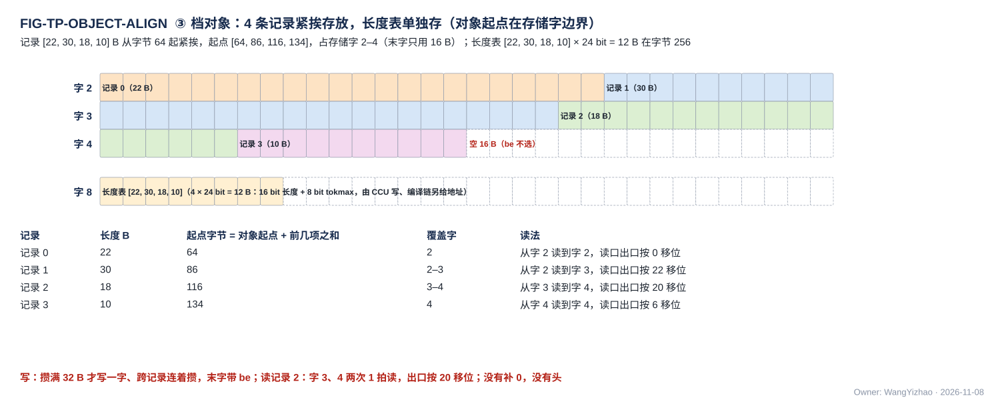
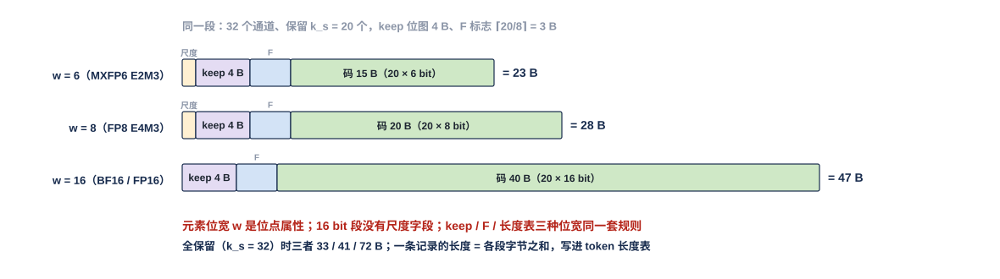
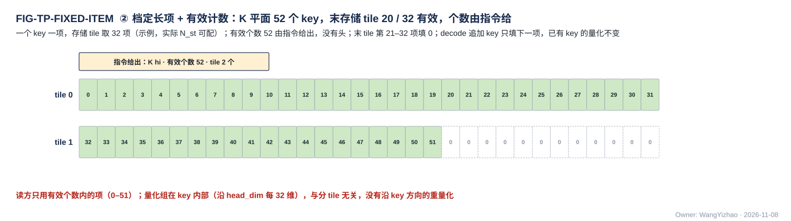
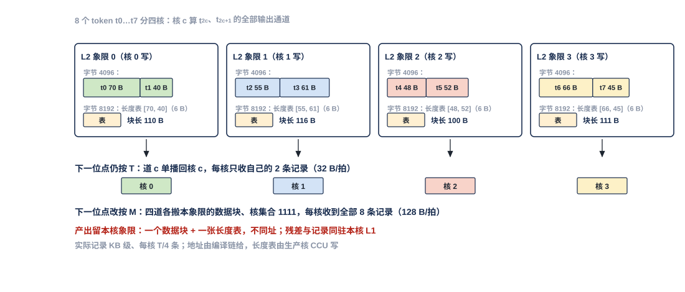
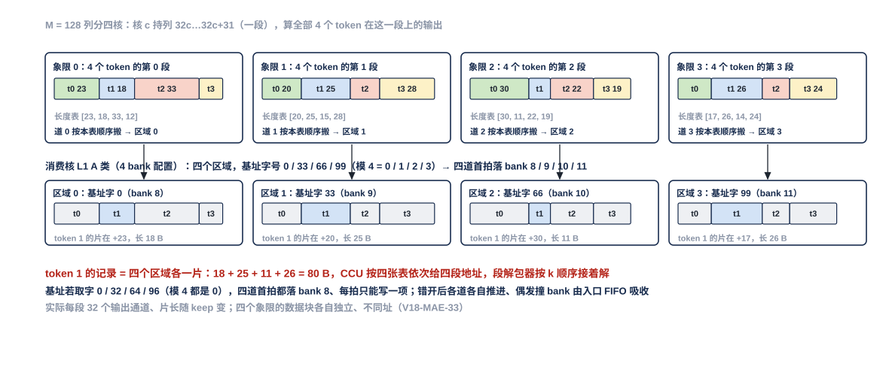
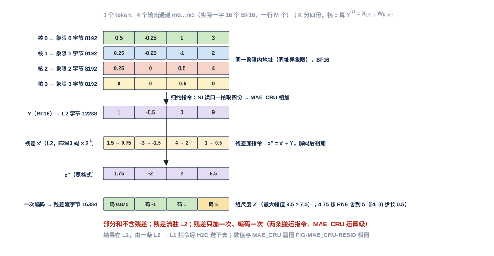
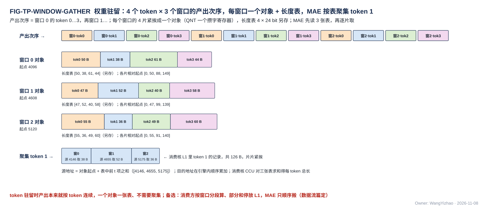
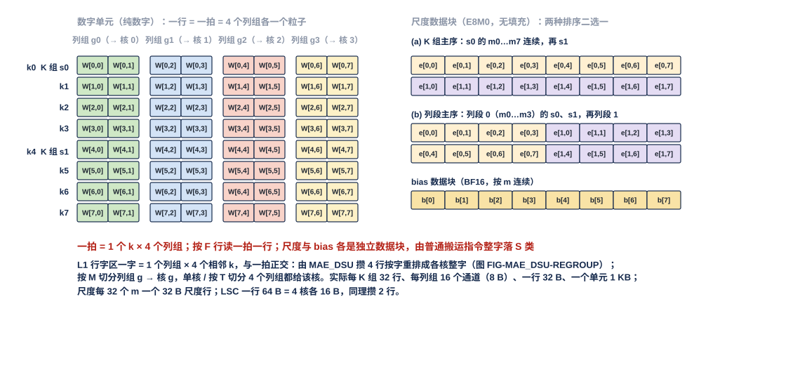
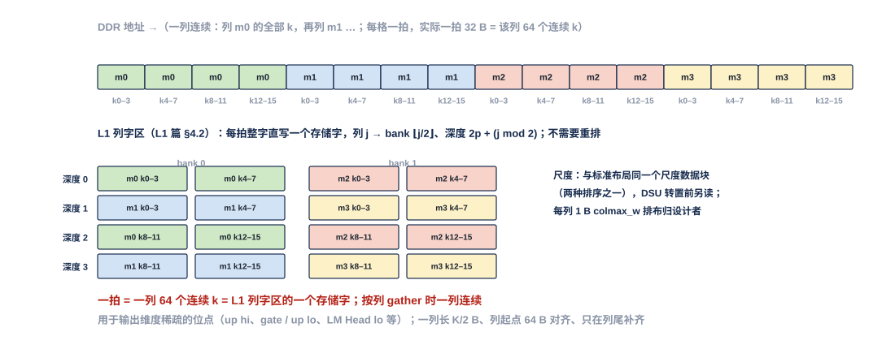
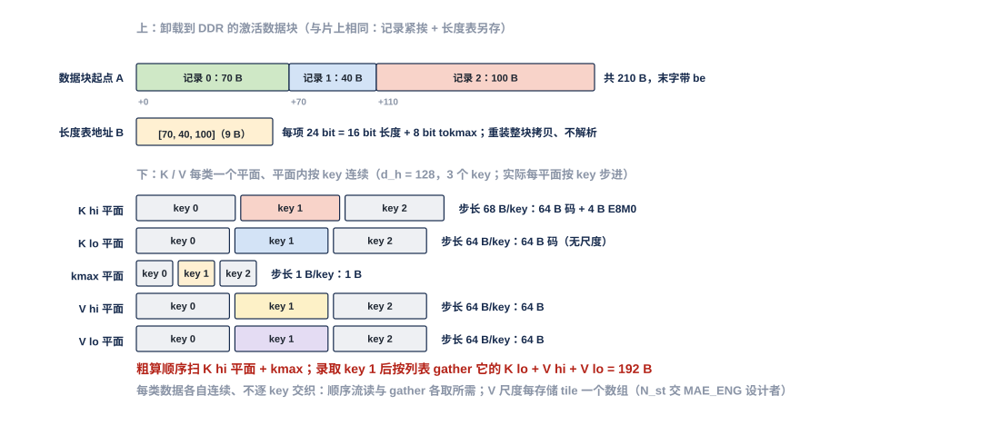

# 片上数据组织（数据组织篇）

> Owner: WangYizhao｜2026-11-08

本篇是四篇协议家族之三（架构篇 `ONCHIP_DATAPATH_ARCH.md`、协议篇 `DATA_TRANSFER_PROTOCOL.md`、本篇、登记篇 `TRANSFER_DATA_REGISTRY.md`），回答**"数据在存储里怎么摆"**：数据块、token 记录、32 通道段、长度表、列表怎样定义与定位；三种打包方式的规则；每一类数据的格式与落点；**每一种并行模式下 token 与通道怎样切分、各份落在哪里、相邻位点怎样衔接**；以及权重、激活在 DDR 侧的排布。本篇只写格式、规则与落点，不写实现方法——地址怎样累加、记录怎样定位是 MAE_ENG 与 CCU 的事，bank 换算与冲突是 L1 / L2 篇的事，链路上怎样握手与完成是协议篇的事，口宽与条数只在架构篇 §7。

## 0 一句话

**存储里的一切都是编译链分配了地址的数据块；数据块由 token 记录组成，token 记录由 32 通道段组成；数据块按三种方式之一打包——定长（长度由指令给）、定长项（项宽固定、有效个数由指令给）、变长（按实际长度紧挨 + 单独存储的 token 长度表）；长度表与列表都是独立的数据块，不嵌在数据里。** 四核并行时数据按位点的切分轴落在本核 L1 或本核象限：要合并的份同址异象限，切分的激活各成数据块；相邻位点切分轴不同时在 L2 里换读法，不回 DDR。

## 1 数据块、token 记录、32 通道段与三种打包方式

### 1.1 三层定义与三种打包方式

| 名词 | 定义 | 例 |
|---|---|---|
| **数据块** | 编译链分配了一个起始地址（段选 + 24 bit 段内字节地址，协议篇 §2.2）的一整块数据，是搬运、发送、完成计数的单位 | 一个 token 组在某位点的全部紧凑激活记录；一块权重的一个 K 组单元；一张位图；一个列表；一张长度表 |
| **token 记录** | 数据块里按 token 独立取用的一条；attention 里按内容叫 **key 记录**（一个 key 的 K 或 V 平面）或**查询行记录**（一个查询行的 Q 粗算记录、$P'$ 记录） | 一个 token 在 q/k/v 位点的输入：$d_{\text{hidden}}/32$ 个 32 通道段连排 |
| **32 通道段** | 一条记录里沿通道维每 32 个相邻通道一段，与 MX 组（g32）对齐；是压紧、量化与解包的单位 | 一段 = 段尺度 + keep 位图 + 保留通道的 F 标志与码（§2.1） |
| **token 长度表** | 一个变长数据块的每条记录一项的列表，记录各条记录的字节数与 tokmax（§2.2） | $T$ 条记录 → $T \times 3$ B |
| **列表** | 外部输入信息五类之一（`L3PU_EXTERNAL_INFORMATION.md`）：位图或序号列表，供 MAE 列表驱动地址生成与 CCU 使用（§2.3） | 读集位图、升序序号列表、参与词号列表 |

**三种打包方式**（用户 11-07 认可三档、11-08 定名）：

| 打包方式 | 长度从哪来 | 用于 | 规则 |
|---|---|---|---|
| **定长** | 指令给出（行字节数 × 行数等几何） | 权重数字块、权重尺度数据块、bias 数据块、配置表 | 不规定内部打包；编译链排布，数据块尾部补一次到存储字 |
| **定长项 + 有效计数** | 项宽固定（按元素类型），**有效个数由指令给** | K / V 平面（一个 key 一项）、稠密格式的残差流（一个 token 一项，§4.1）、行状态、未归约的 BF16 部分和、跨核合并的标量、定长位图 | 位置 = 数据块起点 + 项号 × 项宽；末尾未填的项填 0；**标量紧密排列、可单个写出（一拍、be 只开有效字节）、不补 32 B**（§3） |
| **变长 + 长度表** | 生产方在线给出每条记录的字节数，写成单独存储的 token 长度表 | 前向紧凑激活记录、反传流动梯度、Q 粗算记录、$P'$ 记录、紧凑格式的残差流（§4.1）、变长列表（序号列表、参与词号列表） | 记录按实际长度紧挨（§1.2）；每个数据块配一张长度表（§2.2）；容量按位点窗口静态分配（§2.5） |

哪类数据归哪种方式，按 §4 各小节；MAE 与 L1 / L2 不感知这三种方式，它们只看指令给的地址、长度与 be（V18-MAE-01）。

### 1.2 对齐：数据块起点在存储字边界，记录紧挨，段按字节对齐；跨字由存储处理

- **数据块从编译链分配的、32 的倍数的字节地址开始**；W 类（权重数字）与 S 类（尺度 / 旁带 / bias 行）的数据块只按整字访问（L1 篇 §3.4a）。
- **变长数据块里记录 $t$ 从记录 $t-1$ 结束的下一个字节开始**，记录之间不补 0；记录内部按 32 通道段分段，**段与段之间按字节对齐**（一段末尾补到字节边界，§2.1）。
- 生产方攒满 32 B 才写一个存储字、跨记录连着攒；数据块的最后一个存储字带字节写使能写出；一个存储字可以含两条记录的字节。
- **跨字由存储处理**：读一条记录就是从它的字节起点连续读到终点，覆盖到的存储字逐个发读，读口出口的字节对齐器按起点除以 32 的余数移位（L1 篇 §3.4a、L2 篇 §3.4a）；写口接受从任意字节开始的一拍、跨两个存储字时在存储内部拆成两个 bank 的写。**MAE、hub、CCU 只给逻辑字节地址与 be，不移位、不拆拍**（V18-L1-13 / L2-05）。
- 代价：数据块末字的空余（≤ 31 B）与段按字节对齐的平均 3.5 bit/段。

图中 4 条长度 22、30、18、10 B 的记录从字节 64 起紧挨存放，占字节 64–143（存储字 2–4，末字只用 16 B）；长度表 [22, 30, 18, 10] 每项 24 bit（16 bit 长度 + 8 bit tokmax）、共 12 B，存在编译链另给的地址（图中字节 256，占存储字 8 的前 12 B）；读第 2 条记录 = 从字节 $64 + 22 + 30 = 116$ 起读 18 B，覆盖存储字 3 与 4，读口出口按 $116 \bmod 32 = 20$ 移位。实际记录 KB 级、每数据块 $T$ 条，长度表 $T \times 3$ B。L1 侧的落 bank 见 L1 篇图 FIG-L1_SRAM-MAP-A，L2 侧见 L2 篇图 FIG-L2_SRAM-OBJ-ALIGN。

### 1.3 数据里没有的东西

**数据里只有段头。** 没有数据块头（类型、总长、记录数、首 token 序号、token 数）、没有记录头的 token 序号、没有列表头的项数字段、没有固定槽：**编译链已知的不记，运行期才知道的只有各记录的长度，它们在长度表里**（用户 11-07："对于编译链预先应该知道的数据，确实可以取消"；"我认为长度表，列表，都单独存，单独标定地址，这样更合理"）。记录在数据块内的位置由长度表推出（§2.4），不由任何"起点表"或寄存器累加给出——那是 CCU 与 MAE 的工作，不是存储格式的一部分。本篇不使用"token 槽 / 槽长 / 步长"这些词，只说 **token 长度**（实际）与 **token 长度上限**（§2.5）。

### 1.4 离线静态参数不在本篇定格式与落点

阈值表、封顶 $k$、NLU 的参数表、OPT 的状态格式等**离线静态参数由指令与配置表给出；在线产生的小表（行状态之外的工作区）怎样存由各单元设计者定**（用户 11-08 Q2）。本篇只对两类数据定格式：进 MXU / VNU 数据通路的张量（权重、激活、残差、K / V、梯度、部分和、标量）与交 MAE 列表驱动地址生成的列表。嵌入行是数据，格式 = 残差格式（§4.1）。

## 2 变长数据块的格式

### 2.1 32 通道段：段尺度 + keep 位图 + 每个保留通道的 F 标志与码，元素位宽是位点属性

**一条紧凑记录 = 该 token 的 $M/32$ 个 32 通道段连排，一段 = [MX 格式才有的段尺度 E8M0 8 bit] + keep 位图 32 bit + 每个保留通道（F 标志 1 bit + 码 $w$ bit），末尾补到字节边界**（压缩格式按现行，用户 11-07："我建议咱们先确定当前的这个压缩方法"）。

| 字段 | 位宽 | 含义 |
|---|---|---|
| 段尺度 E8M0 | 8 bit，只在 $w = 6, 8$ 的段有 | 本段保留通道共用的 2 的幂尺度（被判 Z 的通道不进尺度） |
| keep 位图 | 32 bit | 位 $i$ = 1 表示通道 $i$ 保留；全 0 的空段仍有段头。**段头里放的一定是位图、不是序号列表**：一段的候选数固定为 32，位图恒 4 B，解码器按位展开即可，不存在 §2.3 的二选一 |
| F 标志 | 每个保留通道 1 bit，按保留通道序排列，补到字节 | 1 = 下一位点读该通道对应的权重 hi + lo 两个平面，0 = 只读 hi |
| 码 | 每个保留通道 $w$ bit，按通道升序连续打包，补到字节 | $w = 6$：MXFP6 E2M3；$w = 8$：FP8 E4M3；$w = 16$：BF16 或 FP16 整值（哪一种由位点指令给） |

**元素位宽 $w \in \{6, 8, 16\}$ 是位点属性**（V18-TP-63 / QNT-12，用户 11-08："L3PU 需要支持 FP16 和 BF16 的激活值格式，这也是底层需求"）：BF16 / FP16 自带指数、不成组，所以 16 bit 的段没有尺度字段；F 标志与激活格式无关、照旧；keep 压紧、紧挨存放、长度表对三种位宽同一套规则，段解包器按 $w$ 切换。一段的字节数（$k_s$ = 本段保留通道数）：

$$B_{\text{seg}} = \begin{cases} 5 + \lceil k_s/8 \rceil + \lceil w\,k_s/8 \rceil & w = 6, 8 \\ 4 + \lceil k_s/8 \rceil + 2\,k_s & w = 16 \end{cases}$$

图中同一段保留 20 个通道（keep 位图相同、F 标志相同，3 B）：$w = 6$ 时 5 + 3 + 15 = 23 B，$w = 8$ 时 5 + 3 + 20 = 28 B，$w = 16$ 时没有段尺度、码区 40 B，共 4 + 3 + 40 = 47 B；全保留（$k_s = 32$）时三者分别为 33 / 41 / 72 B。一条记录的长度 = 各段 $B_{\text{seg}}$ 之和，写进长度表；脚本按公式断言三个数。

### 2.2 token 长度表：每条记录一项 24 bit，单独存、编译链给地址

| 项 | 规定 |
|---|---|
| 每项 | **24 bit = 16 bit 字节数（一条记录最长 64 KB）+ 8 bit tokmax**（该记录各段 E8M0 的最大指数，LM Head TOPK 列补算的 $E_{\text{base}}$ 用；不用的消费方忽略；MAE 按表取长度时只读低 16 bit）（V18-TP-60，用户 11-08："可以合并在描述当前 Token 实际长度的后面，单独存储，不要和数据拼在一起"） |
| 大小 | $T$ 条记录 → $3T$ B，占 $\lceil 3T/32 \rceil$ 个存储字；全部变长数据块统一这一项宽 |
| 地址 | 编译链分配，写在位点指令、发送指令与搬运指令里；本核消费的表写 L1，跨核消费的表经 C2H 写 L2 本核象限 |
| 谁写 | 生产核 CCU 在数据块写完后一次写出（各条长度由生产单元随数据交 CCU，QNT 篇 §3.7、SEL 篇 §4.3）；MAE_CRU 按列表压缩输出时由执行该指令的 MAE_ENG 引擎写（V18-CRU-08） |
| 谁读 | 消费核 CCU（定位记录，§2.4）；MAE（只在聚集时，§5.7） |
| 变长列表的长度表 | 序号列表、参与词号列表各配一张，每项 16 bit（该列表的字节数）；定长位图不配 |

**数据块、长度表、列表是三种独立的数据块，互不内嵌**（V18-TP-58）。

### 2.3 列表：位图与序号列表是同一条选择结果的两种编码，两种都保留

**位图与序号列表表达的是同一件事——"从 $N$ 个候选里选中了哪些"——只是写法不同，可以互相换算；它们不对应不同的稀疏种类**（用户 11-08 追问后定下的解释）。8 个候选、选中第 1、4、6 个：

| 候选序号 | 0 | 1 | 2 | 3 | 4 | 5 | 6 | 7 |
|---|---|---|---|---|---|---|---|---|
| 是否选中 | 0 | 1 | 0 | 0 | 1 | 0 | 1 | 0 |
| 位图写法 | 0 | 1 | 0 | 0 | 1 | 0 | 1 | 0 |
| 序号列表写法 | [1, 4, 6] | | | | | | | |

位图 = 每个候选占 1 bit、不论选没选，8 bit = 1 B；序号列表 = 只写选中的候选序号，3 项 × 3 B = 9 B。信息相同，差别只有三点：

1. **大小随什么变**：位图 $N/8$ B、只随候选总数 $N$；序号列表 $3k$ B、只随选中数 $k$。LM Head 词表 $N = 151{,}936$ 选 $k = 40$：位图 18,992 B、列表 120 B；一个 64 key 的粗算 tile 录取 30 个：位图 8 B、列表 90 B。分界 $k = N/24$。
2. **怎么产生**：逐元素阈值判决（SEL 对每个候选比一次门限）按候选序逐个得到 0 / 1，顺手就是位图；流式 TOPK 手里只有 $k$ 个胜出者的序号，天然是列表。
3. **怎么使用**：MAE 列表驱动地址生成对位图是"逐位扫，位 $i$ 为 1 就发地址 基址 $+ i \times$ 项字节"，对列表是"逐项读，项值 $j$ 就发地址 基址 $+ j \times$ 项字节"，两种都支持、不转换；**跨核合并只能用位图**——四核各选一批 key 要合成并集，位图逐位 OR 一拍完成，列表合并要排序去重，所以读集合并的位点一律出位图。

**与稀疏维度无关**：输入维稀疏（这个 token 哪些通道是 F / C / Z，沿归约维 $k$）与输出维稀疏（算哪些输出通道 / key / 词，沿 $m$）都可以用任一种编码表达——F 行并集、录取读集、TOPK 词号都是独立列表对象，选位图还是序号只看 $k$ 相对 $N$ 的大小和要不要跨核按位取并。**只有输入维稀疏能把激活本身压掉**（被判 Z 的通道不出码、记录变短，§2.1）；输出维稀疏不压缩输入激活，而是让 MAE 只 gather 被选中的权重列、阵列只算这些列，算出的结果成为下一位点的输入——上一位点的输出稀疏就这样变成下一位点紧凑记录段头里的 keep。

**与段头 keep 的关系**：段头的 keep 是一张固定 $N = 32$ 的位图（一段 32 个通道、32 bit），因为候选数小且固定，不做二选一，**段头里永远是位图、不会是序号列表**；它嵌在记录里，记录靠它自己就能解码（段解包器、MAE_CRU / NLU 出口级的解码都只读段头），不需要任何独立列表。本节二选一的是独立成块、候选数从几十到十几万不等的那些列表：

| 格式 | 每项 | 大小 | 排列 | 谁产 |
|---|---|---|---|---|
| **位图** | 候选每个 1 bit | 定长 $N/8$ B（$N$ = 候选数），一个存储字 256 位 | 按候选序排，位 $i$ 对应候选 $i$ | SEL 的逐元素阈值判决（录取、keep、gate 筛选）、读集合并的并集 |
| **序号列表** | 选中项的候选序号 3 B（任意词表都放得下，V18-MAE-06） | 变长 $3k$ B（$k$ = 选中数），配单项长度表 | 按序号升序 | SEL 的流式 TOPK / 阈值后封顶（名次项转序号）、LOSS 的参与词号列表 |

**为什么两种都保留**（用户 11-08 Q3）：就是上面三点差别——大小各有便宜的一边（$k$ 接近 $N$ 时列表是位图的 24 倍，**本篇只给分界 $k = N/24$ 作参考，按位点二选一由编译链定**），产出方式不同，读集合并只能对位图做（MAE_CRU 篇 §3.3，读集并集是位图的一种）。两种格式**不转换**：MAE 列表驱动地址生成两种都收（位图按位扫描、序号列表按项步进），SEL 按指令出哪一种（V18-SEL-15）。

### 2.4 定位规则：顺序读按长度表逐条步进，组内随机读先读表

**第 $t$ 条记录的字节起点 = 数据块起点 + 长度表前 $t$ 项之和。** 顺序消费（pod 流式读一个 token 组、反传按训练块读）：游标 += 当前记录的长度。组内随机读（CCU_GRP 把一组 32 个 token 按段数排序后发给 4 个 pod）：CCU 先读该组的 32 项长度（3 个存储字），再按各 pod 的起点发读，**定位方式归 CCU 篇**。MAE 只在聚集时读表（§5.7），整数据块顺序搬运不需要逐条长度。**L1 / L2 不解析记录，不按 token 序号定位。**

### 2.5 窗口 = token 长度上限 × token 数，只用于容量与致命错误

每个变长数据块有算法侧按位点给的**窗口**：容量 = token 长度上限 × $T$，编译链按它静态分配 L1 源空间与 L2 目的空间，基址全在指令里，CCU 不做运行期分配；**数据块超出窗口 = 致命错误**（V18-TP-40）。上限 = （封顶 $k$ + 本选择域强制入选的元素数）× ($w$ + 1) bit + 段头，补到字节；**存储或传输压紧激活的位点一律封顶**（流式 TOPK 或阈值后封顶，VNU_SEL 篇，V18-SEL-13），封顶值由算法侧按精度与容量按位点给。上限只用于容量，不用于读：读方按长度表的实际长度读（用户 11-07："可以作为保留设计"）。

## 3 定长项与标量

**定长项数据块每项定长，位置 = 数据块起点 + 项号 × 项宽，没有头；有效个数由位点指令或搬运指令给出**（真实长度在调用描述符里，编译链折进指令），末尾未填的项填 0。项宽按元素类型：BF16 2 B、E8M0 1 B、FP32 4 B，复合项按 §4 各节。

| 定长项 | 项宽 | 一个存储字 | 说明 |
|---|---|---|---|
| 跨核合并的标量（$\sum x^2$、$\sum\lvert x\gamma\rvert$、F5 amax、$\sum g^2$） | FP32 4 B | 8 个 | **紧密排列、可单个发送（一拍、be 只开有效字节）、不补 32 B**（用户 11-07："首先允许标量以紧密排列的形式去发送，但是也可以支持发送单个标量，并且我认为这里无需上对齐上 32B"） |
| $(m_{\text{run}}, l)$ 对 | 2 × FP32 8 B | 4 对 | 两个相邻，作为一项合并 |
| 未归约的 BF16 部分和 | BF16 2 B | 16 个 | 跨核归约的输入（§4.6）、核内停放项 |
| attention 行状态 | $O$ BF16 $2 d_h$ B + $m_{\text{run}}$ / $l$ 各 4 B = $2 d_h + 8$ B | — | $d_h = 128$ 时 264 B（参考）；只在本核 L1，由 NLU 读写 |
| K / V 平面 | 一个 key 一项（§4.3） | — | 有效 key 数由指令给 |

图中一个 K 平面数据块一个 key 一项、按存储 tile 分（示例 32 项一 tile），最后一个 tile 只到第 20 个 key，第 21–32 项填 0，有效个数 52 由指令给出；decode 追加 key 只填下一项，已有 key 的量化（沿 head_dim 每 32 维一组，在 key 内部）不变。

## 4 各类数据的格式与落点

每小节只写格式、段选与打包方式；路径、发令方与完成方式在登记篇。

### 4.1 残差流与嵌入行：两种存储格式（稠密残差格式 / 紧凑记录），硬件都支持，按位点配置

**残差流 $x$（一个 token 一行 $d_{\text{hidden}}$ 个元素）在存储里有两种格式，硬件两种都实现，用哪种由位点配置给出**（V18-DORG-02，用户 11-08："我认为残差流在存储的时候，也应该是压缩存储……只需要在硬件直接标注出来两种支持格式即可"）：

| 格式 | 记录 | 打包 | 怎么产生 |
|---|---|---|---|
| **稠密残差格式** | 纯 MXFP6 E2M3 g32，按 64 通道 tile 排列，每 tile 48 B 码 + 2 B E8M0 = 50 B，tile 之间连续；一个 token 一项，项宽 $d_{\text{hidden}}/64 \times 50$ B（Qwen $d_{\text{hidden}} = 2{,}560$：40 个 tile、2,000 B）；tile 内全部值参与组尺度，没有 BF16 极端值子记录（用户 10-23） | 定长项（用户 11-08 Q1） | 残差加之后一次编码（核内：NLU 出口级 → QNT；K 切分：MAE_CRU） |
| **紧凑记录** | 与 §2.1 的激活记录同一种 32 通道段格式：段头 keep 位图 + 每个保留通道（F 标志 + 码），被判 Z 的通道不出码；记录紧挨 | 变长 + 长度表 | **只能在 SEL 判决之后产生**：核侧 QNT 拿到本 token 的 keep 后，把 $x''$ 按它压缩写出（与写下一位点的紧凑输入记录是同一动作）；K 切分位点写回 L2 残差流（比稠密多一次残差写），核内位点写 L1 |

**残差加的两侧都按稠密做**：

| 位点的核间切分轴 | 残差流驻在哪 | 残差加在哪 | 残差输入 | 相加结果 |
|---|---|---|---|---|
| T / M 切分（及单核） | 本核 L1 A 类 | NLU 的出口级子模块（VNU_NLU 篇 §3.6） | 两种格式都能还原（紧凑记录按段头展开、缺位补 0） | $x'$（BF16）交 QNT；按位点配置编码成稠密残差格式，或等 SEL 判完后编码成紧凑记录 |
| K 切分 | **L2**（V18-CRU-08） | MAE_CRU 的残差加指令（MAE_CRU 篇 §3.1a，图 FIG-MAE_CRU-RESID） | 两种格式都能解码（指令的输入编码字段给出） | **稠密**（BF16 / FP16 / MXFP6 稠密残差格式）写 L2——$x''$ 的 keep 要等核里 SEL 判完 $\mathrm{RMSNorm}(x'')$ 才有，CRU 加完当拍没有掩码；要紧凑格式时由核侧 QNT 在 SEL 之后写回 |

紧凑格式的残差用哪张掩码（下一位点输入记录的 keep，或残差自有阈值）归算法侧；残差流按 keep 压缩相当于残差流稀疏化（被判 Z 的通道从 $x$ 里丢掉、也改变后续层 RMSNorm 的整行统计量），**位点配置里启用紧凑残差以算法侧 A 级验证为前提**【待确认，算法侧】。

**嵌入行是数据，格式 = 稠密残差格式**：词表 $E$ 的一行（$d_{\text{hidden}}$ 维，残差格式 tile 连排）+ 行尾两个 FP32 标量（$\sum x^2$、$\sum\lvert x\gamma\rvert$，8 B），定长项；MAE 按 token id 列表 gather，落消费核 L1 A 类，第 0 层直接作残差。

### 4.2 前向紧凑激活记录、反传流动梯度、Q 粗算记录、$P'$ 记录：变长

| 数据 | 记录 | 元素位宽 | 段选 |
|---|---|---|---|
| 前向紧凑激活记录（线性位点的输入） | 一个 token 一条，$M/32$ 段连排（§2.1） | 位点属性 $w \in \{6, 8, 16\}$，默认 6 | 本核消费：L1 A 类；跨核：L2 本核象限，再经 H2C 落消费核 L1 A 类 |
| 反传流动梯度（dX / dY / dH / dP / dS / dz） | 同上 | 默认 MXFP6 单平面；MXFP6 承载不了时 FP8 / BF16 / FP16（用同一段格式的 $w$） | 同上 |
| Q 粗算记录 | 一个查询行一条：选中维的码 + 段 E8M0，随选中维数变长 | 6 | 本核 L1 A 类 |
| $P'$ 记录 | 一个查询行每个录取 tile 一条：两平面各 24 B 码 + 各 1 B 尺度 / 32 个录取 key，随录取 key 数变长 | 6 × 2 平面 | 本核 L1 A 类 |

四者都是变长数据块：记录紧挨、每数据块一张长度表、按位点窗口分配。**产出按驻留方式成块**：token 驻留（先算完一个 token 的全部输出通道）时一个数据块 = 这组 token 的整条记录；权重驻留时每个窗口的 $T$ 片各成一个数据块（§5.7）。

### 4.3 K / V 平面：一个 key 一项，定长项；全码记录 128 B

| 数据 | 一项（$d_h = 128$） | 说明 |
|---|---|---|
| K hi 平面 | 64 B 码（$d_h$ × 4 bit）+ 4 B E8M0（每 32 维一个）= 68 B；另每 key 1 B kmax | **粗算部分 = hi 平面 + E8M0 + kmax**（用户 11-04） |
| K lo 平面 | 64 B | **补读部分 = lo 平面**；lo 不带尺度，复用同 key hi 的尺度 |
| V 平面 | 8 bit：hi、lo 两平面各 64 B + 1 B 尺度；4 bit：单平面 64 B + 1 B 尺度 | 尺度写入每存储 tile 的尺度数组 |
| **全码记录**（精算用，L1 W 类全码区） | **hi 4 字接 lo 4 字 = 128 B，32 B 对齐；每个字仍是 32 × 4 bit 码的一个平面；E8M0 落 S 类**（V18-MAE-04） | 由 MAE_DSU 两平面合并产出，或重读 gather 时 hi + lo 同次落进 |

**K 只有一条处理路径，指令选"直接处理"或"先 RoPE 再处理"，两种的存储格式相同**（V18-KV-01）；精算 K hi 的来源有驻留与重读两种模式，按位点配置（V18-ATT-01，L1 篇 §7.8a）。L1 里的 K 形态：粗算用的行字区（IAS 模式段）、精算用的列字区 / 全码区（OAS 模式列字，$m$ 取 key 槽号），都是 L1 篇 §4.2 的两种 W 类字形态。**本篇不写**：DDR 存储 tile 的 key 数 $N_{\text{st}}$（交 MAE_ENG 设计者，参考算法侧对 KV 的读取需求）、驻留 / 重读按位点的配置与默认值（归 MAE / 数据流篇）（用户 11-08 Q7）。

### 4.4 权重：数字块、尺度数据块、bias 数据块三个独立数据块

**权重在 DDR 与片上都只有"数字 + 尺度"两种内容，自 V18-DORG-01 起数字、尺度、bias 是三个独立的数据块**（用户 11-08："我希望 E8M0 可以单独紧密存放，偏置可以是一个存放逻辑"；"E8M0 和 Bias 本来就是存在 L1 SRAM 的 S 专项里的，MAE 仍然可以做到无数据感知的读取"）：

| 数据块 | 内容 | DDR 排布 | 片上落点 | 打包 |
|---|---|---|---|---|
| 数字块 | $W$（$K \times M$）的 hi / lo 平面，MXINT8 码 $c = 16h + \ell$ 拆成 hi 平面（4 bit $h$）与 lo 平面（4 bit $\ell \oplus 8$）；MXINT4 只有 hi | 标准布局（§6.1）或列深度优先布局（§6.2），按位点由编译链选 | L1 W 类：行字区（IAS 模式）/ 列字区（OAS 模式，一字 = 一列 64 个连续 $k$，V18-L1-09）；训练核：$W^{\mathsf T}$ 列字块（经 MAE_DSU 转置）；或 L2 任一象限 | 定长 |
| 尺度数据块 | 每（层, 位点）$\lceil K/32 \rceil \times M$ 个 E8M0（1 B，只 hi 平面有；lo 与 LSC 复用） | 无填充；**两种排序二选一**（§6.1） | L1 S 类尺度行（一个存储字 = 一个 K 组下 32 个输出通道的 32 个 E8M0），或 L2 | 定长 |
| bias 数据块 | $M$ 个 BF16（不量化，用户 11-04） | 无填充、按 $m$ 连续（两种排序退化为同一种） | L1 S 类 bias 行（每 32 列块两个存储字） | 定长 |
| 训练块旁带 | 每个 $W^{\mathsf T}$ 列字块一个 32 B 旁带行（$e_{\max}$ + 32 个 $\Delta_m$，MAE_DSU 篇 §5） | 不存 DDR，由 MAE_DSU 算出 | L1 S 类 | 定长 |

三个数据块各由一条普通搬运指令搬运（口对 + 地址生成器 + 几何），MAE 不感知类型；MAE_DSU 转置时的块尺度来自这条另发的尺度读，两种输入布局相同（MAE_DSU 篇 §4.2）。

### 4.5 离线静态参数

见 §1.4：不在本篇定格式与落点。

### 4.6 跨核合并的定长份：同址异象限

| 份 | 项 | 一个存储字 | 合并 |
|---|---|---|---|
| K 切分的部分和 $Y^{(c)} = X_{:,\mathcal K_c} W_{\mathcal K_c,:}$ | BF16 | 16 个 | MAE_CRU 归约指令逐元素相加，输出编码由指令给（BF16 / FP16 / MXFP6 稠密或按列表压缩） |
| 标量 | FP32 | 8 个 | 按类合并 |
| 读集位图 | 1 bit / 候选 | 256 位 | 按位取并 |

**各参与核把自己的份写进 L2 本核象限的同一象限内地址（同址异象限）**，MAE 一拍从 NI 读口取四份交 MAE_CRU（L2 篇 §3.7，MAE_CRU 篇 §2）。

### 4.7 调用输入与结果记录

调用输入（token id、图像块等）与结果记录（输出 token、可选 log-prob 等）是与 M55 共用的格式，**唯一定义处在 CIF 篇**；它们在 L2 外设输入区 / 属主核结果区按任意字节起点与长度紧密存放（PIN 直写与 M1 读回都接受任意字节，MAE_NI_EXT 篇）。

## 5 并行模式下的切分与落点

每种模式一个小节（用户 11-07："需要写清 Token 的拆分逻辑，在某个并行模式下，该怎么切分"），每节按同一顺序写：谁切什么轴 → 各核 / 各 pod 拿到哪一块 → 产出写哪里（段选、同址 / 各成数据块）→ 残差 / 尺度 / bias / 长度表跟着谁 → 下一位点怎么读。核间切分轴是位点配置，由编译链按模型表给出（数据流篇定各调用的默认）。

### 5.1 核内 pod 之间：固定按 T

**一个核的 4 个 pod 各算不同的 token（或查询行、补算记录），不出现几个 pod 读同一条激活记录；激活类读口不向多个 pod 广播**（V18-D-02）。各 pod 读的记录来自同一个数据块（编译链安排一组 token 连续分配，4 个 pod 的首字落不同 bank 余数），产出按产出次序交 QNT、由本核 CCU 紧挨写进同一个数据块（散写只是"几段连续写"，L1 不按 token 序号查找，L1 篇 §7.2）。残差、尺度、bias、长度表都是核级的，与 pod 无关。

### 5.2 核间按 T 切分：各核算不同 token，产出留本核

| 项 | 规定 |
|---|---|
| 切什么 | 一个 token 组按 token 分给四核，核 $c$ 算 token 组 $T_c$ 的全部输出通道（编译链让同一核的 token 连续） |
| 各核拿到 | 自己那组 token 的整条输入记录（一个数据块）+ 全部权重（权重多播，核集合 1111） |
| 产出写哪 | 本核 L1 A 类（本核消费），或 L2 本核象限 $c$（跨核消费）：**象限 $c$ 放核 $c$ 那组 token 的整条记录，一个数据块 + 一张长度表** |
| 跟着谁 | 残差与记录同驻本核 L1；尺度 / bias 随权重多播到各核 S 类；长度表每核一张；读集合并的位图写本核象限同址（§4.6） |
| 下一位点怎么读 | T → T：H2C 道 $c$ 单播回核 $c$（每核 32 B/拍）；T → M：四道各搬本象限的数据块、核集合 1111 多播，消费核 L1 里四个区域各放一组 token（128 B/拍） |

图中 8 个 token（$t_0 \ldots t_7$）分给四核，核 $c$ 算 $t_{2c}$、$t_{2c+1}$；各核的两条输出记录（长度举例 70 / 40、55 / 61、48 / 52、66 / 45 B）紧挨写进象限 $c$ 从同一象限内字节 4096 起的数据块，长度表（各 6 B）写在象限 $c$ 的字节 8192。下一位点仍按 T 时核 $c$ 只读象限 $c$（道 $c$ 单播）；改按 M 时四道都读、每核收到全部 8 条记录。脚本断言每个象限的数据块长度 = 两条记录之和、四张表之和 = 8 条记录。

### 5.3 核间按 M 切分：各核算不同输出通道，四象限各一个数据块

| 项 | 规定 |
|---|---|
| 切什么 | 输出通道 $M$ 分四份，核 $c$ 算全部 token 在它那 $M/4$ 列上的输出 |
| 各核拿到 | 全部 token 的整条输入记录（多播）+ 自己那 $M/4$ 列的权重（按字重排后字 $g$ → 核 $g$，MAE_DSU 篇 §4.1） |
| 产出写哪 | **核 $c$ 在象限 $c$ 里把所有 token 在它那 $M/4$ 列上的段紧挨成一个完整数据块 + 一张长度表；四个象限的数据块各自独立、地址各自分配，不同址**（V18-MAE-33） |
| 跟着谁 | 尺度 / bias 按列块跟权重走（核 $c$ 只收自己列块的尺度行与 bias 行）；残差（M 切分位点）驻本核 L1、各核只加自己列块的残差；长度表每象限一张 |
| 下一位点怎么读 | M → M / M → K：一条四道并行指令、核集合 1111 多播，**消费核 L1 里一条记录 = 四段、各在一个区域**，pod 读 token $t$ 时 CCU 依次给出四段的地址，段解包器按 $k$ 顺序接着解；M → T：每个目的核 $c$ 一条四道指令，道 $q$ 按表只取 $T_c$ 那些 token 的片、单播核 $c$（MAE_ENG 篇 §5.9） |

**消费核四个区域的基址字号模 bank 数互不相同**（4 bank 配置模 4，8 bank 配置模 8；由编译链保证，V18-MAE-33）：四条道同拍各往自己的区域写一个字，基址同余时每拍撞同一个 bank、落地降到 32 B/拍；错开后各道各自推进，偶发的撞 bank 由集合器入口 FIFO 吸收。

图中 $M = 128$ 列分四核（核 $c$ 持列 $32c \ldots 32c + 31$，即每核一段），4 个 token；核 $c$ 把 4 个 token 的第 $c$ 段紧挨成象限 $c$ 的数据块（片长举例：象限 0 为 23 / 18 / 33 / 12 B，象限 1 为 20 / 25 / 15 / 28 B，象限 2 为 30 / 11 / 22 / 19 B，象限 3 为 17 / 26 / 14 / 24 B），各配长度表。下一位点四道并行读回：道 $q$ 按象限 $q$ 的表顺序搬，写进消费核 L1 A 类第 $q$ 个区域，四个区域基址取字 0、33、66、99（模 4 = 0、1、2、3）；token 1 的记录 = 四个区域里各一片（18 + 25 + 11 + 26 = 80 B），由 CCU 按四张表给出四段地址。脚本断言四区域基址模 4 互不相同、token 1 四片之和。MAE 侧的同一例子见 MAE_ENG 篇图 FIG-MAE_ENG-QSPLICE。

### 5.4 核间按 K 切分：各核算部分和，同址异象限，MAE_CRU 归约

| 项 | 规定 |
|---|---|
| 切什么 | 归约维 $K$ 分四份，核 $c$ 算 $Y^{(c)} = X_{:,\mathcal K_c} W_{\mathcal K_c,:}$（全部 token、全部输出通道的部分和） |
| 各核拿到 | 输入记录里自己那 $K/4$ 个通道的段（M 切分的上一位点产出正好是四象限各一个数据块：道 $c$ 单播核 $c$）+ 自己那 $K/4$ 行的权重 |
| 产出写哪 | **BF16 部分和（定长项，16 个一字）经 C2H 写 L2 本核象限 $c$ 的同一象限内地址（同址异象限）**；核内不加残差 |
| 合并 | MAE 收齐四核的发出报告后，**归约指令**：NI 读口一拍取四份 → MAE_CRU 逐元素相加 → 按指令编码（BF16）写 L2；残差位点再一条**残差加指令**：归约结果 + L2 里的残差流 → 一次 MXFP6 编码写回 L2 残差流（或按列表压缩成紧凑记录，长度表由引擎写）（V18-CRU-08） |
| 跟着谁 | 尺度随各核自己那 $K/4$ 行的权重；**残差流驻 L2**；判决（gate 先筛、keep）在归约结果回核后由 SEL 做、位图写 L2 本核象限同址 → 读集合并 |
| 下一位点怎么读 | 归约 / 残差加的结果在 L2 任一象限，由一条 L2 → L1 指令经 H2C 送下去（单播或多播），K 切分的判决与小消息同样当数据走 C2H → L2 → H2C |

图中 1 个 token、4 个输出通道（实际 16 个一字、一行 $M$ 个）：核 0–3 的部分和（BF16）各写象限 0–3 的同一象限内字节 8192；归约指令一拍读四份相加得 1.0 / −0.5 / 0 / 9.0，BF16 写 L2 字节 12288；残差加指令读它与同 token 同 4 个通道的残差（E2M3 码 1.5 / −3 / 4 / 1，组尺度 $2^{-1}$），相加得 1.75 / −2 / 2 / 9.5，按组一次编码（尺度 $2^{1}$，码 0.875 / −1 / 1 / 5）写回残差流字节 16384。脚本断言四份之和与编码后的码。数值与 MAE_CRU 篇图 FIG-MAE_CRU-RESID 相同。

### 5.5 attention 的按头 / 按 key 切分

| 切分 | 各核拿到 | 产出与合并 |
|---|---|---|
| 按 kv 头分核（默认，Qwen 8 个 kv 头、每核 2 个） | 自己 kv 头的 K / V 平面（行字区 / 列字区 / 全码区各核自持）、全部查询行的 Q | 各核的 $O$ 行状态只含自己 kv 头，不跨核合并；反传 dK / dV 不跨核 |
| 按 key 分核（kv 头少于核数时，如 MiniCPM 2 个 kv 头） | 同一 kv 头的不同 key 段、全部查询行的 Q | $(m_{\text{run}}, l)$ 对与 $O$ 部分值作标量 / 定长份写 L2 同址异象限、MAE_CRU 合并；录取读集按位取并（§4.6） |
| 按 query chunk 的反传 | 不同 chunk 的查询行、全部 key | dK / dV 跨 chunk 累加：BF16 部分和经 MAE_CRU 归约，累加区在 DDR（BF16，按 [层][kv 头][key] 可寻址） |

### 5.6 相邻位点切分轴不同的衔接：在 L2 里换读法，不回 DDR

| 上一位点 → 下一位点 | 象限 $q$ 里放什么 | 下一位点怎么读（H2C） | 每核收到 |
|---|---|---|---|
| T → T | 核 $q$ 自己的 token | 道 $q$ 单播回核 $q$ | 32 B/拍 |
| T → M | 核 $q$ 那组 token 的整条记录 | 四道各搬本象限的数据块、核集合 1111 | 128 B/拍 |
| M → M | 所有 token 的第 $q$ 段 | 四道并行、核集合 1111；消费核里一条记录 = 四段四区域 | 128 B/拍 |
| M → T | 同上 | 每个目的核一条四道指令，道 $q$ 按表只取该核的 token、单播 | 四核同时读时每核 32 B/拍 |
| M → K | 所有 token 的第 $q$ 段 = 下一位点归约维的第 $q$ 段 | 道 $q$ 单播核 $q$（核 $q$ 正要这 $K/4$ 个通道） | 32 B/拍 |
| K → T / M / K | 归约（+ 残差加）结果在 L2 一个象限 | 一条 L2 → L1 指令：单播、多播或按 token 分片 | 按读法 |
| T → K | 核 $q$ 那组 token 的整条记录 | 每个目的核一条指令，只取记录里该核那 $K/4$ 个通道的段（按长度表与段序定位，归 MAE_ENG / CCU） | 32 B/拍 |

**这些衔接都在 L2 内完成，不回写 DDR**；MAE 不感知数据类型，衔接只是搬运指令的地址几何与长度表（MAE_ENG 篇 §5.9）。

### 5.7 权重驻留位点的产出：每个窗口一个数据块，MAE 按长度表聚集

**打包单位是 32 通道段**：阵列每 pass 出 16 列，两 pass 凑一组，QNT 即量化并按 SEL 判决压紧，产出"该 token 该段"。两种驻留的产出次序不同：

| 驻留 | 段的产出次序 | 数据块怎么成 |
|---|---|---|
| token 驻留（先算完一个 token 的全部输出通道） | token 0 的段 0、1、…；再 token 1 | 段连着攒、记录紧挨；一个数据块 = 这组 token 的整条记录，配一张长度表 |
| 权重驻留（权重窗口 $W_{\text{win}}$ 列驻 L1，token 逐个流过，过完换下一个窗口） | 窗口 0 的 token 0…$T-1$；窗口 1 的 token 0…$T-1$；… | **每个窗口的 $T$ 片紧挨成一个数据块、各配一张长度表**（片 = 该 token 在这 $W_{\text{win}}$ 列上的 $W_{\text{win}}/32$ 个段）；QNT 只用一个攒字寄存器（V18-QNT-11） |

下一位点的 pod 要按 token、沿 $k$ 读整条，两种衔接都支持、选哪种归数据流篇：**MAE 按长度表聚集**（V18-MAE-33：L2 → L1 指令先读各窗口数据块的长度表，再按表从每个窗口取 token $t$ 的那一片、按窗口次序接续写进消费核 L1；消费核里一个 token 的总长 = 各窗口表项之和，由消费核 CCU 求和或由生产核 CCU 另写一张按 token 汇总的表【设计者定】）；或**消费方按窗口分段算、部分和停放 L1**（MAE 只顺序搬）。用整行统计量判决的位点（相对阈值、QDS 行均值）在权重驻留下须先存 BF16、再压紧，哪些位点如此由 CCU 篇按 SEL 的选择模式逐位点列出。

图中窗口 0 的四片 50 / 38 / 61 / 44 B、窗口 1 的 47 / 52 / 40 / 58 B、窗口 2 的 55 / 36 / 49 / 60 B（举例），各自紧挨成一个数据块，长度表分别为 [50, 38, 61, 44]、[47, 52, 40, 58]、[55, 36, 49, 60]；MAE 聚集 token 1：从窗口 0 数据块 + 50 取 38 B、窗口 1 数据块 + 47 取 52 B、窗口 2 数据块 + 55 取 36 B，接续写进消费核 L1，token 1 的总长 126 B。实际 $W_{\text{win}}$ 由位点配置，片约 50–130 B，窗口数 $M_{\text{core}} / W_{\text{win}}$。

### 5.8 DDR 卸载与重装

| 方向 | 通路 | 规则 |
|---|---|---|
| 卸载 L2 → DDR | NI 读口（4 × 32 B，每象限一份）→ NI_EXT → DDR | 数据块连同它的长度表整体拷贝，DDR 布局由编译链定；同址异象限的合并份按同一段内地址依次或同拍换象限选读出（只是地址几何，V18-MAE-28） |
| 重装 DDR → L1 | 经 IDN 出口 → HUB_IDN 直进核，不经 L2 | 与象限无关 |
| 重装 DDR → L2 | NI 写口（可写任一象限，单位不跨象限，可按段掩码广播） | 可重新选象限，按下一位点的读法摆放 |

重装时的段选与地址由搬运指令给。**"单核产出、多次重读"暂不考虑**（用户 11-06）：单核调用的 token 数小、激活驻在本核 L1，重读走 L1。

## 6 DDR 侧排布

只写两种权重布局与激活值布局；其余小参数（阈值表、位置数组、区块摘要等）的 DDR 排布由设计者定（用户 11-08 Q5）。DDR 字节都按前向消费的方向存；反传要的 $W^{\mathsf T}$ 不在 DDR 另存，由 MAE_DSU 转置得到。

### 6.1 权重标准布局：一拍一个 $k$ 行 × 4 个列组，尺度与 bias 另成数据块

**标准布局用于输入维度稀疏的位点**（q / k / v、o、down 的 hi 与 lo，fc、kernel_projection，LM Head hi）：按 F 行（被选中的输入通道 $k$）读时一行就是一拍，是输入维度稀疏减少片外访存的前提（用户 11-08："我无法接收统一列字布局，因为这会使得输入维度稀疏完全无法减少 EMA"）。

| 项 | 规定 |
|---|---|
| 单元 | **1 KB = 一个平面同一 K 组的 32 个 $k$ 行 × 32 B，纯数字**；hi / lo 单元等长（V18-DORG-01） |
| 一行（一拍） | **32 B = 4 个列组各 8 B，列组 $g$ = 输出通道 $m_{16g} \ldots m_{16g+15}$ 在该 $k$ 下的 16 个 4 bit 码**；一个单元覆盖 64 个输出通道 |
| 单元排列 | 同一 32 列段的各 K 组单元连续；32 列段升序 |
| 尺度数据块 | $\lceil K/32 \rceil \times M$ 个 E8M0 无填充，**排序二选一**：(a) **K 组主序**——一个 K 组的 $M$ 个尺度连续（每 32 个 $m$ 恰为 L1 的一个尺度行；按 F 行选读时一个被选 K 组 = 列表一项、$M$ 字节）；(b) **32 列段主序**——一个列段的所有 K 组连续（权重驻留按列段取时一次连续读）。按位点与模式由编译链选 |
| bias 数据块 | $M$ 个 BF16 按 $m$ 连续 |
| LSC（lo 的稀疏读副本） | 一行 64 B = 4 核各 16 B（32 个输出通道 × 4 bit），不带尺度，只按 F 行读；lo 复用同（列块, K 组）hi 的尺度行 |

**与 L1 的关系**：L1 行字区的一个存储字 = 一个列组的 4 个相邻 $k$ × 16 个 $m$（L1 篇 §4.2），与 DDR 一拍（1 个 $k$ × 4 个列组）正交。核间按 M 切分时列组 $g$ 归核 $g$；单核或按 T 切分时 4 个列组都归同一核。两种情形都由 **MAE_DSU 按字重排**（攒 4 行、2 × 128 B ping-pong）把一拍里分属几个核或几个存储字的 8 B 粒子重排成各核的整字后整字发出（MAE_DSU 篇 §4.1，图 FIG-MAE_DSU-REGROUP，V18-MAE-35）；LSC 同理攒 2 行、粒子 16 B。链路上只有"整字直接发"一种方式。

图按 8 个 $k$ 行 × 4 个列组、每列组 2 个输出通道缩画（实际 32 行、每列组 16 个通道、一行 32 B）：左为数字单元，一行一拍，列组 $g$ 的粒子按 M 切分归核 $g$；右上为尺度数据块的两种排序（K 组主序：$s_0$ 的 $m_0 \ldots m_7$ 连续；列段主序：列段 0 的 $s_0, s_1, \ldots$ 连续），右下为 bias 数据块（$m_0 \ldots m_7$ 各 BF16）。脚本断言两种排序含同一集合的 $(s, m)$、数字单元不含尺度字节。

### 6.2 权重列深度优先布局：一拍一列 64 个连续 $k$，尺度另成数据块

**列深度优先布局用于输出维度稀疏的位点**（up hi、gate / up lo、核间 K 切分模型的 32 行段轮转平面、dH 的 S 列、LM Head lo）：按列（输出通道）gather 时一列连续。

| 项 | 规定 |
|---|---|
| 一列 | 一个输出通道 $m$ 沿 $k$ 展开的码，在 DDR 连续，长 $K/2$ B（hi 或 lo 一个平面），列起点 64 B 对齐，只在列尾补齐 |
| 一拍 | **32 B = 该列 64 个连续 $k$（相邻两个 K 组）**，正好是 L1 列字区的一个存储字（V18-L1-09），经 IDN 整字直写，不需要重排 |
| 尺度数据块 | 与 §6.1 同一数据块、同两种排序；供 DSU 转置时由另一条读先送到（MAE_DSU 篇 §4.2） |
| 每列 $\mathrm{colmax}_w$ | 1 B，编译期给出，落 pod 列元数据表供 OAS 模式的 $E_{\text{base}}$ 用；排布归设计者 |

图按 4 列 × 16 个 $k$（每拍 4 个 $k$）缩画（实际一拍 64 个 $k$，一列 $K/2$ B）：列 $m_0$ 的 4 拍连续，然后列 $m_1$；每拍落 L1 列字区一个字（列 $j$ → bank $\lfloor j/2 \rfloor$、深度 $2p + (j \bmod 2)$，L1 篇 §4.2），尺度另读。脚本断言每拍的 $k$ 范围连续、列间不交织。

### 6.3 激活值、残差与 K / V 在 DDR

| 数据 | DDR 排布 | 说明 |
|---|---|---|
| 紧凑激活记录 / 流动梯度（L2 放不下时卸载，或 L2 驻权重的位点） | **与片上相同：记录紧挨成数据块 + 单独的长度表**，数据块起点 32 B 对齐 | 卸载 / 重装整块拷贝（§5.8）；按 token 定位同 §2.4 |
| 残差流 | 一个 token 一项（50 B × tile 数），按 token 连续 | 定长项 |
| K / V | **每类一个平面、平面内按 key 连续**：K hi 68 B/key、K lo 64 B/key、kmax 1 B/key、V hi / lo 各 64 B/key（4 bit 时单平面 64 B）、V 尺度每存储 tile 一个 $N_{\text{st}}$ B 数组 | 粗算顺序流读 hi 平面 + kmax，录取后按列表 gather lo 与 V；$N_{\text{st}}$ 交 MAE_ENG 设计者 |
| 嵌入表 | 一词一行 = 残差格式 + 8 B 标量，按词号连续 | MAE 按 token id 列表 gather |

图上半是一个卸载到 DDR 的激活数据块（3 条记录 70 / 40 / 100 B 紧挨，长度表 [70, 40, 100] 在另一地址），与 L1 篇图 FIG-L1_SRAM-MAP-A 的例子相同；下半是 3 个 key 的 K hi（68 B/key）、K lo（64 B/key）、kmax（1 B/key）、V hi / lo（64 B/key）各自的平面，粗算只扫 K hi 平面与 kmax，录取 key 1 后 gather 它的 K lo 与 V。脚本断言各平面的 key 步长与录取 gather 的字节数（64 + 128 = 192 B）。

## 7 由谁保证

| 事项 | 由谁保证 |
|---|---|
| 数据块地址、窗口容量、长度表地址 | 编译链（算法侧给 token 长度上限与封顶 $k$） |
| 长度表的写出（内容、时点） | 生产核 CCU；MAE_CRU 压缩输出时由 MAE_ENG 引擎 |
| 紧密数据块的写入与读出在同一种 A 类配置下（L1 篇 §1.6） | 编译链 |
| 同一核的 token 在数据块里连续分配 | 编译链 |
| 跨核合并的定长份同址异象限；按 M 切分的激活四象限各一个数据块；消费核四个区域的基址字号模 bank 数互不相同 | 编译链；CCU 发送指令按它给目的地址 |
| 跨字的读移位与写拆分 | L1 / L2（MAE / hub / CCU 只给地址与 be） |
| 封顶与上限 | 算法侧给值；SEL 保证个数 ≤ 封顶，QNT 保证记录 ≤ 上限 |
| 尺度数据块的排序与权重布局一致；DSU 转置前尺度读已排在该列块首个子段之前 | 编译链 |
| 标准布局 / LSC 一拍的粒子重排成各核整字 | MAE_DSU（按字重排），由 MAE_ENG 的搬运指令驱动 |

## 8 为什么

- **记录按实际长度紧挨、长度表单独存**（用户 11-07："咱们当前标定各个 Token 的数据都需要 Padding 到一个离线确定的 Token 窗口，但是这样真的有意义吗？"；"这样就可以保证 Token 长度无需统一，可以按需压缩"；"我认为长度表，列表，都单独存，单独标定地址，这样更合理"）：窗口只作容量；读方按实际长度读；运行期才知道的只有长度，放在表里，数据里只留段头。
- **三种打包方式**（用户 11-05 认可三档、11-08 定名）：静态数据不规定内部打包；激活、位图、列表要规范打包；有并行度的标量按定长项打包、紧密可单发（用户 11-07）。
- **四核分产的数据：合并的份同址异象限，切分的激活各成数据块**（用户 11-06："重点在于需要标定好 L2 SRAM 的各个象限的数据并存关系，并且 MAE 需要支持在读取的时候将他们合并，在写回的时候将他们拆分"；用户 11-07："我需要你检查下，MAE 在数据搬运的时候，是否需要知道各个 Token 的字节长度？……纯靠 MAE 来计数字节长度不够"；V18-TP-48 / MAE-33）：合并份定长、同址，MAE 一拍取四份；按 M 切分的四份长度各不相同，各成数据块、各配长度表，四道各按自己的表走、互不耦合；相邻位点切分轴不同只是地址几何，层间数据留在 L2、不回 DDR。
- **MAE 只在聚集时读表**（V18-MAE-33）：权重驻留产出按窗口成块是 QNT 只留一个攒字寄存器的代价，由 MAE 按表聚集或消费方分段算来还。
- **对齐归存储**（用户 11-07："这是 L1 和 L2 的需求，其他模块仍然负责只给逻辑地址"）：L1 A 类与 L2 每象限都按存储字轮流落 bank，相邻两字必在不同 bank，跨字的一拍写天然可拆成两个 bank 的写；W / S 类按整字。
- **位图与序号列表都保留、不转换**（用户 11-08 Q3）：大小随 $N$ 与随 $k$ 各有便宜的一边，产出方式不同，读集合并只能对位图做；转换是无谓的硬件。
- **残差流两种存储格式、残差加两侧按稠密做**（用户 11-08："我认为残差流在存储的时候，也应该是压缩存储，只是 CRU 对待它应该是按照稠密去做加法……过完 SEL 模块后再压缩"；"不需要说明默认，只需要在硬件直接标注出来两种支持格式"；V18-DORG-02）：稠密格式是定长项、不需要长度表；紧凑格式只能在 SEL 判决之后由核侧 QNT 产生，所以 CRU 的残差加输出稠密；解码紧凑残差复用段头 keep 展开，CRU 只多一个输入编码。K 切分位点驻 L2 是因为残差加在 MAE_CRU（V18-CRU-08）。
- **权重 E8M0 与 bias 各为独立紧密数据块、两种排序**（用户 11-08："我希望 E8M0 可以单独紧密存放，偏置可以是一个存放逻辑"；"Bias 和 E8M0 同样可以按照两种布局存储，为了不同的模式"）：尺度本来就落 S 类、MAE 本来就不感知类型；独立成块后数字单元纯数字、hi / lo 等长，DSU 转置两种输入布局的尺度来源统一，F 行稀疏与权重驻留各取一种排序。
- **标准布局不改成按列组排字**（用户 11-08："我无法接收统一列字布局，因为这会使得输入维度稀疏完全无法减少 EMA"）：按 F 行读一拍一行是输入维稀疏的前提；与 L1 行字区的正交由 MAE_DSU 按字重排解决，而不是改 DDR 布局或 L1 写口。
- **核内 pod 固定按 T**（V18-D-02）：切分的灵活度只在核间；激活类读口不广播，任一拍每个读口只有一个客户。
- **元素位宽 16 也走紧凑格式**（用户 11-08："L3PU 需要支持 FP16 和 BF16 的激活值格式，这也是底层需求"）：BF16 / FP16 激活与 MXFP6 / FP8 同一套段、keep、长度表规则，只是段里没有尺度字段。
- 被否方案各一句：固定槽 / 离线上限分槽、数据块头与记录头 token 序号、起点表、按 token 槽拼接、链路级拆字分发、L1 写口一拍多地址、统一列字布局、尺度前置在数字单元里。
