# 片上数据传输协议

> Owner: WangYizhao｜2026-11-08

## 1 协议分层与覆盖范围

**本篇给谁用：各模块的设计者凡是涉及数据搬运——读写 L1 / L2、上 C2H、收 H2C / IDN、收发命令网消息——都以本篇为基准参考，并用它对齐彼此的接口**（用户 11-08："协议篇的意义是在让其他模块的设计者在涉及到数据搬运时，能够有一套基准参考，并且还便于各个设计者对齐接口"）。所以本篇按"一条链路上怎么成交"组织：先写核间（§3 链路协议、§4 发送许可与完成），再写核内（§5 RRAM 口、§6 相邻级 stall），然后是两者之间的桥（§7）与命令网（§8）；**正确性只取决于握手逻辑，不取决于物理拍数**——核间时延无关、skid 强制，核内 RRAM 固定 1 拍只在核内。

四篇协议家族的分工：**架构篇**（`ONCHIP_DATAPATH_ARCH.md`）回答"有什么、谁连谁、每个口每拍多宽"——存储、链路、端口、条数、方向、发令方，全口宽总表 PORT-01…30 是口宽与条数的唯一出处；**本篇**回答"链路上怎样成交"；**数据组织篇**（`DATA_ORGANIZATION.md`）回答"数据在存储里怎么摆"——数据块 / token 记录 / 32 通道段、定长 / 定长项 / 变长三种打包、长度表与列表、各并行模式的落点；**登记篇**（`TRANSFER_DATA_REGISTRY.md`）回答"每类数据走哪条路"。全芯片链路图 FIG-TP-ARCH-LINKS 在架构篇 §1，本篇只在各章引用 FIG-TP-ARCH-INTERCORE / -INCORE / -CTRL 说明协议。

### 1.1 全芯片只有三种总线，每种只有一种格式

| 总线 | 在哪里 | 传什么 | 信号 | 一拍 | 本篇哪几章 |
|---|---|---|---|---|---|
| **核间带地址的握手写流**（**信号与核内 RRAM 口同名，核间只多 ready、发令号 `src` 与反向的写入握手**） | 核 ↔ hub ↔ L2，HUB_IDN → 核，NI ↔ L2，MAE 组内 | 数据 | en、ready、din、be、addr、`seg`、`src`；反向写入握手 | 32 B | §3、§4、§7 |
| **核内 RRAM 协议**（RRAM 是本篇给核内 SRAM 口总线起的名字，用户 11-05 定） | 一个计算核内部，每个单元与 L1 之间 | 数据 | en、wea、be、addr、din、dout、vld；相邻级之间另有 stall | 32 B | §5、§6 |
| **命令网**（64 bit 握手消息流） | LIC、MAE、hub、NI、各核 CCU 之间（VNU、MAE_CRU 不在本网上；**标量不走本网**，是数据，经 C2H 写 L2、由 MAE_CRU 合并，V18-TP-55） | 指令（MAE 指令带指令标号）、事件、发出报告、长度转发、MAE → LIC 的完成通知（带指令标号）、可选的执行完成；**链路与数据网同一通用链路块例化**（§3.3.2） | en、ready、data | 64 bit | §8 |

**每种总线只有一种格式，不按数据类型分形态**（用户 11-04）。数据总线之间的转换只发生在产出数据的模块里（§7）。各总线覆盖哪些口、每口几条、每拍多宽，见架构篇 §3（核内口）、§4（核间链路）、§5（命令网端点）与 §7 的全口宽总表；本篇正文引用口时写 PORT-nn。

### 1.2 不在本篇的内容

- 拓扑、口宽、链路条数、对外口 M0 / M1 / PIN / APB 的位宽与时钟：架构篇（对外口的 AXI 桥在 NI_EXT 篇）。
- 数据在存储里怎么摆（打包方式、长度表与列表的格式、各并行模式的落点、DDR 侧布局）：数据组织篇。本篇只保留对齐与紧密存放的三条约束（§2.5）和变长对象的发送 / 完成时序（§4.3）。
- 每类数据走哪条路、谁发令、应写量从哪来：登记篇 REG-nn。
- 单元对单元的推送段（供数 → 阵列（AEB）→ VNU；出口级是 NLU 的子模块，V18-NLU-06）的信号归各模块篇；本篇只规定它们在握手链里的位置（§6.3）。
- 位点指令、MAE 指令（搬运指令，含指令标号）、CCU 的发送指令、MAE → LIC 的完成通知、执行完成与发出报告的字段位宽归 ISA；本篇只定消息骨架（§8.5）。
- hub 内部的 MUX 与多播分叉点实现归 HUB_NOC 篇，HUB_IDN 的分叉点归 HUB_IDN 篇；本篇只写端口上可观察的行为（§3.10）。
- 各链路为什么是这个位宽：架构篇 §9 与设计记录篇。

## 2 共同约定

本章是三种总线共用的四件事：数据单位（存储字）、地址的格式、地址由谁给出、写入什么时候算完成。后面各章只描述信号与时序，凡涉及"地址是什么""写完了没有"都回到本章；读者可以先把本章当作全芯片的一张"地址与完成"约定表来读。

### 2.1 存储字 = 32 B

**存储字**（word）是本篇给 32 B 这个单位起的名字：一个 bank 的一个存储单元；字节地址除以 32 取整就是它的序号（不叫"行"，以免与矩阵的行、token 行混，用户 11-05）。权重布局里的"列字 / 行字"是 16 B 的布局字，两个合一个存储字，不改名。

**核内的字、核间的拍、L1 与 L2 的存储字三者同宽，都是 32 B，这是 bank 的物理宽度。地址以字节计；写带字节写使能，可以只写一个存储字里的若干字节（紧密访存，§2.5）。默认按整个存储字使用（对齐使用）。** 核内 256 B 的权重 lane 读口是 8 个存储字并读，不是更宽的字。

**为什么是 32 B：矩阵计算的数据单位本来就是 32 B**（用户 11-05）——一个 MX 组是 32 个元素共享一个 E8M0，MXINT8 / FP8 下 32 个 8 bit 码正好 32 B；AEB 的一个条目 16 个 BF16 = 32 B；一行尺度 32 个 E8M0 = 32 B；两个列字（各 32 个 4 bit 码）= 32 B；K / V 的一个 key 沿 head_dim 每 32 维一组。把 bank 做成 32 B 宽、把记录补到 32 B，就是补到这些单位的边界，不会把一个计算单位拆到两个 bank 里。

### 2.2 地址 = 24 bit 段内字节位置；堆、类、象限由段选单独给出

**芯片上任何读写地址都是 24 bit 的段内字节地址；落在哪个物理分段不由地址位表达，由段选单独给出**（用户 11-07："我不希望通过地址来约束物理分段（这对于 L3PU 的任何存储都是这样）"；"我希望地址仍然是 24bit，只是类似于堆，类，象限，单独在指令中标定"；V18-TP-57）。地址位宽 24 bit 为参考值【设计者定】：要定的是段内地址的位宽；约束是覆盖 L1 任一类、L2 任一堆的全部字节，并与 ISA 各地址字段同宽。

| 项 | 位宽 | 含义 | 在哪里给出 |
|---|---|---|---|
| **地址** | 24 bit | 段内第几个字节，从 0 起 | 指令里的地址字段；链路上的 addr |
| **堆选** | 1 bit | 落 ping-pong 两堆中的哪一堆。L1 / L2 没有"哪堆在读、哪堆在写"的状态 | 指令里的堆选字段；链路上的 `seg` |
| **类选**（L1）/ **象限选**（L2） | 2 bit | L1：W / S / A 三类之一；L2：象限 0–3 | 指令里的类选 / 象限选字段；链路上的 `seg`。**象限由链路固定的地方不带象限选**：L2WP 第 $n$ 条只写象限 $n$，象限读口 $n$ 只读象限 $n$ |

**堆选与类选 / 象限选合称段选，链路上是一组单独的信号 `seg`**（不称"旁带"，用户 11-07），与 addr、din 同拍、同一通用链路块；它不是地址的一部分，地址生成器的累加只在段内，不会进位到堆或类。**段内的 bank 交织保留**：段内地址除以 32 取整得存储字序号，L1 / L2 用它选 bank 与深度，余数生成字节写使能与读出移位（用户 11-07："我认为需要保留"）。**文稿与图里的 [堆 $h$][类 $c$][字节 $a$] 写法是"段选 $(h, c)$ + 段内地址 $a$"的简写**，不是一个数的位段。

**地址以字节计**（用户 11-05："地址直接改成以 B 为单位"）。本篇凡说"基址""长度""环长"，单位都是字节。读口和写口的地址形式相同。**对齐使用时**（默认，§2.5）地址都是 32 的倍数，一条记录就是从它的首地址起连续的几个存储字，L1 整字返回，消费方从该存储字的第 0 字节开始解析。紧密访存的读写见 §5.2、§5.3。

L1 的三类空间：

| 类选 | 名 | 装什么 | bank | 段内地址 → bank / 深度 |
|---|---|---|---|---|
| W | 权重类 | 权重列块、K / V 平面；两来源位点时 W0 / W1 各半 | 0–7 | 段映射：连续 16 个 16 B 字落 8 个 bank 的同一深度（两来源时 4 个 bank 两个深度），换算式见 L1 篇 §4；**地址必须是 32 的倍数** |
| S | 尺度类 | 权重尺度行、bias 旁带行 | 尺度 SRAM | 一个存储字放一个（32 列块, 段）的 32 个 E8M0；**地址必须是 32 的倍数** |
| A | 激活类 | 紧凑激活记录、停放、部分和、行状态、上行暂存 | 8–11（W1 改配给激活口时加 4–7） | 线性：段内地址 $a$ 所在的存储字 $j = \lfloor a/32 \rfloor$ 落 bank 列表第 $(j \bmod n_{\text{bank}})$ 项、深度 $\lfloor j / n_{\text{bank}} \rfloor$ |

L2 同构：象限选 = 象限号（象限 $n$ 的读口固定接 H2C 第 $n$ 道，L2 篇 §1.2），堆选 = 象限内"一边写一边读"的两块（L2 篇 §4.3），地址 = 块内字节。

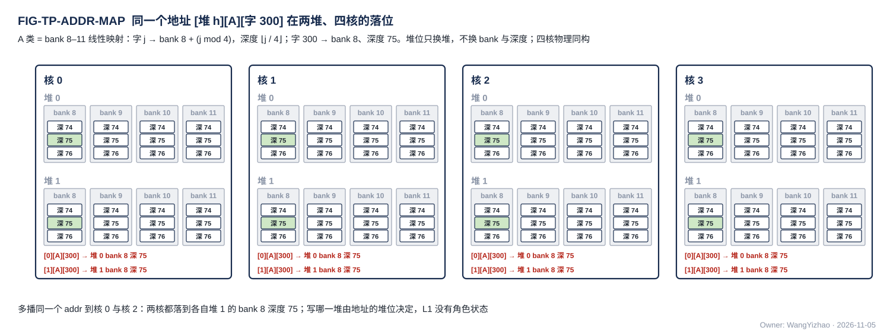

图中同一个地址 [堆 1][A][第 300 个存储字，即字节号 9,600] 在核 0 与核 2 都落到堆 1 的 bank 8 深度 75（4 个 bank 轮流，300 ÷ 4 = 75）；把段选里的堆选改成 0，就落到堆 0 的同号 bank 同深度。四核物理同构，所以多播用同一个地址。

### 2.3 类内怎么分只是编译链的地址

**类的 bank 集合是硬件的，类里哪几个存储字放输入记录、哪几个存储字放停放、哪几个存储字放下一位点预取的权重，是编译链分配的地址，写在指令的基址里；L1 / L2 不知道、也不需要知道。** 所以 L1 / L2 没有分配表，没有分区号，四核物理同构，多播同一个地址在四核落同一位置。两堆之间的切换也不是 L1 的状态：编译链让这个位点往堆 1 写、从堆 0 读，下个位点反过来，全部体现在指令给出的堆选里。

### 2.4 地址：核内与 C2H 由本核 CCU 给出，其余核间链路由 MAE 搬运引擎逐拍给出

**谁拥有源，谁发令**（V18-TP-27 / 35）：**源在核内的搬运（L1 的任何对象，以及 MXU、VNU 的输出经计算核的集成输出端口出核，V18-TP-56）由本核 CCU 发令，核内 RRAM 口与 C2H 的每拍地址都由本核 CCU 给出；源在核外的搬运（DDR、L2、MAE_DSU、MAE_CRU）由 MAE 发令，H2C、IDN、NI 两方向、MAE_DSU 与 MAE_CRU 出口的每拍地址（addr）由 MAE 的搬运引擎（V18-MAE-02）给出。** 每条链路的发送端只有一个主。两种都是 §2.2 的同一种逻辑地址；L1 / L2 只按地址落位，不做取模、不记状态。

#### 2.4.1 核内：CCU 从基址累加

**CCU 从指令取一个基址（字节），然后累加。** 规则：

- 对齐使用时每交出一个存储字，地址加 32；隔字取用（列字、跨步）时步长可配，以字节计、是 32 的倍数。紧密对象按实际写入的字节数累加。
- 变长记录：生产方随数据给出每条记录的字节长度 $n_i$，记录紧挨，$a_{i+1} = a_i + n_i$（数据组织篇 §1.2）。CCU 的写累加器顺带得到各条长度，对象写完后写成 token 长度表（数据组织篇 §2.2）；读方按表定位，随机读时直接把起点放 addr（数据组织篇 §2.4）。
- 每个对象（数据组织篇 §1.2）重置一次基址。
- 环形回绕由 CCU 做：对象内第 $x$ 个字节的地址 = 基址 + $(x \bmod L)$，$L$ 是对象所在环的长度（字节），CCU 从指令拿到 $L$。L1 不做取模。
- 段内地址超出该段容量 = 致命错误（§9）。

#### 2.4.2 核间：C2H 由本核 CCU 逐拍给出，H2C / IDN / NI 由 MAE 搬运引擎逐拍给出

**C2H 由本核 CCU 发令**（用户 11-06："要么就取消 C2H 的 MAE 主，统一改成各核的 CCU 主"；V18-TP-35）：CCU 按位点里的发送指令取 L2 目的地址、长度或"按对象实际长度"，选数据来源（读 L1 发送、或 MXU / VNU 的输出直接出核，每条指令二选一：写 L1 或写 L2，V18-TP-56），逐拍给出 C2H 上的 addr；**C2H 只到 L2**（V18-CRU-07），没有通路选择；**计算核的集成输出端口就是 CCU 的 C2H 通道**（§7.1）。**本核的 C2H 只写 L2 象限 $n$，象限由链路固定，发送指令不给象限选**（V18-L2-04、V18-TP-57）。对象发完、L2 回来的写入握手数满后，CCU 经命令网向 MAE 发"发出报告"（§4.3）。

**MAE = 指令引擎 + 搬运引擎 + 运算级。MAE 的指令只有搬运指令；源与目的之间有一级运算级，由指令的运算字段经 MUX 选直通 / 经 MAE_DSU 整形 / 经 MAE_CRU 合并，MAE_DSU 与 MAE_CRU 并列、互不依赖，地址仍由同一搬运引擎给出**（用户 11-06 晚，V18-MAE-12）。**搬运引擎不按链路配置**：由它给地址的链路是 H2C 道 × 4、IDN × 4、NI → L2、L2 → NI、MAE_DSU 出口、MAE_CRU 出口（作 H2C 道的第二个源，或经 NI-L2C 写 L2），任何一个搬运引擎执行到经过某条链路的指令时就在该链路上给地址；同一链路上的多条指令在单位边界轮流，所以引擎数与链路数无关，按并发指令数【设计者定】（V18-MAE-10）。搬运引擎只听 MAE 的指令。

- **搬运引擎逐拍产生源地址与目的地址（addr）**；线性段、gather、V 行字散写的行位交错都在搬运引擎内展开。**MAE 不做环形回绕**（用户 11-06 晚："对于环形缓冲问题，我认为 MAE 不感知这件事"；V18-MAE-17）：MAE 搬运的数据不用环形缓冲，编译链按静态窗口与 ping-pong 分配，跨环尾时拆成两条指令；核内 CCU 的回绕（§2.4.1）不受影响。基址、步长、长度只出现在 ISA 的搬运指令里，作指令字段；**协议与执行方接口上没有基址 / 步长 / 长度**。
- hub、NI_INT、HUB_IDN、MAE_DSU 自己没有寻址逻辑；接收方无状态，按 addr 类选的固定映射落 bank、按 be 写字节。
- L1 的接收桥（LDP、NWB）只按到达的 addr 写 L1，不归 CCU 寻址，也不归 MAE 寻址。
- 【设计者定】两项，各自的约束：
  - **搬运引擎的物理位置**（MAE 中央或数据源旁）：放在远离 MAE 核心处的搬运引擎，必须经命令网回"执行完成"短消息，MAE 才能判定该指令执行完、带指令标号通知 LIC（§4.4.1、§4.4.4、§8.1）。
  - **一个搬运引擎内部的并行度**（DDR 在飞请求数等）：执行 DDR 读的搬运引擎的在飞请求数要让 M0 在 DDR → L2 / L1 阶段持续读满 DDR 可用带宽——"DDR 满带宽由 MAE 读序与指令编译保证"（V18-NII-01），NI_INT 不设入站缓冲替它吸收不足；在其余链路上，一个搬运引擎每拍至多产生一个地址，链路位宽即其上限。

把"地址由谁给"集中到两个主（核内 CCU、核外 MAE 搬运引擎），是为了让 hub、NI_INT、HUB_IDN 和所有接收方都成为无状态的转运与落位逻辑：它们不需要知道对象或步长，出错时也只需检查地址是否越界。

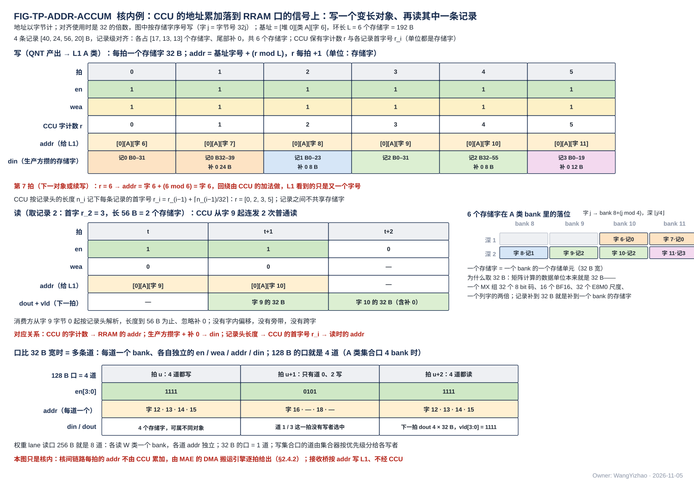

图是核内的例子，按 RRAM 的信号逐拍画，只看地址累加与回绕；为看清按字的累加，图把每条记录画成补到整字（实际记录紧挨，CCU 累加的是字节、攒满 32 B 写一字，规则见数据组织篇 §1.2）。图中按存储字的序号写（行 $j$ = 字节号 $32j$）。上半是写：QNT 产出一个 4 条变长记录（40、24、56、20 B）的对象（图中 2、1、2、1 个存储字，共 6 个），攒满一个存储字交一拍 din；CCU 为这个对象保有一个字计数 $r$，每拍 addr = 基址行 + ($r \bmod L$)、$r$ 加 1，所以 6 拍的 addr 是行 6…11，第 7 拍回绕到行 6——取模是 CCU 加法器里的事，L1 只看到字号。CCU 同时按生产方给的长度记下每条记录的起点（图中字 0、2、3、5；紧挨存放时为字节 0、40、64、120），对象写完后写成 token 长度表（数据组织篇 §2.2）。下半是读记录 2（首行 3、长 56 B = 2 行）：CCU 连发两拍 en = 1、wea = 0、addr = 字 9、字 10，两个存储字各在下一拍返回 dout，消费方从字 9 字节 0 起解析；没有字内偏移，没有旁带。右侧画出这 6 行在 A 类 4 个 bank 里的落位（存储字 $j$ → bank $8 + (j \bmod 4)$、深度 $\lfloor j/4 \rfloor$），每一个存储字就是一个 bank 的一整字。最下面是口比 32 B 宽时的写法：en 每位对应一个 存储字，128 B 的口 en[3:0]、addr 为首字号，一拍可只写其中若干行；256 B 的权重 lane 读口即 en[7:0]。

### 2.5 对齐与紧密存放

**地址以字节计；L1 与 L2 的每个读口、写口都支持从任意字节开始的访问（V18-TP-25、V18-L1-13 / L2-05）。片上产生的 ③ 档变长对象按实际长度紧挨存放，不补齐、不分槽**（V18-TP-58；用户 11-07："我认为 Token 取消 32B 的限制，它可以以小于 32B 的形式写入存储，紧密排列"）。片外进来的数据（经 PIN 写入的外设数据、经 M1 读入的调用输入、另一颗芯片经 FMC 写来的数据）同样从任意字节开始。只剩三条对齐约束：

1. **对象起点在存储字边界**（32 的倍数），由编译链分配地址时保证；对象内部记录与记录之间、段与段之间按字节紧挨（段按字节对齐，数据组织篇 §1.2）。
2. **W 类、S 类的地址必须是 32 的倍数。** W 类经固定接线送 pod 的槽、L1 与 pod 之间没有选择器与旋转器（L1 篇 §2.2）；S 类一个存储字就是一行尺度。违反即致命错误（§9）。**送进 MXU 的激活记录不要求对齐**：激活类读口出口的字节对齐器把从任意字节开始的记录拼成从第 0 字节起的连续字节（§5.3），pod 的段解包器照旧从第 0 字节解析，跨字的记录多读一拍。
3. **紧密写只用于在写堆里从头顺序拼出的新对象。** 带字节写使能的写只改写选中的字节，写堆里同一存储字的其余字节是两个阶段之前的旧值，不是读堆里的当前值；所以不能用它跨阶段修补某个存储字的一部分（读改写一律"读堆读旧、写堆写新"整字写）。

**跨存储字的访问由存储自己处理**：一拍 32 B 落在相邻两个存储字上时，**写口在存储内部拆成两个 bank 的写、同拍完成；读口出口按地址除以 32 的余数移位**。相邻两个存储字总落在本堆的两个不同 bank（L1 A 类字号模 4 或模 8，L2 每象限字号模 4），所以不会撞同一个 bank 的两个深度。**MAE、hub、CCU 只给逻辑字节地址与 be，不移位、不拆拍**（用户 11-07："这是 L1 和 L2 的需求，其他模块仍然负责只给逻辑地址"）。

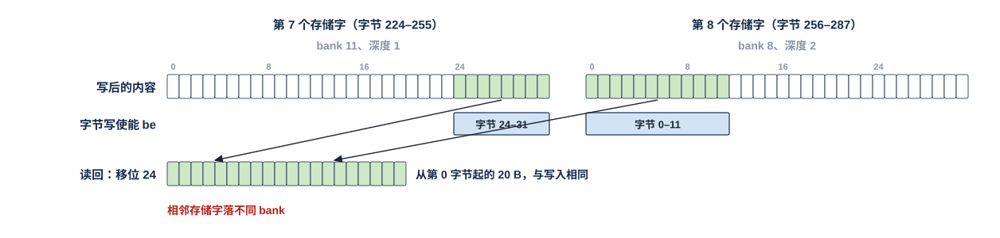

A 类 4 bank 配置。一条 20 B 的记录从字节地址 248 开始，前 8 B 落在第 7 个存储字的字节 24–31（bank 11、深度 1），后 12 B 落在第 8 个存储字的字节 0–11（bank 8、深度 2）；写口把这一拍拆成两个 bank 的写，字节写使能分别只选这 8 B 与 12 B，两个存储字的其余字节保持原值，两个 bank 同拍写。读回时 CCU 发两个存储字的读，读口出口按 $248 \bmod 32 = 24$ 移位，拼出从第 0 字节开始的 20 B。实际记录长度任意，跨字时最多多读一个存储字。

### 2.6 写入完成只分两类：核内按参考设计计数，核间统一"写入握手 + 发令方计数"

**写入完成 = 真正写进最终存储的项数达到发写方的应写量**（用户 11-06："我希望这套判断场景可以在核内和核间协议都存在，需要更新到协议"；V18-TP-37）。**谁来数只分两类：核内一类、核间一类**（用户 11-06："我认为第四层不应该做如此大的区分，我就希望最多分出来一个核间一个核内，核内走我给你的参考设计，核间统一走一个协议，对于 PIN 的问题可以放宽，因为它是从口，但是最好也走一个协议"；"这个协议我完全认可"；V18-TP-50）：

| 类别 | 规则 | 谁比对 | 应写量从哪来 |
|---|---|---|---|
| **核内**（PandaChip NCC 参考设计） | 发令方（本核 CCU）按指令知道应写量；**接收方每把一项写进 bank，该写入口的写入项数就加一**；本地控制方比对，达到即写完。L1 写集合器的每个写者各有一个写入项数——核内写者（§5.2），以及核间链路落进 L1 的接收桥（4 个 LDP、NWB），后者在集合器里同样是写者 | 本核 CCU | 位点指令或长度转发 |
| **核间**（统一协议） | **接收方每把一项写进它的最终存储，就沿同一链路反向回一个写入握手（valid + `src`）；发令方只数 `src` 是自己的那些，数满应写量即写完**。最终存储 = L1 / L2 的 bank、LIC 专用小 SRAM；写往片外时 = 收到 AXI 写响应 | 发令方 | 发令方自己的指令（多播 $k$ 核、象限掩码广播 $k$ 个象限都按 $k$ 倍计） |

**协议参考：写入握手来自 AMBA AXI 的写响应通道 B——从机写完后回 BRESP，主机据此判写完成**（用户 11-06："你需要在协议篇说明下这个写完的握手来自于 AXI 的响应通道 B"）。与 AXI B 的差别：按每一项写入回、不按事务（核间链路上没有事务与 burst）；号归发令方，不归请求（类 AXI 的 BID、TileLink 的 d_source、AXI4-Stream 的 TID）；回程只有 valid、没有 ready，发令方的计数器每拍都能收（类 CHI 链路层的信用回传 LCRDV）；"写进最终存储才回"同 CHI 的 Comp 语义（写对后续访问可见才算完成）。第 4 层（§3.8）列出每条核间写链路的握手去向。

- **写进最终存储的那一拍才算一项**；还在集合器 FIFO 或链路流水级里的数据不计、不回握手，所以不设排空信号，也不依赖任何固定时延。
- **下一级消费者怎样知道写完了**：消费者在本核（例如 MXU、VNU 用 H2C / IDN 送来的数据）→ 本核 CCU 用核内的写入项数判断，比对通过才发读这批数据的指令或切堆，不等核外通知；其余情形 → 发令方数满后通知 LIC（MAE 带指令标号；CCU 用发出报告（§4.3）或位点完成），由 LIC 下发依赖它的后续指令。
- **一条数据进 L1 时两类同时成立**：核间的写入握手回给发令的搬运引擎（引擎据此判指令执行完、通知 LIC）；L1 写集合器里的写入项数交本核 CCU（CCU 据此放行本核的消费）。两者数的是同一批写入，口径一致。
- 核内写入项数的清零按位点或按对象【设计者定】：要定的是清零的粒度与时点；约束是清零粒度与应写量的给出粒度一致（位点指令给的是一个位点的量，长度转发给的是一个对象的量），清零发生在比对通过之后、下一批写的第一项写进 bank 之前，不得丢掉已写入但尚未比对的项；计数位宽须容纳一个清零周期内该入口可能写入的最大项数。发令方的握手计数按指令清零。
- **计数的单位是"写入项"——一次进最终存储的写**。对齐使用时一项就是一个存储字；紧密写跨两个存储字拆成两项、两条记录共用一个存储字各算一项（§2.5、§5.2），发写方按自己拆出的项数给应写量（核内由 CCU 拆、核间由发令方的搬运引擎拆），两端口径天然一致。
- **跨核合并不是第三类完成协议**（V18-CRU-07）：各核经 C2H 把要合并的数据写进 L2，按 C2H → L2 的核间规则完成、发出报告；MAE 收齐参与核的报告后从 L2 读、合并、写回 L2，写回同样按核间规则完成。

核内一类就是 PandaChip NCC 的做法——主控数自己发出的量，接收 cache 的写入地址随写入自增（PE-PRE 的 `wr_fms_cache_addr`）——再加一步由本地控制方比对；核间一类把"接收方的写入地址自增"换成"接收方每写进一项回一个握手、发令方计数"，因为核间的接收方多数没有本地消费方（L2、LIC 小 SRAM），需要知道"写完没有"的是发令方；同一条链路又可能被几个发令方共用、各存储体写进的先后可以与链路上的先后不同，握手带上发令号后归属在发令方一侧自然完成，接收方不保存计数。集合器 FIFO 里排队的写还没写进 bank，所以"写者交出了最后一拍"不等于"写完成"，§4.1 的"写堆写完成"以本节为判据。**因为完成按写入项数判断，接收方不数单位，链路上也不带单位标记**（V18-TP-42）：合并点仲裁的切换边界（§3.9）是发令方内部的信号，发出报告也不带单位数（§4.3），见 §4.5。

## 3 核间协议：带地址的握手写流

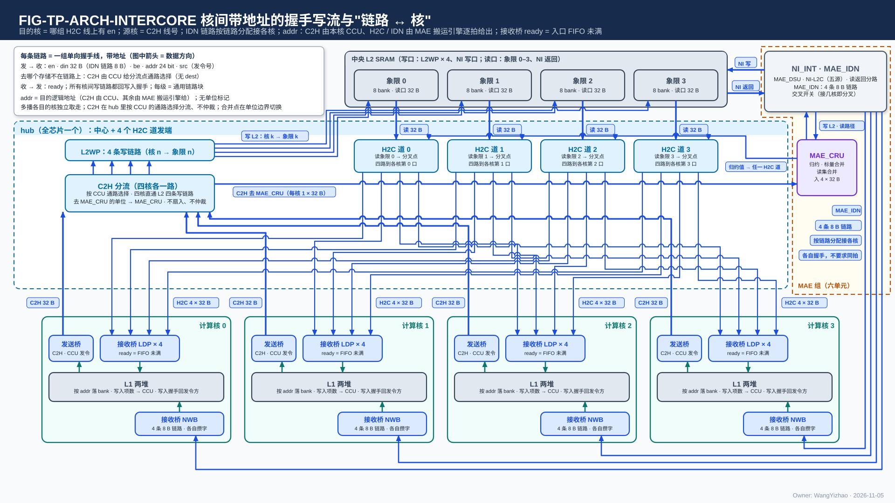

图中 hub 分中心（四核 C2H 各自直通 L2WP 的本核写链路，4 条 × 32 B 进 L2 写口；C2H 只到 L2）与 4 个 H2C 道发端（道 $n$ 读 L2 象限 $n$，经本道的多播分叉点送往四核各自的第 $n$ 道（道框即分叉点，直接引出四路到四核；分叉点放在哪、分几级由后端定，§3.3.4），各目的核按自己的 ready 独立取走）；每核三个数据口：接收桥 LDP × 4（H2C）、IDN 接收桥 NWB（一条 32 B 链路，来自 HUB_IDN 的分叉点）、集成输出端口（C2H）；右上虚线框是 MAE 组，画出 NI_INT（含 MAE_DSU、NI-L2C）与 MAE_CRU；其下另一个"HUB 组"框是 HUB_IDN（与左侧 HUB_NOC 框分开画、同属 HUB 组），NI_INT 的 IDN 出口一路 32 B 进 HUB_IDN，由它按随字的核集合分发到各核 NWB 的 32 B 链路；MAE_CRU 只与 NI_INT 往来：经 NI 读口读 L2 四个象限同址、合并结果经 NI 写口写回 L2；NI_INT 到 L2 的 NI 写口（32 B）与 NI 读口（4 × 32 B）不经 hub。每条链路的信号在左上角说明框里统一标出，线上只标名与位宽。

本章按五层说明核间协议（用户 11-06："我建议你在协议文档中，也以这五层去进行说明"）。§3.1–§3.2 是每条链路都一样的拓扑与信号，§3.4–§3.5 是地址怎样逐拍产生与 IDN 的特殊形态；其余各节按层排列：

| 层 | 管什么 | 一句话 | 节 |
|---|---|---|---|
| 第 1 层 | 这一拍能不能交出 | **en ∧ ready 同拍才成交**；每级都是通用链路块，输出寄存器化，skid 接住在途拍，所以可以任意插级 | §3.3 |
| 第 2 层 | 堵住时怎么办 | **ready = 接收方入口 FIFO 未满**，拉低后逐级传回发令方，只降速、不丢数，没有全局 stall | §3.6 |
| 第 3 层 | 一份数据发给几个核 | **分叉点 = 一级通用链路块 + 每目的核 1 位已取标志**，各目的核按自己的 ready 取走，全部取走才收下一拍；不另配存储 | §3.7 |
| 第 4 层 | 一批数据什么时候算写完 | 只分两类：**核内**按参考设计由本地控制方比对写入项数；**核间**统一由接收方回写入握手、发令方计数（来自 AXI 写响应通道 B） | §3.8（规则在 §2.6） |
| 第 5 层 | 几个源合到一条链路 | **仲裁器在发令方一侧，只在单位边界换源**，单位不交错；链路上没有单位标记 | §3.9 |

前三层回答"这一拍能不能过去"，第 4 层回答"写没写完"，两件事完全分开：ready 只保护桥里的 FIFO，不说明数据已写进存储。设计者实现任一核间链路，只需例化通用链路块，再加本章对该链路规定的仲裁器、多播分叉点与写入握手回程；级数与分叉位置留给后端（§3.3.4）。

**核间链路是带地址的握手写流**（用户 11-05 夜，V18-TP-26）：每拍 en ∧ ready 成交，每拍自带目的地址；**信号与核内 RRAM 口同名（en / din / be / addr），核间只多 ready、发令号 `src` 与反向的写入握手**（用户 11-06，V18-TP-41 / 47 / 51），没有地址通道、响应与 burst，也没有单位标记（V18-TP-42），不是"首拍给地址、后续拍按流解释"的流——就是核内写口加一对握手线拉到核间。核内 RRAM 口的"写当拍、读固定 1 拍、无握手"只在核内（§5）。

### 3.1 拓扑与"链路 ↔ 核"

**链路清单——每条核间链路的方向、条数、位宽、每拍地址由谁给、目的与核的标识——在架构篇 §4.1 与全口宽总表 PORT-12…22，本篇不重复**（用户 11-08："链路表……和架构不会重复吗"→ 整表移架构篇）。本篇对拓扑只规定两条规则：

1. **数据链路上没有"发给哪个核、来自哪个核"的字段：目的核 = 哪组线上有 en，源核 = 线号**（V18-TP-42 / 51）。每核对中央端各有独立的一组 H2C、C2H、IDN 线，核由物理链路标识；多播由分叉点复制（§3.7），写到哪个存储由链路决定，addr 只是目的存储内部的字节位置，没有 dest，也没有单位标签。
2. **所有核间链路同一时钟域，任意位置插任意级寄存器、协议功能不变**（V18-TP-26 / 31，本节末两段与 §3.3）。

**每条链路都带同一组信号：正向 en / din / be / addr / `seg` / `src`，反向 ready 与写入握手；`src` 在只有一个发令方的链路上为常数**（用户 11-06："我希望统一协议，即使它根本不需要"）：链路之间没有位宽差别（din 一律 32 B、be 32 位，IDN 也是，V18-HUB-04），也没有"某条链路少一个信号"的特例；`seg` 全部 5 bit（V18-TP-61）。所有核间写链路另有反向的写入握手旁带（§3.2、§3.8）；NI 写口的同址广播由 `seg` 的段掩码表达，没有独有的旁带。

**MAE_CRU 不连核间链路**（V18-CRU-07）：它的输入经 NI 读口从 L2 读、输出经 NI 写口写回 L2，两段都在 MAE 组与 L2 之间（MAE 各篇与 MAE 集成篇）；各核要合并的数据走 C2H → L2，合并结果要到核 L1 时走 L2 → H2C。

**时延无关：任意位置插任意级寄存器，协议功能不变；本章的功能定义里不出现任何固定拍数**（用户 11-05 夜："我完全认可核间链路和时延无关"；"这里不应该是解除固定时延嘛"）。流水级数【设计者定】，每一级都是 §3.3.2 的通用链路块。

**核间链路全部在同一时钟域，不考虑跨时钟域**（用户 11-05 夜，V18-TP-31）；对外 AXI 口的跨时钟域在 NI_EXT。

### 3.2 信号

**核间信号与核内 RRAM 口同名，核间只多 ready（接收方的握手）、发令号 `src` 与反向的写入握手**（用户 11-06："这里我叫你统一和 RRAM 的命名，你也没有统一"；V18-TP-41）。

| 信号 | 方向 | 位宽 | 用法 | 核内 RRAM 口对应信号 |
|---|---|---|---|---|
| en | 发 → 收 | 1 | 本拍有一次写 | en（写时 wea = 1） |
| ready | 收 → 发 | 1 | 本拍能收；en ∧ ready 成交 | 无（核内无握手；核间比核内多的唯一一根握手线） |
| din | 发 → 收 | 32 B | 数据，字节放在它在目的存储字里的位置 | din |
| be | 发 → 收 | 32 | 字节写使能：本拍哪些字节有效，接收桥原样交写集合器。对齐使用时全 1 | be |
| `seg`（段选） | 发 → 收 | **5，所有链路统一 = 堆选 1 + 段掩码 4（独热）**（V18-TP-61，11-07 B2 / B8：L1 侧 4 位用 3 位 W / S / A，L2 侧 4 位 = 四象限；一拍只许一位为 1，多位为 1 只出现在 NI 写口 = 同址广播；象限由链路固定的链路也带 5 bit，接收方忽略还是核对【设计者定】） | **本拍落哪个物理分段**：堆、类（L1）或象限（L2），由发令方随指令给出（指令字段是 2 bit 选择，发令方展开成独热）、逐拍携带（V18-TP-57）；不是地址的一部分，地址累加不会进位到它；接收方按它选 bank 组。不称"旁带"（用户 11-07） | 无（核内的堆、类在 CCU 发的指令里） |
| addr | 发 → 收 | 24，两方向同宽 | **本拍数据在目的分段内的字节地址**（§2.2；分段由 `seg` 给出，以字节计），**逐拍携带；C2H 上由本核 CCU 给出，H2C / IDN / NI 上由 MAE 搬运引擎给出**（§3.4）。**addr 只是目的存储内部的位置，由该存储自己解释**：L1 的类选 = W / S / A，L2 的类选 = 象限；**写到哪个存储不编码在地址里，由链路决定**（C2H 到 L2、H2C / IDN 到 L1）（用户 11-06："我建议这个地方不要合并在地址中"；V18-TP-51） | addr |
| `src`（发令号） | 发 → 收 | 头文件参数，参考 5 bit（所有链路都带） | **本拍属于哪个发令方**：每个 MAE 搬运引擎一个号、每笔在途 PIN 事务一个号（NI-L2C 的号池，≥ 4 个，参考值）、每核 CCU 一个号；MAE_DSU / MAE_CRU 的输出用执行该指令的引擎的号。数据不打单位标签，只区分发令方（同 AXI4-Stream 的 TID）（用户 11-06："链路增加一个信号，它用来表明对应的是哪个 MAE 引擎呢？相当于不对数据打标签，但是区分数据的通道"；V18-TP-47）。接收方不看 `src`，只把它随写入握手原样带回；几个发令方共用的链路（NI 写口、H2C 道、IDN）靠它让握手各回各家，只有一个发令方的链路（L2WP 第 $n$ 条）上为常数 | 无 |
| 写入握手 | 收 → 发（反向旁带） | L2WP 每条 1 bit；其余链路 valid + `src`；NI 写口按 4 个象限各一组；H2C 每道把四核 LDP 的握手汇总后交发地址的引擎 | **所有核间写链路都有**（V18-TP-50）：接收方每把一项写进最终存储（L1 / L2 bank、LIC 小 SRAM；片外为收到 AXI 写响应），就在这条链路上回一个 valid，带该项的 `src`；只有 valid、没有 ready，发令方的计数器每拍都能收（§2.6、§3.8）。**来自 AXI 的写响应通道 B** | 无 |

每拍对应目的地的一个存储字：addr 给这个存储字的地址，be 给其中有效的字节。**链路上没有单位标记**（V18-TP-42，§4.5）：一个单位从哪拍开始、到哪拍结束只有发令方知道；也没有核号字段（核由链路标识）、单位标签与请求号（§4.4）。**引擎换指令时 `src` 的复用**：上一条指令的握手还没回齐时，同一个号就开始给新指令，握手会混到两条指令之间；做法是等上一条的握手全部回来再换，或每个引擎在两个号之间轮换，【设计者定】，约束是任何时刻一个号只对应一条未完成的指令。

**旧名 ↔ 新名对照**（供读 11-06 以前稿件的人查；正文其他地方只用新名）：

| 旧名（11-06 以前） | 新名 | 说明 |
|---|---|---|
| TVALID | en | |
| TREADY | ready | |
| TDATA | din（命令网为 data） | |
| TKEEP | be | |
| TUSER | addr | |
| TDEST | —— | 撤（V18-TP-51）：去哪个存储由链路决定（C2H 只到 L2，V18-CRU-07） |
| TLAST | —— | 撤（V18-TP-42）；命令网同撤，消息长度在首字 |

### 3.3 第 1 层：逐拍成交（en / ready）与通用链路块，任意插级而功能不变

#### 3.3.1 成交规则

- **ready 是什么**：接收方给发送方的一根线，含义是"这一拍我能收"。发送方把 en 拉高并放好 din / be / addr / `src`；**只有 en 与 ready 在同一拍都为 1，这一拍才算交出**，发送方才能换下一拍；ready 为 0 的拍发送方必须原样保持；接收方随时可以拉低，不需要提前通知。它不计数、不记账，每条链路只这一根线，接收方只看自己的 FIFO 有没有空。
- **发送方的义务**：en 一旦拉起，在成交前不得撤销，其余信号保持。

#### 3.3.2 通用链路块：核间所有握手链路的唯一构件（skid 可配）

**通用链路块**（Common Link Block）**是核间所有握手链路的唯一构件**（用户 11-05 夜："skid 是应该有的设计，这是必须要的，并且这个功能应该在 HUB 和 IDN 中都强制要求"；11-06："我希望它的 Skid 寄存器可配，因为它不止是一个传输数据通路的任务，还需要负责传控制命令，以及例如这个说明自己的数据已经发送完毕的握手信号，因此最好的形式是建立一个 Common Block，然后多次例化"；V18-TP-32 / 38）：一级 valid / ready 握手流水，参数化：

| 参数 | 含义 |
|---|---|
| 数据位宽 $W$ | din（命令网为 data）的位宽 |
| 旁带位宽 $S$ | addr、be、`src` 等随数据走的线，折进旁带；可为 0 |
| **skid 深度** | = 本块拉低 ready 到上游真正停发之间的在途拍数；单级为 1 |
| 流水级数 | 本块内串几级 |

**所有输出寄存器化，相邻块之间无组合路径**；将满阈值 = skid 深度 − 在途拍数。下游把 ready 拉低的那一拍，上游可能已经发出一拍，skid 把它接住，本块下一拍再把自己的 ready 拉低，所以 ready 不穿过多级组合逻辑。

例：下游在第 2 拍拉低 ready，本块的 ready 经寄存器晚一拍才拉低，第 3 拍上游已发出的一拍进 skid：

| 拍 | 下游 ready | 本块对上游的 ready（晚一拍） | 上游发出 | 本块动作 |
|---|---|---|---|---|
| 0 | 1 | 1 | A | A 交给下游 |
| 1 | 1 | 1 | B | B 交给下游 |
| 2 | **0** | 1 | C | 下游不收，C 留在本块输出寄存器 |
| 3 | 0 | **0** | D（上游还没看到停） | **D 进 skid** |
| 4 | 0 | 0 | 停 | 保持 C、D |
| 5 | 1 | 0 | 停 | C 交给下游 |
| 6 | 1 | 1 | — | D 交给下游，恢复 |

skid 深度 = 拉低 ready 到上游真正停下之间的在途拍数（本例 1）；拍号只示意先后，插几级都按同一规则逐级接住。

**数据网（$W$ = 256 bit，旁带 = addr 24 + be 32 + `src`；所有核间写链路另带反向的写入握手旁带，同样寄存器输出）与命令网（$W$ = 64 bit，无旁带）都用同一个块例化。** hub 的四条 H2C 道、C2H 在 hub 里的四条直通链路、hub 控制道，HUB_IDN 的分叉点与四条 IDN 链路，各核的接收桥（LDP、NWB）与集成输出端口，L2 的 NI 写口与 L2WP 四条写链路的集合器入口（每核一条），MAE_DSU 进出口，NI-L2C 两个方向，NI 控制道，都是它的实例加各自的仲裁器、MUX 或多播分叉点（分叉点只多每目的核 1 位已取标志，§3.7）；传数据、传指令、传发出报告只是参数不同。

**验收：随机化全部参数与 ready 拉低的时序，到达目的的数据逐位一致、不丢拍、不重复。**

#### 3.3.3 保序、无应答、无 burst

- **同一链路保序**：先发的拍先到；同一发令方的单位不交错，单位级合并点上不同源的单位也不交错。**C2H 分流不合并四核**（V18-L2-03）：各核的 C2H 直通 L2 的本核写链路，核 $n$ 只写象限 $n$（V18-L2-04），不同核的拍永不相遇。
- **无数据应答、无 outstanding、无 burst**（写入握手只是"写进一项"的计数脉冲，不带数据、不要求发送方等它才发下一拍，§3.8）：地址随数据同拍走，源是 SRAM，接收方自带地址，burst 的三项收益（摊地址通道、摊应答、让 DRAM 连续）在核间都不存在（用户 11-05 夜："当前还是选择非 Burst 的方案吧"）；DDR 的突发在 M0 口，不变。时延只是管道长度，不影响吞吐。

#### 3.3.4 可由后端调整的需求（A1–A7，HUB_NOC 与 HUB_IDN 共用）

**协议不定拓扑，不规定中继点、分叉点放在哪、每段插几级；这些由后端按布局定。协议只要求结构能被这样调整而功能不变**（用户 11-06："我认为咱们在 HUB 的设计，无需过于考虑后端，但是需要对 HUB 提出需求，让其更够被后端调整（受布局调整级数等），这点对 IDN 有一样的需求"；V18-TP-54）：

| 编号 | 需求 | 后端能调什么 |
|---|---|---|
| A1 | **功能与任何一段的级数无关**：任意两个端点之间是一串通用链路块，各段级数是独立参数，可各不相同；改级数只改参数、不改逻辑 | 每段插几级 |
| A2 | **每级满吞吐**：每一级自身能每拍成交，插级只增时延、不降吞吐；skid 只看本级，不随总级数加深 | 插级不掉速 |
| A3 | **多播分叉点可移动、可拆成多级**：每一级都按 §3.7 的已取位规则分叉，分在一处还是逐级分结果相同；**核掩码作旁带走到最后一个分叉点，到核的最后一段不带** | 分叉点的位置与级数 |
| A4 | **任何逻辑不依赖同拍到达或固定的相对时延**：同一核的 4 条 H2C 链路之间、正向与写入握手回程之间都不对齐 | 各条线独立走 |
| A5 | **写入握手回程的级数与正向独立**；握手先到后到不影响发令方的计数 | 回程另走 |
| A6 | **与时延有关的门限是 RTL 头文件参数**（例如 H2C 道首级停发 L2 读的将满阈值 = 深度 − 在途读拍数），没有运行期配置；后端改级数只改参数 | 改级数时改参数 |
| A7 | **验收随机化**每段级数、分叉位置、ready 时序与回程时延；数据逐位一致，写入项数与写入握手计数都与应写量相符 | — |

### 3.4 逐拍地址由该链路的发令方生成：C2H 归本核 CCU，其余归 MAE 搬运引擎

**每拍的 addr 由该链路的发令方给出（§2.4.2）：C2H 上由本核 CCU 按发送指令逐拍给出；H2C、IDN、NI、MAE_DSU 与 MAE_CRU 出口上由 MAE 搬运引擎按指令字段逐拍展开线性段、gather、散写的行位交错（MAE 不做环形回绕，§2.4.2）；hub、NI_INT、HUB_IDN 只把搬运引擎给的地址随数据送出；接收方按段选与段内地址的固定映射落 bank，不累加、不记状态。** 多播时四核收到同一个地址，落同一物理位置（§2.3）。

**搬运从任意字节开始的对象时**，首尾不满的拍用 be 标出有效字节；源读口出口的对齐器已按源地址移位，一拍 = 从源字节地址起的连续 32 B，发令方按目的字节地址逐拍给 addr，目的写口跨字时在存储内部拆成两个 bank 的写（§2.5，V18-L1-13 / L2-05）；发令方（MAE 搬运引擎或 CCU）、hub 与发送方都不移位、不拆拍。

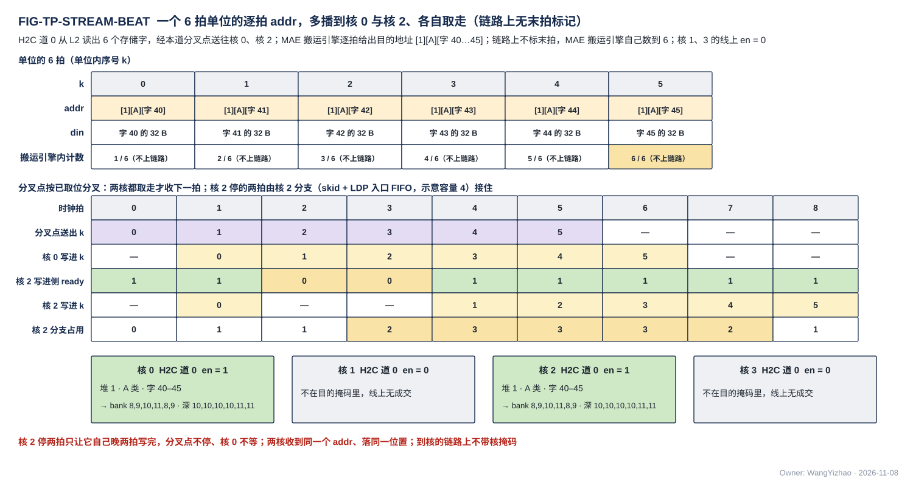

图中 H2C 道 0 从 L2 读出一个 6 个存储字的单位，经本道的分叉点送往核 0、核 2，MAE 搬运引擎逐拍给出 addr = [1][A][字 40] … [1][A][字 45]；**链路上没有标出哪一拍是单位的最后一拍**，MAE 搬运引擎自己数着发了 6 拍。分叉点在拍 0–5 每拍送出一拍（两核都取走才收下一拍）；核 0 一直能写，拍 1–6 写进 k = 0–5；核 2 写进 L1 的一侧在拍 2、3 不 ready，拍 1、4、5、6、7、8 写进，晚两拍写完。**核 2 停的两拍由核 2 的分支（分支 skid + LDP 入口 FIFO，示意容量 4 拍）接住，占用最多 3 拍，分叉点不停、核 0 不等核 2**；若核 2 停得比分支容量还久，分叉点就会停收上游（§3.7）。两核各自写进堆 1 的 A 类第 40–45 个存储字：各核 CCU 看到本核的写入项数达到 6 即可消费（核内一类）；两核每写进一项各回一个写入握手给发地址的搬运引擎，引擎数满 2 × 6 = 12 即该指令写入完成（核间一类，§2.6、§3.8）；核 1、3 的线上 en 为 0。

### 3.5 HUB_IDN：每核一条 32 B 链路，核集合随字

**IDN = 每核一条 32 B 的带地址的握手写流，全芯片 4 条；信号与 H2C 完全相同：en / ready / din 32 B / be 32 / addr 24 / `seg` 5 / `src`，反向写入握手（valid + `src`）**（用户 11-08："IDN 的输入应该是一个 32B 的数据，然后分发到各个 CC 的 32B 通路中，只是有的可能是 8B 有效，有的是 16B 有效"；V18-HUB-04）。

**MAE 的 IDN 出口交 HUB_IDN 一路 32 B，每拍一个存储字（带 addr / be / `src`），随每个存储字给一个 4 bit 核集合**；核集合是 HUB_IDN 之前的旁带，到核的链路上不带。**HUB_IDN 只做一件事：按每拍的核集合把这一拍送到集合内每个核的 IDN 链路——接几核就是多播分叉点（一级通用链路块 + 每目的核 1 位已取，各核独立取走，§3.7，V18-TP-53）**；它不拆拍、不缓存整字、不算地址、不数单位，也没有交叉开关。

**几核共享 M0 带宽 = MAE_ENG 的地址状态机把连续的存储字轮流排给各核**：字 0 → 核 0、字 1 → 核 1 …（或按编译链给的核次序）（用户 11-08："32B 先走道 0 到核 0，然后是下一个 32B 走道 1 到核 1，不是也可以吗？而且这样也不会降低利用率，同时控制逻辑更简单"）。各核轮到的字数比例由搬运指令决定：单核时 32 B/拍；四核按 $m$ 切分时每核平均 8 B/拍，但每拍到达的是一个整字。总量不论开几核都由 M0 的 32 B/拍封顶。**链路上只发整字的前提是 MAE 先按字重排**：DDR 标准布局一拍 = 同一 $k$ 行 4 个列组各 8 B，LSC 一行 = 4 核各 16 B，一拍里的粒子分属几个核或同一核的几个存储字（L1 行字区一个存储字 = 一个列组的 4 个相邻 $k$），由 MAE_DSU 攒 $n$ 行重排成各核的整字后再送 IDN 出口（V18-MAE-35，MAE_DSU 篇 §4.1）；本篇不设拆字分发、L1 写口不接一拍多地址。

**IDN 接收桥 NWB 是与 LDP 相同的普通接收桥**：一条 32 B 链路、一条入口 FIFO、ready = FIFO 未满，按 `seg` / addr 进 W / S / A 类写口，**一个存储字一拍整字写入**，写进 bank 时回写入握手，一个写计数交本核 CCU。**IDN 只送整字对齐对象（be 全 1），这是搬运指令的约定**；紧密对象不经 IDN，只经 NI 写口进 L2（§7.2），再经 H2C 进核，所以 NWB 没有需要"末拍触发写出"的不满尾字。

**输出轴稀疏的权重（DDR 列深度优先平面）按整列发给属主核。** MAE 逐列 gather，一列 $K/2$ 字节是一条连续 burst；这一列的存储字的核集合都只含属主核，**属主核的链路每拍一个整字，32 B/拍**，写进属主核 L1 列字区（一列 64 个连续 $k$，L1 篇 §4.2）。DDR 与 HUB_IDN 都不暂存整列。不采用"DDR 控制器从 4 列各取 8 B 拼成一拍"：DRAM 的最小访问是一个 burst（常见 32–64 B），取 8 B 要浪费 4–8 倍带宽，而且 AXI 一拍的数据只来自同一笔事务。

### 3.6 第 2 层：背压逐级传回发令方，只降速、不丢数

**接收方的 ready = 自己入口 FIFO 未满（按将满阈值判，阈值 = 深度 − 在途拍数，§6.4）。** FIFO 吸收撞 bank、合并点让出造成的瞬时顺延；持续堵住时 ready 拉低，经各级通用链路块一级一级传回，直到发令方停下：

| 链路 | 接收方的 ready 看什么 | 最终停下的是谁 |
|---|---|---|
| C2H → L2 | L2 象限 $n$ 里核 $n$ 的入口 FIFO（L2 篇 §5.2） | 本核集成输出端口的发送 FIFO → stall_tx → CCU 被门控、停算（§6.5） |

| H2C → 核 L1 | 该核 LDP 的入口 FIFO（L1 篇 §7.1） | 该核分支 skid 满 → 分叉点停收上游 → 道首级链路块将满 → 停止发 L2 象限读（L2 篇 §5.3） |
| IDN → 核 L1 | 该核 NWB 的入口 FIFO | HUB_IDN → NI_INT → NI_EXT → 拉低 M0 的 RREADY，DDR 暂停返回（NI_INT 篇 §4.3） |
| NI 写口 → L2 | 目标象限的 NI 写入口 FIFO（广播时掩码内各象限都未满） | NI-L2C 停发，各写客户依次停下；PIN 由 NI_EXT 拉低 AXI 的 WREADY |

**全程只降速、不丢数，没有全局 stall**（用户 11-05："反压的信号来自于写入时的 FIFO"）。一条道堵住不影响别的道。同一道多播时，例如核 2 的 LDP 满，核 2 的分支先由自身 skid 接住，别的核照常取走；分支也满后分叉点停收上游，别的核随之停下——**一核长时间堵住会经分叉点拖慢同一道上的其余核，余量 = 该核分支 skid + LDP 入口 FIFO**（§3.7）。

### 3.7 第 3 层：多播在分叉点按已取位分叉，各目的核独立取走

**多播分叉点 = 一级通用链路块 + 每个目的核（子输出）1 位已取标志；分叉点不另配存储**（V18-TP-53 修订 TP-29）（用户 11-06："缓冲不是已经在存储单元里要求了吗？而 HUB 本身，就已经有 skid 寄存器的需求了"；V18-TP-53）。四核物理同构，多播用同一个 addr、落同一位置（用户 11-05 夜："对于需要广播的数据，我可以接受他们写到目标 L1 SRAM 的同一个地址"）。

分叉点每拍要做的事：

| 步 | 动作 |
|---|---|
| 1 | 对掩码内、本拍尚未取走的子输出拉高 en；**en 只看已取位、不看 ready** |
| 2 | 某子输出 ready = 1 的拍即取走这一拍，置位它的已取位 |
| 3 | 掩码内已取位全部置位后，才接收上游的下一拍，同时清零已取位 |

单播是掩码只有一位的特例。**不做"几个 ready 相与再给 en"**：那样 en 组合依赖 ready，又回到"等齐同拍"。

**各目的核不等齐、不要求同拍成交；快慢核的差距由各分支链路块的 skid 与接收侧入口 FIFO（LDP / NWB）吸收。** 一核堵住时，先由它的分支 skid 接住；分支也满后分叉点停收上游，同一道上的其余核随之停下，所以**余量 = 该核分支 skid + 接收侧入口 FIFO**；需要更大余量时加深接收侧入口 FIFO（L1 篇 §7.1），不在分叉点加存储。分叉点放在哪、分几级由后端定（§3.3.4 A3）。

多播的写入握手：$k$ 个目的核各写进一份、各回一个握手，发地址的搬运引擎按 $k$ 倍计应写量（§3.8）。

### 3.8 第 4 层：写入完成——核内按参考设计，核间统一回写入握手

**只分两类**（规则全文在 §2.6；用户 11-06："我就希望最多分出来一个核间一个核内，核内走我给你的参考设计，核间统一走一个协议"；V18-TP-50）：

- **核内**（PandaChip NCC 参考设计）：发令方 CCU 知道应写量；接收方每把一项写进 bank，该写入口的写入项数加一；本地控制方 CCU 比对。核间链路落进 L1 的接收桥（LDP、NWB）在 L1 写集合器里同样是写者，所以本核消费这些数据时也用这条。
- **核间**：**接收方每把一项写进最终存储，就沿同一链路反向回一个写入握手（valid + `src`）；发令方只数 `src` 是自己的那些，数满应写量即写完。写入握手来自 AMBA AXI 的写响应通道 B——从机写完后回 BRESP，主机据此判写完成**（用户 11-06："你需要在协议篇说明下这个写完的握手来自于 AXI 的响应通道 B"）；与 AXI B 不同的是按每一项写入回、不按事务，号归发令方（类 AXI 的 BID、TileLink 的 d_source），回程只有 valid、没有 ready（类 CHI 链路层的信用回传 LCRDV），"写进最终存储才回"同 CHI 的 Comp 语义。

每条核间写链路的握手：

| 链路 | "写进最终存储"指什么 | 握手回给谁 | 发令方的应写量 |
|---|---|---|---|
| NI 写口 → L2 | 写进 L2 bank | 执行该指令的搬运引擎（NI_INT 按 `src` 分发） | 指令的数据量；象限掩码广播 $k$ 个象限按 $k$ 倍计 |
| C2H → L2 | 写进 L2 象限 $n$ 的 bank | 核 $n$ 的 CCU（L2WP 第 $n$ 条只有一个发令方，握手不带号） | 本次发送的项数 |
| **H2C → 核 L1** | 写进 L1 bank | **给这条道发地址的搬运引擎**；**H2C 道把四核 LDP 回来的握手汇总后交给发地址的引擎，引擎不在道旁时经 hub 回到 MAE；汇总方式（按 `src` 归并成"某 `src` 本拍写进几项"，或原样转交由引擎挑出自己的）【设计者定】，约束不丢、不重、按 `src` 归属正确**（用户 11-06："H2C 汇总后发给地址的引擎也没有问题"；V18-NAME-04） | 指令的数据量；多播 $k$ 核按 $k$ 倍计 |
| **IDN → 核 L1** | NWB 把一个存储字一拍整字写进 L1 bank | **执行该指令的搬运引擎**，经 HUB_IDN 回去 | 指令的数据量（按存储字计） |

| NI → LIC 直连口 | 写进 LIC 专用小 SRAM | 执行该指令的搬运引擎（经 NI_INT） | 指令的数据量 |
| NI_EXT → DDR / 共享内存 | 收到 AXI 写响应 | 执行该指令的搬运引擎 | 指令的数据量（AXI B 本身就是写入握手） |
| PIN → L2 | 写进 L2 bank | NI-L2C 按该 PIN 事务号数满，再由 NI_EXT 回 AXI B 给外部主方 | 该 AXI 事务的项数 |

**PIN 也走同一个协议**（用户 11-06："对于 PIN 的问题可以放宽，因为它是从口，但是最好也走一个协议"）：在片内，一笔 PIN 事务就是一个带 `src` 的发令方，唯一的差别是数满后的动作——别的发令方通知 LIC，PIN 回 AXI B。

**下一级消费者怎样知道写完了：**

1. **消费者在本核**（MXU、VNU 消费 H2C / IDN 送来的数据，或核内写者产出的数据）：本核 CCU 用核内的写入项数判断，比对通过才发读这批数据的指令或切堆，不等核外通知。
2. **其余情形**：发令方数满后通知 LIC——MAE 带指令标号通知（§4.4.4）；CCU 用发出报告（§4.3）或位点完成——由 LIC 下发依赖它的后续指令。

**MAE 对目的为核 L1 的指令，"执行完" = 写入完成**（数满 L1 回来的握手）；LIC 的位点屏障只看 MAE 的完成通知与各核的位点完成即可（§4.4.4）。**跨核合并不另设完成协议**：各核写 L2 按 C2H → L2 一行完成并发出报告，MAE 收齐报告后从 L2 读、合并、写回 L2（V18-CRU-07）。

写入握手只是计数脉冲：**发送方不必等握手回来才发下一拍**，吞吐不受影响；握手经通用链路块的反向旁带回程，同样寄存器输出、可任意插级。

### 3.9 第 5 层：单位级仲裁只在发令方看得到单位边界的合并点

- **单位级仲裁只在发令方能看到单位边界的合并点**（V18-TP-45，细化 V18-TP-36）：这些合并点只在单位边界切换源，一个单位的各拍连续（各拍地址不要求连续），不论两源去的是不是同一个存储（用户 11-06："如果真实存在，那么这里需要仲裁设计，先发一个，另一个阻塞"；V18-TP-36）。**单位边界是发令方内部的信号：CCU / MAE 搬运引擎知道自己的单位何时发完，交给同侧的仲裁器，不上链路**（V18-TP-42，§4.5）。这样的合并点：
  - **计算核的集成输出端口（L1 发送侧读出、VNU 输出——MXU 输出经 NLU 出口级透传后算 VNU 输出，都在本核 CCU 的域里）：CCU 在单位边界选一路，单位不交错**（§7.1，V18-TP-56 / 59）；先后由 CCU 的排程定。
  - **NI-L2C**（M0 / M1 / PIN / MAE_DSU / MAE_CRU 五个写客户合到 NI 写口，V18-MAE-12）：仲裁器按拍记来源，PIN 事务的边界来自 AXI 的 WLAST；**每笔在途 PIN 事务从号池取一个发令号，事务的各拍带这个 `src`，L2 回来的该号握手数到该事务的项数才回 B**（§2.6、§4.4.2，V18-TP-47）。
  - **NI_INT 的 IDN 出口**（读返回分路去 L1 的一路、MAE_DSU 去 L1 的输出）：MAE_ENG 在单位边界择一，交 HUB_IDN 的只有一路 32 B（V18-HUB-03）。
  - **H2C 道只有 L2 一个源**（V18-CRU-07），不是合并点。
- **C2H 不扇入、不仲裁、不分路**（V18-L2-03、V18-CRU-07）：四条 C2H 各自直通 L2WP 第 $n$ 条写链路，**只进象限 $n$ 集合器里核 $n$ 的入口 FIFO**（V18-L2-04）。四核互不等待：核 $n$ 的 ready 只取决于象限 $n$ 里核 $n$ 的入口 FIFO。hub 不记单位先后。同一核的单位在本核 C2H 与本核写链路上连续；不同核的写不相遇，核 $n$ 的写在象限 $n$ 里只与 NI 写相遇；完成由核 $n$ 的 CCU 数 L2WP 第 $n$ 条回来的写入握手判定（§2.6）。

- **L2 象限集合器逐项选（不是单位级）**：每象限 2 个来源入口 FIFO（核 $q$ 的 L2WP 链路一条、NI 写口一条）→ 4 条 bank 道；**两个来源的先后是 RTL 头文件参数（NI 写先 / L2WP 先 / 轮转），流片定死**（用户 11-06："对于 NI 和 L2WP 的先后，可以做成可配的仲裁设计，但是流片定死"；V18-L2-04）；PIN 外设写的等待上界靠它，上界值【设计者定】，参考 ≤ 256 拍，见 MAE_NI_EXT 篇 §7；约束：外部主方的 AXI 写事务不超时；撞 bank 的项留在各自 FIFO，规则与 L1 集合器相同（L2 篇 §5.2）。L1 集合器按 CCU 装的静态表逐项选（§5.2）。

### 3.10 hub 端口上可观察的行为

本篇只约束核与 L2 的端口能看到的事：任一链路的 ready 可被拉低（流水级满、目的入口 FIFO 满）；同一链路保序；H2C 道上单位不交错；**四核 C2H 各自直通 L2 的本核写链路（核 $n$ → 象限 $n$），四核互不等待；所有核间写链路的写入握手沿原链路反向回到发令方**；多播各目的核独立取走。hub 由通用链路块实例 + 多播分叉点构成（§3.3.2），**hub 自己不仲裁、不另配存储，每条道只有一个源**；分叉点的实现归 HUB_NOC 篇（HUB_IDN 的分叉归 HUB_IDN 篇）。

## 4 发送许可与完成

本章把"能不能发"拆成三层，读者不要把它们混在一起：目的空间有没有空（编译链在指令里安排，§4.1）、这一拍能不能进对方的桥（ready，§4.2）、一批数据是否已全部写进存储（写入项数达到应写量，§4.4）。硬件只做后两层，第一层没有任何运行期计数。

### 4.1 目的空间是否空闲归编译链与指令

**"把数据发到某个地址之前，那里的旧数据有没有被读完"，由编译链在指令里安排，不由硬件在运行期计数。** 具体地：类内地址的分配、预取距离、缓冲轮转由 **LIC 的操作 15**（ISA V0.2 §5，不是 MAE 的操作 15）给出；运行期只靠两类事件推进——写完成（§2.6：写入项数达到应写量，核内写者与入链路同一判据）与最后读者完成；ping-pong 两堆的切换条件 = 写堆写完成 ∧ 读堆最后读者完成，由 CCU 收事件后在下一位点的堆选里体现。MAE 与 CCU 不维护按空间的"剩余容量"计数。

### 4.2 链路级只有 ready

这一拍能不能进对方的桥由 ready 回答（§3.3），它只保护桥里的 FIFO，不回答"目的空间有没有空"的问题——那是 §4.1 的事。

### 4.3 变长对象：按实际长度紧挨存放，长度表单独存，CCU 发送，写进 L2 后发出报告，MAE 搬完后转发应写量

变长对象（数据组织篇 §1.1 第 ③ 档）每条记录的实际长度只有生产方在运行期知道。**③ 档对象按 token 实际长度紧挨存放，长度写成单独存储的 token 长度表**（V18-TP-58；用户 11-07："这样就可以保证 Token 长度无需统一，可以按需压缩"；"我认为长度表，列表，都单独存，单独标定地址，这样更合理"）。协议给一条路：

1. **空间由编译链静态分配。** 每个位点的 ③ 档对象（前向紧凑激活记录、反传在算子间流动的梯度 dX / dY / dH / dP / dS / dz、Q 粗算记录、$P'$ 记录、位图、列表、TOPK 项、参与词号列表）有一个由算法侧给出的窗口容量 = token 长度上限 × token 数（上限 = SEL 封顶后的记录长度上限，VNU_SEL 篇），编译链按它分配 L1 源空间与 L2 目的空间。**对象、它的 token 长度表、它引用的列表各是一个独立对象，各有编译链分配的地址，都写在位点指令与发送指令里**；CCU 不做运行期分配。**对象超出窗口 = 致命错误**（§9），由 SEL 封顶保证不发生。上限只用于容量与这条检查，**不决定任何记录的位置**（保留设计，用户 11-07）。
2. **记录紧挨写，长度表随后写。** 生产方（QNT 等）只给数据与每条记录的长度，CCU 推地址：记录 $t$ 从记录 $t-1$ 结束的下一个字节开始（数据组织篇 §1.2），写累加器顺带得到每条记录的 token 长度；**对象写完后，CCU 把各条的表项（每项 24 bit = 16 bit 长度 + 8 bit tokmax，V18-TP-60）写到长度表地址**——本核消费写 L1，跨核消费经 C2H 写 L2。长度表占 $\lceil T \times 3 / 32 \rceil$ 个存储字。
3. **CCU 发送**：要出核的对象由产出核的 CCU 按发送指令经 C2H 发出（§7.1），长度 = CCU 累加得到的实际总长，不需要回读数据，也不需要先向 MAE 报长度（V18-TP-35）；数据之后接着发长度表。
4. **发出报告**：CCU 发完对象与长度表、**并数满 L2 回来的写入握手**（§2.6）后，经命令网向 MAE 发一条"发出报告"，**只带目的起始地址**（§8.5），**含义 = 这份数据和它的长度表已写进 L2**；不带长度、项数、记录数。**报告按地址对应指令**：目的起始地址就是编译链静态分配给该对象的窗口基址，唯一；MAE 把报告配给源起始地址等于它的那条指令，不要求核的发送次序与 LIC 的下发次序一致（用户 11-06："编译链可以离线定 A 和 B 该存在哪个具体的位置"，V18-MAE-14 修订）。需要发出报告的只有核间搬运的 ③ 档对象（C2H → L2 → H2C）。
5. **MAE 按长度表读，搬完后转发应写量**：以该对象为源的搬运指令带对象地址与长度表地址。引擎先读长度表（现有列表驱动地址生成，§3.4）：顺序搬整对象时总长 = 表项之和；聚集时按表项逐片取（V18-MAE-33，MAE_ENG 篇 §5.9）。**长度表先于数据搬到消费核 L1 的编译链地址**，同一链路保序，所以长度表总比它描述的数据先落地。**一条指令搬完后，引擎把本指令实际发出的量（写入项数）经 hub 控制道（H2C）或 NI 控制道（IDN）发长度转发给目的核 CCU**（用户 11-07："总长能否在 MAE 搬运的时候计数得到？完成一整块搬运之后，把计数结果发给下一级消费？"）：载荷 = 段选 + 基址 + 应写量；CCU 以"收到应写量，且该区域的写计数 ≥ 应写量"判这份数据可消费（§2.6），两张网的到达先后无关（V18-TP-44）。长度转发覆盖全部变长对象、列表 gather 与外部对象；定长对象的应写量仍由位点指令给出。消费核 CCU 要定位第 $t$ 条记录时读长度表——长度表所在区域的写计数达到它的字数即可读，不必等整个对象到齐。
6. 同核自产自用的对象不报。**对象必须写完才能发**（V18-TP-46）：边写边发要求同一对象所在的 bank 同时读写（1R1W），L1 单端口 bank 不支持；流式效果只靠 ping-pong——写堆写、读堆发（§4.1）。CCU 对一个对象发第一拍 C2H 之前，该对象在 L1 写堆里的写计数须已达应写量、且该堆已切为读堆。

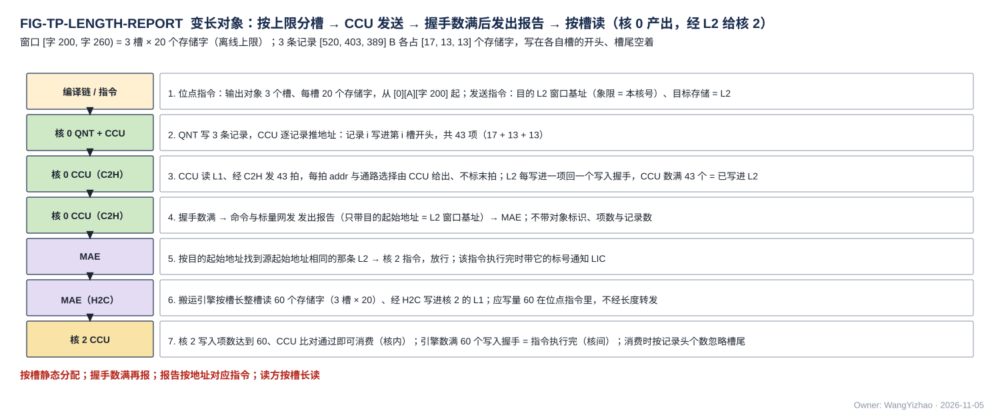

图中按时间从上到下：位点指令给输出对象的窗口 [0][A][字节 6400, 字节 8320)（容量 = 上限 640 B × 3 条）与长度表地址 [0][A][字节 8320]，发送指令给 L2 目的基址与长度表基址（象限由 C2H 链路固定 = 本核号）→ QNT 写出 3 条记录 520 / 403 / 389 B，紧挨着从字节 6400、6920、7323 起写，共 1,312 B = 41 个存储字；CCU 写累加器得到 [520, 403, 389]，对象写完后写成 1 个存储字的长度表 → 核 0 的 CCU 读 L1、经 C2H 发 41 + 1 = 42 拍，每拍的 addr 由 CCU 给出；L2 每写进一项回一个握手，CCU 数满 42 个即"已写进 L2" → CCU 向 MAE 发出报告（只带目的起始地址 = L2 窗口基址） → MAE 按目的起始地址找到源起始地址相同的那条指令放行 → 该指令先读长度表（总长 1,312 B = 41 字），先把长度表搬到核 2、再搬 41 个字 → 搬完后引擎发长度转发（应写量 42）给核 2 的 CCU → 核 2 的写计数达到 42、且已收到应写量即可消费；核 2 的 CCU 读长度表得各记录起点 0 / 520 / 923；核 2 每写进一项回一个写入握手，引擎数满 42 个即该指令执行完、通知 LIC（核间一类）。**紧挨写、长度表单独存；CCU 先发、握手数满再报；报告按地址对应指令；MAE 按表读、搬完再给应写量。**

### 4.4 完成：收发两端按指令数据量计数

**一次搬运发多少数据由指令规定（MAE 的指令、CCU 的发送指令；变长对象由 CCU 按实际长度发出、发完后发出报告，§4.3），发送侧按这个数量数自己发出的拍，写入完成按 §2.6 判定（核内由本地控制方比对写入项数；核间由发令方数写入握手），不用任何时延常数，不发逐单位的应答**（用户 11-05 夜："指令是可以规范一个 MAE 指令发的数据量的，根据这个判断不行吗"；11-06 V18-TP-37；V18-TP-28）。

#### 4.4.1 发送侧：MAE 搬运引擎或 CCU 数发出的拍

**发令方按指令给的数据量数自己发出的拍，数到即该次搬运"发送完成"**：H2C / IDN / NI / MAE_DSU / MAE_CRU 出口由 MAE 搬运引擎数；**发送完成只说明数据都已交出，指令是否执行完按目的以写入完成计——数满写入握手**（§3.8、§4.4.4，V18-TP-50）；C2H 由本核 CCU 数，对象发完、写入握手数满后向 MAE 发出报告（§4.3）。MAE 搬运引擎物理上远离 MAE 核心时（例如在 H2C 道旁），**它数满本指令的写入握手后**经命令网回一条完成短消息（§8.1 表中的"执行完成"消息，在写入握手数满后发；11-06 深夜由"发送完成"改名，V18-NAME-04）【设计者定】：要定的是哪些搬运引擎放在远处（§2.4.2）；放在远处的搬运引擎必须回这条消息，放在 MAE 核心旁的搬运引擎直接交 MAE_ENG、不发消息。**MAE 不设完成计数器**（V18-MAE-13）。

#### 4.4.2 接收侧：每写进一项回写入握手；本核消费另看核内写入项数

**核间每条写链路的接收方，在一项真正写进最终存储的那一拍沿本链路回一个写入握手，由发令方数**（§2.6、§3.8，V18-TP-50）；接收方不保存要比对的计数。**落进 L1 的数据另外照核内一类计写入项数，交本核 CCU 判断本核能否消费**。

| 接收方 | 握手回给谁（核间） | 本地另看什么 | 数满之后 |
|---|---|---|---|
| L1（4 个 LDP、NWB） | 发地址的搬运引擎（LDP 经 H2C 道汇总；NWB 经 HUB_IDN） | 本核 CCU 比对各接收桥的写入项数与应写量（位点指令或长度转发） | 引擎：该指令执行完，带标号通知 LIC；CCU：本核开始消费、报位点完成 / 切堆 |
| L2 · L2WP 第 $n$ 条（只写象限 $n$） | 核 $n$ 的 CCU | — | CCU 向 MAE 发出报告（= 已写进 L2，§4.3），或计入位点完成 |
| L2 · NI 写口 | 执行该指令的搬运引擎（NI_INT 按 `src` 分发）；PIN 事务号的留 NI-L2C 自己数 | — | 引擎：通知 LIC；PIN：NI_EXT 回 AXI B |

| LIC 专用小 SRAM（直连口） | 执行该指令的搬运引擎（经 NI_INT） | — | 引擎通知 LIC |
| DDR / 共享内存 | 执行该指令的搬运引擎（AXI 写响应经 NI_EXT 交回） | — | 引擎通知 LIC |

**不设排空信号**：写入项数与写入握手都只在写进最终存储时发生，集合器 FIFO 里还没写出的数据本来就不计，数满即已全部写入。**链路上没有单位标签、没有请求号；握手不带指令号，只带发令号 `src`**（§3.2）；C2H 在 hub 里只分流、不记单位，核 $n$ 只写象限 $n$，L2WP 上不需要源核号。

#### 4.4.3 NI 路径的乱序返回与发送完成计数

DDR 不同 AXI ID 的读返回可能乱序。**搬运引擎数着该指令还有几笔没回，用于发送完成计数（§4.4.1），不上链路，不重排**；各拍自带 addr，乱序不影响落位。

#### 4.4.4 LIC ↔ MAE 握手：MAE 每执行完一条指令就带指令标号通知 LIC；屏障归 LIC

**LIC ↔ MAE 是握手，不是完成计数器**（用户 11-06 晚："这里我认为不应该是完成计数器，而是 LIC 和 MAE 的握手机制……MAE 只需要在一个指令执行完的时候，通知 LIC 即可"；V18-MAE-13）：

- **LIC 可同时向 MAE 下发多条指令，每条带 LIC 分配的指令标号；MAE 每执行完一条，就带该标号经命令网通知 LIC**（§8.1）。
- **MAE 不设完成计数器，MAE 指令不带等待条件**：指令之间的依赖由 LIC 收到通知后再下发后续指令来表达。
- "执行完"的判据按目的分：

| 指令的目的 | 执行完 = | 写入完成由谁确认 |
|---|---|---|
| L2 | 搬运引擎数 NI 写口回来的写入握手（`src` = 本引擎号）达到应写量（§4.4.2） | MAE |
| MAE_CRU（合并指令） | 收齐参与核的发出报告后开始；写回 L2 的写入握手数满 | MAE 搬运引擎 |
| DDR / 共享内存 | AXI 写响应收齐 | MAE（经 NI_EXT） |
| 核 L1 | **写入完成**：搬运引擎数满 L1 回来的写入握手（多播 $k$ 核按 $k$ 倍计，V18-TP-50） | 引擎；目的核 CCU 另用核内写入项数决定本核何时消费，作为位点完成事件报 LIC |

**位点屏障归 LIC**（用户 11-05："屏障应该是 LIC 的任务"）：**LIC 收各核 CCU 的位点完成事件（已含写计数比对），并数收到的 MAE 完成通知**（取代"读 MAE 的完成计数器"，改 V18-TP-22），满足后发 GO、自行检测超时与位点号不匹配；MAE_CRU 不参与屏障。LIC 操作 15 的按份完成次数由 LIC 保存。

### 4.5 搬运单位是发令方内部的粒度，链路上没有标记

**搬运单位是发令方（本核 CCU、MAE 搬运引擎）内部的粒度，只用于合并点仲裁的切换边界（§3.9）；发出报告不带单位数（§4.3，V18-MAE-14）；链路上没有任何单位标记**（用户 11-06："为什么仍然有末拍的 LAST 拍？"；V18-TP-42）。逐项说明为什么不需要：

| 原先可能需要末拍标记的地方 | 现在怎样做 |
|---|---|
| 判断一批数据写完 | 按写入项数与应写量比对（§2.6：核内数写入项数，核间数写入握手），接收方不数单位 |
| NWB 的尾字写出 | IDN 每拍整字、be 全 1，无尾字（§3.5） |
| 紧密对象的尾字 | 紧密对象只经 NI 写口进 L2，每拍整宽带 be，接收桥逐拍写、不攒字（§7.2） |
| 合并点在哪拍切换源 | 合并点的仲裁器与发令方同侧，"单位发完"是发令方交给仲裁器的内部信号（§3.9） |
| 发出报告 | 只带目的起始地址，不带单位数、项数与对象标识（§4.3） |
| PIN 的 B 响应归属 | 每笔在途 PIN 事务一个发令号，该号的写入握手数满才回 B（§2.6、MAE_NI_EXT 篇 §7.6） |

写入完成不按单位判断，按写入项数（§2.6）。一个单位内各拍的地址不要求连续（逐拍给出，§3.4）；单位级合并点上单位不交错；C2H 分流不合并四核，各核写链路上只有本核的单位（§3.9）。

### 4.6 L1 / L2 不需要接收指令

接收方逐拍拿到地址、无状态，所以 L1 / L2 不需要"接收单位"指令：**接收方每写进一项回一个写入握手，由发令方数；L1 另为每个接收桥计写入项数，交本核 CCU 比对**（§2.6、§4.4.2）；L1 的比对结果用于位点完成与堆切换的判断（§4.1）。

## 5 核内协议：RRAM

**RRAM** 是核内每个单元与 L1 之间那种口的协议名（用户 11-05 定）：按 SRAM 宏的口来定义，写当拍、读固定 1 拍、没有握手。读者可以把它理解为"把 SRAM 宏的口直接拉到单元边上"：时序的确定性来自 L1 的物理 ping-pong 与 CCU 统一发读（§5.6），写侧唯一的不确定（撞 bank）被集合器的 FIFO 吸收，所以口上不需要 ready / busy。

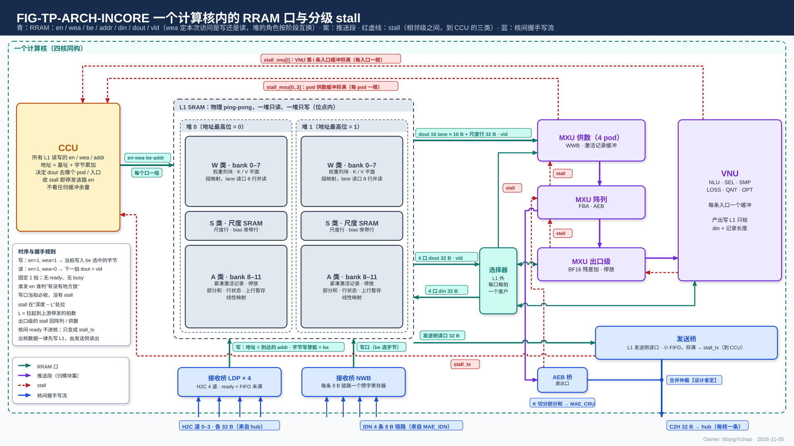

图中 L1 画成两堆、每堆三类（W / S / A）；CCU 在左侧发核内发起的所有 en / addr；右侧 MXU 供数、阵列、VNU（NLU 的出口级子模块先收 AEB 条目）顺序相连，VNU 经 L1 外的选择器用激活类口读写 L1；下方是两个接收桥（LDP、NWB，写地址来自 addr）与计算核的集成输出端口（C2H 的唯一来源：L1 发送侧读出、VNU 输出由 CCU 选一路；MXU 输出经出口级透传后算 VNU 输出，V18-TP-59）；红色虚线是 stall：供数（每 pod 一根）与 VNU（每入口一根）回到 CCU，推送段之间相邻级各一根，集成输出端口的发送 FIFO 拉 stall_tx 到 CCU，CCU 被门控、停算。

### 5.1 信号

| 信号 | 方向 | 位宽 | 含义 |
|---|---|---|---|
| en | 发起方 → L1 | 每道 1 位 | **请求本身**：为 1 的拍这一道就有一次访问 |
| wea | 发起方 → L1 | 每道 1 位 | **本次访问是写（1）还是读（0）**。只在 en = 1 的拍有意义 |
| be | 发起方 → L1 | 每道 32 位 | **字节写使能**：为 1 的字节被写，其余字节保持原值；对齐使用时全 1 |
| addr | 发起方 → L1 | 每道 24 | §2.2 的字节地址；L1 取它所在的存储字 |
| din | 发起方 → L1 | 每道 32 B | 写数据，字节放在它在存储字里的位置 |
| dout | L1 → 消费方 | 每道 32 B | 读数据，一个存储字 |
| vld | L1 → 消费方 | 每道 1 位 | 读数据有效，= 读的 en 延 1 拍 |
| wr_stall | L1 集合器 → 写方 | 每个写者 1 位 | 该写者在集合器里的 FIFO 将满；写方保持 en / wea / addr / din（§5.2）。读口没有对应信号 |

**一个口 = 若干条道，每道一个 bank、一套独立的 en / wea / be / addr / din / dout / vld**（用户 11-05："如果位宽不是 32 B，例如 128 B，它应该是 4 个 Enable 信号"）：32 B 的口就是 1 道；A 类写集合口 4 道（A 类配成 8 bank 时 8 道）；权重 lane 读口 8 道，每道一个 W 类 bank，各道的 addr 由 (列, pod 掩码) 列表给、可以不同深度。道与 bank 的接线固定，"口比 32 B 宽"只是道数多，没有"首地址 + 连续几个字"这种带状语义。

**wea 不能省：一个堆在这个阶段只写、下个阶段只读，堆的口是同一个单端口 SRAM 口，每次访问都要告诉它这次是写还是读。** 位点内 wea 对一个堆是常值（写堆全 1、读堆全 0），阶段切换时翻转；它仍由发起方逐拍给出，而不是由 L1 按"角色"自己推——L1 没有角色状态（§2.2），堆选和 wea 都来自地址与指令。wea 只区分读写；写哪些字节由 be 给出。

### 5.2 写：经集合器分道，当拍写入，无应答

**写堆每个 bank 只有一个写口；所有写者都经本类的集合器进入。** 集合器的结构（用户 11-05 定）：

- 每个写者一条入口 FIFO，每项 = 地址 + 32 B 数据 + 32 位字节写使能（深度【设计者定】，几项即可：要定的是每条 FIFO 的项数；约束是深度 > 写者到 FIFO 的在途拍数 $L$，wr_stall 在占用达到"深度 − $L$"时拉起（§6.4），其余深度用来吸收瞬时撞 bank 的顺延）；落地来源（H2C 接收桥 LDP、IDN 接收桥 NWB）的 FIFO 就是接收桥自己的 FIFO，不另加。
- **紧密写跨两个存储字时，写方（核内写者由 CCU 给地址）拆成两项，各带字节写使能、各落一个 bank。** 相邻两个存储字总在不同的 bank 上（A 类轮流落 bank，L2 象限内同样轮流），两项可同拍进两道，也可先后写入。
- 每拍集合器为每条道（= 每个 bank）从"队头正好落在这个 bank"的写者里按优先级选一个，把它的 en / addr / din 交给该道；其余写者在自己的 FIFO 里多等一拍。
- **优先级表每类一张，随位点指令由 CCU 装**；默认落地来源最高（多播各目的核独立取走、互不等待，§3.7；落地流仍先走）、IDN 次之、核内写者按位点配置；同优先级轮转。
- A 类的 bank 数可配为 4 或 8（W1 改配给激活），**道数随 bank 数变，写者侧的入口不变**。
- W 类集合口（NWB 与 H2C 多播权重块，位点内二选一 → 8 道）与 S 类写口同一规则：来源各一条 FIFO、按同一张优先级表分道；H2C 四道同时写 W 类撞 bank 时由各自接收桥的 FIFO 顺延。
- L1 内部没有仲裁；撞 bank 的处理全部在集合器。
- **每个写者在集合器出口有一个写计数，该写者的一项真正写进 bank 的那一拍加一；CCU 据此与该写者的应写量比对、判写完成**（§2.6）。落地来源的写计数就是接收桥的写计数（§7.2）。

一个类的写集合器对外的全部接口（L1 的 A 类为例；W 类、S 类与 L2 每象限的集合器同构，只是写者与道数不同，见 L1 篇 §6.4、L2 篇 §5.2）：

| 接口 | 方向 | 每个写者 / 每道 | 内容 |
|---|---|---|---|
| 写者入口 | 写者 → 集合器 | 每个写者一组 | en、addr 24 bit（核内写者由 CCU 给）、din 32 B、be 32 位；落地来源由接收桥按 addr / be 填 |
| wr_stall | 集合器 → 写者 | 每个核内写者 1 位 | 该写者 FIFO 占用 ≥ 深度 − $L$；落地来源改为拉低本链路 ready |
| 道输出 | 集合器 → bank | 每道一组（A 类 4 或 8 道） | en、wea = 1、be、addr（换算成深度）、din，道 $i$ 固定接本类 bank 列表第 $i$ 项 |
| 优先级表 | CCU → 集合器 | 每类一张 | 每个写者一个优先级，随位点指令装，位点内不变 |
| A 类配置 | CCU → 集合器 | 1 位 | 4 / 8 bank，位点边界生效；只改道数与地址 → bank 换算 |
| 写计数 | 集合器 → CCU | 每个写者一个 | 该写者的项写进 bank 的那一拍加一 |

**每拍的动作**：对每条道，在"FIFO 队头的地址换算后落在这条道的 bank"的写者中取优先级最高者（同级轮转），出队并写入；一个写者的队头一拍只能被一条道取走，没被选中的写者原样保持队头。

**选中的那一拍，addr 所在存储字里 be 为 1 的字节被 din 覆盖；没有应答。** 写者看到的只有自己 FIFO 的 wr_stall（将满才拉），不知道撞没撞 bank。写完成（§2.6）之后任何读都读到新值（读堆与写堆分开，位点内不会读到正在写的堆）。

写带宽的硬上限 = 道数 × 32 B/拍。**同一阶段并发写者的总需求不得超过它**（含落地流），由编译链保证；集合器只吸收瞬时的撞 bank。

### 5.3 读：固定 1 拍，无 ready，无 busy

**en = 1、wea = 0 的那一拍给 addr，下一拍 dout 上是 addr 所在的存储字、vld = 1。** 读出时延固定 1 拍，没有例外：读堆上没有写者；4 个激活类读口可读任一 A 类 bank，同拍撞 bank 由 CCU 排开（所有读 en 都是它发的）；L1 不拼接（数据组织篇 §1.2）、不做任何多拍访问，所以没有 ready，也没有 busy。

L2 不同：它有 4 个象限读口加 NI 读口（4 × 32 B，每象限一份）抢 bank，读不到"固定 1 拍无握手"，**L2 的读口加一根 busy**（用户 11-05），L1 不加。

**紧密读**：从字节地址 $a$ 读 $n$ 字节，覆盖第 $\lfloor a/32 \rfloor$ 到 $\lfloor (a+n-1)/32 \rfloor$ 个存储字。CCU（L2 侧为发读方）逐字发读，每个字仍固定 1 拍；**读口出口的字节对齐器按 $a \bmod 32$ 移位，拼出从第 0 字节开始的连续字节**，移位量由发读方随读地址给出。跨两个字时，L1 用两个激活类读口同拍读或一个读口读两拍；L2 的读口每口一道，读两拍，出口同样有字节对齐器（V18-L2-05）。地址是 32 的倍数时移位量为 0，对齐器直通。

L1 激活类读口出口的字节对齐器要做的事：

| 项 | 内容 |
|---|---|
| 输入 | 按地址顺序读回的存储字 $w_j, w_{j+1}, \ldots$（$j = \lfloor a/32 \rfloor$），与 CCU 随读给出的移位量 $s = a \bmod 32$（5 bit） |
| 动作 | 第 $i$ 个输出字 = $w_{j+i}$ 的字节 $s \ldots 31$ 接 $w_{j+i+1}$ 的字节 $0 \ldots s-1$；所以要保持上一个读回字到下一个字到达 |
| 输出 | 从第 0 字节起的连续字节，共 $\lceil n/32 \rceil$ 个 32 B 输出字，交该读口本拍的客户 |
| $s = 0$ | 直通，时延与对齐读相同 |

移位量随读请求怎样送到对齐器（单独的 5 bit 线或取自 addr 的低 5 位）【设计者定】，约束是与该次读的 dout 同拍到达对齐器；紧密读允许比对齐读慢（§2.5）。**L2 的 4 个象限读口与 NI 读口出口各有同样的对齐器**（V18-L2-05，L2 篇 §3.4a）：发读方（MAE 搬运引擎）只给字节地址，不移位。

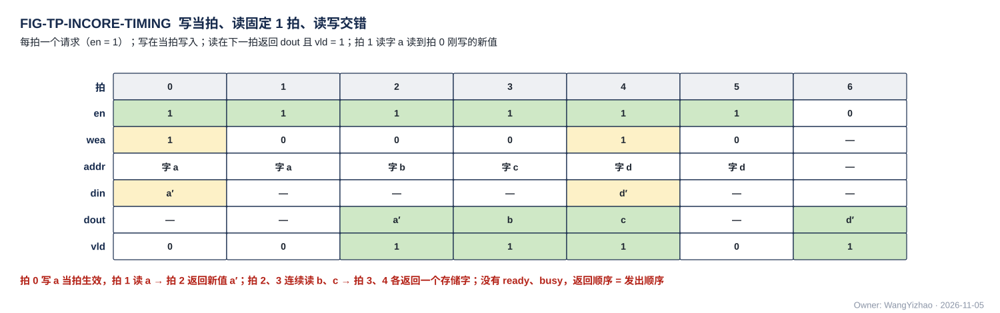

图中拍 0 写字 a，拍 1 读字 a（拍 2 返回新值），拍 2、3 连续读 b、c（拍 3、4 返回），拍 4 写 d；每一拍一个请求，返回按发出顺序一拍一个。

### 5.4 地址推理恒在 CCU

**核内单元发起的每一次 L1 读写，en 与 addr 都由本核 CCU 发出；读出的 dout 送 MXU 哪个 pod 还是 VNU 哪个入口，也由 CCU 决定。** 产出数据的单元（QNT、NLU 的出口级子模块、SEL 等）写 L1 时只给 din 和本条记录的长度，不算地址；CCU 按 §2.4 累加。唯一的例外是来自核间的落地写：接收桥（LDP、NWB）的写地址就是每拍随数据到达的核间 addr（§3.4），由 MAE 搬运引擎逐拍给出，不经 CCU。**L1 发送侧读 L1 的 en / addr 也由本核 CCU 发，送上 C2H 的每拍 addr 与核内来源的选择同样由 CCU 给出**（§2.4.2、§7.1）。CCU 从指令取基址，写入时按生产方给的长度累加，所以它在对象写入时就逐记录知道每条记录落在哪个字节，并在对象写完后写出 token 长度表（数据组织篇 §2.2）；读本核或别核产出的对象时按长度表定位（数据组织篇 §2.4）。

### 5.5 权重 lane 读口是同一种口

权重 lane 读口一拍从 8 个 bank 各读一个存储字（256 B）加同拍的尺度行，就是 §5.1 的 8 道读口；每道的 addr 由 CCU / RTR 给的 (列, pod 掩码) 列表产生（L1 篇 §6.1），时延同样固定 1 拍。

### 5.6 时序确定性的来源

时序确定来自三条已定的 L1 结构：物理 ping-pong（一堆只读、一堆只写）、读侧无仲裁（读由 CCU 统一排）、单端口宏固定 1 拍读出。写侧的撞 bank 在集合器里排先后，只表现为写者 FIFO 的 wr_stall，不影响读时延。本篇因此不写任何等待上界。

## 6 核内握手：相邻级 stall

本章回答"下游放不下时谁停"：核内数据的读请求都由 CCU 发，但数据进的是别人的缓冲，所以需要一组从缓冲回到发 en 者的 stall；它们只连相邻两级，堵塞沿链一级一级传回 CCU，而不是一根线同时冻结整核。

**用词**（用户 11-05）：**握手**指相邻两方之间的一对 valid / ready 线——核内相邻级的 stall（含到 CCU 的 stall_mxu / stall_vnu / stall_tx、写者的 wr_stall）、核间链路的 en / ready 都是握手；**反压**只用来描述握手沿链向上游传播的现象，不是一种机制；本设计**没有全局 stall**。

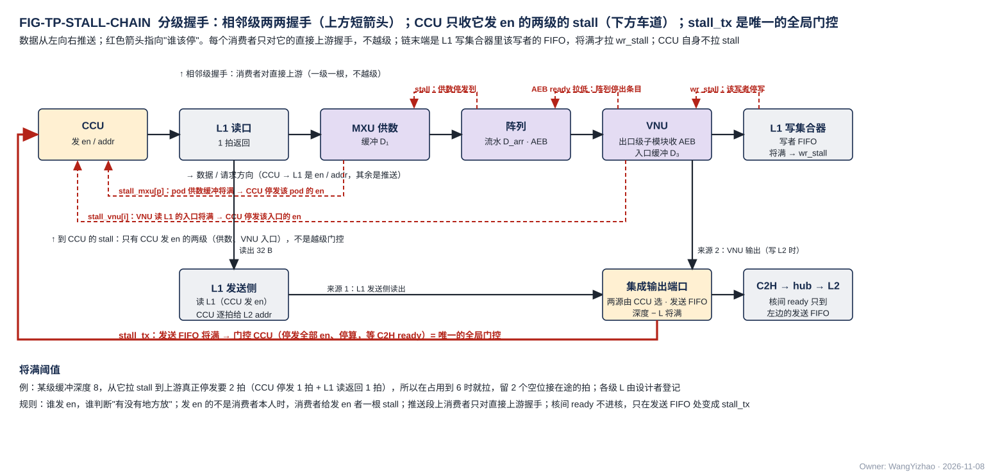

图中数据从左向右：CCU 发 en / addr → L1 读口 1 拍返回 → MXU 供数 → 阵列（AEB）→ VNU（NLU 的出口级子模块先收）→ L1 写口。红色箭头指向"谁该停"，分三类画在三处：**框上方的短箭头是相邻级握手**——阵列对供数的 stall、VNU 对阵列的 AEB ready、L1 写集合器对该写者的 wr_stall，每根只连相邻两框、消费者只对直接上游握手，不越级；**框下方两条车道是到 CCU 的 stall**（stall_mxu[p]、stall_vnu[i]），只因为这两级的数据是 CCU 发 en 读来的，消费者给发 en 者一根 stall，不是越级门控；**最下一行是计算核的集成输出端口**：它的两个核内来源——L1 发送侧读出（CCU 发 en 读 L1、逐拍给 L2 addr）与 VNU 输出（写 L2 时；经出口级透传的 MXU 输出也在内，V18-TP-59）——由 CCU 在单位边界选一路进发送 FIFO，核间 ready 只到这个 FIFO，FIFO 将满拉 stall_tx 从 CCU 左侧进入——这是核内唯一的全局门控（CCU 停发全部 en、停算，等 C2H ready，§7.1）。下方是"将满阈值"的一个数值例：深度 8、在途 2 拍，占到 6 就拉。

### 6.1 规则

**谁发 en，谁承担"有没有地方放"的判断；发 en 的不是消费者本人时，消费者给发 en 者一根 stall。** CCU 发所有 L1 读的 en，但读出来的数据进的是 MXU 供数缓冲或 VNU 入口缓冲，所以这两类消费者各给 CCU 一根 stall。写 L1 的 stall 只有一种：写者在集合器里的 FIFO 将满（wr_stall，§5.2）。

### 6.2 到 CCU 的 stall

| stall | 谁拉 | 何时拉 | CCU 的动作 |
|---|---|---|---|
| stall_mxu[p]，$p = 0 \ldots 3$ | pod $p$ 的供数缓冲（WWB、激活记录缓冲） | 将满 | 停发该 pod 的 L1 读 en |
| stall_vnu[i] | VNU 第 $i$ 条入口的缓冲 | 将满 | 停发该入口的 L1 读 en |
| stall_tx | 计算核集成输出端口的发送 FIFO（§7.1） | 将满（C2H 的 ready 拉低、FIFO 堆积） | **CCU 被门控：停发全部 en、停算，等 stall_tx 撤销再继续**（用户 11-07："C2H 不 Ready 时，CCU 需要被 Gating 住，等待 C2H Ready 再继续计算数据"；V18-TP-56） |
| wr_stall[w] | 写者 $w$ 在 A 类集合器里的 FIFO（§5.2） | 将满 | 到写者本身（QNT、NLU 等），不到 CCU；CCU 发的写 en 若落在该写者，由写者保持 |

MXU、VNU 的输出直接出核时同样进这个发送 FIFO（§7.1），不另设发送桥、不另拉 stall。

**CCU 不看任何缓冲的余量，只看这些 stall。** 这就是 CCU "只做地址推理和顺序推进"的含义。

### 6.3 推送段相邻级握手

供数 → 阵列（AEB）→ VNU → L1 写集合器是推送链（出口级是 NLU 的子模块，阵列的 AEB 条目直接交 VNU，V18-NLU-06）：上游按节拍往下送，不等下游发请求；链的末端是集合器里的写者 FIFO，只在撞 bank 的瞬时才堆积（并发写总需求 ≤ 道数 × 32 B/拍由编译链保证），所以链本身极少从末端被卡住。**每相邻两级之间一根 stall，只在相邻级之间传，不跨级，不设核级 stall 线。** 下游满了，先堆满上一级的缓冲，再由上一级拉它的上游，几拍之内传到供数缓冲、变成 stall_mxu 到 CCU。L1 写口与 CCU 自身不拉 stall。VNU 的输出（含经 NLU 出口级子模块透传的 MXU 输出）由 CCU 按指令选写 L1 或直接推进集成输出端口（§7.1，V18-TP-56 / 59）；推进集成输出端口时，C2H 的停顿经 stall_tx 门控 CCU（§6.2）。

| 相邻级 | stall 方向 |
|---|---|
| 供数 → 阵列 | 阵列 → 供数（阵列流水不能冻结时由供数侧缓冲吸收，归 MXU 篇） |
| 阵列（AEB）→ VNU（NLU 出口级子模块） | VNU → 阵列（对 AEB 条目拉低 ready；AEB 堆满再反压 FBA / 供数，归 MXU 篇与 NLU 篇） |
| 输出 → 集成输出端口（发送 FIFO） | 经 stall_tx 门控 CCU（§6.2），不逐级回传 |

### 6.4 将满阈值 = 深度 − 在途拍数

**每级在拉 stall 时必须还能再收 $L$ 拍，$L$ 是从本级拉 stall 到上游真正停发之间的流水深度（含 L1 的 1 拍读返回、阵列的流水深度）；所以 stall 在"深度 − $L$"处拉，不在满时拉。** 各级的 $L$ 由设计者登记：

| 级 | 发 stall 方 | $L$ 的组成 | 值 |
|---|---|---|---|
| 供数缓冲 → CCU | pod 供数 | CCU 停发 1 拍 + L1 读返回 1 拍 | 【设计者定】 |
| VNU 入口 → CCU | VNU | 同上 | 【设计者定】 |
| VNU（出口级子模块）→ 阵列 | VNU | 阵列流水深度（AEB 吸收在途条目，深度归 MXU 篇） | 【设计者定】 |
| 集成输出端口 → CCU | 发送 FIFO | CCU 停算到最后一拍输出进 FIFO 的流水深度（含 MXU / VNU 流水） | 【设计者定】 |

表中【设计者定】的是各级 $L$ 的拍数，由该级的设计者按自己的流水登记；**约束是该级缓冲深度必须大于 $L$**，否则拉 stall 时已经放不下在途的 $L$ 拍。深度在 $L$ 之上多出的部分决定上游能连续送多少拍而不被停，是性能参数，不影响正确性。

### 6.5 C2H 不 ready：门控 CCU

**核间链路的 ready（§3.3）只到计算核的集成输出端口；端口的发送 FIFO 吸收 ready 的抖动，将满时拉 stall_tx，CCU 被门控、停算，等 ready 恢复再继续**（用户 11-07："C2H 不 Ready 时，CCU 需要被 Gating 住，等待 C2H Ready 再继续计算数据"；V18-TP-56）。核内其他单元看不到 ready。只写 L1 的指令不受 C2H 影响。

## 7 桥：核内口 ↔ 核间口

桥是核内"无握手、固定拍数"与核间"逐拍握手、拍数不定"两种规则的交界：桥里的 FIFO 把 ready 的抖动挡在核外（集成输出端口的发送 FIFO）或把撞 bank 的顺延挡在 L1 / L2 里（接收桥），所以两边的协议都不需要为对方改动。

### 7.1 计算核的集成输出端口：C2H 的唯一来源

**每核只有一个核间发送口——计算核的集成输出端口，它是 C2H 的唯一来源；端口里一个发送 FIFO（addr、data、en 三条同步 FIFO 即可，深度【设计者定】），将满时拉 stall_tx 门控 CCU**（用户 11-07："对于 C2H 口，它只有一个来源，即 CC 的集成输出端口，在 CC 内部，由 CCU 来控制数据来源"；"C2H 不 Ready 时，CCU 需要被 Gating 住，等待 C2H Ready 再继续计算数据"；V18-TP-56）。FIFO 深度要定的是项数，约束同 §6.4：深度 > CCU 停算到最后一拍进 FIFO 的在途拍数 $L$，将满阈值 = 深度 − $L$。

| 核内来源 | 数据 | 触发 |
|---|---|---|
| L1 发送侧 | L1 中任何对象（紧凑记录、残差、部分 dX、位图与列表、旋转后的 K …） | 本核 CCU 的发送指令：CCU 发读 L1 的 en / addr，逐拍给出 C2H 上的 L2 addr |
| VNU 输出 | 量化记录、标量（$\Sigma x^2$、组最大值、$(m_{\text{run}}, l)$ 等）、读集位图等；**以及经 NLU 出口级子模块透传的 MXU 输出**（AEB 的 K 切分部分和、位点指令选直接写 L2 的归约结果，V18-TP-59） | **由 CCU 按指令选写 L1 还是直接写 L2，二选一，不两边都写**；写 L2 时 CCU 推算每拍的 L2 地址（用户 11-07："VNU 和 MXU 的输出可以由 CCU 直接推算要写在 L2 SRAM 的地址，然后走核间协议，不过也要支持输出写回到 L1 SRAM"；"不要支持两边都写"；11-08："如果需要走C2H，先过VNU透传"） |

**CCU 在单位边界选一路，单位在 C2H 上永不交错**（§3.9）；CCU 数着本单位发了几拍，单位发完不上链路。对象发完、L2 回来的写入握手数满后 CCU 向 MAE 发出报告（§4.3）。C2H 每核 32 B/拍，输出速率高于它的位点由编译链选写 L1。AEB 部分和经 NLU 的出口级子模块透传，算作 VNU 输出上 C2H（V18-NLU-06 / TP-59）。

**跨核合并都经 L2**（V18-CRU-07、V18-TP-55）：K 切分的部分和、读集合并的位图、要跨核合并的标量，都是各核经 C2H 写进本核象限的同一象限内地址（同址异象限），MAE 收齐发出报告后由 MAE_CRU 从 L2 读四个象限、合并、写回 L2；要到核 L1 时再由一条 L2 → L1 指令经 H2C 送下去，VNU 从 L1 读用。核间的小消息（K 切分判决、区块并集、改写后的节点档表）当 ③ 档数据走 C2H → L2 → H2C 多播（用户 11-05），不另设通路。事件、发出报告走命令网（§8），不经数据网；**标量不走命令网**（用户 11-07："他们不属于控制网，需要走数据通信协议"）。

### 7.2 接收桥挂在 L1 / L2 的写口上

H2C 四道各一个接收桥（LDP）、IDN 一个接收桥（NWB）是 L1 写集合器的来源，L2 的 L2WP 四条写链路（每核一条）与 NI 写口同理：**核间从口 + 一条入口 FIFO，FIFO 就是它在集合器里的队列；ready = FIFO 未满**（用户 11-05："反压的信号来自于写入时的 FIFO"）。be 随数据进 FIFO，就是该项的字节写使能。落地来源在集合器里优先级最高，正常情况下 FIFO 不会积压，ready 几乎恒高；撞 bank 的瞬时顺延由 FIFO 吸收。**NWB 与 LDP 相同：一条 32 B 的 IDN 链路、一条入口 FIFO，一个存储字一拍整字写入**（§3.5，V18-HUB-04），FIFO 将满拉低本核 IDN 链路的 ready。**紧密对象只经 NI 写口进 L2，每拍整宽带 be，NI 写口的接收桥逐拍写、不攒字**，所以没有一个接收桥需要知道单位在哪拍结束（V18-TP-42）。各接收桥是 §3.3.2 通用链路块的实例。

**每个接收桥在它的一项真正写进最终存储的那一拍，沿本链路反向回一个写入握手（带该项的 `src`），由发令方数**（核间一类，§2.6、§3.8，V18-TP-50）：L2WP 第 $n$ 条回核 $n$ 的 CCU；NI 写口回 NI_INT，再按 `src` 分给引擎；LDP 回 H2C 道，汇总后交发地址的引擎；NWB 沿本核 IDN 链路回 HUB_IDN，再交引擎。**L1 的接收桥另外照核内一类计写入项数**：4 个 LDP、NWB 各一个，写进 bank 时加一，交本核 CCU 判断本核能否消费（§2.6）。

L2：**每象限一个集合器，2 个来源入口 FIFO（核 $q$ 的 L2WP 链路一条、NI 写口一条，各 32 B/拍）→ 4 条 bank 道（本象限一堆 4 个 bank，每道 32 B/拍，按堆选写两堆之一）**（V18-L2-04）。每拍每条道从队头落在该道 bank 的 FIFO 里选一项写进 bank，撞 bank 的项留在各自 FIFO 下拍再选，规则与 L1 集合器相同（§5.2）；**两来源的先后是 RTL 头文件参数**（PIN 外设写的等待上界靠它，上界值【设计者定】；§3.9）。某来源的 FIFO 将满即拉低该来源链路的 ready（核 $q$ 的链路 → 核 $q$ 的 C2H 停发；NI 写口 → NI-L2C 停发），另一来源不受影响。每源每拍至多一项，一个象限每拍至多写进两项，4 条写道总是够用。

### 7.3 位宽 1:1，没有拆拍

核内字 32 B = 核间拍 32 B = 存储字 32 B，桥不拆拍、不拼拍。核内 256 B 的权重 lane 读口是读口，由发 en 的一方按自己 FIFO 的余量控速，不产生位宽上的握手。

### 7.4 MAE_CRU 的握手

MAE_CRU 是 MAE 组的合并单元（部分和归约、标量合并、读集合并），与 MAE_DSU 并列：**搬运指令的运算字段经 MUX 选"经 MAE_CRU 合并"时数据才过它；一组合并就是一条搬运指令：源 = L2（NI 读口一拍读四个象限同址），运算 = 合并，目的 = L2（经 NI-L2C）**（V18-MAE-11 / 12、V18-CRU-07）。**启动条件 = MAE 收齐参与核写 L2 后的发出报告**（用户 11-07："CC 完成后会发握手信号，MAE 识别握手信号决定下一级操作"）。进出都握手、地址与反压由 MAE_ENG 统一控制（V18-MAE-25）：

| 方向 | 对端 | 握手 |
|---|---|---|
| 入：四个象限同址的四份 | NI 读口（L2 的 4 × 32 B 读口，由 NI_INT 的返回车道交来） | 每象限 busy 时该份顺延，四份到齐才合并（MAE_CRU 篇 §4.1） |
| 出：合并结果写 L2 | NI-L2C 的写客户（五源之一）→ NI 写口 → L2 | NI-L2C 对该客户的 ready；L2 写进后回写入握手给引擎 |

**MAE_CRU 不连核间链路，也不在命令网上**（V18-CRU-07、V18-TP-55）。每完成一条合并指令，由 MAE 带指令标号通知 LIC（§4.4.4）。**MAE_CRU 合并的并行 lane 数可配【设计者定】**（用户 11-05："对 CRU 并行处理的 Lane 要求为可配的"）。

## 8 命令网协议：64 bit 握手消息流

命令网承载一切"不是 32 B 存储字"的控制往来：CCU 指令、搬运指令、事件、发出报告与长度类报告。**标量不走本网**：它们是数据，经 C2H 写 L2、由 MAE_CRU 合并（用户 11-07："如果是控制网，我认为他们不属于控制网，需要走数据通信协议"；V18-TP-55）。它与数据网物理分开、用同一个通用链路块，所以数据网再拥堵也不会挡住 GO 或长度转发，反之亦然；读者可以把它看作数据网的控制面，§4 的完成判据所需的应写量都经它送达。

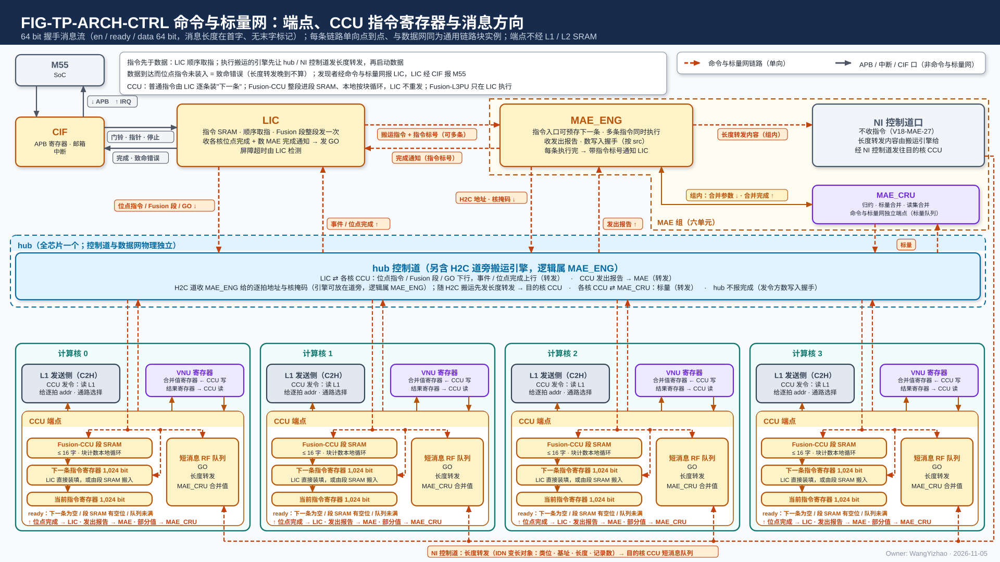

图中 LIC 在上排左；MAE 组（虚线框）在上排右，画出有命令网端点的两个单元：MAE_ENG 与 NI 控制道口（不收指令，只把搬运引擎给的长度转发内容发往目的核，V18-MAE-27），二者合一个端点；MAE_CRU 不在本网上（V18-TP-55）。LIC ⇄ MAE_ENG 两条线：下行是搬运指令（带指令标号），上行是**完成通知（带指令标号）**，MAE 不设完成计数器。hub 控制道在中间横贯，四个核的 CCU 端点（C2H 由 CCU 发令，对象发完向 MAE 发出报告）在下排，VNU 不在本网上；hub、NI、L1 都不向 MAE 报完成（完成按写计数，§2.6、§4.4），可选的"执行完成"只在搬运引擎远离 MAE 时用，图中不画；每条线都是通用链路块的实例（§3.3.2）；每条线单向，线上标消息类型；LIC 与 MAE 到核的每一条消息都经 hub 控制道；GO 由 LIC 发（屏障 = 位点完成事件 + MAE 完成通知，归 LIC）；CCU 框内画出当前 / 下一条两个指令寄存器、Fusion-CCU 段 SRAM 与短消息 RF 队列。CIF ↔ M55 的 APB 与中断不属于命令网。

### 8.1 端点与方向

| 消息 | 发送方 → 接收方 | 载荷 | 字数（64 bit） | 触发 |
|---|---|---|---|---|
| 位点指令 / Fusion 段 | LIC → 核 $c$ 的 CCU | 1,024 bit 指令字 × 成员数 | 1 + 16 × 成员数 | LIC 顺序取指 |
| GO | LIC → CCU | 位点号 | 1 | LIC 收齐各核位点完成事件并数到所需的 MAE 完成通知（屏障归 LIC，用户 11-05；V18-MAE-13） |
| MAE 指令（搬运指令） | LIC → MAE | 指令字段 + **LIC 分配的指令标号**；对 C2H 来源的指令标明"源来自核 $c$ 的 C2H"（§8.5） | 1 + n | LIC 顺序取指；**可同时下发多条**（V18-MAE-13 / 14） |
| **完成通知** | **MAE → LIC** | **指令标号** | 1 | **每条 MAE 指令执行完**（判据见 §4.4.4；每条 CRU 合并指令同样通知）；MAE 不设完成计数器（V18-MAE-13） |
| H2C 搬运指令 | MAE_ENG → 放在 H2C 道旁的远端搬运引擎（引擎放在 MAE 中央时没有这条消息，改由引擎直接给 H2C 道逐拍的 L2 读 en / addr、目的 addr / be 与核掩码；hub 只收解码后的控制，V18-MAE-27 / NAME-02） | 搬运指令的字段（MAE_ENG 篇 §3.2）：口对 L2 → 核 L1、两端地址生成器与几何、核掩码、象限掩码与四道并行规则（MAE_ENG 篇 §5.9）、长度（变长对象 = token 长度表各项之和，列表驱动时取列表计数） | 1 + n | MAE 按 LIC 下发的指令分配 |
| 长度转发 | hub → 目的核 CCU（H2C 搬运）；NI → 目的核 CCU（IDN 搬运，走 NI 控制道） | 段选、基址、应写量 | 1 + 1 | 搬运指令执行完后发，不要求先于数据到达（§8.6）；**应写量 = 引擎本指令实际发出的写入项数**（V18-TP-58），覆盖变长对象、列表驱动 gather（= 列表计数 × 项字节数）与经 PIN / M1 进来的外部对象；定长对象的应写量在位点指令里，不经它 |
| 执行完成（搬运引擎远离 MAE 时）【设计者定】 | 远端 MAE 搬运引擎 → MAE | 搬运引擎号 | 1 | 搬运引擎数满本指令的写入握手（§3.8、§4.4.1） |
| 发出报告 | CCU → MAE | 目的起始地址（类选即 L2 象限） | 1 + 1 | 对象经 C2H 发完且写入握手数满（= 已写进 L2，§4.3）；**按目的起始地址对应源起始地址相同的那条 MAE 指令**（V18-MAE-14 修订） |
| 事件 / 位点完成 | CCU → LIC | 事件号 | 1 | CCU |

表中"字数"列的 $n$ 是载荷字数，由消息类型与首字决定，各字段位宽归 ISA（§8.5）。致命错误从 LIC 出 M55 的口在 CIF，不在本网。本网没有标量消息，MAE_CRU 也不是本网端点（V18-TP-55）：标量是 VNU 的输出，与其他数据同走 C2H → L2；MAE_ENG 给 MAE_CRU 的合并参数是 MAE 组内信号，不在本网上。

**拓扑**：每条链路单向、点到点，目的由链路本身决定，不设 addr；物理上走 hub 的控制道与 NI 的控制道，与数据网完全独立——命令网的握手不受数据网影响，数据网也不等命令网。端点清单、链路条数与 FIG-TP-ARCH-CTRL 见架构篇 §5。

### 8.2 端点形态：两个指令寄存器 + Fusion 段 SRAM，短消息 RF 队列

**端点都不经 L1 / L2 SRAM。CCU 的指令端点是两个 1,024 bit 指令寄存器——当前指令与下一条指令——任何指令都从"下一条"寄存器进入执行（用户 11-05 定）；下一条寄存器有两个来源：**

| 来源 | 装填 | 用在哪 |
|---|---|---|
| LIC 经命令网直接装填 | 一条普通 CCU 指令（16 字）写进"下一条"寄存器；ready = 下一条寄存器为空 | 位点级指令、块数少或块很长的 Fusion |
| CCU 自己的 **Fusion-CCU 段 SRAM** | LIC 把整段（段头 + 成员）经命令网一次写进段 SRAM；CCU 的段计数器按 LIC 操作 15 的工作块数在本地循环，逐条把成员搬进"下一条"寄存器；ready = 段 SRAM 有空位 | 成员短、块数多的 Fusion（attention 的 tile 循环），见 §8.3 的必要性 |

其他端点：

| 消息类 | 端点 | 说明 |
|---|---|---|
| 搬运指令（只到远端搬运引擎，如 H2C 道旁的引擎；NI_INT、HUB_IDN、MAE_DSU、MAE_CRU 不收指令，只收引擎解码后的控制信号，V18-MAE-27） | 指令队列 SRAM 或 RF，深度【设计者定】（要定的是能排队的指令数；约束：ready 按将满阈值拉低，深度 > 链路在途拍数；队列满时 MAE 停发，只降速） | ready = 队列未满 |
| 短消息（执行完成（可选）、事件、GO、发出报告、长度转发、MAE → LIC 的完成通知） | RF 队列 | 一两拍消费；深度【设计者定】；ready = 队列未满。 |

段 SRAM 的容量 = 每核 Fusion-CCU 段长上限（编译链限制，参考 16 条 1,024 bit 指令 = 2 KB【设计者定】；这里的"条"是一条 16 个 64 bit 字的 CCU 指令，不是网上的 64 bit 字），超限的段由编译链拆分。要定的是容量；约束是装得下编译链允许的最长 Fusion-CCU 段（段头 + 全部成员），两者须一致。段 SRAM 没有类选、不在数据网上。

### 8.3 Fusion：Fusion-L3PU 由 LIC 执行，Fusion-CCU 整段进 CCU 本地循环

**Fusion-L3PU（组合 MAE、CCU 与同步指令的段）只在 LIC 执行：LIC 按段内顺序向 MAE、hub、各核 CCU 发各自的成员，CCU 看不到这种段。Fusion-CCU 段（同一核上的普通 CCU 指令序列）由 LIC 经命令网一次写进该核的段 SRAM，CCU 按 LIC 操作 15 的工作块数本地循环，LIC 不逐块重发；块数与录取相关的循环终止都在 CCU，LIC 只收段完成事件。**

为什么 Fusion-CCU 需要段 SRAM 而不能只靠两个寄存器由 LIC 逐块重发：一条指令在 64 bit 命令网上是 16 拍；attention 的一个 tile 循环含 4–6 条成员（粗算、判决、精算、P×V、状态更新、量化），其中判决与状态更新一类成员的执行时间不到 16 拍，逐块重发时 CCU 会等指令，而一核每 tile 要收 64–96 拍的指令流、四核的成员又不尽相同（归约属主等字段按核不同，不能一律多播）。块长、成员执行时间远大于 16 拍的 Fusion（线性层按列块循环）可以不用段 SRAM，由 LIC 逐条装填"下一条"寄存器——两种装填方式对 CCU 的执行前端是同一个"下一条"寄存器。

**MAE_CRU 的合并参数随 MAE 搬运指令**（用户 11-06 晚："那 MAE 不应该全是搬运指令？"；V18-MAE-12）：合并种类（归约、标量合并、读集合并）、象限掩码、L2 源与目的地址是搬运指令里的参数，**不设独立的 CRU 配置操作**；在 Fusion-L3PU 段里它就是 LIC 交给 MAE 的一条搬运指令，LIC 只排序与分发、不直接给 MAE_CRU 发令（用户 11-05："CRU 应该交给 MAE 发令"）。原则：**源在核外的搬运由 MAE 发令，源在核内的由本核 CCU 发令；搬运途中按固定规则的合并（MAE_CRU）由 MAE 的搬运指令选用**（用户 11-05 认可，11-06 按 C2H 改 CCU 主修订；V18-TP-35；11-06 晚 V18-MAE-12）。

### 8.4 信号

| 信号 | 位宽 | 用法 |
|---|---|---|
| en / ready | 1 / 1 | 握手，与数据网同名同义 |
| data | 64 bit | 消息字 |

**没有末字标记、没有 be：消息长度由类型与首字决定**（首字含长度，§8.5），接收方按首字给出的字数收完一条消息（V18-TP-42）。

**命令网的每条链路也是 §3.3.2 通用链路块的实例**（$W$ = 64 bit，无旁带；用户 11-06，V18-TP-38），与数据网同一块、同一套寄存器输出与 skid 条款；hub 控制道、NI 控制道是它的实例加各自的仲裁器。

### 8.5 消息骨架

**每条消息 = 首字 + 载荷字。首字含类型、源、长度；字段位宽归 ISA。** 载荷：

| 消息 | 载荷字 |
|---|---|
| 位点指令 / Fusion 段 | 每个成员 16 字（1,024 bit 指令字，ISA 已定） |
| 搬运指令（MAE） | **字段见 MAE_ENG 篇 §3.2**：指令标号（LIC 分配）、口对、源端与目的端各自的地址生成方式与参数（算术 / 列表驱动）、几何、核集合、运算字段（直通 / 经 MAE_DSU：整形模式与参数 / 经 MAE_CRU：合并种类、象限掩码、L2 源 / 目的地址）、第二目的（可选）、优先级、长度（指令给定；列表驱动时取列表计数）、象限掩码与四道并行规则（V18-MAE-28）；没有完成计数号、等待条件与环长；由搬运引擎展开成逐拍地址；字段位宽归 ISA |
| 完成通知 | 指令标号 |
| 执行完成（可选） | 搬运引擎号 |
| 发出报告 | 目的起始地址（象限由 C2H 链路固定，不带象限选） |
| 长度转发 | 段选、基址、应写量（写入项数）；**MAE 搬完一条指令后以实际发出量发**（V18-TP-58，§4.3 第 5 条） |

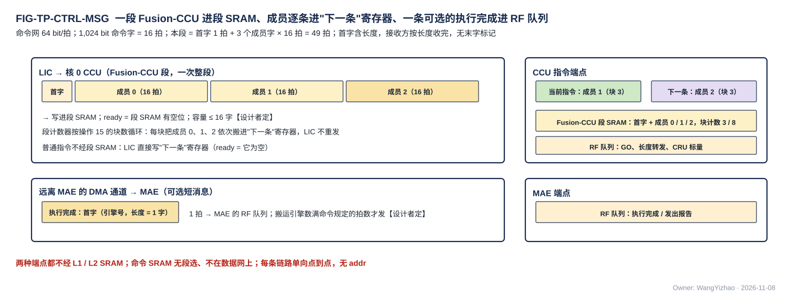

图中 LIC → CCU 链路上先后到达首字与 3 个成员字（各 16 拍），整段写进 Fusion-CCU 段 SRAM；CCU 的段计数器按块循环，把成员逐条搬进"下一条"指令寄存器，当前指令寄存器里是上一条成员；同一时间一条远离 MAE 的搬运引擎 → MAE 的链路上一条 1 字的执行完成（可选，§4.4.1）进 MAE 的 RF 队列，首字里的长度 = 1 字，接收方据此知道这条消息到此为止。

### 8.6 顺序与时延

- 同一链路保序。
- **指令先于数据发出**：LIC 顺序取指保证搬运指令先于依赖它的数据指令发出；执行搬运的引擎先搬长度表、再搬数据，搬完后让 hub 控制道（H2C）或 NI 控制道口（IDN）把长度转发（应写量 = 实际发出量）发往目的核（§4.3 第 5 条）。
- **长度转发不要求先于数据到达**（V18-TP-44）：长度转发走命令网、数据走数据网，两张时延无关的网保证不了到达先后。**数据可以先落地**——接收方无状态、按 addr 写，不需要长度；**长度转发只门控目的核 CCU 的完成判定（写计数 ≥ 应写量）**，记录定位用长度表、不用它；晚到时 CCU 等它，不是错误。
- **数据到达而对应位点指令尚未装入 CCU = 致命错误**，不停顿、不缓冲；长度转发晚到不属于这一情形。

## 9 错误

**违反本协议的事件只有致命一类：数据到达而对应配置未就绪（在 L1 指对应位点指令尚未装入 CCU、堆选 / 类选未定义时有落地写到达；长度转发晚于数据到达不算，§8.6）、段内地址超出该段容量、压紧激活对象超位点窗口、W 类或 S 类的读写地址不是 32 的倍数。** 发现者经命令网报 LIC（L2 的经 hub 控制道）；**VNU 各单元在本网上没有端口，它们发现的致命错误由本核 CCU 转报**（用户 11-05 定）——窗口与长度表地址在 CCU 指令里，写累加器也在 CCU，超窗口多数情形由 CCU 直接发现。LIC 经 CIF 报 M55，由 M55 决定。各链路、各口的断言清单是验证交付物，不在本篇。

## 10 由谁保证

以下事项协议不检查，由对应方保证：

| 事项 | 由谁保证 |
|---|---|
| 两堆的读写方向在位点内一致，堆选由指令的段选字段给 | 编译链 / CCU |
| 类内各对象的地址互不重叠（压紧激活对象按位点窗口静态分配） | 编译链 |
| 每位点的封顶值与窗口 | 算法侧（模型表） |
| 目的空间在数据到达时已读完（预取距离、缓冲轮转） | 编译链（LIC 操作 15） |
| 指令先于数据发出；长度表先于数据搬运；长度转发在搬完后发、不要求先于数据到达，CCU 等它再判完成 | LIC 顺序取指 + hub / NI 内部顺序；MAE 搬运引擎；CCU |
| token 长度表在对象写完后写出（本核消费写 L1，跨核经 C2H 写 L2）；对象、长度表、列表各有编译链地址 | CCU / 编译链 |
| 聚集前先读各窗口对象的长度表；搬完后以实际发出量发长度转发 | MAE 搬运引擎 |
| 压紧激活对象不超位点窗口 | SEL（封顶模式）/ QNT |
| 同一阶段并发写者的总需求 ≤ 集合口道数 × 32 B/拍（含落地流） | 编译链 |
| 集合器优先级表随位点指令装好 | CCU |
| 同拍读同一 A 类 bank 的请求错开 | CCU |
| MAE_CRU 归约值（输出编码由指令给，默认 BF16；V18-CRU-08）对回（token, 列块），即归约在飞表 RIFT 的功能 | CCU 地址推算：**归约值落在哪个存储字由引擎给的地址决定，CCU 按地址推出属于哪个（token, 列块）**；超 32 B 的一组占连续几个存储字、分多拍发，**不带组序号**（V18-CRU-01 / 02 / 05；MAE_CRU 篇 §5.1） |
| 发出报告在依赖它的搬运指令之前到 MAE | CCU（对象发完触发） |
| 发出报告按目的起始地址对应源起始地址相同的那条 MAE 指令（报告不带对象标识） | 编译链：每个变长对象有静态分配的窗口基址，同一时间在飞的对象基址互不相同 |
| 每条 MAE 指令带指令标号；MAE 每执行完一条就带标号通知 LIC；指令间依赖由 LIC 收到通知后再下发表达 | LIC（分配标号、按通知分发）/ MAE（按 §4.4.4 判据通知） |
| MAE 搬运的数据不用环形缓冲，跨环尾拆成两条指令（MAE 不回绕） | 编译链 |
| 对象起点在存储字边界；W 类、S 类地址是 32 的倍数；③ 档记录紧挨、段按字节对齐 | 编译链 / 生产方（QNT 等） |
| 紧密写只用于写堆里从头顺序拼出的新对象 | 编译链 |
| 跨存储字的一拍在存储内部拆成两个 bank 的写、读口出口移位；MAE / hub / CCU 只给逻辑字节地址与 be | L1 / L2 |
| 各级 $L$ 与将满阈值 | 各模块设计者 |
| 核内累加的步长与基址正确 | CCU |
| 每拍 addr 正确（H2C / IDN / NI / MAE_DSU / MAE_CRU 出口）；经 IDN 时每个字的字地址与核集合 | MAE 搬运引擎 |
| C2H 的核内来源选择（L1 发送侧 / MXU / VNU 输出）、读 L1 的 en / addr、每拍 L2 addr；C2H 不 ready 时停算 | 本核 CCU |
| 同链路保序；多播各目的独立取走 | hub、HUB_IDN |
| 单位级合并点只在单位边界切换源（边界由发令方给出，不上链路） | 集成输出端口（CCU）、NI-L2C、NI_INT 的 IDN 出口的仲裁器 |
| C2H 在 hub 里直通 L2 的本核写链路，不扇入、不仲裁、不分路；核 $n$ 只写象限 $n$；L2 集合器 2 来源逐项选（先后为 RTL 头文件参数） | hub；L2 集合器（象限由链路固定） |
| 核内写入项数在写进 bank 时加一：L1 写集合器的每个写者（含 LDP、NWB） | L1 写集合器 |
| 跨核合并：收齐参与核的发出报告才从 L2 读 | MAE 搬运引擎 |
| L2 每写进一项沿来源链路回一个写入握手（NI 写口带 `src`） | L2 象限集合器 |
| 发令号分配：每个搬运引擎一个、每笔在途 PIN 事务一个、每核 CCU 一个；任何时刻一个号只对应一条未完成的指令 | MAE_ENG / NI-L2C / CCU |
| PIN 每笔 AXI 写事务取一个发令号，该号的握手数满才回 B | NI-L2C、NI_EXT |
| 每条核间写链路的接收方在写进最终存储时回写入握手（带 `src`） | L1（LDP、NWB）、L2、LIC 小 SRAM；片外为 NI_EXT 转交的 AXI 写响应 |
| 应写量与写入项数 / 握手数的比对，达到后才报完成 / 切堆 / 发读 / 发出报告 | CCU（核内写入项数、C2H 的握手）、MAE 搬运引擎（H2C / IDN / NI 写 / LIC 直连口 / 片外的握手） |
| NI 写一个单位不跨象限；象限掩码广播 $k$ 个象限时应写量按 $k$ 倍计 | MAE 搬运引擎 |
| 所有核间链路由通用链路块例化（寄存器输出 + skid、将满阈值 = skid 深度 − 在途拍数） | 各模块设计者 |
| 通用链路块的参数（数据位宽、旁带位宽、skid 深度、流水级数） | 各模块设计者 |
| 对象写完（写计数达到应写量、写堆切为读堆）才发出，不做流式转发 | CCU / 编译链 |
| PIN 的 L2 窗口按（调用种类, 输入种类）固定 | 编译链 |
| 位点屏障：收齐位点完成事件、数到所需的 MAE 完成通知、发 GO、超时与位点号检查 | LIC |
| MAE_CRU 的合并参数（合并种类：归约 / 标量合并 / 读集合并；象限掩码；L2 源与目的地址）随搬运指令到位；每完成一条合并指令由 MAE 带指令标号通知 LIC | MAE |
| 标量是 VNU 的输出：要跨核合并的经集成输出端口写 L2（或先写 L1 再发）；合并值经 H2C 落 L1 后由 VNU 读用 | CCU |
| MAE_CRU 各类合并的并行 lane 数按时延需要配置 | 设计者 |
| Fusion 段不超槽容量 | 编译链 |
| 输出轴稀疏权重按整列发给属主核（属主核的链路每拍一个整字，32 B/拍）；各核轮到的字数比例与核集合随搬运指令给出 | MAE、HUB_IDN |

## 11 为什么

- **11-06 晚冲突项裁定**：MAE_CRU 输出只保留 BF16 直出（用户："只保留 BF16 直出、撤掉 MXFP6 g32 输出"，V18-CRU-02）；一组合并 = 一条搬运指令、CRU 输入全定长、应写量只来自指令（用户："合并应该是放在搬运指令下的功能，它本质上仍然属于，数据从哪里到哪里，中间做了个中间操作"，V18-MAE-21）；CRU 输出可进任一 H2C 道（"任一道"，V18-MAE-22）；标量经命令网转发（"原定这些数据要过控制网"，V18-MAE-23）；CRU 入口 FIFO 只写问题与约束（"给出为什么有这个问题，解决方法交给设计者"，V18-MAE-24）；运算级进出握手、地址与反压由 MAE_ENG 统一控制（"可以由 ENG 统一控制"，V18-MAE-25）；MAE_CRU 的进出链路在 §3.1 专门说明（"核间链路还是专门说一下这件事吧"）。
- **两种数据总线各统一一种**（用户 11-04）：旧协议按数据类型分四种流控形态、20 条链路，读者无法掌握；统一后每种总线一页写完。
- **核内选 NCU 式 SRAM 口总线、读固定 1 拍，命名 RRAM**（用户 11-05，附 NCU 存储总线总结）：en 即请求、写当拍、读 1 拍、无握手，面积与时延最低；可行的前提是 L1 已物理 ping-pong、无仲裁。wea 保留（用户 11-05："对于一个 ping-pong 的读堆和写堆来说，对于堆 0，它可能在阶段 1 是写，阶段 0 变成读"）。当时定的"读口字节偏移不要、写整字"，11-05 夜改为地址以字节计、写带 be、读口出口带字节对齐器（见下文"地址以字节计"一条）。
- **核内地址推理恒在 CCU**（用户 11-05）：产出方只给数据与长度，地址只在一处算，变长记录的位置自然得到。
- **分级 stall 而非核级 stall**（用户 11-05）：CCU 像 NCC 一样不感知下游余量，所以必须有 stall；但单一全局 stall 会让整核为末端一拍停一拍，分级后上游能先把管道填满。
- **核间选带地址的握手写流**（用户 11-04 定只写不读、不要 AXI4-MM；11-05 夜："既然如此，协议篇就不应该说它是基于 AXI Stream 改造的"；V18-TP-26）：每拍带地址，所以不是 Stream；无突发、无响应，所以不是 AXI；就是核内写口加一对握手线拉到核间。信号名 11-06 起与核内 RRAM 口统一（见下文 V18-TP-41 一条）。
- **逐拍地址而非首拍地址或 burst，链路无标签**（用户 11-04；11-05 夜："当前还是选择非 Burst 的方案吧"；"现在已经有 address 的话，ID 确实可以取消了，通过直接来编排地址就可以了"）：有了地址线，首拍带地址没有意义；burst 摊的是地址通道与应答的开销、让 DRAM 连续，本设计源是 SRAM、接收方自带地址，三项收益都没有，而 burst 会让接收方有状态。地址已能编排落位，单位标签与 ID 都不需要。
- **MAE 多搬运引擎逐拍给地址、核边界两侧各一个主**（用户 11-05 夜："我建议统一每个数据的每一拍地址都是 MAE 算来的，取消步长、长度、环长"；"统一由 MAE 算可能不够严谨，CCU 也是需要算的……为了保证核间调度不会出现多个 Master"；"这两个设计我没有意见"；V18-TP-27）：跨核边界的地址只在 MAE 一处产生，hub、NI、HUB_IDN、接收方都不寻址；核内仍由 CCU，两边各一个主。11-06 起 C2H 的地址改由本核 CCU 给出（V18-TP-35，见下文），每条链路的发送端仍只有一个主。
- **时延无关、skid 强制、同一时钟域**（师兄提醒长距离链路的时序风险；用户 11-05 夜："我完全认可核间链路和时延无关，原有 RRAM 读写固定 1 拍、无握手的设计可以只放在核内"；"skid 是应该有的设计，这是必须要的，并且这个功能应该在 HUB 和 IDN 中都强制要求"；"核间协议无需考虑跨时钟域设计"；V18-TP-31 / 32）：核间链路长、要插寄存器，功能定义不能依赖拍数；每级寄存器输出 + skid 让 ready 不穿组合路径，后端可以任意插级。
- **完成按指令数据量计数**（用户 11-05 夜："如果 enable 信号拉低了不就说明数据发送完了吗……指令是可以规范一个 MAE 指令发的数据量的，根据这个判断不行吗"；"这里不应该是解除固定时延嘛"；"那单位标签还有意义吗"；V18-TP-28）：数据量在指令里已定，收发两端各数各的就够，不需要完成消息与标签；"末拍 + 固定时延"在插级后不成立。
- **多播各目的独立取走**（师兄提醒；用户 11-05 夜："对于需要广播的数据，我可以接受他们写到目标 L1 SRAM 的同一个地址"；V18-TP-29）：等齐成交要求四核的 ready 汇到一处组合，长距离下时序不可收。11-05 夜先改为发送侧共享缓冲；**11-06 深夜撤缓冲（V18-TP-53）**：时序问题已由同晚的 skid 强制（每级寄存器输出，分叉点只看紧邻各分支的寄存器 ready）解决，独立取走只需每目的核 1 位已取标志（共享缓冲取深度 1 即退化成已取位），余下只是余量，而分支 skid 与接收侧入口 FIFO 本来就有，缓冲深度因此一直说不出性能目标。
- **可由后端调整、不定拓扑**（V18-TP-54）：HUB_NOC 与 HUB_IDN 的级数、分叉位置随布局变，协议只要求 A1–A7（§3.3.4），使后端调整不改功能。
- **dest 独立成线、撤抢占优先级**（用户 11-05 夜："目的是 CRU 还是 L2 应该是由 MAE 来控制，它需要用单独的信号线决定这件事，不要归纳进地址……优先级是和数据类型相关的"；"我觉得这个还是有抢占设计合理点"；V18-TP-33）：目的空间由 MAE 定、单独一根线；优先级跟数据类型走，L2 集合器按 MAE 装的静态表（hub 只按 dest 分流，11-06 起 C2H 分流不仲裁，V18-L2-03）；C2H 直达口优先保留，11-06 起改为单位边界优先（见下文 V18-TP-36 一条）。C2H 改 CCU 主后，dest 由本核 CCU 按发送指令给出（V18-TP-35）。**11-06 深夜撤 dest**，改为发令方的通路选择（V18-TP-51，见下文一条）。
- **读返回按请求对应关系分路**（用户 11-05 夜："需要 ID 让 MAE 知道这是它之前发的哪个数据的返回（其实只要有这个功能就可以了，无需基于 ID 实现）"；V18-TP-34）：只要求功能，不定义目的标签格式。
- **PIN 窗口由编译链固定**（用户 11-05 夜："某些数据在编译链定死在某个地址了，然后做什么操作只能去这里取，我认为这个设计方案也是可以的，并且更简单"；V18-NIE-02）：运行期不再配置窗口，只剩写完通知与实际长度。
- **撤 VC**（用户 11-04）：数据与指令分网之后，VC 没有任何意义。
- **桥在产出模块**（用户 11-05）：不设独立的转换单元，产出模块各带两个口。
- **资源级流控归编译链、变长对象发完后发出报告**（用户 11-05；11-06 V18-TP-35）：空间由指令的地址安排规避；变长激活的实际长度由 CCU 在发完后报 MAE。
- **命令网独立、CCU 两个指令寄存器 + Fusion-CCU 段 SRAM**（用户 11-05）：指令不经 L1 / L2；CCU 只保有当前与下一条两条指令，由 LIC 装填；Fusion 整段存 RF 占用极大、逐块重发又会让短成员等指令，所以 Fusion-CCU 段放 SRAM、CCU 内部计数；Fusion-L3PU 由 LIC 执行。
- **记录级 32 B 对齐 + CCU 解码**（用户 11-05）：激活本来就是打包格式，CCU 能按头算出每条记录的首字号；32 B 正好是一个 bank 的宽度，记录对齐到存储字就没有任何跨 bank 访问，"理论上能消除很多控制上的问题"。当时否掉的两个方案：对象级对齐 + 内部字节紧凑（跨存储字记录要读两次、CCU 要带字内偏移）；NCC 式字节地址 + 每字节 en（两个 7 B 的东西能紧挨着放，但要每口一套移位 / 旋转网络，对 KB 级记录没有意义）。对片上记录这个判断仍成立，所以对齐使用仍是默认；11-05 夜为片外数据加回字节地址与字节写使能，作为兼容能力（见下文）。
- **撤跨深度支持、busy（L1）**（用户 11-05）：对齐使用时写、读都不跨存储字。同日撤的字节 en 与数据网的字节有效位，11-05 夜随紧密访存加回（即现在的 be）。
- **地址 = 堆 + 类 + 字节号，撤分配表与角色位**（用户 11-05）：分区数几个就够，ping-pong 用地址里的 1 bit 显式选。
- **C2H 口前直达口优先（11-06 起在单位边界优先）、CRU 归约值走数据网、整行统计位点清单归 CCU 篇**（用户 11-05）：直达口短而时延敏感；归约值是一组 BF16 的数据（11-06 起只保留 BF16 直出，V18-CRU-02）、落点是 L1；位点清单是排程问题不是协议问题。
- **标量双向经 CCU 中转**（用户 11-05："直接发给 CCU，由 CCU 直接配置 VNU 内部需要计算数据的寄存器吧……VNU 的控制命令本来就来自 CCU，那么刚好可以统一调配"）：VNU 在命令网上不设端口，少一类端点；合并值到达与使用它的指令在 CCU 一处排序，VNU 不需要有效位、不因标量未到而 stall。部分和（AEB）不是标量，仍走 32 B 数据网。
- **屏障归 LIC、CRU 由 MAE 发令**（用户 11-05："屏障应该是 LIC 的任务"；"CRU 应该交给 MAE 发令"；LIC 的职责边界是"只负责组织四核以及 MAE 的指令分发以及调度"）：CRU 的输入经 C2H 进、按固定规则合并后经 H2C 道落 L1 或经命令网回 CCU，与 MAE 管的搬运同构；合并方式只按参数选、不需要独立指令流。原则（11-06 修订）：源在核外的搬运由 MAE 发令，源在核内的由本核 CCU 发令；搬运途中按固定规则的合并由 MAE 选用。11-06 晚起 CRU 并入 MAE 组（MAE_CRU）、合并参数随搬运指令、MAE 不设完成计数器，见下文 V18-MAE-11…17 各条。
- **"位图 OR"改称读集合并**（用户 11-05："OR，我认为它不应该叫这个命名，它会严重影响名称"）：名字说的是功能（把几核各自要读的集合合成一份并集、只读一次再多播），不是实现它的逻辑运算。
- **MAE_CRU（原 CRU）并行 lane 可配、不定时延要求值**（用户 11-05）：时延要求"并不现实"，正确的要求是并行度可配，出现瓶颈时增加并行度。
- **握手 / 反压用词**（用户 11-05："反压（stall）是全局的，但是核内的叫握手会更合适"）：相邻两方的 valid / ready 一律叫握手；本设计没有全局 stall。
- **地址以字节计，支持非对齐紧密访存，默认对齐使用**（用户 11-05 夜："这个需求还涉及到对协议的更改，但是我认为这个更改是必要的……统一改成非对齐紧密访存，只是标注，在设计的时候，要以 32B 对齐的模式去读取，因为这个明显是一个兼容式设计，可以不用，但是不能没有"；"我就认为这里的地址直接改成以 B 为单位去读取就行了"；V18-TP-25）：片外进来的数据（经 PIN 的外设数据、经 M1 的 Token ID 列表与调用输入、图像、音频、传感器向量、另一颗芯片经 FMC 写来的数据）起点与长度不由片上决定，必须能紧密写入；片上数据仍按 32 B 对齐使用，对齐使用时的时序与此前一致。只有 W / S 类与送进 MXU 的激活记录要求地址是 32 的倍数：L1 → pod 的权重接线固定、尺度行格式固定、段解包器从存储字首字节解析。A 类在 8 bank 配置下借用的 bank 4–7 同样支持，因为它们的读出走激活类读口、不走权重 lane（L1 篇 §6.3）。取代 V18-L2-01（PIN 由 M55 按 32 B 对齐）与 V18-TP-10 中"撤字节 en 与数据网字节有效位"的部分。
- **写侧集合器**（用户 11-05："L1 SRAM 在这里同样给出仲裁设计，这些数据写要有先后顺序，这样才可能做到部分 L1 SRAM 的 Bank 可配"；"把位宽提升到 128 B……原本的 4 个来源还是 32 B，但是现在汇集到 128 B 了"）：A 类必须跨 bank 交错（重放 4 道同拍到达），撞 bank 不能靠划分消除；每个 bank 只有一个写口，落地写与核内写最终都经同一个按 bank 的选择，所以 H2C / IDN 也进集合器、以接收桥 FIFO 作队列、优先级最高。被否：按写者划分 bank（写入容量不同、对象容量受限）。
- **存储字命名**（用户 11-05："以行命名是否不合适"）：避开矩阵的行、token 行、bank 物理行三个"行"。
- **压紧激活按位点窗口静态分配、选择模式一律封顶**（用户 11-06："我认为 Activation 数据虽然要被压缩，但是可以在算法侧预先给出一个典型窗口，去保证每个数据都能被存储到该窗口，这样还可以极大程度简化调度逻辑。并且这个窗口需要以每个计算为单位去调整"；V18-TP-40、V18-SEL-13，取代 11-05 的 bump 分配）：调度逻辑大幅简化，所有地址编译期确定，CCU 没有对象间的运行期依赖，L2 目的端怎样占位随之解决。代价是窗口留在上限时的空间空着，窗口大小直接决定一核能驻留多少 token，所以封顶值是算法侧按精度与容量一起定、按位点调的旋钮。
- **C2H 由各核 CCU 发令，谁拥有源谁发令**（用户 11-06："对于 C2H 来说，这里不能武断地确认……要么就取消 C2H 的 MAE 主，统一改成各核的 CCU 主，然后 CCU 推理结束后发中断给 MAE"；V18-TP-35）：C2H 的源在 L1，源地址、对象实际长度、何时写完都只有本核 CCU 知道；由 MAE 发令要么让 CCU 先报长度、MAE 再回指令（多一次往返），要么让两个主共同决定一条链路的地址。改为 CCU 发令后，C2H 发送端只有一个主，长度在发完后以发出报告交 MAE。
- **单位级仲裁，任何链路上单位永不交错**（用户 11-06："关于问题 3，我建议你评估 C2H 是否真的会存在两个源同时发数据的情况，如果真实存在，那么这里需要仲裁设计，先发一个，另一个阻塞"；V18-TP-36）：K 切分 attention 按 tile 流水时，tile $t$ 的 AEB 部分和与 tile $t+1$ 的读集位图重叠、目的都是 CRU，两源确实同时有数据；单位都只有几十拍，在单位边界切换的等待很短，而交错会让目的方要按源分拆单位。
- **写入完成 = 写计数达到应写量，核内核间同一条**（用户 11-06："关于问题 2，你同样可以参考这个项目目录，例如 PE-PRE 需要从 NCC 接受数据……它如何判断数据接收完毕的逻辑是否可以用在这里"；"我希望这套判断场景可以在核内和核间协议都存在，需要更新到协议"；V18-TP-37）：参照 PandaChip NCC——主控数发出量、PE-PRE 的写入地址随写入自增（`wr_fms_cache_addr`）——再加一步由本地控制方比对；计数在写进 bank 时加一，所以不需要排空信号，也不依赖固定时延。
- **通用链路块，skid 可配，数据网与命令网共用**（用户 11-06："对 HUB 的需求，我希望它的 Skid 寄存器可配，因为它不止是一个传输数据通路的任务，还需要负责传控制命令，以及例如这个说明自己的数据已经发送完毕的握手信号，因此最好的形式是建立一个 Common Block，然后多次例化"；V18-TP-38）：所有核间握手链路用一个参数化块，寄存器输出与 skid 条款只写一次、验一次；命令网由此也获得 skid 条款。
- **核间信号与核内 RRAM 口同名**（用户 11-06："这里我叫你统一和 RRAM 的命名，你也没有统一"；V18-TP-41，取代 V18-TP-26 中"信号名沿用 AXI 风格"）：核间链路就是核内写口加一对握手线，同一个东西用两套名字只会让读者以为是两种协议；改名后核间只比核内多 ready（11-06 深夜起另有发令号 `src` 与反向写入握手，dest 撤，V18-TP-51）。旧名对照表只留在 §3.2。
- **撤 last，链路上没有单位标记**（用户 11-06："为什么仍然有末拍的 LAST 拍？"；V18-TP-42）：写入完成按写计数（§2.6），接收方不再数单位；IDN 送进 L1 的都是 32 B 对齐对象，一个存储字一拍整字写入，没有需要末拍触发写出的尾字；紧密对象只经 NI 写口进 L2，每拍整宽带 be，接收桥逐拍写、不攒；合并点仲裁器与发令方（CCU、MAE 搬运引擎）同侧，"单位发完"是发令方内部信号；发出报告的单位数由发令方自己数（11-06 晚起发出报告不再带单位数，V18-MAE-14）；PIN 的 B 响应按 NI-L2C 仲裁器记的每笔事务拍数归属。命令网同撤，消息长度在首字。
- **L2 写计数按（入链路, 象限）分别维护**（11-06 Agent 核出，协调者定，V18-TP-43）：NI 写口与 L2WP 按象限分进不同入口 FIFO，各象限写进 bank 的先后可与链路顺序不同，一个总写计数会把 PIN 事务误归属；集合器本来就每象限一个，计数随之按象限。
- **长度转发不要求先于数据到达**（11-06 Agent 核出，协调者定，V18-TP-44）：两张时延无关的网保证不了到达先后；接收方无状态，数据可先落地，长度转发只门控 CCU 的消费与比对。
- **单位级仲裁只在发令方看得到单位边界的合并点，C2H 分流按拍**（11-06 Agent 核出，协调者定，V18-TP-45，细化 V18-TP-36）：撤 last 之后单位边界只在发令方内部，C2H 口前、NI-L2C、HUB_IDN、H2C 道的仲裁器与发令方同侧、拿得到边界；C2H 分流扇入的是四个核，边界不上链路，hub 拿不到；L2 按 addr 落位、按写计数判完成，CRU 按 CRU 内地址落位，四核按拍交错不影响正确性。其中"C2H 分流按拍仲裁"一句已被 V18-L2-03 取代（下一条）。
- **撤流式转发**（用户 11-06："流式转发不要默认实现，首先流式转发本身就要求 SRAM 有 1R1W 的功能，这无法支持，咱们只通过 ping-pong 来实现等效流式转发"；V18-TP-46）：对象未写完就开始发，要求同一对象所在的 bank 一边被写者写、一边被发送侧读，即 1R1W；L1 是单端口 bank。等效的流式只靠 ping-pong 两堆：写堆写下一个对象、读堆发上一个对象。
- **超 32 B 的 CRU 归约值分多拍**（用户 11-06："当其是 BF16 的时候，分多个时钟传输就可以了"；V18-CRU-01）：一组超过一个存储字，占连续几个存储字、分多拍发；不为此加宽链路。11-06 深夜撤组序号，位置由每拍地址给出（用户 11-06："认可，无需组序号"；V18-CRU-05）。11-08 起 MAE_CRU 的输入 / 输出编码由搬运指令给出（FP16 / BF16 / MXFP6 / FP8 入，BF16 / FP16 / MXFP6 稠密或按列表压缩出），归约与残差加是两条指令，核间 K 切分位点的残差加在 MAE_CRU（用户 11-08；V18-CRU-08），上面"只保留 BF16 直出"的旧写法以此为准。
- **CRU 并入 MAE 组（MAE_CRU），MAE 只有搬运指令、运算级经 MUX 选直通 / MAE_DSU / MAE_CRU**（用户 11-06 晚："要不咱们重新划分下，CRU 归纳到 MAE 中，和 DSU 并行，这样 MAE 除了搬运指令的基础功能外，还可以叠加数据运算和数据操作，这样分组看起来更合理"；"我认为 CRU 归入 MAE，这是正确的设计，只是现在需要调整接口的，我认为可以选择一个 MUX，决定数据要不要过 CRU 还是直接传，我认为 DSU 也是一样的，DSU 和 CRU 可以是并行的，因为他们没有依赖关系……MAE 也可以直接放在物理中心，但这是后端的事情，咱们不感知"；"C1 可以接""C2 我认可""C4 认可"；V18-MAE-11 / 12）：CRU 的输入经 C2H 或 MAE 读路径进、按固定规则合并后经 H2C 道落 L1、经 NI-L2C 写 L2 或经命令网回 CCU，本来就是"搬运途中的运算"，与 MAE_DSU 的整形同构；归进 MAE 后它的配置就是搬运指令的运算参数，不需要单独的配置操作。物理位置归后端，正文不写"在 hub 中心"。HUB 组只剩 HUB_NOC。
- **MAE_CRU 在命令网上单独一个端点**（用户 11-06 晚："我认为可以单独一个端点"；V18-MAE-12）：标量合并的往返不与 MAE_ENG 的指令、发出报告、长度转发排同一队，互不阻塞。
- **LIC ↔ MAE 握手：指令标号 + 执行完通知，撤完成计数器与等待条件**（用户 11-06 晚："这里我认为不应该是完成计数器，而是 LIC 和 MAE 的握手机制……MAE 只需要在一个指令执行完的时候，通知 LIC 即可"；"添加指令标号没有问题，ME6 撤回没问题，V18-TP-22 改没问题，CRU 交给 MAE 通知也没问题"；V18-MAE-13）：依赖由 LIC 收到通知后再下发表达，MAE 不需要维护按种类的计数、指令也不需要等待字段；屏障改为 LIC 数通知。
- **发出报告只留目的起始地址、写入项数、记录数、尾字有效字节数，按地址对应指令**（用户 11-06 晚："当前的对象标识概念到底是什么？不是说不分对象，完全通过地址和指令来配置吗"；"对于 ME8，我认可"；V18-MAE-14）：协议不分对象，"哪份数据"由地址确定——变长对象的窗口由编译链静态分配，报告的目的起始地址就是唯一的窗口基址（用户 11-06："编译链可以离线定 A 和 B 该存在哪个具体的位置……这里应该不需要做单独考虑吧"；评估后"我完全认可"），所以不需要"按核按序"的次序约束（真正运行期才知道的只有实际写入项数，它用于写入完成比对与不搬窗口空白；需要报告的只有核间搬运的压紧激活 / 反传梯度，精算 K lo / V 等按列表 gather 的应写量 MAE 自己数列表即得，不是风险点）；写入项数直接给 MAE 设（源核, 象限）写计数目标，并作后续 L2 → 核搬运的长度。
- **应写量单独通知，撤列表到齐计数**（用户 11-06 晚 ME9："我认为应该选 A"；V18-MAE-15）：变长对象与 gather 到核 L1 的应写量都经长度转发给目的核 CCU，接收方不解析数据；压紧激活格式不改，方案 B（位图提出 + popcount）不采用。
- **MAE 不做环形回绕**（用户 11-06 晚："对于环形缓冲问题，我认为 MAE 不感知这件事"；"环形缓冲交给（a）"；V18-MAE-17，取代 V18-TP-27 中"环形回绕在搬运引擎内展开"）：MAE 搬运的数据由编译链按静态窗口与 ping-pong 分配，跨环尾拆成两条指令；接收方本来无状态，MAE 也就不需要环长。核内 CCU 的回绕不变。
- **象限按核绑定写入：核 $n$ 只写象限 $n$，NI 写任一象限、单位不跨象限、可按象限掩码广播；L2 集合器两来源先后为 RTL 头文件参数**（用户 11-06："C2H 的写入不是分象限的吗？……对于 NI，它可以写在任意象限，但是我觉得可以禁止跨象限地址……如果 NI 需要广播的话，你可以让 NI 根据 MAE 的指令去配置"；"不然在此之前，象限的意义是什么？"；"对于 NI 和 L2WP 的先后，可以做成可配的仲裁设计，但是流片定死"；V18-L2-04）：象限在读写两侧意义一致，每象限一进一出；四核均衡产出时读写总带宽不变。
- **写 L2 的完成改为写入握手 + 发令方计数，链路加发令号 `src`**（用户 11-06："这里为什么不能用我给你的参考项目的握手思路（发送方内部计数），以及如果用不了，能否从成熟协议中找个正确设计"；"我认可方案 1"；"我仍然认为取消单位标签是正确的设计……如果说链路增加一个信号，它用来表明对应的是哪个 MAE 引擎呢？相当于不对数据打标签，但是区分数据的通道"；V18-TP-47）：参照 AXI 的 B 通道与 AXI4-Stream 的 TID；L1 方向不变（本地 CCU 比对写计数，因为 CCU 既是控制方也是消费方）。上文"L2 写计数按（入链路, 象限）分别维护"一条由本条取代。11-06 深夜扩到全部核间写链路（下一条，V18-TP-50）。
- **写入完成只分核内、核间两类；核间统一"写入握手 + 发令方计数"，握手来自 AXI 的写响应通道 B**（用户 11-06："我认为第四层不应该做如此大的区分，我就希望最多分出来一个核间一个核内，核内走我给你的参考设计，核间统一走一个协议，对于 PIN 的问题可以放宽，因为它是从口，但是最好也走一个协议"；"这个协议我完全认可"；"你需要在协议篇说明下这个写完的握手来自于 AXI 的响应通道 B"；V18-TP-50）：**写入握手来自 AMBA AXI 的写响应通道 B——从机写完后回 BRESP，主机据此判写完成**；本设计按每一项写入回、不按事务，号归发令方（类 AXI 的 BID、TileLink 的 d_source），回程只有 valid（类 CHI 链路层信用回传 LCRDV），"写进最终存储才回"同 CHI 的 Comp 语义。核内照 PandaChip NCC 参考设计，本核消费者直接用写入项数、不等核外通知；核间的发令方数满后经 LIC 通知下一级。H2C、IDN、C2H → CRU、LIC 直连口因此新增握手回程；MAE 对目的 L1 的指令以写入完成计，LIC 屏障只看完成通知与位点完成。
- **MAE_CRU 按 CRU 内地址计到达份数**（用户 11-06："我认可改成按条目计数"；V18-MAE-30）：同一核先后发两组合并的数据、而 MAE 执行两条指令的先后与 CCU 发送先后不一定相同时，按源核累计分不清各属哪组；按 CRU 内地址（C2H 的 addr，由指令给出）归属，与发出报告按地址配对同一原则，多组合并可同时在飞，入口 FIFO 合不合并都不影响。
- **变长对象按离线上限分槽、按槽读，发出报告只带目的起始地址**（用户 11-06："离线确定一个上限，然后存储以上限为单位做存储（这里可以标定为当前想出的最简设计方案，如果大家有问题欢迎讨论）"；V18-TP-49）：读多长在编译期已知，发出报告与长度转发随之简化；长度转发只留给列表 gather 与外部对象。上文"发出报告只留目的起始地址、写入项数、记录数、尾字有效字节数"一条中的后三项由本条撤。**11-07 夜本条的"按槽"部分被 V18-TP-58 取代（下一条），"发出报告只带地址"保留。**
- **变长对象按 token 实际长度紧挨存放，长度表单独存，MAE 搬完后转发应写量**（用户 11-07："咱们当前标定各个 Token 的数据都需要 Padding 到一个离线确定的 Token 窗口，但是这样真的有意义吗？……这个设计对控制逻辑提出的要求其实很少，地址计数可以动态地增加一个 Token 的维度切片的长度"；"这样就可以保证 Token 长度无需统一，可以按需压缩"；"我认为对象头应该单独存储，这样也便于 MAE 做控制逻辑，并且这里编译链还可以标定地址在哪"；"我认为长度表，列表，都单独存，单独标定地址，这样更合理"；"总长能否在 MAE 搬运的时候计数得到？完成一整块搬运之后，把计数结果发给下一级消费？"；V18-TP-58）：按上限分槽的浪费 = 上限 − 实际，取决于算法侧把上限定多紧，而紧密存放只多一张 $T \times 2$ B 的表；表放在数据外、地址编译链定，MAE 用现有的列表机制读它，不解记录头，也不需要回填；总量由 MAE 搬运时计数、搬完再转发，数据不等它，只有完成判定等它、被 ping-pong 盖住。被否：逐条解记录头定位（MAE 全对象链式扫描，拍数与数据本身同量级）、长度走命令网（权重驻留位点每核每位点 5 KB，且卸载到 DDR 时仍要落存储）、对象头内嵌在数据开头（要预留回填）或末尾。
- **跨字节的对齐归存储，其他模块只给逻辑地址**（用户 11-07："我认为 Token 是不会触发存储器在同一个 Clock 写入同一个 bank 的不同深度的问题的，因为所有存储器都会以至少 2 个 32B 的 Bank 为并行度"；"这是 L1 和 L2 的需求，其他模块仍然负责只给逻辑地址"；V18-L1-13 / L2-05）：L1 A 类与 L2 每象限都按存储字轮流落 bank，相邻两字必在不同 bank，跨字的一拍在存储内拆成两个 bank 的写同拍完成；读口出口的对齐器 L1 已有，L2 补上后 MAE 与 hub 不需要移位器，聚集出的记录可以片片紧挨。撤 11-05 的"送进 MXU 的记录必须 32 对齐"（对齐器已覆盖，跨字多读一拍）。
- **撤 dest，去哪个存储由发令方的通路选择决定；地址不编码目的存储**（用户 11-06："它和直接根据写的目标存储做区分有什么区别？而这点咱们的指令里已经有规范了"；"这里的数据走向 L2 还是 CRU，和正常的数据从 L2 走向 L1，或者要不要走 IDN 是一个意思吗？……我建议这个问题交给引擎"；"我建议这个地方不要合并在地址中"；V18-TP-51）：数据去 L2 还是 MAE_CRU 与"走 H2C 还是 IDN"同属指令的口对，dest 只是把指令里已有的信息又放进链路信号；做法与 NI_INT 读返回分路、HUB_IDN 按核集合分发由引擎给控制相同，链路上只剩 en / din / be / addr / `src` 与反向 ready、写入握手。远端引擎回 MAE 的短消息改名"执行完成"（V18-NAME-04）。
- **11-07 晚五项**（V18-HUB-03、V18-CRU-07、V18-MAE-32、V18-TP-55 / 56）：**MXU / VNU 输出可直接写 L2、C2H 唯一来源 = 核的集成输出端口、C2H 不 ready 门控 CCU**（用户："VNU 和 MXU 的输出可以由 CCU 直接推算要写在 L2 SRAM 的地址，然后走核间协议，不过也要支持输出写回到 L1 SRAM"；"不要支持两边都写"；"对于 C2H 口，它只有一个来源，即 CC 的集成输出端口"；"C2H 不 Ready 时，CCU 需要被 Gating 住"）；**CRU 经 L2 合并**（"相当于把 CRU 的 FIFO 复用 L2 SRAM"；"先写到 L2，再交到 L1，这样的设计会比较有序"）——C2H 只剩一个去向、H2C 只剩一个源，11-06 的 C2H 分流、H2C 两源 MUX、CRU 入口与端点、"按 CRU 内地址计到达份数"随之撤；**NI 读口 4 × 32 B**（"这个 128B 可以是 4 个象限的读拼接"）；**标量走数据协议、命令网改名**（"他们不属于控制网，需要走数据通信协议"）；**IDN 拆分归 HUB_IDN、4 拍同一字地址**（"被拆分的数据，可以写在 L1 SRAM 的相同地址，因此这里不需要地址推理"）。下面各条里与此冲突的旧写法以本条为准。
- 被否方案各一句：自定义三层协议、首拍地址、VC、22 拍 LDB、L1 的 busy + 内置拼接 FIFO、核级 stall、按单位的接收绑定指令、偏移表、AXI4-MM burst、运行期按空间计数、整段 RF、64 个分区的分配表；PIN 由 M55 按 32 B 对齐（11-05 定、同夜被紧密访存取代）；11-05 夜又否：单位标签、接收方逐单位上报、末拍 + 固定时延判完成、多播等齐成交、核间 burst、发送方 / hub 累加地址、地址里折目的位与抢占优先级、PIN 运行期窗口配置；11-06 又否：目的不同（dest 不同）的单位可交错、到达单位计数 + 集合器排空信号、MAE 发 C2H（含"长度待报"往返）、运行期 bump 分配（11-05 定、11-06 被位点窗口取代）、链路上的末拍标记、沿用 AXI 风格的信号名、L2 共享 32 B 写口与 C2H 分流四核按拍扇入（换成每核一条写链路）、流式转发（换成 ping-pong）；11-06 晚又否：CRU 归 hub、CRU 的独立配置操作（MAE 操作 18）、MAE 完成计数器与指令等待条件、发出报告里的对象标识与单位数、列表到齐计数消息（方案 B 位图提出 + popcount 同否）、MAE 搬运引擎内的环形回绕；11-06 深夜又否：四核写任一象限（每象限 5 来源）、L2 按（入链路, 象限）维护写计数与 MAE 按累计目标值比对、象限队列头式的归属、MAE 装的 L2 集合器优先级表、读方按实际长度读、发出报告里的项数 / 记录数 / 尾字字节数、逐槽长度列表、"单核产出多次重读"的拷贝补救（暂不考虑）；11-06 深夜第三次又否：dest 信号、把目的存储编码进地址（V18-TP-51）；11-07 夜又否：按离线上限分槽 / 按槽读、对象头与记录头的 token 序号、列表的项数字段、发出报告带总长、MAE 逐条解记录头定位、长度走命令网、搬运引擎 / hub 做字节移位、把段放大到 64 / 128 以省头（位图与尺度按元素 / 按 32 计，段长不改开销）。
