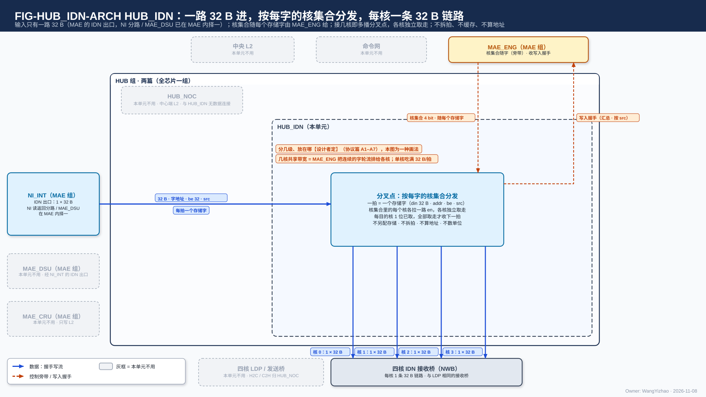
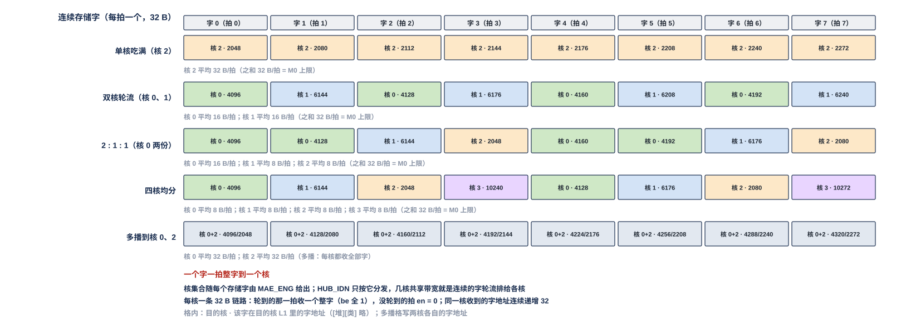
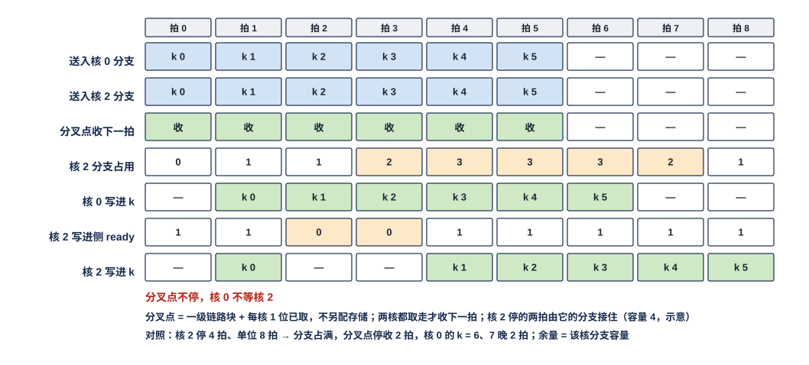

# HUB 入站分发网（HUB_IDN）需求

> Owner: WangYizhao｜2026-11-08

HUB_IDN 是 HUB 组两个部分之一（另一个是 HUB_NOC），全芯片一个；HUB 取英文 hub（中心枢纽）之意，不是缩写，指片上中心端（L2、NI）与四核之间的全部核间数据链路（V18-NAME-05，HUB_NOC 篇 §1）。**MAE 交来一路 32 B 写流（每拍一个存储字，带字地址、be、`src`，随字一个 4 bit 核集合），HUB_IDN 把这一拍送到核集合里每个核的 IDN 链路上——接几核就是一个多播分叉点，各目的核独立取走；每核一条 32 B 链路，信号与 H2C 完全相同。** 一个存储字一拍整字到一个核；几核共享 M0 的 32 B/拍，是 MAE_ENG 把连续的存储字轮流排给各核，不是把一拍拆开。HUB_IDN 不拆拍、不缓存整字、不算地址（字地址与核集合都由 MAE_ENG 的状态机算，V18-TP-27 / HUB-04）、不判完成（发送计数与写入握手计数都在 MAE 搬运引擎；L1 接收桥写进 bank 时沿原链路回写入握手，HUB_IDN 只把它汇总、按 `src` 交引擎，V18-TP-50）、不仲裁（输入只有一路）、不改字。

## 1 组成与位置

### 1.1 位置

HUB 组 = HUB_NOC、HUB_IDN（用户 11-07，V18-HUB-01；IDN 原属 MAE 组，用户 11-05 夜 V18-NII-04 从 NI 拆出）。HUB_IDN 的上游是 MAE 组的一个口——NI_INT 的 IDN 出口（NI 读返回分路与 MAE_DSU 的输出在 MAE 内部由 MAE_ENG 在单位边界择一，V18-HUB-03），下游是四核 L1 的 IDN 接收桥 NWB；**它与 HUB_NOC 之间没有数据连接**（HUB_NOC 的中心端是 L2，HUB_IDN 的中心端是 NI）。**MAE_CRU 的输出不经 HUB_IDN**：合并结果只经 NI-L2C 写 L2，要到核 L1 时另由一条指令经 H2C 送下去（V18-CRU-07）。与 MAE 组之间的口（32 B 写流、随字核集合、写入握手）列在 §2.1，MAE 一侧的驱动与共享方式见 MAE 集成篇 §3（`MAE_INTEGRATION.md`）。

**HUB_IDN 与一条 H2C 道是同一种部件**：都是一路 32 B 进、按核集合在分叉点分给几个核、各核独立取走；差别只在源头（H2C 道的源是 L2 的一个象限读口，HUB_IDN 的源是 NI 的 IDN 出口）和核集合的给法（H2C 道随单位，HUB_IDN 随字）。所以本篇很短：分叉点的规则在协议篇 §3.7 / HUB_NOC 篇 §3 已写，本篇只写 HUB_IDN 特有的部分。

### 1.2 做什么、不做什么

| 做 | 不做（归谁） |
|---|---|
| **分发**：每拍按随字的核集合，把这一个存储字送到集合内每个核的 IDN 链路上 | 不推算地址：字地址、be、核集合都由 MAE_ENG 的状态机算（V18-TP-27、V18-HUB-04）；不数单位：HUB_IDN 不需要单位边界（核集合随字，不随单位） |
| 多播：接几核即分叉点，按已取位分叉，各目的核独立取走（V18-TP-53） | 不另配多播存储；不攒字、不落地（各核 NWB） |
| 每条链路、每级流水是通用链路块的实例 | 不拆拍（没有拆拍寄存器）、不缓存整字（V18-L1-10）、不改字、不做错误检查、不合并两源（NI 分路与 MAE_DSU 输出在 MAE 内择一，V18-HUB-03）、不判完成（V18-TP-37 / 50） |
| 把 4 条链路回来的写入握手汇总、按 `src` 交引擎 | 不送紧密（非对齐）对象——它们只经 NI 写口进 L2，再经 H2C 进核（V18-TP-42）；IDN 每拍都是整字、be 全 1 |

### 1.3 术语

- **IDN 链路**：每核一条 32 B 的带地址的握手写流（协议篇 §3.2），全芯片 4 条，信号与 H2C 道到核的最后一段相同：en / ready / din 32 B / be 32 / addr 24 / `seg` 5 / `src`，反向写入握手。
- **核集合**：一个 4 bit 位图，第 $c$ 位为 1 表示这一拍要送核 $c$；**随每个存储字由 MAE_ENG 给出**（旁带，到核的链路上不带）。取代 11-07 的"拆分需求（道号 + 每单位核集合 + 单位边界）"与 V1.7_3 的"道掩码 / 链路分配"。
- **分叉点**：一级通用链路块 + 每目的核 1 位已取标志，核集合里的每个核各拉一路 en、各按自己的 ready 取走，全部取走才收上游下一拍（协议篇 §3.7，V18-TP-53）。
- **通用链路块**：协议篇 §3.3 定义的参数化握手流水块（V18-TP-38）。
- **字地址**：该存储字在目的核 L1 里的 24 bit 段内字节地址（32 的倍数）加 `seg`；四核物理同构，多播时各核用同一个地址（协议篇 §2.3）。

## 2 数据从哪来、到哪去

HUB_IDN 只有一个输入：MAE 的 IDN 出口交来的 32 B 写流（NI 读返回分路与 MAE_DSU 输出已在 MAE 内部择一），每拍一个存储字，带字地址、32 bit be 与 `src`，旁带该字的 4 bit 核集合。MAE_CRU 的输出不经 HUB_IDN（只写 L2）。中间只有一个分叉点：对核集合里的每个核各拉一路 en，各核按自己的 ready 取走，全部取走才收下一拍（§5）；分叉点分几级、放在哪由后端定（§3.2）。输出是 4 条链路，每核一条 32 B，接四核的 IDN 接收桥 NWB；**一拍只有一个存储字进来，所以单播时同一拍只有一个核的链路上有 en，多播时核集合里的几个核都有**。写入握手沿各链路反向回来，HUB_IDN 汇总后按 `src` 交对应的搬运引擎。

### 2.1 与 MAE 组之间的接口

| 接口 | 对端 | 方向 | 内容 |
|---|---|---|---|
| 32 B 写流 | MAE 的 IDN 出口（NI_INT） | 入 | 每拍一个存储字：din 32 B + addr 24 bit（字地址）+ `seg` 5 + be 32 bit + `src`，en / ready 一对；通用链路块实例。字地址、be 由执行该指令的搬运引擎算（V18-HUB-03 / 04） |
| 核集合 | MAE_ENG 的搬运引擎 | 入（随字旁带） | **每个存储字一个 4 bit 核集合，与该字同拍给出**；HUB_IDN 按它拉对应核的 en。不上到核的链路；格式【设计者定】：要定的是它随数据走（与 din 同一级流水）还是单独一组线，约束是与 din 逐拍对齐、到最后一个分叉点为止 |
| 写入握手（汇总后） | MAE_ENG 的搬运引擎 | 出 | 把 4 条 IDN 链路回来的写入握手汇总，**按 `src` 交对应引擎**（每拍至多 4 个 valid）；汇总方式【设计者定】，约束是不丢、不重、不阻塞（握手无 ready）（V18-TP-50） |

### 2.2 与四核的接口

| 接口 | 对端 | 方向 | 内容 |
|---|---|---|---|
| IDN 链路 × 4 核（每核 1 条） | 各核 L1 的 IDN 接收桥 NWB | 出 | 每条：en / ready / din 32 B / be 32 / addr 24 / `seg` 5 / `src`，与 H2C 到核的链路同一组信号（架构篇 PORT-16）；没有单位标记；通用链路块实例；**ready = 该核 NWB 的入口 FIFO 未满**（L1 篇 §7.5） |
| IDN 落地写入握手 × 4 核 | 各核 NWB | 入（反向旁带） | 每条链路 1 × (valid + `src`)/拍：NWB 把一个存储字写进 L1 bank 的那一拍回一个；只有 valid、没有 ready（协议篇 §2.6 / §3.8，V18-TP-50） |

### 2.3 由别的模块保证的事项

| 事项 | 由谁保证 |
|---|---|
| 每个存储字的字地址、`seg`、be 与核集合 | MAE_ENG 搬运引擎的状态机（V18-HUB-04） |
| IDN 只送整字（be 全 1；紧密对象只经 NI 写口进 L2，再经 H2C 进核） | MAE 搬运指令（V18-TP-42） |
| 几核共享带宽时连续存储字轮流排给各核；整列发给属主核时该列的每个字核集合都只含属主核 | MAE_ENG 的地址状态机 / 编译链（§4.2、§4.3） |
| 目的空间已读完、压紧激活按位点窗口预留 | 编译链（LIC 操作 15、V18-TP-40） |
| NI 分路与 MAE_DSU 输出择一、单位不交错 | MAE 的 IDN 出口（MAE_ENG 在单位边界决定，V18-HUB-03） |
| 按 addr / `seg` 落 bank、整字直写、写计数交 CCU、写进 bank 时回写入握手 | L1 接收桥 NWB（与 LDP 相同） |

## 3 链路：每核一条 32 B，与 H2C 同一种口

### 3.1 链路与信号

**全芯片 4 条 IDN 链路，每核一条 32 B；每条各自 en / ready / addr，没有任何两条链路之间的同拍要求。** 信号表见协议篇 §3.2；与 H2C 到核的链路相比没有任何不同，只是源头不同。单播时一拍只有一个核的链路有 en；多播时核集合里各核的链路同拍都有 en，但各核独立取走、不要求同拍成交（§5）。

| 项 | 规定 |
|---|---|
| 条数 | 4（每核 1），加上 MAE 的 IDN 出口 1 条输入 |
| 每拍 | 一个存储字 32 B，be 全 1（IDN 只送整字） |
| 地址 | 随数据的 addr 24 bit（字地址）+ `seg` 5 bit，由 MAE_ENG 给；HUB_IDN 原样转交，不推算 |
| 一核每拍 | 0 或 32 B：轮到就是一个整字，没轮到 en = 0；平均带宽 = 该核轮到的字数比例 × 32 B/拍（§4.2） |
| 总量 | 每拍至多一个字进来，所以四核合计 ≤ 32 B/拍 = M0 上限（多播时各核各收一份，不占额外输入带宽） |

### 3.2 时延无关、可由后端调整

**每条链路、分叉点的每一级都是通用链路块的实例，skid 深度与各段流水级数为例化参数【设计者定】；分叉点分几级、放在哪由后端按布局定（协议篇 §3.3 A1–A7）。** FIG-HUB_IDN-ARCH 把分叉点画成一个框只是一种画法：可以在 HUB_IDN 入口处一次分四路，也可以逐级靠近各核再分。约束只有两条：多播在分叉点按已取位、各目的核独立取走（§5）；核集合作为旁带走到最后一个分叉点为止、到核的链路上不带。四条链路之间、正向与写入握手回程之间都不对齐；验收随机化各段级数、分叉位置、ready 时序与回程时延（V18-TP-32 / 38 / 54）。

## 4 分发：核集合随字，几核共享就是轮流

### 4.1 规则

**每个存储字带自己的核集合；HUB_IDN 在分叉点对集合里的每个核拉 en，不看前后的字。** 不同指令的字交替上来时各带各的核集合，所以没有"按单位切换配置"这件事，也没有交叉开关：一条输入、四条输出，连接关系就是每拍的核集合本身。

### 4.2 几核共享 M0 带宽：MAE_ENG 把连续存储字轮流排给各核

**进入本单元的每个字都是一个核的整存储字：列深度优先布局一个 DDR 拍本来就是一列 64 个连续 $k$ 的整字（V18-L1-09）；DDR 标准布局（一拍 = 同一 $k$ 行 4 个列组各 8 B）与 LSC（一行 = 4 核各 16 B）由 MAE_DSU 先攒行按字重排成各核的整字再送来（V18-MAE-35）。几核同时取数时，MAE_ENG 按编译链给的核次序把各核的整字轮流排出：字 0 → 核 $a$、字 1 → 核 $b$……每个核收到的是整字，平均带宽是它轮到的字数比例乘 32 B/拍；总量不论开几核都由 M0 的 32 B/拍封顶**（用户 11-05 晚："如果只使用单核或者双核，IDN 应该全力供给这两个核"；用户 11-08："32B 先走道 0 到核 0，然后是下一个 32B 走道 1 到核 1"）。

| 共享方式（举例） | 连续存储字的核集合 | 每核平均 |
|---|---|---|
| 单核（含标准布局经 MAE_DSU 重排后的 4 个字都给该核） | 每个字都是 {核 $c$} | 32 B/拍 |
| 双核轮流 | {核 $a$}、{核 $b$}、{核 $a$}、{核 $b$}… | 各 16 B/拍 |
| 2 : 1 : 1 | {核 $a$}、{核 $a$}、{核 $b$}、{核 $c$}… | 16 / 8 / 8 B/拍 |
| 四核均分 | {核 0}、{核 1}、{核 2}、{核 3}… | 各 8 B/拍，每拍到达的仍是一个整字 |

这张表只是举例：核次序与比例由编译链按各核的列块数定，HUB_IDN 不知道、也不需要知道；"8 B/拍"是四拍一个整字的平均值，不是某一拍只有 8 B 有效。

图中每列是连续到来的一个存储字（一拍一个），每行是一种共享方式，格内是该字的核集合与它在目的核 L1 里的字地址（同一核收到的字地址连续递增 32）。单核吃满时 8 个字都给核 2；双核轮流时核 0、核 1 交替；2 : 1 : 1 时核 0 每 4 个字拿 2 个；四核均分时每核每 4 拍拿 1 个整字；最后一行是多播（权重同发核 0、核 2），每个字的核集合是 {0, 2}，两核各收全部 8 个字。脚本断言单播各行各核平均字节数之和等于 32 B/拍、多播行每核都收到全部字、字地址都是 32 的倍数。

### 4.3 输出轴稀疏权重整列发给属主核

每拍 32 B 正好是该核 L1 列字区的一个存储字（一列 64 个连续 $k$，L1 篇 §4.2）；**MAE 逐列 gather，该列的每个字核集合都只含属主核，属主核的链路上连续若干拍各到一个整字（32 B/拍），再轮到别的核的列**；HUB_IDN 与 DDR 都不暂存整列、不拼接子突发（V18-L1-09 / 10）。被选中的列才被读取，没人要的列既不读 DDR 也不占 L1。

## 5 多播：分叉点按已取位分叉，各目的核独立取走

**一个字的核集合含多个核即多播；分叉点 = 一级通用链路块 + 每个目的核 1 位已取标志，不另配存储**（用户 11-06："缓冲不是已经在存储单元里要求了吗？而 HUB 本身，就已经有 skid 寄存器的需求了"；"这点对 IDN 有一样的需求"；V18-TP-53 / 54）。规则照协议篇第 3 层（§3.7）。四核物理同构，多播用同一个 addr、落同一位置（用户 11-06 认可；协议篇 §2.3）。

| 项 | 规定 |
|---|---|
| 个数 | 一个分叉点（可拆成几级，§3.2） |
| 存的内容 | 本级链路块的一拍：din 32 B + addr 24 bit + `seg` 5 + be 32 bit + `src`；另加每个目的核 1 位已取 |
| 每拍动作 | 对核集合内、本拍尚未取走的核拉高 en（**en 只看已取位、不看 ready**）；某核链路 ready = 1 即取走并置位；集合内全部置位后才收上游下一拍，已取位清零 |
| 单播 | 核集合只有一个核时退化为一级流水 |
| 余量 | 快慢核的差距由该核分支的 skid 与 NWB 入口 FIFO 吸收；一核堵得比这还久时分叉点停收上游，其余核随之停下；需要更大余量时加深 NWB 入口 FIFO（L1 篇 §7.5），不在 HUB_IDN 里加存储 |
| 位置与级数 | 由后端定（协议篇 §3.3 A1–A7）；核集合作旁带走到最后一个分叉点，到核的链路上不带 |

图中一个 6 拍的字流（核集合 {0, 2}）多播到核 0 与核 2，每核分支容量 4 拍（分支 skid + NWB 入口，示意）。核 0 一直能写；核 2 写进 L1 的一侧在拍 2、3 不 ready。分叉点在拍 0–5 每拍送出一拍、从不停收；核 0 在拍 1–6 写进 k = 0–5，核 2 在拍 1、4、5、6、7、8 写进，分支占用最多 3 拍——**核 2 停两拍只让它自己晚两拍写完，核 0 不等**。对照：核 2 停 4 拍、单位 8 拍时，核 2 分支占满，分叉点停收 2 拍，核 0 的 k = 6、7 晚 2 拍写进，余量就是该核分支容量。逐拍模型与 HUB_NOC 篇、协议篇共用（`_build/mcast_fork_sim.py`），脚本断言以上各数。

## 6 输入只有一路：两源在 MAE 内部择一

去核 L1 的数据有两个产生方：NI 读返回分路（DDR 原形）与 MAE_DSU（整形后的 $W^{\mathsf T}$ 列字块、全码记录等）。**两者在 MAE 的 IDN 出口由 MAE_ENG 在单位边界择一，单位不交错，HUB_IDN 只收一路 32 B 写流**（用户 11-07："MAE 只负责透传 32B 的数据给 IDN"；V18-HUB-03；MAE_NI_INT 篇 §5）。所以本单元没有两源 MUX、没有源顺序接口。不同指令的字交替上来时各带各的核集合（§4.1）。

## 7 握手、顺序与透明

- ready 为 0 时发送方保持；同一链路保序；逐位无损；无数据应答、无 outstanding、无 burst（协议篇 §3.3）；写入握手只是反向的计数脉冲，发送方不等它。
- **多播时每个目的核各回自己的写入握手**，引擎按目的核数倍计应写量（V18-TP-50）。
- **停发只作用于拿这一拍的核**：某核链路拉低 ready 时，该核分支的 skid 先接住；分支也满后分叉点停收上游，输入写流的 ready 随之拉低，最终经 NI_INT、NI_EXT 停 DDR 读返回；只降速、不丢数、不报错（V18-NII-01）。单播时别的核的链路本来就没有 en，不受影响。

## 8 计数与复位

不上报计数（写入握手只转交、不计数）；不做错误检查；复位清分叉点的已取位、各级 skid 与在途握手；没有跨调用驻留的状态，没有配置寄存器。

## 9 要求值与验收

### 9.1 要求值

| 项 | 值 | 性质与依据 |
|---|---|---|
| 输入 | 1 × 32 B/拍（每拍一个存储字） | 要求值：与 MAE 的 IDN 出口、M0 每拍 32 B 相同（V18-L1-10） |
| 输出链路 | 4 条，每核 1 × 32 B/拍，信号与 H2C 相同 | 要求值（V18-HUB-04；架构篇 PORT-16） |
| 每核平均 | 轮到的字数比例 × 32 B/拍；单核吃满 32 B/拍 | 由 MAE_ENG 的字次序决定，HUB_IDN 不限制 |
| 多播分叉点 | 无存储，每目的核 1 位已取 | 余量由 NWB 入口 FIFO 定（§5） |
| 每字时延 | 一拍整字 | 设计结果，不作要求值 |
| skid 深度、各段流水级数、分叉点的位置与级数 | 【设计者定】（随布局） | 协议篇 §3.3 |
| 门数 | 分叉点已取位 + 4 条链路的通用链路块实例 + 写入握手汇总，NAND2 等效，建议值【设计者定】（参考：V1.7_3 对 IDN 的估计 22–32 k 门，含当时的两层信用与交叉开关，现结构应明显小于此数） | 参考值来自 V1.7_3 NII-R-190 一阶推导，现结构未重估 |

### 9.2 验收

| 项 | 方法 | 判据 |
|---|---|---|
| 分发 | 随机核集合序列（含四种共享方式）、随机数据 | 每拍的字只出现在核集合内各核的链路上；各核所得字逐位比对、字地址与引擎给的一致 |
| 多播 | 到 $N$ 核、各核独立随机 ready | 各核内容与 addr 相同；集合内全部取走后分叉点才收下一拍；en 不依赖 ready；慢核短时堵住（不超过其分支容量）不拖快核 |
| 整列 | 列深度优先权重 | 属主核每拍一个整字直写，无暂存 |
| 指令交替 | 几条指令的字交替上来、核集合各不相同 | 各核所得与参考一致；没有任何"配置切换"时刻 |
| 时延无关与可调 | 随机化各段级数、分叉位置、ready 时序与回程时延（A7） | 逐位一致、不丢拍、不重复；写入握手计数与应写量相符 |
| 停发 | 某核 NWB 将满 | 只停拿这一拍的核；不丢拍 |
| 写入握手转交 | 四种共享方式、多播、随机 ready 与随机插级 | 每个写进 L1 的存储字恰有一个握手到达 `src` 对应的引擎；多播 $k$ 核时到达 $k$ 个 |

## 10 为什么

- **IDN 独立成篇**（用户 11-05 夜："我建议单独放一个 MAE IDN 模块"）。
- **归 HUB 组、改名 HUB_IDN**（用户 11-07："我认为现在咱们可以先将IDN从MAE中归类到HUB中"；V18-HUB-01）：它不生成地址、不数单位、不判完成、不改数据，只做分发与多播分叉，与 H2C 道同一类部件；HUB 只传输、MAE 发令并做运算级，分工随之干净。
- **每核一条 32 B 链路、不拆 8 B**（用户 11-08："32B 拆 8B 传输的意义是什么？32B 先走道 0 到核 0，然后是下一个 32B 走道 1 到核 1，不是也可以吗？而且这样也不会降低利用率，同时控制逻辑更简单"；V18-HUB-04）：DDR 标准布局一拍确实交织 4 个列组（各 8 B，可分属 4 核），这是输入维度稀疏按 $k$ 行读所必需的排法、不能改（用户 11-08："我无法接收统一列字布局，因为这会使得输入维度稀疏完全无法减少 EMA"）；但把它拆成各核整字的工作放在 MAE_DSU 攒行重排（V18-MAE-35，用户 11-08："我希望这个任务仍然是 MAE 的"），链路与本单元就只需要"整字直接发"一种方式，拆拍、攒字、"4 拍同一字地址"都不需要。16 × 8 B 与 4 × 32 B 的线数相同（每核 32 B）；一核只有一条链路，11-05 夜担心的"4 道同拍耦合"（V18-TP-30 的由来）不再存在；撤掉拆拍寄存器、攒字寄存器、交叉开关与"换号"待定项，每字时延 4 拍变 1 拍，IDN 链路与 H2C 链路成为同一种口。
- **核集合随字、不随单位**（V18-HUB-04）：一拍一个字到一个核集合，"几核共享"就是连续的字轮流排给各核，交叉开关与"按单位切换配置"没有存在的必要；几条指令的字交替上来也不会用错配置。
- **两源在 MAE 内择一、MAE 只给一路 32 B**（V18-HUB-03，用户 11-07："MAE 只负责透传 32B 的数据给 IDN"）：两个产生方都在 MAE 里，择一是 MAE 内部仲裁；11-07 早先的"源顺序交 HUB"（V18-HUB-02）随之撤。
- **整列发给属主核**（V18-L1-10）：DRAM 最小访问一个突发，不能从 4 列各取 8 B 拼一拍。
- **多播独立取走**（师兄提醒"RRAM 协议跑长距离会出一堆 bug" + 用户 11-05 夜）："等齐同拍成交"是跨芯片的组合路径，随后端变化而失效。
- **撤多播缓冲、分叉点只用已取位**（11-06 深夜，V18-TP-53；用户 11-06："缓冲不是已经在存储单元里要求了吗？而 HUB 本身，就已经有 skid 寄存器的需求了"；"这点对 IDN 有一样的需求"）：时序问题已由每级寄存器输出 + skid 解决，独立取走只需每核 1 位已取，余量本来就在分支 skid 与 NWB 入口里。
- **分叉点位置与级数留给后端**（V18-TP-54）：本篇只提协议篇 §3.3 的 A1–A7。
- **无寻址、无完成角色**（V18-TP-27 / 37 / 50）：地址由 MAE 搬运引擎给；写入完成由引擎数 L1 回来的写入握手判（核间统一协议，用户 11-06："核间统一走一个协议"），L1 写计数只供本核消费。
- **通用链路块**（用户 11-06："建立一个 Common Block，然后多次例化"）。
- **信号与核内 RRAM 口同名、撤 last**（用户 11-06；V18-TP-41 / 42）：写完成按写入握手计数，链路上的末拍标记没有消费者。
- **CRU 不经 IDN**（V18-CRU-07）：合并结果只写 L2，要到核 L1 时另由一条指令经 H2C 送下去。
- 被否方案各一句：每核 4 条独立 8 B 链路 + 拆拍 / 攒字 / 4 拍同地址（11-08 撤）、道掩码按口拆、同一拍按字节切给几个核（用户 11-08 原话之一，与 V18-L1-09 的布局不符，未采用）、同拍驱动四核、等齐成交、发送侧多播缓冲（分叉点已取位）、NI 内置 IDN、IDN 内合并两源（改在 MAE 内择一）、两层信用、链路上的末拍标记、交叉开关与按单位切换配置。
