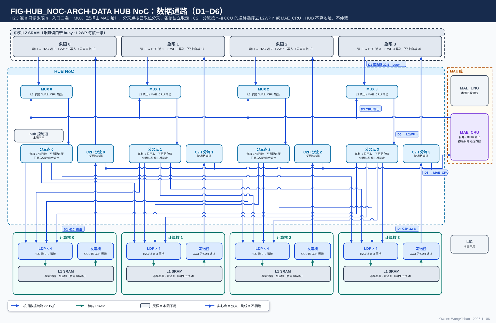
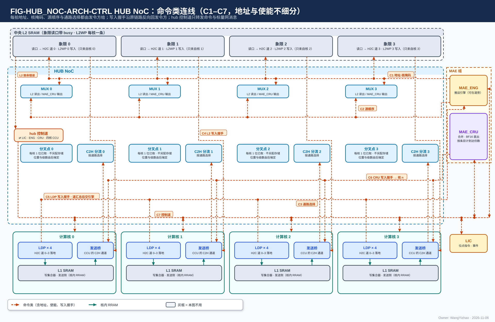
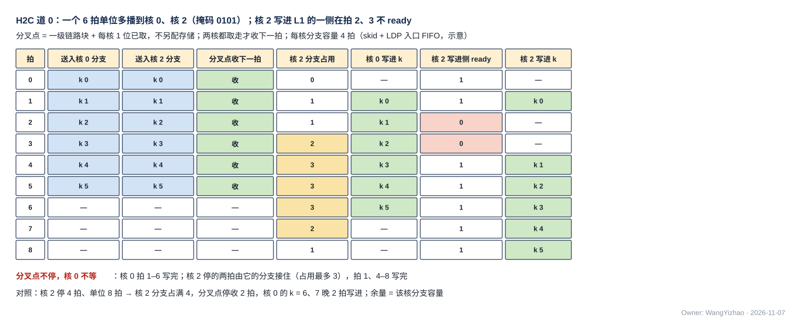
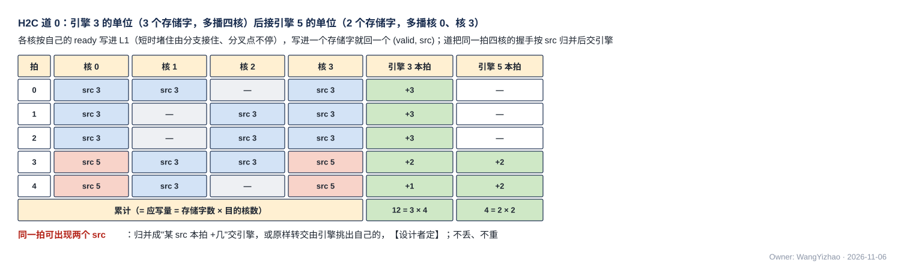

# HUB NoC（以中央 L2 为中心的两级集中式互连）需求

> Owner: WangYizhao｜2026-11-06｜正式稿第一版，待用户审阅。按用户 11-06 确认的目录（`../V17_3_MODULE_TOC_HUB_NOC_20261106.md` 第五版，H1–H3 全部关闭；用户："我认为当前的设计已经没有问题了，请你产出 HUB 的文档"）编写；依据 `Claude_Design_Spec/V1.8_DESIGN_REVISIONS.md` V18-TP-26…52、V18-L2-03 / 04、V18-MAE-11 / 22 / 27 / 28 / 30、V18-NAME-02 / 04；正式稿 `DATA_TRANSFER_PROTOCOL.md`（下称"协议篇"）、`L2_SRAM.md`、`L1_SRAM.md`、`MAE_ENG.md`、`MAE_INTEGRATION.md`。图件登记 `_build/FIGURE_REGISTRY_HUB_NOC.md`。

> 11-06 深夜修订（V18-TP-53 / 54，任务书 `_build/MCAST_FORK_BRIEF_20261106.md`）：**撤多播缓冲，H2C 道的多播改为分叉点（一级通用链路块 + 每目的核 1 位已取标志）；新增 §3.5 拓扑、级数与分叉位置由后端定（A1–A7）**（§1.1、§2、§2.1、§3.3、§3.5、§5.2、§7、§10–§12，图 FIG-HUB_NOC-ARCH-DATA、FIG-HUB_NOC-MCAST）。

旧稿 `V17_3_MODULE_TOC_HUB_NOC_20261104.md`（第三版）与 V1.7_3 的 HUB_NOC 只作历史。

**HUB 只传输：不发令、不生成或累加地址、不做环形回绕、不做归约 / 合并 / 判决 / 排序、不维护计数、不解析载荷、不报完成；每拍的地址、核掩码与路径选择都由发令方给出**（H2C 由 MAE 的搬运引擎给，C2H 由各核 CCU 给）。传什么、发给谁、写到哪，见 MAE_ENG 篇与数据流篇。

## 1 组成与位置

### 1.1 三部分，全芯片一个

| 部分 | 做什么 | 个数 |
|---|---|---|
| **H2C 道 0–3** | 道 $n$ 按引擎给的地址读 L2 象限 $n$，经入口二选一 MUX（L2 读出 / MAE_CRU 输出）与多播分叉点，送四核各自的第 $n$ 条 H2C 链路 | 4 |
| **C2H 分流** | 每核一路，按本核 CCU 给的通路选择，把去 L2 的单位直通 L2WP 第 $n$ 条、去 MAE_CRU 的单位交 CRU 数据入口 | 4 |
| **hub 控制道** | 命令与标量网在 LIC、MAE、各核 CCU、L2 之间的转发 | 1 |

方向名只用 H2C 道 $n$ / C2H 分流（用户 11-06，V18-NAME-02）。

### 1.2 HUB 组只有本篇

CRU 已并入 MAE 组（MAE_CRU，V18-MAE-11），HUB 组只剩 HUB_NOC，**不设 HUB 集成篇，对外口全部写在本篇 §2**（用户 11-06："HUB 不需要集成篇了"）。

### 1.3 逻辑归属与物理位置分开

放在 H2C 道旁的搬运引擎逻辑上属 MAE_ENG（MAE 集成篇 §1.4）；本篇只写道与引擎之间的接口。MAE_CRU 的物理位置归后端。

### 1.4 不经 HUB 的通路

NI 与 L2 之间（NI 写口、NI 返回读口）、MAE_IDN 到各核、MAE_ENG 与 LIC 之间的指令口与完成通知（MAE 集成篇 §3）。

## 2 数据从哪来、到哪去

图从上到下是中央 L2、HUB、四核：L2 的四个象限读口各接一条 H2C 道，道入口的二选一 MUX 另接 MAE_CRU 的输出，MUX 之后是该道的多播分叉点框，**由分叉点框直接引出四路**，分别接四核 LDP 的第 $n$ 个落地口（图上画在 hub 里，实际放在哪、分几级由后端定，§3.5）；四核的发送桥各接一路 C2H 分流，分流后去 L2WP 第 $n$ 条或 MAE_CRU 的 CRU 数据入口。编号：D1 L2 象限读 → MUX（32 B，带 busy）；D2 H2C 4 道（道 $n$ 在分叉点按已取位分到各核 LDP 的第 $n$ 个落地口）；D3 MAE_CRU → 四个 MUX；D4 发送桥 → C2H 分流（32 B）；D5 C2H 分流 → L2WP $n$（核 $n$ → 象限 $n$）；D6 C2H 分流 → MAE_CRU。hub 控制道与 MAE_ENG 在本图画灰。

外框与对端位置与数据图相同，画命令类连线：引擎给 H2C 道的逐拍地址与核掩码、MAE 给 MUX 的源顺序、CCU 给 C2H 分流的通路选择、三类写入握手回程、hub 控制道的各端点。**地址线、使能线都画成命令线，不细分**（用户 11-06）。编号：C1 MAE_ENG → H2C 道（向上一支是 L2 读 en / addr 到象限读口，向下一支是目的 addr / be 与核掩码到 MUX）；C2 MAE_ENG → MUX：源顺序；C3 发送桥（即 CCU 的 C2H 通道）→ C2H 分流：通路选择；C4 L2 象限 $n$ → 核 $n$：L2 写入握手，沿 C2H 反向；C5 各核 LDP 的写入握手 → 道汇总后交 MAE_ENG；C6 MAE_CRU → 各核：CRU 写入握手；C7 hub 控制道 ⇄ 四核、MAE_ENG、MAE_CRU、LIC，另有 L2 → 控制道的致命错误。核框里没有单独画 CCU，C3 / C4 / C6 都连到"发送桥（CCU 的 C2H 通道）"。

### 2.1 对外接口

| 口 | 对端 | 方向 | 条数 × 位宽 | 信号 | ready 由谁给 |
|---|---|---|---|---|---|
| L2 象限读口 $n$ → H2C 道 $n$ | 中央 L2 | 入 | 4 × 32 B | 道 → L2：en、addr（由引擎给）；L2 → 道：dout、vld、busy | L2 撞 bank 时回 busy，道保持重发（L2 篇 §5.3） |
| MAE_CRU 输出 → H2C 道 MUX | MAE 组 | 入 | 口数与宽度【设计者定】，参考 1 × 32 B | 核间写流，addr 由执行合并指令的引擎给 | MUX 选中该源且道首级链路块未满 |
| H2C 道 → 四核 | 四核 LDP | 出 | 每核 4 条 × 32 B | en / din / be / addr / `src`；反向 ready 与写入握手 | 各核 LDP 入口 FIFO 未满 |
| 四核发送桥 → C2H 分流 | 四核 | 入 | 每核 1 × 32 B | en / din / be / addr / `src`；反向 ready 与写入握手 | 选中路径的下游（L2WP 第 $n$ 条入口 FIFO 或 CRU 数据入口） |
| C2H 分流 → L2WP | 中央 L2 | 出 | 4 × 32 B（核 $n$ → 象限 $n$） | 同上 | L2 象限 $n$ 里核 $n$ 的入口 FIFO 未满（L2 篇 §5.2） |
| C2H 分流 → MAE_CRU | MAE 组 | 出 | 4 × 32 B（每核一条） | 同上 | CRU 数据入口未满 |
| 引擎 → H2C 道（控制） | MAE_ENG 的搬运引擎（可在道旁） | 入 | 每道一组 | 逐拍 L2 读 en / addr、目的 addr / be、核掩码；**一条指令可同时驱动四道**（V18-MAE-28） | — |
| MAE → H2C 道 MUX（控制） | MAE_ENG | 入 | 每道一组 | 下一个单位来自哪个源（L2 / CRU）的顺序（§5.3） | — |
| 本核 CCU → C2H 分流（控制） | 四核 CCU | 入 | 每核一组 | 通路选择（L2 / MAE_CRU），只在单位边界变（§6） | — |
| 写入握手回程 | 发令方 | 出 | 见 §7 | valid（+ `src`） | 无 ready |
| hub 控制道 | LIC、MAE_ENG（与 NI 控制道合一个端点）、MAE_CRU（单独端点）、四核 CCU、L2 | 入 / 出 | 64 bit 消息流 | en / ready / data | 各端点队列未满 |

### 2.2 由谁保证

| 事项 | 由谁保证 |
|---|---|
| 每拍地址、核掩码、象限位（H2C 道 $n$ 读地址的象限位 = $n$；C2H 写地址的象限位 = 本核号） | 发令方（MAE 搬运引擎、各核 CCU）；L2 检查并报致命错误 |
| 两源的先后、源顺序与单位边界 | MAE_ENG（§5.3，V18-TP-52） |
| C2H 的通路选择与单位对齐 | 本核 CCU（§6，V18-TP-51） |
| 目的空间在数据到达时已空闲 | 编译链（协议篇 §7.1） |
| 四核分产的数据同址异象限；H2C 四道落 L1 的目的地址错开 bank | 编译链（协议篇 §9.9） |
| 写入完成的计数与比对 | 发令方（核间）、本核 CCU（核内）（协议篇 §2.6、§5.8） |

## 3 拓扑与口宽

### 3.1 以中央 L2 为中心的两级集中式互连

第一级在中心（C2H 分流、hub 控制道），第二级是四条 H2C 道。核与核之间没有直连，核间数据都经 L2 或 MAE_CRU（名称用户 10-21 定，不写"星形"）。

### 3.2 读写各 128 B/拍，象限一进一出

| 方向 | 口宽 | 规则 |
|---|---|---|
| H2C | 每核 4 道 × 32 B，四道合计 128 B/拍 | **道 $n$ 只读象限 $n$**；一次读出可多播给几个核，只占一份读口 |
| C2H | 每核 1 × 32 B，四核合计 128 B/拍 | **核 $n$ 只写象限 $n$**（V18-L2-03 / 04） |

### 3.3 到核的链路上没有核号

目的核 = 哪组 H2C 线上有 en；源核 = C2H 线号；核掩码由引擎给道，**分叉点之前的段带 4 bit 核掩码旁带，到核的链路上不带**（协议篇 §5.1、§5.3.4 A3）。

### 3.4 口宽固定，流水级数可配

需求超口时由 ready 自然停顿；hub 里每一级都是通用链路块，级数【设计者定】（协议篇 §5.3.2）。

### 3.5 拓扑、级数与分叉位置由后端定（A1–A7）

**本篇不定拓扑，不规定分叉点放在哪、每段插几级；只要求 HUB 能被后端这样调整而功能不变**（用户 11-06："我认为咱们在 HUB 的设计，无需过于考虑后端，但是需要对 HUB 提出需求，让其更够被后端调整（受布局调整级数等）"；V18-TP-54）。需求全文见协议篇 §5.3.4，落到 HUB 上是：

| 编号 | 在 HUB 上的落点 |
|---|---|
| A1 | L2 象限读口 → 分叉点、分叉点 → 各核 LDP、各核发送桥 → C2H 分流 → L2WP / MAE_CRU、hub 控制道的每一段，级数各自是参数 |
| A2 | 每级每拍成交；插级只增时延 |
| A3 | H2C 道 $n$ 的分叉点可放在 hub 中心，也可拆成几级、逐级靠近各核；核掩码作旁带走到最后一个分叉点，到核的链路上不带 |
| A4 | 同一核的 4 条 H2C 链路之间、正向与写入握手回程之间不对齐 |
| A5 | 三类写入握手回程（§7）的级数与正向独立 |
| A6 | 道首级停发 L2 读的将满阈值（= 深度 − 在途读拍数）等与时延有关的门限是 RTL 头文件参数 |
| A7 | 验收随机化每段级数、分叉位置、ready 时序与回程时延（§11.2） |

## 4 链路信号与通用链路块

本篇照引协议篇五层的第 1 层，只写 hub 端口上的用法：

- **正向 en / din 32 B / be / addr 24 bit / `src`，反向 ready 与写入握手；没有 dest**（V18-TP-41 / 47 / 51）。
- **addr 只是目的存储内部的位置，由该存储自己解释**（L1 的类位 = W / S / A，L2 的类位 = 象限，MAE_CRU = CRU 内地址）；写到哪个存储由链路或发令方的通路选择决定，地址不编码"是哪个存储"（用户 11-06："我建议这个地方不要合并在地址中"）。
- hub 里每一级都是通用链路块：寄存器输出，skid 接住在途拍，任意插级功能不变。
- 无单位标记、无请求号、无 burst；同一链路保序。

## 5 H2C 道：读象限、多播、两源 MUX

### 5.1 按引擎给的地址读象限 $n$

道 $n$ 把引擎逐拍给的 en / addr 交象限 $n$ 读口；读口 busy 时保持重发。**hub 不生成、不累加地址**，读出的存储字连同引擎给的目的 addr / be / `src` 进入本道（V18-TP-27、V18-MAE-27）。

### 5.2 多播：分叉点按已取位分叉，各目的核独立取走

**道 $n$ 的多播分叉点 = 一级通用链路块 + 每个目的核 1 位已取标志，不另配存储**（用户 11-06："缓冲不是已经在存储单元里要求了吗？而 HUB 本身，就已经有 skid 寄存器的需求了"；"那我认可当前取消这个缓冲的设计"；V18-TP-53）。规则照协议篇第 3 层（§5.7）：对掩码内、本拍尚未取走的核拉高 en（en 只看已取位、不看 ready）；某核 ready = 1 即取走并置位；掩码内全部置位后才收上游的下一拍。四核收到同一个 addr，落同一物理位置。

**快慢核的差距由各核分支的 skid 与该核 LDP 入口 FIFO 吸收**：一核堵住先由它的分支接住，其余核照常取走；分支也满后分叉点停收上游，道首级链路块随之将满、停发 L2 读，同一道上的其余核也停下。所以余量 = 该核分支 skid + LDP 入口 FIFO；需要更大余量时加深 LDP 入口 FIFO（L1 篇 §7.1），不在 hub 里加存储。**分叉点放在 hub 中心还是靠近各核、分一级还是逐级分，由后端定**（§3.5）。

数值例：H2C 道 0 的一个 6 拍单位多播到核 0、核 2（核掩码 0101），每核分支容量 4 拍（分支 skid + LDP 入口 FIFO，示意）。核 0 一直能写；核 2 写进 L1 的一侧在拍 2、3 不 ready。分叉点在拍 0–5 每拍送出一拍、从不停收；核 0 在拍 1–6 写进 k = 0–5，核 2 在拍 1、4、5、6、7、8 写进，分支占用最多 3 拍。**核 2 停两拍只让它自己晚两拍写完，核 0 不等。** 对照：核 2 停 4 拍（拍 2–5）、单位 8 拍时，核 2 分支占满 4 拍，分叉点停收 2 拍，核 0 的 k = 6、7 随之晚 2 拍写进——**余量就是该核的分支容量**。实际容量【设计者定】，逐拍模型见 `_build/mcast_fork_sim.py`。

### 5.3 两源 MUX：先后由 MAE 判，HUB 只切换

H2C 道 $n$ 有两个数据源：L2 象限 $n$ 的读出、MAE_CRU 的输出（作该道的第二源，可进任一道，由指令给出，V18-MAE-22）。**两源各由一条指令、一个搬运引擎驱动，优先级与单位边界只有 MAE 知道，所以先后由 MAE_ENG 判；HUB 在道入口只放一个二选一 MUX，按 MAE 给的源顺序切换，不看优先级、不仲裁、不计数**（用户 11-06："HUB 不需要感知这个，HUB 只需要把这两个端口 MUX 出来给 MAE 就行了"；V18-TP-52）。

| 方 | 做什么 |
|---|---|
| MAE_ENG | 在单位边界按两条指令的**优先级字段**选下一个单位用哪个源，**暂不做老化**；编译链给 CRU 输出的指令标高优先级（CRU 优先）（用户 11-06："直接按照指令的优先级字段即可，可以暂时不考虑老化，只需要标优先级（CRU 优先）"）。每定一个单位，就往该道 MUX 旁的源顺序队列放一项"源 = L2 / CRU" |
| HUB 的 MUX | **在当前单位的最后一拍过去之后**，从源顺序队列取下一项切换 |

**为什么要等当前单位的最后一拍**：L2 读是引擎先发地址、数据过 $t_{\text{r}}$ 拍才出来（撞 bank 再顺延），MAE 决定切到 CRU 的那一拍，上一个 L2 单位还可能有几拍数据没出来；MUX 一收到选择就切会把它截断或交错。**每个源的单位末拍由发令方的内部边界信号标出**（MAE 与 HUB 之间，不上核间链路，链路上仍没有单位标记）。源顺序队列的深度、末拍信号随数据走的方式【设计者定】；约束是道上单位不交错、MUX 不需要知道优先级。

不做老化的前提：CRU 输出是一组合并完成后的结果，量小、时断时续，流量由编译链安排；编译链也可以把 CRU 输出指到当时空闲的道上，避开冲突。

## 6 C2H 分流：按发令方的通路选择分路

**本核 CCU 的 C2H 通道按发送指令的目标存储给 C2H 分流下通路选择：去 L2 的单位直通 L2WP 第 $n$ 条，去 MAE_CRU 的单位交 CRU 数据入口（核 $n$ 那一条）**（用户 11-06："这里的数据走向 L2 还是 CRU，和正常的数据从 L2 走向 L1，或者要不要走 IDN 是一个意思吗？……我建议这个问题交给引擎"；V18-TP-51）。

- C2H 口前的两源（L1 发送侧、AEB 直达口）在核内按单位合并（协议篇 §6.1），所以选择也只在单位边界变；选择怎样送到分流点（随拍或按单位）【设计者定】，约束是与所属单位对齐。
- **不扇入、不仲裁**：四核各一路直通，四核互不等待；ready 只取决于本核那条链路选中的下游（V18-L2-03）。
- 链路上不带"去哪"的字段，与 NI_INT 读返回分路、MAE_IDN 交叉由发令方给控制是同一种做法。

## 7 写入握手的回程

本节照引协议篇第 4 层（§5.8）的核间统一规则：**接收方每把一项写进最终存储，就沿同一链路反向回一个写入握手（valid + `src`），发令方只数自己的 `src`，数满应写量即写入完成**——这个握手来自 **AMBA AXI 的写响应通道 B：从机写完后回 BRESP，主机据此判写完成**（V18-TP-50）。hub 上有三类回程：

| 回程 | 从哪来 | 交给谁 | 每拍 |
|---|---|---|---|
| L2 → C2H | L2 象限 $n$ 把核 $n$ 的一项写进 bank | 核 $n$ 的 CCU，沿 C2H 反向 | 至多 1 项，不带号（这条链路只有核 $n$ 一个发令方） |
| LDP → H2C 道 | 各核 LDP 把一个存储字写进 L1 bank | **H2C 道汇总后交给发地址的引擎；引擎不在道旁时经 hub 回到 MAE**（用户 11-06："H2C 汇总后发给地址的引擎也没有问题"，V18-NAME-04） | 每道至多 4 项（四核），各带 `src` |
| MAE_CRU → C2H | CRU 内地址写进时 | 发数据的核的 CCU，沿 C2H 去 MAE_CRU 的分支反向 | 至多 1 项 |

**H2C 道的汇总**：多播时同一拍最多回来 4 个握手；各核分支快慢不同，同一拍的 `src` 可能不同（例如核 2 还在取引擎 3 那条指令的最后几拍，核 0 已经在取引擎 5 的下一条）。汇总方式【设计者定】，两种都可以：按 `src` 归并成"某 `src` 本拍写进几项"交给引擎，或原样转交、由引擎挑出 `src` 是自己的那些；约束是不丢、不重、按 `src` 归属正确。多播 $k$ 个核时，引擎按 $k$ 倍计应写量。

数值例：H2C 道 0 上先是引擎 3 的单位（3 个存储字，多播四核），后接引擎 5 的单位（2 个存储字，多播核 0、核 3）；核 1 在第 1、2 拍不 ready，核 2 在第 0 拍不 ready。

| 拍 | 核 0 | 核 1 | 核 2 | 核 3 | 引擎 3 | 引擎 5 |
|---|---|---|---|---|---|---|
| 0 | src 3 | src 3 | — | src 3 | +3 | — |
| 1 | src 3 | — | src 3 | src 3 | +3 | — |
| 2 | src 3 | — | src 3 | src 3 | +3 | — |
| 3 | src 5 | src 3 | src 3 | src 5 | +2 | +2 |
| 4 | src 5 | src 3 | — | src 5 | +1 | +2 |

第 3、4 拍同一拍出现两个 `src`。累计引擎 3 = 12 = 3 × 4、引擎 5 = 4 = 2 × 2，各等于自己的应写量（单位存储字数 × 目的核数），脚本断言。

三类回程都是通用链路块的反向旁带：**只有 valid、没有 ready**（发令方的计数器每拍都能收），寄存器输出、可任意插级；**发送方不等握手回来才发下一拍**，吞吐不受影响。

## 8 hub 控制道：命令与标量网的转发

### 8.1 形态

64 bit 握手消息流，同一个通用链路块；消息长度在首字，没有末字标记；与数据网物理独立，**数据网再拥堵也不挡控制道，反之亦然**（协议篇 §8）。

### 8.2 端点

| 端点 | 说明 |
|---|---|
| LIC | 位点指令、Fusion 段、GO 的发出方；位点完成、事件、致命错误的收方 |
| MAE_ENG（与 NI 控制道合一个端点） | 远端引擎的指令与执行完成、长度转发、CCU 的发出报告（MAE 集成篇 §3.2 C3） |
| MAE_CRU（单独一个端点） | 四核 CCU 的标量与合并值，不与 MAE_ENG 共队列 |
| 四核 CCU | VNU 不在本网上，标量经 CCU 中转 |
| L2 | 只发致命错误 |

### 8.3 经 hub 控制道的消息

| 消息 | 源 → 目的 |
|---|---|
| 位点指令、Fusion-CCU 段、GO | LIC → 核 CCU |
| 位点完成、核事件 | 核 CCU → LIC |
| 发出报告（只带目的起始地址） | 核 CCU → MAE_ENG |
| 长度转发（只用于运行期才知道的量） | 发地址的引擎 → 目的核 CCU（V18-TP-49） |
| 远端引擎的指令、执行完成 | MAE_ENG ⇄ 道旁引擎（V18-NAME-04） |
| 标量、合并值 | 核 CCU ⇄ MAE_CRU |
| 致命错误 | L2 → LIC |

### 8.4 只转发、不解析

hub 按首字的消息类型与源转往出链路，转发表随拓扑固定；不解析载荷。同一链路保序；**两张网之间不保证先后**：长度转发可以晚于数据到达，CCU 等它再消费，不是错误（V18-TP-44）。

## 9 顺序、透明与时延

- **保序**：同一链路先发先到；多播各目的核看到的次序相同；H2C 道上单位不交错。
- **逐位透明**：不改位、不过滤、不重传。
- **时延无关**：功能定义里不出现固定拍数；控制道单程时延不定要求值，完成全部靠计数，不靠时延。

## 10 错误、计数与复位

- **hub 自身不做检查、不报错**；L2 的致命错误经 hub 控制道转给 LIC（L2 篇 §7）。
- **流量性停顿只计数**：各 H2C 道与 C2H 的 ready 低拍数、L2 读 busy 拍数、分叉点等待拍数（掩码内有核未取走而停收上游的拍数）；经 CIF 的 Monitor 寄存器读出（V18-MAE-26），计数项【设计者定】。
- **复位**清在途拍、分叉点的已取位与源顺序队列；hub 没有跨调用状态、没有配置。

## 11 要求值与验收

### 11.1 要求值

| 项 | 值 | 说明 |
|---|---|---|
| H2C | 每核 4 道 × 32 B/拍，四道合计 128 B/拍 | 道 $n$ 只读象限 $n$ |
| C2H | 每核 1 × 32 B/拍，四核合计 128 B/拍 | 核 $n$ 只写象限 $n$ |
| 控制道 | 64 bit | — |
| 多播分叉点 | 无存储，每目的核 1 位已取标志 | 余量由各核 LDP 入口 FIFO 定（L1 篇 §7.1） |
| 源顺序队列深度、各段流水级数、skid 深度、分叉位置 | 【设计者定】（级数与分叉位置随布局，§3.5） | 满足通用链路块条款与 A1–A7 |
| 门数 | 【待标定】 | V1.7_3 的 ≤ 147 k 门 + 约 8 KB RF 是旧链路格式（flit、虚通道、hub 累加地址）下的值 |

### 11.2 验收

| 对象 | 方法 | 判据 |
|---|---|---|
| 多播（§5.2） | 周期模型与 RTL 对拍 | 各目的核独立取走；掩码内全部取走后分叉点才收下一拍；en 不依赖 ready；一核短时堵住（不超过其分支容量）不挡其他核 |
| 两源 MUX（§5.3） | 周期仿真 | 只在单位末拍之后按源顺序切换；随机化 $t_{\text{r}}$ 与 busy，道上单位不交错 |
| C2H 分流（§6） | 逐位比对 | 按通路选择分去 L2WP 第 $n$ 条或 CRU 数据入口；核 $n$ 只进象限 $n$；四核互不等待 |
| 写入握手回程（§7） | 逐拍检查 | 不丢、不重；按 `src` 归属正确；多播 $k$ 核时总数 = 单位存储字数 × $k$ |
| 控制道（§8） | 周期仿真 | 不被数据网反压；按转发表转到正确端点；同一链路保序 |
| 时延无关与可调（§3.5、§9） | 随机化每段级数、分叉位置、ready 时序与回程时延（A7） | 结果逐位一致、不丢拍、不重复；写入握手计数与应写量相符 |

## 12 为什么

- **只传输、发令方给地址与选择**（用户 11-01、11-03 D6.1；11-05 夜 V18-TP-27："我建议统一每个数据的每一拍地址都是 MAE 算来的"；11-06 V18-MAE-27）：HUB 不必知道指令，所以没有配置、没有计数、没有状态。
- **两源 MUX 由 MAE 控制**（用户 11-06："HUB 不需要感知这个，HUB 只需要把这两个端口 MUX 出来给 MAE 就行了"；V18-TP-52）：优先级与单位边界都在 MAE 一侧。
- **撤 dest，去哪个存储由发令方的通路选择决定**（用户 11-06："它和直接根据写的目标存储做区分有什么区别？而这点咱们的指令里已经有规范了"；"我建议这个地方不要合并在地址中"；V18-TP-51）。
- **C2H 不扇入、象限一进一出**（用户 11-06："L2 为什么共享写口位宽是 32B？这明显不合理，它应该被设计成 128B"；V18-L2-03 / 04）：四核写 L2 互不等待，读写对称。
- **多播在分叉点按已取位分叉、不另配存储**（11-05 夜 V18-TP-29 先定"各目的核独立取走"并用发送侧共享缓冲实现；11-06 深夜 V18-TP-53 撤缓冲）：等齐同拍的时序问题已由每级寄存器输出 + skid 解决，独立取走只需已取位，余量本来就在各核 LDP 入口 FIFO 与分支 skid 里（用户 11-06："缓冲不是已经在存储单元里要求了吗？而 HUB 本身，就已经有 skid 寄存器的需求了"；"那我认可当前取消这个缓冲的设计"；V18-TP-53）。
- **不定拓扑、留给后端调**（V18-TP-54）：级数与分叉位置随布局变，本篇只提 A1–A7（§3.5）。
- **核间统一写入握手**（V18-TP-50，来自 AXI 写响应通道 B）：hub 只多几条反向旁带，不需要知道完成的含义。
- **核由物理链路标识**（V18-TP-15）：链路数 = 核数，不需要核号字段。
- **CRU 并入 MAE，HUB 组只剩一篇**（V18-MAE-11；用户 11-06："HUB 不需要集成篇了"）。
- 被否方案各一句：自定义 flit 与虚通道（分网后没有意义）、首拍地址与 TLAST（逐拍地址、计数判完成）、hub 累加地址与回绕（发令方给地址、MAE 不回绕）、四核扇入仲裁（每核一条写链路）、多播等齐成交（各自取走）、hub 内多播缓冲（分叉点已取位）、定死星形或树形拓扑（后端按布局定）、hub 报完成（计数制）、端点配置"先收妥后切换"（hub 没有配置）、dest 信号与目的位并进地址（发令方的通路选择）、H2C 道两源由 HUB 仲裁或加老化（MAE 按优先级判）。
