# L1 SRAM 需求

> Owner: WangYizhao｜2026-11-04 重写稿；**2026-11-05 第三版：按片上数据传输协议篇定稿同步**（含同日用户再定的记录级 32 B 对齐，与晚间第二轮裁定 S14–S20：存储字命名、口 = 道、写侧集合器、A 类 4 / 8 bank、接收桥反压、bump 分配、发送命令送 CCU、重放流撤），待用户审阅。按 `../V17_3_MODULE_TOC_L1_SRAM_20261104.md`（第三版）编写；依据为 `DATA_TRANSFER_PROTOCOL.md`（下称"协议篇"）、`Claude_Design_Spec/V1.8_DESIGN_REVISIONS.md` 的 V18-TP-01…20 与 V18-L1-01…06、V18-QNT-01 / 06，以及 `Claude_Design_Spec/V1.7_3/Modules/L1_SRAM.md`（冻结基线）；冲突处以协议篇与 V18-TP 为准。
> 11-05 第四次同步（协议篇 §4、§6.1、§8.1，V18-TP-21 / 24）：CRU 的该项功能改称读集合并；交 CRU 的标量经 CCU 中转、不由产出单元直发；"反压"作机制名处改称握手（§7.1、§7.3–§7.5、§8.4、§15）。
> 11-06 第八次（V18-TP-35…38，附录 `_build/TP_REVISION_BRIEF_20261106_ADDENDUM.md`）：**C2H 由本核 CCU 发令，L1 的发送桥就是 CCU 的 C2H 通道（读 L1 与每拍 addr / dest 都由 CCU 给），对象发完后 CCU 向 MAE 发出报告；C2H 口前单位级仲裁、AEB 直达口在单位边界优先，单位永不交错；写入完成 = 写计数（写进 bank 时加一）达到应写量，核内写集合器的每个写者与每条入链路各一个写计数、交 CCU 比对，撤排空信号；收发桥是通用链路块的实例**（§1.3、§2、§6.4、§7、§8、§9.2、§10、§12–§15，图 FIG-L1_SRAM-ARCH）。
> 11-06 清晰度遍历：改写了 §1.4（尺度 SRAM 深度要定什么、约束）、§3 / §6 / §7 / §8 / §10 章首说明、§3.4a（字节对齐器的输入 / 动作 / 输出）、§4.1（8 bank 列表顺序的约束）、§6.4（入口 FIFO 深度约束、核内写者分条的约束与参考划分、接口表指向）、§7.5（攒字寄存器进 FIFO 只定电路）、§7.8（双写 bank 并发待标定的内容）、§8.2（发送桥 FIFO 深度约束）、§8.3（仲裁只定电路）、§10（计数位宽与清零约束）、§11（"位点就绪"信号要定什么）、§14.1（优先级表宽）。未改设计。
> 11-06 第九次（V18-TP-40、V18-SEL-13，任务书 `_build/TP_REVISION_BRIEF_20261106_WINDOW.md`）：**变长对象（压紧激活）按算法侧给的位点窗口由编译链静态分配，基址与窗口长在指令里，撤 CCU 的 bump 分配；存储或传输的压紧激活一律封顶，超窗口 = 致命错误**（§2.5、§3.2、§11、§15）。
> 11-06 第十次（V18-TP-41…44，任务书 `_build/TP_RENAME_NOLAST_BRIEF_20261106.md`）：**核间信号与核内 RRAM 口同名（en / ready / din / be / addr / dest），撤 last：NWB 四拍凑满整字即写、IDN 送进 L1 的都是 32 B 对齐对象且一个存储字由同一条链路送全；C2H 的单位边界是 CCU 交口前仲裁器的内部信号，不上链路；长度转发不要求先于数据到达，数据可先落地**（§1.3、§2.1、§7.0、§7.5、§8.2、§8.3、§10、§12–§15，图 FIG-L1_SRAM-ARCH）。
> 11-06 裁定审计（V18-TP-42 / 45）：经 IDN 落地的对象一律 32 B 对齐、一个存储字由同一条链路送全（不只 W / S 类）；下行链路上的单位不交错由 HUB-DN / MAE_IDN 的单位级合并点保证（§2.5、§7.0）。
> 11-05 夜第七次（核间协议改版，V18-TP-26…34，任务书 `_build/TP_REVISION_BRIEF_20261105_NIGHT.md`）：**核间链路改称带地址的握手写流，每拍 addr / dest 由 MAE 搬运引擎给出**（撤"由 hub / NI / 发送侧累加"与源环长）；IDN 改为每核 4 条独立 8 B 链路、NWB 每条一个攒字寄存器、不要求同拍；C2H 为 addr 24 bit + dest 1 bit，撤抢占优先级；**完成改为计数制**：L1 对每条入链路计到达单位数并给 CCU 排空信号，发送侧不再报完成；收发桥寄存器输出 + skid 强制；多播改各目的独立取走（§1.3、§2、§3.1、§3.3、§6.4、§7、§8、§9.2、§10–§15，图 FIG-L1_SRAM-ARCH、FIG-L1_SRAM-RING）。
> 11-05 夜第六次（V18-TP-25、V18-L1-11）：**地址改以字节计，A 类支持非对齐紧密访存，默认仍按 32 B 对齐使用**；24 个 bank 用同一种带字节写使能的宏（bank 4–7 改配给 A 类时同样支持）；激活类读口出口加字节对齐器，bank 4–7 在列字区重组器之前接入激活类读口；W / S 类与送进 MXU 的记录地址必须是 32 的倍数；addr 下行 24 / 上行 27 bit，加 be（§1.5、§1.6、§2.1、§2.3、§3.1、§3.3–§3.5、新增 §3.4a、§6.0、§6.1a、§6.4–§6.6、§7.0、§7.5、§8.2、§11、§14、§15，新图 FIG-L1_SRAM-COMPACT-A）。
> 11-05 晚第五次（用户裁定，V18-L1-09 / L1-10）：列字区一个存储字改为同一列 64 个连续 $k$，每个 W 类 bank 后加 128 B 读口重组器（共 1 KB，按两来源定容量）；NWB 整字直写、撤配对暂存（§7.6 原【待确认】关闭）；稀疏取列约束改"每 pass 每 bank ≤ 2 列"；IDN 道掩码任意拆分、输出轴稀疏权重整列发给属主核（§2.1、§2.2、§2.5、§4.2、§4.3、§6.1、§6.2、§7.5、§7.6、§12–§15）。
> 11-06 第十一次（V18-L1-12、V18-L2-03，任务书 `_build/TP_L2WP128_BRIEF_20261106.md`）：**读口重组器的直通 / 重组改为每次读请求带 1 bit、随指令的读命令给出，撤"按区的配置位"；W / S / A 三类只是 bank 集合与口的接线，类里放什么由编译链地址决定，L1 与 MAE 不感知；C2H 经 hub 按 dest 分流后直通 L2 的本核写链路（L2WP 每核一条），不再经 HUB-UP 扇入**（§2.1、§3.1、§6.1a、§8.2、§14.1、§15）。
> 11-06 第十二次（V18-ATT-01 / NAME-01，任务书 `_build/MAE_TYPE_AGNOSTIC_BRIEF_20261106.md`）：**精算 K hi 有驻留、重读两种来源，由位点指令选，L1 两种都要支持，长上下文默认重读；驻留模式 NWB 双写、K hi 列字区留到覆盖它的录取单位精算完，重读模式 K hi 只落行字、粗算完即按 tile 释放，录取后 hi + lo 同次 gather 落录取 key 全码区**（新增 §7.8a 与图 FIG-L1_SRAM-KHI-RESIDENT-VS-REREAD；§2.5、§7.8、§14、§15）；**§3.2 改写为三层说明：硬件类、可配边界、类内地址，"逻辑区"只指第三层编译链地址名**（任务书 §0a 第 20 项）；名称按 `L3PU_EXTERNAL_INFORMATION.md` §6 替换：位点命令 / 搬运指令 / MAE 命令 → 位点指令 / 搬运指令 / MAE 指令，MAE_DSU → MAE_DSU（§2.1、§2.5、§3.2、§6.4、§7.0、§7.5、§7.7、§7.9、§8.1、§10、§14、§15）。
> 11-06 深夜第二次（V18-TP-50 / MAE-30）：**写入完成只分核内、核间两类**：核内（写集合器各写者、各入链路）照常写计数交 CCU；**H2C 四条 LDP、IDN 四条 NWB 在存储字写进 bank 时另沿原链路回写入握手（valid + `src`）给核外发令方**；C2H 发往 MAE_CRU 的数据同样收 CRU 条目写进时回来的握手（§2.1、§7.0、§10）。
> 11-06 深夜（V18-L2-04、V18-TP-47…49）：**C2H 只写 L2 本核象限；C2H 写进 L2 的完成由 CCU 数 L2 沿 C2H 反向回来的写入握手，数满才发出报告，报告只带目的起始地址；变长对象按离线上限分槽、读方按槽读；H2C 四道落地的目的地址由编译链错开 bank（协议篇 §9.9）**（§2.1、§8.2、§8.5、§10）。L1 自己的写计数（核内写者、LDP、NWB）不变。
> 11-06 晚第十三次（V18-MAE-11 / 12 / 14，任务书 `_build/MAE_CRU_MERGE_BRIEF_20261106.md`）：CRU 并入 MAE 组、改称 MAE_CRU，不写物理位置；CRU 结果作为 HUB-DN 道的第二源由 MAE_CRU 下发，合并参数随 MAE 搬运指令；发出报告只留目的起始地址、写入项数、记录数、尾字有效字节数，撤对象标识，按序对应（§2.1、§7.1、§7.3、§8.2、§8.3、§8.4、§8.5）。只换词与句。11-06 晚第二次：报告改为按地址对应指令（V18-MAE-14 修订）；归约值只保留 BF16 直出（V18-CRU-02）；环形回绕只在核内由 CCU 做（V18-MAE-17，§2.5、§3.3、FIG-L1_SRAM-RING）。
> 11-06 深夜第三次（V18-TP-51 / NAME-04）：**撤 dest 信号，去哪个存储由发令方的通路选择决定（C2H 由本核 CCU 的 C2H 通道按发送指令的目标存储给 C2H 分流下通路选择，只在单位边界变）；地址不编码"是哪个存储"，addr 只是目的存储内部的位置；远端引擎回 MAE_ENG 的"发送完成"短消息改名"执行完成"**。

矩阵写法：$Y_{T \times M} = X_{T \times K}\,W_{K \times M}$ 中，$W$ 以归约位置 $k$ 为行、输出通道 $m$ 为列。**存储字**指 32 B 这个存储单位（一个 bank 的一个存储单元；地址以字节计，字节地址除以 32 取整得到的存储字序号本篇叫**字号**，协议篇 §2.1、§2.2）；"列字"指一个输出通道 $m$ 在 32 个连续 $k$ 上的 32 个 4 bit 码（16 B 布局字）；"行字"指一个 $k$ 在 16 个连续 $m$ 上的 16 个 4 bit 码（8 B），两个相邻 $k$ 的行字合成一个 16 B 布局字；两个 16 B 布局字合成一个存储字。"段"指 32 个 $k$ × 16 个 $m$ 的一块权重数字（256 B，16 个 16 B 布局字，占 8 个存储字）。

## 1 组成与物理约束

### 1.1 对外是一组 RRAM 口，对内预先分好 bank 组

每核一块 L1。**对外它是一组 RRAM 口（核内 SRAM 口协议，协议篇 §3）、三组核间口（带地址的握手写流，协议篇 §5）和一个命令与标量网出口；对内由固定的 bank 组拼成**：哪些 bank 接哪个口的哪条道、两堆怎样配对、每类地址落哪些 bank，都在硬件里定死；软件只决定类内各对象占哪些存储字（编译链与 CCU 分配的地址），以及 §1.6 的 A 类配置。全芯片 4 份，物理相同。

### 1.2 24 个单端口 bank 分两堆，成对做 ping-pong

**L1 由 24 个单端口 bank 组成，每个 bank 宽 32 B（一个存储字）、深 $D$ 个存储字。** 24 个 bank 分成两堆，记作堆 0、堆 1（即逻辑地址的堆位，§3.1），各 12 个；**堆 0 的第 $j$ 个 bank 与堆 1 的第 $j$ 个 bank 组成一对**。

$D$ 可配，参考 576 或 640（每 bank 18 KB 或 20 KB，L1 合计 432 KB 或 480 KB），以 SRAM 总账为准【设计者定】。每堆按 bank 号分三组，三组深度相同：

| 组 | 每堆 bank 号 | 地址类（§3.1） | 读出 | 写入 |
|---|---|---|---|---|
| W0 | 0–3 | W | 权重 lane 读口第 0–3 道（lane 0–7） | W 类写集合口第 0–3 道 |
| W1 | 4–7 | W（A 类 8 bank 配置时归 A） | 权重 lane 读口第 4–7 道（lane 8–15） | W 类写集合口第 4–7 道（8 bank 配置时为 A 类写集合口第 4–7 道） |
| A | 8–11 | A | 4 个激活类读口，任一口可读任一 A 类 bank | A 类写集合口第 0–3 道 |

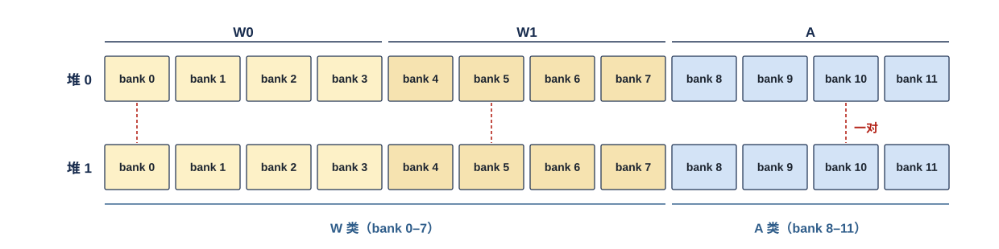

上排是堆 0、下排是堆 1，颜色按组区分（W0、W1、A）。红色虚线连起的上下两格是一对，同一位点里同一对总是一个读、一个写。W0、W1 的 8 个 bank 是 W 类地址的 bank 集合，读出时一个 bank 一道、共出 16 条权重 lane；A 组的 4 个 bank 是 A 类地址的 bank 集合（4 bank 配置）。

### 1.3 一堆只读、一堆只写，由地址的堆位选

**同一位点里，一对 bank 中一个只被读（读堆）、一个只被写（写堆）；落哪一堆由每次访问地址里的堆位决定，L1 没有"哪堆在读、哪堆在写"的状态。** 堆位由发地址的一方显式给出：核内访问与发送侧读由 CCU 按指令给（C2H 送出的目的地址也由 CCU 给），落地写由 MAE 搬运引擎逐拍放在 addr 里（经 hub 或 MAE_IDN 送达）。编译链让这个位点往堆 1 写、从堆 0 读，下一个位点反过来，全部体现在地址里（协议篇 §2.3）。

因此 L1 内没有"边读边写同一个 bank"的情形：**读堆上没有写者，写堆上没有读者。** 读改写也是两次独立的访问：从读堆读旧值，往写堆写新值（§6.5）。

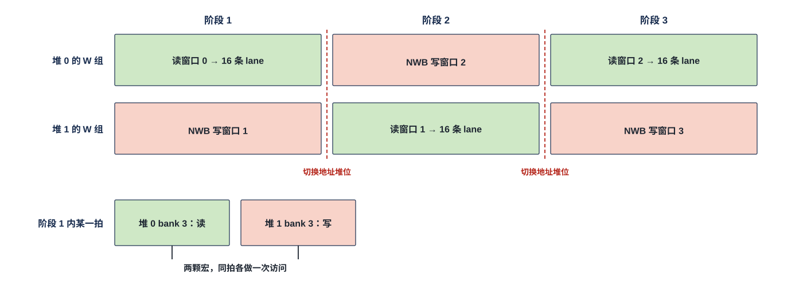

以 W 组为例。阶段 1：堆 0 的 W 组被读、经 16 条 lane 送窗口 0 的权重，同时 NWB 把窗口 1 写进堆 1。阶段之间由编译链翻转地址的堆位，阶段 2 读堆 1 的窗口 1、写堆 0 的窗口 2，依此交替。下方放大阶段 1 里的某一拍：堆 0 的 bank 3 被读、堆 1 的 bank 3 被写，是两颗独立的宏，同拍各做一次访问，读不等写、写也不等读。**同步读写靠的是物理上两颗宏，不靠时分。**

### 1.4 尺度 SRAM 与旁带行（S 类）

**另有一块尺度 SRAM，是 S 类地址的存储体，同样分两堆、成对、由地址堆位选堆。** 一个存储字 32 B，装三种行：

- **E8M0 尺度行**：一个（32 列块, 段）的 32 个 E8M0，即 32 个相邻输出通道 $m$ 各自在一个 MX 组（32 个 $k$）上的指数尺度；列 $m$ 在字内第 $m \bmod 32$ 字节。
- **训练块旁带行**：一个训练块（反传用的 $W^{\mathsf T}$ 的一个 32 × 32 子块）的块最大指数（1 B）、32 个 4 bit 叶移位量 $\Delta_m$（16 B）与标志，其余保留。
- **bias 行**：一个 32 列块的 32 个 BF16 bias，占两个存储字（64 B），不量化。

尺度 SRAM 的深度与 $D$ 的配比【设计者定】：要定的是每堆尺度 SRAM 的存储字数；约束是一个位点读堆里 W 类权重用到的全部尺度行、训练块旁带行与 bias 行都要同时放得下（它们与 W 类数字同拍读出，§4.5；hi 尺度行还要驻留到同（列块, 段）的 lo 用完，§2.5），并计入 SRAM 总账（§1.5）。哪一类行占多少由编译链按 S 类地址分配。

### 1.5 硬约束

- 只用单端口宏，不用双端口或多端口宏。
- SRAM 总量不超过整体集成篇的 SRAM 总账。
- **bank 宽一个存储字（32 B），24 个 bank 用同一种带字节写使能的宏**：一次写可只改写选中的字节（紧密访存，§3.4a、协议篇 §2.5）。W 类与 S 类只按整字写、地址必须是 32 的倍数；bank 4–7 会改配给 A 类（§1.6），所以必须带字节写使能。尺度 SRAM 按整字写。
- KB 级缓冲（NWB 攒字缓冲、写集合器的入口 FIFO、发送桥 FIFO 等）只用 SRAM 或 RF 宏，不用触发器阵列；RF 库最小深度 4。
- 尺度粒度保持每 32 个 $k$ 一个 E8M0，不为省尺度行放大到块级（用户 11-01）。
- L1 不访问 DDR，不直接访问 L2。

### 1.6 配置项：A 类 4 bank 或 8 bank

**A 类只有两种配置，按位点由 CCU 给出、在位点边界生效**（用户 11-05："L1 SRAM 就留出这两种配置模式即可"）：

| 配置 | A 类 bank | A 类写集合口道数 | W 类 bank | 权重 lane 读口 |
|---|---|---|---|---|
| 4 bank（默认） | 8–11 | 4 道 | 0–7 | 8 道，256 B/拍 |
| 8 bank | 8–11 + 4–7（W1 整组改配） | 8 道 | 0–3 | 4 道，128 B/拍 |

**两种配置下写者看到的接口完全相同**（每个写者仍是一条 32 B 入口，§6.4）；变的只是集合器后面的道数与 A 类的容量。4 个激活类读口在两种配置下都能读任一 A 类 bank。8 bank 配置下两来源位点（§6.2）不可用。**任何对象（含紧密对象，§3.4a）的写入与读出必须在同一种 A 类配置下**：地址到 bank 的换算随 4 / 8 bank 变化（§4.4），由编译链保证。

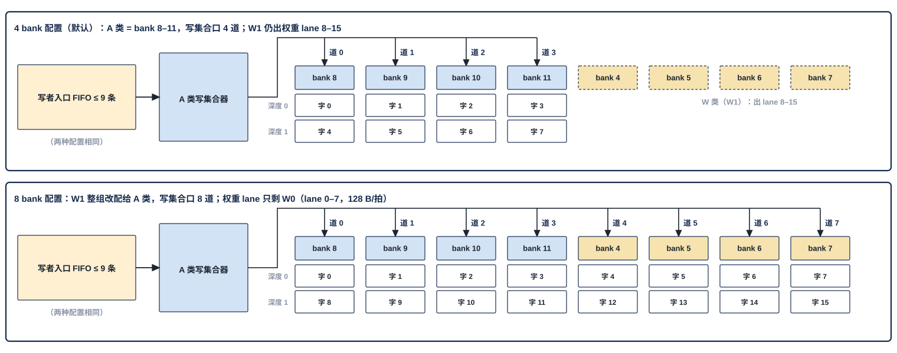

上半是 4 bank 配置：A 类写集合口 4 道，道 $i$ 接 A 类 bank 列表第 $i$ 项（bank 8–11），A 类字号 0–7 依次落 bank 8、9、10、11、8、9、10、11（深度 0、0、0、0、1、1、1、1）；W1 的 bank 4–7 仍出权重 lane 8–15。下半是 8 bank 配置：W1 整组改配给 A 类，写集合口 8 道，bank 列表参考 (8, 9, 10, 11, 4, 5, 6, 7)，字号 0–7 一个深度铺满 8 个 bank；权重 lane 只剩 W0 的 lane 0–7。两种配置左侧的写者入口都是同样的 ≤ 9 条 FIFO。

## 2 数据从哪来、到哪去

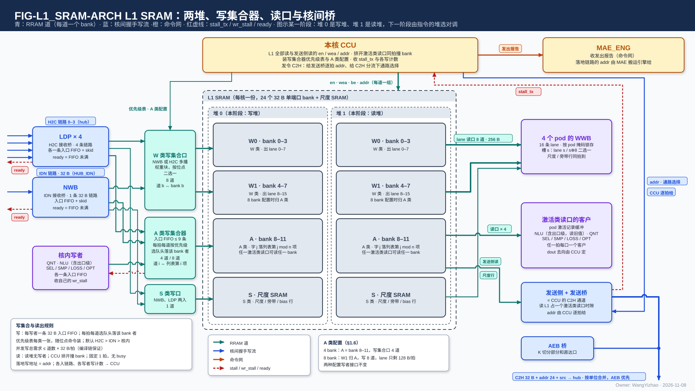

图按"写在左、存储在中、读在右"排。

- **中间是 L1 的两堆**：每堆 W0（bank 0–3）、W1（bank 4–7，8 bank 配置时归 A 类）、A（bank 8–11）与 S（尺度 SRAM）。图里画的是某一阶段：堆 0 是写堆、堆 1 是读堆，下一阶段由地址堆位对调，所以写入线都进堆 0、读出线都从堆 1 出。
- **左侧是写入**：来源有 H2C 接收桥 LDP × 4、IDN 接收桥 NWB（4 条独立 8 B 链路，各一个攒字寄存器）与核内写者（QNT、出口级、NLU、SEL / SMP / LOSS / OPT 等）。它们经三个写集合口进写堆——**W 类写集合口**（NWB 与 H2C 多播权重块按位点二选一，8 道）、**A 类写集合器**（每个写者一条 32 B 入口 FIFO，≤ 9 条，每拍为每道按优先级选"队头落在该 bank"的写者；4 道或 8 道，道 $i$ 接 A 类 bank 列表第 $i$ 项）、**S 类写口**（NWB、LDP 两入，1 道）。核内写者 FIFO 将满时拉 wr_stall 回自己；接收桥与 NWB 的 FIFO 将满时拉低 ready 回 hub / MAE_IDN。
- **右侧是读出**：权重 lane 读口 8 道（每道一个 W 类 bank，各道可不同深度）出 16 条 lane 到 4 个 pod 的 WWB，S 类同拍出尺度 / 旁带行；4 个激活类读口可读任一 A 类 bank，撞 bank 由 CCU 排开，dout 去哪个客户由 CCU 定；发送侧占一个激活类读口的时隙，读出的存储字进发送桥 FIFO，配上本核 CCU 逐拍给出的 addr（C2H 分流的通路选择也由 CCU 给），与 AEB 桥在 C2H 口前按单位合并（单位边界是 CCU 交仲裁器的内部信号），AEB 直达口在单位边界优先。
- **上方**：本核 CCU 发全部核内读写与发送侧读的 en / wea / addr，装各类写集合器的优先级表与 A 类配置，按位点里的发送指令给发送桥逐拍的 addr、给 C2H 分流下通路选择（**发送桥就是 CCU 的 C2H 通道**），收 stall_tx 与各写计数（每个写者、每条入链路各一个）；CCU 数自己发出的拍得发送完成，再数 L2 沿 C2H 反向回来的写入握手（每拍至多 1 项，V18-TP-47），数满即对象已写进 L2，之后经命令与标量网向 MAE 发出报告；L1 不向 MAE 报完成。

L1 组对外口的个数与共享方式见 L1 集成篇（待写）。

### 2.1 对外口一览

**一个口 = 若干条道，每道固定接一个 bank、带一套独立的 en / wea / addr / din / dout / vld**（协议篇 §3.1）；32 B 的口就是 1 道。

| 口 | 总线 | 方向 | 对端 | 道数 × 每道每拍 |
|---|---|---|---|---|
| H2C 接收口 × 4（LDP） | 核间握手写流 | 入 | H2C 第 0–3 道 | 4 条链路，每条 en / ready / din 32 B / be 32 / addr 24 bit / `src`；ready = 该 LDP 的入口 FIFO 未满 |
| IDN 接收口（NWB） | 核间握手写流 | 入 | MAE_IDN 的 4 条 8 B 链路 | **4 条独立 8 B 链路，每条各自 en / ready / din 8 B / be 8 / addr 24 bit / `src`，各一个 32 B 攒字寄存器，四拍凑满整字即写，不要求同拍**；每条链路接哪个核由 MAE_IDN 的交叉开关按指令的链路分配；每条的 ready = 该链路攒字寄存器与 NWB 入口 FIFO 未满 |
| C2H 发送口 | 核间握手写流 | 出 | C2H 分流（口前与 AEB 直达口合并；hub 按本核 CCU 给的通路选择分去 L2 的本核写链路或 MAE_CRU 的 CRU 数据入口） | 1 × (en / ready / din 32 B / be 32 / addr 24 bit / `src`)；去 L2 时 addr = [堆 1][象限 2][字节号 21]，去 MAE_CRU 时 addr 是 MAE_CRU 的 CRU 内地址；addr 由本核 CCU 逐拍给出，通路选择由 CCU 按发送指令的目标存储给出、只在单位边界变（§8.2，V18-TP-51）；链路上没有单位标记 |
| 命令与标量网出口 | 命令与标量网 | 出 | LIC（致命错误）；MAE（发出报告，由 CCU 发） | 64 bit |
| 权重 lane 读口 | RRAM | 出 | 4 个 pod 的 WWB | 8 道 × 32 B（16 条 lane × 16 B，256 B/拍），每条 lane 带 4 bit pod 掩码、段位位与半段位；8 bank 配置时 4 道。列字区经每 bank 一个读口重组器交出（§6.1a），行字区直通；直通 / 重组由每个读请求带的 1 bit 选（V18-L1-12） |
| 尺度 / 旁带 / bias 读口 | RRAM | 出 | 4 个 pod | 1 道 × 32 B，与 lane 同拍 |
| 激活类读口 × 4 | RRAM | 出 | pod 激活记录缓冲、VNU、出口级、发送侧 | 各 1 道 × 32 B；任一口可读任一 A 类 bank；出口带字节对齐器（紧密读移位，§3.4a） |
| A 类写集合口 | RRAM | 入 | LDP × 4、NWB、核内写者（各一条入口 FIFO） | 4 道（8 bank 配置 8 道）× 32 B，每项带 32 位字节写使能；每个核内写者一根 wr_stall |
| W 类写集合口 | RRAM | 入 | NWB 或 H2C 多播权重块（按位点二选一） | 8 道 × 32 B |
| S 类写口 | RRAM | 入 | NWB、LDP | 1 道 × 32 B |
| 读写侧 en / wea / be / addr | RRAM | 入 | 本核 CCU | 每道一组；addr 24 bit（字节地址）；be 32 位；权重 lane 读口的每道读请求另带 1 bit 直通 / 重组（§6.1a） |
| C2H 写入握手 | 核间反向旁带（经发送桥） | 入 | 本核 CCU | 1 bit/拍：L2 象限 $n$ 把本核的一项写进 bank、或 MAE_CRU 把本核的一项写进 CRU 内地址时置 1，CCU 计数（V18-TP-47 / 50） |
| H2C 落地写入握手 × 4 | 核间反向旁带（LDP → H2C 道） | 出 | 给该道发地址的 MAE 搬运引擎 | 每条 LDP 1 × (valid + `src`)/拍：该道的一个存储字写进 L1 bank 的那一拍回一个（V18-TP-50） |
| IDN 落地写入握手 × 4 | 核间反向旁带（NWB → MAE_IDN） | 出 | 经 MAE_IDN 交执行该指令的 MAE 搬运引擎 | 每条 IDN 链路 1 × (valid + `src`)/拍：该链路攒满的一个存储字写进 L1 bank 的那一拍回一个（V18-TP-50） |
| stall_tx、写计数 | 核内信号 | 出 | 本核 CCU | stall_tx 1 bit；各入链路写计数（LDP 0–3、IDN 链路 0–3 各一个）与各核内写者的写计数，写进 bank 时加一（§10） |

### 2.2 权重 lane 固定接 pod 的槽

**lane $2b$、$2b+1$ 固定接 W 类 bank $b$ 读口重组器的两路输出（各 16 B），并固定送到 4 个 pod 的 WWB 当前段的槽 $2b$、$2b+1$。** 行字区时重组器直通，两路就是该存储字的前半与后半；列字区时两路是本 pass 该 bank 两列在当前段的列字（§6.1a）。 一条 lane 同时扇出到 4 个 pod；每拍随 lane 带一个 4 bit pod 掩码，掩码第 $p$ 位为 1 的 pod 锁存这个 16 B 布局字，为 0 的不锁存。另带 1 bit 段位位，指明写进 WWB 的相邻段位 A 还是 B；两来源时再带 1 bit 半段位，指明这一拍是段的布局字 0–7 还是 8–15（§6.2）。

所以 **L1 到 pod 之间没有逐拍选择器**：选哪些列靠各道的读地址（§6.1），放哪个槽靠固定接线，送哪个 pod 靠掩码。两来源时每个槽有一个按位点设定的二选一（§6.2）。

### 2.3 激活类读口可读任一 A 类 bank，撞 bank 由 CCU 排开

**4 个激活类读口每口 1 道 32 B，每口都能读任一 A 类 bank（4 bank 或 8 bank 配置）；同一拍两个读口落同一个 bank 的情形由 CCU 排开——所有读 en 都是 CCU 发的**（用户 11-05，协议篇 §3.3）。读口的客户经 L1 外的选择器接入：pod 的激活记录缓冲、NLU、QNT、MXU 出口级（读改写的旧值）、SEL / SMP / LOSS / OPT、L1 发送侧；**任一拍每个读口只有一个客户，读出的 dout 送哪个客户由 CCU 决定**（协议篇 §3.4）。A 类的相邻存储字轮流落各 bank（§4.4），一个客户读一个对象时由 CCU 逐拍选读口与 bank，L1 不做任何读侧仲裁。紧密读跨两个存储字时，CCU 用两个读口同拍读或一个读口读两拍，读口出口的字节对齐器按 CCU 给的移位量拼出连续字节（§3.4a）。

### 2.4 核内访问的地址由 CCU 发，落地写的地址随数据到达

**核内发起的每一次 L1 读写，en / wea / addr 都由本核 CCU 发出，dout 去哪也由 CCU 定；产出数据的单元（QNT、出口级、SEL 等）写 L1 时只把 din 与本条记录的长度交给自己在写集合器里的那条 FIFO，不算地址**（协议篇 §3.4；写地址由 CCU 与数据一起进 FIFO）。**发送侧读 L1 的 en / addr 同样由 CCU 发，发送桥送出的每拍 addr 与 C2H 分流的通路选择也由 CCU 给出——发送桥就是 CCU 的 C2H 通道**（§8.2；协议篇 §2.4，V18-TP-35：谁拥有源，谁发令）。**接收桥（LDP、NWB）的写地址就是每拍随数据到达的 addr，由 MAE 搬运引擎给出，不经 CCU**（源在核外的搬运归 MAE）。L1 自己不发请求，不解析数据内容，不累加地址，不取模。

### 2.5 由别的模块保证的事项

以下事项 L1 不检查，由对应模块保证：

| 事项 | 由谁保证 |
|---|---|
| 两堆的读写方向在位点内一致（同一对 bank 不在同一位点里既被读又被写），堆位由指令给 | 编译链、CCU |
| 类内各对象的地址互不重叠，不越过类的物理边界 | 编译链（压紧激活对象按位点窗口静态分配）、CCU |
| 目的空间在数据到达时已读完（预取距离、缓冲轮转） | 编译链（LIC 操作 15） |
| 两堆切换：写堆写完成 ∧ 读堆最后读者完成之后，才在下一位点的地址里翻转堆位 | CCU（比对各写者与各入链路的写计数与应写量） |
| 同一阶段并发写者的总需求 ≤ 集合口道数 × 32 B/拍（含落地流） | 编译链 |
| 各类写集合器的优先级表与 A 类配置随位点指令装好 | CCU |
| 同一拍各激活类读口不落同一个 A 类 bank；每个读口任一拍只有一个客户 | CCU 与指令 |
| 读序列里每个 pass 每个 bank 至多两列（列字区），相邻两个深度连续发；列字区的 $K$ 补到 64 的倍数、段按对消费 | CCU_RTR、编译链 |
| 输出轴稀疏权重按整列发给属主核（四条 IDN 链路都接该核）；链路分配随搬运指令给出 | MAE、MAE_IDN |
| 经 IDN 落地的对象（W / S / A 类）都 32 B 对齐，一个存储字的 32 B 由同一条链路送全（NWB 每条链路攒满整字才写；V18-TP-42） | MAE 的 IDN 通道 |
| 落地链路（H2C、IDN）每拍 addr 正确；单位在一条链路上不交错 | MAE 搬运引擎；hub、MAE_IDN 的合并点 |
| C2H 的源地址、每拍 addr 与通路选择正确；单位发完的内部信号交口前仲裁器，C2H 口前合并只在单位边界切换 | 本核 CCU；C2H 口前的仲裁器 |
| 每条入链路与每个核内写者的应写量（从位点指令与长度转发得到） | CCU |
| hi 尺度行驻留到同（列块, 段）的 lo 用完 | 编译链（S 类地址分配） |
| 对象头单独占整字；每条记录从整字起、尾部补 0 到 32 B | 生产方（QNT 等）、编译链 |
| 变长对象按位点窗口静态分配；压紧激活对象不超位点窗口 | 编译链；SEL（封顶模式）、QNT |
| 归约值对回 token 与列块（RIFT），在 32 B 内 | CCU 地址推算 |
| 环形回绕：第 $k$ 个存储字的地址 = 基址 + $(k \bmod L)$ | 只在核内，由 CCU；MAE 搬运的数据不按环形使用（编译链，V18-MAE-17） |
| 类里装什么、何时被覆写（L1 不释放任何空间） | 编译链、数据组织篇 |
| DDR 布局与存储形态（存行字还是列字） | MAE |
| 同一对象的读改写只由一个客户进行 | 编译链与位点指令 |
| 精算 K hi 的来源（驻留模式 / 重读模式）按位点选；长上下文默认重读 | 位点指令（编译链选） |
| K hi 列字区、K hi 行字区、录取 key 全码区的释放规则（驻留：按覆盖它的录取单位精算完；重读：行字按粗算 tile、全码区按录取单位） | CCU 按指令执行 |
| 补读 gather 每项的字节数（驻留只 lo 64 B/key；重读 hi + lo 128 B/key，尺度另段落 S 类） | MAE 指令 |

## 3 逻辑地址

L1 只认地址，不认数据：本章与 §4 合起来就是 L1 的全部"寻址逻辑"——从 24 bit 地址取出堆位、类位、字号，再按 §4 的固定式换成 bank 与深度。地址怎样算出来（累加、回绕、按记录跳）都在 L1 之外，读者实现 L1 时只需实现取位与换算。

### 3.1 逻辑地址 = 堆位 + 类位 + 字节号

**L1 的每条道用同一种 24 bit 逻辑地址，以字节计（位宽为参考值【设计者定】）：最高 1 bit 堆位、接着 2 bit 类位、低 21 bit 字节号；读写相同。** 字节号除以 32 取整是第几个存储字，物理位置（哪个 bank、哪个深度）由 L1 按类位的固定映射算出（§4）；余数只用于生成字节写使能与读出移位。**W 类与 S 类的地址必须是 32 的倍数**（协议篇 §2.5）。

| 位 | 名 | 含义 |
|---|---|---|
| 最高 1 bit | 堆位 | 落堆 0 还是堆 1（§1.3） |
| 接着 2 bit | 类位 | W（权重类）、S（尺度类）、A（激活类）三类之一；每类的 bank 集合硬件固定。L1 的地址只有这 24 bit；C2H 上行的 addr 同为 24 bit（类位换成 L2 的象限）；写到哪个存储不编码在地址里，由 CCU 的通路选择决定，见 §8.2 |
| 低 21 bit | 字节号 | 该类空间内第几个字节，从 0 起 |

| 类 | 常放的内容（由编译链的地址决定，不是硬件限制） | 存储体与接线 |
|---|---|---|
| W | 权重列块、K / V 平面、训练块、LSC 块；两来源位点时 W0 / W1 各放一个来源 | bank 0–7（8 bank 配置时 0–3）；32 B 对齐，经固定 lane 到 pod |
| S | 权重尺度行、训练块旁带行、bias 行 | 尺度 SRAM；尺度 / 旁带行，与 lane 同拍读出 |
| A | 紧凑激活记录、停放、部分和、行状态、K 存储码、归约值、上行暂存 | bank 8–11（8 bank 配置时加 4–7）；激活类读口 |

**W / S / A 三类只是硬件的 bank 集合与口的接线（W 类 32 B 对齐、经固定 lane 到 pod；S 类是尺度行；A 类接激活类读口），类里放什么由编译链的地址决定**：权重类可放任何 32 B 对齐、要经 lane 读出的数据，激活类也可放非激活数据；L1 与 MAE 都不感知类里装的是什么（V18-L1-12）。

**四核物理同构，多播时四核收到同一个地址，落同一物理位置。**

### 3.2 类内怎么分只是编译链与 CCU 的地址

L1 的"区"分三层，只有前两层是硬件：

| 层 | 是什么 | 由谁定、何时变 |
|---|---|---|
| 第一层 硬件类 | W / S / A 三类 bank 集合与接线固定：W 类经 16 条 lane、读口重组器到 pod；S 类是尺度 SRAM；A 类接激活类读口、出口带字节对齐器；两堆 ping-pong 是物理上成对的 bank（§1.2、§1.3） | 硬件固定，不随位点变 |
| 第二层 可配边界 | bank 4–7 归 W 类（A 类 4 bank）还是归 A 类（A 类 8 bank），只改容量与写道数、不改读口宽（§1.6） | 位点指令，位点边界生效 |
| 第三层 类内地址 | K hi 行字区、K hi 列字区、录取 key 全码区、训练块区、停放区等，只是编译链给类内一段地址起的名字（V18-L1-12） | 编译链分配、CCU 推进；L1 不感知 |

**本篇说的"逻辑区"只指第三层，是编译链地址名，不是硬件分区。** **类里哪些存储字放输入记录、哪些放停放、哪些放下一位点预取的权重，是编译链分配、CCU 推进的地址，写在 CCU 指令与搬运指令的基址里；L1 不知道、也不需要知道。** 所以 L1 没有分配表、没有分区号、没有按区的状态。**变长对象（压紧激活）按算法侧给的位点窗口由编译链静态分配，基址与窗口长在指令里；CCU 不做运行期分配**（窗口 = 封顶后的记录长度上限 × token 数，权重驻留下的 token 槽就是窗口按 token 切成的槽；协议篇 §7.3、§9.7，用户 11-06，V18-TP-40）。

### 3.3 核内与 C2H 地址由 CCU 给出，落地地址由 MAE 搬运引擎逐拍给出，L1 不做取模

**核内：CCU 从指令取一个基址（字节），然后累加：对齐使用时每交出一个存储字加 32，隔字取用时步长可配（字节，32 的倍数）；A 类的紧密对象按实际字节数累加**（协议篇 §2.4 核内段）。对齐使用时一条 $n_i$ 字节的记录占 $\lceil n_i/32 \rceil$ 个存储字，CCU 为对象记下每条记录的首地址，随机读时直接把首地址放 addr。**核间：落地写的每拍 addr 由 MAE 搬运引擎逐拍给出**，线性段、gather、散写都在搬运引擎内展开；**C2H 发送的源地址与每拍 addr 由本核 CCU 给出**（协议篇 §2.4 核间段，V18-TP-35）。**环形回绕只在核内、由 CCU 做：地址 = 基址 + (对象内偏移 mod $L$)，$L$ 是对象所在环的长度（字节）；MAE 搬运的数据（H2C / IDN 落地、C2H 发出）不按环形使用，编译链用静态窗口与 ping-pong 分配，越过窗口末尾拆成两条指令**（用户 11-06："对于环形缓冲问题，我认为 MAE 不感知这件事"；"环形缓冲交给（a）"，V18-MAE-17）。**L1 只收到地址，不做取模。** 越过类的物理边界是致命错误（§11）。

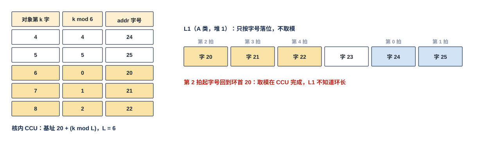

对齐使用的例子，按存储字的序号写。一个核内环占 A 类第 20–25 个存储字（$L$ = 6 个存储字），本次写的是对象的第 4–8 个存储字。左边是算地址的一方（本核 CCU）逐字算 $k \bmod 6$ 与字号：第 4、5 个给 24、25，第 6 个起回到环首给 20、21、22。右边是 L1：按收到的字号落位，第 0、1 拍落字 24、25，第 2–4 拍落字 20–22；L1 不知道环长，也不知道发生了回绕。

### 3.4 对齐使用（默认）：每条记录占整数个存储字

**片上数据默认对齐使用，对齐的单位是记录：对象头单独占一个存储字（不足补 0）；每条记录从一个整字开始，占 $\lceil n_i/32 \rceil$ 个存储字，尾部补 0 到字边界，下一条记录从下一个整字起；任何一个存储字只属于一条记录或一个对象头**（协议篇 §2.5、§9.1，用户 11-05）。32 B 正好是一个 bank 的宽度，所以一条记录的每个存储字都是某个 bank 的一整字，没有访问跨字或跨 bank。生产方攒满 32 B 才写一个存储字，记录尾字写满 0；对齐使用时 L1 只收整字。

- **W 类的一段占 8 个存储字**：单来源时段起点字号是 8 的倍数（一段落 8 个 bank 的同一深度）；两来源时来源 A 的段起点字号 $\equiv 0 \pmod 8$、来源 B 的 $\equiv 4 \pmod 8$（一段落 4 个 bank 的相邻两个深度，§4.3）。
- 需要紧排的小数据由发送方合成一个对象。

### 3.4a 紧密访存：A 类支持任意字节起点，W / S 类与 MXU 供数除外

**L1 的 A 类必须支持非对齐紧密访存，但它是兼容能力：可以不用，但不能没有**（用户 11-05 夜，协议篇 §2.5）。对象与记录可以从任意字节开始、首尾紧挨，用于起点与长度不由片上决定的数据（片外数据，如 Token ID 列表、图像、传感器向量；紧密对象只经 NI 写口进 L2、再经 H2C 落地，不经 IDN，V18-TP-42）：

- **写**：带字节写使能，只改写选中的字节。一次写跨两个存储字时拆成两项，相邻存储字落不同的 A 类 bank，可由集合器的两道同拍写入（§6.4）。
- **读**：CCU 按地址覆盖到的存储字逐个发读（每字固定 1 拍），读口出口的字节对齐器按地址除以 32 的余数移位；跨字时用两个激活类读口同拍读，或一个读口读两拍。**每个激活类读口出口一个字节对齐器**：输入是按地址顺序读回的存储字与 CCU 随读给出的移位量 $s = a \bmod 32$；第 $i$ 个输出字 = 第 $i$ 个读回字的字节 $s \ldots 31$ 接下一个读回字的字节 $0 \ldots s-1$，所以要保持上一个读回字；$s = 0$ 时直通、时延不变（协议篇 §3.3 表）。移位量怎样随读请求送到对齐器【设计者定】，约束是与该次读的 dout 同拍到达。
- **A 类 8 bank 配置同样支持**：借来的 bank 4–7 也是带字节写使能的宏（§1.5），它们的读出走激活类读口、在列字区重组器之前接入（§6.1a），不经权重 lane，所以和 bank 8–11 没有区别。

**不支持的地方**：W 类与 S 类的地址必须是 32 的倍数——W 类经固定接线送 pod 的槽，L1 与 pod 之间没有选择器与旋转器（§2.2）；S 类一个存储字就是一行尺度。**送进 MXU 的激活记录也必须对齐**，pod 的段解包器从存储字首字节开始解析；紧密对象要进 MXU，先由 MAE 整理成对齐记录。紧密写只用于在写堆里从头顺序拼出的新对象（§6.5）。

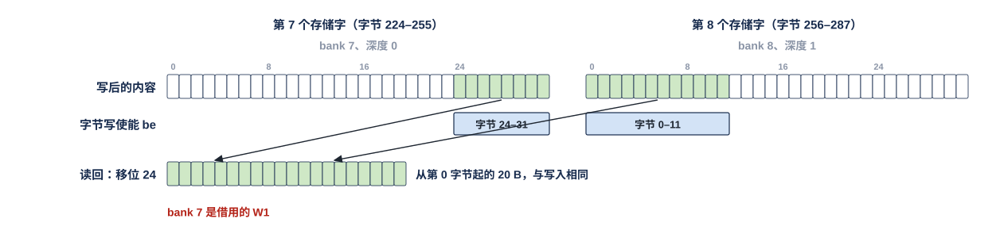

A 类 8 bank 配置（bank 列表 8、9、10、11、4、5、6、7）。一条 20 B 的记录从字节地址 248 开始：前 8 B 落第 7 个存储字的字节 24–31，该字在列表第 7 项 bank 7（借来的 W1）、深度 0；后 12 B 落第 8 个存储字的字节 0–11，回到列表第 0 项 bank 8、深度 1。两次写的字节写使能分别只选这 8 B 与 12 B，两个存储字的其余字节保持原值；读回时 CCU 读这两个存储字，激活类读口出口按 24 移位，得到从第 0 字节起的 20 B，与写入相同（脚本断言）。4 bank 配置下同一条记录落 bank 11 深度 1 与 bank 8 深度 2，见协议篇 FIG-TP-COMPACT。

### 3.5 读一条记录 = 从首地址起连续读整字（对齐使用）

**L1 的读口永远整字返回；随机读一条记录就是从它的首地址起连续发 $\lceil n_i/32 \rceil$ 次普通的 1 拍读，消费方从首字字节 0 起解析，按记录头的长度忽略尾部填充**（协议篇 §9.4）。停放项（每项 2 B 的 BF16 部分和）、attention 行状态这类固定槽数据（② 档）同样按整字读写，一个存储字的槽整体交消费方。对齐使用时没有字内偏移；**送进 MXU 的记录必须对齐**，CCU 不给解包器任何旁带偏移；L1 不做同一 bank 跨深度的两拍访问，没有 busy，没有内置拼接 FIFO。

## 4 地址到物理位置的换算：按类固定

### 4.1 换算只看类位

| 类 | 字号 $r$（地址除以 32 取整）→ 物理位置 | 保证 |
|---|---|---|
| W | bank $r \bmod 8$、深度 $\lfloor r/8 \rfloor$ | 一段的 16 个布局字一拍（8 个 bank）或两拍（4 个 bank）读完，同一段内各 bank 只取一个深度 |
| S | 尺度 SRAM 深度 $r$ | 一个存储字一个（32 列块, 段）或一个训练块的旁带 |
| A | A 类 bank 列表第 $(r \bmod n_{\text{bank}})$ 项、深度 $\lfloor r / n_{\text{bank}} \rfloor$ | 相邻存储字轮流落列表里的 bank |

**堆由地址堆位选，两堆的换算相同。** 换算是固定的组合逻辑，没有表；唯一的配置是 §1.6 的 A 类 4 / 8 bank。

A 类 bank 列表在 4 bank 配置下为 (8, 9, 10, 11)，$n_{\text{bank}} = 4$；8 bank 配置下参考 (8, 9, 10, 11, 4, 5, 6, 7)，$n_{\text{bank}} = 8$（顺序【设计者定】：要定的是这 8 个 bank 的一个固定排列；约束是两堆相同、硬件固定不随位点变，编译链、CCU 的地址推算与验收参考模型用同一排列——相邻存储字落不同 bank 对任何排列都成立）。8 bank 配置时 W 类只用 $r \bmod 8 < 4$ 的字号，W1 的 bank 不再出 W 类数据。A 类写集合口的道 $i$ 固定接列表第 $i$ 项。

行字与列字只是布局字的内容不同，落位规则相同（用户 11-04）：IAS 模式的 pod 用"一列装多行"的行字，OAS 模式的 pod 用"一行装多列"的列字，**都不错位，不用 MOD4-SKEW**。存行字还是列字、DDR 里怎样预排，**由 MAE 决定；L1 只按逻辑地址落位**（用户 11-04）。

### 4.2 W 类占 8 个 bank：行字区一段落同一深度，列字区一个存储字 = 一列 64 个连续 $k$

**行字区（IAS 模式用）：一段的第 $j$ 个 16 B 布局字（$j$ = 0…15）在第 $8d + \lfloor j/2 \rfloor$ 个存储字的前半（$j$ 为偶）或后半（$j$ 为奇），即 bank $\lfloor j/2 \rfloor$、深度 $d$；一段的 16 个布局字在同一深度，一拍读出。** 一个存储字装 4 个相邻 $k$ × 16 个 $m$，与 DDR 标准布局每核连续 4 拍收到的 4 个行字一致。

**列字区（OAS 模式用；来自 DDR 列深度优先平面的权重含 LSC、精算用的 K 列字、LM Head 候选 lo 列）：一个存储字 = 同一个输出通道 $m$ 的相邻两段 $k_{64p}$–$k_{64p+63}$，前半是段 $2p$、后半是段 $2p+1$**（用户 11-05："改成 64 个连续 k"）。16 列一组（列 $j$ = 0…15）：**列 $j$ 落 bank $\lfloor j/2 \rfloor$、深度 $2p + (j \bmod 2)$**，所以 bank $b$ 装列 $2b$、$2b+1$（相邻两个深度），W0（bank 0–3）装列 0–7、W1（bank 4–7）装列 8–15。DDR 列深度优先每拍 32 B 正好是一个字，由一条 IDN 链路送进 NWB 的攒字寄存器、攒满即整字写入（§7.6）；一段 16 个列字分在两个深度的 16 个半字里，由读口重组器拼回整段（§6.1a）。

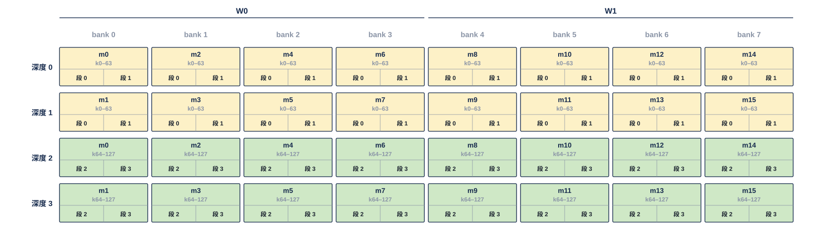

每格是一个 32 B 存储字：上行是输出通道 $m$，下行是它覆盖的 64 个归约位置 $k$，格内前半 / 后半是段 $2p$ / $2p+1$。深度 0 装 $m_0$、$m_2$、…、$m_{14}$，深度 1 装 $m_1$、$m_3$、…、$m_{15}$，各带 $k_0$–$k_{63}$；深度 2、3 是同一批列的 $k_{64}$–$k_{127}$。读深度 0、1 两拍得到 16 列的段 0 与段 1，由重组器先交段 0、再交段 1。实际每个 bank 深 $D$，机制相同。

### 4.3 两来源时一段落 4 个 bank 的相邻两个深度

两来源位点（§6.2）里，**来源 A 只用 bank 0–3（字号 $\bmod 8 < 4$），行字区一段的布局字 0–7 在深度 $d$、8–15 在深度 $d+1$；来源 B 同样只用 bank 4–7**，两拍读完。列字区在两来源下每来源 16 列占 4 个深度：**bank $b$（来源内第 $b$ 个）装列 $2b$、$2b+1$、$2b+8$、$2b+9$，深度 $4p + 0$、$+1$、$+2$、$+3$**，每字仍是该列的段 $2p$、$2p+1$；4 拍读 4 个深度得到 2 段，由重组器按半段交出（§6.1a）。

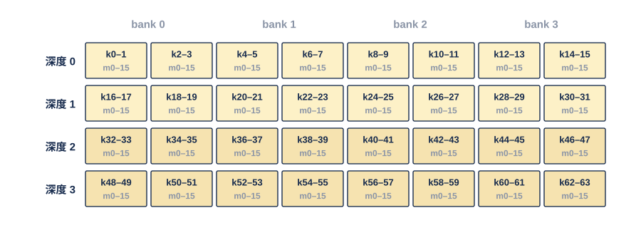

这里画的是行字（IAS 模式用）：每格是一个 16 B 布局字，上行是它覆盖的两个相邻归约位置 $k$，下行是 16 个输出通道 $m_0$–$m_{15}$。一段 = $k_0$–$k_{31}$ × $m_0$–$m_{15}$ 的 16 个布局字：0–7（$k_0$–$k_{15}$）在深度 0（W 类第 0–3 个存储字），8–15（$k_{16}$–$k_{31}$）在深度 1（第 8–11 个），两拍读完；深度 2、3 是下一段 $k_{32}$–$k_{63}$。占 8 个 bank 时同一段落在一个深度，与 §4.2 相同。

**训练块**是 32 个 $W^{\mathsf T}$ 列字（每个为一个 $k$ 沿 32 个 $m$ 的码），即两段，落相邻两个深度；它的旁带行在 S 类的一个存储字（§1.4）。LSC 块（低平面稀疏读副本）按原样落位，规则同。

### 4.4 A 类：相邻存储字轮流落 bank

**A 类第 $r$ 个存储字落 A 类 bank 列表第 $(r \bmod n_{\text{bank}})$ 项、深度 $\lfloor r / n_{\text{bank}} \rfloor$**（协议篇 §2.2）。一个对象从基址字起写：对象头占一个存储字，每条记录各占整数个存储字、尾部补 0：

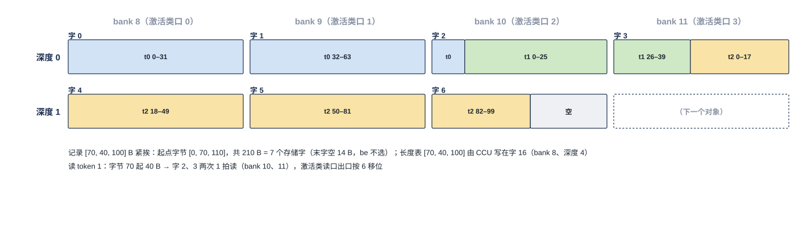

一个对象从 A 类第 0 个存储字开始（4 bank 配置）：8 B 对象头占字 0（补 24 B）；三个 token 的记录长 70 B、40 B、100 B，各占 3、2、4 个存储字（尾部各补 26、24、28 B），首字号为 1、4、6；共 10 个存储字。CCU 只记这三个首字号。读 token 1 的记录就是从字 4 起读 2 个存储字，从字 4 字节 0 起解析。10 个存储字依次落 bank 8、9、10、11、8、9、10、11、8、9，深度 0、0、0、0、1、1、1、1、2、2。**连续的存储字落不同的 bank，所以写时由集合器的不同道并行写入，读时由 CCU 用不同的激活类读口错开读出。**

### 4.5 S 类：一个存储字一个（32 列块, 段），与数字同拍读出

S 类第 $r$ 个存储字就是尺度 SRAM 深度 $r$（两堆由堆位选）。**读 W 类的一段时，同拍读出的 S 类字号由 CCU 与 W 类各道的读地址一起给出**（协议篇 §3.5），按（32 列块, 段）或训练块号定位；**数字与对应 E8M0 同拍到达 pod**。bias 行在一个列块首次读出时同拍到达。（32 列块, 段）→ S 类字号的对应由编译链在指令里给出，L1 不换算。

## 5 数字、尺度与 bias

### 5.1 写入时数字与尺度分两路

- 权重、K、V 的数字写 W 类或 A 类；E8M0 写 S 类。
- 前向权重的 E8M0 按 32 列块内段主序零散到达，**NWB 用 32 B 合并寄存器攒满一个存储字再整字写**。
- 训练块的旁带行整字写进 S 类。
- 同一权重窗口内 lo 平面与 LSC 不写尺度行，复用同（列块, 段）hi 已写入的尺度行。
- **bias 为 BF16、不量化**，每 32 列块两个存储字，与该列块的权重同一写入方写进 S 类（用户 11-04）。
- 激活紧凑记录的尺度在段头里，BF16 停放值没有尺度，这两类不经 S 类。

### 5.2 读出时同拍到达

- 权重段与它的 E8M0 尺度行同拍到达 pod。
- **训练块的旁带行随该块第 1 拍到达**，块的两段分两拍（用户 11-04）。
- bias 行随该列块首段到达，由 MXU 在累加侧或出口级相加（MXU 篇）。

## 6 读写协议：RRAM 口、读侧与写集合器

本章是 L1 内部要做成 RTL 的主体：读侧没有仲裁，只有按 CCU 地址取字（权重 lane 另有列字区的重组器）；写侧所有不确定性集中在写集合器。读者可以按"读侧 §6.1–§6.3、写侧 §6.4–§6.6、两侧共同的正确性 §6.7–§6.8"三段来读。

### 6.0 每个口是若干条 RRAM 道

**L1 的全部核内口都是 RRAM 口，一个口 = 若干条道，每道固定接一个 bank**（协议篇 §3.1）：

| 信号 | 方向 | 位宽 | 含义 |
|---|---|---|---|
| en | 发起方 → L1 | 每道 1 | 请求本身：为 1 的拍这一道有一次访问 |
| wea | 发起方 → L1 | 每道 1 | 本次访问是写（1）还是读（0） |
| be | 发起方 → L1 | 每道 32 | 字节写使能：为 1 的字节被写，其余字节保持原值；对齐使用时全 1 |
| din | 发起方 → L1 | 每道 32 B | 写数据，字节放在它在存储字里的位置 |
| dout | L1 → 消费方 | 每道 32 B | 读数据，一个存储字 |
| vld | L1 → 消费方 | 每道 1 | 读数据有效，= 读的 en 延 1 拍 |
| wr_stall | L1 写集合器 → 写者 | 每个写者 1 | 该写者在集合器里的入口 FIFO 将满；写者保持 en / wea / addr / din。读口没有对应信号 |

| 口 | 道数 | 道 ↔ bank |
|---|---|---|
| 权重 lane 读口 | 8（8 bank 配置时 4） | 道 $b$ 接 W 类 bank $b$，各道 addr 可不同深度 |
| 尺度 / 旁带读口 | 1 | 尺度 SRAM |
| 激活类读口 × 4 | 各 1 | 每口经读侧选择可接任一 A 类 bank；出口带字节对齐器 |
| A 类写集合口 | 4（8 bank 配置时 8） | 道 $i$ 接 A 类 bank 列表第 $i$ 项 |
| W 类写集合口 | 8 | 道 $b$ 接 W 类 bank $b$ |
| S 类写口 | 1 | 尺度 SRAM |

"口比 32 B 宽"只是道数多，没有"首地址 + 连续几个字"的带状语义。**写：选中的那一拍 be 为 1 的字节被 din 覆盖，没有应答；读：en = 1、wea = 0 的那一拍给 addr，下一拍 dout 上是该存储字。** 一个堆的口是同一个单端口 SRAM 口，所以 wea 逐拍给出；位点内它对一个堆是常值（写堆全 1、读堆全 0），阶段切换时随地址堆位一起翻转。wea 只区分读写，写哪些字节由 be 给出。

### 6.1 权重 lane：按（列, pod 掩码）列表逐道取字

**每拍，权重 lane 读口的 8 道各从读堆的一个 W 类 bank 读一个存储字，各道的 addr 由 CCU / RTR 给的列表产生**，bank 读出时延固定 1 拍。列字区的读序列以 **pass** 为单位：一个 pass = 每个 bank 连续两个深度的两次读（两拍）+ 重组器两拍交出（当前段对的段 $2p$、$2p+1$）；pass 的一项是（bank $b$ 的第一列、第二列, 两列各自的 pod 掩码），由 CCU_RTR 产出；每次读请求另带 1 bit 直通 / 重组（列字区的读置重组，行字与训练块的读置直通，§6.1a）：

- 掩码 = 4 个 pod 各自需求的"或"。**几个 pod 都要的列只读一次，同拍广播**；**没有 pod 要的列不进读序列，不读**。
- 一拍里每道只能出一个存储字（一个深度）。**每个 pass 每个 bank 至多两列（任意两列，不要求相邻）**，由 CCU_RTR 排读序列时保证；只有一列时第二路 lane 空。
- 整段读（IAS 的 hi 段、训练块、并集接近稠密的位点）就是 16 条 lane 掩码全 1。

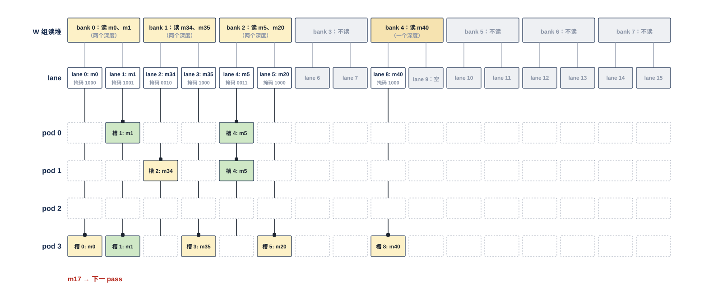

例子是某一个 pass 交出的一段。4 个 pod 各自要的输出通道：pod 0 要 {$m_1$, $m_5$, $m_{17}$}，pod 1 要 {$m_5$, $m_{17}$, $m_{34}$}，pod 2 不要，pod 3 要 {$m_0$, $m_1$, $m_{20}$, $m_{35}$, $m_{40}$}。列 $m$ 落 bank $\lfloor (m \bmod 16)/2 \rfloor$（§4.2）。

- **上排**：W 类读堆的 8 个 bank（8 道）。CCU_RTR 给每个 bank 挑至多两列：bank 0 读 $m_0$、$m_1$，bank 1 读 $m_{34}$、$m_{35}$，bank 2 读 $m_5$、$m_{20}$，bank 4 读 $m_{40}$，bank 3、5、6、7 不读（同一 bank 的两列在不同深度，分两拍读）。
- **中排**：每个 bank 的重组器出两条 lane（lane $2b$ = 第一列、$2b+1$ = 第二列），每条带一个 4 bit 掩码（位 3…0 = pod 3…0）；bank 4 只读一列，lane 9 空。
- **下排**：每条 lane 是一根竖线，**同时穿过 4 个 pod 的同号槽**；掩码为 1 的 pod 在交点处锁存（黑点）。$m_1$ 与 $m_5$（绿）读一次就同拍进了两个 pod，这就是广播；pod 2 一个也不收。
- 没人要的列不读：与旧布局不同，不再有"同一个存储字里没人要的另一列"随字读出。
- 剩下的 $m_{17}$ 也在 bank 0，本 pass 已满两列，放到下一个 pass 装段位 B。

### 6.1a 列字区的读口重组器：按段对读，拼回整段

**每个 W 类 bank 的 dout 后有一个 128 B 重组器（2 × 64 B 乒乓，一组装该 bank 相邻两个深度的两个存储字），8 个 bank 共 1 KB**（用户 11-05："应该是 512 B 的保持 RF，因此需要有 ping-pong 设计"；按两来源定容量）。CCU 对列字区连续发相邻两个深度的地址，位宽与地址格式不变，不感知重组；重组器把两个字的前半拼成段 $2p$ 的两个列字送 lane $2b$、$2b+1$，下一拍把后半拼成段 $2p+1$ 的两个列字。**直通还是重组由每次读请求带的 1 bit 选择：0 = 直通（行字 / 训练块），1 = 重组（列字区整段）；这 1 bit 随位点指令里的读命令（CCU / RTR 给 L1 的（列, pod 掩码）列表，每项一位）一起到 L1 的权重 lane 读口，与该请求的 addr 同拍进入该 bank 的重组器**（V18-L1-12）。一个位点里行字区与列字区混读时逐请求切换，没有位点级或区级状态；重组器只看请求带的这一位：直通请求的读出字原样分前半 / 后半两路交出（§2.2），重组请求按下文的段对节拍进保持寄存器。由重组切到直通时的交出节拍【设计者定】：要定的是保持寄存器里尚未交完的列字与紧随其后的直通字怎样排；约束是同一 bank 的 lane 输出顺序与请求顺序一致、不丢字，pod 掩码与段位位随所属的字一起交出。**A 类 8 bank 配置下，bank 4–7 的读出在重组器之前接入激活类读口的读侧选择器，不经重组器**——重组器只服务 W 类的 lane 读。

- **单来源**：拍 0 读深度 $2p$（8 个 bank → 偶数列）、拍 1 读深度 $2p+1$（奇数列）；拍 2 交出段 $2p$ 的 16 列、拍 3 交出段 $2p+1$，同时 bank 已在读下一对。稳态一段一拍，比行字区多 1 拍时延；每 bank 保持 ≤ 96 B（含本拍读入的字，下同）。
- **两来源**（每来源 4 个 bank，每拍交半段）：拍 0、1 读深度 $4p$、$4p+1$ → 拍 2 交段 $2p$ 前半；拍 2、3 读 $4p+2$、$4p+3$ → 拍 4 交段 $2p$ 后半；拍 5、6 交段 $2p+1$ 的前半、后半（来自保持），期间 bank 读下一对。稳态一段两拍、多 2 拍时延，第一对段起步有 1 拍气泡；峰值保持每 bank 128 B = 每来源 512 B，这是重组器容量的依据。
- **重组器按 16 B 半字槽管理，交出一个列字就释放一个槽**，不按 64 B 整组释放：否则两来源下拍 4 读入的字没有槽可落，节奏降到每 6 拍 4 个半段（仿真断言，见图）。
- **约束**：列字区的 $K$ 由编译链补到 64 的倍数；段按对消费（供数单元沿 $k$ 顺序走段，自然满足）；稀疏取列的 pass 两拍读两拍交出，每 bank ≤ 2 列。

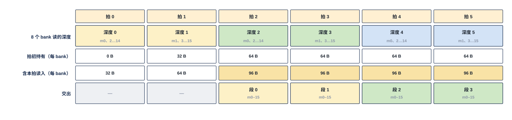

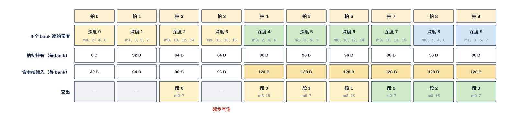

两表按拍列出 bank 读的深度、重组器每 bank 的持有字节（拍初持有 / 含本拍读入）与交出的段，数值由脚本按 16 B 半字槽模拟并断言（交出顺序、每 bank 不超 128 B）。单来源从拍 2 起每拍一段，含读入 96 B/bank；两来源（只画来源 A 的 4 个 bank）4 拍读 4 个深度，交出顺序为段 $2p$ 前半、后半、段 $2p+1$ 前半、后半，只有拍 3 一个起步气泡，含读入 128 B/bank。

### 6.2 两来源：W0 与 W1 各供一组 pod

同一位点里两组 pod 读两种权重（例如 2 个 pod 做 gate 的 hi、2 个 pod 做 up 的折叠）时，**来源 A 放 W0（出 lane 0–7），来源 B 放 W1（出 lane 8–15）**，各自按 §4.3 一段占 4 个 bank × 2 个深度、两拍读完（行字区）；列字区每来源 16 列占 4 个深度，4 拍读得 2 段、每拍交半段（§6.1a）。pod 分组由掩码给出，2 + 2、1 + 3、3 + 1 都可以（用户 11-04）。两来源只在 A 类 4 bank 配置下可用。

**每个 pod 的槽 $s$，输入在 lane $s$ 与 lane $s \oplus 8$ 之间按位点静态二选一**：收来源 A 的 pod，槽 0–7 接 lane 0–7、槽 8–15 接 lane 0–7；收来源 B 的 pod，槽 0–7 接 lane 8–15、槽 8–15 接 lane 8–15。

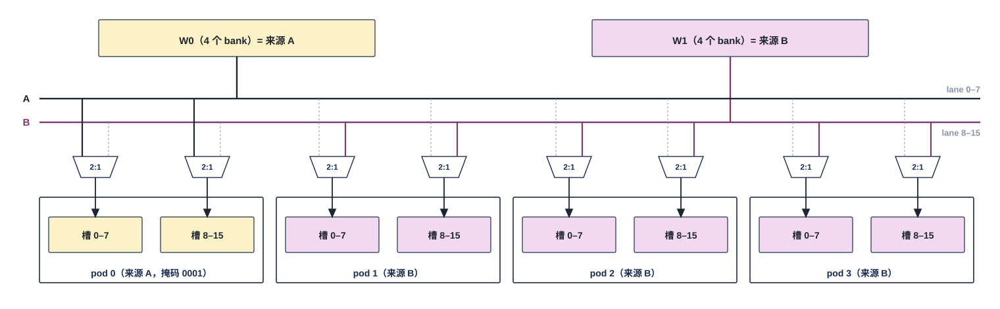

- W0 放来源 A，它的 4 个 bank 出 lane 0–7，在图中合成总线 A；W1 放来源 B，出 lane 8–15，合成总线 B。两条总线都扇出到 4 个 pod。
- 每个 pod 的槽分前后两半（槽 0–7、槽 8–15），每半前面一个二选一，从总线 A、B 中选一条（实线为选中，虚线为未选）。选择按位点设定，位点内不变。
- 例子是 1 + 3：pod 0 两半都选总线 A，收来源 A；pod 1–3 两半都选总线 B，收来源 B。掩码相应为 0001（来源 A 的 lane）与 1110（来源 B 的 lane）。
- 一段 16 个布局字在 4 个 bank 上分两拍：拍 0 两条总线各送本来源的 0–7、半段位为 0，各 pod 写进槽 0–7；拍 1 各送 8–15、半段位为 1，写进槽 8–15。每个来源一拍 128 B。
- 单来源时每个 pod 的前半选总线 A、后半选总线 B，就是 §2.2 的直连。

### 6.3 A 类 8 bank 配置：只加容量与写道数，不加读口

**W1 整组改配给 A 类（§1.6）时**：

- A 类容量翻倍，A 类写集合口从 4 道变 8 道，写者侧入口不变；
- 4 个激活类读口仍各 32 B/拍，只是可读的 bank 多了 4 个；
- W1 不再出 lane，权重读上限从 256 B/拍降为 W0 的 128 B/拍。

**各读口的上限由物理接线决定：权重 256 B/拍（8 bank 配置时 128 B/拍），每个激活类读口 32 B/拍。配置只改变容量与写道数。**

### 6.4 写集合器：每个写者一条 FIFO，每道按优先级选

**写堆每个 bank 只有一个写口；所有写者都经本类的写集合器进入**（用户 11-05，协议篇 §3.2）：

- **每个写者一条入口 FIFO，每项 = 地址 + 32 B 数据 + 32 位字节写使能**（深度【设计者定】，几项即可：要定的是每条 FIFO 的项数；约束是深度大于写者到 FIFO 的在途拍数，wr_stall 在"深度 − 在途拍数"处拉起，协议篇 §4.4）。落地来源（H2C 接收桥 LDP × 4、IDN 接收桥 NWB）的 FIFO 就是接收桥自己的 FIFO，不另加；NWB 的 4 个攒字寄存器写出的字进同一条 NWB 入口 FIFO（§7.5）。A 类写集合器的来源 ≤ 9 条：落地 5 条 + 核内写者 ≤ 4 条。核内写者怎样分条【设计者定】：要定的是 QNT、出口级、NLU、SEL / SMP / LOSS / OPT 各占哪一条入口；约束是核内入口不超过 4 条、同一条入口任一拍只有一个写者在交数据（共用一条的单元由 VNU 组在组内分时）；参考划分：出口级（MXU 组）一条；VNU 沿用现行的 L1 客户划分，NLU、QNT 各一条，SEL / SMP / LOSS / OPT 共用一条（V1.8 修订文档 11-04 "VNU 集成篇"条所记的 CORE-F-330 现行划分；写 VNU 集成篇时若改变，记入 V1.8）。
- **每拍集合器为每条道（= 每个 bank）从"队头正好落在这个 bank"的写者里按优先级选一个**，把它的 en / addr / din 交给该道；其余写者在自己的 FIFO 里多等一拍。
- **优先级表每类一张，随位点指令由 CCU 装**；默认 H2C 落地最高（多播时各目的核独立取走，但一个核落地慢、堵满它的分支后会经 H2C 道的分叉点拖慢同一道上的其余核；H2C 不另配多播存储，余量就在 LDP 入口 FIFO，V18-TP-53）、IDN 次之、核内写者按位点配置；同优先级轮转。
- **写者只看自己 FIFO 的 wr_stall**（将满才拉，阈值 = 深度 − 写者到 FIFO 的在途拍数），不知道撞没撞 bank；L1 内部没有别的仲裁。
- **每个写者在集合器出口有一个写计数：该写者的一项真正写进 bank 的那一拍加一，交本核 CCU 与该写者的应写量比对，达到即该写者写完成**（协议篇 §2.6，V18-TP-37）。FIFO 里排队的项不计，所以写者交出最后一项不等于写完成；落地来源的写计数就是 LDP、NWB 各入链路的写计数（§7.0）；计数的位宽与清零见 §10。
- W 类写集合口的来源是 NWB 或 H2C 多播权重块（按位点二选一，驻留侧反转，§7.7），8 道；S 类写口 NWB、LDP 两入、1 道；两者同样按优先级选，撞 bank 时由各自接收桥的入口 FIFO 顺延（协议篇 §3.2）。

**写带宽的硬上限 = 道数 × 32 B/拍。同一阶段并发写者的总需求不得超过它（含落地流），由编译链保证；集合器只吸收瞬时的撞 bank。**

写集合器的全部对外接口（写者入口、wr_stall、道输出、优先级表、A 类配置、写计数）与每拍动作列在协议篇 §3.2 的接口表；W 类集合口与 S 类写口按同一张表例化，只是写者为 NWB / LDP、道数为 8 / 1、没有 A 类配置位。

### 6.5 读改写：从读堆读旧值，往写堆写新值

NLU 的 attention 行状态、区块摘要部分和、出口级的部分和合并等读改写，**从 [读堆][类][字号] 读旧值、往 [写堆][同类][同字号] 写新值**（写经该写者的集合器 FIFO），下一位点堆位翻转后新值成为旧值（用户 11-04）。L1 内不存在对同一个 bank 先读后写的原子操作。读改写一律整字写；**带字节写使能的紧密写只用于在写堆里从头顺序拼出的新对象**——写堆里同一存储字的其余字节是两个阶段之前的旧值，不能用它跨阶段修补某个字的一部分（协议篇 §2.5）。

### 6.6 写口只落 bank

**L1 的全部写口只把 be 选中的字节落 bank，不量化、不打包、不改写记录内容，也不解析记录**。紧凑记录、Q 记录、$P'$ 记录由 QNT 生成，对象头与记录头由生产方写。

### 6.7 存取逐位无损、写入后可见

任一数据写入后，按同一 [堆][类][字号] 读出，必须与写入逐位相同。**写入 bank 的那一拍之后发起的任何读都读到新值**；读堆与写堆分开，位点内不会读到正在写的堆。

### 6.8 读侧不仲裁，读出固定 1 拍

**读堆上没有写者；4 个激活类读口同拍撞 bank 由 CCU 排开，权重 lane 读口每道只接一个 bank；所以读侧没有仲裁、没有等待，读出时延固定 1 拍，没有 ready，也没有 busy**（用户 11-05，协议篇 §3.3）。写侧的撞 bank 全在写集合器里吸收（§6.4）。

## 7 落地：LDP 与 NWB 是接收桥

落地写与核内写的区别只在地址来源：核内写的地址由 CCU 给，落地写的地址随数据从核外到达（addr）。进了写集合器之后两者没有区别，所以本章只写接收桥本身——握手、按 be 落字节、IDN 的攒字与写计数。

### 7.0 L1 对核间链路的支持

L1 组有三组核间口：H2C 入（4 个 LDP，4 条 32 B 链路）、IDN 入（NWB，4 条独立 8 B 链路）、C2H 出（发送侧，§8）。核间链路是**带地址的握手写流**（**信号与核内 RRAM 口同名：en / din / be / addr，核间只多 ready、发令号 `src` 与反向的写入握手**；链路上没有单位标记；协议篇 §5，V18-TP-41 / 42）。两种接收桥遵守同一套规则（协议篇 §5、§6.2）：

1. **逐拍地址。** 每拍的 addr 就是这一拍数据所在目的存储字的逻辑地址（[堆 1][类 2][字节号 21]，以字节计），由 MAE 搬运引擎逐拍生成、经 hub 或 MAE_IDN 送达；**接收桥不累加、不记状态，按类位进对应的写集合口。** 没有首拍地址，也不要求一个单位的各拍地址连续。下行链路不带目的存储的标志：落到哪个存储由链路决定（协议篇 §5.1，V18-TP-51）。
2. **接收桥 = 核间从口 + 一条入口 FIFO，这条 FIFO 就是它在写集合器里的队列；ready = FIFO 未满**（用户 11-05："反压的信号来自于写入时的 FIFO"）。撞 bank 的瞬时顺延由 FIFO 吸收。
3. **通用链路块（寄存器输出与 skid）。** 接收桥是协议篇 §5.3.2 通用链路块的实例：ready 为寄存器输出，与上游之间不得有组合路径；skid 深度可配，= 从本级拉低 ready 到上游真正停发之间的在途拍数，将满阈值 = 深度 − 在途拍数（V18-TP-32 / 38）。**功能与链路时延无关**：上游插任意级寄存器，落地结果不变。
4. **按 be 落地。** be 就是这一拍的字节写使能。对齐使用时全 1、每拍一个整字（IDN 由 NWB 四拍攒成整字，§7.5）；H2C 上紧密对象首尾不满的存储字按该拍的 be 只写有效字节，逐拍写、不攒。W 类与 S 类的落地地址必须是 32 的倍数。
5. **多播**：发送侧（H2C 道、MAE_IDN）共享一份缓冲、各目的核按自己的 ready 独立取走；四核收到同一个 addr，落同一物理位置（协议篇 §5.7）。L1 一侧与单播没有区别。
6. **保序、单位不交错**：同一链路先发的拍先到；下行（H2C、IDN）一个单位的各拍在链路上连续（H2C 道、MAE_IDN 的合并点由 MAE 搬运引擎给单位边界、只在边界换源，V18-TP-36 / 45；单位边界是发令方内部的信号，链路上没有单位标记，L1 也不需要知道，V18-TP-42）。
7. **按链路写计数、写进 bank 时加一、交 CCU 比对**：L1 为每条入链路（LDP 0–3、IDN 链路 0–3）各维护一个写计数，在这条链路的存储字真正写进 bank 的那一拍加一（还在攒字寄存器与入口 FIFO 里的不计），交本核 CCU；CCU 与应写量（来自位点指令或长度转发）比对，达到即落地完成、可以消费（§10，协议篇 §2.6、§7.4，V18-TP-37）。**同一拍，这条链路还沿原链路反向回一个写入握手（valid + `src`）给发令方**：LDP 回给该 H2C 道发地址的搬运引擎，NWB 经 MAE_IDN 回给执行该指令的搬运引擎；发令方数满即这条搬运指令写入完成（核间统一协议，协议篇 §2.6 / §5.8，V18-TP-50）。两件事各管一头：**写计数给本核消费者（CCU，核内规则），写入握手给核外发令方（核间规则）**。不设排空信号；链路上没有单位标签。**长度转发不要求先于数据到达**（协议篇 §8.7，V18-TP-44）：数据可以先落地、写计数先涨，长度转发到了 CCU 才比对、才开始消费；晚到不是错误。
8. **不需要接收指令**：接收方逐拍拿到地址、无状态。

### 7.1 LDP：H2C 四道各一个接收桥

**H2C 4 道 × 32 B/拍，每道一个 LDP；每拍按 addr 把 32 B 交给对应类的写集合口，落对应堆、对应字号的存储字。** 链路上没有核标识：本核的 4 条 H2C 链路是一组独立的线，核由链路标识；多播时 H2C 道在分叉点按已取位把一拍分给几个目的核，各自按 ready 取走；快慢核的差距由各核分支 skid 与本 LDP 的入口 FIFO 吸收（协议篇 §5.1、§5.7；V18-TP-53）。落地的内容有 K / V、权重（驻留侧反转时）、残差、直写数据、部分和读回、Draft 分布、旋转后的 K、MAE_CRU 的归约值与合并后的读集（§7.3）、核间小消息（K 切分判决、区块并集、节点档表，③ 档对象）与要重放的激活记录等；**写到哪一类哪一个存储字只由 addr 决定，不由数据类型决定。**

**原"重放流直交 pod 激活入口"撤**（用户 11-05）：H2C 激活一律先按 addr 落 A 类，再由 CCU 按对象头读出、经激活类读口交 pod。段片解析、激活记录缓冲与段解包器在 pod 一侧（MXU_AFU 篇）。

### 7.2 散写：L1 不解析记录头

token 切分时各核的记录散写到各自位置：**hub 按道顺序发出，每拍地址由 MAE 的 H2C 道搬运引擎给出，编译链把该道的 token 在 A 类里连续分配；L1 只按 addr 落位，不解析记录头，不按 token 序号定位**（协议篇 §9.5）。记录头里的 token 序号（16 bit）供接收方校验与仿真对拍，不供 L1 寻址。

**四道同时落地同一份数据时（L2 里四核分产、同址异象限的数据经四道并行读回，协议篇 §9.9），四道的目的地址由编译链按 A 类 bank 数错开**：A 类字号 $j$ 落 bank 列表第 $j \bmod 4$ 项（8 bank 配置为 $j \bmod 8$，§4.4），道 $q$ 的落地起点比道 0 错开 $q$ 个存储字（或段步长取 $4k+1$ / $8k+1$ 个存储字），否则四道每拍落同一 bank，A 类写集合口只能每拍写进一项（V18-TP-48；数值例见 MAE_ENG 篇 FIG-MAE_ENG-QSPLICE）。L1 不检查，冲突只会让 LDP 的入口 FIFO 顺延、拉低 ready。

### 7.3 MAE_CRU 结果的落点

**MAE_CRU 产出的归约值（BF16 直出，超过 32 B 时占连续几个存储字，不带组序号；V18-CRU-02 撤 MXFP6 g32 输出，V18-CRU-05 撤组序号）与读集合并后的读集（录取读集 / 区块读集 / lo 读集，用户 11-05 定名）是数据，由 MAE_CRU 作为 H2C 道的第二源经 H2C 下发（不经 MAE_IDN），每拍 addr 由执行该搬运指令的 MAE 搬运引擎给出；CRU 的合并参数随该 MAE 搬运指令**（协议篇 §6.1，V18-MAE-11 / 12）；LDP 照常按 addr 落 A 类；**归约值对回（token, 列块）的 RIFT 归 CCU 按地址推算，L1 不参与**（用户 11-05；V18-CRU-05 起不带组序号，位置只由地址给出）。

### 7.4 落地写与核内写共用写侧

**落地写的到达拍由 hub / MAE_IDN 决定，CCU 不排它的时隙；它与核内写在写集合器里按优先级分道，落地来源默认最高。** 落地 FIFO 将满时拉低 ready、经握手让 hub / MAE_IDN 停发，核内写者 FIFO 将满时拉 wr_stall 让写者本身停写；两种情形都只在瞬时撞 bank 时出现，持续的超额由 §6.4 的编译链约束排除。

### 7.5 NWB：IDN 的接收桥

**NWB 是 IDN 的接收桥，接 MAE_IDN 的 4 条独立 8 B 链路；每条链路各自有 en / ready / din 8 B / be 8 位 / addr 24 bit / `src`，各配一个 32 B 攒字寄存器，四条链路不要求同拍**（用户 11-05 夜："单核 4 道同拍耦合的问题需要解决，如果强制要求同拍，可能会对后端要求过大"；协议篇 §5.5，V18-TP-30）。每条链路接哪个核由 MAE_IDN 的交叉开关按搬运指令的**链路分配**给出，本核可以接 0–4 条（用户 11-05："如果只使用单核或者双核，IDN 应该全力供给这两个核"）。

**每条链路的攒字规则：**

- addr 以字节计，给这一拍 8 B 在目的存储字里的起始字节地址：除以 32 取整是哪个存储字，除以 32 的余数指明落该字的哪个 8 B；be 给其中有效的字节。
- **攒字寄存器按 addr 与 be 把 8 B 放进对应位置；四拍凑满 32 B 即以一次整字写入**（V18-TP-42）。**IDN 送进 L1 的都是 32 B 对齐对象，一个存储字由同一条链路送全，由 MAE 的 IDN 通道保证**（§2.5；W 类与 S 类本来只整字写），所以 NWB 没有不满的尾字，不需要"末拍触发写出"，也不需要链路上的单位标记。紧密对象不经 IDN 进 L1：它们只经 NI 写口进 L2（协议篇 §6.2），要进 L1 时由 H2C 逐拍带 be 落地（§7.0 第 4 条）。
- 标准布局在单核位点一核收 4 片：同一 $k$ 下 4 个列组的 4 个行字属于 4 个不同的存储字，链路 $i$ 送第 $i$ 个列组的行字，四个攒字寄存器各攒各的字、各自满了各自写出。

四个攒字寄存器写出的字进同一条 NWB 入口 FIFO，同拍有几个字写出时按链路号轮流进，未进的寄存器保持（规则已定为按链路号轮流，设计者只定电路；约束是寄存器保持期间本链路的 ready 为 0，不丢该链路的下一拍）。前向权重的 E8M0 由 32 B 合并寄存器攒整字写进 S 类（§5.1）。**每条链路的 ready = 本链路攒字寄存器能收这一拍 ∧ 入口 FIFO 未满，每条链路的入口是一个通用链路块实例（协议篇 §5.3.2）；四条链路的 ready 各自独立，一条停不拖住另外三条。**

### 7.6 按列到达的权重：每拍整字直写，整列发给属主核

**按列到达**：输出轴稀疏的权重在 DDR 按列深度优先存放，一个输出通道 $m$ 的全部 $K$ 个码连续，一个 32 B 拍带同一列相邻两段（各 32 个 $k$）的两个 16 B 列字。按 §4.2 列字区的字形态，**这 32 B 正好就是 L1 的一个存储字，由一条 IDN 链路送进 NWB、攒满即整字写入，不暂存整列、不配对、不写 0**（用户 11-05："这个暂存我不能接受"）。DDR 布局不变，块不错位，不用 MOD4-SKEW。

**整列发给属主核。** MAE 逐列 gather，**MAE_IDN 把四条链路都分配给这一列的属主核**（协议篇 §5.5）：每个存储字整字走一条链路（4 拍 × 8 B），四条链路各送不同的字，合计仍为 32 B/拍；一列的各字落同一个 bank 的连续深度，写进的是写堆，与读堆的读不冲突，四个攒字寄存器同时写满时经入口 FIFO 依次写入。各核收到的是"一列连续若干字、再轮到别的核"的突发，平均仍为每核 8 B/拍。被选中的列才被读取，没人要的列既不读 DDR 也不占 L1。

### 7.7 驻留侧反转：两类写堆都可由 IDN 或 H2C 写入

核与核协作时，可以按位点选"权重驻留、激活经 H2C 流入"或"激活驻留、权重经 IDN 流入"。**W 类与 A 类的写堆各自可由 NWB（IDN）或 LDP（H2C）写入，按位点由搬运指令的目的地址与写集合口的来源选择决定；读接线不变**（W 组只出 lane，A 组只出激活类读口）（用户 11-04，V18-L1-04）。

### 7.8 K 的落地

- **直接处理（K 量化在 RoPE 之后存储，指令配置，V18-KV-01）**：精算用的 K hi 有驻留、重读两种来源，按位点指令选（§7.8a）。**驻留模式下** NWB 把同一份 K hi 同时写成粗算用的段形态与精算用的列字形态，精算不为同一 hi 平面再读 DDR；**重读模式下**只写段形态，不双写。驻留模式两种形态同写的 bank 并发【待标定】：同一份 K hi 写两份，NWB 每收一个存储字要向 W 类写集合口交两项，待标定的是两份的落位是否同拍撞 bank、入口 FIFO 要吸收多少顺延；约束是总写需求不超过 W 类写集合口 8 道 × 32 B/拍（§6.4），由编译链保证。
- **先 RoPE 再处理（K 量化在 RoPE 之前存储，指令配置，V18-KV-01）**：入站的未旋转原码按字节原样落 A 类的 K 存储码对象，不做双写；NLU 经激活类读口读取、旋转，QNT 重量化后写回 L1，再由 L1 发送侧经 C2H 写 L2，由 MAE 经 H2C 多播进需要的核的 W 类（用户 11-04，V18-L1-05）。key 可按核切分，各核旋转一部分后互相多播。

### 7.8a 精算 K hi 的两种来源：驻留模式与重读模式

**attention 精确分数（FCR，全码重算）要用录取 key 的 K hi、K lo 两平面全码列字；其中 K hi 有驻留、重读两种来源，由位点指令选，L1 两种都要支持**（用户 11-06："可以改成对 MXU，CCU，MAE 模块都提出这个要求，可以支持驻留，也可以支持重读"；V18-ATT-01）。**长上下文默认重读模式。** 两种模式下 L1 的口、地址换算与读写协议都不变；变的只是 K 落在哪几个逻辑区（K hi 行字区、K hi 列字区、lo 区、录取 key 全码区都是编译链地址名，不是硬件分区，§3.2）、各区占几份、何时可被覆写。**两种 K 处理选项（直接处理 / 先 RoPE 再处理，指令配置，V18-KV-01）下本节的两种模式同样适用**：先 RoPE 再处理时，重读模式 gather 回的是未旋转的 hi + lo 原码（落 A 类的 K 存储码对象），NLU 精算段旋转、QNT 重量化后写全码区；驻留模式留住的是粗算段落下的未旋转 hi 原码，释放规则同 K hi 列字区。

下表以 head_dim 128、一个 kv 头为例；$N_{\text{ct}}$ 为一个粗算 tile 的 key 数，$N_{\text{u}}$ 为一个录取单位的 key 数（参考值都是 64）。

| 项 | 驻留模式 | 重读模式 |
|---|---|---|
| 粗算读到达的 K hi（每 key 64 B 数字 + 尺度） | NWB 双写：行字（段布局）进 K hi 行字区给粗算，列字进 K hi 列字区留给精算 | 只写行字进 K hi 行字区，不双写 |
| 录取后的补读 | 只 gather 录取 key 的 lo 平面（64 B/key），进 lo 区 | hi + lo 同一次 gather，经 MAE_DSU 两平面合并成记录（平面分开：hi 的 4 个存储字接 lo 的 4 个存储字 = 128 B/key，V18-MAE-04），进录取 key 全码区（W 类）；E8M0 尺度行另落 S 类，与粗算共用 |
| 精算用到的 L1 区 | K hi 列字区 + lo 区 | 录取 key 全码区 |
| 份数 | K hi 列字区 $n_{\text{hi}} \ge 1 + \max_t \lvert\bigcup_{u \in \mathcal U_{\text{fly}}(t)} \mathcal T(u)\rvert$（$\mathcal U_{\text{fly}}(t)$ 为 $t$ 时刻在飞的录取单位，$\mathcal T(u)$ 为单位 $u$ 覆盖的粗算 tile 集合），一份 = 一个粗算 tile 的列字（$N_{\text{ct}} \times 64$ B，参考 4 KB） | 全码区一份 = 一个录取单位（$N_{\text{u}} \times 128$ B，参考 8 KB），份数 $n_{\text{fc}}$ 随流水深度（参考 3） |
| 可被覆写（释放）的时点 | K hi 行字区每个 tile 粗算完即释放；K hi 列字区按粗算 tile 写入，**一个 tile 的份留到覆盖它的全部录取单位精算完**；lo 区按录取单位 | K hi 行字区每个 tile 粗算完即释放；全码区一份在该录取单位精算完后释放 |
| L1 占用与上下文长度 | 随录取单位跨的 tile 数增长、不封顶（32K 上下文 × 64 B × 8 个 kv 头最坏 16 MB） | **与上下文长度无关** |
| 精算 pass 的两条列道 | hi 道读 K hi 列字区，lo 道读 lo 区（两个不同区） | 两道都读同一条全码记录 |

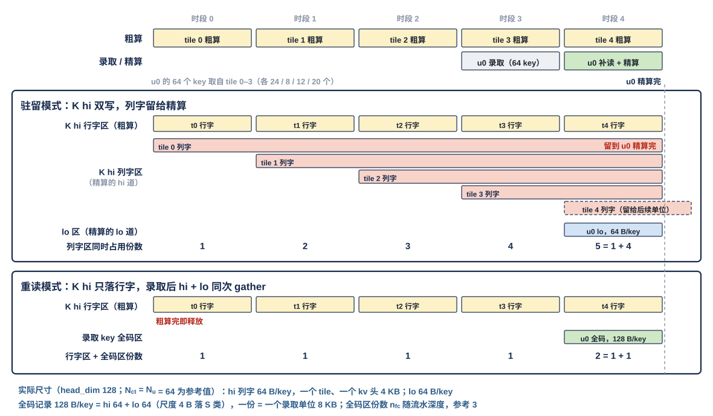

粗算 tile 0…4 依次在时段 0…4 到达并粗算；录取单位 u0 的 64 个 key 取自 tile 0–3（各 24、8、12、20 个，示例），时段 3 末录取，时段 4 补读并精算，时段 4 末精算完（竖虚线）。上半是驻留模式：每个 tile 的行字粗算完即释放，列字却要留到覆盖它的 u0 精算完——tile 0 的列字从时段 0 留到时段 4 末，跨了 4 个 tile；时段 4 时列字区同时占 5 份（为 u0 留住的 4 个 tile + 正在写入的 tile 4，即 $n_{\text{hi}}$ 的下限 $1 + 4$），u0 的 lo 另占 lo 区。下半是重读模式：任一时段只有本 tile 的行字，粗算完即释放；u0 补读时 hi + lo 一起进全码区占一份，时段 4 共 $1 + 1$ 份。录取单位跨的 tile 越多，驻留模式的列字区越大，重读模式不变（脚本断言两种模式的最大份数）。

#### 驻留模式：NWB 双写，K hi 列字区留到覆盖它的录取单位精算完

**粗算读到达的每个 K hi 存储字，NWB 向 W 类写集合口交两项：段形态进 K hi 行字区，列字形态进 K hi 列字区**（§7.8 第一条，同写的 bank 并发【待标定】）。录取后 MAE 只 gather 录取 key 的 lo 平面落 lo 区，每项 64 B。K hi 列字区一个 tile 的份要等覆盖它的全部录取单位精算完才可被覆写，所以份数随"在飞录取单位覆盖的粗算 tile 数"增长；短上下文、录取单位跨的 tile 少时，它省掉一次 hi 平面的 DDR 读。

#### 重读模式：K hi 只落行字，录取后 hi + lo 同次 gather 落录取 key 全码区

**粗算读到达的 K hi 只写段形态进 K hi 行字区，粗算完即按 tile 释放，不双写。** 录取后 MAE 按录取列表对同一个 key 同时读 DDR 里的 hi 平面与 lo 平面，经 MAE_DSU 两平面合并（记录级：hi 字与 lo 字放在同一条记录的相邻地址，不做半字节交织，V18-MAE-04）后，经 MAE_IDN、NWB 落录取 key 全码区；一份 = 一个录取单位，份数 $n_{\text{fc}}$ 只随流水深度（参考 3），**L1 占用与上下文长度无关**。代价是 hi 平面多读一次 DDR（用户 11-06："我觉得重新读一遍影响也不大"）。**全码记录在 L1 里的落位（用户 11-06 定）：数据 128 B = hi 的 4 个存储字接 lo 的 4 个存储字，进 W 类、天然 32 B 对齐，每个存储字仍是一个平面的 32 个 4 bit 码（排列与只有 4 bit 的列字相同，一个 key 占两倍的字）；E8M0 尺度行不进记录，落 S 类，粗算与精算共用同一组。** 精算 pass 的两条列道分别取同一 key 的 hi 字与 lo 字。

#### 两种模式下读口不变，释放规则由 CCU 按指令执行

**精算 pass 的两条列道各自给地址，可以来自两个不同的区（驻留：K hi 列字区 + lo 区），也可以来自同一全码区（重读）**；权重 lane 读口、读口重组器与 §6.1 的读序列规则不变，L1 不知道当前是哪种模式。各区何时可被覆写由 CCU 按位点指令里的模式执行（驻留按覆盖它的录取单位精算完、重读按粗算 tile 与录取单位），L1 自己不释放任何空间（§13）；补读 gather 每项的字节数（只 lo 64 B，或 hi + lo 128 B）由 MAE 指令给出（§2.5）。

### 7.9 L1 不变换数据

**L1（含 LDP、NWB）不做方向变换（$W^{\mathsf T}$）、不算块尺度、不旋转、不转置、不置换、不解码 KV 存储格式。** 方向变换与块尺度只在 MAE 组的数据整形单元 MAE_DSU 做一次，结果经 MAE_IDN 落地。

## 8 发送侧

发送侧是 L1 唯一的出核路径：核内单元不直连 C2H，要出核的数据先写进 L1，再由 CCU 按发送指令读出、配上逐拍地址送上 C2H。所以在 L1 一侧，发送只是"一个激活类读口的时隙 + 一个发送桥 FIFO"，地址与长度全部在 CCU。

### 8.1 发送由本核 CCU 的发送指令发起

**C2H 由本核 CCU 发令：发送是位点指令的一部分，CCU 按发送指令发读 L1、给出每拍目的地址**（用户 11-06："要么就取消 C2H 的 MAE 主，统一改成各核的 CCU 主"；协议篇 §2.4.2、§6.1，V18-TP-35）。L1 不收任何指令；MAE 不再向核发 C2H 发送指令。

| 字段 | 含义 |
|---|---|
| 源 | 本核 L1 的对象（堆位、类位、起始地址）；CCU 据此逐拍发读 |
| 目的 | 目标存储（L2 或 MAE_CRU）与目的地址（L2 逻辑地址或 MAE_CRU 的 CRU 内地址）；CCU 据此逐拍给出 addr，并给 C2H 分流下通路选择 |
| 长度 | 存储字数；变长对象按槽存储（每条记录一个离线上限的槽，V18-TP-49），CCU 只发各槽里实际写了的存储字，项数在做写地址推理时已累加出 |

**发送指令里没有请求号等给执行方回报用的字段**；字段位宽归 ISA。

### 8.2 发送：CCU 发读并给出每拍目的地址，发送桥是 CCU 的 C2H 通道

**发送侧读 L1 占一个激活类读口的时隙，en / addr 由 CCU 发出；读出的存储字进发送桥 FIFO（深度【设计者定】），再经核间主口发上 C2H。每拍的 addr 也由本核 CCU 逐拍给出，C2H 分流的通路选择由 CCU 按目标存储给出——发送桥就是 CCU 的 C2H 通道**（协议篇 §6.1，V18-TP-35 / 51）：把 FIFO 队头的存储字与 CCU 给的下一拍 addr 配成一拍发出，发送桥自己不累加地址。读出的字数与给出的拍数都等于发送指令的数据量，由 CCU 保证一致。**CCU 不再给 last**（V18-TP-42）：CCU 数着当前单位发了几拍，"单位发完"作为内部信号交 C2H 口前的仲裁器（§8.3），不上链路；对象发完、写入握手数满后 CCU 发出报告，报告只带目的起始地址（§8.5）。**发送指令的 L2 地址象限位必须等于本核号**（核 $n$ 只写 L2 象限 $n$，V18-L2-04）。发送桥是通用链路块的实例（协议篇 §5.3.2）。

**C2H 的 addr 是 24 bit：去 L2 时为 [堆 1][象限 2][字节号 21]，去 MAE_CRU 时是 MAE_CRU 的 CRU 内地址**，另带 be 与 `src`（协议篇 §5.2）。**写到哪个存储不编码在地址里，也没有 dest 信号：CCU 按发送指令的目标存储给 C2H 分流下通路选择，只在单位边界变；addr 不带优先级**（V18-TP-33 / 51）：C2H 分流不扇入、不仲裁，只按通路选择分流：本核 C2H 上去 L2 的单位直通 L2 的本核写链路（L2WP 每核一条 32 B，共 4 条），去 MAE_CRU 的单位交 MAE_CRU 的 CRU 数据入口；本核 C2H 的 ready 只取决于本核那条链路的下游（L2 象限 $n$ 里本核的入口 FIFO 或 MAE_CRU 的 CRU 数据入口），不受其他核影响；**本核只写 L2 象限 $n$**，L2 集合器里本核与 NI 写的先后是 RTL 头文件参数（协议篇 §5.9，V18-L2-03 / 04）。下行（H2C、IDN）同为 24 bit 的 [堆][类][字节号]。

FIFO 将满（深度 − $L$，$L$ = CCU 停发到读数据进 FIFO 的流水深度【设计者定】；FIFO 深度须大于 $L$，多出的部分决定 C2H 的 ready 被拉低多少拍内 CCU 不必停发）时拉 **stall_tx** 给 CCU，CCU 停发发送侧的读 en；核内看不到 ready。**发送桥的 en、din、be、addr、`src` 全部寄存器输出，与下游之间不得有组合路径，出口配 skid 缓冲**（协议篇 §5.3.2 通用链路块，V18-TP-32 / 38）；ready 为 0 时原样保持本拍。

### 8.3 C2H 口前与 AEB 直达口按单位合并，直达口在单位边界优先

**一核只有一条 C2H：L1 发送侧与 MXU 阵列出口缓冲（AEB）的直达口两个核间主口在 C2H 口前合并，单位级仲裁、只在单位边界切换源，两源的单位在 C2H 上永不交错；两源同时有数据时 AEB 直达口在单位边界优先，L1 发送侧阻塞到直达口当前单位发完**（用户 11-06："如果真实存在，那么这里需要仲裁设计，先发一个，另一个阻塞"；协议篇 §5.9、§6.1，V18-TP-36）。两源确实会同时有数据：K 切分 attention 按 tile 流水时，tile $t$ 的 AEB 部分和与 tile $t+1$ 的读集位图重叠，目的都是 CRU，两种单位都只有几十拍。两源都在本核 CCU 的域里，CCU 可在排程上让位图先于部分和发出。**单位边界是发令侧交仲裁器的内部信号**（L1 发送侧由 CCU 给，§8.2），链路上不带（V18-TP-42）。仲裁规则已定（本节首句），仲裁电路【设计者定】，约束是满足通用链路块的寄存器输出条款（协议篇 §5.3.2）。

### 8.4 核内单元的上行一律先写 L1

**核内单元要出核的数据（紧凑记录、残差、部分 dX、旋转后的 K、位图与序号列表、核间小消息等），先经写集合器写进 L1 的 A 类，再由 L1 发送侧按本核 CCU 的发送指令经 C2H 发出。** 目的有两种：L2（addr 为 L2 地址），或 MAE_CRU（addr 是 MAE_CRU 的 CRU 内地址，例如 SEL 要做读集合并的位图；去哪个由 CCU 的通路选择决定，V18-TP-51；合并后的读集经 H2C 道回核，§7.3）。不经 L1 的只有两条（用户 11-04 / 11-05）：

- **交 CRU 的标量**：attention 部分状态 $(m_{\text{run}}, l)$、归一化的平方和部分和、$\sum g^2$ 部分和、量化的跨核 amax 部分值（FP32），**经 CCU 中转**：产出单元（NLU / QNT；OPT / LOSS 不设结果寄存器）把部分值放进本单元的结果寄存器，由本核 CCU 读出、经命令与标量网发 MAE_CRU（MAE_CRU 在网上单独一个端点，V18-MAE-12）；合并值回到 CCU 的短消息队列，由 CCU 写进目的单元的寄存器（用户 11-05，协议篇 §6.1、§8.1）。不落 L1，也不经 L1 发送侧。
- **K 切分的部分和**：AEB 直达口直送 MAE_CRU（通路选择 = MAE_CRU，V18-MXU-04），即 §8.3 的另一源。

### 8.5 发送完成与写入完成都由 CCU 计数，写入握手数满后 CCU 发出报告，L1 不报

**L1 不向 MAE 报完成：本核 CCU 按发送指令的数据量数自己给出的拍，数到即"发送完成"；再数满 L2 回来的写入握手即"已写进 L2"，之后 CCU 经命令与标量网向 MAE 发"发出报告"（只带目的起始地址，类位即 L2 象限；不带对象标识与长度——变长对象按槽读，读方不需要实际长度；MAE 按目的起始地址把报告配给源起始地址相同的那条指令，地址就是编译链静态分配的窗口基址，V18-MAE-14 修订、V18-TP-49）**（协议篇 §7.3、§7.4，V18-TP-35 / 47；用户 11-05 夜："指令是可以规范一个 MAE 指令发的数据量的，根据这个判断不行吗"）。判据里没有任何时延常数；数据是否已写进目的空间：写 L2 由 CCU 数 L2 沿 C2H 反向回来的写入握手（每写进一项一个，V18-TP-47），写 MAE_CRU 同样由 CCU 数 MAE_CRU 把本核的项写进 CRU 内地址时回来的写入握手（V18-TP-50）；合并何时可做是 MAE_CRU 自己按 CRU 内地址数到达份数（V18-MAE-30），与本核无关（协议篇 §2.6 / §5.8）。握手只是计数脉冲，链路上没有请求号。

## 9 两堆切换

### 9.1 堆由地址的堆位给，L1 无角色状态

**每次访问落哪一堆由地址的堆位给出，L1 没有"哪堆在读、哪堆在写"的状态。** 不同对象可以按各自的节奏在两堆间轮转，例如权重按窗口、激活按 token 组、行状态按 tile——每个对象的轮转只体现在它的读写地址的堆位里。

切换的时序见 §1.3 的 FIG-L1_SRAM-PINGPONG：切换前读堆给 lane 与激活类读口读出，写堆收写集合器的写；下一阶段两堆对调。

### 9.2 切换条件 = 写完成 ∧ 最后读者完成

**一个对象从写堆转为读堆的条件是：写堆写完成 ∧ 读堆最后读者完成；由 CCU 收事件后在下一位点的地址堆位里体现**（协议篇 §7.1）。**写完成的判据核内核间同一条：写计数达到应写量**（协议篇 §2.6，V18-TP-37）——核内写者看它在集合器出口的写计数（§6.4），落地写看各入链路的写计数（§7.0）；写计数在存储字写进 bank 的那一拍加一，由 CCU 与应写量比对（§10）。读出固定 1 拍，没有在途读需要等待。切换不清数据。

## 10 完成与计数

L1 在完成判定里只承担"数"与"回"：每个写入口在存储字写进 bank 时加一（核内规则，给本核 CCU）；核间落地的入链路（LDP、NWB）同一拍再沿原链路回一个写入握手给核外发令方（核间规则，V18-TP-50）。应写量、比对、据此切堆或报位点完成都在 CCU，所以 L1 的计数器没有阈值、不产生事件，只是被 CCU 读取的计数；握手只有 valid、不等应答（用户 11-06："我就希望最多分出来一个核间一个核内，核内走我给你的参考设计，核间统一走一个协议"）。

| 项 | 时点 | 交给 | 带 |
|---|---|---|---|
| 入链路写计数 | 该链路的一个存储字写进 bank 的那一拍加一 | 本核 CCU | 按入链路分开计数：LDP 第 0–3 条、IDN 链路 0–3，共 8 个 |
| 写者写计数 | 该核内写者的一项写进 bank 的那一拍加一 | 本核 CCU | 每个核内写者一个（§6.4） |
| 落地写入握手 | LDP / NWB 的一个存储字写进 bank 的那一拍回一个 | 核外发令方（H2C：发地址的引擎；IDN：经 MAE_IDN 交引擎） | 每条入链路一路 valid + `src`，共 8 路 |

计数位宽【设计者定】：约束是容纳一个清零周期内该入口可能写入的最大项数。按位点或按对象清零【设计者定】：约束是清零粒度与 CCU 拿到的应写量粒度一致（位点指令给一个位点的量、长度转发给一个对象的量），清零发生在比对通过之后、下一批的第一项写进 bank 之前（协议篇 §2.6）。

**L1 只计数，比对在 CCU**：CCU 从位点指令与长度转发得到每条入链路、每个写者的应写量，写计数达到即报位点完成或切堆（协议篇 §2.6、§7.4、§7.6，V18-TP-37）。**不设排空信号**：还在攒字寄存器与入口 FIFO 里的数据本来就不计。**L1 不向 MAE 报完成消息**：发送完成与写进 L2 都由 CCU 自己计数、握手数满后 CCU 发出报告（§8.5）；落地方向 L1 只按拍回写入握手（计数脉冲，不是完成消息），落地的写计数比对在 CCU，链路上没有单位标签、报告不带指令号。核内写没有应答，L1 不发写完成或读完成。**L1 不维护按空间的剩余容量计数**；空间是否可写归编译链与指令（协议篇 §7.1）。

## 11 错误检测

**违反协议的事件只有致命一类**（协议篇 §10），L1 发现时经命令与标量网报 LIC，LIC 经 CIF 报 M55：

| 错误 | 检查时机 |
|---|---|
| 越过类的物理边界：地址超出该类在本位点配置下的物理容量（含 4 bank 配置时 A 类字落到 bank 4–7、8 bank 配置时 W 类字落到 bank 4–7） | 收到 addr（核内）或 addr（落地）时 |
| 配置未就绪：对应位点指令尚未装入 CCU、堆位 / 类位未定义时有落地写到达（用户 11-05） | 收到 addr 时；"位点就绪"由 CCU 给 L1 的信号【设计者定】：要定的是这根信号的形式与粒度；约束是它反映落地写到达那一拍 CCU 是否已装入对应位点指令，未就绪时该落地写按致命错误报，不缓冲、不停顿（协议篇 §8.7） |

压紧激活对象超位点窗口由 SEL（封顶模式）/ QNT 保证、CCU 发现（协议篇 §10），不由 L1 检查。类内对象是否重叠、是否覆写了仍有读者的数据、读口是否同拍撞 bank、并发写是否超道数带宽，L1 不检查（§2.5）。各口的断言清单是验证交付物。

## 12 性能计数

- 发送桥 FIFO 将满拉 stall_tx 的拍数。
- C2H 口前合并时 L1 发送侧因 AEB 直达口的单位优先而阻塞的拍数。
- 写集合器：每个写者因撞 bank 顺延的拍数、wr_stall 拉高的拍数；每条入链路（LDP 0–3、IDN 链路 0–3）拉低 ready 的拍数。
- 读口重组器每组的占用拍数；列字区 pass 因第二列为空而空出的 lane 拍数。
- 各激活类读口按客户统计的占用拍数。

## 13 复位与内容保持

- 复位时清在途状态：写集合器各入口 FIFO、收发桥的 skid 缓冲、NWB 的 4 个攒字寄存器、读口重组器、发送桥 FIFO 与各入链路、各写者的写计数器。A 类配置回到默认（4 bank），优先级表回到默认。
- 复位不清数据，上电后数据内容不确定。
- **L1 没有调用的概念，也不释放任何空间**：数据在被覆写前一直保持；不再需要的存储字由编译链安排直接覆写（用户 11-04）。

## 14 要求值与验收

### 14.1 要求值

| 项 | 要求值 | 说明 |
|---|---|---|
| bank | 24 个单端口 bank，宽 32 B（一个存储字），深 $D$；两堆各 12，成对 | $D$ 可配，参考 576 / 640【设计者定】 |
| 分组与类 | 每堆 W0（4）、W1（4）、A（4），三组深度相同；W 类 = bank 0–7，A 类 = bank 8–11，S 类 = 尺度 SRAM | A 类 4 / 8 bank 两种配置（§1.6） |
| 逻辑地址 | 24 bit = 堆位 1 + 类位 2 + 字节号 21，以字节计；W / S 类须为 32 的倍数 | 参考值【设计者定】 |
| 权重 lane 读口 | 8 道 × 32 B = 256 B/拍（16 条 lane × 16 B），带 4 bit pod 掩码、段位位与半段位；8 bank 配置时 4 道 128 B/拍 | 固定接 pod 槽；槽 $s$ 在 lane $s$ / $s \oplus 8$ 间静态二选一 |
| 读口重组器 | 每个 W 类 bank 128 B（2 × 64 B 乒乓），共 1 KB；列字区单来源多 1 拍、两来源多 2 拍，行字区直通 | 每次读请求带 1 bit 选直通 / 重组，随指令的读命令给出（§6.1a，V18-L1-12） |
| 激活类读口 | 4 个，各 1 道 32 B/拍，可读任一 A 类 bank | 撞 bank 由 CCU 排开 |
| A 类写集合口 | 4 道（8 bank 配置 8 道）× 32 B/拍；来源 ≤ 9 条入口 FIFO | 入口 FIFO 深度、核内写者分条【设计者定】 |
| W 类写集合口 / S 类写口 | 8 道 / 1 道 × 32 B/拍 | — |
| 优先级表 | 每类一张，随位点指令由 CCU 装；默认 H2C > IDN > 核内，同级轮转 | 表宽【设计者定】：每个写者一个优先级字段，位数至少能表达默认三级并让核内写者按位点再分级 |
| 尺度 SRAM | 两堆成对，宽 32 B，与 lane 同拍出一个存储字 | 深度【设计者定】 |
| 写粒度 | 字节：24 个 bank 同一种带 32 位字节写使能的宏；W 类、S 类与尺度 SRAM 整字写 | 对齐使用时记录尾部由生产方填 0 |
| 读出时延 | 固定 1 拍，无 ready / busy | RRAM（协议篇 §3.3） |
| H2C 落地 | 4 条链路 × (32 B/拍 + be + addr 24 bit + `src`)；ready = 入口 FIFO 未满；通用链路块实例（寄存器输出 + skid） | skid 深度 = 在途拍数【设计者定】 |
| IDN / NWB | 4 条独立链路 × (8 B/拍 + be 8 + addr 24 bit + `src`)，不要求同拍，四拍凑满整字即写；本核接几条由链路分配定；每条 ready = 本链路攒字寄存器能收 ∧ 入口 FIFO 未满，寄存器输出 + skid | 攒字寄存器 4 × 32 B（每链路一个）；入口 FIFO 深度【设计者定】 |
| C2H 发出 | 32 B/拍 + be + addr 24 bit + `src`，addr 与通路选择由本核 CCU 给出、单位边界不上链路（发送桥 = CCU 的 C2H 通道）；通用链路块实例；口前单位级合并、AEB 直达口在单位边界优先 | 发送桥 FIFO 深度与将满阈值的 $L$【设计者定】 |
| 写计数 | 每条入链路（8 条）、每个核内写者各一个写计数器，写进 bank 时加一，交本核 CCU | 计数位宽、清零方式【设计者定】 |
| 落地写入握手 | LDP 4 路、NWB 4 路，各 1 × (valid + `src`)/拍，写进 bank 时回，通用链路块反向旁带、无 ready | `src` 位宽同协议篇（参考 5 bit） |
| 精算 K hi 两种来源（§7.8a） | 驻留模式（NWB 双写、K hi 列字区 + lo 区）与重读模式（只落行字、录取 key 全码区 128 B/key，尺度落 S 类）都支持，位点指令选；读口与换算不随模式变 | 份数 $n_{\text{hi}}$、$n_{\text{fc}}$ 随位点指令 |
| 命令与标量网出口 | 64 bit；致命错误；CCU 的发出报告 | — |
| 门数 | 按类固定换算、读侧选择与读序列执行、写集合器（含 ≤ 9 条入口与优先级选择）【待标定】；接收桥与 skid、NWB 攒字寄存器、写计数器、读口重组器 1 KB、发送侧另计 | NAND2 等效，不含 SRAM / RF 宏 |

### 14.2 验收

| 对象 | 方法 | 用例 |
|---|---|---|
| 按类换算（§4） | 与换算式参考模型逐位比对 | W 类单来源 / 两来源、A 类 4 / 8 bank、S 类全部字号的落点；两堆各一遍 |
| 回绕只在核内 CCU（§3.3） | 逐位比对 | 环尾附近的写入与读出：L1 收到的字号与参考一致，L1 内无取模 |
| 对齐使用与整字写（§3.4、§3.5、§6.0） | 逐位比对 | 随机长度记录组成的对象写入；对象头与每条记录从整字起、尾部补 0；按首地址随机读回任一条 |
| 紧密访存（§3.4a） | 逐位比对 + 周期仿真 | A 类 4 / 8 bank 两种配置下任意起点与长度的写（含跨 bank 7 与 bank 8、只写 1 B），未选字节保持原值；经激活类读口读回移位后与写入相同；W / S 类非 32 倍数地址报致命错误 |
| RRAM 时序（§6.0、§6.8） | 周期仿真 + 断言 | 读固定 1 拍、读写交错；全部读口同拍满载（CCU 排开撞 bank）时读出时延恒定 |
| 写集合器（§6.4、§7.4） | 周期仿真 + 断言 | ≤ 9 个写者随机写 A 类：每道每拍至多一写、按优先级选、同级轮转；wr_stall 与 ready 在将满时拉起、不丢不乱；4 / 8 bank 配置下写者接口不变 |
| lane 取字与掩码（§6.1） | 逐位比对 + 断言 | 随机 pod 需求下各 pod WWB 收到的布局字与参照一致；没人要的列不读；每 pass 每 bank 至多两列 |
| 读口重组器（§6.1a） | 周期仿真 + 逐位比对 | 列字区单来源连续段对：稳态一段一拍、时延 +1；两来源：一段两拍、时延 +2、起步 1 拍气泡、每来源峰值保持 512 B；行字区直通时延不变；稀疏 pass 第二列为空时 lane 空 |
| 两来源（§6.2） | 逐位比对 | 2 + 2、1 + 3、3 + 1 三种分组 |
| A 类 8 bank 配置（§1.6、§6.3） | 逐位比对 + 断言 | 配置前后 A 类容量翻倍、写道数 4 → 8、激活读口宽不变、权重读上限降为 128 B/拍 |
| 训练块（§4.3、§5.2） | 逐位比对 | 两拍读出的数字与 MAE_DSU 输出逐位相同，旁带行随第 1 拍到达 |
| 逐拍地址落地（§7.0–7.2、§7.5） | 逐位比对 + 周期仿真 | H2C 单播、四核多播（各核 ready 时序不同、各自取走）；各拍 addr 任意不连续时照常落位；散写不按记录头定位 |
| 落地写入握手（§7.0、§10） | 逐拍检查 | 每个存储字写进 bank 的那一拍恰回一个握手、`src` 等于该拍随数据带来的发令号；入口 FIFO 与攒字寄存器里的不回；多播时每个目的核各回自己的 |
| 时延无关与 skid（§7.0、§8.2） | 周期仿真 + 断言 | 随机化每条入 / 出链路的流水级数与 ready 拉低时序，落地内容与发出的拍逐位一致、不丢拍、不重复；收发桥各信号均为寄存器输出 |
| IDN 四条链路（§7.5） | 逐位比对 + 周期仿真 | 四条 IDN 链路不同拍到达、各自 ready 拉低时各自落位；每条链路四拍凑满整字即写出；链路分配 {4}、{2, 2}、{2, 1, 1}、{1, 1, 1, 1} 四种；单核收 4 片时 4 个攒字寄存器各自写出 4 个字 |
| 按列到达（§7.6） | 逐位比对 + 周期仿真 | 四条链路都接属主核，每个存储字整字由一条链路送全：整字写入同一 bank 的连续深度，不暂存整列 |
| 写计数（§6.4、§9、§10） | 逐位比对 + 断言 | 写堆写入、堆位翻转后读出逐位相同；各入链路、各写者的写计数与实际写进 bank 的存储字数一致（FIFO、攒字寄存器里的项不计）；写计数达到应写量后才切堆，未达即切堆的情形断言不出现 |
| 驻留侧反转（§7.7） | 逐位比对 | W 类由 LDP 写、A 类由 NWB 写 |
| 精算 K hi 两种来源（§7.8a） | 逐位比对 + 周期仿真 | 驻留模式：NWB 双写的行字与列字与参照一致、精算两条列道分读 K hi 列字区与 lo 区；重读模式：只写行字、全码记录落地后精算两条列道读同一记录；同一组录取 key 两种模式的精算输入逐位相同 |
| 发送（§8） | 逐位比对 + 周期仿真 | 发出的字节、be 与参照一致，逐拍 24 bit addr、通路选择与 CCU 给出的逐一对应；FIFO 将满拉 stall_tx 不丢拍；口前合并只在 CCU 给出的单位边界切换、两源同时有数据时直达口在单位边界优先、两源的单位不交错 |
| 错误检测（§11） | 错误注入 | 表中每种错误各一例 |
| 复位（§13） | 检查在途状态 | 写入、发送与落地进行中复位 |

## 15 为什么

- **物理 bank 分区、硬化 ping-pong、读侧无仲裁**（用户 11-04）：统一阵列加逐 bank 仲裁时，写入要等读空拍、读又要等写入完成，会出现"自己卡住自己"；物理分开后读写不共用 bank，这条依赖断开。用户要求一律 ping-pong（"我不允许不 ping-pong 的设计"），读改写因此写成读堆读旧、写堆写新。
- **写侧集合器、每写者一条 FIFO、按优先级分道**（用户 11-05："我不能接收4个写通道一一对应一个Bank，因为他们的写入容量也是不同的……L1 SRAM在这里同样给出仲裁设计，这些数据写要有先后顺序"）：写者的写入量各不相同，按写者划分 bank 会浪费容量；集合器只在写侧、只吸收瞬时撞 bank，读侧仍固定 1 拍。H2C / IDN 也归入集合器、优先级最高，因为多播时分叉点要等各目的核都取走才收下一拍，一个核落地慢、堵满它的分支后会拖慢其余核（分叉点不另配存储，V18-TP-53）。
- **A 类 4 / 8 bank 两种配置、写者接口不变**（用户 11-05："它可能会被改到8个Bank……但是它暴露给外围的接口还是这个"）：容量可配，外围不感知；只留两种配置，换算仍是固定组合逻辑。
- **激活类读口可读任一 A 类 bank、CCU 排撞**（用户 11-05）：A 类相邻存储字轮流落 bank，固定"口 $p$ 接 bank $8+p$"会让一个对象只能由 4 个口轮流读；所有读 en 本来就由 CCU 发，撞 bank 在 CCU 排开最省。
- **接收桥的握手来自写入 FIFO**（用户 11-05："NWB将满时，应该反压上一步的数据传输……反压的信号来自于写入时的FIFO"）：有了写集合器，落地写不再"当拍必收"，ready = FIFO 未满；IDN 链路因此也有握手。
- **握手 / 反压用词**（用户 11-05："反压（stall）是全局的，但是核内的叫握手会更合适"，V18-TP-24）：相邻两方的 valid / ready（核内 stall、wr_stall、stall_tx，核间 ready）一律叫握手；反压只描述握手沿链向上游传播，本设计没有全局 stall。
- **CRU 的该项功能叫读集合并、交 CRU 的标量经 CCU 中转**（用户 11-05，V18-TP-21 / 24）：名字说功能（几核要读的集合合成一份并集、只读一次再多播），不说逻辑运算；标量由 CCU 读 VNU 结果寄存器发出、合并值由 CCU 写回，L1 不参与标量。
- **存储字命名、口 = 道**（用户 11-05："这里仍然以行命名是否不合适"；"如果位宽不是32B，例如128B，它应该是4个Enable信号"）：32 B 单位与矩阵的行、token 行区分开；宽口拆成每 bank 一道，各道独立给地址。
- **两堆数量相等、每个 bank 交给谁可配**（用户 11-04）：灵活性保留在"容量给谁"，带宽由接线定死。
- **32 B bank、24 个**（用户 11-04；11-05 补："矩阵计算数据基本都是以32B为单位"）：一个 MX 组的 32 个 8 bit 码、一行 32 个 E8M0、两个列字都正好 32 B；32 B 比 16 B 宏少、面积省约 10–15%；64 B 时每堆只有 8 个 bank，权重和激活就分完了。深度平分给三组（用户 11-04）。列字区改为一字一列（下一条）后，稀疏取列不再有"同字另一列白读"的代价。
- **lane 固定接槽、pod 掩码、撤并集压紧器**（用户 11-04）：选列靠地址，放槽靠固定接线，送哪个 pod 靠掩码，L1 到 pod 之间没有逐拍选择器；广播与跳过由掩码表达。代价是每个 pass 每个 bank 至多两列（11-05 前为"同一段位每 bank 至多一对相邻列"），由 CCU_RTR 排读序列时满足。
- **8 bank 配置只加容量**（用户 11-04："只能增加容量，读取的上限不能动"）。
- **列字区一字一列 64 个 $k$、读口重组器**（用户 11-05："我不能接受相邻两列的调整……改成64个连续k呢？……L1 SRAM需要把两个Bank拼到一起"；"还是先走读口重组方案吧"；"我认可这个设计，因为要考虑Fusion时的两来源情况"）：DDR 列深度优先布局是为了只取被选中的列，每拍 32 B 是一列的 64 个 $k$；旧的"一字装同段两列"与它差一个转置，要么 NWB 暂存一整列（$K/2$ B，用户不接受），要么 DDR 改列对布局（取列粒度变列对，用户不接受），要么半字分 bank 加按段旋转（要 16 B 写使能与出口旋转器）。改成一字一列后写侧整字直写，转置由读口 1 KB 的重组器在段对上完成，带宽不变、多 1–2 拍；容量按两来源（Fusion）的 512 B/来源定，两来源下每来源只有 4 个 bank、4 拍才凑齐一对段。副产品：稀疏取列每 bank 任取两列，没人要的列不读。
- **IDN 链路任意分配、整列发给属主核**（用户 11-05："IDN 是否应该全力供给这两个核"）：链路分给核只是交叉开关的配置，总量由 M0 封顶；DDR 控制器不能从 4 列各取 8 B 拼一拍（DRAM 最小访问一个 burst），整列发给属主核则每个存储字整字落地。
- **IDN 改为每核 4 条独立 8 B 链路、每条一个攒字寄存器**（用户 11-05 夜："单核 4 道同拍耦合的问题需要解决，如果强制要求同拍，可能会对后端要求过大"，V18-TP-30）：原"每核口 32 B、每拍一个 addr"要求 4 道同拍到达，后端插级后难以保证；拆成独立链路后每条各自握手、各自攒字。
- **核间链路是带地址的握手写流，每拍地址由 MAE 搬运引擎给出，收发桥只是落脚点**（用户 11-05 夜："既然如此，协议篇就不应该说它是基于 AXI Stream 改造的"；"我建议统一每个数据的每一拍地址都是 MAE 算来的，取消步长，长度，环长"；"CCU 也是需要算的……为了保证核间调度不会出现多个 Master"，V18-TP-26 / 27）：核内 RRAM 口地址归 CCU、跨核边界地址归 MAE，各一个主；发送命令因此不再带源环长、请求号。11-06 起 C2H 改由本核 CCU 发令、发送桥是 CCU 的 C2H 通道（见下文 V18-TP-35 一条），每条链路的发送端仍只有一个主。
- **时延无关、收发桥寄存器输出 + skid 强制**（用户 11-05 夜："skid 是应该有的设计，这是必须要的"；"这里不应该是解除固定时延嘛"，V18-TP-32）：RRAM 口"写当拍、读固定 1 拍、无握手"的正确性依赖物理拍数，只能留在核内；核间流水级数由后端定，功能定义里不出现固定拍数。
- **完成改为计数制，比对在 CCU，不报 MAE**（用户 11-05 夜："指令是可以规范一个 MAE 指令发的数据量的，根据这个判断不行吗"；"那单位标签还有意义吗"，V18-TP-28）：收发两端都知道应有的数据量，各自计数即可判完成，不需要完成消息与单位标签。11-06 起计数改为写计数（见下文 V18-TP-37 一条），撤"到达单位计数 + 排空"。
- **C2H 的目的由 dest 单独成线、撤抢占优先级**（用户 11-05 夜："目的是 CRU 还是 L2 应该是由 MAE 来控制，它需要用单独的信号线决定这件事，不要归纳进地址……优先级是和数据类型相关的"，V18-TP-33）：addr 两方向同为 24 bit；L2 集合器的先后改按 MAE 装的静态表（11-06 深夜再改为 RTL 头文件参数，V18-L2-04）；AEB 直达口抢占保留（"我觉得这个还是有抢占设计合理点"），11-06 起改为单位边界优先（V18-TP-36）。C2H 改 CCU 主后，dest 由本核 CCU 按发送指令给出（V18-TP-35）。**11-06 深夜撤 dest**，改为 CCU 给 C2H 分流的通路选择（用户 11-06："我建议这个问题交给引擎"；"我建议这个地方不要合并在地址中"；V18-TP-51）。
- **多播各目的独立取走**（用户 11-05 夜："对于需要广播的数据，我可以接受他们写到目标 L1 SRAM 的同一个地址"，V18-TP-29）：不再"等齐后同拍成交"，四核落同一地址。
- **地址 = 堆 + 类 + 字节号，撤分配表与角色位**（用户 11-05："权重一个区，激活值应该是另一个区……停放，部分和，行状态……都属于激活区"；"直接添加一个1bit标识符"）：分区只要三类，ping-pong 用地址里的 1 bit 显式选；多播同一地址四核落同一位置。
- **核内口统一为 RRAM、读固定 1 拍**（用户 11-05）：en 即请求、读 1 拍、无握手，面积与时延最低；可行的前提是 L1 已物理 ping-pong、读侧无仲裁。wea 保留（同一个堆在不同阶段分别被写、被读）。
- **核内地址推理恒在 CCU，落地写地址逐拍随数据到达**（用户 11-04 / 11-05）：产出方只给数据与长度，核内地址只在 CCU 一处算；核间有了地址线，接收方无状态，L1 不需要接收指令。
- **记录级 32 B 对齐、最小写一个存储字**（用户 11-05："以 32B 为单位去对齐，这样还可以和一个 Bank 的位宽匹配"）：每条记录占整数个存储字，读写都不跨字，CCU 只记首地址；不要 busy。代价是每条记录平均补约 16 B，对 KB 级紧凑记录占比 < 1%。对片上数据这仍是默认用法（11-05 夜起叫"对齐使用"）。
- **压紧激活按位点窗口静态分配**（用户 11-06："可以在算法侧预先给出一个典型窗口，去保证每个数据都能被存储到该窗口，这样还可以极大程度简化调度逻辑。并且这个窗口需要以每个计算为单位去调整"；V18-TP-40，取代 11-05 的 bump 分配）：所有基址编译期确定，CCU 没有对象间的运行期依赖；代价是窗口留在上限时的空间空着，窗口大小决定一核能驻留多少 token，封顶值由算法侧按位点调。
- **环形回绕只在核内、由 CCU 做**（用户 11-05 "回绕在算地址的一方"；11-06 晚："对于环形缓冲问题，我认为 MAE 不感知这件事"，V18-MAE-17：MAE 搬运的数据不按环形使用）：L1 / L2 不知道对象与环，取模只在 CCU 一处做。
- **发送由 CCU 发起、重放流撤**（用户 11-05；11-06 V18-TP-35 撤 MAE 的发送命令，改为 CCU 的发送指令）：源读地址本来由 CCU 发，发令也放在 CCU 少一跳；H2C 激活一律先落 L1，L1 不必区分"落 bank"与"直通 pod"。
- **空间许可归编译链**（用户 11-05）：目的空间是否已读完由指令的地址安排规避，L1 不按空间计数；完成的判定见上文计数制。
- **C2H 发出归 L1 发送侧**（用户 11-04）：上行数据统一由 L1 发出，核内单元不直连 C2H；C2H 口前与 AEB 直达口合并、直达口优先（用户 11-05；11-06 起在单位边界优先）。
- **C2H 由本核 CCU 发令**（用户 11-06："对于 C2H 来说，这里不能武断地确认……要么就取消 C2H 的 MAE 主，统一改成各核的 CCU 主，然后 CCU 推理结束后发中断给 MAE"，V18-TP-35）：源在 L1，源地址、对象实际长度、何时写完都只有本核 CCU 知道；由 CCU 发令后没有"长度待报"往返，发完后以发出报告交 MAE。
- **单位级仲裁、单位永不交错**（用户 11-06："如果真实存在，那么这里需要仲裁设计，先发一个，另一个阻塞"，V18-TP-36）：K 切分 attention 的 tile 流水里 AEB 部分和与读集位图确实重叠，都只有几十拍，在单位边界切换即可。
- **写入完成只分核内、核间两类**（用户 11-06："我就希望最多分出来一个核间一个核内，核内走我给你的参考设计，核间统一走一个协议"；"这个协议我完全认可"；V18-TP-50）：落地的存储字既是本核 CCU 的核内写者（写计数，供消费），又是核间链路的一项写入（写入握手，供发令方判完成）；握手来自 AXI 写响应通道 B 的做法（协议篇 §2.6 / §5.8）。
- **写入完成 = 写计数达到应写量，核内核间同一条**（11-06 白天；深夜改为上一条的两类写法，用户 11-06："我希望这套判断场景可以在核内和核间协议都存在，需要更新到协议"，V18-TP-37）：参照 PandaChip NCC（主控数发出量、接收方写入地址随写入自增）；计数在写进 bank 时加一，所以不需要排空信号，集合器 FIFO 里排队的写也不会被误算为已写完。
- **收发桥是通用链路块的实例**（用户 11-06："最好的形式是建立一个 Common Block，然后多次例化"，V18-TP-38）：寄存器输出与 skid 条款只写一次，skid 深度可配。
- **驻留侧反转**（用户 11-04）：核间协作支持 token 驻留与权重驻留互换，两类的写入方都要能接 H2C 与 IDN。
- **精算 K hi 驻留与重读两种都支持、长上下文默认重读**（用户 11-06："如果不重读，默认 K 的 hi 4bit 驻留的话，L1 SRAM 在长上下文情况存不下"；"可以改成对 MXU，CCU，MAE 模块都提出这个要求，可以支持驻留，也可以支持重读"，V18-ATT-01）：驻留模式的 K hi 列字区要留到覆盖它的录取单位精算完，份数随录取单位跨的 tile 数增长、不封顶（32K 上下文最坏 16 MB）；重读模式多读一次 hi 平面，换来与上下文长度无关的 L1 占用。两种都支持是架构要求，短上下文可选驻留省 DDR 读。
- **旋转后的 K 经 L2 多播**（用户 11-04）：query 需要同一批 K，key 可分给不同核旋转后多播，不必每核重复旋转全部 key。
- **bias 作旁带行、BF16 不量化**（用户 11-04）：目标 LLM 多数无 bias，但 VLM / VLA 的视觉编码器与投影层都有。bias 与权重同存同读，在累加侧相加，与残差加同一处逻辑。
- **单端口多 bank、SRAM 总量不增**：项目硬约束。
- **核间信号与核内 RRAM 口同名、撤 last**（用户 11-06："这里我叫你统一和 RRAM 的命名，你也没有统一，并且为什么仍然有末拍的 LAST 拍？"；协议篇 §5.2、§7.5，V18-TP-41 / 42）：L1 的接收桥按写计数判完成、不数单位；IDN 送进 L1 的对象都 32 B 对齐、一个存储字由同一条链路送全，NWB 四拍凑整即写，没有尾字；C2H 的单位边界是 CCU 交口前仲裁器的内部信号。长度转发与数据走两张时延无关的网，到达先后不保证，所以数据可先落地、CCU 等长度转发再比对（V18-TP-44）。
- **重组器直通 / 重组随读请求带 1 bit，类只是接线**（用户 11-06："该怎么读不应该是由 MAE 指令控制吗？并且为什么需要分区呢？按需写到权重区或者激活区不就可以了……MAE 不应该感知这件事"；V18-L1-12）：读法由发读的指令决定，同一位点里行字与列字可以混读，按区配置位会让 L1 多出一份"哪段地址是列字区"的状态；W / S / A 只是 bank 集合与口的接线，装什么由编译链地址决定。
- **被否方案**：MOD4-SKEW（读侧要纠错位）；NWB 整列暂存（$K/2$ B/核）、DDR 列对布局（取列粒度变列对）、半字分 bank + 按段旋转 bank（16 B 写使能与出口旋转器）、DDR 控制器拼接 4 列各 8 B（浪费 4–8 倍 burst）——都被 11-05 的一字一列 + 读口重组取代；整块 544 B 一拍读（段读口已定 256 B）；统一阵列逐 bank 读写仲裁（等待与自锁）；按写者划分 bank（写入量不同；重放 4 道同拍到达必须跨 bank）；"激活类口 $p$ 固定接 bank $8+p$"（相邻存储字轮流落 bank 后读不全）；小客户组与激活扩展组（不加带宽）；64 B 与混合宽度 bank（lane 无法固定接线）；L1 未用部分并入 L2 池（上行只由命令发出）；读侧 keep（V18-QNT-01）；64 项分配表与分区号、CCU 角色位与 L1 自动换算（地址里的类位与堆位足够）；核间单位首拍带地址与"同道单位各拍连续"（逐拍地址后无意义）；虚搬运引擎与链路信用、22 拍往返推出的落地缓冲深度（数据与命令分网）；接收桥 ready 恒高（有写集合器后不成立）；读口 busy 与内置拼接 FIFO（对齐使用时不需要）；W 类 16 B 半字写（11-05 夜起 bank 带字节写使能，但 W 类仍按整字写）；"接收单位"命令与 L1 命令单元（接收无状态；发送命令进 CCU）；重放流直交 pod（ready 与区分字段都不成立）；运行期 bump 分配变长对象（11-05 定，11-06 被位点窗口静态分配取代）；L1 按区计数与带请求号的写完成 / 读完成（空间归编译链）；L1 按记录头 token 序号定位灌入流（L1 不解析数据，散写地址由 MAE 搬运引擎给出）；发送侧"末拍成交 + 固定流水时延"报完成、多播"等齐后同拍成交"、链路上的单位标签与请求号、C2H addr 里的 2 bit 抢占优先级、IDN 每核口每拍一个 addr 的同拍耦合、执行方（hub / NI / 发送侧）按基址累加地址与源环长（均被 11-05 夜 V18-TP-26…33 取代）；链路上的末拍标记与 NWB"末拍触发写出"、沿用 AXI 风格的核间信号名（11-06 V18-TP-41 / 42）；读口重组器按区的配置位（11-06 V18-L1-12，换成每个读请求带 1 bit）。
