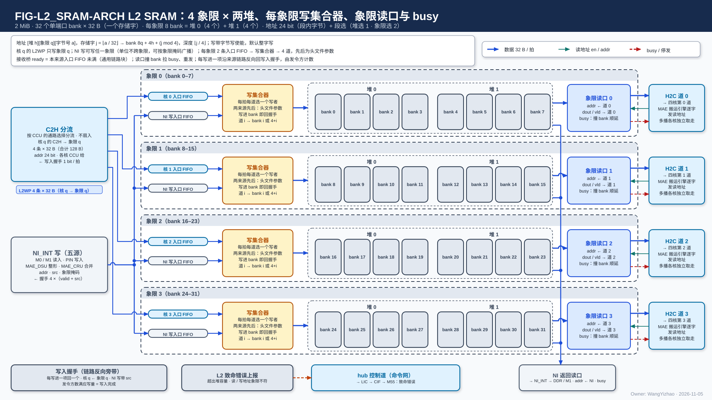
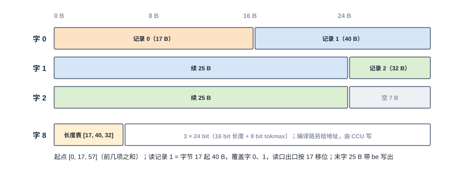
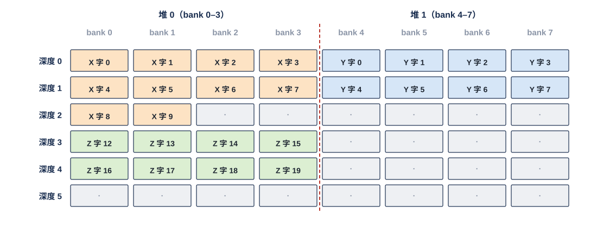

# L2 SRAM 需求

> Owner: WangYizhao｜2026-11-03｜重写稿，待用户审阅。按用户 11-03 确认的 L2 目录编写（`../V17_3_MODULE_TOC_L1_L2_HUB_20261103.md` 第二部分）；稿内四处原待确认项已由用户 11-03 按建议定下。
>
> 2026-11-05 按片上数据传输协议篇定稿同步（`DATA_TRANSFER_PROTOCOL.md`，V18-TP-01…20），共两轮。第一轮：逻辑地址改为 [堆][象限][字号]，撤区表、区号、请求号、首拍地址与 8 B 字补齐，最小写单位一个存储字（32 B），记录级 32 B 对齐，读写地址由发地址方逐字给出，完成由执行搬运的一方报 MAE。第二轮（11-05 晚）：32 B 单位改称"存储字"；口 = 道的集合；每象限一个写集合器（L2WP、NI 写各一条入口 FIFO → 4 道，按搬运命令的抢占优先级）；接收桥 ready = 入口 FIFO 未满；读口加 busy；NI 写 L2 与 L2 写回 DDR 的完成由 NI 报；错误经 hub 控制道；PIN 窗口 =（堆位, 象限, 起始字, 长度）；架构图改为 FIG-L2_SRAM-ARCH。同步记录 `_build/TP_SYNC_REPORT_B_20261105.md`。
>
> 11-05 夜（V18-TP-25、V18-L2-02）：**地址改以字节计，L2 支持非对齐紧密访存，默认仍按 32 B 对齐使用**：bank 带字节写使能，写口带字节掩码（链路 be），addr 下行 24 / 上行 27 bit；PIN 不再要求 M55 按 32 B 对齐（V18-L2-01 被取代）（§1.3、§2.1、§3.1、§3.4、§3.4a、§3.6、§4.2、§5.1–§5.4、§10、§11）。
>
> 11-05 夜第二轮（V18-TP-26…34、V18-NIE-02，任务书 `_build/TP_REVISION_BRIEF_20261105_NIGHT.md`）：**两个写口改为核间从口（带地址的握手写流），addr 24 bit + dest，hub 按 dest 分流后到 L2 的只有 L2 目的、L2 不看 dest；每拍地址由 MAE 的 DMA 搬运引擎给出，回绕在搬运引擎内；撤 2 bit 抢占优先级，象限集合器按 MAE 装的静态优先级表；撤 $t_{\text{w}}$ 与"执行方报完成"，L2 对每条入链路计到达单位数并给排空信号交 MAE；集合器入口按 skid 强制条款；PIN 窗口由编译链固定**（§2、§3.1、§3.3、§3.6、§5.1–§5.3、§5.5、§5.7、§6.2–§6.3、§8–§11）。
>
> 11-06 清晰度遍历：改写了 §3 / §5 / §6 章首说明、§5.2（入口 FIFO 深度约束、PIN 等待上界参考值、象限写集合器接口表与每拍动作）、§5.3（busy 拍序要定什么、busy 的读法）、§5.6（$t_{\text{r}}$ 要定什么与登记对象）、§6.2（写读次序可配要定什么）、§10.1（写计数位宽与清零约束）。未改设计。
>
> 11-06（V18-TP-35…38，附录 `_build/TP_REVISION_BRIEF_20261106_ADDENDUM.md`）：**C2H（L2WP 的来源）由各核 CCU 发令，每拍 addr / dest 由该核 CCU 给出；L2 对每条入链路维护写计数，在存储字写进 bank 的那一拍加一，由 MAE 与应收量（MAE 的命令或 CCU 的发出报告）比对，撤排空信号；合并点只在单位边界切换，单位永不交错；两个接收桥是通用链路块的实例**（§2、§3.1、§3.3、§5.1、§5.2、§5.5、§5.7、§8–§11，图 FIG-L2_SRAM-ARCH）。
> 11-06 第二次（V18-TP-41…43，任务书 `_build/TP_RENAME_NOLAST_BRIEF_20261106.md`）：**两个写口的信号与核内 RRAM 口同名（en / ready / din / be / addr / dest），撤 last；写计数改为按（入链路, 象限）分别维护，MAE 按象限比对，PIN 事务四个象限都到齐才回 B**（§2、§5.1、§5.2、§5.5、§8–§11，图 FIG-L2_SRAM-ARCH）。
> 11-06 裁定审计（V18-TP-45）：**HUB 上行四核扇入按拍仲裁，不同核的单位在 L2WP 上可按拍交错**（§5.2、§10.2、§11，图 FIG-L2_SRAM-ARCH 文字）。
> 11-06 第三次（V18-L2-03，任务书 `_build/TP_L2WP128_BRIEF_20261106.md`）：**L2WP 由 1 条 32 B 口改为每核一条 32 B 写链路（4 条，合计 128 B/拍，与读侧四个象限读口对称）；HUB 上行不再扇入、不仲裁，只按 dest 分流；每象限写集合器 5 个来源入口 FIFO（四核 + NI 写）→ 4 道，四核轮转、NI 写与四核的先后按 MAE 装的 5 来源静态表；写计数按（源核链路, 象限），每象限 5 个、共 20 个**（§2、§2.1、§2.3、§2.4、§5.1、§5.2、§5.5、§5.7、§6.2、§8、§10、§11，图 FIG-L2_SRAM-ARCH）。上一行 V18-TP-45 的"按拍仲裁、L2WP 上按拍交错"随之撤。
> 11-06 第四次（V18-NAME-01 / MAE-01…09，任务书 `_build/MAE_TYPE_AGNOSTIC_BRIEF_20261106.md`）：名称按外部输入信息篇（`L3PU_EXTERNAL_INFORMATION.md`）统一：命令 / MAE 命令 / 搬运命令 → 指令 / MAE 指令 / 搬运指令（"命令与标量网"网名不变），MAE 的 DMA 通道 / MAE 通道 → MAE 搬运引擎（V18-MAE-02），通道描述符 → 指令里的字段，共享内存 → 共享内存 / DDR（§2、§3、§4、§5、§10、§11）。本篇正文没有"区域表""描述符""LRB"的现行用法（区表已于 11-05 撤，只在 §11 的历史句中出现）。**任务书 §0a 第 20 项（用户 11-06）：L2 不区分区，"固定区 / 列表区（LRB）/ 调用输入区 / 外设输入区"都只是编译链给某段地址起的名字**（§3.4a 典型用途一句、§3.5 加粗句）；地址格式、集合器与计数规则不变。只换词与句，未改结构、数字与规则。
>
> 11-06 晚（V18-MAE-11 / 12，任务书 `_build/MAE_CRU_MERGE_BRIEF_20261106.md`）：CRU 并入 MAE 组、改称 MAE_CRU，正文不写其物理位置；NI 写口来源改列 NI-L2C 的五个写客户（M0 / M1 / PIN / DSU / CRU），加一句 MAE_CRU 的结果可经 NI 写口写 L2（§2、§2.1、§3.1、§5.5）。只换词与句。
>
> 11-06 深夜第二次（V18-TP-50）：核间写入完成统一为"写入握手 + 发令方计数"（来自 AXI 写响应通道 B），L2 本来就是这种做法，只核对措辞；协议篇节号改为 §5.7 多播、§5.8 写入完成、§5.9 仲裁（§2.2、§5.2、§11 的引用）。
> 11-06 深夜（V18-L2-04、V18-TP-47 / 48、V18-NIE-03、V18-NAME-03）：**象限按核绑定写入——核 $n$ 的 L2WP 只写象限 $n$，NI 写可写任一象限但一个单位不跨象限、可按象限掩码广播；每象限写集合器只剩两个来源，先后为 RTL 头文件参数，撤 MAE 装表；撤写计数，改为每写进一项就沿链路反向回一个写入握手、由发令方计数；核间按 $m$ 切分的数据同址异象限存放；PIN 地址按线性映射换算**（§1.2、§2、§3.2、§3.6、新增 §3.7、§5、§6、§7–§11，图 FIG-L2_SRAM-ARCH）。
> 11-06 深夜第三次（V18-TP-51 / NAME-04）：**撤 dest 信号，去哪个存储由发令方的通路选择决定（C2H 由本核 CCU 的 C2H 通道按发送指令的目标存储给 C2H 分流下通路选择，只在单位边界变）；地址不编码"是哪个存储"，addr 只是目的存储内部的位置；远端引擎回 MAE_ENG 的"发送完成"短消息改名"执行完成"**。

## 1 组成与物理约束

### 1.1 32 个单端口 bank 分成 4 个象限、每象限两堆

L2 是全芯片一块 2 MiB 的片上 SRAM，由 32 个单端口 bank 组成。**每个 bank 一拍只做一次读或一次写，一次访问一个存储字。** 存储字是 32 B 这个单位的名字（传输协议篇 §2.1）：一个 bank 的一个存储单元；字节地址除以 32 取整就是它的序号。每 8 个 bank 组成一个象限，共 4 个象限，每个象限 512 KiB（16,384 个存储字）；每个象限的 8 个 bank 再分成两堆，每堆 4 个 bank（§4.1）。

参考宏几何为每个 bank 32 B × 2048 深。bank 数、深度与宏几何【设计者定】，但必须满足本篇的端口位宽、换算规则与冲突规则。

### 1.2 象限 n 一进一出：写入来自核 n 的 L2WP，读出接 H2C 第 n 道

**象限 n 的读口固定接 H2C 链路第 n 道（n = 0…3），一个象限读口只能读本象限的 bank；核 n 的 L2WP 写链路只写象限 n**（V18-L2-04）。哪份数据从哪条道送出，由它所在的象限决定；核 n 写进 L2 的数据都在象限 n。**NI 是唯一能进出任意象限的通路**：NI 写口可写任一象限（一个搬运单位不跨象限），NI 返回读口可读任一象限。

这样每个象限的写入只有两个来源（核 n 的 L2WP、NI 写），读出只有两个去向（H2C 道 n、NI 返回读）。四核都在产出时数据天然分在四个象限，下一位点四道并行读回，读写总带宽都是 4 × 32 B/拍。

### 1.3 硬约束

- 只用单端口宏，不用多端口宏。
- SRAM 总量不增加。
- **bank 宽一个存储字（32 B），带字节写使能**：一次写可以只改写一个存储字里的若干字节，其余字节保持原值；默认按整个存储字写（对齐使用，§3.4）。没有读改写。
- 同一份数据需要一边写下一块、一边读当前块时，两块放在同一象限的两堆（§4.3），不另设物理宏。

## 2 数据从哪来、到哪去

图从左到右是写入、存储、读出三段。左侧是写来源：L2WP 的四条写链路（每核一条，各 32 B / 拍；**核 $n$ 的链路只进象限 $n$**；C2H 在 hub 里按该核 CCU 给的通路选择分流，逐拍 addr 24 bit 由该核 CCU 给出）与 NI_INT 写（一条 32 B 写口，汇合五个写客户：M0 / M1 读入、PIN 写入、MAE_DSU 整形输出、MAE_CRU 合并结果；每拍地址与象限掩码由 MAE 的搬运引擎给出，PIN 除外），NI 写经一条竖总线可进任一象限。每个象限一行：先是两条入口 FIFO——核 $n$ 一条、NI 写一条（ready = 该 FIFO 未满）——再是本象限的写集合器（每拍为 4 条写道各选一个写者，两条 FIFO 的队头落同一道时按 RTL 头文件参数定的先后；道 $i$ 按地址堆位写 bank $i$ 或 $4+i$），然后是两堆共 8 个 bank（堆 0 = 象限内 bank 0–3，堆 1 = bank 4–7，图中标的是全芯片 bank 号）。每写进一项，集合器沿该来源的链路反向回一个写入握手（L2WP 回核 $n$，NI 写回 NI_INT 并带发令号，§5.5）。右侧是象限读口 $q$ 与 H2C 道 $q$ 之间的三根线：道 $q$ 发读地址（en / addr，青）、读口回数据（dout / vld，蓝）、撞 bank 时读口回 busy（红虚线）。四个象限的 bank 另有一条到 NI 返回读口的分支（右侧竖总线），读出经 NI_INT 写回 DDR 或经 M1 写共享内存 / DDR。下方是致命错误上报：经 hub 控制道（命令与标量网）报 LIC。**L2 没有配置口**。

### 2.1 写入来源

| 写口 | 来源 | 每拍 |
|---|---|---|
| L2WP（4 条写链路，每核一条） | 计算核 $n$ 的上行数据（**由该核 CCU 发令**，该核 L1 发送侧按 CCU 的发送指令发出）；C2H 在 hub 里按核 $n$ 的 CCU 给的通路选择分流，核 $n$ 的 C2H 上去 L2 的单位直通第 $n$ 条，不与其他核合并（V18-L2-03）；**第 $n$ 条只写象限 $n$**（V18-L2-04） | 4 × 32 B（合计 128 B，与四个象限读口合计相同） |
| NI 写 | NI-L2C 的五个写客户：M0（从 DDR 读入的数据，含 MAE 拷贝）、M1（从 M1 读入的调用输入）、PIN（经 PIN 写入的数据）、MAE_DSU（整形后的数据）、MAE_CRU（合并结果，例如读集合并后的列表）（V18-MAE-12）；**可写任一象限，一个搬运单位不跨象限；按 MAE 指令的象限掩码可把同一拍写进几个象限的同一象限内地址（广播）** | 32 B（广播时每个目标象限各写一份） |

**各口能到达的象限**（V18-L2-04）：

| 口 | 能到达的象限 | 由谁保证 |
|---|---|---|
| L2WP 第 $n$ 条（写） | 只有象限 $n$ | 核 $n$ 的 CCU 发的地址象限位 = $n$，L2 检查（§7） |
| NI 写（写） | 任一象限；一个单位只在一个象限内，广播时按象限掩码写几个象限 | MAE 搬运引擎（单位不跨象限、掩码） |
| 象限读口 $n$（读，接 H2C 道 $n$） | 只有象限 $n$ | MAE 搬运引擎发的地址象限位 = $n$，L2 检查（§7） |
| NI 返回读（读） | 任一象限 | — |

**MAE_CRU 的结果可经 NI 写口写 L2**（V18-MAE-12）：MAE_CRU 的合并结果除经 H2C 道下发核 L1 外，也可作为 NI-L2C 的写客户写进 L2，与其他 NI 写同一个接收桥、同一种写入握手（用执行该合并指令的搬运引擎的发令号）。

五个写口（L2WP 四条 + NI 写）都是**接收桥**（传输协议篇 §6.2）：核间从口（带地址的握手写流，**信号与核内 RRAM 口同名：en、ready、din 32 B、be、addr 24 bit，另有发令号 `src`；链路上没有单位标记**，V18-TP-41 / 42）后接入口 FIFO。**addr 逐拍携带这一拍数据的目的逻辑地址 [堆 1][象限 2][字节号 21]（§3）：L2WP 上由发出该拍的核的 CCU 给出，NI 写口上由 MAE 的搬运引擎生成**（传输协议篇 §2.4.2、§5.2、§5.4，V18-TP-35）；be 标出本拍有效字节。**写到哪个存储不编码在地址里，也没有 dest 信号**：四核 C2H 由该核 CCU 按发送指令的目标存储给 C2H 分流下通路选择，**去 MAE_CRU 的单位交 MAE 组的 CRU 数据入口，到达 L2WP 各链路的只有去 L2 的单位**（V18-TP-51）。L2WP 第 $n$ 条的接收桥直接接象限 $n$ 集合器里核 $n$ 的 FIFO；NI 写接收桥按 addr 的象限位（广播时按象限掩码）把这一拍放进目标象限的 NI 写 FIFO（§5.2）。

### 2.2 读出去向

| 读口 | 去向 | 每拍 |
|---|---|---|
| 象限读口 0–3 | 象限 n 的数据经 H2C 第 n 道送往四核。多播给几个核时，L2 只读一次；**多播由 hub 的 H2C 道在分叉点按已取位分给各目的核、各自取走，L2 只管读口**（传输协议篇 §5.7；V18-TP-53） | 各 32 B |
| NI 返回读口 | 经 NI 写回 DDR，或经 M1 写入共享内存 / DDR | 32 B |

### 2.3 地址逐拍由发令方给出：C2H 归各核 CCU，其余归 MAE 的搬运引擎

**L2 的读写由发令方发起：经 L2WP 的写由各核 CCU 发令（源在核内），NI 写与全部读由 MAE 的指令发起（源在核外，V18-TP-35）；每拍的地址由发令方逐拍给出（线性段、gather、散写都在 CCU 或 MAE 搬运引擎内展开；L2 里的对象不按环形使用，§3.3），L2 自己不发请求、不累加、不回绕、不解析数据内容。**

- 写：四核 C2H 上由各核 CCU、NI → L2 上由 MAE 搬运引擎把每拍的目的地址放在 addr 上；C2H 在 hub 里只按通路选择分流、NI_INT 只转运，都不算地址。L2 按 addr 落字。
- 读：H2C 道 n 的 MAE 搬运引擎按 MAE 的 H2C 搬运指令、L2 → NI 的 MAE 搬运引擎按 MAE 的指令，每拍给一个字地址（§5.3）。
- 链路与 L2 的口上都没有请求号、没有单位标签；L2 不发读出完成。**每把一项写进 bank，L2 就沿该来源的链路反向回一个写入握手**（NI 写的握手带发令号 `src`），由发令方数满应写量判定写入完成（§5.5，V18-TP-47）。

### 2.4 由发起方与编译链保证的事项

以下事项 L2 不检查，由对应方保证（传输协议篇 §11）：

| 事项 | 由谁保证 |
|---|---|
| 目的空间在数据到达时已读完（预取距离、缓冲轮转） | 编译链（LIC 操作 15） |
| 同一堆内各对象的地址互不重叠 | 编译链 |
| 两堆在位点内读写方向一致，堆位由指令给出 | 编译链 / MAE |
| 不跨窗口末尾：L2 里的对象不按环形使用，越过窗口的搬运拆成两条指令（§3.3） | 编译链（V18-MAE-17） |
| 对象头与每条记录从整字起、尾部补 0（§3.4） | 生产方 / 编译链 |
| 同一时段同时在用的数据放在不相交的 bank 上，避免冲突（§6.4） | 编译链 |
| 写入何时可读 | 发令方数写入握手达应写量（C2H 归该核 CCU，NI 写归 MAE 搬运引擎，§5.5）；最后读者事件归 CCU / LIC |
| C2H 每拍 addr 与通路选择正确，象限位 = 本核号；握手数满后发出报告 | 各核 CCU |
| NI 写一个单位不跨象限；象限掩码与应写量一致（广播 $k$ 个象限，应写量按 $k$ 倍计） | MAE 搬运引擎 |
| 核间按 $m$ 切分的数据同址异象限存放（§3.7） | 编译链 |

## 3 逻辑地址

L2 与 L1 用同一种地址，只是类位在 L2 里解释为象限号。读者实现 L2 时，寻址逻辑只有两件事：按 §4.2 取位得到 bank 与深度，按字节号的低 5 位生成字节写使能；地址如何产生都在发地址的一方；L2 里的对象不按环形使用（§3.3）。

### 3.1 逻辑地址 = 堆位 + 象限位 + 字节号

**L2 的逻辑地址与 L1 同构，是传输协议篇 §2.2 的 24 bit 地址，以字节计（位宽为参考值【设计者定】）：**

| 位 | 名 | 在 L2 的含义 |
|---|---|---|
| 最高 1 bit | **堆位** | 象限内两堆中的哪一堆（§4.1） |
| 接着 2 bit | **象限位**（协议篇的类位） | 象限号 0–3 |
| 低 21 bit | **字节号** | 该堆内第几个字节，从 0 起；除以 32 取整即第几个存储字 |

**物理位置（哪个 bank、哪个深度）由 L2 按 §4.2 的固定换算式从地址所在的存储字直接取位得到，不查表**；字节号除以 32 的余数只用于生成字节写使能与读出移位。

C2H 上"去 MAE_CRU"由该核 CCU 给 C2H 分流的通路选择决定（不折进地址、也没有 dest 信号，传输协议篇 §5.9，V18-TP-51），不占象限码，所以 L2 的象限位 4 个码全部可用。

### 3.2 象限读口 n 只接受象限位为 n 的地址

象限读口 n 只连 H2C 第 n 道，一次读出的数据必须来自象限 n。**H2C 道 n 发出的读地址，象限位必须是 n；L2WP 第 n 条收到的写地址，象限位也必须是 n**，否则为致命错误（§7）。需要四条道并行送出的数据，由编译链拆成四个象限对象，按 §3.7 同址异象限存放。

### 3.3 L2 不做取模，L2 里的对象不按环形使用

**L2 不做取模；L2 里的对象也不按环形使用。** L2 中的数据最终都由 MAE 读出（经 H2C 道去核、经 NI 返回读口去片外或运算级），而 **MAE 不做环形回绕**（用户 11-06："对于环形缓冲问题，我认为 MAE 不感知这件事"；"环形缓冲交给（a）"，V18-MAE-17）：编译链按静态窗口与 ping-pong 两堆分配 L2 地址，一次搬运若会越过窗口末尾，由编译链拆成两条指令。经 C2H 写入 L2 的地址同样不回绕（CCU 按窗口顺序给出）。L2 只按每拍收到的地址落字，接收方无状态不变。

### 3.4 对齐使用（默认）：每条记录占整数个存储字

**片上产生的数据默认按对齐使用，对齐的单位是记录**（传输协议篇 §2.5、§9.1）：对象是一块权重、一组 K / V 平面、一个 token 组的紧凑激活记录、一张位图、一个列表；记录是对象里按 token（或按项）独立取用的单位。规则：

1. **对象头单独占一个存储字**，不足补 0。
2. **每条记录从一个整字开始，占 $\lceil n_i / 32 \rceil$ 个存储字（$n_i$ 为该记录字节数），尾部补 0 到字边界**；下一条记录从下一个整字起。数据怎样分段由数据格式决定，L2 不解析。
3. 生产方攒满 32 B 才写一个存储字，所以到 L2 的每一拍都是整字。
4. **任何一个存储字只属于一条记录或一个对象头**：没有记录跨字被拆开取用，读方不需要字内偏移。

一个对象：对象头 8 B 占字 0（后 24 B 补 0）；记录 0 长 17 B 占字 1（补 15 B）；记录 1 长 40 B 占字 2–3（字 3 后 24 B 补 0）；记录 2 长 32 B 正好占字 4、不补。共 5 个存储字，按记录头长度读回各记录与写入逐字节相同。

### 3.4a 紧密访存：起点与长度任意，用于片外进来的数据

**L2 必须支持非对齐紧密访存，但它是兼容能力：可以不用，但不能没有**（用户 11-05 夜，传输协议篇 §2.5）。对象与记录可以从任意字节开始、首尾紧挨：

- **写**：带字节写使能，只改写选中的字节。一笔跨两个存储字的写拆成两次，相邻两个存储字落本堆的两个不同 bank，可由集合器的两条道同拍写入（§5.2）。
- **读**：发读方按地址覆盖到的存储字逐字发读（每字仍是一次普通读），在自己一侧按地址除以 32 的余数移位（§5.3）；跨字时多读一个字。
- **典型用途**：起点与长度不由片上决定的数据，例如经 PIN 写进"外设输入区"的外设数据、经 M1 读入"调用输入区"的 Token ID 列表、图像、音频与传感器向量（两个"区"都只是编译链给某段地址起的名字，L2 里没有对应的硬件分区），以及另一颗芯片经 FMC 写来的数据。

两条约束（传输协议篇 §2.5）：紧密写只用于在写堆里从头顺序拼出的新对象，不用来跨阶段修补某个存储字的一部分；紧密对象要送进计算核的 MXU 时，先由 MAE 整理成对齐记录。数值例见传输协议篇 FIG-TP-COMPACT。

### 3.5 象限内怎么分只是编译链的地址

每堆里哪几个存储字放哪个对象、哪些内容跨调用保留，是编译链分配的地址，写在 MAE 指令的基址里；L2 不知道，也不需要知道。

**L2 不区分区：任何地址都能写、都能读，堆位与象限位只是物理 bank 组，没有逻辑分区。** 其他篇里的"固定区""列表区（LRB）""调用输入区""外设输入区"等，都只是编译链给某段地址起的名字。

### 3.6 PIN 窗口

SoC 经 PIN 口访问 L2 时，**L2 逻辑地址 = PIN 的 AXI 地址 − $A_{\text{PIN}}$**（线性映射，$A_{\text{PIN}}$ 是 SoC 地址图给 L3PU PIN 的基址），只允许落在一个允许写入区间（外设输入区 = 起始逻辑地址 + 长度）内；换算参数是 RTL 头文件参数、流片定死（V18-NIE-03，MAE_NI_EXT 篇 §6–§7）。**外设输入区由编译链放在一个象限的一堆之内**，所以一笔 PIN 事务不跨象限，与"NI 写一个单位不跨象限"一致。各种输入在区内的窗口按（调用种类, 输入种类）由编译链固定（V18-NIE-02）。MAE_NI_EXT 换算后经 NI 写口 / NI 返回读口访问；L2 不区分 PIN 与其他 NI 访问。区内可从任意逻辑地址写入任意长度（紧密访存，§3.4a、§5.4）。

### 3.7 象限并存关系：一份核间切分的数据同址异象限存放

**一份要四核分产、四道并行读的数据，按"第 $q$ 份放象限 $q$、四份的象限内地址相同"存放（同址异象限）；四份只差象限位。**（V18-TP-48；传输协议篇 §9.9 写各切分轴的读法，MAE_ENG 篇 §5.9 写读时合并与写时拆分。）

| 生产方式 | 象限 $q$ 里放什么 | 象限内地址 |
|---|---|---|
| 核间按输出通道 $m$ 切分（每核算 $M/4$ 列） | 所有 token 的第 $q$ 段（核 $q$ 负责的 $m$ 范围；对下一位点就是归约维 $k$ 的第 $q$ 段） | token $t$ 的段：本对象基址 + $t$ × 段槽长；四个象限相同 |
| 核间按 token 切分（每核算一组 token） | 核 $q$ 那组 token 的整条记录 | token 组内序号 $t'$：基址 + $t'$ × 记录槽长；四个象限相同 |
| NI 写进来的数据（DDR 重装、L2 → L2 重排） | 由 MAE 指令按上表任一种摆放，或按象限掩码复制到几个象限 | 同上 |

例：一个位点 8 个 token、核间按 $m$ 切分、每段槽长 2 个存储字。四个象限的段都从 [堆 0][象限 $q$][字节 4096] 起，token 3 的四段分别在 [0][0][4096 + 3 × 64]、[0][1][同]、[0][2][同]、[0][3][同]，即象限内字节号都是 4288。下一位点四道各读本象限 [4096, 4096 + 8 × 64) 的 16 个存储字，在目的核 L1 里按地址拼回 8 条整记录（传输协议篇 §9.9）。

同址异象限的好处：读时合并与写时拆分只是在地址的象限位上走一级跨距（$2^{21}$），四道用同一套象限内地址；NI 的象限掩码广播也是同一象限内地址写几个象限，两件事用同一个规则。两堆照常做读写双缓冲：第 $l$ 位点从四个象限的堆 $1-h$ 读上一位点的输出，同时把自己的输出写进四个象限的堆 $h$（核 $n$ 写象限 $n$），两堆的 bank 不相交、不撞。

## 4 逻辑地址到物理 bank 的换算

### 4.1 每个象限分成两堆，每堆 4 个 bank

**象限 q 的 8 个 bank 中，堆 0 固定占象限内 bank 0–3，堆 1 固定占 bank 4–7**（4 + 4，硬件固定，用户 11-05 晚定）。每堆容量 = 4 个 bank × 深度，参考 2048 深时为 8,192 个存储字；地址超出堆容量为致命错误（§7）。

### 4.2 地址 [h][q][j] 落在哪个 bank、哪个深度

**地址 [堆 $h$][象限 $q$][字节号 $a$] 所在的存储字 $j = \lfloor a/32 \rfloor$ 落在全芯片 bank $8q + 4h + (j \bmod 4)$，深度 $\lfloor j / 4 \rfloor$。** 相邻的存储字轮流落到本堆的 4 个 bank 上，换算只是取位，不查表。例：[堆 0][象限 2][字 5] → bank $16 + 0 + 1 = 17$，深度 1。

缩小例只画象限 0 的 8 个 bank、6 个深度，实际每个 bank 深 2048，机制相同：

- 堆 0（bank 0–3）里编译链放了两个对象：对象 X 占字 0–9（深度 0–2），对象 Z 占字 12–19（深度 3–4）；字 10、11 未用。
- 堆 1（bank 4–7）里放了对象 Y，占字 0–7（深度 0–1）。

同一堆内的对象互不重叠由编译链保证；两堆的 bank 不相交由硬件保证。

### 4.3 一边写、一边读的两块数据放在两堆

**同一份数据一边写下一块、一边读当前块时，两块放在同一象限的两堆，堆位由指令给出；两堆的 bank 不相交，同拍写一堆、读另一堆永远不撞 bank。** 上图中每拍写堆 1 的一个存储字、读堆 0 的同号存储字：

| 拍 | 写堆 1 的存储字 | 落点（bank, 深度） | 读堆 0 的存储字 | 落点（bank, 深度） |
|---|---|---|---|---|
| 0 | 字 0 | (4, 0) | 字 0 | (0, 0) |
| 1 | 字 1 | (5, 0) | 字 1 | (1, 0) |
| 2 | 字 2 | (6, 0) | 字 2 | (2, 0) |
| 3 | 字 3 | (7, 0) | 字 3 | (3, 0) |

下一个阶段两堆读写方向互换，体现在指令给出的堆位里；L2 没有"哪堆在写、哪堆在读"的状态。

### 4.4 任何道一拍内对每个 bank 至多访问一个深度

这是 L1、L2 共用的判据。L2 的每条道每拍只访问一个存储字（一个 bank 的一个深度），所以单条道自然满足；**不同道或口在同一拍访问同一个 bank 时按 §6 处理**。

## 5 端口与读写协议

L2 的写侧与 L1 相同（接收桥 → 入口 FIFO → 集合器 → bank，不确定性被 FIFO 吸收），另外每写进一项沿链路回一个写入握手；读侧与 L1 不同：5 个读口与写道抢 bank，读不到固定 1 拍，所以加 busy。本章按"口 → 写 → 读 → 完成 → 流控"的顺序写。

### 5.1 口与道

**一个口 = 若干条道，每道一拍访问一个存储字（32 B）、带一套独立的 en / addr / din 或 dout / vld**（传输协议篇 §3.1）。L2 的口：

| 口 | 方向 | 对端 | 道数 × 每拍 | 信号 |
|---|---|---|---|---|
| L2WP 接收桥 $n$（$n$ = 0…3，每核一个） | 入 | C2H 分流（核 $n$ 的 C2H 按通路选择分流后直通，不扇入） | 4 条，各 1 × 32 B | 每条一套：en、ready（= 象限 $n$ 里核 $n$ 的入口 FIFO 未满）、din、be、addr 24 bit（[堆 1][象限 2][字节号 21]，逐拍，由核 $n$ 的 CCU 给出，象限位必须 = $n$）、`src`（统一协议，L2WP 上恒为核 $n$ 的 CCU 号，L2 不看） |
| L2WP 写入握手 $n$ | 出（反向旁带） | 核 $n$ 的 CCU（经 C2H 分流回程） | 4 条，各 1 bit/拍 | 象限 $n$ 集合器把核 $n$ 的一项写进 bank 的那一拍置 1；只有 valid，没有 ready（CCU 的计数器恒能接收）；通用链路块的反向旁带，与数据同样寄存器输出、时延无关 |
| NI 写接收桥 | 入 | NI_INT（NI-L2C） | 1 × 32 B | en、ready、din、be、addr 24 bit（MAE 搬运引擎生成）、`src`（发令号：搬运引擎号或 PIN 事务号）、象限掩码 4 bit（全 0 = 按 addr 象限位写一个象限；非 0 = 写掩码内各象限的同一象限内地址）；ready = 每个目标象限的 NI 写入口 FIFO 都能收下这一拍（各象限独立取走的做法【设计者定】） |
| NI 写入握手 | 出（反向旁带） | NI_INT（NI-L2C） | 4 × (1 bit valid + `src`) /拍 | 象限 $q$ 集合器把 NI 写的一项写进 bank 的那一拍，第 $q$ 组置 valid 并带该项的 `src`；只有 valid，没有 ready |
| 象限 q 写集合口（每象限一个） | 内部 | 本象限两条入口 FIFO（核 $q$、NI 写）→ 本象限 bank | 4 × 32 B | 道 $i$：en、be、addr、din，按地址堆位写 bank $8q + i$ 或 $8q + 4 + i$ |
| 象限读口 0–3 | 出 | H2C 道 n | 各 1 × 32 B | 道 n → L2：en、addr（逐字）；L2 → 道 n：dout、vld、busy |
| NI 返回读口 | 出 | NI_INT | 1 × 32 B | 同象限读口，可读任一象限 |
| 致命错误上报 | 出 | hub 控制道（命令与标量网）→ LIC | — | 错误类型、出错地址（§7） |

**L2 没有配置口**：集合器两来源的先后是 RTL 头文件参数（§5.2），不由 MAE 装。

### 5.2 写入：接收桥 → 象限入口 FIFO → 写集合器 → bank

**L2WP 第 $q$ 条的接收桥每成交一拍，把（地址, 数据, 字节写使能）放进象限 $q$ 集合器里核 $q$ 的入口 FIFO；NI 写接收桥按 addr 的象限位（或象限掩码）放进目标象限的 NI 写 FIFO。集合器每拍为本象限的每条写道，从"队头落在该道 bank"的两条 FIFO 里选一个写进 bank，写进的那一拍沿该来源的链路回一个写入握手。** 规则（V18-L2-04，与 L1 集合器相同：逐项按先后选）：

- 每象限两条入口 FIFO：核 $q$ 的 L2WP 链路一条、NI 写一条，各收 32 B/拍；深度【设计者定】，几项即可：要定的是项数；约束是深度大于接收桥到 FIFO 的在途拍数（ready 在"深度 − 在途拍数"处拉低，§5.7），多出的部分吸收撞 bank 与先后让出的顺延。
- **两条 FIFO 的队头落在同一条道时，按 RTL 头文件参数定的先后取一个**：参数可取"NI 写先""L2WP 先"或"轮转"，流片定死，运行中不变（用户 11-06："对于 NI 和 L2WP 的先后，可以做成可配的仲裁设计，但是流片定死"；V18-L2-04 撤 MAE 装的 5 来源静态优先级表）。落选的项留在自己的 FIFO，下一拍再选；一条 FIFO 将满只拉低它自己那条链路的 ready（核 $q$ 的链路 → 核 $q$ 的 C2H 停发；NI 写 → NI-L2C 停发），另一个来源照常写。**PIN 外设写的等待上界靠这个先后参数保证**：取"NI 写先"或"轮转"时，NI 写在一个 bank 上至多让出一拍；上界值【设计者定】，参考 ≤ 256 拍（MAE_NI_EXT 篇 §7）；约束是外部主方的 AXI 写事务不超时。
- **每条 FIFO 每拍至多出一个队头，所以每个来源每拍至多写进一项**；一个象限每拍至多写进两项，4 条写道一定够用，原"同一阶段写一个象限的总需求 ≤ 4 道 × 32 B/拍"由结构自动满足。

一个象限写集合器的接口与每拍动作：

| 接口 | 方向 | 内容 |
|---|---|---|
| 两条入口 FIFO（核 $q$、NI 写） | 接收桥 → 集合器 | 每项 = 地址（堆位、存储字号）+ 32 B 数据 + 32 位字节写使能；NI 写的项另带 `src` |
| 写道 $i$（$i$ = 0…3） | 集合器 → bank | en、be、addr（深度）、din；堆位为 0 写 bank $8q + i$，为 1 写 $8q + 4 + i$ |
| 先后参数 | RTL 头文件 | 两来源的先后：NI 写先 / L2WP 先 / 轮转，流片定死 |
| 写入握手 | 集合器 → 链路反向旁带 | 核 $q$ 的一项写进 bank 时回核 $q$ 一个 valid；NI 写的一项写进 bank 时回 NI_INT 第 $q$ 组 valid + `src` |
| bank 占用 | 集合器 ↔ 读口仲裁 | 本拍写道要占的 bank，供 §6.2 的写读先后判定 |

每拍：对每条写道 $i$，看两条 FIFO 的队头所在存储字是否 $j \bmod 4 = i$（两堆都由道 $i$ 写，按堆位选 bank）；两条队头都落在道 $i$ 时（同一个 bank，或同道不同堆的两个 bank——一道一拍只有一套写信号）按先后参数取一个；被选中的项写进 bank 并回写入握手，同拍该 bank 上的读口按 §6.2 处理。
- 选中的那一拍，addr 所在存储字里字节写使能为 1 的字节被 din 覆盖（对齐使用时整字覆盖）；没有应答。
- **be 就是该项的字节写使能，接收桥随数据原样放进 FIFO。** 一笔紧密写跨两个存储字时由 MAE 搬运引擎拆成两拍、各带自己的 addr 与 be；相邻两个存储字落本堆的两个不同 bank（$j \bmod 4$ 相邻），由集合器的两条道写入。
- **接收桥的 ready = 目标象限的入口 FIFO 未满**（NI 写广播时 = 掩码内各目标象限都未满）；FIFO 吸收撞 bank 的瞬时顺延。
- 每拍自带地址，**L2 不要求一个搬运单位的各拍地址连续**，各拍按 addr 落到各自的地址。**C2H 分流不扇入、不仲裁，核 $q$ 独占通往象限 $q$ 的写链路，四核互不等待**（传输协议篇 §5.9，V18-L2-03 / 04）；核 $q$ 的写只在象限 $q$ 集合器里与 NI 写相遇。链路上没有单位标记，L2 也不需要知道单位在哪拍结束（V18-TP-42）。
- **写入握手：集合器把一项写进 bank 的那一拍，沿该项来源的链路反向回一个写入握手**（V18-TP-47）：L2WP 第 $q$ 条回核 $q$ 的 CCU，每拍 1 bit；NI 写回 NI_INT，四个象限各一组 valid + `src`（发令号）。还在入口 FIFO 里的项不回握手，所以不设排空信号。L2 不保存任何计数，也不知道一项属于哪条指令；**归属由发令方按 `src` 与自己的应写量完成**（§5.5）。L2WP 上只有核 $q$ 一个发令方，不需要 `src`；NI 写口有几个搬运引擎与 PIN 事务共用，靠 `src` 区分。

从进入入口 FIFO 到写进 bank 的拍数随撞 bank 与先后等待变化，**L2 的功能定义里不使用任何固定写入时延**；写入是否已完成由发令方数握手判定（§5.5）。等待的上界由先后参数保证（§6.3）；上界值【设计者定】。

### 5.3 读出：发读方每拍给一个字地址，撞 bank 时 busy

**H2C 道 n 的 MAE 搬运引擎（或 L2 → NI 的 MAE 搬运引擎）每拍给读口一个字地址（en = 1、addr）；不撞 bank 时 L2 在固定拍数后把该存储字放到 dout、vld = 1。** 本拍目标 bank 被写道或另一个读口占用时，L2 对该读口拉 **busy**，发读方保持 en / addr 到下一拍重发（用户 11-05："L2 的读口加 busy"；L1 不加）。读出按发出顺序返回，一拍一个存储字，不丢失、不乱序。busy 相对被拒请求的拍序（与 en 同拍返回，或固定若干拍后返回）【设计者定】；约束是发读方能据 busy 唯一判定哪一拍的请求未成交、只重发那一拍，且重发后返回顺序仍与发出顺序一致。

可以把 busy 理解为 L2 读口版的"本拍没成交"：L2 不排队、不缓存请求，冲突的代价全部留在发读方（重发），所以 L2 的读侧逻辑只有每个 bank 的一次先后判定（§6）。

道 n 的发读节奏由道自己按下游余量控制（何时停发由 HUB_NOC 篇按传输协议篇 §4.4 的将满阈值定）；L2 的读口不缓存请求、不排队。读请求里没有长度与请求号：一次搬运有多长、何时读完，由 MAE 搬运引擎按指令给的数据量计数。多播给几个核时象限读口只读一次，各目的核独立取走由 H2C 道的分叉点负责（HUB_NOC 篇 §5.2），不影响读口；道停发 L2 读看道首级链路块的将满阈值。

**紧密读**：读口仍按存储字返回。发读方把地址覆盖到的存储字逐个发读，需要从字中间开始的数据由发读方按地址除以 32 的余数移位：H2C 道搬紧密对象时源、目的地址的余数相同，不移位，首尾拍用 be 标出有效字节；NI 返回读经 M1 写共享内存 / DDR 时，NI 按目的地址移位并给出 AXI 的字节选通（传输协议篇 §3.3、§5.4）。

### 5.4 写粒度

- **写粒度是字节：每个存储字 32 位字节写使能，只改写选中的字节，其余字节保持原值。** 对齐使用时整字写（§3.4），L2 不做读改写。
- 不满一个存储字的数据：片上生产方按对齐使用在记录尾部补 0 后整字写入（§3.4）；片外进来的数据按实际字节写入（§3.4a）。**经 PIN 写入的数据不要求 32 B 对齐**：NI_EXT 按 AXI 地址与字节选通生成每个存储字的字节写使能，不补字、不读改写（用户 11-05 夜，取代同日"由 M55 按 32 B 对齐"的 V18-L2-01）。

### 5.5 写入完成：L2 每写进一项回一个写入握手，由发令方计数

**L2 不发读出完成，不保存计数，也不报完成；它只在每项写进 bank 的那一拍沿来源链路回一个写入握手。** 发令方按指令知道应写量，数满握手即"写入完成"（传输协议篇 §2.6、§7.4，V18-TP-47；思路同 AXI 写响应 B 通道、PandaChip NCC 主控按发出量计数）：

| 搬运 | 发令方 | 写入完成的判据 |
|---|---|---|
| C2H（核 $n$ 的 L1 → L2 象限 $n$） | 核 $n$ 的 CCU | CCU 数 L2WP 第 $n$ 条回来的握手，达到本次发送的项数即写进 L2；之后 CCU 向 MAE 发出报告（含义 = 已写进 L2） |
| NI 写 L2（NI-L2C 五个写客户 M0 / M1 / PIN / DSU / CRU → L2，含 MAE 拷贝） | 执行该指令的 MAE 搬运引擎（`src` = 引擎号） | 引擎数 NI 写入握手里 `src` = 本引擎号的项，达到应写量（广播 $k$ 个象限按 $k$ 倍计）即写入完成 |
| PIN 写 L2 | NI-L2C 为每笔在途 PIN 事务分一个发令号（池 ≥ 4，参考值） | 该事务号的握手数达到该事务的项数，NI_EXT 回 B 响应（MAE_NI_EXT 篇 §7.6） |
| H2C（L2 → 核） | H2C 道的 MAE 搬运引擎 | 不经 L2 写口：目的核 L1 的落地写计数交该核 CCU 比对 |
| L2 写回 DDR / M1 | L2 → NI 的 MAE 搬运引擎 | 不经 L2 写口：以 AXI 写响应为准（NI_EXT 交 MAE） |

**发令方判写入完成之后，依赖这次写入的读才发出**（MAE 收到 CCU 的发出报告或自己的引擎判完成后放行）。**一个存储字写进 bank 之后发起的任何读，都读到新写入的值**，握手又是在写进 bank 的那一拍才发出，所以握手数满后发的读一定读到新值。判据里没有任何固定时延。

**为什么不再由 L2 维护写计数**：同一条 NI 写口被几个搬运引擎与 PIN 事务共用，各象限写进 bank 的先后又可以与链路上的先后不同，接收方的累计计数只能靠"累计目标值"间接归属，L2 还得为每条链路、每个象限各留一个计数。握手带发令号后，归属在发令方一侧自然完成，L2 只回 valid 与 `src`（用户 11-06："这里为什么不能用我给你的参考项目的握手思路（发送方内部计数）"；"我认可方案 1"）。

### 5.6 读出时延

不撞 bank 时，从发读方给出读地址到该存储字出现在 dout 上的拍数是一个固定值 $t_{\text{r}}$【设计者定】，不随数据内容变化；撞 bank 时按 §6 另加 busy 的拍数。要定的是 $t_{\text{r}}$ 的拍数（含 bank 宏读出与 L2 内部流水）；约束是对所有读口、所有地址相同，并登记给 H2C 道与 NI 返回车道——它们把 $t_{\text{r}}$ 计入自己将满阈值的在途拍数（传输协议篇 §4.4）。

### 5.7 流控：写侧逐拍握手、读侧 busy

- **L2 的口上只有逐拍握手，不设请求队列。**
- 写侧：接收桥 ready = 目标象限里本来源的入口 FIFO 未满；写者（hub 的四条直通路、NI）只看 ready，不知道撞没撞 bank；一个来源被拉低不影响另一个来源，也不影响别的象限。
- **五个接收桥（L2WP 四条 + NI 写，集合器入口）是通用链路块的实例**（传输协议篇 §5.3.2，V18-TP-32 / 38）：ready 与送进入口 FIFO 的各信号都是寄存器输出，与上游之间没有组合路径；"未满"按将满阈值判（阈值 = 深度 − 在途拍数），拉低 ready 后仍在途的拍全部收下。**写入握手是同一链路块的反向旁带**，同样寄存器输出、可任意插级；它只有 valid，发令方的计数器每拍都能收，所以不需要 ready。
- 读侧：撞 bank 时 busy，发读方保持重发。

## 6 bank 冲突时的处理

冲突在 L2 里只影响"谁先成交"，不影响数据正确：写侧的落选者留在入口 FIFO，读侧的落选者拿到 busy 重发。所以本章规定的是每个 bank 上的先后规则与不饿死保证，吞吐靠编译链的地址分配避免冲突（§6.4）。

### 6.1 不冲突时每条道每拍成交一个存储字

**各道、各口本拍访问的 bank 互不相同时，每条道每拍按 32 B 成交。** 这是 L2 唯一的吞吐承诺：每个象限写 4 道、读 1 道，另有 NI 返回读 1 道。

### 6.2 每个 bank 的竞争者至多三个

一个 bank 同拍至多被三方访问：本象限集合器的那条写道、本象限读口、NI 返回读口。只有一个成交，其余顺延：

- 两个写来源（核 $q$ 的 L2WP 链路、NI 写）之间的先后在集合器里决定（RTL 头文件参数，§5.2），不在 bank 上竞争。
- **写道与读口撞 bank 时默认写道先成交**（入口 FIFO 被占用越久，ready 越可能拉低、反压传回链路），落选读口拉 busy；该次序可配【设计者定】：要定的是是否提供"读口先"的配置及由谁装；约束是任何配置下满足 §6.3 的不饿死条款。
- 两个读口之间按 §6.3 的可配顺序，落选者拉 busy。

### 6.3 任何配置都不饿死

仲裁顺序可配置，例如固定优先级或轮转。**任何配置下，一个读口在同一个 bank 上因另一个读口连续被拒的次数不超过 1；入口 FIFO 里的写者等待有上界**：每个象限只有两个来源、每源每拍至多一项，先后参数取"轮转"或"NI 写先"时 NI 写在一个 bank 上至多让一拍，取"L2WP 先"时 NI 写的等待上界由核 $q$ 对同一 bank 的连续写长度决定（编译链保证，上界值【设计者定】），这是 PIN 外设写等待上界存在的前提（§5.2）。读口因写道被拒的次数不设上界：写与读分在两堆时不会相遇（§4.3），同一堆里的并发读写由编译链避免（§6.4）。

### 6.4 避免冲突是分配方的责任

冲突只会让成交顺延，不会出错；但频繁冲突会降低吞吐。**同一时段同时在用的数据放在不相交的 bank 上——一边写一边读的放两堆、四条道并行读的放四个象限——由编译链保证**（§2.4）。

### 6.5 冲突例

象限 0 读口按指令读堆 0 的字 1、2，NI 写同时写堆 0 的字 5、6、7（§4.2 换算）：

| 拍 | 象限 0 读口 | 象限 0 写道（NI 写） | 结果 |
|---|---|---|---|
| 0 | 读 [0][0][字 1]：bank 1，深度 0 | 写 [0][0][字 5]：道 1 → bank 1，深度 1 | 同在 bank 1，写道成交，读口 busy |
| 1 | 重发读字 1：bank 1，深度 0 | 写字 6：道 2 → bank 2，深度 1 | 不同 bank，都成交 |
| 2 | 读字 2：bank 2，深度 0 | 写字 7：道 3 → bank 3，深度 1 | 不同 bank，都成交 |

## 7 错误检测

以下情况为致命错误（传输协议篇 §10 的"越过类的物理边界"在 L2 的三种形态），**L2 经 hub 控制道（命令与标量网）报 LIC**，事件带错误类型与出错地址；LIC 经 CIF 报 M55：

| 错误 | 检查时机 |
|---|---|
| 地址超出该堆容量 | 写入入口 FIFO 时、读口接收地址时 |
| 象限读口 n 收到象限位不是 n 的地址 | 读口接收地址时 |
| L2WP 第 n 条收到象限位不是 n 的写地址 | 接收桥收下该拍时 |

对象之间是否重叠、目的空间是否已读完，L2 不检查（§2.4）。

## 8 性能计数

每个读口统计 busy 的拍数；每条入口 FIFO（每象限 2 条、共 8 条）统计因 FIFO 满而 ready 为低的拍数，以及队头因 bank 被占或先后让出而等待的拍数。供 LIC / MAE 读取。

## 9 复位与内容保持

- 复位时清空各入口 FIFO，在途的读写与写入握手丢弃。L2 不持地址状态与计数，没有别的在途状态要清。
- 复位不清数据。上电后的数据内容不确定。
- L2 没有"调用"的概念：数据在被覆写前一直保持。哪些内容跨调用保留，由编译链与 LIC 按地址分配决定。

## 10 要求值与验收

### 10.1 要求值

| 项 | 要求值 | 说明 |
|---|---|---|
| 容量 | 2 MiB | SRAM 总量不增 |
| bank | 32 个单端口 bank，每个存储字 32 B；4 个象限 × 2 堆 × 4 个 bank | 深度与宏几何【设计者定】，参考 2048 深 |
| 写口 | 5 个接收桥：L2WP 4 条（每核一条，第 $n$ 条只写象限 $n$）+ NI 写 1 条（任一象限、可按象限掩码广播），各 32 B/拍（L2WP 合计 128 B/拍），addr 24 bit + `src`（都带）；每象限一个写集合器，2 条入口 FIFO → 4 道，两来源先后为 RTL 头文件参数 | 入口 FIFO 深度【设计者定】；接收桥是通用链路块实例 |
| 读口 | 5 个（象限读口 0–3、NI 返回读口），各 1 道 × 32 B/拍，带 busy | 象限读口 n 只读象限 n |
| 逻辑地址 | [堆 1 bit][象限 2 bit][字节号 21 bit]，24 bit，以字节计 | 参考值【设计者定】；每堆有效存储字数参考 8,192 |
| 写粒度 | 字节：每个存储字 32 位字节写使能；默认整字写 | 无读改写 |
| 写入握手 | 每项写进 bank 时沿来源链路反向回一个：L2WP 每条 1 bit/拍；NI 写 4 象限 × (valid + `src`)/拍 | 写入完成的唯一依据，由发令方计数；`src` 位宽为头文件参数，参考 5 bit |
| 读出时延 $t_{\text{r}}$ | 固定拍数（不撞 bank 时） | 【设计者定】 |
| 冲突等待上界 | 读口因另一读口连续被拒 ≤ 1 次；入口 FIFO 写者等待有上界（同级轮转 + 并发写需求 ≤ 道数 × 32 B/拍） | 写道默认先于读口 |
| 门数 | 参考约 15–25 k 门（NAND2 等效），不含 SRAM 宏 | 4 个写集合器与入口 FIFO（RF，每象限 2 条）、bank 仲裁、写入握手；地址换算只是取位【待标定】 |

### 10.2 验收

| 对象 | 方法 | 用例 |
|---|---|---|
| 地址换算（§4.2） | 与换算式参考模型逐字比对 | 两堆、四象限、随机地址的落点 |
| 逐拍地址写入（§5.2） | 逐位比对 | 四核同拍各经自己的 L2WP 链路写本核象限、各拍地址不连续，各拍按 addr 落字；NI 写按象限掩码广播到 1–4 个象限，各象限同一象限内地址的内容相同 |
| 写集合器与先后（§5.2） | 周期模型与 RTL 对拍 | 核 $q$ 与 NI 写持续落同一 bank，先后参数取三种值各跑一遍；让出一方等待不超上界；一个来源 FIFO 满时另一来源照常写入 |
| 接收桥握手与 skid（§5.7） | 逐位比对、检查不丢拍、不重复、不乱序 | 入口 FIFO 到将满阈值时 ready 拉低、腾出后恢复；随机化上游流水级数与 ready 拉低时序，结果逐位一致 |
| 写入握手（§5.2、§5.5） | 逐拍检查 | 每项写进 bank 的那一拍恰回一个握手、`src` 等于该项的发令号，入口 FIFO 里排队的项不回；几个搬运引擎与两笔 PIN 事务在 NI 写口上交替、各象限写进先后与链路顺序相反时，各发令方按 `src` 数到的项数等于自己发出的项数；随机化反向旁带的插级数，结果不变 |
| 整字写读回（§3.4、§5.4） | 逐位比对 | 随机记录长度、各记录尾部补 0 后按首地址与字数读回 |
| 紧密写读回（§3.4a、§5.4） | 逐位比对 | 任意起点与长度的写（含跨两个存储字、只写 1 B），未选字节保持原值；按任意字节地址读回、移位后与写入相同；PIN 不对齐突发 |
| 一边写一边读（§4.3） | 逐拍检查 bank 不相交 | 同拍写堆 1、读堆 0，四象限并发 |
| 写入后的可见性（§5.5） | 逐位比对 | 发令方握手数满后发读，读到新值；随机化写入等待拍数，结果不变 |
| 同址异象限（§3.7） | 逐位比对 | 四核按 $m$ 切分各写本象限的同一象限内地址，下一位点四道并行读回，在目的 L1 拼出的整记录与参考模型一致 |
| 读口 busy（§5.3、§6） | 周期模型与 RTL 对拍 | 读口与写道、与 NI 返回读同拍撞 bank；busy 期间保持重发，返回不乱序 |
| 读出时延（§5.6） | 周期测量 | 不撞 bank 时任意读的时延等于 $t_{\text{r}}$ |
| 致命错误上报（§7） | 错误注入 | 表中每种错误各一例，检查经 hub 控制道到 LIC 的事件内容 |
| 复位（§9） | 检查在途状态 | 读写进行中复位，入口 FIFO 清空 |

## 11 为什么

- **逻辑地址 = 堆位 + 象限位 + 字节号，撤区表**（用户 11-05，V18-TP-14）：每个象限要分的只有"一边写、一边读"的两块，用地址里的 1 bit 显式选堆就够；象限内哪几个存储字放什么只是编译链的地址。原"区号 + 区内偏移、由 L2 查区表换算"（用户 11-03）随之撤，LIC 操作 6 的区表装载随之撤。
- **两堆按 bank 固定分开、4 + 4**（用户 11-05 晚）：同拍写一堆、读另一堆不撞 bank 由硬件保证；代价是原来允许的 6 + 2 等不等分不再可配。
- **"存储字"不叫"行"**（用户 11-05，V18-TP-17）：避免与矩阵的行、token 行混淆。
- **每象限一个写集合器**（用户 11-05，V18-TP-18）：多个写口共用单端口 bank，必须有先后；FIFO 吸收瞬时冲突，接收桥 ready 由此不再恒高，下游的拥堵经握手传回核间链路。
- **象限按核绑定写入：核 $n$ 只写象限 $n$，NI 写任一象限、单位不跨象限、可广播**（用户 11-06："C2H 的写入不是分象限的吗？这里 L2 SRAM 提出一个各个象限各自负责对应的……逻辑地址转物理地址的需求不就可以了……如果 NI 需要广播的话，你可以让 NI 根据 MAE 的指令去配置"；"不然在此之前，象限的意义是什么？"；V18-L2-04）：与读侧"道 $n$ 只读象限 $n$"对称，每个象限一进一出；集合器来源从 5 个降到 2 个，原 20 个写计数随之消失。四核均衡产出时数据天然分在四个象限，读写总带宽不变；代价是单核产出的对象只在本核象限，"单核产出、多次重读"在现行数据流里不出现，暂不考虑（用户 11-06）。11-06 白天的"四核可写任一象限、每象限 5 来源"（V18-L2-03 的实现写法）撤。
- **两来源先后为 RTL 头文件参数、流片定死，撤 MAE 装表**（用户 11-06："对于 NI 和 L2WP 的先后，可以做成可配的仲裁设计，但是流片定死"）：先后只取决于两类来源，不随调用变化，L2 因此没有配置口。11-05 夜的"MAE 装的静态优先级表"（V18-TP-33）与更早的"随数据到达的 2 bit 抢占优先级"都撤。
- **写入握手 + 发令方计数，撤 L2 写计数**（用户 11-06："这里为什么不能用我给你的参考项目的握手思路（发送方内部计数），以及如果用不了，能否从成熟协议中找个正确设计"；"我认可方案 1"；"链路增加一个信号，它用来表明对应的是哪个 MAE 引擎……不对数据打标签，但是区分数据的通道"；V18-TP-47）：同 AXI 的 B 通道与 AXI4-Stream 的 TID 思路，归属在发令方完成，L2 只回 valid 与 `src`。取代 11-06 的"L2 按（入链路, 象限）维护写计数、MAE 按累计目标值比对"（V18-TP-37 / 43、V18-MAE-20）。
- **同址异象限**（用户 11-06："重点在于需要标定好 L2 SRAM 的各个象限的数据并存关系，并且 MAE 需要支持在读取的时候将他们合并，在写回的时候将他们拆分"；V18-TP-48）：读时合并、写时拆分只是象限位上的一级跨距；数据流里原"token $j$ 的记录写象限 $j \bmod 4$"随之改为"生产核 $n$ 写象限 $n$"。
- **dest 独立成线，L2 不看**（用户 11-05 夜，V18-TP-33："目的是 CRU 还是 L2 应该是由 MAE 来控制，它需要用单独的信号线决定这件事，不要归纳进地址"）：hub 按 dest 分流，到 L2WP 的只有 L2 目的；addr 只剩 24 bit 地址，两方向同宽。**11-06 深夜撤 dest**：去 L2 还是 MAE_CRU 与"走 H2C 还是 IDN"一样由指令的口对决定，改由发令方（CCU）给 C2H 分流下通路选择，地址仍不编码目的存储（用户 11-06："我建议这个问题交给引擎"；"我建议这个地方不要合并在地址中"；V18-TP-51）。
- **接收桥按 skid 强制条款，是通用链路块的实例**（用户 11-05 夜，V18-TP-32："skid 是应该有的设计，这是必须要的"；11-06 V18-TP-38："最好的形式是建立一个 Common Block，然后多次例化"）：跨核链路的流水级数由后端定，只有寄存器输出加 skid 才能让任意插级功能不变。
- **L2 读口加 busy，L1 不加**（用户 11-05）：L2 有 5 个读口与 4 个写集合器抢 32 个 bank，读做不到"固定 1 拍无握手"；L1 读堆上没有写者、读口撞 bank 由 CCU 排开。
- **每拍地址由 MAE 的搬运引擎给出**（用户 11-05 夜，V18-TP-27："我建议统一每个数据的每一拍地址都是 MAE 算来的，取消步长，长度，环长"）：L2 收到的就是最终地址。**L2 里的对象不按环形使用**（用户 11-06："对于环形缓冲问题，我认为 MAE 不感知这件事"；"环形缓冲交给（a）"，V18-MAE-17）：编译链用静态窗口与 ping-pong，越过窗口拆两条指令。原"逻辑区一律环形、由 L2 回绕"（用户 11-03）与"回绕由发地址方做"（V18-TP-14 / 27）撤。11-06 起经 C2H 写 L2 的地址由各核 CCU 给出（V18-TP-35："要么就取消 C2H 的 MAE 主，统一改成各核的 CCU 主"），每条链路的发送端仍只有一个主。
- **逐拍地址而非首拍地址**（用户 11-04 / 11-05，V18-TP-05）：链路已有地址线，每拍带地址后 L2 不持"当前单位写到哪"的状态，也不要求一个单位的各拍地址连续。原"每个传输单位只在首拍带一次地址"（用户 11-03）撤。
- **记录级 32 B 对齐，最小写一个存储字**（用户 11-05，V18-TP-10 再定："以 32B 为单位去对齐，这样还可以和一个 Bank 的位宽匹配"）：每条记录的每个存储字都是某个 bank 的一个整字，没有跨字、没有字内偏移；每条记录平均浪费 16 B，紧凑激活记录 KB 级，占比 < 1%；同日先定的"对象整体对齐、内部紧凑"被取代。主流设计同样按存储最小访问宽度对齐：NVDLA 的特征数据起始地址与行、面跨度必须 32 B 对齐；AMD / Xilinx 的 DMA 不启用数据重对齐引擎时，起始地址必须对齐到数据宽度。原"单位末尾补到 8 B 字"撤。对片上数据这条仍是默认用法（11-05 夜起写作"对齐使用"）。
- **地址以字节计、支持非对齐紧密访存**（用户 11-05 夜："统一改成非对齐紧密访存……在设计的时候，要以 32B 对齐的模式去读取，因为这个明显是一个兼容式设计，可以不用，但是不能没有"；"地址直接改成以 B 为单位"；V18-TP-25 / V18-L2-02）：片外进来的数据起点与长度不由片上决定，Token ID 列表、图像等经 PIN 或 M1 进 L2 时无法保证 32 B 对齐；bank 加字节写使能后既不用读改写、也不用要求写入方对齐。取代 11-05 白天的"PIN 由 M55 按 32 B 对齐"（V18-L2-01）与"最小写一个存储字、无字节写使能"。
- **完成按数据量计数、与时延无关**（11-06 深夜起计数放在发令方，见上一条；以下为此前的依据，用户 11-06 V18-TP-37："我希望这套判断场景可以在核内和核间协议都存在，需要更新到协议"，参照 PandaChip NCC 主控计数、接收方写入地址随写入自增；用户 11-05 夜，V18-TP-28："指令是可以规范一个 MAE 指令发的数据量的，根据这个判断不行吗"；"这里不应该是解除固定时延嘛"；"那单位标签还有意义吗"）：跨核链路的流水级数由后端定，"末拍 + 固定时延"会随后端变化而失效；按指令数据量计数与时延无关。L2 不发写确认、读出完成，链路不带请求号与单位标签。取代 11-05 白天的"完成由执行方报、L2 给出 $t_{\text{w}}$"（V18-TP-08、V18-TP-20）与 11-05 夜的"到达单位计数 + 排空信号"（写计数在写进 bank 时加一，FIFO 里的项本来就不计）。
- **错误经 hub 控制道**（用户 11-05，V18-TP-20）：L2 与 hub 中心相邻，不另拉到 LIC 的线。
- **PIN 窗口 = 起始逻辑地址 + 长度**（用户 11-05，V18-TP-20；11-05 夜统一用逻辑地址表述）：与逻辑地址同构；原"分区表"随区表撤。**窗口由编译链按（调用种类, 输入种类）固定**（用户 11-05 夜，V18-NIE-02："某些数据在编译链定死在某个地址了……我认为这个设计方案也是可以的，并且更简单"），撤运行期窗口配置。
- **目的空间是否空闲归编译链**（用户 11-05，V18-TP-08）：由 LIC 操作 15 的预取距离与缓冲轮转安排；原"按区计数在 MAE 与 LIC"（用户 11-03）中的空间计数撤。
- **象限 n 固定接 H2C 第 n 道**：H2C 为 4 道 × 32 B，每道由一个象限供数；一次读出只经一条道。
- **PIN 地址线性映射、参数流片定死**（用户 11-06，V18-NIE-03）：外设输入区由编译链放在一个象限的一堆内，PIN 事务不跨象限。
- **单端口多 bank、SRAM 总量不增**：项目硬约束。
- **不标定吞吐与等待百分位**（用户 11-03）：SRAM 只承诺固定位宽与冲突规则。原稿中"NI 写持续 ≥ 19.2 B/拍"是 DDR 带宽，归 MAE 与系统带宽预算；"p99 ≤ 16 / ≤ 15 拍"是特定负载的仿真统计，归设计记录篇；"PIN ≤ 256 拍"是对 SoC 外部访问的时延承诺，归 MAE_NI_EXT / CIF 篇。
- **写口信号与核内 RRAM 口同名、撤 last**（用户 11-06："这里我叫你统一和 RRAM 的命名，你也没有统一，并且为什么仍然有末拍的 LAST 拍？"；V18-TP-41 / 42）：L2 只按 addr 与 be 逐拍写、每项回一个握手，从不需要知道单位在哪拍结束。
- **写计数按（入链路, 象限）分别维护**（11-06 协调者定，V18-TP-43；同日深夜被写入握手取代）：同一链路的拍按象限进不同 FIFO，各象限写进 bank 的先后可与链路顺序不同，总计数会误归属——这正是改用"握手带发令号、由发令方计数"的原因。
- **C2H 分流四核扇入按拍仲裁**（11-06 协调者定，V18-TP-45）：撤 last 后四核的单位边界不上链路，hub 看不到；L2 按 addr 落位、按（入链路, 象限）写计数判完成，交错无害。单位级仲裁只留在发令方看得到边界的合并点（C2H 口前、NI-L2C 等，传输协议篇 §5.9）。同日被下一条取代：C2H 分流不再扇入。
- **L2WP 每核一条 32 B 写链路（4 条，128 B/拍），C2H 分流只分流**（用户 11-06："L2 为什么共享写口位宽是 32B？这明显不合理，它应该被设计成 128B"；V18-L2-03）：读侧四个象限读口合计 128 B/拍，写侧只有一条 32 B 共享口，四核向 L2 写时只能分享 32 B/拍；每核一条后写读对称，四核互不等待，hub 不再扇入仲裁；四核混计的问题（裁定审计报告 R1）不再存在，不需要 hub 传源核号。同日深夜再定象限按核绑定（V18-L2-04），每象限只剩两个来源。
- 被否方案各一句：区表与区号（换成堆位 + 象限位）、L2 内回绕与 MAE 搬运引擎取模（换成静态窗口、不按环形使用）、首拍地址（换成逐拍 addr）、8 B 字补齐（换成记录尾部补 0）、PIN 由 M55 按 32 B 对齐（换成字节写使能）、对象整体对齐 + 内部紧凑（换成记录级对齐）、写确认与读出完成通知（换成收发两端计数）、末拍 + 固定时延 $t_{\text{w}}$ 后由执行方报完成（换成写计数比对）、到达单位计数 + 排空信号（换成写进 bank 时加一的写计数）、L2 侧按区计数、接收桥 ready 恒高（换成 FIFO 未满）、L2WP 绝对优先与随 addr 的 2 bit 抢占优先级（换成 MAE 装的静态优先级表，再换成 RTL 头文件参数）、四核写任一象限（换成核 $n$ 写象限 $n$）、L2 侧写计数比对（换成写入握手 + 发令方计数）、目的位折进 addr（换成 dest，再换成发令方的通路选择）、运行期配置 PIN 窗口（换成编译链固定）、链路上的末拍标记（写计数已足够）、每条入链路一个总写计数（换成按象限）、L2WP 一条 32 B 共享口 + C2H 分流四核扇入（换成每核一条写链路）、hub 向 L2 传 2 bit 源核号再按（核, 象限）计数（R1 的建议修法，链路分开后不需要）。
