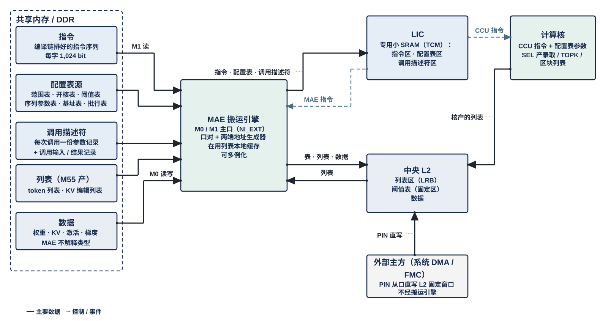

# L3PU 的外部输入信息：指令、配置表、调用描述符、列表、数据

> Owner: WangYizhao｜2026-11-06｜第二版（用户 11-06 两点补充：数据作第五类；LIC 专用小 SRAM；列表由 MAE 消费、在用列表在 MAE 本地缓存；共享内存 / DDR）。依据：用户 11-06 裁定 V18-NAME-01、V18-MAE-01…08、V18-LIC-01、V18-NII-06（`Claude_Design_Spec/V1.8_DESIGN_REVISIONS.md`）；V1.7_3 CIF / LIC / MAE_ENG 篇中各类记录的内容（冻结基线，名称按本篇替换）。本篇是全套正式稿的名称与分工基准：各篇提到这五类信息时只用本篇的名称，不再另造。
>
> 11-06 晚（V18-MAE-11…16，任务书 `_build/MAE_CRU_MERGE_BRIEF_20261106.md`）：CRU 并入 MAE 组、改称 MAE_CRU，核产列表的进入路径写作 C2H → MAE_CRU 读集合并 → 经 NI 写口落 L2；MAE 指令内容的"整形模式"改为运算字段（直通 / DSU / CRU），加第二目的，"完成计数号与消费门限"改为指令标号（握手）；§5 消费门限句改为应写量经长度转发（开头、§1、§2、§5）。只换词与句。

**L3PU 从外部接收的信息只有五类：指令、配置表、调用描述符、列表、数据。** 前三类由 LIC 消费，从 LIC 的专用小 SRAM 取用；列表由 MAE 消费，大批存 L2、在用的在 MAE 本地缓存；数据（权重、KV、激活、梯度）由 MAE 按指令搬运，MAE 不解释其类型（V18-MAE-01）。五类的区别在于谁产生、什么时候变、谁消费：指令随模型与调用种类固定、由编译链产生；配置表随模型或工况固定、调用之间装载；调用描述符每次调用变一次、由 M55 写；列表在运行中产生、由核或 M55 写、驱动 MAE 的地址生成；数据随调用流动。**"共享内存 / DDR"指 M55 与 L3PU 共用的片上系统 SRAM（HSRAM）与 DDR 共享区**：小而时延敏感的（调用描述符、配置表源、M55 产的列表）放 HSRAM，大的（指令序列、模型数据、KV、训练记录）放 DDR；L3PU 经 M1 读 HSRAM 与 DDR 共享区的记录、经 M0 读写 DDR 的数据。

**共享内存 / DDR 里的五样全部由 MAE 搬运引擎搬进芯片**（M1 读指令、配置表源、调用描述符、M55 产的列表，M0 读写数据），搬运引擎按指令的目的口把它们送到 LIC 专用小 SRAM（经 NI_INT 的 LIC 直连口）、L2（经 NI 写口）或核 L1（经 MAE_IDN）；**唯一不经搬运引擎的是外部主方经 PIN 从口直写 L2 固定窗口**，因为那是从口、由外部主方发地址（V18-MAE-09 两条路并存）。核产的列表经 C2H → MAE_CRU 读集合并 → L2 列表区（MAE_CRU 经 NI 写口写 L2，V18-MAE-12），再被搬运引擎按指令读取；LIC 向搬运引擎发 MAE 指令、向核发 CCU 指令。

## 1 五类信息总表

| 名称 | 是什么 | 谁产生、何时变 | 放在哪 | 怎样进入 L3PU | 谁消费 |
|---|---|---|---|---|---|
| **指令** | LIC 顺序消费的 1,024 bit 字，按执行模块分 LIC 指令、MAE 指令、CCU 指令、Fusion 指令（段头） | 编译链，随（模型, 调用种类）固定；运行期不改 | 共享内存 / DDR 中的指令序列；片上 LIC 专用小 SRAM 的指令区（当前 / 下一调用两份） | 调用之间经 M1 读口 → NI_INT LIC 直连口 → LIC 专用小 SRAM（装载是一条搬运指令） | LIC 取指；MAE 指令交 MAE 搬运引擎，CCU 指令交目的核 CCU（经命令与标量网） |
| **配置表** | 调用之间装进 LIC 或 L2 固定区的小表，按内容命名：范围表、开核表、阈值表、序列参数表、基址表、批行表、KV 段表 | 编译链或 M55，随模型 / 工况固定；运行期装表只写非活动份，下一调用入口切换 | 共享内存 / DDR 中的配置表源；片上 LIC 专用小 SRAM 的配置表区、L2 固定区（阈值表） | 同上；阈值表经 NI 写口进 L2 固定区 | LIC 按调用描述符的表键查表、把参数填进指令；核 SEL 读阈值表；VNU 读序列参数 |
| **调用描述符** | M55 每次调用写的一份参数记录（调用种类、各记录地址、表键、开关、驻留版本号）；调用输入记录与结果记录随它 | M55，每次调用一份；调用开始时 LIC 一次锁存 | 共享内存（HSRAM） | 门铃后经 M1 读口 → LIC 直连口 → LIC 专用小 SRAM 锁存 | LIC（查表、填指令、判断调用边界） |
| **列表** | 运行时产生、给搬运引擎的地址生成器用的索引序列（稀疏信息）；载荷只有位图或行号两种 | 核（SEL 录取、TOPK、区块选择）在调用内产生；M55 产的 token 列表、KV 编辑列表随调用给 | 大批存 L2 列表区（LRB）；M55 产的在共享内存；**正在被用的列表在 MAE 本地缓存（容量与组织【设计者定】）** | 核产的经 C2H → MAE_CRU 读集合并 → L2 列表区；M55 产的经 M1 读口进 L2 或由搬运引擎直接读 | **MAE 搬运引擎**（列表驱动地址生成器；LIC 不读列表内容）；CCU_RTR 按列表出 pass |
| **数据** | 权重、KV、激活、梯度、特征记录、掩码记录、teacher 记录等张量字节 | 编译链（权重）、M55（调用输入）、L3PU 自己（KV、激活、梯度） | DDR（模型数据、KV、训练区）；调用输入在 HSRAM | 经 M0（大流量）或 M1（调用输入）由搬运引擎按指令搬运，目的口可为 L2、L1 或 LIC 直连口；**SoC 侧数据（Token ID、图像）进 L2 两条路都支持：NPU 经 M1 读回落 L2，或外部主方经 PIN 从口直写 L2 固定窗口**（V18-MAE-09） | 核的 MXU / VNU；MAE 不解释类型 |

不是这五类的：门铃、中断、运行控制、计数门限——CIF 的 APB 寄存器，不是记录。

## 2 指令：编译链排好的序列，LIC 顺序取用

- **一条指令就是一个 1,024 bit 字**，按公共头的执行模块码分四类；编译链按真实层结构顺序展开，调用描述符给入口与有效字数。指令可以在同一调用里反复执行（层体复用），这是编译链的安排，不另起"模板"一名。
- **指令里只有当前调用不变的字段**；随工况变的参数（基址、有效范围、份号、参与核）由 LIC 从配置表查出后填进当前发射副本（基址绑定），MAE 与 CCU 执行端只在该基址上加本条指令内的偏移。
- **MAE 指令的内容**（V18-MAE-01 / 02）：来源口、目的口；源端与目的端各自的地址生成方式（算术：基址 + 行字节数 + 行数 + 跨距；列表驱动：基址 + 列表地址 + 项数 + 项字节数）；目的核集合；运算字段（经 MUX 选直通 / 经 MAE_DSU 整形——半字合并 / 转置 / 两平面合并 / 经 MAE_CRU 合并——合并种类、参与核、期望到齐数，V18-MAE-12）；可带第二目的（V18-MAE-16）；优先级；LIC 分配的指令标号（MAE 执行完带标号通知 LIC；MAE 不设完成计数器，指令不带等待条件，V18-MAE-13）。没有数据类型字段。
- **CCU 指令的内容**归 CCU_CTL 篇；核侧要知道的类型信息（K 直接处理还是先 RoPE 再处理（V18-KV-01）、V 位宽、平面数、整形后字形）写在 CCU 指令里，不经 MAE。
- **存放：LIC 的专用小 SRAM**（类似 CPU 的 TCM：LIC 只从这块本地存储取指令、查配置表、读锁存的调用描述符，不直接访问共享内存 / DDR），分指令区（当前 / 下一调用两份）、配置表区、调用描述符区，经 NI_INT 的 LIC 直连口装入（口宽 32 B，V18-NII-08），容量与组织【设计者定】（参考：指令每调用几十 KB、配置表若干 KB、描述符约 256 B）；装载在当前调用内由一条搬运指令完成（目的口 = LIC 直连口），只写非活动份（V18-LIC-01）。

## 3 配置表：调用之间装载的小表

| 表 | 内容 | 表键 | 存放 | 消费者 |
|---|---|---|---|---|
| 范围表 | 按真实长度分档的核级权重窗口、token 组大小、tile 数等 | 真实长度 | LIC | LIC 填指令 |
| 开核表 | attention 借核数、kv 头到核的分配 | 占槽数 / 有效节点数 | LIC | LIC 填指令 |
| 基址表 | 层基址、各逻辑区基址与步进规则（基址绑定表行） | （模型, 层, 位点） | LIC | LIC 填指令 |
| 阈值表 | 各位点的录取 / keep / FFN 门限（原"阈值套库"），每调用按套号选一套 | 套号（调用描述符给） | L2 固定区 → 核 SEL | SEL |
| 序列参数表 | VNU 各单元的序列参数（RoPE 基、均值向量、置换等；原"VNU 序列镜像"） | （模型, 层, kv 头） | LIC → 核 | NLU / QNT |
| 批行表 | Batch 各行的段基址、长度、活动位（可片上驻留，带驻留版本号） | 行号 | LIC | LIC、CCU_CTL |
| KV 段表 | 各段的位置字段（上下文长度、下一位置号、段上界）与 M55 写的其余字段 | 段号 | DDR 共享区，经 M1 翻页 | LIC（调用末回写位置字段） |
| 训练表 | $\mu_{\text{train}}$、dX 切分轴、份额门限 | （模型, 位点） | LIC | LIC 填指令 |

规则：**运行期装表只写非活动份**，当前被引用的份不覆写；装载是一条 MAE 指令（源 = 共享内存配置表源，目的 = LIC 直连口或 L2 固定区），MAE 不核对表头，表的版本号由调用描述符引用、LIC 在下一调用入口切换。原"模型配置表与模板镜像""表镜像头""连续镜像"都指这里的配置表源。

## 4 调用描述符：每次调用一份

- **只有它叫描述符。** 内容：调用种类（Prefill / Decode / Proposal / Verify / 独立训练 / 生成循环）、指令入口与有效字数、各记录地址（调用输入记录、结果记录、Draft 分布、随机数、批行表、KV 编辑列表）、配置表的表键（真实长度、占槽数、训练行数 $D$）与版本号、调用级开关（训练、区块搜索、阈值套号、置信度输出）、驻留选择位与驻留版本号、PIN 输入的实际长度。
- **调用输入记录与结果记录随它**：输入记录（token、anchor、树记录组、接受列表）由 M55 写在描述符指向的地址；结果记录（首 token、接受结果、TOPK 项）由 LIC 经一条 MAE 指令写回；**调用完成状态不再作为状态字写进共享内存，而由 CIF 的状态寄存器承载**：写结果记录那条指令执行完（AXI 写响应收齐、MAE 通知 LIC）后，LIC 写 CIF 状态寄存器、CIF 发中断，M55 经 APB 读；CIF 另有一组 Monitor 寄存器供调试与看日志（用户 11-06："我认为状态字应该是 CIF 的事情，L3PU 完成某个字的输出，给到 CIF 的某个寄存器"，V18-MAE-26）。
- 锁存：LIC 经 M1 读入后在调用开始一次锁存，共享内存中下一份的改写不影响本调用。字段的字节格式归 CIF 篇（与 M55 共用的格式唯一一份定义）。

## 5 列表：运行时产生的索引序列

- **两种载荷**：位图（每行 / 每 key / 每区块 1 bit）或行号（**每项固定 3 B，任意词表都放得下的冗余设计，所有行号类列表同此**，用户 11-06）；记录头只有序号与计数，不再带"模板号"（V18-MAE-06）——哪条指令用哪张列表由指令引用列表地址表达。
- **种类**：录取列表（SEL 录取 key，驱动 K lo 或 K hi + lo、V 的 gather）、TOPK 列表（LM Head 补算列）、区块列表（区块搜索后的 K hi 读）、token 列表（嵌入 gather）、KV 编辑列表（M55 给的拷贝 / 压实 / 散写 / 作废动作，由 LIC 展开成带列表的搬运引擎指令）、监督行列表。
- **存放与进入**：核产的列表经本核 C2H 进 L2，跨核的先经 MAE_CRU 读集合并（V18-TP-24）再经 NI 写口落 L2 列表区（V18-MAE-12）（原 LRB，只是区名）；M55 产的列表在共享内存，经 M1 由搬运引擎直接读或先进 L2。
- **消费：列表由 MAE 读，不由 LIC 读**（V18-MAE-08）。搬运引擎的地址生成器按列表展开地址（源端或目的端）；LIC 只在指令里给列表的地址与项数，不看内容；KV 编辑列表同样由搬运引擎按项展开，LIC 只发指令。CCU_RTR 另按列表出 pass。
- **不设"稀疏读取"专门模式**：列表驱动就是通用的地址生成方式，稠密读取只是位图全 1 或算术地址的特例，搬运引擎不区分（用户 11-06："稀疏读取必然兼容稠密读取"）。
- **存放两级**：大批列表存 L2 列表区（容量随上下文长度，归数据组织篇）；**正在被某条搬运引擎使用的列表在 MAE 本地缓存**，缓存容量、预取深度与替换【设计者定】，约束是搬运引擎逐拍出地址时不因取列表而停拍（参考：每搬运引擎一段 ≥ 1 KB 的列表窗口）。
- 列表驱动的 gather 到核 L1 时，**应写量 = 列表计数 × 项字节数，由 MAE 经长度转发交目的核 CCU**，目的核 CCU 据此比对写计数（V18-MAE-15，撤"列表到齐计数"消息；写计数按写入项数计，V18-TP-37）；一条记录到齐与否不由 MAE 按记录格式判断，接收方也不解析数据。

## 6 名称替换表

| 现行稿里的叫法 | 统一后 |
|---|---|
| 指令镜像、指令表、命令、MAE 命令、SD.MAE 字段、位点命令、访存模板、模板与序列镜像、Fusion 描述符、位点描述符 | 指令（LIC / MAE / CCU / Fusion 指令） |
| 表镜像、模型配置表与模板镜像、表镜像头、连续镜像、VNU 序列镜像、阈值套库、分区表（已撤） | 配置表（范围表 / 开核表 / 基址表 / 阈值表 / 序列参数表 / 批行表 / KV 段表 / 训练表）；共享内存里的叫配置表源 |
| 调用输入输出描述符、批描述、tile 级描述 | 调用描述符；批行表（配置表）；指令字段 |
| KV 计划、KV 编辑描述符、LRB 记录 | KV 编辑列表；列表；L2 列表区 |
| 模型镜像 | DDR 中的模型数据 |
| 掩码镜像、累加面镜像 | 掩码记录、累加面 |
| KV 元数据、元数据 | KV 段表；尺度行（按实指） |
| 布局码（每平面 4 bit）、K 存储精度码 | 退出（MAE 指令只给几何；核侧类型信息在 CCU 指令） |
| 共享内存、系统 SRAM、HSRAM、DDR 共享区（分别指） | 共享内存 / DDR（需要区分时写 HSRAM 或 DDR 共享区） |
| LIC 指令存储、表存储、模板缓存 | LIC 专用小 SRAM（指令区 / 配置表区 / 调用描述符区） |
| 张量、载荷、数据平面 | 数据 |
| CRU、HUB_CRU、hub 中心的 CRU | MAE_CRU（合并单元，MAE 组成员，V18-MAE-11） |
| MAE 指令的整形模式字段（作为唯一选项） | 运算字段：直通 / 经 MAE_DSU（整形模式）/ 经 MAE_CRU（合并参数）（V18-MAE-12） |
| 完成计数号、消费门限、MAE 完成计数器 | 指令标号；MAE 执行完带标号通知 LIC（V18-MAE-13） |
| 对象标识（发出报告里） | 退出；报告按目的起始地址对应指令（V18-MAE-14 修订） |
| 状态字（结果记录里） | 退出；调用完成状态在 CIF 状态寄存器（V18-MAE-26） |
| 列表到齐计数 | 退出；应写量经长度转发（V18-MAE-15） |

## 7 由谁保证

| 事项 | 由谁保证 |
|---|---|
| 指令与配置表的版本配套、装载后的切换时机 | 编译链 + LIC |
| 调用描述符的字节格式、提交顺序（写记录 → 缓存清洗 → 写指针 → 门铃） | CIF 篇、M55 Runtime |
| 列表的载荷格式（位图 / 行号）与项数上限 | SEL / CCU_RTR 产出侧与指令；MAE 只按项字节数展开 |
| 张量数据的类型、格式、布局 | 编译链折成指令的几何字段与 CCU 指令的类型字段；MAE 不感知 |

## 8 为什么

- **五类而不是更多**（用户 11-06："这看起来太乱了……直接就说指令就行了，为什么要说指令镜像？"；"你漏掉了权重和激活值，这些也属于外部接收的信息"）：按"谁产生、何时变、谁消费"划分，每类一个名字，各篇不再各自起名。
- **LIC 用专用小 SRAM、列表由 MAE 消费并本地缓存**（用户 11-06："类似于 CPU 的 TCM 和 Cache 概念……大批数据的存储可以交给 L2 SRAM，但是正在被使用的列表需要在 MAE 处有存储的配置"）：LIC 不碰共享内存，MAE 不碰 LIC 的表，各自的本地存储只装自己要消费的信息。
- **MAE 只认几何**（V18-MAE-01）：数据类型差异在编译链消化，MAE 的指令与硬件都不随新数据类型变。
- **列表记录不带模板号**（V18-MAE-06）：指令引用列表，而不是列表指向指令，避免两边各存一份对应关系。
- **只有调用描述符叫描述符**：它是唯一每次调用都变、又不是列表的东西。
