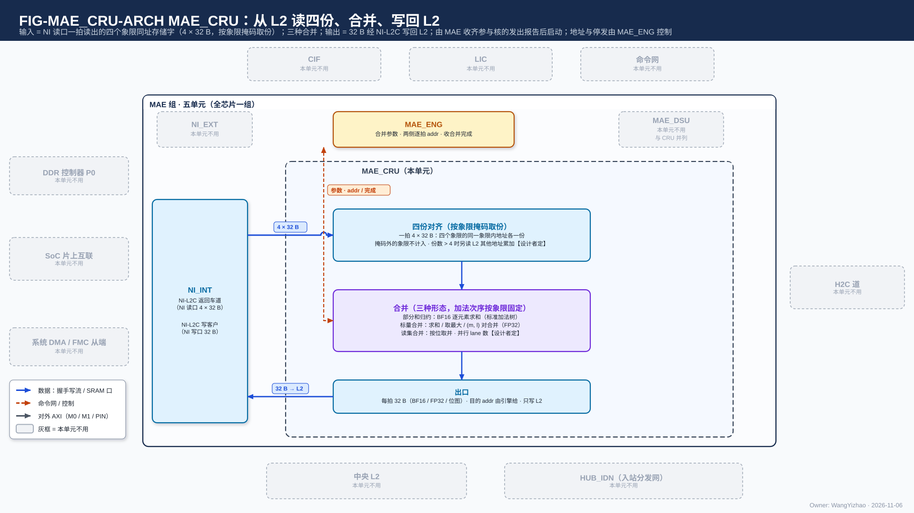
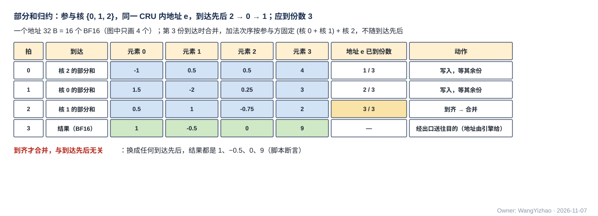
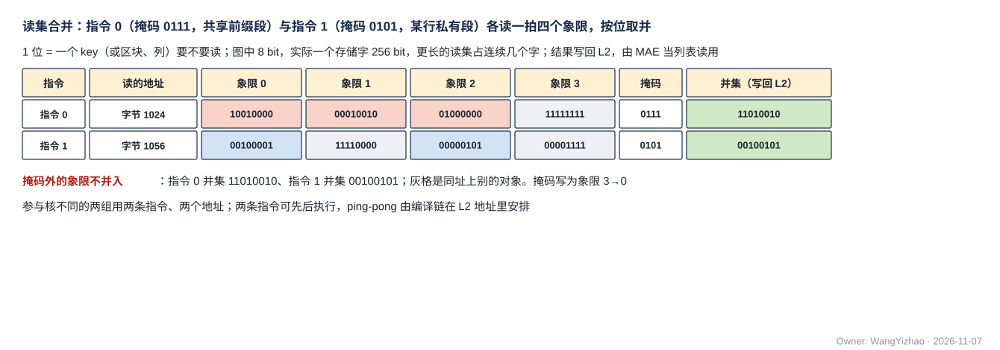
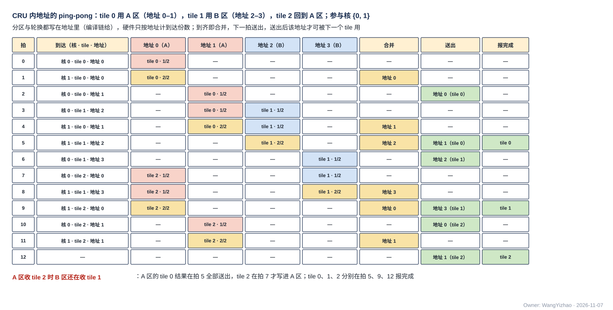

# MAE 合并单元（MAE_CRU）需求

> Owner: WangYizhao｜2026-11-07｜正式稿第一版，待用户审阅。按用户 11-06 深夜确认的目录（`../V17_3_MODULE_TOC_MAE_CRU_20261106.md` 第二版，C1–C7 与 ping-pong 已定）编写；依据 `Claude_Design_Spec/V1.8_DESIGN_REVISIONS.md` V18-MAE-11 / 12 / 13 / 21 / 22 / 23 / 24 / 25 / 30、V18-CRU-01…05、V18-TP-21 / 23 / 24 / 50 / 52 / 54、V18-D-02；正式稿 `DATA_TRANSFER_PROTOCOL.md`（下称"协议篇"）、`MAE_ENG.md`、`MAE_INTEGRATION.md`、`HUB_NOC.md`。V1.7_3 `Modules/HUB_CRU.md` 只作参考值。图件登记 `_build/FIGURE_REGISTRY_MAE_CRU.md`。

MAE_CRU 是 MAE 组六个单元之一，全芯片一个，做**搬运途中按固定规则的合并**：把各核送来的同一输出位置的部分和逐元素相加、把各核的标量按类合并、把各核的读集按位取并。**它是搬运指令的运算级之一（与直通、MAE_DSU 并列，由运算字段经 MUX 选用）；一组合并 = 一条搬运指令，合并种类、参与核、CRU 内地址范围与每个地址应到的份数是这条指令的运算参数；两侧每拍地址由执行该指令的搬运引擎给出；MAE_CRU 按 CRU 内地址数到达份数，到齐即合并，一组全部合并完报 MAE_ENG，由 MAE_ENG 带指令标号通知 LIC。**（用户 11-06："CRU 归纳到 MAE 中，和 DSU 并行，这样 MAE 除了搬运指令的基础功能外，还可以叠加数据运算和数据操作"；"合并应该是放在搬运指令下的功能，它本质上仍然属于，数据从哪里到哪里，中间做了个中间操作"。）

## 1 组成与位置

### 1.1 位置

MAE 组 = MAE_ENG、NI_EXT、NI_INT、MAE_IDN、MAE_DSU、MAE_CRU（V18-MAE-11）。MAE_CRU 全芯片一个；**物理位置（hub 中心，或与 MAE 一起放在芯片中心）归后端，本篇不写**（用户 11-06："MAE 也可以直接放在物理中心，但这是后端的事情，咱们不感知"）。与 MAE 组外的连接经组的对外口，口的个数与共享方式见 MAE 集成篇（`MAE_INTEGRATION.md`）§3。

### 1.2 做什么、不做什么

| 做 | 不做（归谁） |
|---|---|
| 三种合并：部分和归约、标量合并、读集合并（§3） | 不生成地址：两侧每拍地址由执行该指令的搬运引擎给出（V18-MAE-25） |
| 按 CRU 内地址数到达份数，到齐即合并（§4） | 不做屏障与 GO（LIC，V18-TP-22）；不通知 LIC（MAE_ENG 带指令标号通知，V18-MAE-13） |
| 一组合并的地址范围全部合并完，报 MAE_ENG（§5.4） | 不量化：只有 BF16 直出（V18-CRU-02）；量化由消费核的 QNT 做 |
| CRU 入口每写进一项，给发数据的核回写入握手（§5.3） | 不做残差加（归约属主核的 MXU 出口级加一次，用户 11-03）；不做 attention 的 $O$ 累加（NLU） |
| | 不做判决、并集的排序 / 压紧 / 切单位（SEL、CCU_RTR）；不经 MAE_IDN 送数（V18-MAE-12） |
| | 不做运行时检查（用户 11-06："最后如果需要 debug 可以最后架构确定了统一加"） |

**MAE_CRU 只提供合并形态；用哪一种、哪些核参与、地址范围与每个地址应到的份数，都是搬运指令的运算参数**（V18-MAE-12 / 21），撤原 MAE 操作 18 的独立端点配置与"先收妥后切换"。本篇不写指令字段（字段在 MAE_ENG 篇 §3.2 与 ISA）。运算字段选直通或 MAE_DSU 时，数据不过 MAE_CRU；核间不切归约维的位点（例如按输出通道 $m$ 分核）没有部分和送进来。

### 1.3 术语

- **核间切分归约维与部分和**：矩阵乘 $Y = XW$（$X$ 为 $T \times K$，$W$ 为 $K \times M$）的归约维 $k$ 切成几段分给各核，核 $c$ 只持 $W$ 的行子集 $\mathcal K_c$，算出同一输出块的一份**部分和** $Y^{(c)} = X_{:,\mathcal K_c} W_{\mathcal K_c,:}$，完整输出 $Y = \sum_c Y^{(c)}$。反传 $\mathrm dX = \mathrm dY\,W^{\mathsf T}$ 的归约维是 $m$；attention 反传 $\mathrm dK = \mathrm dS^{\mathsf T} Q$ 按查询行分核时，归约维是查询行，同理。
- **CRU 内地址**：MAE_CRU 里的一个合并位置，**一个地址 32 B**（C2H 一拍，16 个 BF16）。**地址由指令给出，MAE_CRU 不自己编号**：CCU 的发送指令给出写到 CRU 的哪个地址（就是 C2H 上的 addr），MAE 的合并指令给出本组的地址范围与每个地址应到的份数（用户 11-06："这些应该是指令告知的"；V18-CRU-04）。地址只是 CRU 存储内部的位置，由 CRU 自己解释，不编码"是哪个存储"（V18-TP-51）。
- **参与方 / 到达份数 / 应到份数**：参与方是给某个地址送一份输入的一方（参与核，或 MAE 的读路径）；到达份数是该地址已经收到几份；**应到份数 = 参与核数 + 读路径份数**（§4.4），写在指令里。
- **读集**：一组 key（或区块、列）要不要读的位图，1 位对应一个 key / 区块 / 列。查询行按 T 切给几个核时，各核由 SEL 得出本核查询行要读的 key，即本核的读集 $R_c$；读集合并 = $R = \bigcup_c R_c$，并集落 L2 后由 MAE 当列表（位图形式）把这些 key 只读一次、多播给各核；**每个查询行仍只用本核自己的录取位，并集只决定"一次读哪些"**。
- **（最大值, 缩放和）对**：查询行 $i$ 的 softmax 分母分在几个核上时（K 按核切分），核 $c$ 持 $m_c = \max_{j \in \mathcal J_c} s_{ij}$ 与 $l_c = \sum_{j \in \mathcal J_c} e^{s_{ij} - m_c}$，$s_{ij}$ 为 $S = QK^{\mathsf T}$ 的元素。

## 2 数据从哪来、到哪去

外框与 MAE 组其余五篇相同，本单元不用的对端与同组单元画灰。三类输入写进 **CRU 存储**：右侧四核 C2H 去 MAE_CRU 的分支（每核 1 × 32 B）经 C2H 入口写入，并沿原链路给发数据的核回写入握手；左侧 NI_INT 的读返回分路送来读路径数据（DDR / L2，算一份）；上方命令与标量网（MAE_CRU 的独立端点）送来各核 CCU 转来的标量。CRU 存储按地址记到达份数，**某地址到齐即进合并**（部分和归约 / 标量合并 / 读集合并）；结果经出口送去 H2C 道（任一道，作该道的第二源）、NI-L2C 写客户（去 L2，或经 NI_EXT 的 M1 去共享内存），标量合并值经命令与标量网回目的核 CCU。MAE_ENG 给合并参数与两侧每拍地址、收合并完成，并在任一段 ready 拉低时统一停发。MAE_DSU 与 MAE_CRU 并列、无往来；MAE_CRU 不经 MAE_IDN。

### 2.1 MAE 组内的接口

| 接口 | 对端 | 方向 | 内容 |
|---|---|---|---|
| 合并参数 | MAE_ENG 的搬运引擎 | 入 | 合并种类（归约 / 标量合并的类 / 读集合并）、参与核、本组的 CRU 内地址范围与每个地址应到的份数；随单位给出，格式【设计者定】 |
| 两侧每拍地址 | MAE_ENG 的搬运引擎 | 入 | 读路径一侧写 CRU 的地址；出口一侧的目的 addr / be（L1、L2 或共享内存的逻辑地址）（V18-MAE-25） |
| 合并完成 | MAE_ENG | 出 | 本组地址范围全部合并完（V18-MAE-30） |
| 停发 | MAE_ENG | 出 | 各段 ready（入口、出口）；任一段拉低时执行该指令的引擎统一停发 |
| 读路径输入 | NI_INT 读返回分路 | 入 | 32 B + addr（CRU 内地址），引擎给的通路选择 = 去 MAE_CRU；通用链路块实例 |
| 结果去 L2 / 共享内存 | NI-L2C 写客户（五源之一） | 出 | 32 B + addr / be + `src`；写 L2 时 L2 回写入握手给引擎，写共享内存时经 NI_EXT 的 M1，以 AXI 写响应计（MAE_ENG 篇 §10） |

### 2.2 经 MAE 组对外的接口

| 接口 | 对端 | 方向 | 条数 × 位宽 | 内容 |
|---|---|---|---|---|
| C2H 去 MAE_CRU 的分支 | 四核发送桥（经 HUB_NOC 的 C2H 分流） | 入 | 每核 1 × 32 B | en / din / be / addr（CRU 内地址）/ `src`；ready = 该核入口未满（§4.5） |
| CRU 入口写入握手 | 四核 CCU（沿 C2H 分支反向） | 出 | 每核 1 bit/拍 | 每把一项写进 CRU 存储回一个 valid；入口第 $n$ 条只有核 $n$ 一个发令方，不带号（V18-TP-50；MAE 集成篇 C11） |
| 结果去 H2C 道 | HUB_NOC 的 H2C 道 MUX（第二源） | 出 | 口数与宽度【设计者定】，参考 1 × 32 B | 可进任一道，由指令给出（V18-MAE-22）；同道与 L2 读出的先后由 MAE_ENG 按优先级字段判，HUB 只做二选一 MUX（V18-TP-52）；落各核 L1 后由 LDP 回写入握手给发地址的引擎 |
| 命令与标量网端点 | hub 控制道 | 入 / 出 | 64 bit 消息流 | **MAE_CRU 在命令与标量网上单独一个端点，不与 MAE_ENG / NI 控制道共队列**（V18-MAE-12 C3、V18-MAE-23）；入：各核 CCU 转来的标量（消息首字带 CRU 内地址）；出：标量合并值回目的核 CCU |

### 2.3 由别的模块保证的事项

| 事项 | 由谁保证 |
|---|---|
| 各参与核把同一输出位置的部分和写到同一个 CRU 内地址；标量消息首字带 CRU 内地址 | CCU 的发送指令、编译链 |
| 各组合并的地址范围互不重叠；ping-pong 轮换时，上一个 tile 的结果送出后才往同一地址写新 tile 的数据 | 编译链（§4.3） |
| 部分和不含残差 | MXU（出口级） |
| 读集已含强制入选与录取上限 | SEL、CCU |
| 并集之后的排序、单位切分 | CCU_RTR |
| 两侧每拍地址、停发、写入握手计数与完成通知 | MAE_ENG |
| 合并值写进 VNU 的合并值寄存器、何时消费 | CCU（V18-TP-21） |
| 结果的目的空间在写入时已空闲 | 编译链（协议篇 §7.1） |
| 同一 H2C 道上 CRU 输出与 L2 读出的先后 | MAE_ENG（V18-TP-52） |

## 3 合并形态

**三种形态，按"运算的本质"归类，不按用途分节**；用哪一种由指令的合并种类给出。

| 形态 | 按矩阵维度说做什么 | 输入 | 输出 | 典型用途 |
|---|---|---|---|---|
| 部分和归约 | 同一地址上各参与方的 BF16 向量逐元素相加，$Y = \sum_c Y^{(c)}$ | 每份 32 B = 16 个 BF16 | BF16 向量 | 核间切分 $k$ 的线性位点；dX 沿 $m$ 跨核切分；dK / dV 按查询行分核 |
| 标量合并 | 同一地址上各参与核的一个 FP32 标量按类合并：求和、取最大、（最大值, 缩放和）对合并 | FP32 标量（对合并为两个 FP32） | FP32 标量 | 归一化的 $\Sigma x^2$、量化的组最大值、lse、梯度范数平方 |
| 读集合并 | 同一地址上各参与方的读集按位取并，$R = \bigcup_c R_c$ | 每份至多 256 bit | 并集位图 | attention 录取读集、长上下文区块读集、多核 lo 读集 |

### 3.1 部分和归约：BF16 逐元素求和，标准加法树，次序按参与方固定

**到齐后把同一地址上的各份 BF16 部分和逐元素相加，BF16 直出；加法树按标准 BF16 设计（RNE），加法次序按参与方固定、不随到达先后**（用户 11-06："BF16 的加法树可以直接走标准设计"；V18-CRU-03）。参与方的固定次序【设计者定】，约束是对同一组输入、无论到达先后与 ready 时序，结果逐位相同（§5.5）。

图中参与核 {0, 1, 2} 把同一输出位置（例如 token 5、输出通道 0–15）的部分和写到同一个 CRU 内地址 $e$，应到份数 3。三份按核 2、核 0、核 1 的先后到达，每到一份写进地址 $e$、到达份数加一；第 3 份到达时合并，按 (核 0 + 核 1) + 核 2 相加，得 1、−0.5、0、9，经出口送往指令给的目的（例如归约属主核 L1）。一个地址实际 16 个元素，图中只画 4 个。脚本断言：换任何到达先后，结果相同。

### 3.2 标量合并：求和、取最大、（最大值, 缩放和）对合并

**各核 CCU 把 VNU 结果寄存器里的标量读出，经命令与标量网送到 MAE_CRU；消息首字带写到 CRU 的哪个地址（由 CCU 的指令给），与数据网写进来的数据共用一套 CRU 内地址**（V18-TP-21、V18-CRU-04）。到齐后按指令给的类合并，合并值经命令与标量网回目的核 CCU，CCU 写进 VNU 的合并值寄存器。**（最大值, 缩放和）对合并保留在 MAE_CRU**（用户 11-06："这个操作看起来硬件通路需求比较低"）：

$$m' = \max_c m_c,\qquad l' = \sum_c l_c\, e^{\,m_c - m'}$$

只有 MAE_CRU 同时看到各核的值；若不在这里做，就要把各核的对送回一个核再由 NLU 合并，多一轮往返。

例（3 个核，FP32）：

| 类 | 核 0 | 核 1 | 核 2 | 合并值 |
|---|---|---|---|---|
| 求和（如 $\Sigma x^2$ 的部分值） | 2.0 | 3.5 | 0.5 | 6.0 |
| 取最大（如组最大值） | 1.25 | 3.0 | 2.5 | 3.0 |
| 对合并 $(m_c, l_c)$ | (5, 2.0) | (3, 4.0) | (4, 1.0) | $m' = 5$，$l' = 2.0 + 4.0\,e^{-2} + 1.0\,e^{-1} \approx 2.9092$ |

对合并中核 1 的 $l_c$ 被 $e^{-2}$ 缩放、核 2 的被 $e^{-1}$ 缩放；求和与对合并的加法同样按参与方固定次序。一个标量只占地址里的 4 B（对合并 8 B），按字节写使能写入（§4.1 的紧密数据）。

### 3.3 读集合并：按位取并

**同一地址上各参与方的读集按位取并；一个地址 256 bit，更长的读集占连续几个地址**（V18-CRU-04）。结果经 NI-L2C 落 L2，由 MAE 当列表（位图形式）读用（V18-MAE-12），或经 H2C 道送核 L1。并集之后不封顶、不另加强制入选、不按档号过滤；结果与各核用哪种选择模式无关（V18-SEL-02）。只有一个核执行时，读集由该核自己形成，不经 MAE_CRU。

图中地址 0 由核 {0, 1, 2} 合并（应到 3 份）、地址 1 由核 {0, 2} 合并（应到 2 份），例如批处理时共享前缀段由所有持有核合并、某一行私有段只由持有该行的核合并——两者用不同地址、参与核不同。两地址的拍交错到达：地址 1 在拍 3 先到齐，并集 00100101；地址 0 在拍 4 到齐，并集 11010010。图中 8 bit，实际一个地址 256 bit。

### 3.4 输入全部定长

部分和为 BF16 向量（每份 16 个元素），标量为 FP32 语义，读集每位一个 key / 区块 / 列；**MAE_CRU 方向没有变长信息，应到份数只来自指令，不用发出报告**（用户 11-06："我认为 CRU 里应该是没变长信息吧"；V18-MAE-21）。线上格式不随内部实现改变。

## 4 CRU 内地址与到达份数

### 4.1 CRU 存储：SRAM，一个地址 32 B，按字节写使能支持紧密数据

**CRU 存储以 SRAM 实现，一个地址 32 B，按字节写使能（be）支持紧密数据**（与 L1 / L2 的紧密访问兼容能力同一思路，V18-TP-25）：例如一个标量只占地址里的 4 B，读集不满 256 bit 时只写有效字节。**若设计者判断实际场景几乎没有紧密数据，可以用较少的寄存器实现紧密部分**（用户 11-06："我认为这里应该需要考虑对紧密数据的存储支持，同样以 SRAM 的形式实现，这里可以写在 SRAM 的需求中（但是可以由设计者定，如果认为实际场景几乎不会有这样的需求，可以以较少的寄存器实现）"；V18-CRU-04）。

每个地址另记一个到达份数。容量【设计者定】：要定的是地址个数；约束是同时在收与在合并的各组合并的地址范围放得下（编译链按地址分配，§4.3）。

### 4.2 按地址计到达份数，到齐即合并；一组全部合并完才报 MAE_ENG

**每把一份写进某个地址，该地址的到达份数加一；达到指令给的应到份数，即合并该地址；本条指令的地址范围全部合并完，报 MAE_ENG**（V18-MAE-30）。合并结果送出后，该地址的到达份数清零，可被下一组使用。

**归属靠地址，不靠源核**：同一核可能先后发两组合并的数据，而 MAE 执行两条指令的先后与 CCU 发送的先后不一定相同；按源核累计分不清各属哪组，按地址则不会混。

### 4.3 CRU 内地址由编译链做 ping-pong

**tile $t$ 的合并用 A 区地址，tile $t+1$ 用 B 区地址；B 区收数时 A 区可以合并、送出；A 区结果送出后，tile $t+2$ 才回到 A 区。分区与轮换都写在地址里，硬件只按地址计数，不知道哪里是 A 区、哪里是 B 区**（用户 11-06："我认为这里应该不是两条指令在飞，而是一个基础的 ping-pong 设计"）——与 L1 的两堆 ping-pong 同一做法。分两区还是更多区由编译链定，**硬件不设组数上限**（用户 11-06："不设上限"；V18-CRU-05）。每个 tile 仍是一条合并指令，各自报完成。

图中参与核 {0, 1}，每个 tile 两个地址：tile 0 用 A 区地址 0–1，tile 1 用 B 区地址 2–3，tile 2 回到 A 区。各核的拍交错到达；某地址到齐的那一拍合并，下一拍送出，送出后该地址清零。A 区在拍 1、4 合并 tile 0 的两个地址时，B 区在拍 3、5 收 tile 1；A 区的 tile 0 结果在拍 5 全部送出，tile 2 在拍 7 才写进 A 区——这一先后由编译链的地址安排保证（§2.3）。tile 0、1、2 分别在拍 5、9、12 报完成。拍号只示意先后，实际合并与送出的拍数【设计者定】。

### 4.4 读路径送来的一项算一份

**MAE 从 DDR / L2 读出、经 NI_INT 读返回分路送进 MAE_CRU 的一项，同样写进 CRU 内地址、算一份；应到份数 = 参与核数 + 读路径份数，计数规则不变，读路径一侧的地址由引擎给出**（用户 11-06："我认为算一份"；V18-CRU-05）。例：dK / dV 分段计算时，上一段的部分和存在 L2，本段各核又送来部分和，两者在同一地址相加。这是兼容能力（V18-MAE-12 C1）：可以不用，但要能用。

### 4.5 入口 FIFO 的组织【设计者定】

四核 C2H 去 MAE_CRU 的分支各一条 32 B 链路进 MAE_CRU。**要定的是入口 FIFO 怎样组织**，两种做法各有代价（V18-MAE-24；用户 11-06："给出为什么有这个问题，解决方法交给设计者"）：

| 做法 | 代价 |
|---|---|
| 每核一个 FIFO | 面积四份 |
| 四核合并一个 FIFO | 要按拍在四核间选（单位边界不在链路上）；一个慢核的拍可能占住入口，拖慢其余核 |

约束：按地址计数不受影响；不丢拍；每核入口的 ready = 该核的入口未满；读路径与标量入口同样握手。

### 4.6 不参与的核不等待

参与核由指令给出；不在参与核里的核不送、不等，求和时不计入（不是按 0 计）。

## 5 输出与完成

### 5.1 只有 BF16 直出，超过 32 B 分多拍，不带组序号

**部分和归约只有 BF16 直出**（撤 MXFP6 g32 输出，用户 11-06："只保留 BF16 直出、撤掉 MXFP6 g32 输出"；V18-CRU-02）；一组结果超过 32 B 时占连续几个存储字、分多拍发（V18-CRU-01）。**不带组序号，位置由每拍地址给出**（用户 11-06："认可，无需组序号"；V18-CRU-05）。

### 5.2 去向

| 去向 | 经由 | 地址 | 典型 |
|---|---|---|---|
| 核 L1 | 出口 → H2C 道（任一道，第二源）→ 各核 LDP | 引擎逐拍给，可按核掩码多播 | 归约值回归约属主核；并集送核 |
| L2 | 出口 → NI-L2C 写客户 → NI 写口 | 引擎逐拍给 | 读集合并后的列表落 L2（V18-MAE-12）；部分和暂存 L2 |
| 共享内存 | 出口 → NI-L2C → NI_EXT（M1） | 引擎逐拍给 | 结果交片外（MAE_ENG 篇 §6） |
| 目的核 CCU | 标量出口 → 命令与标量网 | 消息首字给目的 | 标量合并值（V18-MAE-23） |

### 5.3 写入完成：入口侧与出口侧

**入口侧**：MAE_CRU 每把一项写进 CRU 存储，就沿 C2H 分支反向给发数据的核回一个写入握手（valid，不带号）；该核 CCU 数满本次发送的项数，即发送方写入完成，源空间可复用（V18-TP-50；MAE 集成篇 C11）。**出口侧**：结果写进目的地后，由目的地按核间规则回写入握手给执行该指令的搬运引擎（L1 经 H2C 道汇总、L2 经 NI 写口）；写共享内存时以 AXI 写响应计（协议篇 §5.8）。**"按地址到齐才合并"是合并运算的语义，不是第三类完成协议**（协议篇 §2.6）。

### 5.4 合并完成通知

本组地址范围全部合并完，MAE_CRU 报 MAE_ENG；MAE_ENG 按 MAE_ENG 篇 §10 的判据判该指令执行完成，**带指令标号通知 LIC**（V18-MAE-13），LIC 据此分发后续指令与做屏障。

### 5.5 确定性：结果与到达先后无关

**每种形态的结果只依赖参与方的输入与指令，与到达先后、ready 时序、核号无关**。这是功能要求、不是精度目标：核间切 $k$ 时，归约值决定归约属主核的判决（gate 先筛，以及下一位点各通道读 hi + lo、只读 hi 或跳过），判决送同组各核，各核按同一判决锁步推进；训练前向重算也须复现同一判决与掩码。读集合并本身逐位确定。

### 5.6 精度

**不写"任务精度下降"类要求；BF16 加法树按标准设计**（用户 11-06："这里不需要有任务精度下降的要求，BF16 的加法树可以直接走标准设计"；V18-CRU-03）。标量合并按 FP32 语义；对合并的指数元件按标准 FP32 实现【设计者定】。算法侧的软仿硬参考链按"BF16 标准加法、按参与方固定次序"同步。

## 6 握手与速率

### 6.1 进出都握手，由 MAE_ENG 统一停发

**C2H 分支、读路径、标量入口进 MAE_CRU，MAE_CRU 到 H2C 道、NI-L2C、标量出口，每段都是 ready 握手；两侧每拍地址由执行该指令的搬运引擎给出；任一段 ready 拉低时，该引擎统一停发**（用户 11-06："DSU 和 CRU 的地址都交给 MAE-ENG 来确定，这里数据->DSU/CRU, DSU/CRU->存储单元都需要反压设计，可以由 ENG 统一控制"；V18-MAE-25、V18-TP-23）。停发只降速、不丢数：某核入口满时该核的 C2H 链路 ready 拉低，经发送桥 FIFO 传回本核 CCU（协议篇 §4.5）；出口满时停止合并送出，进而拉低入口。

### 6.2 可由后端调整

每条进出链路与每级都是通用链路块的实例；**级数与位置可由后端按布局调整，功能不变**（协议篇 §5.3.4 A1–A7，V18-TP-54）。物理位置归后端（§1.1）。

### 6.3 并行 lane 数【设计者定】，不定时延要求值

**各类合并的并行 lane 数可配【设计者定】，不定时延要求值**（V18-TP-23）。每拍处理能力匹配上下游，相关模块与现行参考值（只作背景，由 MAE_CRU 设计者与这些模块对接）：

| 相关模块 | 接口 | 参考值 |
|---|---|---|
| 四核发送桥 | C2H 去 MAE_CRU 的分支 | 每核 32 B/拍，与 L1 发送侧、AEB 直达口共用 C2H |
| HUB_NOC | H2C 道第二源 | 参考 1 × 32 B/拍，与 L2 读出分时 |
| NI_INT | 读路径入、NI-L2C 出 | 各 32 B/拍 |
| 命令与标量网 | 标量入 / 出 | 64 bit 消息流 |

部分和上送的负载为旧供数结构下仿真【待标定】，归数据流篇。

## 7 计数与复位

- **不做运行时检查**；debug 用的检查等架构确定后统一加（V18-CRU-05）。
- **流量性停顿只计数**：各核入口满拍数、出口 ready 低拍数等，经 CIF 的 Monitor 寄存器读出（V18-MAE-26），计数项【设计者定】。
- **复位**清入口 FIFO、CRU 存储的到达份数与在途合并；没有跨调用驻留的状态。

## 8 要求值与验收

### 8.1 要求值

| 项 | 值 | 性质与依据 |
|---|---|---|
| 入口 | 每核 1 × 32 B/拍 | 要求值：与 C2H 每核 32 B 相同 |
| 出口（去 H2C 道） | 口数与宽度【设计者定】，参考 1 × 32 B | V18-MAE-22 |
| CRU 存储 | SRAM，32 B / 地址，字节写使能；容量【设计者定】 | 约束见 §4.1；紧密部分可用较少寄存器实现 |
| 入口 FIFO 组织与深度 | 【设计者定】 | 约束见 §4.5 |
| 并行 lane 数 | 【设计者定】 | 不定时延要求值（§6.3） |
| 容量参考 | 入口每核 16 条共 2,048 B、标量配对表 ≤ 1 KB、读集合并缓冲约 1.5 KB | 参考值：V1.7_3 HUB_CRU，旧结构 |
| 门数 | 【待标定】 | V1.7_3 的 ≤ 164 k 门 + 约 4.6 KB RF 含 barrier 与 MXFP6 量化，现结构未重估 |

### 8.2 验收

| 项 | 方法 | 判据 |
|---|---|---|
| 三种形态 | 对参考模型（BF16 标准加法、按参与方固定次序；FP32 标量合并；按位取并） | 逐位一致 |
| 确定性 | 随机置换到达先后与 ready 时序 | 结果逐位相同 |
| 按地址计数 | 多组合并交错到达、ping-pong 轮换 | 只在到齐时合并；各组互不干扰；每条指令恰报一次完成 |
| 读路径份 | 读路径份与核份混合到达 | 计入应到份数，结果与参考一致 |
| 紧密数据 | 标量、不满 256 bit 的读集按字节写使能写入 | 未写字节不被改动 |
| 不参与的核 | 指令只给部分核 | 不等待、不计入 |
| 握手与停发 | 入口满、出口满注入 | 不丢拍；写入握手数 = 写进 CRU 的项数 |
| 可调性 | 随机化各段级数与 ready 时序（A7） | 结果逐位一致 |

## 9 为什么

- **合并归 MAE，是搬运指令的运算级**（用户 11-06："CRU 归纳到 MAE 中，和 DSU 并行"；"我认为可以选择一个 MUX，决定数据要不要过 CRU 还是直接传"；V18-MAE-11 / 12）：原则"核外的数据搬运，包括搬运途中按固定规则的合并，都由 MAE 发令"（V18-TP-23）；一组合并 = 一条指令，不另设配置操作。
- **按 CRU 内地址计数，地址由指令给出**（V18-MAE-30、V18-CRU-04）：按源核累计分不清组；地址是编译链本来就在分配的东西。
- **ping-pong 写在地址里**（用户 11-06）：硬件不必维护分区状态，与 L1 两堆同一做法。
- **SRAM 支持紧密数据**（用户 11-06）：标量与短读集只占地址的一部分；需求少时可用寄存器实现。
- **只 BF16 直出、不带组序号**（用户 11-06）：量化由消费核的 QNT 做；位置由每拍地址给出。
- **对合并留在 CRU**（用户 11-06："硬件通路需求比较低"）：只有 CRU 同时看到各核的值。
- **屏障归 LIC**（V18-TP-22 / MAE-13）：LIC 已持全部位点完成与 MAE 完成通知。
- **残差只加一次**（用户 11-03）：部分和不含残差，归约属主核的 MXU 出口级加一次。
- **确定性**：K 切分时各核按归约值锁步推进，重算要复现（§5.5）。
- 被否方案各一句：CRU 归 hub、MAE 操作 18 端点配置与先收妥后切换（合并参数是指令的运算参数）；MXFP6 g32 出口（只 BF16）；按源核写计数与 MAE_ENG 比对（按地址计数）；合并键与到齐位（CRU 内地址）；CRU 做 barrier 与 GO（LIC）；列表环写入（MAE 不回绕）；组序号（地址定位置）；运行时检查（架构定后统一加 debug）；元件精度目标与两级 BF16 树公式（标准加法树）；核内两路部分和在 CRU 合并（核内 pod 一律按 T 切分，V18-D-02，不再出现）。
