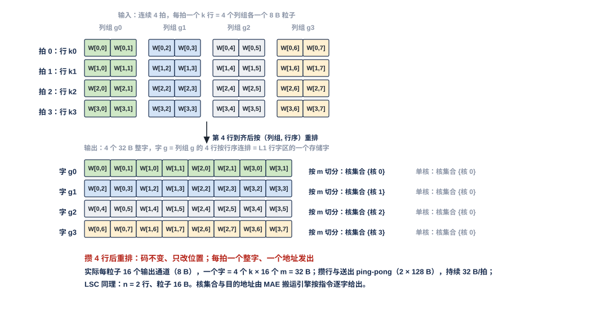
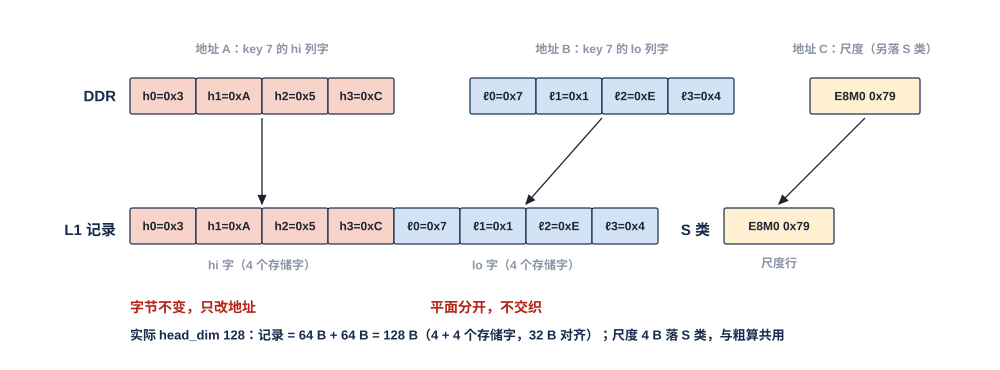

# MAE 数据整形单元（MAE_DSU）需求

> Owner: WangYizhao｜2026-11-07

MAE_DSU 是 MAE 组五个单元之一，全芯片一个，也是 MAE 运算级的两个单元之一（另一个是合并单元 MAE_CRU，二者并列、互不依赖，V18-MAE-12）。**它按四种整形模式之一工作——按字重排、转置、块尺度与旁带、两平面合并（V18-MAE-05 / 35）；指令运算字段选"经 DSU"时，模式由指令的整形模式字段给出（按字重排 / 转置 / 两平面合并三选一；"原样"即运算字段选"直通"，V18-MAE-12），块尺度与旁带随转置一起做；DSU 的全部控制——模式、几何参数、两侧每拍地址与 be、停发——只来自 MAE_ENG 的搬运引擎**（V18-MAE-03 / 25 / 35，用户 11-08："MAE DSU 的控制命令，一定要来自 MAE ENG"）。**按字重排**把一拍里分属几个核或几个存储字的粒子（标准布局一拍 = 同一 $k$ 行下 4 个列组各 8 B；LSC 一行 = 4 核 × 16 B）攒几行后重排成各核的整个存储字，使链路上只有"整字直接发"一种分发方式；**转置**把前向形式存放的权重 $W$（$K \times M$，MXINT8 hi / lo 4 bit 平面 + E8M0 尺度，标准布局或列深度优先布局，两种都必须支持）整形成训练核消费的 $W^{\mathsf T}$ 列字块——32 个 16 B 列字加一个 32 B 旁带行，共 544 B——并算出每块的块尺度；**两平面合并**把同一 key（或同一列块）的 hi 平面列字与 lo 平面列字放进同一条记录的相邻地址，K、V 等非权重数据同样可用。输入可从 DDR（经 NI_INT 的读返回分路）或 L2（经 NI-L2C 返回车道）来，输出去 L1（经 NI_INT 的 IDN 出口 → HUB_IDN）或 L2（经 NI-L2C 写客户）。它是片上唯一改变字内粒子位置、改变权重字方向、做块内尺度计算的元件；只改位置与做精确的指数运算，不改字节值、不是量化点；只处理指令标为整形的那一份，原形那一份与其余数据不经过它。DDR 里只存前向形式的权重，反向不另存 $W^{\mathsf T}$（用户 11-06），所以没有片外出口。

## 1 组成与位置

### 1.1 位置

MAE 组 = MAE_ENG、NI_EXT、NI_INT、MAE_DSU、MAE_CRU（V18-NII-03 / 04、V18-MAE-11；入站分发网 HUB_IDN 属 HUB 组，V18-HUB-01）。MAE_DSU 的上游是 NI_INT（读返回分路给 DDR 原形、NI-L2C 返回车道给 L2 原形），下游是 NI_INT 的 IDN 出口（去核 L1：与 NI 读返回分路去 L1 的一路择一，一路 32 B 交 HUB 组的 HUB_IDN，V18-HUB-03）与 NI_INT 的 NI-L2C 写客户（去 L2，供之后经 H2C 多播）。**经 DSU 是 MAE 搬运指令运算级的一个选项**：MAE 只有搬运指令，指令的运算字段经 MUX 选直通 / 经 MAE_DSU 整形 / 经 MAE_CRU 合并，DSU 与 CRU 并列、没有依赖关系、一条指令只选其一（V18-MAE-12）；选经 DSU 时，执行该指令的 MAE 搬运引擎把数据经 DSU 送出，输入输出每拍的地址仍由这条搬运引擎给出（V18-MAE-03；ISA 影响 TP-ISA-8）。与 MAE 组外的连接经 MAE 组的对外口，口的划分见 MAE 集成篇 §3（`MAE_INTEGRATION.md`）。

把整形放在 MAE 组而不是各核，是因为同一份 DDR 读可以同时服务前向核（原形）与训练核（整形后），权重只读一次（D50 复用哲学）；独立成单元而不是藏在 NI_INT 里，是为了让它也能从 L2 取数、向 L2 输出——权重驻 L2 的位点不必再读 DDR，整好的 $W^{\mathsf T}$ 可以先存 L2 再多播，把约 427 拍的首块等待移出训练读的关键路径（用户 11-06）。两平面合并也放在这里，因为它是 MAE 组唯一与两个平面相关的动作（V18-MAE-04），MAE 搬运引擎本身不感知数据类型（V18-MAE-01）。

### 1.2 做什么、不做什么

| 做 | 不做（归谁） |
|---|---|
| 四种整形模式：按字重排、转置、块尺度与旁带、两平面合并（§3、§4、§5） | 不量化、不舍入：数字位只改位置，块尺度是精确的整数运算（§5） |
| 块尺度 $e_{\max}$、$\Delta_m$ 与旁带行 / 旁带表（§5） | 不生成地址、不收指令：模式、几何参数、输入输出每拍 addr / be、停发都由执行该指令的 MAE 搬运引擎给出（V18-TP-27、V18-MAE-03 / 25 / 35） |
| 先 hi 后 lo、尺度复用（§5.3） | 不缓冲整列、不判完成：DSU 输出去 L1 / L2 时，接收方写进 bank 时回的写入握手直接交执行该指令的搬运引擎，DSU 不计数（V18-TP-50） |
| 暂存一份：按字重排攒 $n$ 行、转置攒一个子段共用（§4.1、§4.2） | 不规定暂存怎样组织与转置怎样实现，只规定输入、输出与吞吐（§4.2、§10） |
| 两平面合并：同一 key 的 hi 字、lo 字、尺度行落同一记录相邻地址（§4.3） | 两平面合并不做半字节交织、不算尺度（§4.3） |
| 进出口都是通用链路块实例（§6.4） | 不处理原形那一份与激活（它们不经 DSU）；K / V 只经两平面合并 |

### 1.3 术语

- **粒子**：一拍输入里将要落到不同核或不同存储字的最小连续字节段；标准布局一拍 32 B = 同一 $k$ 行下 4 个列组各 16 个输出通道的码，粒子 8 B；LSC 一行 64 B = 4 核各 32 个输出通道，粒子 16 B。粒子大小由搬运指令的几何给出。
- **行字**：16 B，同一个 $k$ 下 32 个输出通道 $m$ 的 4 bit 码；标准布局的 DDR 单元里一行 32 B = 4 个 8 B 半行字（各 16 个输出通道）。
- **列字**：16 B，同一个 $m$ 下 32 个连续 $k$ 的 4 bit 码；列深度优先布局按列字存放。
- **$W^{\mathsf T}$ 列字**：训练核消费形态的一个字——$k$ 固定、沿 32 个输出通道展开（即 $W^{\mathsf T}$ 的一行 $m$ 方向的 32 个码），16 B；叶序为自然的输出通道序。
- **$W^{\mathsf T}$ 列字块**（现称训练块）：一个（32 个输出通道的段, K 组）的 32 个 $W^{\mathsf T}$ 列字 + 1 个 32 B 旁带行 = 544 B；L1 篇按块分 2 拍读（§4、L1 篇 §7.9）。
- **K 组**：32 个连续 $k$；**子段**：转置时一个列块连续到达的 $k$ 范围，长 $L_{\text{DSU}}$，由指令给、不超过硬件上限。
- **块尺度**：$e_{\max} = \max_m e_m$，$\Delta_m = e_{\max} - e_m$（4 bit）；**旁带行**：块最大值 1 B + 32 个 $\Delta_m$ 16 B + 标志，补到 32 B；**旁带表**：核级驻留侧取 W 的位点上按列块另出的一张表，每（32-$m$ 段, K 组）一项，每项一个 32 B 尺度行。
- **hi 平面列字 / lo 平面列字**（两平面合并用）：MXINT8 码 $c = 16h + \ell$ 拆成的两个 4 bit 平面中，同一 key（$S = QK^{\mathsf T}$ 里 $K^{\mathsf T}$ 的一列：key 固定、沿 head_dim 展开）的全部 hi 码 $h$ 或全部 lo 码 $\ell$；head_dim 128 时各 64 B。
- **全码记录**：两平面合并的输出，同一 key 的 hi 平面列字接 lo 平面列字组成的一条记录（平面分开，每个存储字仍是一个平面的 32 个 4 bit 码）；head_dim 128 时 64 B + 64 B = 128 B，落核 L1 的全码区；E8M0 尺度行不在记录内，落 S 类（L1 篇）。

## 2 数据从哪来、到哪去

MAE_DSU 有两个入口，都来自 NI_INT，各 32 B：DDR 原形入口接读返回分路，L2 原形入口接 NI-L2C 返回车道；一条指令只用其中一个。执行该指令的搬运引擎随单位给出整形模式与几何参数（粒子大小、攒行数、子段长、是否双目的），也给出输出每拍的 addr / be；DSU 不设指令队列、不算地址、不收 LIC 指令。**图里只画要求存在的硬件：两个入口、一份暂存、一条整形数据通路、两个出口；四种整形不是四个模块，而是这条数据通路的模式**（用户 11-06 晚：架构图不要画成"每个功能例化一个模块"）。暂存由按字重排（攒 $n$ 行，2 × 128 B ping-pong 起）与转置（攒一个子段）共用，组织方式【设计者定】；数据通路按指令在按字重排、转置、两平面合并（同一 key 的 hi 4 字接 lo 4 字成一条 128 B 记录，尺度行另落 S 类）三者中选一，块尺度与旁带随转置一起做；"先 hi 后 lo"时 lo 复用 hi 的尺度。出口 → L1 经 NI_INT 的 IDN 出口交 HUB_IDN（32 B / 拍），送出 $W^{\mathsf T}$ 列字块、旁带行与全码记录；出口 → NI-L2C 经写客户写 L2（32 B），三种模式的输出都可走（两平面合并去 L2 是兼容能力）。进出 DSU 的每一段都是 ready 握手，任一段拉低时由执行该指令的搬运引擎统一停发。外圈只有下方的 HUB_IDN 点亮（去 L1 的出口经 NI_INT 的 IDN 出口交它），其余对端画灰：DSU 没有片外出口，与 MAE_CRU 并列、没有往来。双目的时，原形那一份由 NI_INT 直接交 HUB_IDN、不经 DSU，所以不在本图。

### 2.1 MAE 组内的接口

| 接口 | 对端 | 方向 | 内容 |
|---|---|---|---|
| 整形模式与参数 | MAE_ENG（执行该指令的搬运引擎） | 入 | **DSU 的全部控制只来自执行该指令的搬运引擎，随单位给出**（V18-MAE-35）：整形模式（按字重排 / 转置 / 两平面合并三选一；"原样"即指令运算字段取"直通"、数据不经 DSU，V18-MAE-12）、按字重排的几何（粒子字节数 8 / 16、攒行数 $n$、每字粒子数）、转置的输入布局（标准 / 列深度优先）与子段长 $L_{\text{DSU}}$、是否双目的（同一次读的原形是否同时投前向核，§6.3）；源（DDR 读返回 / L2 返回车道）与目的（L1 经 IDN 出口 → HUB_IDN / L2 经 NI-L2C）由指令的口对给出。DSU 不设指令队列、不收 LIC 指令（V18-MAE-12） |
| 整形输入 | NI_INT | 入 | 32 B/拍（读返回分路与 NI-L2C 返回车道同宽）的 hi / lo 4 bit 平面与 E8M0 尺度行，每拍带 addr（源地址，供分辨列块 / 子段 / 行号，或两平面合并的源段）、be；通用链路块实例 |
| 整形输出 → L1 | NI_INT 的 IDN 出口（→ HUB_IDN） | 出 | **按字重排：各核的整个存储字流，每拍一个 32 B 字（尾字 be 只开有效字节）、随字 4 bit 核集合，带搬运引擎给出的目的 addr**；转置：$W^{\mathsf T}$ 列字块流，每拍一个 32 B 存储字，带目的 addr（训练核 L1 的 W 类 / S 类逻辑地址）与 be，旁带行作为该块的一拍落 S 类；**两平面合并：K（或 V）的全码记录同样经 HUB_IDN 去核 L1 的全码区**，每拍目的 addr 同样由搬运引擎给出 |
| 整形输出 → L2 | NI_INT（NI-L2C 写客户） | 出 | 按字重排 / 转置 / 两平面合并的输出（两平面合并去 L2 是兼容能力，用户 11-06 "能"，V18-MAE-19），32 B/拍，目的 addr 为 L2 逻辑地址；供之后 MAE 经 H2C 多播给需要的核 |
| 输入输出每拍地址与停发 | MAE_ENG（执行该指令的搬运引擎） | 入 | **DSU 两侧每拍的 addr / be 都由该搬运引擎给出**；进 DSU（NI_INT → DSU）与出 DSU（DSU → IDN 出口 / NI-L2C）每段都是 ready 握手，任一段 ready 拉低时由该引擎统一停发（用户 11-06："DSU 和 CRU 的地址都交给 MAE-ENG 来确定……都需要反压设计，可以由 ENG 统一控制"，V18-MAE-25） |

### 2.2 经 MAE 组对外的接口

无。所有进出都经同组单元。

### 2.3 由别的模块保证的事项

| 事项 | 由谁保证 |
|---|---|
| **输入读序**：列尺度行 / 前置 E8M0 先于该块首个数字字到达；同一（列块, 子段）先 hi 后 lo；转置的一个列块在子段内连续到达；子段长 ≤ 上限；按字重排的 $n$ 行连续到达 | 编译链把读序折成指令的源地址与几何（V18-MAE-01）；MAE 搬运引擎按地址顺序发读，需保序的读用同一 AXI ID |
| 整形模式、重排几何、转置输入布局、是否双目的 | MAE 搬运指令（运算字段选经 DSU、整形模式字段、几何字段、第二目的，V18-MAE-03 / 12 / 16 / 35） |
| 按字重排后各字的核集合与目的地址（按 $m$ 切分：字 $g$ → 核 $g$；单核 / 按 $T$ 切分：全部字给该核或多播）；按 F 行稀疏读时选中的行在 L1 紧密连续 | MAE 搬运引擎按指令几何逐字给出（V18-MAE-35） |
| 输出每拍 addr（列字块落训练核 W 类块区、旁带行落 S 类、旁带表落 S 类表区、全码记录落全码区；或 L2 地址） | 执行该指令的 MAE 搬运引擎（V18-TP-27、V18-MAE-03） |
| 两平面合并的两个源段（hi 平面、lo 平面、尺度行在 DDR 的地址）与记录内各字的落地地址 | 编译链折成指令的两端地址；MAE 搬运引擎逐拍给出 |
| 目的空间已读完、按份轮转 | 编译链（LIC 操作 15） |
| 训练位点权重在 DDR 的布局（标准 / 列深度优先），即指令转置模式里填哪种输入布局；前向读标准布局 / LSC 时指令填按字重排及其几何 | 编译链 / 数据组织篇 |
| 精算 K hi 用驻留还是重读（重读时才用两平面合并） | 位点配置（V18-ATT-01）；CCU 指令 |
| 单位不交错（DSU 输出与 NI 分路在 IDN 出口择一） | MAE_ENG 在单位边界决定（V18-TP-36、V18-HUB-03） |
| 旁带行 / 旁带表的字节编排、L1 段读口分 2 拍读块；全码区的位置与记录间距 | 数据组织篇、L1 篇 |
| 消费侧按 $\Delta_m$ 折进道级指数偏移；精算 pass 按 $c = 16h + \ell$ 合成 hi、lo 两条列道 | MXU_AFU、CCU_RTR；MXU 篇 |

## 3 变换总表

| 变换 | 按矩阵维度说做什么 | 输入格式 | 输出格式 | 吞吐 | 典型用途 |
|---|---|---|---|---|---|
| 按字重排 | 把连续 $n$ 拍输入里分属几个核或几个存储字的粒子（8 B 或 16 B）按（粒子位置, 行序）重排成各核的整个存储字：字 $g$ = 第 $g$ 个粒子位置在这 $n$ 行上的码；码不变、只改位置 | 标准布局单元的 $n = 4$ 个 $k$ 行（4 × 32 B，每行 4 个列组各 8 B）；LSC 的 $n = 2$ 行（2 × 64 B，每行 4 核各 16 B）；按 F 行稀疏读时是被选中的行 | 4 个 32 B 字，字 $g$ = 列组 $g$（或核 $g$）的 $n$ 行 × 16（或 32）个输出通道 = L1 行字区 / LSC 块的一个存储字；尾字 be 只开有效行 | 随输入流 32 B/拍，攒行与送出 ping-pong，持续 32 B/拍 | 前向读标准布局权重、LSC：按 $m$ 切分时字 $g$ 给核 $g$，单核 / 按 $T$ 切分时四个字都给该核或多播 |
| 转置 | 把前向形式的 $W$ 整形成 $W^{\mathsf T}$ 列字：按 $W^{\mathsf T}_{m,\,k} = W_{k,\,m}$，输出列字 $k$ 固定、沿 32 个输出通道；**标准布局与列深度优先布局两种输入都必须支持** | 标准布局 1 KB 单元（32 行 × 32 B 纯数字），或列深度优先布局（列字 16 B：$m$ 固定、32 个 $k$）；两种布局的块尺度都由另一条读从独立尺度对象先送到（V18-DORG-01）；一个列块的一个子段（每列 $L_{\text{DSU}}$ 个 $k$）连续到达 | $W^{\mathsf T}$ 列字块 544 B = 32 个 16 B 列字 + 32 B 旁带行 | 每拍至多出一块 544 B；输入 ≤ 32 B/拍、输出 ≤ 32 B/拍；首块时延随输入布局与子段长变化，不作要求值 | 训练核读权重：q / k / v、o、down 的 hi 与 lo、fc、kernel_projection、LM Head hi（标准布局）；up hi、gate / up lo、核间 K 切分模型的 32 行段轮转平面、dH 的 S 列（列深度优先） |
| 块尺度与旁带 | 对每块 32 个 E8M0 算 $e_{\max}$ 与 32 个 $\Delta_m$，打成 32 B 旁带行；核级驻留侧取 W 时另出旁带表 | 32 个 E8M0 | 32 B 旁带行 / 每（段, K 组）一个 32 B 表项 | 与块同吞吐 | 随转置 |
| 两平面合并 | 同一 key（$K^{\mathsf T}$ 的一列，沿 head_dim）或同一列块的 hi 平面列字与 lo 平面列字从 DDR 两处读出，放进同一条记录的相邻地址（平面分开：hi 的 4 个字接 lo 的 4 个字）；尺度行另落 S 类；不做半字节交织 | 同一 key 的 hi 平面列字、lo 平面列字（head_dim 128 时各 64 B） | 全码记录：hi 字 + lo 字，128 B（4 + 4 个存储字） | 随输入流，每拍 32 B；不缓冲整列 | 精算重读模式的录取 key 全码记录（V18-ATT-01）；两平面权重的训练读也可用 |
| 原样 | 不经 DSU（指令运算字段 = 直通） | — | — | — | 训练关闭、不参与训练的平面、LSC、LoRA 副本；精算驻留模式下的 K lo 补读 |

四种变换都在 MXU 与 DDR 共同依赖的码与尺度定义之内——只改位置，或做无损的指数运算——所以**输出必须与软件参照逐位一致，格式合同不放开**（§8）。

## 4 四种整形模式，由指令的整形模式字段给出

**整形模式只由执行指令的搬运引擎给出，不按数据类型、dX 份额或切分轴派生；训练核收到的权重只有 $W^{\mathsf T}$ 列字块一种形态**（GRAD-UNI，V1.6；现行保留）。指令运算字段选"经 DSU"时，整形模式取按字重排、转置、两平面合并三者之一；"原样"即运算字段取"直通"、数据不经 DSU（运算字段经 MUX 选直通 / DSU / CRU，V18-MAE-12）；块尺度与旁带（§5）不单独占一个值，随转置自动进行。**本章只规定每种模式的输入与输出；暂存怎样组织、怎样换位，由设计者定**（用户 11-08："无需规定中间该怎么实现，只需要说明……输入是怎样的，输出是怎样的"）。

### 4.1 按字重排：攒 $n$ 行，把一拍里分属几个核的粒子重排成各核的整字

**为什么需要它**：链路上只有"整字直接发"一种分发方式——每拍一个 32 B 字送到一个核集合，一个地址（V18-HUB-04）。但 DDR 标准布局的一拍是同一个 $k$ 行下 4 个列组各 8 B，LSC 的一行是 4 核各 16 B，一拍里的粒子要落到不同核、或同一核的不同存储字（L1 行字区一个存储字 = 一个列组的 4 个相邻 $k$ × 16 个 $m$，L1 篇 §4.2）；这种布局是输入维度稀疏按 $k$ 行读、减少片外访存所必需的，不能改成按列组排字（用户 11-08："我无法接收统一列字布局，因为这会使得输入维度稀疏完全无法减少 EMA"）。所以在 DSU 攒几行，把粒子重排成各核的整字，再整字发出；重排的任务属于 MAE，不属于 HUB_IDN 或 L1（用户 11-08："我希望这个任务仍然是 MAE 的"）。

**输入**：连续 $n$ 拍，每拍 32 B 由 $p$ 个粒子组成（粒子 $b$ 字节，$p \cdot b = 32$）；粒子大小 $b$ 与攒行数 $n$ 由指令几何给出，$n \cdot b = 32$ 使输出恰为整字。标准布局：$b = 8$、$p = 4$、$n = 4$（4 个 $k$ 行）；LSC（一行 64 B 分两拍到达）：$b = 16$、$n = 2$（2 行）。按 F 行稀疏读时，这 $n$ 行是被选中的、在 DDR 上不相邻的行，按选中次序到达。

**输出**：$p$ 个 32 B 存储字，**字 $g$ = 第 $g$ 个粒子位置（列组 $g$ / 核 $g$）在这 $n$ 行上的码按行序连排**，即 L1 行字区（或 LSC 块）的一个存储字；最后一组不足 $n$ 行时尾字用 be 只开有效行。每个字随带 4 bit 核集合与目的 addr（搬运引擎按指令几何逐字给出）：**核间按 $m$ 切分时字 $g$ 只给核 $g$；单核或核间按 $T$ 切分时 $p$ 个字都给该核或多播**。落 L1 后，选中的行仍紧密连续（地址由搬运引擎按"已发行数"推进）。

**吞吐**：输入 32 B/拍、输出 32 B/拍。**攒行与送出 ping-pong：一份暂存在收下 $n$ 行时，另一份的 $p$ 个字在往外送，持续 32 B/拍**（用户 11-08："这个攒 4 行 + ping-pong 是最合理的设计"）；暂存最小 2 × 128 B，与转置共用同一份暂存（§1.2）。

图中输入是 4 个 $k$ 行（$k_0 \ldots k_3$），每行 4 个粒子（列组 $g_0 \ldots g_3$，每个粒子按 2 个输出通道缩画、实际 16 个）；重排后字 $g$ 装列组 $g$ 的 4 行，正好是 L1 行字区的一个存储字。下排给出两种去向：按 $m$ 切分时字 $g$ 的核集合 = {核 $g$}，单核时 4 个字的核集合都 = {核 0}。脚本断言每个码只出现一次、字 $g$ 内按 $k$ 行序、字节值不变。

### 4.2 转置：两种 DDR 布局的前向权重 → $W^{\mathsf T}$ 列字块

训练核要的是 $k$ 固定、沿 32 个输出通道的 $W^{\mathsf T}$ 列字（GRAD-UNI）。**输入可以是两种 DDR 布局之一，两种都必须支持**（用户 11-08："转置需要支持两个 DDR 布局的转置"；11-06："转置必须保留"）：

| 输入布局 | 一拍 / 一个单元里是什么 | 尺度从哪来 | 一个列块怎样到达 |
|---|---|---|---|
| 标准布局 | 1 KB 单元 = 一个平面同一 K 组的 32 个 $k$ 行，每行 32 B = 4 个列组各 16 个输出通道的 8 B；单元只有数字，hi / lo 单元等长（lo 复用 hi 的块尺度） | 独立的尺度对象（数据组织篇 §6.1），由搬运引擎在该列块首个子段之前另发一条读取入：该列块 32 个输出通道在本 K 组的 32 个 E8M0（同一次读在 NI_INT 同时交 DSU 与前向核，前向核把它作尺度行写 S 类） | 一个 32 列段 = 相邻两个列组；一个子段（每列 $L_{\text{DSU}}$ 个 $k$）的各单元连续到达 |
| 列深度优先布局 | 列字 16 B = 一个输出通道 $m$ 下 32 个连续 $k$ 的码，一列的各列字在 DDR 连续 | 同上：独立的尺度对象，由搬运引擎在该列块首个子段之前另发一条读取入 | 一个列块（32 个输出通道）在子段内连续到达 |

**两种输入布局的块尺度都来自独立的尺度对象（V18-DORG-01）**：权重的 E8M0 不夹在数字单元里，DSU 不解析任何单元头；尺度对象按 K 组主序或 32 列段主序排列（编译链按位点选），对 DSU 没有区别——它只在每个块的数字到达前收到该块的 32 个 E8M0。

**输出**：$W^{\mathsf T}$ 列字块 544 B = 32 个 16 B 列字（列字 $j$ = $k = 32s + j$ 固定、沿 32 个输出通道，叶序为自然的输出通道序）+ 一个 32 B 旁带行（§5）：

$$W^{\mathsf T}_{m,\ 32s + j} = W_{32s + j,\ m},\qquad 0 \le j, m < 32 .$$

块的落地地址（训练核 L1 的 W 类块区、旁带行落 S 类，或 L2 地址）由搬运引擎逐拍给出；DSU 按固定顺序出块：列字 $0 \ldots 31$、旁带行。

**参数**：子段长 $L_{\text{DSU}}$ 随指令给出，上限【设计者定】（要定的是上限与对应的暂存容量；约束是 $K_t$ 分块为其整数倍，由编译链保证）。到达次序由编译链排定、搬运引擎按指令地址发读：核级驻留侧取 A 时为 $m$ 组 → $K_t$ 分块 → 组内各列块的该 $K_t$ 段；取 W 时为列块读序，子段长取 $\min(k_{\text{blk}}, L_{\text{DSU}})$。

**吞吐**：每拍至多出一块 544 B；输入 ≤ 32 B/拍、输出 ≤ 32 B/拍。首块要等到够出一块的输入到齐，这段时延只在接收 $W^{\mathsf T}$ 的训练核一侧暴露，前向核那一份不等（§7）；它随输入布局与子段长变化，不作要求值。中间怎样暂存、怎样换位不规定。

图中取 $k = 5$ 的一行：列组 $2b$ 的 8 B 粒子装输出通道 $m_0 \ldots m_{15}$，列组 $2b+1$ 的粒子装 $m_{16} \ldots m_{31}$；两者构成 $k = 5$ 的一个 16 B $W^{\mathsf T}$ 列字的前半与后半，字内按输出通道序。图按每粒子 4 个通道缩画，实际每粒子 16 个通道、每字 32 个；脚本断言输出列字的 32 个码与两个粒子按序相同。

图中输入是 4 个列字（$m = 0 \ldots 3$，每个装 $k = 0 \ldots 3$ 的码 $W_{k,m}$），输出是 4 个 $W^{\mathsf T}$ 列字（$k = 0 \ldots 3$，每个装 $m = 0 \ldots 3$ 的码）；实际一个子段是 32 列 × $L_{\text{DSU}}$ 个 $k$，每 32 个 $k$ 出一块。脚本断言输出字 $j$ 的第 $m$ 个码等于输入字 $m$ 的第 $j$ 个码。

### 4.3 两平面合并：DDR 两处的 hi 字与 lo 字 → 同一记录相邻地址

**输入**：同一 key（或同一列块）的 hi 4 bit 平面列字与 lo 4 bit 平面列字，来自 DDR 两处——两段 gather，或同一指令的两个源段。以 head_dim 128 的 K 为例：hi 平面列字 = 该 key 128 个 head_dim 维的 hi 码 $h$，4 个存储字 64 B；lo 平面列字 = 同样 128 个 lo 码 $\ell$，4 个存储字 64 B。该 key 的 E8M0 尺度行（128 / 32 = 4 个 E8M0）另读、不进这条记录。

**输出（平面分开的记录级）**：同一条记录里相邻地址的 hi 字接 lo 字——**数据 = hi 的 4 个存储字 + lo 的 4 个存储字 = 128 B，每个存储字仍是一个平面的 32 个 4 bit 码，排列与只有 4 bit 的平面完全相同，只是一个 key 占两倍的字；E8M0 尺度不进记录，按 L1 现行落 S 类的尺度行（粗算与精算共用同一组）**（用户 11-06："还是和只有 4bit 一样的存储排列就可以了，E8M0 单独存 S"；"我需要平面分开的记录级策略"）。记录经 HUB_IDN 落核 L1 的全码区，128 B 天然 32 B 对齐。**不做半字节交织，也不按 8 bit 逐元素打包：字节值不变，只改落地地址。** MXU 阵列只吃 4 bit 数字字，8 bit 打包要在供数口拆回，所以只做记录级合并（V18-MAE-04）。

**数值含义**：MXU 精算 pass 把同一记录里的 hi 字与 lo 字当作两条列道、用同一尺度，按 $c = 16h + \ell$ 合成，数值等价 MXINT8：

$$q \cdot x = (16h + \ell) \cdot 2^{e} \cdot q = 16\,(q\,h)\,2^{e} + (q\,\ell)\,2^{e},$$

$e$ 为该元素所在 32 元素组的 E8M0 指数；hi、lo 两条列道如何合成归 MXU 篇。

**地址与分工**：

- **地址由 MAE 搬运引擎逐拍给出**：源端两段（hi 平面一处、lo 平面一处）与目的端记录内各字的地址都由编译链折进指令的两端地址生成器，DSU 不算地址；尺度行是同一条指令里去 S 类的另一段。
- **DSU 做什么【设计者定】**：把两个源段的字按 key 对齐后交替送出，或只按搬运引擎给的地址把字落位（DSU 只做通路）。要定的是用哪种做法；**约束是输出顺序与地址由搬运引擎定、DSU 不缓冲整列**（暂存至多覆盖链路块的 skid 与对齐所需的几拍）。
- 不算尺度、不重发尺度：尺度行原样送 S 类。
- 记录 128 B = 4 个存储字 hi + 4 个存储字 lo，起点与各字都 32 B 对齐（V18-TP-25），不需要补齐；记录间距由指令目的地址给出（参考 128 B，紧排）。

**用途**：

- **精算重读模式的录取 key 全码记录**（V18-ATT-01）：长上下文默认重读，SEL 录取后由列表驱动的 gather 一次读出每个录取 key 的 hi + lo + 尺度，经两平面合并落全码区；补读 gather 的项字节数可配（重读：hi + lo 128 B，尺度另段去 S 类；驻留模式只读 lo，原样落位，不经 DSU）。
- **两平面权重的训练读也可用**：需要 hi、lo 同记录的训练位点同样可以选两平面合并；默认的训练读仍走转置。
- V 的两平面同样可用（V18-MAE-05：与权重无关的数据同样可用）。

图中 DDR 里 key 7 的 hi 平面列字在地址 A、lo 平面列字在地址 B（各按 4 个码缩画），尺度在地址 C；合并后 hi 字与 lo 字相邻落进 L1 全码区同一条记录，尺度行另落 S 类。图下给出每个码的字节值，合并前后相同、只改地址。实际 head_dim 128：记录 = 64 B + 64 B = 128 B（4 + 4 个存储字），尺度 4 B 在 S 类。脚本断言每个码的字节值合并前后不变、记录内 hi → lo 相邻无空隙、尺度不在记录内。

### 4.4 原样：不经 DSU

指令运算字段 = 直通时数据不经 DSU，按原样落位：训练关闭、该平面不参与训练、LSC 副本、OPT 执行核不是前向核时经双写落两核 L1 的 LoRA 副本；精算驻留模式下只读 K lo 的补读。

## 5 块尺度与旁带

### 5.1 块尺度：$e_{\max}$ 与 $\Delta_m$，整数运算无损

**对每块（32 个输出通道的段, K 组）的 32 个 E8M0 指数 $e_0 \ldots e_{31}$，DSU 现算块最大值 $e_{\max} = \max_m e_m$ 与 32 个叶的指数差 $\Delta_m = e_{\max} - e_m$（4 bit 字段）**；E8M0 的来源与转置的输入布局无关：都是搬运引擎在该列块首个子段前从独立的尺度对象另读进来的、本块 32 个输出通道在该 K 组的 32 个（V18-DORG-01，§4.2）。按字重排不算尺度：前向读的尺度由另一条搬运指令整字落目的核 S 类的尺度行（L1 篇 §5.1）。块内不置换、不分段；核内没有对应的块尺度引擎。$\Delta_m$ 超出 4 bit 字段时的表示与 EXP-FOLD 偏移基准的上限【设计者定】——要定的是饱和还是分级，约束是消费侧（MXU_AFU 的道级指数偏移）用同一规则还原。

这一步是无损的：$2^{e_m} = 2^{e_{\max}} \cdot 2^{-\Delta_m}$ 恒等成立，消费侧把 $\Delta_m$ 折进道级偏移后，数值与按原尺度计算逐位相同。

图中 4 个输出通道的 E8M0 指数 5、2、7、4 → $e_{\max} = 7$，$\Delta = (2, 5, 0, 3)$；旁带行的字节编排：块最大值 1 B、32 个 $\Delta_m$ 各 4 bit 共 16 B、其余保留，补到 32 B。实际每块 32 个通道。脚本断言 $2^{e_m} = 2^{e_{\max}} / 2^{\Delta_m}$ 对每个通道成立。

### 5.2 旁带行与旁带表

- **旁带行**只有一种格式：块最大值 E8M0 1 B + 32 个 $\Delta_m$ 各 4 bit 共 16 B + 标志，其余字节保留（位序与编码随 ISA 定）。**它作为该块的附带项（32 B/块）随块送出**，落训练核 S 类作该块的尺度行；L1 段读口分 2 拍读块时块最大值与 $\Delta_m$ 随 32 个列字读出，所有收方 pod 都从这里取，不另设旁带区。附带项约占训练核所收字节的 $32 / 544 \approx 6\%$。
- **旁带表**（核级驻留侧取 W 的训练位点）：$W^{\mathsf T}$ 列块驻 L1 块区、各 pod 按需挑 $k$ 时，按列读出的列字拼不出随块旁带行，所以 DSU 在定形列块时按列块另出一份旁带表，随列块落训练核 S 类的表区：每（32-$m$ 段, K 组）一项，每项一个 32 B 尺度行，内容与随块旁带行逐位相同；表的位置与长度由指令给，与列块双缓冲同份轮换；lo 复用 hi 的表项。消费侧一个 pass 至多 2 个 K 组，每条列道按列掩码表的 K 组位从两套旁带里二选一（MXU_AFU、CCU_RTR 篇）。

### 5.3 先 hi 后 lo，尺度复用

**训练读全码（反传读 lo）时，同一（列块, 子段）先处理 hi、再处理 lo；lo 平面不带尺度，lo 块使用的块最大值、$\Delta_m$ 与旁带行必须与同块 hi 逐位相同**（同一码 $c = 16h + \ell$ 的两个平面共用一组尺度），由 DSU 重发。缓存、重算还是从 L1 回读【设计者定】——要定的是 hi 的 32 个 E8M0（或算好的 $e_{\max}$、$\Delta_m$）在 lo 到达前放在哪，约束是容量覆盖一个（列块, 子段）、逐位一致。只读 hi 的反传不读、不处理 lo；lo 可按梯度掩码只读列表上的部分。本节只适用于转置；按字重排与两平面合并不算尺度（§4.1、§4.3）。

### 5.4 dH 的 S 列

LM Head 权重 $W$ 为 hidden × vocab、词表项是列；dH 要的是它的 $W^{\mathsf T}$ 方向。MAE 搬运引擎以列表驱动的源地址按（32 列块, 子段）两层展开 gather 来的 S 列（每列每子段一次读，$L_{\text{DSU}} = 512$ 时 256 B 数字；该列块的列尺度向量在首个子段前读入），DSU 对它做转置，送指令目的核集合给出的 dH 执行核、落其块区，旁带行作该块的尺度行；S 列只有这一份，不投前向核。

## 6 输入与输出

**各模式的来源与去向**：

| 模式 | 来源 | 去向 |
|---|---|---|
| 按字重排 | DDR 或 L2 的标准布局单元、LSC 行（按行或按 F 行稀疏读） | 前向核 L1 行字区 / LSC 块（按核集合整字发，经 IDN 出口 → HUB_IDN）或 L2 |
| 转置 | DDR 或 L2 的标准布局单元，或列深度优先列字（含 dH 的 S 列） | 训练核 L1（W 类块区 + S 类）或 L2 |
| 块尺度与旁带 | 随转置的 E8M0 | 随转置（旁带行、旁带表落 S 类） |
| 两平面合并 | K hi / K lo 两源（DDR 两处，同一 key；V 同理） | 核 L1 全码区（经 IDN 出口 → HUB_IDN） |

### 6.1 两个输入源

| 源 | 经 | 数据 |
|---|---|---|
| DDR 原形 | NI_INT 读返回分路 | 标准布局或列深度优先布局的 hi / lo 平面与尺度，32 B/拍；两平面合并时为同一 key 的 hi 平面列字、lo 平面列字与尺度行（DDR 两处） |
| L2 原形 | NI_INT 的 NI-L2C 返回车道 | 同上（按字重排、转置）；权重驻 L2 的位点不必再读 DDR（V18-NII-03） |

两源不同时用（一条指令一个源口；两平面合并的两个源段同在 DDR）。

### 6.2 两个输出宿

| 宿 | 经 | 数据 | 之后 |
|---|---|---|---|
| 前向核 L1 | IDN 出口 → HUB_IDN（32 B/拍） | 按字重排后各核的整字（行字区 / LSC 块的存储字），随字核集合 | pod 经权重 lane 读口按段读 |
| 训练核 L1 | IDN 出口 → HUB_IDN（32 B/拍） | $W^{\mathsf T}$ 列字块流：32 个列字落 W 类块区、旁带行落 S 类、旁带表落 S 类表区 | 训练核按 GRAD-UNI 消费 |
| 核 L1 全码区 | IDN 出口 → HUB_IDN（32 B/拍） | 两平面合并的全码记录（hi 字 + lo 字 + 尺度行） | 精算 pass 读 hi、lo 两条列道 |
| L2 | NI_INT 的 NI-L2C 写客户（32 B/拍） | 按字重排 / 转置的输出，以及两平面合并的全码记录（兼容能力，V18-MAE-19），落 L2 逻辑地址 | MAE 之后经 H2C 多播给需要的核 |

**输出每拍 addr 由执行该指令的 MAE 搬运引擎逐拍给出，DSU 按固定顺序出块（按字重排：字 $0 \ldots p-1$；转置：列字 $0 \ldots 31$、旁带行；两平面合并：hi 字、lo 字、尺度行）、不算地址**（V18-TP-27、V18-MAE-03）；去 L1 还是 L2 由引擎的通路选择决定（V18-TP-51）。没有片外出口：DDR 只存前向形式的权重（用户 11-06）。

### 6.3 双目的（需求）：一次 DDR 读同时投原形与整形两份

**一条搬运指令可带第二目的：一次 DDR 读同时投原形一份（经 HUB_IDN 给前向核）与整形一份（经 MAE_DSU 给训练核 L1 或 L2），权重只读一次；这是必须支持的需求**（用户 11-06："必须保留，这要直接写成需求"，V18-MAE-16）。

原形那一份不经 DSU、直接由 NI_INT 的 IDN 出口交 HUB_IDN 送前向核；DSU 的输出是同一次 DDR 读的**第二份字节**，去 L1 时经 IDN 出口 → HUB_IDN 送该 K 组的属主训练核，去 L2 时经 NI-L2C 写客户。两份都去 L1 时共用 IDN 出口一路 32 B/拍（在单位边界择一），两份字节之和超过时只降速（第二份比例 $\rho \le 2/3$、含旁带约 0.6 为参考值，归数据流篇）。没有前向核同读时（独立训练、只为训练读的平面、dH 的 S 列、两平面合并）只有 DSU 这一份。

### 6.4 通用链路块与停发

DSU 的两个入口、两个出口都是协议篇 §3.3.2 通用链路块的实例（en / ready / addr / be / din / `src`；skid 深度与流水级数为例化参数【设计者定】）。**DSU 暂存满时对上游拉低 ready**，NI_INT 分路随之停住、经 NI_EXT 拉低 M0 的 RREADY（或 NI-L2C 返回车道停发读）；只降速、不丢数、不报错。下游（IDN 出口、NI-L2C 写客户）拉低 ready 时 DSU 保持当前拍。

## 7 时序关系

1. **块尺度先于数字**（转置，两种输入布局相同）：MAE 搬运引擎在每个列块的首个子段前从独立的尺度对象读入该列块的尺度（同一次读在 NI_INT 同时交 DSU 与前向核：DSU 算块尺度，前向核把它作尺度行写 S 类；V18-DORG-01）。
2. **旁带先于该块首字到达接收核**：旁带行作为块的附带项与块同送，接收核 NWB 先落尺度行。
3. **lo 晚于同块 hi**（转置）：复用的尺度已由 hi 算出 / 写入。
3a. **按字重排的 $n$ 行连续到达，第 $n$ 行到齐后 $p$ 个字按序送出**；输出字的先后与各字去哪个核都由搬运引擎给出，接收核不要求字按核集合交替到达。
4. **两平面合并不要求同一记录内 hi 字、lo 字、尺度行的到达先后**：落地地址由搬运引擎逐拍给出；搬运引擎数接收方回来的写入握手判本指令写完（核间规则），目的核 CCU 用核内写计数判断能否消费（V18-TP-37 / 50）。
5. **原形那一份不等 DSU**：暂存时延只在接收 $W^{\mathsf T}$ 的训练核一侧暴露；前向核只在 $K_t$ 边界停放，分块内各子段的到达次序不影响前向累加。
6. 整形模式与参数在指令边界切换；模型级配置在调用开始采样。

## 8 不得破坏的合同

- **输出与软件参照逐位一致**：按字重排与转置只改位置、不产生新字节；两平面合并不改字节值、不做半字节交织；块尺度与旁带是无损整数运算。
- **输出字节只由整形模式字段与指令决定，与接收核内 pod 分工无关**；每个权重元素只存一份、只送一份。
- **原形宿收到的数据与不经 DSU 时完全相同**。
- **hi / lo 两块的块最大值、$\Delta_m$ 与旁带行逐位相同**（转置）。
- **控制只来自 MAE_ENG 的搬运引擎**：DSU 没有自己的指令入口，不从数据内容推模式。
- 不改任何数据位以外的内容；不改激活与其他不经 DSU 的数据；K / V 经两平面合并时只改落地地址。

## 9 计数与复位

不上报计数；不做错误检查；复位清暂存、列尺度缓存与旁带缓存（DSU 不设指令队列，§2.1）；缓存按（列块, 子段）用完即无效；没有跨调用驻留的状态。

## 10 要求值与验收

### 10.1 要求值

| 项 | 值 | 性质与依据 |
|---|---|---|
| 按字重排吞吐 | 输入 32 B/拍、输出 32 B/拍持续（攒行与送出 ping-pong，暂存 ≥ 2 × 128 B） | 要求值（V18-MAE-35）：前向读标准布局权重不因重排降速 |
| 转置吞吐 | 每拍至多读出、转置一个 $W^{\mathsf T}$ 列字块（544 B）；输入 ≤ 32 B/拍、输出 ≤ 32 B/拍 | 要求值；一块经 IDN 出口送训练核需 $544 / 32 = 17$ 拍，DSU 不是瓶颈 |
| 两平面合并吞吐 | 随输入流，每拍 32 B；一条 128 B 记录 4 拍（参考） | 要求值：DSU 不成为录取 key 重读的瓶颈 |
| 子段长上限 $L_{\text{DSU}}$ 与暂存容量 | 【设计者定】 | 要定的是上限与对应容量，约束是 $K_t$ 为其整数倍、暂存同时覆盖按字重排的 2 × 128 B |
| 门数 | 【设计者定】，NAND2 等效 | 中间实现不规定（用户 11-08） |
| 旁带开销 | 32 B/块 ≈ 6% | 推导值 |

### 10.2 验收

| 项 | 方法 | 判据 |
|---|---|---|
| 四种模式 | 逐位比对 | 按字重排的每个输出字 = 对应粒子位置在 $n$ 行上的码按行序连排、尾字 be 正确、各字的核集合与地址符合指令（标准布局 $n = 4$、LSC $n = 2$、按 F 行稀疏读各一组用例）；转置对标准布局与列深度优先两种输入的输出列字与旁带行、旁带表都与软件参照逐位相同；两平面合并记录的每个字节与 DDR 源字节相同、位置符合搬运引擎给的地址 |
| 按字重排不降速 | 周期仿真 | 输入持续 32 B/拍时输出持续 32 B/拍，不因攒行停收 |
| 原形不变 | 逐位比对 | 原形宿收到的字节与不经 DSU 时相同 |
| hi / lo | 逐位比对 | 两块旁带相同；lo 不重复计算尺度 |
| 两平面合并数值 | 软件参照 | 精算 pass 用全码记录的结果与按 MXINT8 直接计算逐位相同 |
| 双目的 | 周期仿真 | 两份字节各自正确、DDR 只读一次；超 32 B/拍只降速 |
| 两源两宿 | 周期仿真 | DDR / L2 进、L1 / L2 出四种组合结果相同 |
| 时延无关 | 随机化流水级数与 ready | 逐位一致、不丢拍、不重复（协议篇 §3.3.2） |
| 暂存满 | 随机停发 | 对上游拉低 ready，不丢数 |

## 11 为什么

- **一次 DDR 读同时服务前向核与训练核**（D50，复用哲学）：权重只读一次，训练核的形态差异在 DSU 一处解决。
- **独立成功能模块、两源两宿**（用户 11-06："权重整形必然需要，但是我认为可以调整下它的位置……可以接受 DDR 来的数据，也可以接收从 L2 SRAM 来的数据"）：L2 进避免训练核再读 DDR，L2 出把首块等待移出关键路径。
- **改名 MAE_DSU、四模式一张总表**（V18-MAE-05，用户 11-06："由于 WSU 不止做转置，你可以重新评估他的命名"）：它服务的已不只是权重，K、V 同样可用。
- **整形是指令选项，模式由 2 bit 字段给**（V18-MAE-03，用户 11-06："MAE 不需要感知它发的是什么数据，它只需要支持一些数据传输模式，然后从不同的来源传输到不同的目的即可，有的情况下需要经过 WSU 的处理，处理完后再发往目标地址"）：撤来源布局码后，DSU 不从数据类型推模式。
- **两平面合并归 DSU、做记录级**（V18-MAE-04，用户 11-06："而对于 MAE 本身，我认为它唯一支持的，就是读取 DDR 的两块数据，然后给它拼成 8bit，这里可以合并在 WSU 的功能里"；"我建议改成记录级整合"）：MXU 阵列只吃 4 bit 数字字，半字节交织还要在供数口拆回；记录级合并只改地址。
- **精算 K hi 支持重读**（V18-ATT-01，用户 11-06："如果不重读，默认 K 的 hi 4bit 驻留的话，L1 SRAM 在长上下文情况存不下"；"可以改成对 MXU，CCU，MAE 模块都提出这个要求，可以支持驻留，也可以支持重读"）：重读模式下录取 key 的 hi + lo + 尺度经两平面合并一次落全码区。
- **没有片外出口**（用户 11-06："DDR 中理论上只有为前向准备的局部，反向不会再额外存一份权重"）。
- **转置必须保留，且两种 DDR 布局的输入都支持；只规定输入输出，不规定实现**（用户 11-06；11-08："无需规定中间该怎么实现，只需要说明他在转置的时候，输入是怎样的，输出是怎样的，以及转置需要支持两个 DDR 布局的转置"）。
- **按字重排是 DSU 的一种模式、复用 DSU 的暂存、控制只来自 MAE_ENG**（V18-MAE-35，用户 11-08："让 MAE 支持两种数据分发模式……我希望这个任务仍然是 MAE 的"；"我认为这个攒 4 行 + ping-pong 是最合理的设计……是否能统一逐 Clock 了"；"我建议放 MAE DSU，作为一个整形模式，并且复用 DSU 所需的寄存器，MAE DSU 的控制命令，一定要来自 MAE ENG"）：标准布局与 LSC 的一拍分属几个核、或同一核的几个存储字，是输入维度稀疏按 $k$ 行读所必需的排法，不能改成按列组排字；在 MAE 攒几行重排成各核的整字后，链路上只剩"整字直接发"一种方式，HUB_IDN 保持直连、L1 写口不加东西，单核与按 $T$ 切分时仍是 32 B/拍。
- **方向只在 DSU 换一次、块尺度集中在 DSU**（现）：各核 L1 只按地址落位、段读口不旋转不转置，pod 按固定导线取字。
- **GRAD-UNI 训练核只收一种形态**（V1.6）。
- **地址归 MAE 搬运引擎、完成归搬运引擎数写入握手、进出口是通用链路块**（V18-TP-27 / 37 / 38 / 50、V18-MAE-03）：DSU 只是途中一级，不是发令方，也不是接收方。
- **子段长上限交设计者**（用户 11-02 第 12 项）。
- **DSU 与 MAE_CRU 并列、由运算字段经 MUX 选择**（V18-MAE-11 / 12，用户 11-06："我认为可以选择一个 MUX，决定数据要不要过 CRU 还是直接传，我认为 DSU 也是一样的，DSU 和 CRU 可以是并行的，因为他们没有依赖关系"）：MAE 只有搬运指令，整形是运算级的一路，DSU 因此不设自己的指令队列。
- **双目的是需求**（V18-MAE-16，用户 11-06："必须保留，这要直接写成需求"）。
- 本篇各项细节按"非 MXU 模块只要求符合协议篇且能实现"交设计者（V1.8 §3）。
- 被否方案各一句：KRU、NI-FORK、NI 内置整形、预整形存片外；两平面合并做半字节交织（交织后供数口还要拆回，V18-MAE-04）；DDR 标准布局改按列组排字（输入稀疏失效）、链路级拆字 / 逐 clock 分发、L1 写口一拍多地址、攒行寄存器放 MAE_ENG 或 NWB（11-08）。
