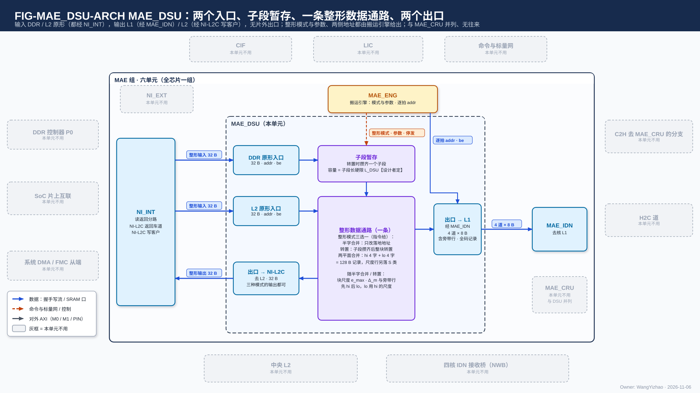
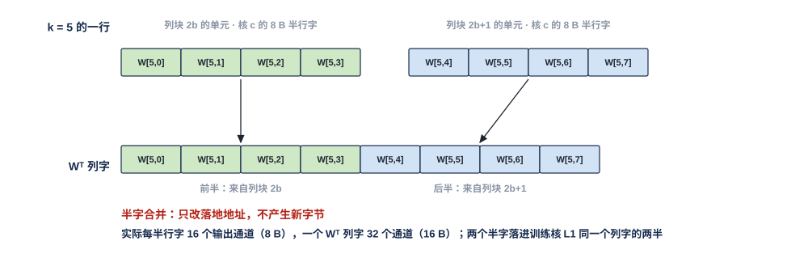
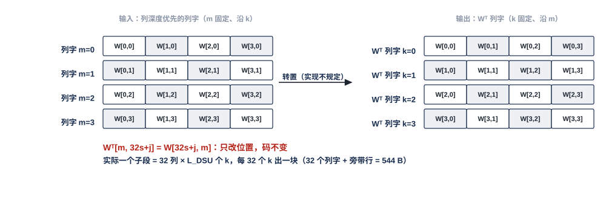
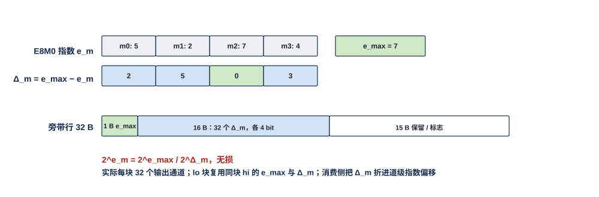

# MAE 数据整形单元（MAE_DSU）需求

> Owner: WangYizhao｜2026-11-06｜正式稿第二版（11-06 改名 MAE_DSU，加两平面合并），待用户审阅。第一版按用户 11-06 确认的目录（`../V17_3_MODULE_TOC_MAE_WSU_20261106.md`，W1–W3 已定）编写；第二版依据 `Claude_Design_Spec/V1.8_DESIGN_REVISIONS.md` V18-MAE-01…05、V18-ATT-01、V18-NAME-01 与任务书 `_build/MAE_TYPE_AGNOSTIC_BRIEF_20261106.md`，名称按 `L3PU_EXTERNAL_INFORMATION.md`（下称"外部输入信息篇"）。其余依据：`Claude_Design_Spec/V1.7_3/Modules/MAE_NI_INT.md` 的整形条款（NII-F-510…590、NII-R-170 / 180 / 210 / 220 / 280，冻结基线）、片上数据传输协议篇 `DATA_TRANSFER_PROTOCOL.md`（下称"协议篇"）、L1 正式稿、V1.8 的 V18-NII-03 及其 11-06 修订、V18-TP-25 / 27 / 36 / 37 / 38 / 41 / 42、V18-L1-09。与 V1.7_3 冲突处以 V1.8 为准。
> 11-06 深夜第二次（V18-TP-50）：**DSU 输出去 L1 / L2 时，接收方回的写入握手直接交执行该指令的搬运引擎，DSU 不计数、不判完成**（§1.2、§7、§11）。
> 11-06 晚修订（V18-MAE-11…18，任务书 `_build/MAE_CRU_MERGE_BRIEF_20261106.md`）：**CRU 并入 MAE 组（MAE_CRU），MAE 组六单元；MAE 只有搬运指令，运算字段经 MUX 选直通 / 经 MAE_DSU 整形 / 经 MAE_CRU 合并，DSU 与 CRU 并列、互不依赖；DSU 不设指令队列，整形模式与参数由执行该指令的搬运引擎随单位给出；双目的写成需求（§6.3）**（开头、§1.1、§2.1、§2.3、§6.3、§9、§10.2、§11）。§2 的连接图已换为 PPT 式架构图 FIG-MAE_DSU-ARCH（旧 CONN 退役）。只改词、句与必要的表行。
> 11-06 晚第二次（冲突项裁定，V18-MAE-19 / 25）：**整形模式三选一（半字合并 / 转置 / 两平面合并），"原样"即运算字段选"直通"；两平面合并的输出也可去 L2（兼容能力）；DSU 两侧每拍地址都由搬运引擎给出，进出每段都握手、由该引擎统一停发**（开头、§2.1、§4、§4.4、§6.2）。
> 11-06 深夜第三次（V18-TP-51 / NAME-04）：**撤 dest 信号，去哪个存储由发令方的通路选择决定（C2H 由本核 CCU 的 C2H 通道按发送指令的目标存储给 C2H 分流下通路选择，只在单位边界变）；地址不编码"是哪个存储"，addr 只是目的存储内部的位置；远端引擎回 MAE_ENG 的"发送完成"短消息改名"执行完成"**。

MAE_DSU 是 MAE 组六个单元之一，全芯片一个，也是 MAE 运算级的两个单元之一（另一个是合并单元 MAE_CRU，二者并列、互不依赖，V18-MAE-12）。**它按四种整形模式之一工作——半字合并、转置、块尺度与旁带、两平面合并（V18-MAE-05）；指令运算字段选"经 DSU"时，模式由指令的整形模式（半字合并 / 转置 / 两平面合并三选一；"原样"即运算字段选"直通"，V18-MAE-12）给出，不再由来源布局码派生（V18-MAE-03）**，块尺度与旁带随半字合并、转置一起做。前三种把前向形式存放的权重 $W$（$K \times M$，MXINT8 hi / lo 4 bit 平面 + E8M0 尺度，标准布局或列深度优先布局）整形成训练核消费的 $W^{\mathsf T}$ 列字块——32 个 16 B 列字加一个 32 B 旁带行，共 544 B——并算出每块的块尺度；两平面合并把同一 key（或同一列块）的 hi 平面列字与 lo 平面列字放进同一条记录的相邻地址，K、V 等非权重数据同样可用。输入可从 DDR（经 NI_INT 的读返回分路）或 L2（经 NI-L2C 返回车道）来，输出去 L1（经 MAE_IDN）或 L2（经 NI-L2C 写客户）。它是片上唯一改变权重字方向、做块内尺度计算的元件；只改位置与做精确的指数运算，不改字节值、不是量化点；只处理指令标为整形的那一份，原形那一份与其余数据不经过它。DDR 里只存前向形式的权重，反向不另存 $W^{\mathsf T}$（用户 11-06），所以没有片外出口。

## 1 组成与位置

### 1.1 位置

MAE 组 = MAE_ENG、NI_EXT、NI_INT、MAE_IDN、MAE_DSU、MAE_CRU（V18-NII-03 / 04、V18-MAE-11）。MAE_DSU 的上游是 NI_INT（读返回分路给 DDR 原形、NI-L2C 返回车道给 L2 原形），下游是 MAE_IDN（去核 L1）与 NI_INT 的 NI-L2C 写客户（去 L2，供之后经 H2C 多播）。**经 DSU 是 MAE 搬运指令运算级的一个选项**：MAE 只有搬运指令，指令的运算字段经 MUX 选直通 / 经 MAE_DSU 整形 / 经 MAE_CRU 合并，DSU 与 CRU 并列、没有依赖关系、一条指令只选其一（V18-MAE-12）；选经 DSU 时，执行该指令的 MAE 搬运引擎把数据经 DSU 送出，输入输出每拍的地址仍由这条搬运引擎给出（V18-MAE-03；ISA 影响 TP-ISA-8）。与 MAE 组外的连接经 MAE 组的对外口，口的划分见 MAE 集成篇 §3（`MAE_INTEGRATION.md`）。

把整形放在 MAE 组而不是各核，是因为同一份 DDR 读可以同时服务前向核（原形）与训练核（整形后），权重只读一次（D50 复用哲学）；独立成单元而不是藏在 NI_INT 里，是为了让它也能从 L2 取数、向 L2 输出——权重驻 L2 的位点不必再读 DDR，整好的 $W^{\mathsf T}$ 可以先存 L2 再多播，把约 427 拍的首块等待移出训练读的关键路径（用户 11-06）。两平面合并也放在这里，因为它是 MAE 组唯一与两个平面相关的动作（V18-MAE-04），MAE 搬运引擎本身不感知数据类型（V18-MAE-01）。

### 1.2 做什么、不做什么

| 做 | 不做（归谁） |
|---|---|
| 四种整形模式：半字合并、转置、块尺度与旁带、两平面合并（§3、§4、§5） | 不量化、不舍入：数字位只改位置，块尺度是精确的整数运算（§5） |
| 块尺度 $e_{\max}$、$\Delta_m$ 与旁带行 / 旁带表（§5） | 不生成地址：输入输出每拍 addr 由 MAE 搬运引擎给出（V18-TP-27、V18-MAE-03） |
| 先 hi 后 lo、尺度复用（§5.3） | 不缓冲整列、不判完成：DSU 输出去 L1 / L2 时，接收方写进 bank 时回的写入握手直接交执行该指令的搬运引擎，DSU 不计数（V18-TP-50） |
| 两平面合并：同一 key 的 hi 字、lo 字、尺度行落同一记录相邻地址（§4.3） | 两平面合并不做半字节交织、不算尺度（§4.3） |
| 进出口都是通用链路块实例（§6.4） | 不处理原形那一份与激活（它们不经 DSU）；K / V 只经两平面合并 |

### 1.3 术语

- **行字**：16 B，同一个 $k$ 下 32 个输出通道 $m$ 的 4 bit 码；标准布局的 DDR 单元里一行 32 B = 4 个 8 B 半行字（各 16 个输出通道）。
- **列字**：16 B，同一个 $m$ 下 32 个连续 $k$ 的 4 bit 码；列深度优先布局按列字存放。
- **$W^{\mathsf T}$ 列字**：训练核消费形态的一个字——$k$ 固定、沿 32 个输出通道展开（即 $W^{\mathsf T}$ 的一行 $m$ 方向的 32 个码），16 B；叶序为自然的输出通道序。
- **$W^{\mathsf T}$ 列字块**（现称训练块）：一个（32 个输出通道的段, K 组）的 32 个 $W^{\mathsf T}$ 列字 + 1 个 32 B 旁带行 = 544 B；L1 篇按块分 2 拍读（§4、L1 篇 §7.9）。
- **K 组**：32 个连续 $k$；**子段**：转置时一次攒齐再转置的 $k$ 范围，长 $L_{\text{DSU}}$，由指令给、不超过硬件硬限。
- **块尺度**：$e_{\max} = \max_m e_m$，$\Delta_m = e_{\max} - e_m$（4 bit）；**旁带行**：块最大值 1 B + 32 个 $\Delta_m$ 16 B + 标志，补到 32 B；**旁带表**：核级驻留侧取 W 的位点上按列块另出的一张表，每（32-$m$ 段, K 组）一项，每项一个 32 B 尺度行。
- **hi 平面列字 / lo 平面列字**（两平面合并用）：MXINT8 码 $c = 16h + \ell$ 拆成的两个 4 bit 平面中，同一 key（$S = QK^{\mathsf T}$ 里 $K^{\mathsf T}$ 的一列：key 固定、沿 head_dim 展开）的全部 hi 码 $h$ 或全部 lo 码 $\ell$；head_dim 128 时各 64 B。
- **全码记录**：两平面合并的输出，同一 key 的 hi 平面列字接 lo 平面列字组成的一条记录（平面分开，每个存储字仍是一个平面的 32 个 4 bit 码）；head_dim 128 时 64 B + 64 B = 128 B，落核 L1 的全码区；E8M0 尺度行不在记录内，落 S 类（L1 篇）。

## 2 数据从哪来、到哪去

MAE_DSU 有两个入口，都来自 NI_INT，各 32 B：DDR 原形入口接读返回分路，L2 原形入口接 NI-L2C 返回车道；一条指令只用其中一个。执行该指令的搬运引擎随单位给出整形模式与参数（子段长、是否双目的），也给出输出每拍的 addr / be；DSU 不设指令队列、不算地址。**图里只画要求存在的硬件：两个入口、子段暂存、一条整形数据通路、两个出口；四种整形不是四个模块，而是这条数据通路的模式**（用户 11-06 晚：架构图不要画成"每个功能例化一个模块"）。子段暂存只在转置时用，攒齐一个子段（子段长不超过硬限 $L_{\text{DSU}}$）；数据通路按指令在半字合并、转置、两平面合并（同一 key 的 hi 4 字接 lo 4 字成一条 128 B 记录，尺度行另落 S 类）三者中选一，块尺度与旁带随半字合并、转置一起做；"先 hi 后 lo"时 lo 复用 hi 的尺度。出口 → L1 经 MAE_IDN（4 道 × 8 B），送出 $W^{\mathsf T}$ 列字块、旁带行与全码记录；出口 → NI-L2C 经写客户写 L2（32 B），三种模式的输出都可走（两平面合并去 L2 是兼容能力）。进出 DSU 的每一段都是 ready 握手，任一段拉低时由执行该指令的搬运引擎统一停发。外圈全部画灰：DSU 没有对外口，没有片外出口，与 MAE_CRU 并列、没有往来。双目的时，原形那一份由 NI_INT 直接交 MAE_IDN、不经 DSU，所以不在本图。

### 2.1 MAE 组内的接口

| 接口 | 对端 | 方向 | 内容 |
|---|---|---|---|
| 整形模式与参数 | MAE_ENG（执行该指令的搬运引擎） | 入 | **DSU 收执行该指令的搬运引擎随单位给的整形模式与参数**：整形模式（半字合并 / 转置 / 两平面合并三选一；"原样"即指令运算字段取"直通"、数据不经 DSU，V18-MAE-12）、子段长 $L_{\text{DSU}}$（转置）、是否双目的（同一次读的原形是否同时投前向核，§6.3）；源（DDR 读返回 / L2 返回车道）与目的（L1 经 MAE_IDN / L2 经 NI-L2C）由指令的口对给出。DSU 不设指令队列（V18-MAE-12） |
| 整形输入 | NI_INT | 入 | 32 B/拍（读返回分路与 NI-L2C 返回车道同宽）的 hi / lo 4 bit 平面与 E8M0 尺度行，每拍带 addr（源地址，供分辨列块 / 子段 / 行号，或两平面合并的源段）、be；通用链路块实例 |
| 整形输出 → L1 | MAE_IDN | 出 | 半字合并 / 转置：$W^{\mathsf T}$ 列字块流，4 道 × 8 B，每拍带 MAE 搬运引擎给出的目的 addr（训练核 L1 的 W 类 / S 类逻辑地址）与 be，旁带行作为该块的一拍落 S 类；**两平面合并：K（或 V）的全码记录同样经 MAE_IDN 去核 L1 的全码区**，每拍目的 addr 同样由搬运引擎给出 |
| 整形输出 → L2 | NI_INT（NI-L2C 写客户） | 出 | 半字合并 / 转置 / 两平面合并的输出（两平面合并去 L2 是兼容能力，用户 11-06 "能"，V18-MAE-19），32 B/拍，目的 addr 为 L2 逻辑地址；供之后 MAE 经 H2C 多播给需要的核 |
| 输入输出每拍地址与停发 | MAE_ENG（执行该指令的搬运引擎） | 入 | **DSU 两侧每拍的 addr / be 都由该搬运引擎给出**；进 DSU（NI_INT → DSU）与出 DSU（DSU → MAE_IDN / NI-L2C）每段都是 ready 握手，任一段 ready 拉低时由该引擎统一停发（用户 11-06："DSU 和 CRU 的地址都交给 MAE-ENG 来确定……都需要反压设计，可以由 ENG 统一控制"，V18-MAE-25） |

### 2.2 经 MAE 组对外的接口

无。所有进出都经同组单元。

### 2.3 由别的模块保证的事项

| 事项 | 由谁保证 |
|---|---|
| **输入读序**：列尺度行 / 前置 E8M0 先于该块首个数字字到达；同一（列块, 子段）先 hi 后 lo；转置的一个列块在子段内连续到达；子段长 ≤ 硬限 | 编译链把读序折成指令的源地址与几何（V18-MAE-01）；MAE 搬运引擎按地址顺序发读，需保序的读用同一 AXI ID |
| 整形模式、是否双目的 | MAE 搬运指令（运算字段选经 DSU、整形模式字段、第二目的，V18-MAE-03 / 12 / 16） |
| 输出每拍 addr（列字块落训练核 W 类块区、旁带行落 S 类、旁带表落 S 类表区、全码记录落全码区；或 L2 地址） | 执行该指令的 MAE 搬运引擎（V18-TP-27、V18-MAE-03） |
| 两平面合并的两个源段（hi 平面、lo 平面、尺度行在 DDR 的地址）与记录内各字的落地地址 | 编译链折成指令的两端地址；MAE 搬运引擎逐拍给出 |
| 目的空间已读完、按份轮转 | 编译链（LIC 操作 15） |
| 训练位点权重在 DDR 的布局（标准 / 列深度优先），即指令里填半字合并还是转置 | 编译链 / 数据组织篇 |
| 精算 K hi 用驻留还是重读（重读时才用两平面合并） | 位点配置（V18-ATT-01）；CCU 指令 |
| 单位不交错（DSU 输出与 NI 分路在 MAE_IDN 同一道上按单位轮流） | MAE_IDN 的合并仲裁（V18-TP-36） |
| 旁带行 / 旁带表的字节编排、L1 段读口分 2 拍读块；全码区的位置与记录间距 | 数据组织篇、L1 篇 |
| 消费侧按 $\Delta_m$ 折进道级指数偏移；精算 pass 按 $c = 16h + \ell$ 合成 hi、lo 两条列道 | MXU_AFU、CCU_RTR；MXU 篇 |

## 3 变换总表

| 变换 | 按矩阵维度说做什么 | 输入格式 | 输出格式 | 吞吐 | 典型用途 |
|---|---|---|---|---|---|
| 半字合并（原"拼接直通"） | 把 $W$ 标准布局里同一 $k$ 下相邻两个列块（各 16 个输出通道）的两个 8 B 半行字落进同一个 $k$ 固定、32 个输出通道的 16 B $W^{\mathsf T}$ 列字；只改落地地址，不产生新字节 | 标准布局 1 KB 单元（32 行 × 32 B，前置 64 个 E8M0） | $W^{\mathsf T}$ 列字块 544 B | 随输入流，每拍 32 B，块尺度流水 ≤ 8 拍（参考值） | q / k / v、o、down 的 hi 与 lo，不做核间 K 切分的 gate hi，fc、kernel_projection，LM Head hi |
| 转置 | 把列深度优先布局里一个列块 32 个输出通道的一个子段（每列 $L_{\text{DSU}}$ 个 $k$）攒齐后，按 $W^{\mathsf T}_{m,\,32s+j} = W_{32s+j,\,m}$ 转成 $k$ 固定、沿 32 个输出通道的列字 | 列深度优先布局（列字 16 B：$m$ 固定、32 个 $k$；列尺度向量先到） | 同上 | 每拍至多出一块 544 B；首块等一个子段攒齐 | up hi、gate / up lo、核间 K 切分模型的 32 行段轮转平面、dH 的 S 列 |
| 块尺度与旁带 | 对每块 32 个 E8M0 算 $e_{\max}$ 与 32 个 $\Delta_m$，打成 32 B 旁带行；核级驻留侧取 W 时另出旁带表 | 32 个 E8M0 | 32 B 旁带行 / 每（段, K 组）一个 32 B 表项 | 与块同吞吐 | 半字合并、转置都用 |
| 两平面合并 | 同一 key（$K^{\mathsf T}$ 的一列，沿 head_dim）或同一列块的 hi 平面列字与 lo 平面列字从 DDR 两处读出，放进同一条记录的相邻地址（平面分开：hi 的 4 个字接 lo 的 4 个字）；尺度行另落 S 类；不做半字节交织 | 同一 key 的 hi 平面列字、lo 平面列字（head_dim 128 时各 64 B） | 全码记录：hi 字 + lo 字，128 B（4 + 4 个存储字） | 随输入流，每拍 32 B；不缓冲整列 | 精算重读模式的录取 key 全码记录（V18-ATT-01）；两平面权重的训练读也可用 |
| 原样 | 不经 DSU（指令运算字段 = 直通） | — | — | — | 训练关闭、不参与训练的平面、LSC、LoRA 副本；精算驻留模式下的 K lo 补读 |

四种变换都在 MXU 与 DDR 共同依赖的码与尺度定义之内——只改位置，或做无损的指数运算——所以**输出必须与软件参照逐位一致，格式合同不放开**（§8）。

## 4 四种整形模式，由指令的整形模式字段给出

**整形模式只由指令给出，不按数据类型、dX 份额或切分轴派生；训练核收到的权重只有 $W^{\mathsf T}$ 列字块一种形态**（GRAD-UNI，V1.6；现行保留）。指令运算字段选"经 DSU"时，整形模式取半字合并、转置、两平面合并三者之一；"原样"即运算字段取"直通"、数据不经 DSU（运算字段经 MUX 选直通 / DSU / CRU，V18-MAE-12）；块尺度与旁带（§5）不单独占一个值，随半字合并、转置自动进行。

### 4.1 半字合并：标准布局 → $W^{\mathsf T}$ 列字，地址级完成

一个 1 KB 标准布局单元 = 一个平面同一 K 组的 32 行（$k$），每行 32 B = 4 个 8 B 半行字（各 16 个输出通道在该 $k$ 下的码，对应 4 核各一份）；单元前置 64 B = 64 个 E8M0（4 × 16 个输出通道，挂 hi 平面；lo 单元无前置，复用 hi 的块尺度）。

**DSU 用前置的 E8M0 在数字字到达之前算出块尺度与旁带行；对训练核那一份的每个半行字，把同一核、同一 $k$ 下相邻两个列块的两个 8 B 半行字落进同一个 16 B $W^{\mathsf T}$ 列字的两半**，叶序为自然的输出通道序。这一步只是给出落地地址，不产生新字节；有前向核同读时，训练核那一份与前向核那一份是同一批字节、经 MAE_IDN 分别送到（§6.3）。块尺度流水时延【设计者定】（参考 ≤ 8 拍）；因为合并不暂存，首块没有子段等待。

图中取 $k = 5$ 的一行：列块 $2b$ 的单元里核 $c$ 的 8 B 半行字装输出通道 $m_0 \ldots m_{15}$，列块 $2b+1$ 的单元里核 $c$ 的半行字装 $m_{16} \ldots m_{31}$；两者落进训练核 L1 同一个 16 B $W^{\mathsf T}$ 列字的前半与后半，字内按输出通道序。图按每半字 4 个通道缩画，实际每半字 16 个通道、每字 32 个；脚本断言合并出的 32 个码与两个半字按序相同。

### 4.2 转置：列深度优先布局 → $W^{\mathsf T}$ 列字，攒齐一个子段整块转置

列深度优先布局按列字存放（一个列字 = $m$ 固定、32 个连续 $k$），训练核要的是 $k$ 固定、沿 $m$ 的列字，两者相差一个 32 × 32 的半字节转置。**DSU 把一个列块（32 个输出通道）的一个子段攒齐后整块转置**：

$$W^{\mathsf T}_{m,\ 32s + j} = W_{32s + j,\ m},\qquad 0 \le j, m < 32,$$

$s$ 为子段内 K 组号；输出列字 $j$ 即 $k = 32s + j$ 固定、沿 32 个输出通道展开，各叶相对块最大值的指数差由旁带给出。

- **子段长 $L_{\text{DSU}}$ 是硬件硬限【设计者定】**（参考 512 个 $k$），实际值随指令给出、不超过硬限；$K_t$ 分块须是 $L_{\text{DSU}}$ 的整数倍（编译链）；暂存须覆盖硬限。
- **到达次序由编译链排定、MAE 搬运引擎按指令地址发读**：核级驻留侧取 A 时为三层顺序（$m$ 组 → $K_t$ 分块 → 组内各列块的该 $K_t$ 段），一个列块在本 $K_t$ 分块内按长 $L_{\text{DSU}}$ 的子段连续到达；取 W 时为列块读序，同一 32 列在本列块的 $k_{\text{blk}}$ 个 $k$ 上连续到达，子段长取 $\min(k_{\text{blk}}, L_{\text{DSU}})$。
- **吞吐与首块时延**：每拍至多读出、转置一个 544 B 的块；首块要等一个子段攒齐——$L_{\text{DSU}} = 512$、只读 hi 时 32 列 × 512 个 $k$ × 4 bit = 8 KB，按参考工况 19.2 B/拍约 427 拍（推导值）。这段时延只在接收 $W^{\mathsf T}$ 的训练核一侧暴露，前向核那一份不等（§7）。
- 暂存的组织（skew 写入、去 skew、半字节转置布线）是参考实现，归设计者；参考规模约 22 KB 暂存、约 30 k 门。

**转置必须保留**（用户 11-06）：up / gate 等按列深度优先存放的平面只有这条路能得到 $W^{\mathsf T}$ 形态。

图中输入是 4 个列字（$m = 0 \ldots 3$，每个装 $k = 0 \ldots 3$ 的码 $W_{k,m}$），攒齐后转成 4 个 $W^{\mathsf T}$ 列字（$k = 0 \ldots 3$，每个装 $m = 0 \ldots 3$ 的码）；实际一个子段是 32 列 × $L_{\text{DSU}}$ 个 $k$，每 32 个 $k$ 出一块。脚本断言输出字 $j$ 的第 $m$ 个码等于输入字 $m$ 的第 $j$ 个码。

### 4.3 两平面合并：DDR 两处的 hi 字与 lo 字 → 同一记录相邻地址

**输入**：同一 key（或同一列块）的 hi 4 bit 平面列字与 lo 4 bit 平面列字，来自 DDR 两处——两段 gather，或同一指令的两个源段。以 head_dim 128 的 K 为例：hi 平面列字 = 该 key 128 个 head_dim 维的 hi 码 $h$，4 个存储字 64 B；lo 平面列字 = 同样 128 个 lo 码 $\ell$，4 个存储字 64 B。该 key 的 E8M0 尺度行（128 / 32 = 4 个 E8M0）另读、不进这条记录。

**输出（平面分开的记录级）**：同一条记录里相邻地址的 hi 字接 lo 字——**数据 = hi 的 4 个存储字 + lo 的 4 个存储字 = 128 B，每个存储字仍是一个平面的 32 个 4 bit 码，排列与只有 4 bit 的平面完全相同，只是一个 key 占两倍的字；E8M0 尺度不进记录，按 L1 现行落 S 类的尺度行（粗算与精算共用同一组）**（用户 11-06："还是和只有 4bit 一样的存储排列就可以了，E8M0 单独存 S"；"我需要平面分开的记录级策略"）。记录经 MAE_IDN 落核 L1 的全码区，128 B 天然 32 B 对齐。**不做半字节交织，也不按 8 bit 逐元素打包：字节值不变，只改落地地址。** MXU 阵列只吃 4 bit 数字字，8 bit 打包要在供数口拆回，所以只做记录级合并（V18-MAE-04）。

**数值含义**：MXU 精算 pass 把同一记录里的 hi 字与 lo 字当作两条列道、用同一尺度，按 $c = 16h + \ell$ 合成，数值等价 MXINT8：

$$q \cdot x = (16h + \ell) \cdot 2^{e} \cdot q = 16\,(q\,h)\,2^{e} + (q\,\ell)\,2^{e},$$

$e$ 为该元素所在 32 元素组的 E8M0 指数；hi、lo 两条列道如何合成归 MXU 篇。

**地址与分工**：

- **地址由 MAE 搬运引擎逐拍给出**：源端两段（hi 平面一处、lo 平面一处）与目的端记录内各字的地址都由编译链折进指令的两端地址生成器，DSU 不算地址；尺度行是同一条指令里去 S 类的另一段。
- **DSU 做什么【设计者定】**：把两个源段的字按 key 对齐后交替送出，或只按搬运引擎给的地址把字落位（DSU 只做通路）。要定的是用哪种做法；**约束是输出顺序与地址由搬运引擎定、DSU 不缓冲整列**（暂存至多覆盖链路块的 skid 与对齐所需的几拍）。
- 不算尺度、不重发尺度：尺度行原样送 S 类。
- 记录 128 B = 4 个存储字 hi + 4 个存储字 lo，起点与各字都 32 B 对齐（V18-TP-25），不需要补齐；记录间距由指令目的地址给出（参考 128 B，紧排）。

**用途**：

- **精算重读模式的录取 key 全码记录**（V18-ATT-01）：长上下文默认重读，SEL 录取后由列表驱动的 gather 一次读出每个录取 key 的 hi + lo + 尺度，经两平面合并落全码区；补读 gather 的项字节数可配（重读：hi + lo 128 B，尺度另段去 S 类；驻留模式只读 lo，原样落位，不经 DSU）。
- **两平面权重的训练读也可用**：需要 hi、lo 同记录的训练位点同样可以选两平面合并；默认的训练读仍走半字合并 / 转置。
- V 的两平面同样可用（V18-MAE-05：与权重无关的数据同样可用）。

图中 DDR 里 key 7 的 hi 平面列字在地址 A、lo 平面列字在地址 B（各按 4 个码缩画），尺度在地址 C；合并后 hi 字与 lo 字相邻落进 L1 全码区同一条记录，尺度行另落 S 类。图下给出每个码的字节值，合并前后相同、只改地址。实际 head_dim 128：记录 = 64 B + 64 B = 128 B（4 + 4 个存储字），尺度 4 B 在 S 类。脚本断言每个码的字节值合并前后不变、记录内 hi → lo 相邻无空隙、尺度不在记录内。

### 4.4 原样：不经 DSU

指令运算字段 = 直通时数据不经 DSU，按原样落位：训练关闭、该平面不参与训练、LSC 副本、OPT 执行核不是前向核时经双写落两核 L1 的 LoRA 副本；精算驻留模式下只读 K lo 的补读。

## 5 块尺度与旁带

### 5.1 块尺度：$e_{\max}$ 与 $\Delta_m$，整数运算无损

**对每块（32 个输出通道的段, K 组）的 32 个 E8M0 指数 $e_0 \ldots e_{31}$，DSU 现算块最大值 $e_{\max} = \max_m e_m$ 与 32 个叶的指数差 $\Delta_m = e_{\max} - e_m$（4 bit 字段）**；E8M0 的来源：标准布局取单元前置 64 个中属于本块 32 个输出通道的 32 个；列深度优先取该列块列尺度向量中该 K 组的 32 个。块内不置换、不分段；核内没有对应的块尺度引擎。$\Delta_m$ 超出 4 bit 字段时的表示与 EXP-FOLD 偏移基准的上限【设计者定】——要定的是饱和还是分级，约束是消费侧（MXU_AFU 的道级指数偏移）用同一规则还原。

这一步是无损的：$2^{e_m} = 2^{e_{\max}} \cdot 2^{-\Delta_m}$ 恒等成立，消费侧把 $\Delta_m$ 折进道级偏移后，数值与按原尺度计算逐位相同。

图中 4 个输出通道的 E8M0 指数 5、2、7、4 → $e_{\max} = 7$，$\Delta = (2, 5, 0, 3)$；旁带行的字节编排：块最大值 1 B、32 个 $\Delta_m$ 各 4 bit 共 16 B、其余保留，补到 32 B。实际每块 32 个通道。脚本断言 $2^{e_m} = 2^{e_{\max}} / 2^{\Delta_m}$ 对每个通道成立。

### 5.2 旁带行与旁带表

- **旁带行**只有一种格式：块最大值 E8M0 1 B + 32 个 $\Delta_m$ 各 4 bit 共 16 B + 标志，其余字节保留（位序与编码随 ISA 定）。**它作为该块的附带项（32 B/块）随块送出**，落训练核 S 类作该块的尺度行；L1 段读口分 2 拍读块时块最大值与 $\Delta_m$ 随 32 个列字读出，所有收方 pod 都从这里取，不另设旁带区。附带项约占训练核所收字节的 $32 / 544 \approx 6\%$。
- **旁带表**（核级驻留侧取 W 的训练位点）：$W^{\mathsf T}$ 列块驻 L1 块区、各 pod 按需挑 $k$ 时，按列读出的列字拼不出随块旁带行，所以 DSU 在定形列块时按列块另出一份旁带表，随列块落训练核 S 类的表区：每（32-$m$ 段, K 组）一项，每项一个 32 B 尺度行，内容与随块旁带行逐位相同；表的位置与长度由指令给，与列块双缓冲同份轮换；lo 复用 hi 的表项。消费侧一个 pass 至多 2 个 K 组，每条列道按列掩码表的 K 组位从两套旁带里二选一（MXU_AFU、CCU_RTR 篇）。

### 5.3 先 hi 后 lo，尺度复用

**训练读全码（反传读 lo）时，同一（列块, 子段）先处理 hi、再处理 lo；lo 平面不带尺度，lo 块使用的块最大值、$\Delta_m$ 与旁带行必须与同块 hi 逐位相同**（同一码 $c = 16h + \ell$ 的两个平面共用一组尺度），由 DSU 重发。缓存、重算还是从 L1 回读【设计者定】——要定的是 hi 的 32 个 E8M0（或算好的 $e_{\max}$、$\Delta_m$）在 lo 到达前放在哪，约束是容量覆盖一个（列块, 子段）、逐位一致。只读 hi 的反传不读、不处理 lo；lo 可按梯度掩码只读列表上的部分。本节只适用于半字合并与转置；两平面合并不算尺度（§4.3）。

### 5.4 dH 的 S 列

LM Head 权重 $W$ 为 hidden × vocab、词表项是列；dH 要的是它的 $W^{\mathsf T}$ 方向。MAE 搬运引擎以列表驱动的源地址按（32 列块, 子段）两层展开 gather 来的 S 列（每列每子段一次读，$L_{\text{DSU}} = 512$ 时 256 B 数字；该列块的列尺度向量在首个子段前读入），DSU 对它做转置，送指令目的核集合给出的 dH 执行核、落其块区，旁带行作该块的尺度行；S 列只有这一份，不投前向核。

## 6 输入与输出

**各模式的来源与去向**：

| 模式 | 来源 | 去向 |
|---|---|---|
| 半字合并 | DDR 或 L2 的标准布局单元 | 训练核 L1（W 类块区 + S 类）或 L2 |
| 转置 | DDR 或 L2 的列深度优先列字（含 dH 的 S 列） | 训练核 L1（W 类块区 + S 类）或 L2 |
| 块尺度与旁带 | 随上两行的 E8M0 | 随上两行（旁带行、旁带表落 S 类） |
| 两平面合并 | K hi / K lo 两源（DDR 两处，同一 key；V 同理） | 核 L1 全码区（经 MAE_IDN） |

### 6.1 两个输入源

| 源 | 经 | 数据 |
|---|---|---|
| DDR 原形 | NI_INT 读返回分路 | 标准布局或列深度优先布局的 hi / lo 平面与尺度，32 B/拍；两平面合并时为同一 key 的 hi 平面列字、lo 平面列字与尺度行（DDR 两处） |
| L2 原形 | NI_INT 的 NI-L2C 返回车道 | 同上（半字合并、转置）；权重驻 L2 的位点不必再读 DDR（V18-NII-03） |

两源不同时用（一条指令一个源口；两平面合并的两个源段同在 DDR）。

### 6.2 两个输出宿

| 宿 | 经 | 数据 | 之后 |
|---|---|---|---|
| 训练核 L1 | MAE_IDN（4 道 × 8 B） | $W^{\mathsf T}$ 列字块流：32 个列字落 W 类块区、旁带行落 S 类、旁带表落 S 类表区 | 训练核按 GRAD-UNI 消费 |
| 核 L1 全码区 | MAE_IDN（4 道 × 8 B） | 两平面合并的全码记录（hi 字 + lo 字 + 尺度行） | 精算 pass 读 hi、lo 两条列道 |
| L2 | NI_INT 的 NI-L2C 写客户（32 B/拍） | 半字合并 / 转置的输出，以及两平面合并的全码记录（兼容能力，V18-MAE-19），落 L2 逻辑地址 | MAE 之后经 H2C 多播给需要的核 |

**输出每拍 addr 由执行该指令的 MAE 搬运引擎逐拍给出，DSU 按固定顺序出块（半字合并 / 转置：列字 $0 \ldots 31$、旁带行；两平面合并：hi 字、lo 字、尺度行）、不算地址**（V18-TP-27、V18-MAE-03）；去 L1 还是 L2 由引擎的通路选择决定（V18-TP-51）。没有片外出口：DDR 只存前向形式的权重（用户 11-06）。

### 6.3 双目的（需求）：一次 DDR 读同时投原形与整形两份

**一条搬运指令可带第二目的：一次 DDR 读同时投原形一份（经 MAE_IDN 给前向核）与整形一份（经 MAE_DSU 给训练核 L1 或 L2），权重只读一次；这是必须支持的需求**（用户 11-06："必须保留，这要直接写成需求"，V18-MAE-16）。

原形那一份不经 DSU、直接由 NI_INT 交 MAE_IDN 送前向核；DSU 的输出是同一次 DDR 读的**第二份字节**，去 L1 时经 MAE_IDN 送该 K 组的属主训练核，去 L2 时经 NI-L2C 写客户。两份都经 MAE_IDN 时，MAE_IDN 的道合计 32 B/拍，两份字节之和超过时只降速（第二份比例 $\rho \le 2/3$、含旁带约 0.6 为参考值，归数据流篇）。没有前向核同读时（独立训练、只为训练读的平面、dH 的 S 列、两平面合并）只有 DSU 这一份。

### 6.4 通用链路块与停发

DSU 的两个入口、两个出口都是协议篇 §5.3.2 通用链路块的实例（en / ready / addr / be / din / `src`；skid 深度与流水级数为例化参数【设计者定】）。**DSU 暂存满时对上游拉低 ready**，NI_INT 分路随之停住、经 NI_EXT 拉低 M0 的 RREADY（或 NI-L2C 返回车道停发读）；只降速、不丢数、不报错。下游（MAE_IDN、NI-L2C 写客户）拉低 ready 时 DSU 保持当前拍。

## 7 时序关系

1. **块尺度先于数字**：标准布局由单元前置的 64 B 尺度满足；列深度优先由 MAE 搬运引擎在每个列块的首个子段前读入该列块的列尺度行（同一次读在 NI_INT 同时交 DSU 与前向核：DSU 算块尺度，前向核把它作尺度行写 S 类）。
2. **旁带先于该块首字到达接收核**：旁带行作为块的附带项与块同送，接收核 NWB 先落尺度行。
3. **lo 晚于同块 hi**（半字合并、转置）：复用的尺度已由 hi 算出 / 写入。
4. **两平面合并不要求同一记录内 hi 字、lo 字、尺度行的到达先后**：落地地址由搬运引擎逐拍给出；搬运引擎数接收方回来的写入握手判本指令写完（核间规则），目的核 CCU 用核内写计数判断能否消费（V18-TP-37 / 50）。
5. **原形那一份不等 DSU**：暂存时延只在接收 $W^{\mathsf T}$ 的训练核一侧暴露；前向核只在 $K_t$ 边界停放，分块内各子段的到达次序不影响前向累加。
6. 整形模式与参数在指令边界切换；模型级配置在调用开始采样。

## 8 不得破坏的合同

- **输出与软件参照逐位一致**：半字合并不产生新字节；转置只改位置；两平面合并不改字节值、不做半字节交织；块尺度与旁带是无损整数运算。
- **输出字节只由整形模式字段与指令决定，与接收核内 pod 分工无关**；每个权重元素只存一份、只送一份。
- **原形宿收到的数据与不经 DSU 时完全相同**。
- **hi / lo 两块的块最大值、$\Delta_m$ 与旁带行逐位相同**（半字合并、转置）。
- 不改任何数据位以外的内容；不改激活与其他不经 DSU 的数据；K / V 经两平面合并时只改落地地址。

## 9 计数与复位

不上报计数；不做错误检查；复位清暂存、列尺度缓存与旁带缓存（DSU 不设指令队列，§2.1）；缓存按（列块, 子段）用完即无效；没有跨调用驻留的状态。

## 10 要求值与验收

### 10.1 要求值

| 项 | 值 | 性质与依据 |
|---|---|---|
| 吞吐 | 每拍至多读出、转置一个 $W^{\mathsf T}$ 列字块（544 B）；输入 ≤ 32 B/拍、输出 ≤ 32 B/拍 | 要求值；一块经 MAE_IDN 送训练核需 $544 / 32 = 17$ 拍，DSU 不是瓶颈 |
| 两平面合并吞吐 | 随输入流，每拍 32 B；一条 128 B 记录 4 拍（参考） | 要求值：DSU 不成为录取 key 重读的瓶颈 |
| 转置首块时延 | 等一个子段攒齐：$L_{\text{DSU}} = 512$、只读 hi 时 8 KB，19.2 B/拍约 427 拍 | 推导值（参考工况） |
| 半字合并块尺度流水 | ≤ 8 拍 | 参考值【设计者定】 |
| 子段长硬限 $L_{\text{DSU}}$ | 【设计者定】（参考 512）；暂存覆盖硬限 | 要定的是硬限与暂存容量，约束是 $K_t$ 为其整数倍 |
| 暂存与门数 | 约 22 KB 暂存（随 $L_{\text{DSU}}$ 上限）、去错位约 30 k 门、旁带打包 5–10 k 门，NAND2 等效；两平面合并不加整列暂存 | 建议值【设计者定】 |
| 旁带开销 | 32 B/块 ≈ 6% | 推导值 |

### 10.2 验收

| 项 | 方法 | 判据 |
|---|---|---|
| 四种模式 | 逐位比对 | 半字合并 / 转置的输出列字与旁带行、旁带表与软件参照逐位相同；两平面合并记录的每个字节与 DDR 源字节相同、位置符合搬运引擎给的地址 |
| 原形不变 | 逐位比对 | 原形宿收到的字节与不经 DSU 时相同 |
| hi / lo | 逐位比对 | 两块旁带相同；lo 不重复计算尺度 |
| 两平面合并数值 | 软件参照 | 精算 pass 用全码记录的结果与按 MXINT8 直接计算逐位相同 |
| 双目的 | 周期仿真 | 两份字节各自正确、DDR 只读一次；超 32 B/拍只降速 |
| 两源两宿 | 周期仿真 | DDR / L2 进、L1 / L2 出四种组合结果相同 |
| 时延无关 | 随机化流水级数与 ready | 逐位一致、不丢拍、不重复（协议篇 §5.3.2） |
| 暂存满 | 随机停发 | 对上游拉低 ready，不丢数 |

## 11 为什么

- **一次 DDR 读同时服务前向核与训练核**（D50，复用哲学）：权重只读一次，训练核的形态差异在 DSU 一处解决。
- **独立成功能模块、两源两宿**（用户 11-06："权重整形必然需要，但是我认为可以调整下它的位置……可以接受 DDR 来的数据，也可以接收从 L2 SRAM 来的数据"）：L2 进避免训练核再读 DDR，L2 出把首块等待移出关键路径。
- **改名 MAE_DSU、四模式一张总表**（V18-MAE-05，用户 11-06："由于 WSU 不止做转置，你可以重新评估他的命名"）：它服务的已不只是权重，K、V 同样可用。
- **整形是指令选项，模式由 2 bit 字段给**（V18-MAE-03，用户 11-06："MAE 不需要感知它发的是什么数据，它只需要支持一些数据传输模式，然后从不同的来源传输到不同的目的即可，有的情况下需要经过 WSU 的处理，处理完后再发往目标地址"）：撤来源布局码后，DSU 不从数据类型推模式。
- **两平面合并归 DSU、做记录级**（V18-MAE-04，用户 11-06："而对于 MAE 本身，我认为它唯一支持的，就是读取 DDR 的两块数据，然后给它拼成 8bit，这里可以合并在 WSU 的功能里"；"我建议改成记录级整合"）：MXU 阵列只吃 4 bit 数字字，半字节交织还要在供数口拆回；记录级合并只改地址。
- **精算 K hi 支持重读**（V18-ATT-01，用户 11-06："如果不重读，默认 K 的 hi 4bit 驻留的话，L1 SRAM 在长上下文情况存不下"；"可以改成对 MXU，CCU，MAE 模块都提出这个要求，可以支持驻留，也可以支持重读"）：重读模式下录取 key 的 hi + lo + 尺度经两平面合并一次落全码区。
- **没有片外出口**（用户 11-06："DDR 中理论上只有为前向准备的局部，反向不会再额外存一份权重"）。
- **转置必须保留**（用户 11-06）。
- **方向只在 DSU 换一次、块尺度集中在 DSU**（现）：各核 L1 只按地址落位、段读口不旋转不转置，pod 按固定导线取字。
- **GRAD-UNI 训练核只收一种形态**（V1.6）。
- **地址归 MAE 搬运引擎、完成归搬运引擎数写入握手、进出口是通用链路块**（V18-TP-27 / 37 / 38 / 50、V18-MAE-03）：DSU 只是途中一级，不是发令方，也不是接收方。
- **子段长硬限交设计者**（用户 11-02 第 12 项）。
- **DSU 与 MAE_CRU 并列、由运算字段经 MUX 选择**（V18-MAE-11 / 12，用户 11-06："我认为可以选择一个 MUX，决定数据要不要过 CRU 还是直接传，我认为 DSU 也是一样的，DSU 和 CRU 可以是并行的，因为他们没有依赖关系"）：MAE 只有搬运指令，整形是运算级的一路，DSU 因此不设自己的指令队列。
- **双目的是需求**（V18-MAE-16，用户 11-06："必须保留，这要直接写成需求"）。
- 本篇各项细节按"非 MXU 模块只要求符合协议篇且能实现"交设计者（V1.8 §3）。
- 被否方案各一句：KRU、NI-FORK、NI 内置整形、预整形存片外；两平面合并做半字节交织（交织后供数口还要拆回，V18-MAE-04）。
