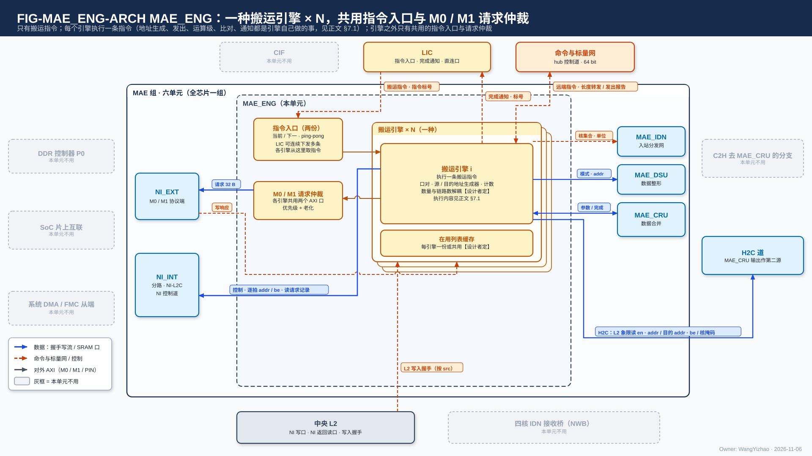
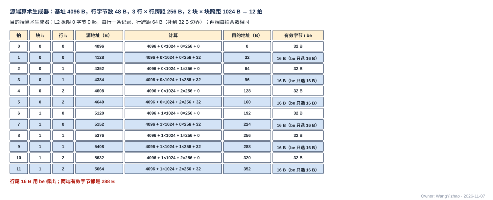
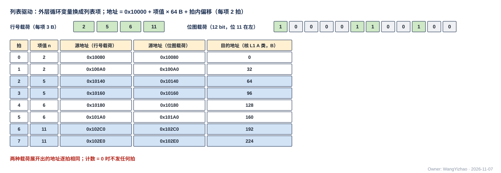
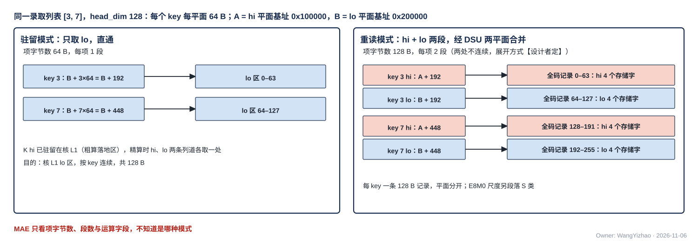
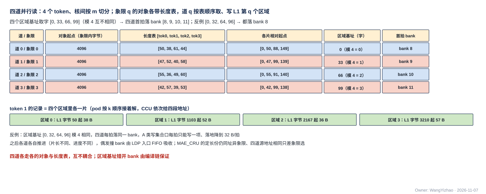
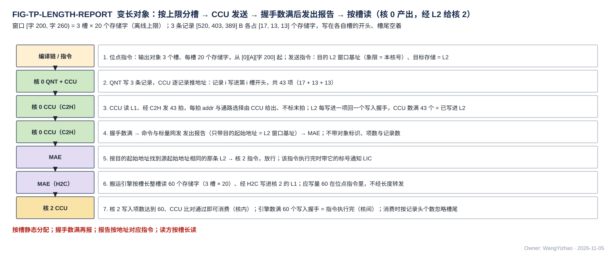

# MAE 搬运引擎与指令执行（MAE_ENG）需求

> Owner: WangYizhao｜2026-11-06｜正式稿第一版，待用户审阅。按用户 11-06 晚逐条确认的目录（`../V17_3_MODULE_TOC_MAE_ENG_20261106.md` 第四版，ME1–ME15 与冲突项 K1–K7 / Q1–Q9 全部关闭）编写；依据 `Claude_Design_Spec/V1.8_DESIGN_REVISIONS.md` V18-MAE-01…26（含 MAE-02 措辞、MAE-06 修订、MAE-14 修订）、V18-ATT-01、V18-NAME-01、V18-LIC-01、V18-KV-01、V18-NII-01…08、V18-NIE-02、V18-TP-26…46、V18-CRU-02；正式稿片上数据传输协议篇 `DATA_TRANSFER_PROTOCOL.md`（下称"协议篇"）、外部输入信息篇 `L3PU_EXTERNAL_INFORMATION.md`、MAE_NI_EXT / NI_INT / IDN / DSU、L1_SRAM、L2_SRAM。`Claude_Design_Spec/V1.7_3/Modules/MAE_ENG.md` 只作参考（V18-MAE-07），按数据类型写的条款不继承。图件登记 `_build/FIGURE_REGISTRY_MAE_ENG.md`。
>
> 11-06 深夜第二次（V18-TP-50 / MAE-30）：**写入完成只分核内、核间两类；核间统一为"写入握手 + 发令方计数"（握手来自 AXI 写响应通道 B 的做法）——目的为核 L1 的指令，"执行完"由"发送完成"改为本引擎数满 L1 回来的握手（H2C 落地经 H2C 道回、IDN 落地经 MAE_IDN 回，多播按目的核数倍计），LIC 直连口同样；目的核 CCU 仍按核内写计数判断能否消费**（§1.2、§2.2、§3.4、§4.2、§7.1、§10.2、§14.2）。用户 11-06："我就希望最多分出来一个核间一个核内，核内走我给你的参考设计，核间统一走一个协议"；"这个协议我完全认可"。
> 11-06 深夜（V18-L2-04、V18-TP-47…49、V18-MAE-28 / 30、V18-NAME-03）：**MAE_CRU 按条目计到达份数、合并完成报 MAE_ENG；新增 §5.9 象限并存数据的读时合并（一条指令四道并行）与写时拆分，新图 FIG-MAE_ENG-QSPLICE；写 L2 的完成改为引擎数写入握手（按发令号），撤 L2 写计数的累计目标值比对与 MAE 装 L2 优先级表；发出报告只带目的起始地址、变长对象按槽读**（§1、§2、§3.1–§3.2、§3.5、§4.2、§6.4、§7.1、§8.5、§10、§11、§13–§15）。
> 11-06 深夜第三次（V18-TP-51 / NAME-04）：**撤 dest 信号，去哪个存储由发令方的通路选择决定（C2H 由本核 CCU 的 C2H 通道按发送指令的目标存储给 C2H 分流下通路选择，只在单位边界变）；地址不编码"是哪个存储"，addr 只是目的存储内部的位置；远端引擎回 MAE_ENG 的"发送完成"短消息改名"执行完成"**。

MAE_ENG 是 MAE 组六个单元之一，全芯片一个。**它接收 LIC 下发的搬运指令（可同时多条），把每条指令交给一个搬运引擎；搬运引擎按"口对 + 两端地址生成器 + 几何"逐拍产生源地址与目的地址，经 NI_EXT、NI_INT、MAE_IDN、H2C 道把数据从一个存储的某个区域搬到另一个存储的某个区域，途中按指令选直通、经 MAE_DSU 整形或经 MAE_CRU 合并；判断数据已写进目的地后（L2 数写入握手、MAE_CRU 按 CRU 内地址数到达份数、片外数 AXI 写响应），带指令标号通知 LIC。** MAE 不感知数据类型（用户 11-06："MAE 无需感知数据类型，它要做的只是把数据从某个指令规范的存储的某个区域，写到某个指令规范的存储的某个区域"，V18-MAE-01）。

## 1 组成与位置

### 1.1 一种搬运引擎完成全部工作，引擎之外只有共用资源

**MAE_ENG 的主体是 N 个同一种的搬运引擎；执行一条指令要做的全部事情——地址生成、发请求与给每拍地址、选运算级与停发、计数与比对、通知 LIC——都是这个引擎自己做的（§7.1），不是另外的模块。** 引擎之外只有几个引擎共用的资源：

| 部件 | 为什么存在 |
|---|---|
| 搬运引擎 × N | 每个引擎执行一条指令（§7）；数量【设计者定】 |
| 指令入口（两份，ping-pong） | 所有引擎从这里取指令；LIC 可连续下发、可预存下一条（§3.5） |
| M0 / M1 请求仲裁 | 多个引擎共用两个 AXI 口，按优先级 + 老化选（§8） |
| 在用列表缓存 | 引擎按列表出地址时的本地副本；每引擎一份还是共用【设计者定】（§6.3） |

物理怎样划分【设计者定】；约束是对外接口（§2）与本篇的行为要求不变。

### 1.2 做什么、不做什么

| 做 | 不做（归谁） |
|---|---|
| 执行搬运指令；是全部 DDR / 共享内存请求的唯一生成者 | **不感知数据类型**：没有布局码、精度码、按类型命名的操作（V18-MAE-01）；类型差异由编译链折成几何 |
| 给出 H2C、IDN、NI 两方向、MAE_DSU / MAE_CRU 两侧的每拍地址（V18-TP-27、V18-MAE-25） | 不发 C2H：源在核内的搬运由各核 CCU 发令（V18-TP-35），MAE 只收发出报告 |
| 读列表、在用列表本地缓存（V18-MAE-08） | 不改数据：整形在 MAE_DSU，合并在 MAE_CRU |
| 数目的地回来的写入握手（L2、核 L1、LIC 直连口，按发令号）；收 MAE_CRU 的合并完成；数 AXI 写响应 | **不做环形回绕**（V18-MAE-17）：MAE 搬运的数据不按环形使用 |
| 收 CCU 的发出报告，按地址配给指令（V18-MAE-14 修订） | 不校验列表与 KV 编辑列表的内容（产出方保证；LIC 只发指令） |
| 给长度转发的内容（类位、基址、长度、记录数） | 不判"目的空间有没有空"（编译链，LIC 操作 15）；不按存储空间计剩余容量 |
| 执行完带指令标号通知 LIC（V18-MAE-13） | 不设完成计数器、指令不带等待条件；不知道调用；不核对配置表表头 |

### 1.3 所属组

MAE 组 = MAE_ENG、NI_EXT、NI_INT、MAE_IDN、MAE_DSU、MAE_CRU（用户 11-05 夜 / 11-06，V18-NII-03 / 04、V18-MAE-11）。与组外交换经组的对外口；口的个数、共享与仲裁见 MAE 集成篇。

### 1.4 术语

- **搬运指令**：LIC 下发给 MAE 的一条指令，说明把数据从哪个存储的哪个区域搬到哪个存储的哪个区域、途中做不做中间操作（§3）。MAE 只有这一类指令（V18-MAE-12）。
- **指令标号**：LIC 为每条搬运指令分配的号，MAE 执行完时带回给 LIC，用来区分并发指令中是哪一条完成了（V18-MAE-13）；位宽归 ISA。
- **搬运引擎**：一条指令的执行上下文——口对、两端地址生成器、发出计数、在用列表缓存（V18-MAE-10）。"通道 / 道"只指物理链路及其子道（IDN 4 道、H2C 4 道），不指搬运引擎。
- **口 / 口对**：口是数据进出某个存储或单元的位置（M0 读、L2 的 NI 写口等，§4.1）；口对 = (源口, 目的口)。
- **地址生成器**：每端一个，选"算术"（按几级规律跳变的地址）或"列表驱动"（按列表项给出地址）（§5）。
- **几何**：行字节数、行数、各级跨距（字节）、列表项字节数；数据类型差异全部折进这几个量。
- **核集合**：目的为核 L1 时的接收核。H2C 为 4 bit 核掩码；IDN 为 4 道 × 4 核的链路分配（MAE_IDN 篇 §4）。
- **运算级**：源与目的之间的中间操作，由运算字段经 MUX 选直通 / 经 MAE_DSU / 经 MAE_CRU（§9）。
- **搬运单位**：引擎内部的一段连续拍，合并点只在单位之间切换源；链路上没有单位标记（协议篇 §7.5）。
- **写入项**：一次进 bank 的写（对齐使用时 = 一个存储字）；写计数与应写量都以它计（协议篇 §2.6）。
- **发出报告**：CCU 经 C2H 发完一个变长对象、数满 L2 回来的写入握手后给 MAE 的消息，只带目的起始地址（§10.4）。
- **发令号 `src`**：核间数据链路上标明"这一拍属于哪个发令方"的信号；每个搬运引擎一个号，L2 的写入握手带回这个号，引擎只数自己的（协议篇 §5.2，V18-TP-47）。
- **长度转发**：搬运变长数据到核 L1 时，先发给目的核 CCU 的 (类位, 基址, 长度, 记录数)（§10.5）。
- **逻辑地址**：24 bit [堆 1][类 2][字节号 21]，以字节计（协议篇 §2.2）；DDR / 共享内存一侧为字节地址。

## 2 数据从哪来、到哪去

图为协议篇式架构图（用户 11-06："它的每一个模块的架构图（包括模块内架构和模块外接口），采用协议中的架构图片的风格"）。**图里的框只画真实存在或几个引擎共用的硬件；一个引擎执行一条指令的步骤不画，写在 §7.1。** MAE 组框内六个单元，MAE_ENG 展开为一叠"搬运引擎 × N（一种）"，以及两样共用资源：指令入口（两份）与 M0 / M1 请求仲裁；在用列表缓存画在引擎框内（每引擎一份还是共用【设计者定】）。所有对外连线都从引擎出发：读写请求经请求仲裁交 NI_EXT、收写响应；每拍目的地址与读请求记录交 NI_INT；单位的核集合与"单位发完"交 MAE_IDN；整形模式与地址交 MAE_DSU；合并参数交 MAE_CRU、收合并完成；收 NI 写口回来的写入握手（按发令号）与 CCU 的发出报告；执行完带标号通知 LIC。框外：上方 LIC（指令入 / 完成通知出）与命令与标量网（远端引擎的指令、长度转发内容出；发出报告、远端执行完成入），下方中央 L2（写入握手入，经 NI_INT 转交；MAE 不装 L2 的表），右侧 H2C 道（远端搬运引擎在其旁给 L2 象限读 en / addr 与 H2C 每拍 addr）；CIF、DDR / SoC 片上互联 / DMA、四核 IDN 接收桥与 C2H 去 MAE_CRU 的分支不与 MAE_ENG 直接相连，画灰。

### 2.1 MAE 组内的接口

| 接口 | 对端 | 方向 | 内容 |
|---|---|---|---|
| 读写请求 | NI_EXT | 出 | 每笔 32 B，带选口位（M0 / M1）；同一 64 B 单元的两笔背靠背，成批按地址升序（NI_EXT 篇 §4.2） |
| 写响应 | NI_EXT | 入 | 每笔 AXI 写响应；MAE 按指令分别数满（响应对回指令的方式【设计者定】，NI_EXT 篇 §2.1） |
| 解码后的控制、每拍地址 | NI_INT | 出 | **不是指令**（NI_INT 不收指令、不设指令队列，V18-MAE-27）：每笔读请求的记录 (去向, 目的逻辑地址)（记录放 MAE_ENG 还是 NI_INT【设计者定】，V18-TP-34）；每单位的通路选择与单位边界；长度转发的内容；每拍目的 addr / be 随数据 |
| 单位的核集合与单位边界 | MAE_IDN | 出 | 每单位 4 道 × 4 核的链路分配与"单位发完"（MAE_IDN 篇 §2.1） |
| 整形模式与参数、两侧地址 | MAE_DSU | 出 | 整形模式（三选一）、子段长 $L_{\text{DSU}}$、是否双目的；DSU 两侧每拍 addr / be（V18-MAE-25） |
| 合并参数、两侧地址 | MAE_CRU | 出 | 合并种类、参与核、每个 CRU 内地址应到的份数（= 参与核数 + 读路径份数）与本组合并的地址范围；CRU 输出每拍 addr / be |
| 合并完成 | MAE_CRU | 入 | 一组合并的全部地址都已合并（MAE_CRU 按 CRU 内地址计到达份数，V18-MAE-30） |
| 停发 | NI_EXT / NI_INT / MAE_IDN / MAE_DSU / MAE_CRU | 入 | 各段的 ready（握手）；任一段拉低时执行该指令的引擎停发（§9.6） |

### 2.2 经 MAE 组对外的接口

口的个数、共享与仲裁由 MAE 集成篇定义；本表只列 MAE_ENG 用到的。

| 接口 | 对端 | 方向 | 内容 |
|---|---|---|---|
| 搬运指令 | LIC | 入 | 每条带指令标号；可连续下发多条（V18-MAE-13）；64 bit 通用链路块实例（集成篇 §3.2 C1） |
| 完成通知 | LIC | 出 | 每条指令执行完一次，带指令标号；走 MAE_ENG 与 LIC 之间的口，不经 NI 控制道 |
| 致命错误 | LIC（经组的致命错误上报） | 出 | §13.1 的几类，带指令标号与原因 |
| 远端搬运引擎的指令、长度转发内容 | 命令与标量网（hub 控制道） | 出 | 远端引擎在 H2C 道旁时，指令经此送达；H2C 搬运变长数据时，长度转发的内容（协议篇 §8.1） |
| 发出报告、远端完成 | 命令与标量网 | 入 | CCU 的发出报告（§10.4）；远端引擎的"执行完成"短消息（远端引擎数满写入握手后才发；原名"发送完成"，协议篇 §7.4.1，V18-TP-50、V18-NAME-04） |
| L2 写入握手（NI 写口） | 中央 L2，经 NI_INT 转交 | 入 | 每象限每拍 1 bit valid + `src`；引擎只数 `src` = 本引擎号的（V18-TP-47） |
| L1 写入握手（H2C 落地） | 各核 LDP，经 H2C 道回 | 入 | 每核每道每拍 1 × (valid + `src`)，H2C 道把多播各目的核的握手汇总后交给发地址的引擎，引擎不在道旁时经 hub 回到 MAE；汇总方式（按 `src` 归并或原样转交）【设计者定】，约束不丢、不重、按 `src` 归属正确（V18-TP-50、V18-NAME-04） |
| L1 写入握手（IDN 落地） | 各核 NWB，经 MAE_IDN 汇总 | 入 | 16 条链路各 1 × (valid + `src`)/拍，MAE_IDN 按 `src` 交引擎（V18-TP-50） |
| LIC 直连口写入握手 | LIC 专用小 SRAM，经 NI_INT 转交 | 入 | valid + `src`/拍（V18-TP-50、MI8） |
| L2 象限读 en / addr、H2C 每拍 addr | L2 象限读口、H2C 道 | 出 | 由执行 L2 → L1 指令的搬运引擎给出（可放在 H2C 道旁，§7.5） |

### 2.3 由别的模块保证的事项

| 事项 | 由谁保证 |
|---|---|
| 数据类型、布局、读序折成指令的几何与地址 | 编译链（V18-MAE-01） |
| MAE 搬运的数据不按环形使用；越过窗口末尾时拆成两条指令 | 编译链（V18-MAE-17） |
| 变长对象的窗口静态分配，同时在飞的对象窗口基址互不相同（发出报告按地址配对的前提） | 编译链（V18-TP-40、V18-MAE-14 修订） |
| 目的空间在数据到达时已读完；预取距离与 ping-pong 轮转 | 编译链（LIC 操作 15） |
| 指令之间的依赖与下发次序（同址先写后读、结果记录先落地再写完成状态） | LIC（收到完成通知后再下发，V18-MAE-13） |
| KV 编辑列表展开为带列表的搬运指令 | LIC（V18-MAE-07） |
| 列表的内容、排序、去重、项数上限 | 列表产出方（SEL、CCU_RTR、MAE_CRU、M55） |
| L1 的写入完成比对 | 目的核 CCU（协议篇 §2.6） |
| 多播复制 | H2C 道 / MAE_IDN 的分叉点（每目的核 1 位已取，V18-TP-29 / 53） |
| 落 bank、写计数（L1 / MAE_CRU）与写入握手（L2） | 各接收方 |
| 核间按 $m$ 切分的数据同址异象限存放；H2C 四道落 L1 的目的地址错开 bank（§5.9） | 编译链 |
| AXI 协议、跨时钟域、PIN 窗口检查 | NI_EXT |
| 整形算法 / 合并算法 | MAE_DSU / MAE_CRU |

## 3 搬运指令：只有几何，没有数据类型

### 3.1 MAE 只有搬运指令

**MAE 只有一类指令——搬运指令**（用户 11-06："ME1：为什么是两类指令？……那 MAE 不应该全是搬运指令？"，V18-MAE-12）。原先看起来像"配置"的动作都是搬运：

| 动作 | 作为哪种搬运 |
|---|---|
| 装指令、配置表、调用描述符、KV 段表进 LIC 专用小 SRAM | 源 = 共享内存 / DDR，目的 = LIC 直连口（V18-LIC-01） |
| 装阈值表进 L2 | 源 = 共享内存 / DDR，目的 = L2；不核对表头，版本由调用描述符引用、LIC 切换 |
| CRU 的归约 / 标量合并 / 读集合并 | 源 = CRU 内地址或 MAE 读路径，运算 = 合并，目的 = 核 L1 / L2 / CCU；合并参数是指令的运算参数（撤原 MAE 操作 18 的独立配置，V18-MAE-12 / 21） |

### 3.2 搬运指令的内容

本表只写每项的含义、量纲与取值范围；字段位段归 ISA。

| 项 | 含义 | 量纲 / 取值 |
|---|---|---|
| 指令标号 | LIC 分配，执行完带回 | 位宽归 ISA |
| 口对 | (源口, 目的口)，取值见 §4.2 合法表 | 枚举 |
| 源端地址生成器 | 方式（算术 / 列表驱动）+ 参数（§5） | 地址以字节计 |
| 目的端地址生成器 | 同上 | 同上 |
| 几何 | 行字节数、行数、各级计数与跨距、列表项字节数 | 字节 / 个 |
| 核集合 | 目的为核 L1 时：H2C 4 bit 核掩码；IDN 4 道 × 4 核链路分配 | 位图 |
| 象限并行规则 | 源为 L2、经 H2C 去核时：参与的象限掩码（4 bit），以及"道 $q$ 的源 / 目的地址 = 公共地址 + $q$ × 象限跨距 / 目的偏移步长"的两个步长；四道同时执行（§5.9） | 位图 + 字节 |
| 象限掩码（写 L2） | 目的为 L2、经 NI 写口时：全 0 = 按地址象限位写一个象限；非 0 = 同一拍写进掩码内各象限的同一象限内地址（广播，V18-L2-04） | 4 bit |
| 运算字段 | 直通 / 经 MAE_DSU（整形模式三选一 + 子段长）/ 经 MAE_CRU（合并种类 + 参与核 + CRU 内地址范围与每个地址应到份数） | 枚举 + 参数（§9） |
| 第二目的（可选） | 原样一份经 MAE_IDN 投另一核集合（双目的，§9.3） | 有 / 无 + 核集合 |
| 优先级 | M0 / M1 请求发射与共享链路仲裁的先后（§8.2） | 暂定 2 bit 四级 |
| 长度 | 指令给定（变长对象按槽：槽长 × 个数，V18-TP-49）；列表驱动时由列表计数得出（§6.5）；源为 C2H 写进 L2 的对象时，等对应的发出报告到达才执行（§10.4） | 字节 / 项 |

### 3.3 没有的字段

**没有布局码、K 存储精度码、平面、载荷格式描述、目的标签、请求号、按数据类型命名的操作码、完成计数号、等待条件、环长。** 核侧要知道的类型（K 直接处理还是先 RoPE 再处理、V 位宽）在 CCU 指令里，不经 MAE（V18-MAE-01 / 13 / 17、V18-KV-01）。

### 3.4 一条指令的生命周期

进入指令入口 → 分到一个空闲搬运引擎 → 逐拍发出（读请求、地址、数据）→ 发送完成（引擎数满指令给的数据量）→ 写入完成（引擎数满目的地回来的写入握手；片外为 AXI 写响应；目的为 MAE_CRU 时为 MAE_CRU 报合并完成，§10.2）→ 带指令标号通知 LIC；引擎在其中做的每一步见 §7.1。**每一步只由计数与握手推进，不依赖任何固定拍数**；在任意位置插入流水级，结果不变（协议篇 §5.3.2）。

### 3.5 指令入口：ping-pong、多条并发、依赖由 LIC 表达

**指令入口有 ping-pong，可预存下一条；必须允许多条指令同时执行，LIC 可连续下发多条**（用户 11-06："我认为 MAE 也要有 ping-pong 指令概念，有预存下一项的功能"，V18-MAE-13）。

- **一条指令对应一个还是多个搬运引擎【设计者定】**：要定的是指令到引擎的映射；约束是 (1) 多条指令可同时执行；(2) 同一条链路上不同指令的单位不交错（§8.4）；(3) 每条指令恰好通知 LIC 一次。指令不指名引擎。
- **指令不带等待条件**：指令之间的先后（例：先把数据写进 L2，再从 L2 搬给核）由 LIC 收到前一条的完成通知后再下发后一条来表达（用户 11-06："ME6 撤回没问题"）。
- 入口深度【设计者定】：深度不影响正确性；入口满时对 LIC 拉低 ready，LIC 停发。

例：三条指令的下发、执行与通知次序（"→"表示先后）。

| 时刻 | LIC | MAE |
|---|---|---|
| t0 | 下发 #3（M0 → L2：读权重 tile 进 L2 象限 1）、#5（L2 → 共享内存：写回上一位点的结果记录） | #3、#5 分到两个引擎并行执行 |
| t1 | — | #5 的 AXI 写响应收齐 → 通知 LIC "#5 完成" |
| t2 | — | #3 的引擎数到 NI 写口回来、发令号 = 本引擎的写入握手达到应写量 → 通知 LIC "#3 完成" |
| t3 | 收到 #3 才下发 #4（L2 → 核 0–3 H2C 多播该 tile） | #4 分到引擎执行 |

#4 依赖 #3，所以 LIC 等 #3 的通知；#5 与 #3 无关，可以与 #3 同时执行、先完成。

## 4 口与口对：哪些搬运合法

### 4.1 口的清单

| 源口 | 目的口 |
|---|---|
| M0 读（DDR） | 核 L1，经 MAE_IDN |
| M1 读（HSRAM、DDR P2、FMC 主端窗口） | 核 L1，经 H2C（H2C 道） |
| L2 象限读（经 H2C 道，去核） | L2，经 NI 写口 |
| L2 的 NI 返回读口 | DDR，经 M0 写 |
| MAE_CRU 输出（合并结果） | 共享内存 / DDR，经 M1 写 |
| | LIC 直连口（32 B，LIC 专用小 SRAM） |
| | L2 集合器配置口 |

### 4.2 口对合法表

| 口对 | 经过的单元 | 每拍地址谁给 | 执行完的判据（§10.2） | 可选运算 | 多播 |
|---|---|---|---|---|---|
| M0 → 核 L1 | NI_EXT → NI_INT（拆拍）→ MAE_IDN | 搬运引擎 | L1 写入握手数满（经 MAE_IDN 回，多播按目的核数倍计；消费由目的核 CCU 按核内写计数判断） | 直通 / DSU / 双目的 | 可（核集合） |
| M0 → L2 | NI_EXT → NI_INT → NI 写口 | 搬运引擎 | L2 写入握手数满 | 直通 / DSU / CRU（读路径，兼容能力） | — |
| **M1 → L2** | NI_EXT → NI_INT → NI 写口 | 搬运引擎 | L2 写入握手数满 | 直通 | — |
| M1 → LIC 直连口 | NI_EXT → NI_INT → LIC | 搬运引擎 | LIC 小 SRAM 每写进一项回写入握手，引擎数满应写量（集成篇 §3.2 C7、§5.1，MI8） | 直通 | — |
| L2 → 核 L1 | L2 象限读口 → H2C 道 | 搬运引擎（可在 H2C 道旁） | L1 写入握手数满（经 H2C 道回，多播按目的核数倍计） | 直通 | 可（核掩码） |
| L2 → DDR / 共享内存 | NI 返回读口 → NI_INT → NI_EXT | 搬运引擎 | AXI 写响应收齐 | 直通 | — |
| **L2 → L2** | NI 返回读口 → NI_INT → NI 写口 | 搬运引擎 | L2 写入握手数满 | 直通 / DSU / CRU（兼容能力） | — |
| **DDR → DDR**（区域复制） | NI_EXT 读返回 → NI_INT → NI_EXT 写 | 搬运引擎 | AXI 写响应收齐 | **只直通**：不经运算级、不攒字（V18-NII-07） | — |
| CRU → 核 L1 | MAE_CRU → H2C 道（任一道） | 搬运引擎 | L1 写入握手数满（经 H2C 道回） | 本身即合并 | 可 |
| CRU → L2 | MAE_CRU → NI-L2C 写客户 → NI 写口 | 搬运引擎 | L2 写入握手数满 | 本身即合并 | — |

**不开 M1 → 核 L1**（用户 11-06 ME13）：M1 只有 8 B × $f_{\mathrm{IO}}$，进核的数据先落 L2，再经 H2C 进核。DDR 两条路都能到：大流量走 M0，M55 放在 DDR 共享区的小记录可走 M1。

### 4.3 不在本表、并列说明的两条

- **PIN 直写 L2 固定窗口**：外部主方经 PIN 从口发地址，不经搬运引擎；与 M1 → L2 并列，两条都必须支持（用户 11-06："M1 读回和 L2 直写，都要支持，这是必要的兼容性"，V18-MAE-09）。
- **核 L1 → L2 / MAE_CRU（C2H）**：由本核 CCU 发令、逐拍给地址；MAE 只收发出报告（§10.4，V18-TP-35）。

### 4.4 选口位

M0 / M1 由口对与地址所在空间决定：HSRAM 与 FMC 主端窗口只经 M1；DDR 两条路都能到。**选口位随每笔请求交 NI_EXT，NI_EXT 只看这一位分流**（NI_EXT 篇 §6）。

### 4.5 不合法即致命

口对不在 §4.2 表内、两端总字节数不等，均为致命错误（§13.1）。

## 5 地址生成器：每端一个，算术或列表驱动

### 5.1 两端各自选方式，顺序 / gather / scatter 不再是模式

**源端、目的端各一个地址生成器，各自独立选"算术"或"列表驱动"**（用户 11-06："顺序，按列表取，按列表散写，不是可以合并吗？本身都是在做地址推算"，V18-MAE-02）。

| 源端 | 目的端 | 效果 | 典型例子 |
|---|---|---|---|
| 算术 | 算术 | 顺序搬运、区域复制 | 权重流、DDR → DDR 拷贝 |
| 列表驱动 | 算术 | gather（按列表取、连续放） | 录取 key 的 K lo / V 补读 |
| 算术 | 列表驱动 | scatter（连续取、按列表散放） | KV 散写 |
| 列表驱动 | 列表驱动 | 按两张列表对应搬 | 按槽号对应的 KV 拷贝 |
| 任一 | 任一，核集合多位 | 多播（复制在 H2C 道 / MAE_IDN 的分叉点） | 权重同时投四核 |

### 5.2 算术生成器：为什么要嵌套，要解决什么

**问题**：一条指令搬的数据，在源或目的里往往不是一段连续地址，而是"一行连续、行与行之间按固定跨距跳、几块之间再按更大的跨距跳"。例：从行跨距 4,096 B 的矩阵里取 64 行 × 128 B 的一块，每行 128 B 连续、行间跳 4,096 B；再取同一方向的 3 块，块间再跳一个更大的跨距。所以地址要能**按几级规律跳变**：地址 = 基址 + 行内偏移 + $\sum_l i_l \cdot s_l$，$i_l$ 是第 $l$ 级的计数变量、$s_l$ 是该级跨距（字节）。

**要定的【设计者定】**：支持几级、各级计数与跨距的位宽（用户 11-06："ME2：描述出这个问题，解释为什么要嵌套，让 Designer 想方法""ME4 和 ME2 我觉得可以由设计者后续标定"）。约束：

1. 每拍产生一个地址，不因算地址停拍；
2. 级数不够表达的搬运由编译链拆成多条指令，硬件不必为极端几何加级；
3. **不做环形回绕**（V18-MAE-17）：地址只按上式单调展开，越过窗口末尾由编译链拆指令；
4. 行尾不满 32 B 的拍用 be 标出有效字节。

图中源端：基址 4,096 B，行字节数 48 B，3 行、行跨距 256 B，2 块、块跨距 1,024 B；每行 48 B 拆成 2 拍（32 B + 16 B），共 12 拍。源地址依次是 4096、4128、4352、4384、4608、4640、5120、5152、5376、5408、5632、5664；每行第 2 拍 be 只选 16 B。目的端是 L2 象限 0 里从字节 0 起、行跨距 64 B 的 6 行（每行一条记录、补到 32 B 边界），目的地址 0、32、64、96 … 352，两端每拍字节在存储字内的位置相同（余数相同，协议篇 §5.4）。脚本断言两端有效字节数都是 288 B。实际行字节数、行数与跨距由指令给出。

### 5.3 列表驱动生成器：外层循环换成列表项

**列表驱动 = 把最外层循环变量换成列表项**：位图载荷取置位位置的序号，行号载荷取每项 3 B 的值（V18-MAE-06 修订）；地址 = 基址 + 项值 × 项字节跨距 + 内层偏移。

图中行号列表 [2, 5, 6, 11]，项字节跨距 64 B，源基址 DDR 0x10000：每项 2 拍，源地址 0x10080 / 0x100A0、0x10140 / 0x10160、0x10180 / 0x101A0、0x102C0 / 0x102E0，共 8 拍；同一组项写成 12 bit 位图 `1000 0110 0100`（位 2、5、6、11 为 1），展开出的地址逐拍相同；目的端算术、从核 L1 A 类字节 0 起连续压紧，8 拍落 0 … 224。边界：列表计数 = 0 时不发任何拍，指令立即执行完。实际项数由列表头的计数给出。

**一个列表项要取两处不连续的数据**——例：重读模式下同一 key 的 hi 段在 $A + 64n$、lo 段在 $B + 64n$，$A$、$B$ 相差一个平面的大小（§5.4）——**怎样展开【设计者定】**（用户 11-06："ME3：给出这个问题，即列表项取不连续数据，由 Designer 想方案"）。约束：一项展开出的几段在目的端按指令给的次序相邻落位；不因展开停拍。

### 5.4 驻留 / 重读只改变 gather 项字节数

精算 K hi 的来源有驻留与重读两种，按位点选、长上下文默认重读（V18-ATT-01）。**对 MAE 来说两种模式只差每个录取 key 取多少字节**（用户 11-06："可以改成对 MXU，CCU，MAE 模块都提出这个要求，可以支持驻留，也可以支持重读"）：

| 模式 | 每个录取 key 取什么（head_dim 128） | 运算 | 目的 |
|---|---|---|---|
| 驻留 | 只取 lo 段 64 B | 直通 | 核 L1 的 lo 区，按 key 连续 |
| 重读 | hi 段 64 B + lo 段 64 B（两处） | 经 MAE_DSU 两平面合并 | 核 L1 全码区，每 key 一条 128 B 记录（hi 4 个存储字接 lo 4 个，平面分开）；E8M0 尺度另段落 S 类（V18-MAE-04） |

图中录取列表 [3, 7]：驻留模式源地址为 lo 平面 $B$ + 192、$B$ + 448 各 64 B，落 lo 区 0 / 64；重读模式每个 key 读 hi 平面 $A + 64n$ 与 lo 平面 $B + 64n$ 两段，经 DSU 拼成一条记录，key 3 落全码区 0–127、key 7 落 128–255。MAE 不知道是哪一种模式，只看指令里的项字节数、展开段数与运算字段。实际 head_dim 与段长由指令给出。

### 5.5 不设稀疏读取模式

**稠密是位图全 1 或算术地址的特例**，搬运引擎不区分（用户 11-06："稀疏读取必然兼容稠密读取"，V18-MAE-08）。

### 5.6 两端怎样配合

源端每交出一个写入项，目的端给出它的目的地址与 be。**紧密对象要求源、目的地址除以 32 的余数相同**，字节在拍内的位置不变、两端都不移位；余数不同的搬运先由一条搬运整理成余数相同或对齐的对象（协议篇 §5.4）。

### 5.7 地址单位与边界

DDR / 共享内存一侧为字节地址；片上一侧为 24 bit 逻辑地址。**越过类的物理边界 = 致命错误**；W 类、S 类与送 MXU 的记录必须 32 B 对齐（协议篇 §2.5、§10）。

### 5.8 形成 DDR 请求

- 每笔请求 32 B；同一 64 B 单元的两笔背靠背；成批按地址升序、读写成批换向（NI_EXT 篇 §4.2）。
- 需保序的读（DSU 输入：尺度行先于列字、先 hi 后 lo）用同一 AXI ID 发出。
- 每笔读记下 (去向, 目的逻辑地址)，返回按此分路（V18-TP-34）。

### 5.9 象限并存的数据：读时四道并行合并，写 L2 时按象限拆分

**核 $n$ 写进 L2 的数据只在象限 $n$（V18-L2-04）；四核分产的一份数据按"第 $q$ 份放象限 $q$、四份象限内地址相同"存放（同址异象限，L2 篇 §3.7）。MAE 要在读的时候把四份合并、在写进 L2 的时候按象限拆分；两件事都只是地址几何，MAE 仍不感知数据类型**（用户 11-06："MAE 需要支持在读取的时候将他们合并，在写回的时候将他们拆分"；"E1 是一个 MAE 的实际需求"；V18-MAE-28）。

| 编号 | 搬运 | 要求 |
|---|---|---|
| M-1 读时合并 | L2 → 核 L1，经 H2C | **一条指令驱动四条 H2C 道同时执行**：道 $q$ 读象限 $q$；源地址 = 公共象限内地址（四道相同），目的地址 = 公共目的地址 + $q$ × 目的偏移步长；四道各按自己的 ready 停发、进度可以不同（L1 按地址落位，不要求四道同拍）；**四道都发送完成才算本指令发送完成**，四道共用本引擎的发令号；核掩码决定多播（1111）或单播 |
| M-2 卸载时合并 | L2 → DDR，经 NI 返回读口 | NI 返回读口只有一道，搬运引擎按象限位的跨距（$2^{21}$）**依次**读四个象限，DDR 侧写成编译链要的布局 |
| M-3 写 L2 时拆分 | DDR → L2、L2 → L2，经 NI 写口 | 目的地址按象限跨距依次写四个象限，**一个单位不跨象限**；或用象限掩码把同一份写进几个象限（广播，应写量按象限数倍计） |
| M-4 嵌套级数 | 以上三项 | 算术生成器至少覆盖"段内 → 象限 → token"三层（§5.2 的级数约束之一）；象限一级就是地址象限位上的一级跨距，不需要专门的象限字段以外的硬件 |
| E2 四道子生成器 | M-1 | **四道的地址子生成器属于通用搬运引擎**（除非实现太难），放在一个引擎内还是分在四条 H2C 道旁【设计者定】（用户 11-06："E2 我认为同样归属到通用引擎中（除非这个设计太难实现），但是可以交给设计者定"）；约束是四道各自停发、互不等待 |

**相邻位点切分轴不同时怎么读**（协议篇 §9.9）：M → M 与 T → M 用一条 M-1 指令、核掩码 1111；**M → T（下一位点每核只要自己那组 token）用每个目的核一条 M-1 指令、核掩码只含该核**，四条指令在同一条道上按单位边界切换（§8.4），不加字段。

图中 4 个 token、每段 2 个存储字，四个象限的段都从象限内字节 4096 起；道 $q$ 第 $b$ 拍读 [象限 $q$][4096 + 64t + 32w]（$t = \lfloor b/2 \rfloor$，$w = b \bmod 2$），写 L1 A 类字 $12t + 3q + w$。每拍四道的源地址相同、只差象限位；目的偏移步长取 3 个存储字，四道同拍落 bank 8、11、10、9 这样 4 个不同的 bank，token $t$ 的四段在 L1 拼成字 $12t \ldots 12t + 11$ 的一条记录（每段后留 1 个空字）。若目的偏移步长取段槽 2 个存储字，道 0 与道 2、道 1 与道 3 每拍落同一 bank，落地降到 64 B/拍。脚本断言四道每拍 bank 互不相同、反例每拍撞 bank。实际段长、token 数与步长由指令给出；**错开 bank 由编译链保证**（协议篇 §9.9）。

## 6 列表：由 MAE 读取，在用列表本地缓存

### 6.1 列表放在哪、谁读

大批列表在 L2（"列表区"只是编译链给一段地址起的名，L2 无逻辑分区）；M55 产的列表在共享内存 / DDR。**列表由搬运引擎自己经同一套口读取；LIC 只在指令里给列表地址与项数，不看内容**（用户 11-06："这个稀疏读取还是交给 MAE 更好"，V18-MAE-08）。

### 6.2 两种载荷

| 载荷 | 每项 | 用途举例 |
|---|---|---|
| 位图 | 1 bit（每行 / 每 key / 每区块） | 录取位图、区块位图 |
| 行号 | **固定 3 B**（任意词表都放得下，用户 11-06："这是一个合理的冗余设计"） | TOPK 列号、token 列表、KV 编辑槽号 |

记录头只有序号、计数、格式位，不带模板号；哪条指令用哪张列表由指令引用列表地址表达（V18-MAE-06 及修订）。

### 6.3 在用列表在 MAE 本地缓存

**正在被某个搬运引擎使用的列表在 MAE 本地缓存**；容量、预取深度、替换【设计者定】（用户 11-06："正在被使用的列表需要在 MAE 处有存储的配置（这里交给设计者订）"）。约束：**搬运引擎逐拍出地址时不因取列表而停拍**（参考：每个搬运引擎一段 ≥ 1 KB 的列表窗口）。

### 6.4 列表不等到齐：ping-pong 分段消费

**列表不需要整份到齐才用**（用户 11-06："列表无需等到到齐，这里也可以结合 ping-pong，到一部分，先消费，然后同时存另一部分"）：编译链把一张长列表分成两半放在不同地址；写前一半的那条指令完成（写入握手数满、LIC 收到通知后下发消费它的指令），引擎就开始消费它，同时后一半继续写入。段长由编译链给。这与"撤流式转发"（V18-TP-46）不冲突：两半是不同地址，写与读各走 L2 自己的口与仲裁，不需要同一 bank 边写边读。

### 6.5 gather 到核 L1 时的应写量

gather 到核 L1 时，目的核 CCU 要知道应写多少才能比对写计数。**应写量 = 列表计数 × 每项写入项数**，由 MAE 读列表时得到，经长度转发告诉目的核 CCU；协议篇原先的"列表到齐计数"消息撤（用户 11-06 ME9："我认为应该选 A"，V18-MAE-15）。

| 步 | 内容 |
|---|---|
| 1 | 录取列表 4 项，每项 64 B = 2 个存储字 |
| 2 | 应写量 = 4 × 2 = 8 个存储字 |
| 3 | 先发长度转发 (A 类, 基址, 8, 4) 给目的核 CCU（不要求先于数据到达） |
| 4 | 目的核接收桥写计数到 8，CCU 比对通过 |

## 7 搬运引擎：一种，多例化

### 7.1 一个搬运引擎对一条指令做什么

以下全部是**同一个搬运引擎**在执行一条指令时做的事，不是别的模块；各步之间只靠计数与握手推进。

1. **取指令**：从指令入口取一条搬运指令，锁存它的口对、两端地址生成器参数、几何、核集合、运算字段、优先级与指令标号。
2. **取列表**（列表驱动时）：经同一套口把列表读进在用列表缓存，或按 ping-pong 分段消费（§6）。
3. **生成地址**：源端、目的端各按算术或列表驱动逐拍产生地址与 be（§5）。
4. **发出**：源在片外时把读写请求交请求仲裁、去 M0 / M1，并为每笔读记下 (去向, 目的逻辑地址)；源在 L2 时直接给 L2 读口 en / addr；目的为核 L1 时给出每单位的核集合与"单位发完"（§5.8、§8）。
5. **选运算级**：按运算字段走直通、MAE_DSU 或 MAE_CRU，给出整形模式或合并参数，以及两侧每拍地址（§9）。
6. **停发**：沿途任一段 ready 拉低时停止产生下一拍，ready 恢复后继续（§9.6）。
7. **计数与比对**：数自己发出的拍（或"还有几笔没回"）判发送完成；按目的判写入完成——写 L2、核 L1、LIC 直连口时数目的地回来的、发令号 = 本引擎号的写入握手（核 L1 的经 H2C 道或 MAE_IDN 回；多播按目的核数倍计，V18-TP-50），写 MAE_CRU 时等 MAE_CRU 报该组合并完成，写片外时数 AXI 写响应；源为 C2H 写进 L2 的对象时，等按地址配到本指令的发出报告到达再开始（§10）。需要时给出长度转发的内容（§10.5）。
8. **通知 LIC**：执行完带指令标号通知 LIC 一次，然后释放，等下一条指令（§10.3）。

### 7.2 一种搬运引擎

**撤 SRE / IGE / WKE / KCE 四类引擎与按数据类别的发射队列；只有一种搬运引擎，每个引擎都支持全部口对、两种地址生成器与三种运算**（用户 11-06："统一每个 ENG 的功能，他们天然支持不同类型的读取，然后可以实例化多个 ENG"，V18-MAE-02）。

### 7.3 数量与链路数解耦

**数量按并发指令数【设计者定】，与链路数解耦**（用户 11-06："搬运引擎数的要求可以和链路数解耦，搬运引擎数要根据并发需求确认"，V18-MAE-10）。要定的是同时执行的指令数上限。约束：同时在用的链路都能有指令在发；可多配，用于预装下一条。参考（不是要求）：IDN 1、H2C 4、NI 写 1、M0 读 1、M0 写 1、M1 1，约 9 个。

### 7.4 指令到引擎的分配

动态分给空闲引擎，指令不指名引擎；一条指令能否分到多个引擎【设计者定】（§3.5）。

### 7.5 物理位置

搬运引擎放在 MAE 中央还是数据源旁（例：H2C 道旁，直接给 L2 象限读 en / addr 与 H2C 每拍 addr）【设计者定】。**远离 MAE 的引擎（例如 H2C 道旁的）就地数满目的地回来的写入握手后，经命令与标量网回一条"执行完成"短消息**（含义是写入握手已数满；原名"发送完成"，V18-NAME-04），MAE 据此判该指令执行完；放在 MAE 旁的引擎直接交，不发消息（协议篇 §7.4.1，V18-TP-50）。

### 7.6 引擎内的并行度

执行 DDR 读的引擎的在飞请求数，要让 M0 在 DDR → L2 / L1 阶段持续读满可用带宽（"DDR 满带宽由 MAE 读序与指令编译保证"，V18-NII-01）；NI_INT 不设入站缓冲替它吸收不足。其余引擎每拍至多一个地址，链路位宽即其上限。

## 8 优先级、并发指令共用 M0 / M1、链路上的单位级仲裁

### 8.1 并发指令共用 M0 / M1：要解决的问题

**问题**：多条指令同时执行时，各自的读请求在 M0 / M1 上按突发交替发出；回来的突发分属不同指令、内容不同（激活、权重、Token ID……）、去向也不同（用户 11-06："AXI 每个 Burst 传过来的数据是不同的数据，有的是激活值，有的是权重，有的是 Token ID"）。设计者要解决两件事：

1. 几条指令的请求按什么先后发出（§8.2 优先级）；
2. 每笔返回交回所属指令的目的地。

**思路**（用户 11-06）：发请求时按指令或引擎打 AXI ID，收返回时按 RID 认。约束：AXI4 同一 ID 内按序返回、不同 ID 可乱序；SoC 侧 DDR 控制器支持的 ID 个数有限，ID 不够时几条指令共用一个 ID，ID 内仍按读请求记录 (去向, 目的逻辑地址) 分路（V18-TP-34）；M0 要能同时维持读 32 笔、写 32 笔未完成事务（NI_EXT 篇 §4.3）。**方案【设计者定】**。

### 8.2 优先级字段

优先级是指令字段，作用于两处：M0 / M1 请求发射的先后；多条指令共用一条链路时在单位边界选哪一条。**暂定 2 bit 四级 + 老化**：一条指令等待超过一定拍数（【设计者定】）就临时提一级，防止低优先级指令一直发不出去（用户 11-06："字段可以保留……至于优先级和老化可以暂定"）。L2 集合器里 NI 写与 L2WP 的先后是 RTL 头文件参数（§8.5），不由此字段决定。**H2C 道两源（L2 读出、MAE_CRU 输出）的先后由本单元在单位边界按两条指令的优先级字段判，暂不老化，编译链给 CRU 输出的指令标高优先级（CRU 优先）；判定后把"下一个单位来自哪个源"放进该道 MUX 旁的源顺序队列，HUB 只按顺序在单位末拍之后切换**（用户 11-06："HUB 不需要感知这个，HUB 只需要把这两个端口 MUX 出来给 MAE 就行了"；V18-TP-52）。

### 8.3 搬运单位的粒度

**搬运单位的粒度【设计者定】**（用户 11-06："ME4……可以由设计者后续标定"）：要定的是合并点在多长一段之后才能换源；约束是单位越长，同链路上别的指令等得越久。单位边界是引擎交给合并点仲裁器的内部信号，不上链路（V18-TP-42 / 45）。

### 8.4 单位级合并点

| 合并点 | 几个源 | 规则 |
|---|---|---|
| NI-L2C 写客户 | M0 / M1 / PIN / MAE_DSU / MAE_CRU 五源 | 单位边界切换；PIN 事务以 AXI WLAST 为界（NI_INT 篇 §5.3） |
| MAE_IDN 每道 | NI 分路 / MAE_DSU | 单位边界切换，交叉随单位换核集合（MAE_IDN 篇 §6） |
| H2C 道 | L2 读出 / MAE_CRU 输出 | 单位边界切换（协议篇 §5.9） |
| 同一链路上的多条指令 | 各指令的引擎 | 单位边界切换，按优先级 |

**同一链路上单位永不交错**（V18-TP-36）。

### 8.5 写 L2：象限按核绑定，MAE 不装 L2 的表

**核 $n$ 的 C2H 只写 L2 象限 $n$；NI 写口（MAE 唯一的 L2 写入路径）可写任一象限，但一个搬运单位不跨象限，需要时按象限掩码广播**（V18-L2-04）。每个象限的写集合器只有两个来源（核 $n$ 的 L2WP、NI 写），**两者先后是 RTL 头文件参数、流片定死，MAE 不装表，L2 没有配置口**（用户 11-06："对于 NI 和 L2WP 的先后，可以做成可配的仲裁设计，但是流片定死"）。约束仍是 PIN 外设写的等待上界（【设计者定】，参考 ≤ 256 拍）与 NI 写持续带宽不低于 DDR 入流（参考 19.2 B/拍）（L2 篇 §5、NI_INT 篇 §5.6）。11-06 白天的"5 来源静态优先级表由一条搬运指令写进 L2 的配置口"撤。

## 9 运算级：直通、经 MAE_DSU、经 MAE_CRU

### 9.1 运算字段经 MUX 三选一

**源与目的之间有一级运算级，由指令的运算字段经 MUX 选直通 / 经 MAE_DSU 整形 / 经 MAE_CRU 合并；DSU 与 CRU 并列、互不依赖；两侧地址仍由同一搬运引擎给出**（用户 11-06："我认为可以选择一个 MUX，决定数据要不要过 CRU 还是直接传，我认为 DSU 也是一样的，DSU 和 CRU 可以是并行的，因为他们没有依赖关系"，V18-MAE-12）。

### 9.2 经 MAE_DSU

- 整形模式三选一：半字合并、转置、两平面合并；块尺度与旁带随前两种自动进行；"原样"就是运算字段选直通。
- 转置另给子段长 $L_{\text{DSU}}$（不超过硬件硬限）。
- 源 DDR / L2；目的 L1 / L2，三种模式都可去 L2（两平面合并去 L2 是兼容能力，V18-MAE-19）；目的 DDR 不可（DSU 无片外出口）。
- 整形算法归 MAE_DSU 篇。

### 9.3 双目的（需求）

**一条搬运指令可带第二目的：一次 DDR 读同时投原形一份（经 MAE_IDN 给前向核）与整形一份（经 MAE_DSU 给训练核 L1 或 L2），权重只读一次**（用户 11-06："必须保留，这要直接写成需求"，V18-MAE-16）。两份的地址都由同一引擎给出；任一份的下游停发都使这次读停住（§9.6），两份逐位不丢。

### 9.4 经 MAE_CRU

- **一组合并 = 一条搬运指令**：源 = CRU 内地址（各核经 C2H 去 MAE_CRU 的分支写入）或 MAE 读路径（DDR / L2，兼容能力），运算 = 合并（归约 / 标量合并 / 读集合并），目的 = 核 L1（经 H2C 道任一道）/ L2（经 NI-L2C）/ CCU（标量经命令与标量网转发）（用户 11-06："合并应该是放在搬运指令下的功能，它本质上仍然属于，数据从哪里到哪里，中间做了个中间操作"，V18-MAE-21 / 22 / 23）。
- **CRU 的输入全部定长**（K 切分部分和、读集位图、标量），每个 CRU 内地址应到的份数（= 参与核数 + 读路径份数）写在指令里；**MAE_CRU 按 CRU 内地址计到达份数（C2H 的 addr 就是 CRU 内地址，由 CCU 的指令给出），某地址份数到齐即合并该地址；一组合并的全部地址完成后报 MAE_ENG**（V18-MAE-30，取代"MAE_ENG 比对按源核的写计数"：同一核先后发两组合并的数据时，按源核累计分不清各属哪组）；CRU 方向不用发出报告（用户 11-06："CRU 里应该是没变长信息吧"）。
- 输出只有 BF16 直出，一组超过 32 B 时分多拍（V18-CRU-02）。
- 合并算法与入口 FIFO 的组织归 MAE_CRU 篇（V18-MAE-24）。

### 9.5 两平面合并的两端

两平面合并时源端用列表驱动（每个录取 key 展开成 hi 段与 lo 段两处，§5.3），目的端用算术（全码区连续，每 key 128 B）（V18-MAE-04）。

### 9.6 运算级进出都握手，由 ENG 统一控制

**数据 → DSU / CRU、DSU / CRU → 存储单元（L1 经 MAE_IDN 或 H2C 道、L2 经 NI-L2C）每段都是 ready 握手；两侧每拍地址都由执行该指令的搬运引擎给出；任一段 ready 拉低时，该引擎统一停发**（用户 11-06："DSU 和 CRU 的地址都交给 MAE-ENG 来确定，这里数据->DSU/CRU, DSU/CRU->存储单元都需要反压设计，可以由 ENG 统一控制"，V18-MAE-25）。停发只降速、不丢数；读路径上的停发最终经 NI_EXT 拉低 M0 / M1 的 RREADY（NI_INT 篇 §4.3）。

## 10 完成：写入握手 / 写计数与 LIC 握手

### 10.1 发送侧

搬运引擎数自己发出的拍（NI 路径数"还有几笔没回"），数到指令给的数据量即该指令**发送完成**（协议篇 §7.4.1 / §7.4.3）。

### 10.2 "执行完"按目的分四种（核间统一：引擎数写入握手）

| 目的 | 执行完的判据 | 谁比对 | 应写量来源 |
|---|---|---|---|
| 核 L1（H2C / IDN） | **本引擎数满 L1 回来的写入握手**（`src` = 本引擎号；多播 $k$ 核按 $k$ 倍计）；消费由目的核 CCU 按核内写计数判断，CCU 照常报 LIC 位点完成 | 本搬运引擎（核间）；目的核 CCU（核内消费） | 指令（核间）；位点指令或长度转发（核内） |
| L2（NI 写口） | 本引擎数到的写入握手（`src` = 本引擎号）达到应写量 | 本搬运引擎 | 指令（象限掩码广播 $k$ 个象限按 $k$ 倍计） |
| MAE_CRU | 本组全部地址到齐并合并完成（MAE_CRU 按 CRU 内地址计到达份数后报 MAE_ENG） | MAE_CRU | 指令（每个地址应到份数） |
| DDR / 共享内存 | AXI 写响应收齐 | MAE_ENG | 指令 |

**写 L2 按写入握手计数**（V18-TP-47）：L2 每把 NI 写口的一项写进 bank，就沿链路反向回一个写入握手，带该项的发令号；四个象限各一组，每组每拍至多一项。**引擎只数发令号等于自己的握手**，数满指令的应写量即本指令写入完成；同一条 NI 写口上别的引擎与 PIN 事务的握手带着别的号，不会算进来，也不需要"累计目标值"或指令号。**引擎换指令时发令号的复用**：等上一条的握手全部回来再给新指令，或每个引擎在两个号之间轮换，【设计者定】，约束是任何时刻一个号只对应一条未完成的指令（协议篇 §5.2）。11-06 白天的"L2 按（入链路, 象限）维护写计数、MAE 按累计目标值比对"（V18-MAE-20）撤。

### 10.3 执行完就带指令标号通知 LIC

**MAE 每执行完一条指令，就带该指令的标号通知 LIC 一次；MAE 不设完成计数器**（用户 11-06："这里我认为不应该是完成计数器，而是 LIC 和 MAE 的握手机制……MAE 只需要在一个指令执行完的时候，通知 LIC 即可"，V18-MAE-13）。LIC 据通知：分发依赖它的后续指令；做位点屏障（各核位点完成事件 + MAE 完成通知，改写 V18-TP-22）；判调用完成；写 CIF 的调用完成状态寄存器（V18-MAE-26）。CRU 的每组合并就是一条指令，同样这样通知。

### 10.4 C2H 的发出报告：按地址配给指令

C2H 由各核 CCU 发令，MAE 只收报告（V18-TP-35）。**CCU 数满 L2 回来的写入握手后才发报告，报告只带目的起始地址（类位即 L2 象限），含义 = 这份数据已写进 L2**；不带对象标识、项数、记录数与尾字字节数（V18-TP-49 修订 V18-MAE-14）。

**MAE 按地址配对**：变长对象的窗口由编译链静态分配，报告的目的起始地址就是唯一的窗口基址；MAE 把报告配给"源起始地址 = 该地址"的那条搬运指令，不要求核的发送次序与 LIC 的下发次序一致（用户 11-06："编译链可以离线定 A 和 B 该存在哪个具体的位置……这里应该不需要做单独考虑吧"；"我完全认可"，V18-MAE-14 修订）。**配上之后这条指令即可执行，按槽长读**：变长对象按离线上限分槽存储，读多长在指令里（槽长 × 个数，V18-TP-49，当前最简方案），不需要报告给长度。

**需要报告的只有核间搬运的压紧激活与反传梯度**（C2H → L2 → H2C），因为只有产出核的 CCU 知道数据何时写进了 L2。按列表 gather（精算的 K lo / V、区块 K hi、嵌入行）的应写量由 MAE 数列表即得；位图、读集、TOPK 项定长。

数值走查见协议篇的图：

核 0 把 3 条记录（17 / 13 / 13 个存储字）写进 L2 的 3 个槽（每槽 20 个存储字）→ 数满 43 个写入握手 → 发出报告（只带目的起始地址）→ MAE 按地址找到 L2 → 核 2 的指令并放行 → 该指令按槽长读 60 个存储字 → 核 2 写计数到 60（位点指令给出），CCU 按记录头忽略槽尾。

### 10.5 长度转发

**只用于运行期才知道的量**（V18-MAE-15、V18-TP-49）：列表驱动 gather 到核 L1 的应写量（列表计数 × 每项写入项数）、经 PIN / M1 进来的外部对象长度。hub（H2C）或 NI 控制道（IDN）把 (类位, 基址, 长度) 发给目的核 CCU；内容由 MAE 从指令或列表计数给出。槽对象的应写量在位点指令里，不经长度转发。**先发、不要求先到**：两张时延无关的网保证不了到达先后，数据可先落地，长度转发只门控目的核 CCU 的消费与写计数比对（V18-TP-44、V18-MAE-15）。

## 11 典型用法：一张对照表

每个实例 = 口对 + 两端生成器 + 核集合 + 运算；各调用里怎样排、次数与字节账归数据流篇。

| 典型用途 | 口对 | 源 / 目的生成器 | 核集合 | 运算 |
|---|---|---|---|---|
| 权重流 | M0 → L1 | 算术 / 算术 | 拆道或多播 | 直通；训练时 DSU 双目的 |
| 权重 tile 进 L2 | M0 → L2 | 算术 / 算术 | — | 直通 |
| K hi 粗算读 | M0 → L1 | 算术 / 算术 | 多播（该 kv 头所在核） | 直通 |
| K lo / V 补读（驻留模式） | M0 → L1 | 列表（录取列表）/ 算术 | 该 kv 头所在核 | 直通 |
| 精算重读全码 | M0 → L1 | 列表（每项两段）/ 算术 | 同上 | DSU 两平面合并 |
| L2 → 核重放、dY / 激活回读 | L2 → L1 | 算术 / 算术 | 多播 | 直通 |
| 层间数据读回（四核分产、同址异象限；M → M、T → M） | L2 → L1 | 算术（四道并行，§5.9）/ 算术（目的偏移错开 bank） | 多播 1111 | 直通 |
| 层间数据读回（M → T，每核只要自己的 token） | L2 → L1 | 每个目的核一条四道并行指令 | 单播该核 | 直通 |
| 层间数据卸载 / 重装（L2 放不下时） | L2 → DDR / DDR → L2 | 算术（象限跨距依次遍历）/ 算术 | — | 直通；重装可按象限掩码广播 |
| 结果记录写出 | L2 → 共享内存 | 算术 / 算术 | — | 直通；执行完后 LIC 写 CIF 状态寄存器 |
| 指令 / 配置表 / 调用描述符 / KV 段表装载 | M1 → LIC 直连口 | 算术 / 算术 | — | 直通 |
| Token ID / 图像进 L2 | M1 → L2 | 算术 / 算术 | — | 直通 |
| 嵌入 gather | M0 → L1 | 列表（token 列表）/ 算术 | 多播 | 直通 |
| KV 拷贝 / 监督行拷贝 | DDR → DDR | 算术 / 算术 | — | 只直通 |
| KV 压实 | DDR → DDR | 列表（保留槽）/ 算术 | — | 只直通 |
| KV 散写 | L2 → DDR | 算术 / 列表（目标槽） | — | 直通 |
| KV 作废 | — | — | — | 无数据动作，LIC 只改 KV 段表 |
| K 切分部分和归约 | CRU → L1 | CRU 内地址 / 算术 | 归约属主核 | CRU 归约 |
| 读集合并 | CRU → L2 | CRU 内地址 / 算术 | — | CRU 读集合并 |
| L2 内拷贝 | L2 → L2 | 算术 / 算术 | — | 直通 / DSU |

**KV 编辑由 LIC 展开成带列表的搬运指令，MAE 不认编辑类型**（V18-MAE-07）。

## 12 时序关系

1. 指令先于数据；长度转发先发、不要求先到（协议篇 §8.7）。
2. 同址先写后读、"结果记录先落地、完成状态后给"：都由 LIC 收到前一条的完成通知后再做下一步表达；调用完成状态写 CIF 状态寄存器，不写共享内存（V18-MAE-13 / 26）。
3. **MAE 不知道调用**：调用完成由 LIC 判定；低优先级的指令可以在 LIC 宣布调用完成后继续执行，其目标空间由编译链登记为在用。
4. 时延无关：任意位置插流水级，MAE 的行为不变（V18-TP-32）。

## 13 错误、计数与复位

### 13.1 致命错误

经组的致命错误上报报 LIC（V18-NAME-03），带指令标号与原因：口对不合法；两端总字节数不等；地址越过类的物理边界；W / S 类或送 MXU 的记录非 32 B 对齐；写 L2 的一个单位跨象限（V18-L2-04）。**不做数据检查**（与 V18-NII-05 同一原则）。

### 13.2 不是错误的情形

流量性停顿（ready 低、入口满）不报错；长度转发晚于数据到达不报错。NI_EXT 的 AXI 主口错误经 NI 控制道转报 LIC，MAE_ENG 不处理。

### 13.3 性能计数

【设计者定】（用户 11-06 ME14："无所谓"）。供参考：每个搬运引擎可计"链路 ready 低的拍数"，经 CIF 的 Monitor 寄存器读出（V18-MAE-26）。

### 13.4 复位

复位清指令入口、搬运引擎上下文（含写入握手计数与发令号占用）、列表缓存；没有跨调用驻留的状态。

## 14 要求值与验收

### 14.1 要求值

| 项 | 值 | 性质与依据 |
|---|---|---|
| M0 请求发射 | 每拍可发 1 笔 32 B 读或写请求 | 要求值：等于 M0 接口能力 $32\ \mathrm{B} \times f_{\mathrm{core}}$（NI_EXT 篇 §4.3） |
| 每个引擎的地址产生 | 每拍至多一个地址，且不因算地址或取列表停拍 | 要求值（§5.2、§6.3） |
| 搬运引擎数 | 【设计者定】 | 约束：同时在用的链路都能有指令在发（§7.3）；参考约 9 |
| 指令入口深度 | 【设计者定】，至少能预存下一条 | 不影响正确性（§3.5） |
| 列表缓存容量 | 【设计者定】 | 约束：取列表不停拍；参考每引擎 ≥ 1 KB（§6.3） |
| 在途读请求记录数 | 【设计者定】 | 约束：≥ M0 读 32 笔 + M1 读在飞数（NI_INT 篇 §3.2） |
| AXI ID 个数与分配 | 【设计者定】 | 约束见 §8.1 |
| 嵌套级数、搬运单位粒度、老化门限 | 【设计者定】 | §5.2、§8.3、§8.2；嵌套至少覆盖"段内 → 象限 → token"三层（§5.9） |
| 四道并行（M-1） | 一条 L2 → L1 指令同时驱动 4 条 H2C 道，每道每拍一个地址 | 要求值（§5.9，V18-MAE-28）；四道子生成器的位置【设计者定】 |
| 发令号 | 每个引擎一个（或两个轮换）；位宽为头文件参数，参考 5 bit | 协议篇 §5.2（V18-TP-47） |
| 门数 | 【待标定】 | V1.7_3 的 ≤ 90 k 门是四类引擎 + 按类别队列的口径，新结构未估 |

### 14.2 验收

| 项 | 方法 | 判据 |
|---|---|---|
| 口对 | §4.2 每行各跑随机几何 | 源 / 目的地址序列与软件参照逐笔一致；不合法口对报致命错误 |
| 算术生成器 | 随机级数、计数、跨距、不满 32 B 的行 | 地址与 be 与参照一致；两端字节数相等 |
| 列表驱动 | 位图与行号两种载荷；计数 = 0；稠密（全 1） | 与等价的算术地址逐笔一致；计数 = 0 不发拍 |
| 驻留 / 重读 | 同一列表两种模式 | 落位与 §5.4 一致；重读记录每字节与 DDR 源相同 |
| 双目的 | 训练位点权重读 | 两份逐位一致；DDR 只读一次；任一份停发时不丢不重 |
| 并发指令 | 随机多条并发、DDR 乱序返回 | 各返回落到所属指令的目的地，与串行执行逐位相同 |
| 单位不交错 | 同一链路多条指令、随机 ready | 单位不交错，只在单位边界切换 |
| 写入握手 | 几个引擎与 PIN 事务同时写 L2、各象限写进先后随机、广播到 1–4 个象限 | 每条指令恰在其数据全部写进时执行完；引擎只数自己发令号的握手 |
| 四道并行合并 | §5.9 的例子与随机几何；四道 ready 随机拉低 | 目的 L1 拼出的记录与参照一致；四道都完成才算完成 |
| 发出报告 | 两核交错发；报告在消费指令下发之前 / 之后到达 | 按地址配对正确，结果相同 |
| CRU | 各源核到达先后随机 | 全部到齐才合并；一组合并恰好通知一次 |
| 完成通知 | 全部用例 | 每条指令恰好通知 LIC 一次，标号正确 |
| L1 写入握手 | H2C / IDN 单播与多播、随机 ready 与插级 | 引擎恰在目的核全部写进 bank 后通知 LIC，多播按目的核数倍计，不早不晚 |
| 时延无关 | 随机化流水级数与 ready 时序 | 逐位一致、不丢拍、不重复（协议篇 §5.3.2） |

## 15 为什么

- **MAE 不感知数据类型**（用户 11-06："MAE 不需要感知它发的是什么数据，它只需要支持一些数据传输模式，然后从不同的来源传输到不同的目的即可"，V18-MAE-01）：类型差异在编译链折成几何，MAE 的指令与硬件不随新数据类型变。
- **一种引擎多例化、与链路数解耦**（"统一每个 ENG 的功能"；"搬运引擎数的要求可以和链路数解耦"，V18-MAE-02 / 10）。
- **两端地址生成器取代读写模式**（"顺序，按列表取，按列表散写，不是可以合并吗？本身都是在做地址推算"，V18-MAE-02）。
- **列表由 MAE 读、本地缓存、不设稀疏模式**（"稀疏读取必然兼容稠密读取"，V18-MAE-08）；**不等到齐、ping-pong 分段消费**（"列表无需等到到齐"）。
- **只有搬运指令，运算级 MUX，CRU 并入 MAE**（"MAE 不应该全是搬运指令？"；"CRU 归纳到 MAE 中，和 DSU 并行"，V18-MAE-11 / 12）；**一组合并 = 一条指令**（V18-MAE-21）。
- **LIC ↔ MAE 握手**（"MAE 只需要在一个指令执行完的时候，通知 LIC 即可"，V18-MAE-13）：依赖关系由 LIC 表达，MAE 不需要计数器与等待条件。
- **发出报告按地址配对**（"编译链可以离线定 A 和 B 该存在哪个具体的位置"，V18-MAE-14 修订）：窗口基址唯一，不需要次序约束与对象标识。
- **应写量单独通知**（"我认为应该选 A"，V18-MAE-15）：一种机制管全部变长数据，接收方不解析数据。
- **双目的是需求**（"必须保留，这要直接写成需求"，V18-MAE-16）：训练时权重只读一次。
- **不做环形回绕**（"对于环形缓冲问题，我认为 MAE 不感知这件事"，V18-MAE-17）。
- **运算级进出握手、由 ENG 统一控制**（V18-MAE-25）。
- **读时合并、写时拆分只靠地址几何**（用户 11-06："重点在于需要标定好 L2 SRAM 的各个象限的数据并存关系，并且 MAE 需要支持在读取的时候将他们合并，在写回的时候将他们拆分，是不是这点支持了，MAE 就没有问题了？"；"E1 是一个 MAE 的实际需求"；V18-MAE-28）：象限按核绑定写入（V18-L2-04）后，Layer Fusion 的层间数据仍留在 L2、由下一位点直接读取；四核均衡产出时四道并行，每核 128 B/拍，与绑定前相同。
- **写 L2 的完成按写入握手 + 发令号**（用户 11-06："我认可方案 1"；"链路增加一个信号，它用来表明对应的是哪个 MAE 引擎"；V18-TP-47）：同 AXI 的 B 通道与 AXI4-Stream 的 TID；引擎自己数自己的，不需要 L2 维护计数，也不需要"累计目标值"。
- **变长对象按槽读、发出报告只带地址**（用户 11-06："离线确定一个上限，然后存储以上限为单位做存储（这里可以标定为当前想出的最简设计方案，如果大家有问题欢迎讨论）"；V18-TP-49）。
- **谁拥有源谁发令**（V18-TP-35）；**完成按写入数量计数**（V18-TP-37）；**区域复制不经写聚合**（"区域复制 DDR->DDR 无需过 WKE"，V18-NII-07）；**外部数据进 L2 两条路**（V18-MAE-09）；**驻留 / 重读都支持**（V18-ATT-01）。
- 被否方案各一句：布局码驱动的地址生成（类型进硬件）；SRE / IGE / WKE / KCE 四类引擎与按类别四级队列（同一件事分四套）；模板 × 列表（指令引用列表即可）；按 L2 区计数与读放行水位（改写计数比对）；首拍带地址（改逐拍）；完成由执行方按末拍 + 固定时延报（随后端变化失效）；"长度待报"往返（改发出报告）；KCE 固定规则压实（改带列表的 DDR → DDR 指令）；KV 编辑类型在 MAE（改 LIC 展开）；完成计数器与指令等待条件（改 LIC 握手）；对象标识与按核按序配对（改按地址）；位图提出 + popcount（只覆盖一部分数据）；配置指令单列（全是搬运）；搬运引擎内的环形回绕；L2 写计数的累计目标值比对（改写入握手）；MAE 装 L2 集合器的优先级表（改 RTL 头文件参数）；发出报告带长度与"长度来源 = 取自发出报告"（改按槽读）。
