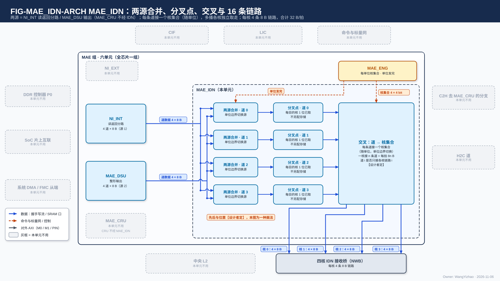
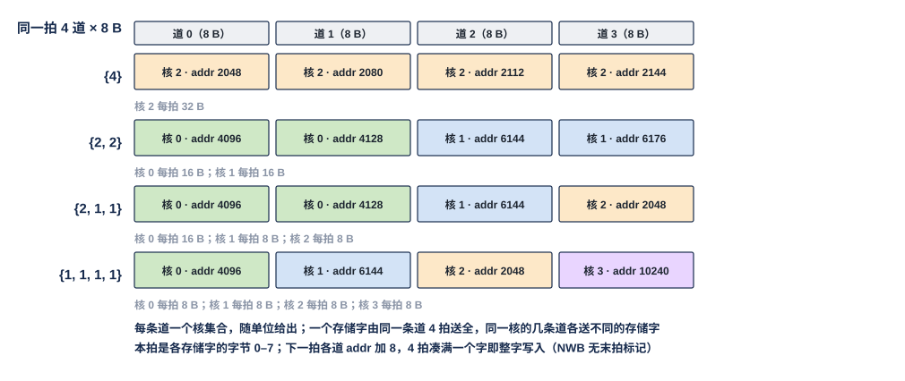
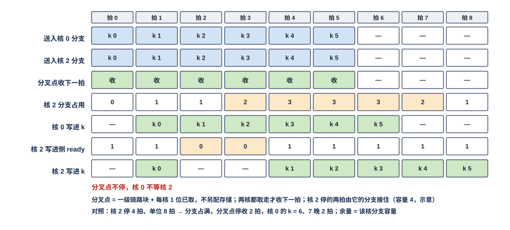

# MAE 入站分发网（MAE_IDN）需求

> Owner: WangYizhao｜2026-11-06｜正式稿第一版，待用户审阅。按用户 11-06 确认的目录（`../V17_3_MODULE_TOC_MAE_IDN_20261106.md`，D1–D3 交设计者）编写；依据片上数据传输协议篇 `DATA_TRANSFER_PROTOCOL.md`（下称"协议篇"）、L1 正式稿、`Claude_Design_Spec/V1.8_DESIGN_REVISIONS.md`（V18-NII-04、V18-TP-26…39、V18-L1-09 / 10）、`Claude_Design_Spec/V1.7_3/Modules/MAE_NI_INT.md` 中 IDN 条款（NII-F-110 / 120 / 130，冻结基线）。与 V1.7_3 冲突处以 V1.8 为准。
> 11-06 深夜第二次（V18-TP-50）：**IDN 落地的写入握手从各核 NWB 沿原链路回到 MAE_IDN，汇总后按 `src` 交引擎；多播缓冲改用"每个目的核下一拍要取的缓冲地址"表述，不用"读指针"**（§1、§2.1–§2.3、§5、§7–§10）。
> 11-06 清晰度遍历：改写了 §2.1（两源接口的握手与量纲）、§4.1（交叉是否换号要定什么、约束）、§5（多播缓冲的组织与深度约束）、§6（两源先后要定什么、约束）、§9.1（各值的性质）；并在 §3、§4、§5 开头加了解释句。
> 11-06 修订（V18-TP-41 / 42，任务书 `_build/TP_RENAME_NOLAST_BRIEF_20261106.md` §1、§2、§3.4）：**信号与核内 RRAM 口同名，撤 last：单位边界是发令方（MAE 通道）交给 MAE_IDN 的内部信号，链路上没有单位标记；链路分配随单位走，每个单位从它的发令方带来自己的核集合，MAE_IDN 在单位边界按当前单位的核集合配置交叉；经 IDN 的一个存储字一律由同一条道送全**（§1.2、§1.3、§2、§4.1–§4.4、§5、§6、§9、§10，图 FIG-MAE_IDN-LANE-SPLIT）。
> 11-06 第二次修订（V18-NAME-01 / MAE-01…09，任务书 `_build/MAE_TYPE_AGNOSTIC_BRIEF_20261106.md`）：名称按外部输入信息篇（`L3PU_EXTERNAL_INFORMATION.md`）统一：命令 → 指令，MAE 通道 → MAE 搬运引擎（V18-MAE-02），MAE_WSU → MAE_DSU（数据整形单元）；两源合并（NI 分路 / MAE_DSU 输出）一句不变（全文）。只换词，未改结构、数字与规则。
> 11-06 晚修订（V18-MAE-11 / 12 / 13，任务书 `_build/MAE_CRU_MERGE_BRIEF_20261106.md`）：**CRU 并入 MAE 组（MAE_CRU），MAE 组六单元；MAE_IDN 的两个源仍是 NI 分路与 MAE_DSU 输出，MAE_CRU 的输出不经 MAE_IDN**（开头、§1.1、§10）。§2 的连接图已换为 PPT 式架构图 FIG-MAE_IDN-ARCH（旧 CONN 退役）。11-06 晚第二次：**内部"两源合并 → 多播缓冲 → 交叉"的次序【设计者定】**，正文 §3 与图上都标注（用户 11-06："可以，但是这一定要标注"）。只改词与句。
> 11-06 深夜第四次（V18-TP-53 / 54，任务书 `_build/MCAST_FORK_BRIEF_20261106.md`）：**撤多播缓冲，多播改为交叉处的分叉点（一级通用链路块 + 每目的核 1 位已取标志，不另配存储），快慢核差距由分支 skid 与 NWB 入口吸收；交叉 / 分叉的先后、位置与各段级数由后端定（协议篇 §5.3.4 A1–A7）**（§1.2、§2、§3、§5、§7–§10，图 FIG-MAE_IDN-ARCH、FIG-MAE_IDN-MCAST）。
> 11-06 深夜第三次（V18-TP-51 / NAME-04）：**撤 dest 信号，去哪个存储由发令方的通路选择决定（C2H 由本核 CCU 的 C2H 通道按发送指令的目标存储给 C2H 分流下通路选择，只在单位边界变）；地址不编码"是哪个存储"，addr 只是目的存储内部的位置；远端引擎回 MAE_ENG 的"发送完成"短消息改名"执行完成"**。

MAE_IDN 是 MAE 组六个单元之一，全芯片一个。**NI 的读返回（含 MAE_DSU 的输出）以 4 条 8 B 道进入，MAE_IDN 按每个单位随带的链路分配把每条道接到一个或多个核的链路上，多播时在分叉点按已取位分叉、各目的核独立取走；每核 4 条独立的 8 B 链路，各自握手、各自带地址，不要求同拍。** 每拍 32 B 是硬上限，一核可以吃满。它没有寻址逻辑（每拍 addr 随数据从 MAE 搬运引擎（V18-MAE-02）来）、不判完成（发送计数与写入完成计数都在 MAE 搬运引擎；L1 接收桥写进 bank 时沿原链路回写入握手，MAE_IDN 只把它汇总、按 `src` 交引擎，V18-TP-50）、不攒字、不改字。

## 1 组成与位置

### 1.1 位置

MAE 组 = MAE_ENG、NI_EXT、NI_INT、MAE_IDN、MAE_DSU、MAE_CRU（用户 11-05 夜，V18-NII-03 / 04；用户 11-06，V18-MAE-11）。MAE_IDN 的上游是 NI_INT 的读返回分路与 MAE_DSU 的输出，下游是四核 L1 的 IDN 接收桥 NWB。**MAE_CRU 的输出不经 MAE_IDN**：合并结果去核 L1 经 H2C 道（作该道的第二源），去 L2 经 NI-L2C 写客户，标量合并值经命令与标量网回 CCU（V18-MAE-12）。与 MAE 组外的连接经 MAE 组的对外口，口的个数、驱动与共享方式见 MAE 集成篇 §3（`MAE_INTEGRATION.md`）。

### 1.2 做什么、不做什么

| 做 | 不做（归谁） |
|---|---|
| 按链路分配做交叉：每条道接一个核集合，在单位边界按当前单位的核集合切换 | 不生成地址：addr / be 逐拍随数据来自 MAE 的 IDN 搬运引擎（V18-TP-27）；不数单位：单位边界由发令方给出（V18-TP-42） |
| 多播：交叉的分叉点按已取位分叉，各目的核独立取走 | 不攒字、不落地（各核 NWB）；不另配多播存储 |
| 两个源（NI 分路、MAE_DSU 输出）按单位轮流上道 | 不判完成：发送计数与写入握手计数都在 MAE 搬运引擎；L1 的写计数只给本核 CCU 消费用（V18-TP-37 / 50） |
| 每条链路、每级流水是通用链路块的实例 | 不缓冲整列（V18-L1-10）；不改字；不做错误检查；不送紧密（非对齐）对象——它们只经 NI 写口进 L2，再经 H2C 进核（V18-TP-42） |

### 1.3 术语

- **道**：NI 一拍 32 B 的 4 条 8 B 道，编号 0–3；一条道 = 同一个归约位置 $k$ 下 16 个输出通道的 4 bit 码（权重），或任何 8 B 数据。
- **链路**：每核 4 条独立的 8 B 握手写流（协议篇 §5.1），编号 0–3。
- **链路分配**：每条道接哪几个核（一个核集合）；**随单位走**——每个单位从它的发令方（MAE 搬运引擎）带来自己的核集合（用户裁定 11-06，任务书 §3.4）；取代 V1.7_3 的"道掩码"。
- **通用链路块**：协议篇 §5.3.2 定义的参数化握手流水块（V18-TP-38）。
- **搬运单位**：发令方（MAE 搬运引擎）内部的粒度，用于合并切换与交叉切换；**链路上没有单位标记，单位边界是发令方交给 MAE_IDN 的内部信号**（协议篇 §7.5，V18-TP-42）。

## 2 数据从哪来、到哪去

MAE_IDN 有两个源，各 4 道 × 8 B：源 1 是 NI_INT 的读返回分路（经拆拍寄存器），源 2 是 MAE_DSU 的整形输出。MAE_CRU 的输出不经 MAE_IDN，所以 MAE_CRU 画灰。图按"两源合并 → 交叉 / 分叉"画，这只是一种画法，先后与位置【设计者定】（§3）。每条道先过自己的两源合并：两源只在单位边界切换，"单位发完"由发令的搬运引擎给出，链路上没有标记。交叉按当前单位随带的核集合（4 bit × 4 道，由 MAE_ENG 给出）把每条道接到一个或几个核的链路上：一核接 $n$ 条道即每拍 $8n$ B；道 $i$ 是否只接各核的链路 $i$ 由设计者定。一条道接几个核，那一处就是多播分叉点：每个目的核 1 位已取，各核按自己的 ready 取走，全部取走才收下一拍（§5）。输出是 16 条链路，每核 4 条 8 B，接四核的 IDN 接收桥 NWB，合计 32 B/拍。

### 2.1 MAE 组内的接口

| 接口 | 对端 | 方向 | 内容 |
|---|---|---|---|
| 链路分配与单位边界 | 各源的发令方（MAE 搬运引擎：源 1 为 IDN 搬运引擎，源 2 为 MAE_DSU 出口的搬运引擎） | 入 | **每个单位带自己的核集合（4 bit × 4 道）与"单位发完"信号，随单位给出**；MAE_IDN 在单位边界按当前单位的核集合配置交叉（任务书 §3.4）。这是发令方与 MAE_IDN 之间的内部接口，不上核间链路；格式【设计者定】 |
| 道数据（源 1） | NI_INT 读返回分路 | 入 | 4 道 × (8 B + addr 24 bit + be 8 bit + `src`)，addr / be 由 MAE 的 IDN 搬运引擎逐拍给出；**每道各自一对 en / ready**，是一个 64 bit 数据、旁带 addr 24 + be 8 + `src` 的通用链路块实例（NI_INT 篇 §5.7），四道不要求同拍 |
| 道数据（源 2） | MAE_DSU | 入 | 同一接口：$W^{\mathsf T}$ 列字块与旁带行；每拍 addr / be 由 MAE_DSU 出口的 MAE 搬运引擎给出 |
| 写入握手（汇总后） | MAE_ENG 的搬运引擎 | 出 | 把 16 条 IDN 链路回来的写入握手汇总，**按 `src` 交对应引擎**（每拍至多 16 个 valid）；汇总方式【设计者定】，约束是不丢、不重、不阻塞（握手无 ready）（V18-TP-50） |

### 2.2 经 MAE 组对外的接口

| 接口 | 对端 | 方向 | 内容 |
|---|---|---|---|
| IDN 链路 × 4 × 4 核 | 各核 L1 的 IDN 接收桥 NWB | 出 | 每条：en / ready / din 8 B / be 8 / addr 24 / `src`，与核内 RRAM 口同名，没有单位标记；通用链路块实例；ready = 该链路的攒字寄存器与入口 FIFO 未满（协议篇 §5.1 / §5.2 / §5.5；L1 篇 §7.5） |
| IDN 落地写入握手 × 4 × 4 核 | 各核 NWB | 入（反向旁带） | 每条链路 1 × (valid + `src`)/拍：NWB 把这条链路攒满的一个存储字写进 L1 bank 的那一拍回一个；只有 valid、没有 ready（协议篇 §2.6 / §5.8，V18-TP-50） |

### 2.3 由别的模块保证的事项

| 事项 | 由谁保证 |
|---|---|
| 每拍 addr / be 正确；每个单位的核集合与单位边界 | MAE 搬运引擎 |
| **一个存储字由同一条道送全**（NWB 每条链路一个攒字寄存器、四拍凑满整字即写，没有末拍触发写出；W / S 类本来只整字写，其余类同样如此，V18-TP-42） | MAE 搬运引擎的地址排法（L1 篇 §7.5） |
| 整列发给属主核时四条道都接该核 | MAE 指令 |
| 每条道的核集合与该核链路的占用互不冲突 | 编译链 / MAE 指令 |
| 目的空间已读完、压紧激活按位点窗口预留 | 编译链（LIC 操作 15、V18-TP-40） |
| 两源同一道上单位不交错 | MAE_IDN 的合并仲裁（§6） |
| 按链路攒字（四拍凑满整字即写）、写计数交 CCU、写进 bank 时回写入握手 | L1 接收桥 |

## 3 链路：每核 4 条独立 8 B 握手写流

MAE_IDN 的输入是 4 条道、输出是 16 条链路（4 核 × 4 条），中间只有两源合并与交叉（接几个核即分叉）；本节先说输出链路本身，§4–§6 再说道怎样接到链路上。

**注意：两源合并与交叉 / 分叉的先后、位置、分几级【设计者定】，后端可按布局调整（协议篇 §5.3.4 A1–A7）。** FIG-MAE_IDN-ARCH 按"两源合并 → 交叉 / 分叉"画，只是一种画法；分叉点可以放在交叉处，也可以拆成几级、逐级靠近各核。约束只有三条：两源只在单位边界切换（§6）；多播在分叉点按已取位、各目的核独立取走（§5）；交叉在单位边界按当前单位的核集合切换（§4.4）（用户 11-06："可以，但是这一定要标注"；"这点对 IDN 有一样的需求"）。

**与协议篇完全一致，链路只差位宽**：每条链路各自 en / ready / addr，一拍里四条链路的字节属于四个不同存储字（一个存储字由同一条链路送全），**不要求同拍到达**；8 B 落存储字的哪一段由 addr 的字节号给出，NWB 按 addr 与 be 攒字、四拍凑满整字即写（V18-TP-30 / 42；L1 篇 §7.5）。

**时延无关、可由后端调整**：每条链路、交叉与分叉的每一级都是通用链路块的实例，skid 深度与各段流水级数为例化参数【设计者定】；四条链路之间、正向与写入握手回程之间都不对齐；验收随机化各段级数、分叉位置、ready 时序与回程时延（V18-TP-32 / 38 / 54；协议篇 §5.3.4）。

## 4 交叉与链路分配：每条道接一个核集合

### 4.1 规则

**每条道一个核集合，随单位给出：每个单位从它的发令方（MAE 搬运引擎）带来自己的核集合，MAE_IDN 在单位边界按当前单位的核集合配置交叉；道 $i$ 的数据送到集合里每个核的某条链路。** 两个源（§6）各自指令的链路分配不同时，交叉跟随当前上道的那个单位，所以两源交替上道时不会用错分配（任务书 §3.4）。道号与目的链路号是否固定同号（道 $i$ 只接各核链路 $i$，交叉只选核）、还是允许换号（任一道接任一链路，交叉 16 × 16），由设计者按交叉开关代价定（用户 11-06）；对落地没有影响——NWB 按地址攒字，字节从哪条链路进来无关。

可以把链路分配理解为一张 4 行（道）× 4 列（核）的 0 / 1 表：第 $i$ 行为 1 的列就是道 $i$ 的核集合；一行有几个 1 就是几播，一列有几个 1 就是该核这条指令用几条链路。

**交叉是否换号【设计者定】**：要定的是道 $i$ 只能接各核的链路 $i$（交叉只决定道 $i$ 送不送某核，各核链路 $i$ 只有道 $i$ 一个来源），还是可以接任一链路（16 × 16 交叉）。约束：(1) §4.2 的四种分配都要支持；(2) 同一核同一条链路在同一时刻只接一条道（"每条道的核集合与该核链路的占用互不冲突"由 MAE 指令保证，§2.3）；(3) 选定的接法要写进 MAE 的指令约定，MAE 搬运引擎按它排地址（一个存储字由同一条道送全，§2.3）。

### 4.2 四种典型分配就是四种核集合

| 分配 | 核集合 | 每核得到 |
|---|---|---|
| {4} | 道 0–3 → 核 $c$ | 32 B/拍，一核吃满 |
| {2, 2} | 道 0、1 → 核 $a$；道 2、3 → 核 $b$ | 各 16 B/拍 |
| {2, 1, 1} | 道 0、1 → 核 $a$；道 2 → 核 $b$；道 3 → 核 $c$ | 16 / 8 / 8 B/拍 |
| {1, 1, 1, 1} | 道 $i$ → 核 $i$ | 各 8 B/拍 |

总量不论开几核都由 M0 的 32 B/拍封顶（用户 11-05 晚："如果只使用单核或者双核，IDN 应该全力供给这两个核"；V18-L1-10）。

### 4.3 输出轴稀疏权重整列发给属主核

四条道都接属主核，每拍 32 B 正好是该核 L1 列字区的一个存储字（一列 64 个连续 $k$，L1 篇 §4.2），MAE_IDN 不暂存；DDR 与 MAE_IDN 都不拼接子突发（V18-L1-09 / 10）。按"一个存储字由同一条道送全"的约束，MAE 搬运引擎把连续的存储字轮流排到四条道上（每条道各送整字），而不是四条道各送同一个字的 8 B（L1 篇 §7.6）。

### 4.4 分配只在单位边界切换

**链路分配随单位走，切换只在单位边界生效**：当前单位发完（发令方给出的内部信号，链路上没有标记，V18-TP-42）之后，交叉按下一个上道单位所带的核集合重新配置（§6）。

图中同一拍的 4 条 8 B 道（道 0–3）在四种分配下送到的核与各道的 addr（字节地址）。**一个存储字由同一条道 4 拍送全**，所以同一核的几条道各送不同的存储字：{4} 全送核 2，四道分别是相邻存储字 [1][W][字节 2048]、2080、2112、2144 的字首 8 B；{2, 2} 道 0、1 送核 0 的字 4096、4128，道 2、3 送核 1 的字 6144、6176；{2, 1, 1} 与 {1, 1, 1, 1} 类推。下一拍各道 addr 加 8，4 拍凑满一个字即整字写入，链路上没有末拍标记。一核接 $n$ 条道时每拍 $8n$ B。脚本断言每种分配下各核所得道互不重叠、同一核各道的存储字互不相同且本拍都在字首。一条 8 B 道 = 同一 $k$ 下 16 个输出通道的 4 bit 码。

## 5 多播：交叉的分叉点按已取位分叉，各目的核独立取走

**一条道的核集合含多个核即多播；交叉把这条道接到几个核的链路上，接的那一处就是分叉点。分叉点 = 一级通用链路块 + 每个目的核 1 位已取标志，不另配存储**（用户 11-06："缓冲不是已经在存储单元里要求了吗？而 HUB 本身，就已经有 skid 寄存器的需求了"；"这点对 IDN 有一样的需求"；V18-TP-53 / 54）。规则照协议篇第 3 层（§5.7）。四核物理同构，多播用同一个 addr、落同一位置（用户 11-06 认可；协议篇 §2.3）。

| 项 | 规定 |
|---|---|
| 个数 | 每条道一个分叉点（4 个），各道独立 |
| 存的内容 | 本级链路块的一拍：din 8 B + addr 24 bit + be 8 bit + `src`；另加每个目的核 1 位已取 |
| 每拍动作 | 对核集合内、本拍尚未取走的核拉高 en（**en 只看已取位、不看 ready**）；某核链路 ready = 1 即取走并置位；集合内全部置位后才收上游下一拍，已取位清零 |
| 单播 | 核集合只有一个核时退化为一级流水 |
| 余量 | 快慢核的差距由该核分支的 skid 与 NWB 入口（攒字寄存器 + 入口 FIFO）吸收；一核堵得比这还久时分叉点停收上游，同道其余核随之停下；需要更大余量时加深 NWB 入口 FIFO（L1 篇 §7.5），不在 MAE_IDN 里加存储 |
| 位置与级数 | 分叉点与交叉的先后、放在哪、分几级由后端定（协议篇 §5.3.4 A1–A7）；核集合作旁带走到最后一个分叉点，到核的链路上不带 |

图中一条道的 6 拍单位多播到核 0 与核 2（核集合 {0, 2}），每核分支容量 4 拍（分支 skid + NWB 入口，示意）。核 0 一直能写；核 2 写进 L1 的一侧在拍 2、3 不 ready。分叉点在拍 0–5 每拍送出一拍、从不停收；核 0 在拍 1–6 写进 k = 0–5，核 2 在拍 1、4、5、6、7、8 写进，分支占用最多 3 拍——**核 2 停两拍只让它自己晚两拍写完，核 0 不等**。对照：核 2 停 4 拍、单位 8 拍时，核 2 分支占满，分叉点停收 2 拍，核 0 的 k = 6、7 晚 2 拍写进，余量就是该核分支容量。逐拍模型与 HUB_NOC 篇、协议篇共用（`_build/mcast_fork_sim.py`），脚本断言以上各数。链路宽 8 B 不影响逐拍逻辑。

## 6 两个源的合并：按单位轮流，永不交错

同一条道可能同时有 NI 分路（DDR 原形）与 MAE_DSU 输出（整形后的 $W^{\mathsf T}$ 列字块）两个源。**合并只在单位边界切换源，一个单位的各拍连续，同一条道上单位不交错**（V18-TP-36）；单位边界由各源的发令方（MAE 搬运引擎）交给合并仲裁器，链路上不带（V18-TP-42）——单位级仲裁只放在这种发令方能看到单位边界的合并点（V18-TP-45）；切到另一源时交叉同时换成该源当前单位的核集合（§4.4）。两源同时有数据时的先后【设计者定】（参考：先到先发或轮转），只要求单位不交错。合并点是通用链路块实例加一个仲裁器。

**两源先后【设计者定】**：要定的是同一条道上两源都有数据时先放哪一源的单位。约束：(1) 只在当前单位发完之后切换；(2) 每条道各自仲裁，四条道互不等待；(3) 没轮到的一源对上游拉低该道 ready，只降速、不丢数。两源各自的单位长度由 MAE 的指令决定，MAE_IDN 不限制。

## 7 握手、顺序与透明

- ready 为 0 时发送方保持；同一链路保序；逐位无损；无数据应答、无 outstanding、无 burst（协议篇 §5.3）；写入握手只是反向的计数脉冲，发送方不等它。
- **多播时每个目的核各回自己的写入握手**，引擎按目的核数倍计应写量（V18-TP-50）。
- **停发只作用于该道**：某核某链路拉低 ready 时，该核分支的 skid 先接住；分支也满后分叉点停收上游，对上游（NI 分路 / MAE_DSU）拉低该道的 ready，最终经 NI_INT、NI_EXT 停 DDR 读返回；只降速、不丢数、不报错（V18-NII-01）。

## 8 计数与复位

不上报计数（写入握手只转交、不计数）；不做错误检查；复位清交叉配置、分叉点的已取位、在途单位与在途握手；没有跨调用驻留的状态。

## 9 要求值与验收

### 9.1 要求值

| 项 | 值 | 性质与依据 |
|---|---|---|
| 合计 | 32 B/拍（4 道 × 8 B，核时钟） | 要求值：与 NI 读返回分路、M0 每拍 32 B 相同（V18-L1-10） |
| 每核 | 8 / 16 / 32 B/拍，按链路分配 | 要求值：一条链路 8 B/拍，按该核接的链路数 1 / 2 / 4 |
| 多播分叉点 | 无存储，每目的核 1 位已取 | 余量由 NWB 入口 FIFO 定（§5） |
| skid 深度、各段流水级数、交叉 / 分叉的位置 | 【设计者定】（随布局） | 协议篇 §5.3.2、§5.3.4 |
| 交叉是否换号 | 【设计者定】 | 约束见 §4.1 |
| 两源先后 | 【设计者定】 | 约束见 §6 |
| 门数 | 交叉 + 分叉已取位 + 合并仲裁 + 16 条链路的通用链路块实例，NAND2 等效，建议值【设计者定】（参考：V1.7_3 对 IDN 的估计 22–32 k 门） | 参考值来自 V1.7_3 NII-R-190 一阶推导，当时含两层信用，现结构未重估 |

### 9.2 验收

| 项 | 方法 | 判据 |
|---|---|---|
| 链路分配 | 四种核集合各跑随机数据 | 各核所得字节逐位比对、互不重叠、并起来等于输入 |
| 多播 | 到 $N$ 核、各核独立随机 ready | 各核内容与 addr 相同；集合内全部取走后分叉点才收下一拍；en 不依赖 ready；慢核短时堵住（不超过其分支容量）不拖快核 |
| 整列 | 列深度优先权重 | 属主核每拍一个整字直写，无暂存 |
| 两源合并 | 两源随机到达、两源各自指令的链路分配不同 | 单位不交错，只在发令方给出的单位边界切换；切换后交叉按新单位的核集合配置，各核所得与参考一致 |
| 时延无关与可调 | 随机化各段级数、分叉位置、ready 时序与回程时延（A7） | 逐位一致、不丢拍、不重复；写入握手计数与应写量相符 |
| 停发 | NWB 将满 | 只停该道；不丢拍 |
| 写入握手转交 | 四种核集合、多播、随机 ready 与随机插级 | 每个写进 L1 的存储字恰有一个握手到达 `src` 对应的引擎；多播 $k$ 核时到达 $k$ 个 |

## 10 为什么

- **IDN 独立成篇**（用户 11-05 夜："我建议单独放一个 MAE IDN 模块"）。
- **四条独立链路**（用户 11-05 夜："单核 4 道同拍耦合的问题需要解决，如果强制要求同拍，可能会对后端要求过大"）：每条各带地址与握手，后端不必让四条道同拍到达。
- **链路分配任意拆**（用户 11-05 晚）：开核少时 IDN 也能全力供给，总量由 M0 封顶。
- **整列发给属主核**（V18-L1-10）：DRAM 最小访问一个突发，不能从 4 列各取 8 B 拼一拍。
- **多播独立取走**（师兄提醒"RRAM 协议跑长距离会出一堆 bug" + 用户 11-05 夜）："等齐同拍成交"是跨芯片的组合路径，随后端变化而失效。
- **撤多播缓冲、分叉点只用已取位**（11-06 深夜，V18-TP-53）（用户 11-06："缓冲不是已经在存储单元里要求了吗？而 HUB 本身，就已经有 skid 寄存器的需求了"；"这点对 IDN 有一样的需求"；V18-TP-53 / 54）：时序问题已由每级寄存器输出 + skid 解决，独立取走只需每核 1 位已取，余量本来就在分支 skid 与 NWB 入口里。
- **交叉 / 分叉位置与级数留给后端**（V18-TP-54）：本篇只提协议篇 §5.3.4 的 A1–A7。
- **无寻址、无完成角色**（V18-TP-27 / 37 / 50）：地址由 MAE 搬运引擎给；写入完成由引擎数 L1 回来的写入握手判（核间统一协议，用户 11-06："核间统一走一个协议"），L1 写计数只供本核消费。
- **两源合并按单位、不交错**（用户 11-06："先发一个，另一个阻塞"）：两源的单位边界都由 MAE 搬运引擎给出，属于发令方能看到单位边界的合并点（V18-TP-45）。
- **通用链路块**（用户 11-06："建立一个 Common Block，然后多次例化"）。
- **道号是否换号、两源先后交设计者**（用户 11-06）。
- **信号与核内 RRAM 口同名、撤 last**（用户 11-06："这里我叫你统一和 RRAM 的命名，你也没有统一，并且为什么仍然有末拍的 LAST 拍？"；V18-TP-41 / 42）：NWB 四拍凑满整字即写、写完成按写计数，链路上的末拍标记没有消费者；MAE_IDN 要的单位边界由发令方在 MAE 组内直接给出。
- **链路分配随单位走**（11-06 协调者定，任务书 §3.4）：两源各自指令的分配不同，交叉只能跟当前上道的单位，否则两源交替时会用错分配。
- **CRU 并入 MAE 组但不经 MAE_IDN**（V18-MAE-11 / 12，用户 11-06："要不咱们重新划分下，CRU 归纳到 MAE 中，和 DSU 并行"；"C2 我认可"）：合并结果去核 L1 沿用 H2C 道的第二源，MAE_IDN 仍只有 NI 分路与 MAE_DSU 两个源。
- 被否方案各一句：道掩码按口拆、每核口 32 B 一个 addr、同拍驱动四核、等齐成交、发送侧多播缓冲（分叉点已取位）、NI 内置 IDN、两层信用、链路上的末拍标记、按指令（而非按单位）切换交叉。
