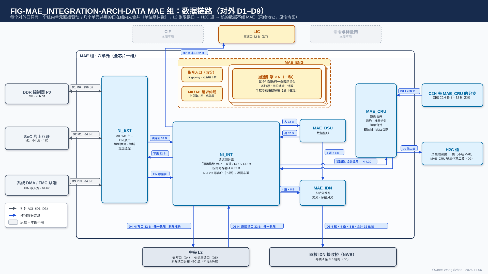
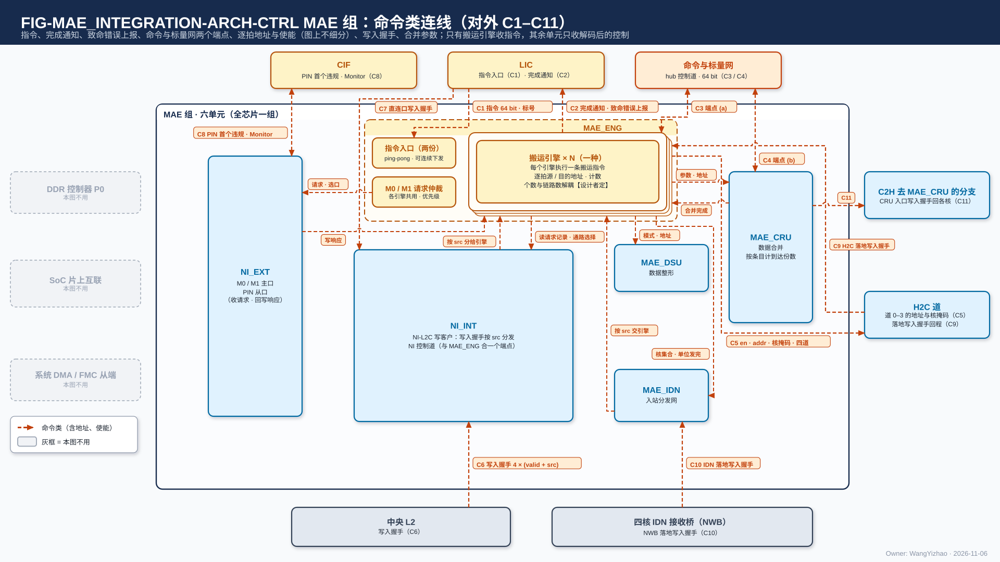
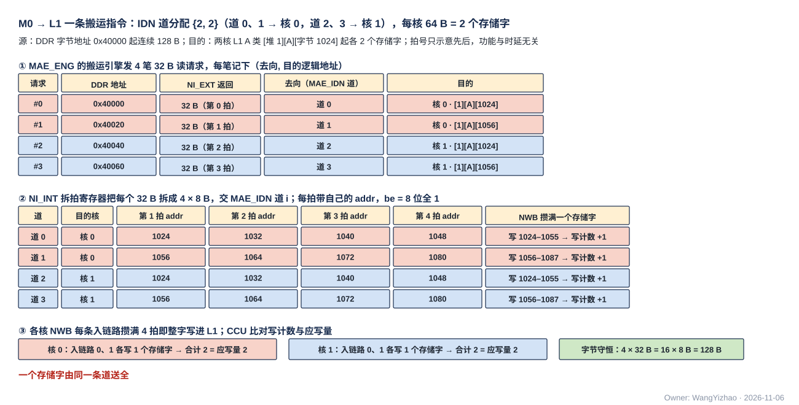

# MAE 组集成（MAE_INTEGRATION）需求

> Owner: WangYizhao｜2026-11-06｜正式稿第一版，待用户审阅。按用户 11-06 确认的目录（`../V17_3_MODULE_TOC_MAE_INTEGRATION_20261106.md` 第四版，MI1–MI8 全部关闭）编写；依据 `Claude_Design_Spec/V1.8_DESIGN_REVISIONS.md` V18-NII-01…08、V18-NIE-01…03、V18-MAE-01…31、V18-TP-26…49、V18-L2-03 / 04、V18-LIC-01、V18-NAME-01…03；单元篇 `MAE_ENG.md`、`MAE_NI_EXT.md`、`MAE_NI_INT.md`、`MAE_IDN.md`、`MAE_DSU.md`（MAE_CRU 篇待写），以及 `DATA_TRANSFER_PROTOCOL.md`（下称"协议篇"）、`L2_SRAM.md`、`L1_SRAM.md`、`L3PU_EXTERNAL_INFORMATION.md`。图件登记 `_build/FIGURE_REGISTRY_MAE_INTEGRATION.md`。
>
> 11-06 深夜第二次（V18-TP-50 / MAE-30）：**写入完成只分核内、核间两类，核间统一为"写入握手 + 发令方计数"（来自 AXI 写响应通道 B）；命令口新增 C9（H2C 落地握手）、C10（IDN 落地握手）、C11（CRU 入口握手）；§5.1 改为两类写法与逐链路表；目的为核 L1 的指令以写入握手数满为执行完**（§1.4、§3.2、§5、§6、§8.3、§9，图 FIG-MAE_INTEGRATION-ARCH-CTRL）。
> 11-06 深夜第三次（V18-TP-51 / NAME-04）：**撤 dest 信号，去哪个存储由发令方的通路选择决定（C2H 由本核 CCU 的 C2H 通道按发送指令的目标存储给 C2H 分流下通路选择，只在单位边界变）；地址不编码"是哪个存储"，addr 只是目的存储内部的位置；远端引擎回 MAE_ENG 的"发送完成"短消息改名"执行完成"**。

本篇只写**组这一层**：六个单元怎样连、组对外有几个口、谁驱动、谁共享、谁仲裁、整组的完成与时序、整组的要求值。单元内部的规则留在各单元篇，本篇只引用。

## 1 组成与边界

### 1.1 六个单元，全芯片各一个

| 单元 | 做什么 | 单元篇 |
|---|---|---|
| MAE_ENG | 接收 LIC 的搬运指令，交给搬运引擎执行；**组内唯一收指令的单元**，给出全部核外搬运的每拍地址 | `MAE_ENG.md` |
| NI_EXT | M0 / M1 / PIN 三个 AXI 口的协议端；地址换算（RTL 头文件参数）；PIN 区间检查 | `MAE_NI_EXT.md` |
| NI_INT | 读返回分路（按读请求记录分到六个目的口）、NI-L2C（写 L2 的五个写客户与返回车道）、NI 控制道 | `MAE_NI_INT.md` |
| MAE_IDN | 到四核的入站分发网：4 条 8 B 链路、交叉开关（接几核即多播分叉） | `MAE_IDN.md` |
| MAE_DSU | 数据整形：半字合并、转置、块尺度与旁带、两平面合并 | `MAE_DSU.md` |
| MAE_CRU | 数据合并：部分和归约、标量合并、读集合并 | MAE_CRU 篇（`MAE_CRU.md`） |

全芯片一组，每个单元一个（用户 11-05 夜 / 11-06，V18-NII-03 / 04、V18-MAE-05 / 11）。

### 1.2 职责边界：谁拥有源谁发令

**源在核外（DDR、共享内存、L2、CRU 内地址）的搬运全部由 MAE 发令；源在核内（L1、AEB）的搬运由该核 CCU 发令（C2H），MAE 只收它的发出报告**（用户 11-06："要么就取消 C2H 的 MAE 主，统一改成各核的 CCU 主"；V18-TP-35）。HUB 只传输，不发令、不算地址；HUB 组只剩 HUB_NOC（用户 11-03 D6.1、11-06 V18-MAE-11）。

### 1.3 运算级：直通 / DSU / CRU 三选一

每条搬运指令的运算字段经 MUX 选一路：**直通、经 MAE_DSU 整形、经 MAE_CRU 合并，DSU 与 CRU 并列、互不依赖**（用户 11-06："DSU 和 CRU 可以是并行的"；V18-MAE-12）。

| 运算 | 输入从哪来 | 输出到哪去 |
|---|---|---|
| 直通 | M0 / M1 读返回、L2 返回读 | L1（经 MAE_IDN 或 H2C 道）、L2（经 NI 写口）、片外（经 NI_EXT）、LIC 直连口 |
| MAE_DSU | DDR 读返回、L2 返回读 | L1（经 MAE_IDN）、L2（经 NI-L2C） |
| MAE_CRU | 各核 C2H 去 MAE_CRU 的单位；MAE 读路径（DDR / L2，兼容能力）；各核 CCU 的标量 | 核 L1（经 H2C 道第二源）、L2（经 NI-L2C）、标量回 CCU；不经 MAE_IDN |

### 1.4 逻辑归属与物理位置分开

- **H2C 道旁的搬运引擎就是 MAE_ENG 的搬运引擎**，同一种引擎的实例；放在道旁只是物理位置，【设计者定】（用户 11-06 MI3："H2C 的引擎应该和 MAE 的 N 个引擎是一个引擎，关闭"）。放在远处的引擎就地数满目的地回来的写入握手后，经命令与标量网回"执行完成"短消息（含义是写入握手已数满；原名"发送完成"，V18-NAME-04；协议篇 §7.4.1，V18-TP-50）。
- **只有 MAE_ENG 的引擎收指令，其余五个单元只收引擎解码后的控制**（V18-MAE-27）。
- MAE 组整体与 MAE_CRU 放在 hub 中心还是芯片物理中心，归后端，本篇不写（用户 11-06："这是后端的事情，咱们不感知"）。

### 1.5 时钟

组内与核间链路同一个核时钟域（V18-TP-31）；跨时钟域只在 NI_EXT 的 M0 / M1 / PIN 外沿，三个口都必须支持异步（V18-NIE-01）。

## 2 组内互连

### 2.1 六个单元之间的全部连接

| 源 → 目的 | 内容 | 每拍位宽与旁带 | 单位边界由谁给 |
|---|---|---|---|
| MAE_ENG → NI_EXT | 读写请求（每笔 32 B）+ 选口位（M0 / M1） | 请求字段归 NI_EXT 篇 | 引擎 |
| NI_EXT → MAE_ENG | 写响应（AXI B） | — | — |
| MAE_ENG → NI_INT | 解码后的控制：每笔读请求的记录 (去向, 目的逻辑地址)、通路选择、要发的长度转发内容；**NI_INT 不收指令** | 归 NI_INT 篇 §3 | 引擎 |
| MAE_ENG → MAE_IDN | 每单位的核集合（4 道 × 4 核）与"单位发完" | 控制旁带 | 引擎 |
| MAE_ENG → MAE_DSU | 整形模式、子段长、双目的；输入输出两侧每拍地址 | 控制旁带 | 引擎 |
| MAE_ENG → MAE_CRU | 合并种类、参与核、CRU 内地址范围与每个地址应到份数；输出每拍地址 | 控制旁带 | 引擎 |
| MAE_CRU → MAE_ENG | 一组合并完成 | 1 个事件 | — |
| NI_EXT → NI_INT | M0 / M1 读返回；PIN 存储字（addr = L2 逻辑地址、be、`src` = PIN 事务号） | 32 B + 旁带 | 读返回按请求记录；PIN 按 AXI 事务（WLAST） |
| NI_INT → NI_EXT | 写出数据（L2 → DDR / M1、区域复制）+ be；PIN 落地依据（该事务号的写入握手数满 → 回 B） | 32 B + be | 引擎 |
| NI_INT → MAE_IDN | 读返回分路经 4 × 32 B 拆拍寄存器拆成 4 道 × 8 B | 4 × (8 B + addr 24 + be 8 + `src`) | 引擎 |
| NI_INT ↔ MAE_DSU | 整形输入 32 B；整形输出去 L2 时回 NI-L2C 写客户 | 32 B + 旁带 | 引擎 |
| MAE_DSU → MAE_IDN | 整形输出去 L1 | 4 道 × 8 B（与 NI 分路同接口） | 引擎 |
| NI_INT ↔ MAE_CRU | MAE 读路径数据进 CRU（兼容能力）；CRU 写 L2 的结果进 NI-L2C 写客户 | 32 B + 旁带 | 引擎 |
| NI_INT → MAE_ENG | L2 NI 写口回来的写入握手，**按 `src` 分给对应引擎**（PIN 事务号的留给 NI-L2C 自己数） | 4 象限 × (valid + `src`) | — |

### 2.2 组内合并点与仲裁：全部单位级

| 合并点 | 几个源 | 规则 |
|---|---|---|
| NI-L2C 写客户 | M0、M1、PIN、DSU、CRU 五个写客户合到 NI 写口 | 单位级，只在单位边界换源；每拍带发令号；PIN 的事务边界来自 AXI WLAST（NI_INT 篇 §5.5） |
| 读返回分路 | M0 / M1 两口同去一处时 | 单位级 |
| MAE_IDN 每道 | NI 分路、DSU 两个源 | 单位级，边界随单位从引擎来 |
| 同一条链路上的多条指令 | 几个引擎 | 单位级，按指令优先级 + 老化（ENG 篇 §8）；H2C 道两源只按优先级、暂不老化（V18-TP-52） |

**组内所有合并点都在发令方一侧、拿得到单位边界，所以全部做单位级仲裁**，链路上不需要单位标记（V18-TP-36 / 42 / 45）。

### 2.3 组内数据链路统一用核间协议

**MAE 组内的数据链路一律用核间协议——带地址的握手写流，每级是通用链路块（skid 与级数可配，可取 0 级）；IDN 必须是**（用户 11-06 MI7："数据链路可以评估下使用核内协议还是核间协议，至少 IDN 要核间协议"；"支持统一核间协议"）。理由：组内与核间用同一种块，验证只做一套；组内连线在后端同样可能被插级，时延无关的写法让这件事不影响功能。纯控制的内部信号（单位边界、核集合）随数据作旁带。

## 3 组的对外口

**组对外只有本节列出的口；每个口只有一个组内单元直接驱动，几个单元共用的口在组内先合并、在单位边界仲裁。** 数据口与命令口各画一张图，编号与表行一一对应（用户 11-06："一个画数据的，一个画命令的，命令需要包括地址，使能信号，但是在架构图上无需区分"）。

### 3.1 数据口

图中 MAE 组框内是六个单元与组内数据连线（NI_EXT ↔ NI_INT 的读返回、写出与 PIN 存储字；NI_INT → MAE_IDN 4 道 × 8 B；NI_INT ↔ MAE_DSU；MAE_DSU → MAE_IDN；NI_INT ↔ MAE_CRU 的读路径与合并结果），NI_INT 的读返回分路即运算级 MUX；框外是全部对端，本图不用的对端（CIF、命令与标量网）画灰。跨框的每根数据线标有编号 D1–D9，对应下表。L2 象限读口经 H2C 道到核的数据不经 MAE，只在中央 L2 与 H2C 道两个对端框里注明。

| 编号 | 口 | 对端 | 方向 | 个数 × 位宽 | 驱动单元 | 共享与仲裁 | 依据 |
|---|---|---|---|---|---|---|---|
| D1 | M0 | DDR P0 | 出 / 入 | 1 × AXI4 主 256 bit | NI_EXT | 全部引擎的 DDR 请求；按优先级、64 B 背靠背、升序成批合成一路 | NI_EXT 篇 §4；ENG 篇 §5.8 / §8 |
| D2 | M1 | SoC 片上互联（HSRAM、DDR 共享区、FMC 主端窗口） | 出 / 入 | 1 × AXI4 主 64 bit | NI_EXT | 同上；调用描述符与配置表的读不得被同口写占满在飞 | NI_EXT 篇 §5.4 |
| D3 | PIN | 系统 DMA、FMC 从端 | 入（写）/ 出（读、B） | 1 × AXI4 从 64 bit | NI_EXT | 写进 L2 经 NI-L2C，与 M0 / M1 / DSU / CRU 共用 NI 写口 | NI_EXT 篇 §7 |
| D4 | L2 的 NI 写口 | 中央 L2 | 出 | 1 × 32 B | NI_INT（NI-L2C） | 五个写客户单位级合并；**可写任一象限、一个单位不跨象限、可按象限掩码广播**；在 L2 每个象限集合器里是两个来源之一，与本象限对应核 L2WP 的先后是 RTL 头文件参数 | V18-L2-04；L2 篇 §5.2 |
| D5 | L2 的 NI 返回读口 | 中央 L2 | 入 | 1 × 32 B | NI_INT（返回车道） | 可读任一象限；由 L2 → NI 的引擎发地址，按余量发读 | NI_INT 篇 §5.4 |
| D6 | IDN 链路 | 四核 L1 的 NWB | 出 | 16 条 = 4 核 × 4 条，各 8 B；合计 32 B/拍 | MAE_IDN | 每道两源（NI 分路 / DSU）单位级；链路分配 {4} / {2, 2} / {2, 1, 1} / {1, 1, 1, 1} | V18-TP-30；IDN 篇 |
| D7 | LIC 直连口 | LIC 专用小 SRAM | 出 | 1 × 32 B | NI_INT（读返回分路） | 只收 M1 读回的指令、配置表、调用描述符、KV 段表 | V18-NII-06 / 08、V18-LIC-01 |
| D8 | CRU 数据入口 | 各核 C2H 去 MAE_CRU 的分支 | 入 | 4 × 32 B（每核一条） | MAE_CRU | 入口 FIFO 每核一条或四核合并【设计者定】 | V18-MAE-11 / 24 |
| D9 | CRU → H2C 道出口 | H2C 道（第二源） | 出 | 口数与宽度【设计者定】，参考 1 × 32 B | MAE_CRU | 可进任一道，由指令给出；在 H2C 道上与 L2 读出在单位边界换源，**先后由 MAE_ENG 按优先级字段判（暂不老化，CRU 优先），HUB 只有二选一 MUX、按 MAE 给的源顺序切换**（V18-TP-52）；BF16 直出 | V18-MAE-22、V18-CRU-02 |

**NI 返回读口保持 1 × 32 B，不做四象限并行**（V18-MAE-31）：它的下游每拍最多收 32 B——M0 接口 32 B/拍（DDR 带宽参考只有 19.2 B/拍）、M1 8 B × $f_{\mathrm{IO}}$、DSU 输出经 IDN 或 NI 写口 32 B/拍、L2 → L2 拷贝经 NI 写口 32 B/拍——四象限同拍读出拼成 128 B 没有下游能收；卸载时的"读时合并"按地址依次遍历四个象限（ENG 篇 §5.9 M-2）。需要 128 B/拍的只有 L2 → 核 L1，已由四个象限读口加 H2C 四道供给。

### 3.2 命令口

外框与对端位置与数据图相同；跨框的每根命令线标有编号 C1–C11（C9–C11 是三条落地写入握手回程：H2C、IDN、CRU 入口）。**地址线、使能线都画成命令线，不细分。** 组内命令线：请求仲裁 → NI_EXT（请求、选口）、NI_EXT → 引擎（写响应）、引擎 ↔ NI_INT（读请求记录、通路选择；写入握手按 `src` 分给引擎）、引擎 → MAE_DSU（模式、地址）、引擎 → MAE_IDN（核集合、单位发完）、引擎 ↔ MAE_CRU（参数与地址、合并完成）。**写入握手都沿原数据链路反向回到发送这条链路的那一方**：C6、C7 回到 NI_INT、由 NI_INT 按 `src` 交引擎；C9 回到 H2C 道、交给发地址的引擎；C10 回到 MAE_IDN、按 `src` 交引擎；C11 从 MAE_CRU 回到各核 CCU；MAE_ENG 与 NI 控制道合成的命令网端点 (a) 画在 NI_INT 框内。

| 编号 | 口 | 对端 | 方向 | 形式 | 驱动单元 | 内容 | 依据 |
|---|---|---|---|---|---|---|---|
| C1 | 指令入口 | LIC | 入 | **64 bit 通用链路块实例**；入口 ping-pong，可预存下一条，LIC 可连续下发多条 | MAE_ENG | 搬运指令（每条带 LIC 分配的指令标号） | 用户 11-06 MI2："64bit"；V18-MAE-13 |
| C2 | 完成通知与致命错误上报 | LIC | 出 | 走 MAE_ENG 与 LIC 之间的口，不经 NI 控制道 | MAE_ENG | 每条指令执行完带标号通知一次（含一组 CRU 合并）；**组内各单元的致命错误一并报 LIC，由 LIC 写 CIF 报 M55** | V18-MAE-13 / 21、V18-NAME-03 |
| C3 | 命令与标量网端点 (a) | hub 控制道 | 出 / 入 | 64 bit；**MAE_ENG 与 NI 控制道合一个端点**，组内按消息边界合并、入口按消息类型分发 | MAE_ENG（含 NI 控制道） | 出：远端引擎的指令、长度转发；入：各核 CCU 的发出报告、远端引擎的执行完成 | 用户 11-06 MI1："进行合并是可以的" |
| C4 | 命令与标量网端点 (b) | hub 控制道 | 出 / 入 | 64 bit；单独一个端点，不与 (a) 共队列 | MAE_CRU | 入：四核 CCU 的标量；出：标量合并值回 CCU | V18-MAE-12 C3 |
| C5 | H2C 道的控制 | H2C 道 0–3 | 出 | 逐拍 | MAE_ENG 的搬运引擎（可在道旁） | L2 象限读 en / addr、目的 addr / be、核掩码；**一条 L2 → L1 指令可同时驱动四道，道 $q$ 读象限 $q$**（读时合并） | V18-NAME-02、V18-MAE-28 |
| C6 | L2 写入握手 | 中央 L2（经 NI_INT） | 入 | 4 象限 × (valid + `src`)/拍，链路反向旁带 | — | 每写进一项回一个；NI_INT 按 `src` 分给引擎，PIN 事务号的留 NI-L2C | V18-TP-47 |
| C7 | LIC 直连口写入握手 | LIC 专用小 SRAM（经 NI_INT） | 入 | valid + `src`/拍，D7 链路的反向旁带 | — | 每写进一项回一个，回到 NI_INT 后按 `src` 交给引擎；引擎数满后通知 LIC | 用户 11-06 MI8 |
| C8 | CIF | CIF | 出 / 入 | 双向寄存器口 | NI_EXT | PIN 首个违规；Monitor 寄存器读出；**不装 PIN 窗口表**（地址换算是 RTL 头文件参数） | V18-NIE-03、V18-MAE-26 |
| C9 | H2C 落地写入握手 | 四核 LDP（经 H2C 道） | 入 | 每核每道 1 × (valid + `src`)/拍，H2C 链路反向旁带；H2C 道把多播各目的核的握手汇总后交给发地址的引擎，引擎不在道旁时经 hub 回到 MAE；汇总方式（按 `src` 归并或原样转交）【设计者定】 | — | 每个存储字写进 L1 bank 回一个；引擎数满（多播按目的核数倍计）即写入完成 | V18-TP-50 |
| C10 | IDN 落地写入握手 | 四核 NWB（经 MAE_IDN） | 入 | 16 条链路各 1 × (valid + `src`)/拍，IDN 链路反向旁带 | — | NWB 攒满的存储字写进 L1 bank 回一个；MAE_IDN 汇总后按 `src` 交引擎 | V18-TP-50 |
| C11 | CRU 入口写入握手 | 四核 CCU（经 C2H 分流回程） | 出 | 每核 1 bit/拍（CRU 入口第 $n$ 条只有核 $n$ 一个发令方，不带号） | MAE_CRU | 本核的一项写进 CRU 内地址回一个，供该核 CCU 判发送方写入完成 | V18-TP-50 |

C2H 分流不受 MAE 控制，只按本核 CCU 给的通路选择分流（V18-NAME-02、V18-TP-51）；**L2 没有给 MAE 的计数出口与配置口**（V18-L2-04、V18-TP-47）。

### 3.3 与 HUB 的关系

| 通路 | MAE 做什么 | HUB 做什么 |
|---|---|---|
| L2 → 核 L1 | 引擎给 H2C 道逐拍地址与核掩码（C5） | H2C 道读象限、在分叉点按已取位分给各核、各核独立取走 |
| 核 → MAE_CRU | MAE_CRU 收（D8） | C2H 按本核 CCU 的通路选择分流 |
| MAE_CRU → 核 L1 | MAE_CRU 出（D9），地址由引擎给；与 L2 读出的先后由 MAE_ENG 判，并给 MUX 源顺序 | H2C 道入口二选一 MUX 按源顺序切换后发出（HUB_NOC 篇 §5.3） |
| 命令与标量网 | 两个端点（C3 / C4） | hub 控制道转发 |

## 4 按口对看整组的数据路径

| 口对（ENG 篇 §4.2） | 经过的组内单元 | 用到的对外口 | 每拍地址谁给 | 写入完成谁数 |
|---|---|---|---|---|
| M0 → 核 L1 | ENG → NI_EXT → NI_INT 读返回分路 → MAE_IDN（可经 DSU） | D1、D6 | 引擎（DDR 请求、IDN 每拍 addr） | 目的核 CCU 比对 NWB 写计数 |
| M1 → 核 L1 | 同上（经 M1） | D2、D6 | 引擎 | 目的核 CCU |
| M0 / M1 → L2 | NI_EXT → NI_INT → NI-L2C | D1 / D2、D4 | 引擎 | 引擎数写入握手（C6） |
| M1 → LIC 直连口 | NI_EXT → NI_INT 读返回分路 | D2、D7 | 引擎 | 引擎数写入握手（C7），通知 LIC |
| PIN → L2 | NI_EXT → NI-L2C | D3、D4 | NI_EXT（$A - A_{\text{PIN}}$） | NI-L2C 数该事务号的握手 → 回 B |
| L2 → 核 L1 | 引擎在 H2C 道旁 | C5（数据走 H2C） | 引擎（可四道并行） | 目的核 CCU 比对 LDP 写计数 |
| L2 → DDR / 共享内存 | NI-L2C 返回车道 → NI_EXT | D5、D1 / D2 | 引擎（象限跨距依次遍历） | AXI 写响应 |
| L2 → L2 | 返回车道 → NI-L2C（可经 DSU / CRU） | D5、D4 | 引擎（可按象限掩码广播） | 引擎数写入握手 |
| DDR → DDR | NI_EXT 读 → NI_INT → NI_EXT 写（区域复制） | D1 | 引擎 | AXI 写响应 |
| 核 → CRU → 核 L1 / L2 / CCU | 各核 C2H → MAE_CRU →（H2C 道 / NI-L2C / 命令网） | D8、D9 / D4 / C4 | CCU（入）、引擎（出） | MAE_CRU 按 CRU 内地址数到齐（入）；目的方按本表对应行（出） |

数值走查：一条 M0 → L1 指令、IDN 道分配 {2, 2}（道 0、1 → 核 0，道 2、3 → 核 1），源为 DDR 字节地址 0x40000 起连续 128 B，目的为两核 L1 A 类 [堆 1][A][字节 1024] 起各 2 个存储字。
- ① 搬运引擎发 4 笔 32 B 读请求（0x40000、0x40020、0x40040、0x40060），每笔记下 (去向, 目的逻辑地址)：#0 → 道 0 / 核 0 字节 1024，#1 → 道 1 / 核 0 字节 1056，#2 → 道 2 / 核 1 字节 1024，#3 → 道 3 / 核 1 字节 1056。
- ② NI_INT 的拆拍寄存器把每个返回的 32 B 拆成 4 拍 × 8 B 交给对应的道，每拍带自己的 addr（道 0、2：1024、1032、1040、1048；道 1、3：1056、1064、1072、1080），be 为 8 位全 1。**一个存储字由同一条道送全**（协议篇 §5.5），所以每核的两条道各送不同的存储字。
- ③ 各核 NWB 每条入链路攒满 4 拍即整字写进 L1；核 0、核 1 各写进 2 个存储字，CCU 比对写计数达到应写量 2。字节守恒 4 × 32 B = 16 × 8 B = 128 B，脚本断言。

图中道 2、3 落到核 1 NWB 的入链路 0、1；**MAE_IDN 的道与各核入链路编号的对应【设计者定】**（MAE_IDN 篇 D1），这里只是一种取法。拍号只示意先后，功能与时延无关。

## 5 整组的完成汇总

### 5.1 只分两类：核内沿用参考设计，核间统一"写入握手 + 发令方计数"

**写入完成只分核内、核间两类**（用户 11-06："我就希望最多分出来一个核间一个核内，核内走我给你的参考设计，核间统一走一个协议，对于 PIN 的问题可以放宽，因为它是从口，但是最好也走一个协议"；"这个协议我完全认可"；V18-TP-50；协议篇 §2.6 / §5.8）：

| 类别 | 规则 | 谁比对 |
|---|---|---|
| **核内**（PandaChip NCC 参考设计） | 发令方（CCU）按指令知道应写量；接收方每把一项写进 bank，写入项数加一；本地控制方比对 | 本核 CCU |
| **核间**（统一协议） | 接收方每把一项写进它的最终存储，就沿同一链路反向回一个写入握手（valid + `src`）；发令方只数 `src` 是自己的，数满应写量即写完。**这个握手来自 AMBA AXI 的写响应通道 B：从机写完后回 BRESP，主机据此判写完成** | 发令方 |

MAE 组涉及的核间写链路逐条如下（"最终存储"是数据真正写进、之后的读一定读到新值的地方）：

| 链路 | 最终存储 | 握手回给谁（发令方） | 应写量来源 | 发令方数满之后 |
|---|---|---|---|---|
| H2C → 核 L1 | L1 bank（LDP 写进） | 给该道发地址的搬运引擎（经 H2C 道回，C9）；多播 $k$ 核按 $k$ 倍计 | 指令 | 引擎（远端的数满后回"执行完成"短消息）→ MAE 带标号通知 LIC |
| IDN → 核 L1 | L1 bank（NWB 攒满整字写进） | 执行该指令的引擎（经 MAE_IDN 按 `src` 回，C10）；多播按目的核数倍计 | 指令 | MAE 带标号通知 LIC |
| NI 写口 → L2 | L2 bank | 执行该指令的引擎（经 NI_INT 按 `src` 回，C6）；广播 $k$ 个象限按 $k$ 倍计 | 指令 | MAE 带标号通知 LIC |
| NI → LIC 直连口 | LIC 专用小 SRAM | 引擎（经 NI_INT 回，C7） | 指令 | MAE 带标号通知 LIC（MI8） |
| NI_EXT → DDR / 共享内存 | 片外 | 引擎（**AXI 写响应即写入握手的片外形式**） | 指令 | MAE 带标号通知 LIC |
| PIN → L2 | L2 bank | NI-L2C 按 PIN 事务号数（PIN 事务就是一个带 `src` 的发令方） | 该 AXI 事务的项数 | NI_EXT 回 AXI B 给外部主方 |
| C2H → L2 | L2 bank | 核 $n$ 的 CCU（经 C2H 回） | 本次发送的项数 | CCU 向 MAE 发出报告（只带目的起始地址），MAE 按地址配给对应指令后放行（协议篇 §7.3） |
| C2H → MAE_CRU | CRU 内地址 | 发数据的核的 CCU（经 C2H 分流回程，C11） | 本次发送的项数 | CCU 的发送方写入完成 |

**下一级消费者怎样知道**：消费者在本核 → 用核内计数（目的核 CCU 照常用 LDP / NWB 的写入项数判断能否消费，不等核外通知）；其余 → 发令方数满后通知 LIC，由 LIC 下发后续指令。**MAE_CRU 的"按地址到齐才合并"是合并运算本身的语义**（MAE_CRU 是这批数据的消费方），不是第三类完成协议（V18-MAE-30）：某地址到达份数达到应到份数即合并，一组全部完成后 MAE_CRU 报 MAE_ENG、再通知 LIC。

### 5.2 发令号的分配

| 发令方 | 号 | 约束 |
|---|---|---|
| 每个搬运引擎 | 一个（或两个轮换）【设计者定】 | 任何时刻一个号只对应一条未完成的指令：换指令前等上一条的握手全部回来，或在两个号之间轮换 |
| 每笔在途 PIN 事务 | 从 NI-L2C 的号池取 | 号池 ≥ 本口可同时在飞的写事务数（参考 4）；用完时停收新事务 |
| 每核 CCU（C2H） | 一个 | L2WP 第 $n$ 条与 CRU 入口第 $n$ 条都只有核 $n$ 一个发令方，握手不需要带号 |
| MAE_DSU / MAE_CRU 的输出 | 用执行该指令的引擎的号 | — |

位宽为头文件参数，参考 5 bit（协议篇 §5.2，V18-TP-47）。

### 5.3 组内单元不报完成

NI_INT、MAE_IDN、MAE_DSU、NI_EXT 只搬，不报完成、不发完成消息；**NI_INT 与 MAE_IDN 只把回来的写入握手按 `src` 转交给引擎，不计数**；唯一的完成短消息是放在远处的引擎数满握手后回的"执行完成"（协议篇 §7.4.1，V18-NAME-04）。**组对 LIC 的唯一完成接口是 C2 的完成通知**。

## 6 整组的时序关系

1. **指令先于数据**：LIC 顺序取指，搬运指令先于依赖它的数据指令下发；长度转发先发、不要求先到，只用于运行期才知道的量（列表 gather 的应写量、外部对象长度）（V18-TP-44 / 49）。
2. **DDR 满带宽由 MAE 读序与指令编译保证**：组内不设入站缓冲，下游停发只经 RREADY 回到 DDR（V18-NII-01）。
3. **时延无关**：组内任意位置插流水级，整组行为不变；验收随机化级数与 ready 时序（V18-TP-32 / 38）。
4. **组不知道调用**：只按指令执行；调用完成由 LIC 按收到的完成通知判定（V18-MAE-13）。
5. **写入握手不挡数据**：握手是反向的计数脉冲，只有 valid、没有 ready，发令方不等它回来就发下一拍；握手与数据走同一链路块的两个方向，到达先后与数据拍数无关，只看数（V18-TP-50）。

## 7 错误、计数与复位（组级）

### 7.1 组内只有两处做检查

| 检查方 | 检查什么 | 处理 |
|---|---|---|
| NI_EXT | PIN 地址不在外设输入区、FIXED / WRAP 突发；M0 / M1 请求不在任何换算区 | PIN：整笔 SLVERR，首个违规交 CIF；M0 / M1：不发出，作主口错误 |
| MAE_ENG | 口对不合法、两端总字节数不等、地址越过类的物理边界、W / S 类或送 MXU 的记录非 32 B 对齐、写 L2 的一个单位跨象限 | 致命错误 |

NI_INT、MAE_IDN、MAE_DSU、MAE_CRU 不做数据检查（V18-NII-05）。

### 7.2 致命错误上报

**组内各单元的致命错误一并报 LIC，由 LIC 写 CIF 报 M55**（C2，用户 11-06 MI6："我认为一并发给 LIC，然后 LIC 发给 CIF"；V18-NAME-03）。事件带指令标号（有时）、口号、出错地址、原因。PIN 违规是外部主方的错，回 SLVERR 并由 NI_EXT 把首个违规交 CIF，不算致命错误。

### 7.3 计数与复位

性能计数【设计者定】，经 CIF 的 Monitor 寄存器读出（V18-MAE-26）。复位清各单元的在途状态（指令入口、引擎上下文与握手计数、列表缓存、拆拍寄存器、MAE_IDN 分叉点的已取位、CRU 内地址）；**没有跨调用驻留的状态**；地址换算参数是 RTL 头文件常量，复位后不需装载（V18-NIE-03）。

## 8 要求值与验收（组级）

### 8.1 要求值

| 项 | 值 | 性质与依据 |
|---|---|---|
| M0 | 每拍 1 笔 32 B 读或写请求（核时钟） | 要求值：$32\ \mathrm B \times f_{\mathrm{core}}$（NI_EXT 篇 §4.3） |
| M1 / PIN | 8 B × $f_{\mathrm{IO}}$ | 要求值；$f_{\mathrm{IO}}$【待确认】 |
| 读返回分路 | 32 B/拍 | 要求值 |
| NI 写口 | 32 B/拍；持续带宽不低于 DDR 入流 | 要求值；DDR 入流参考 19.2 B/拍 |
| NI 返回读口 | 1 × 32 B/拍 | 要求值（V18-MAE-31） |
| IDN | 合计 32 B/拍，4 核 × 4 条 × 8 B | 要求值（V18-TP-30） |
| LIC 直连口 | 32 B/拍 | 要求值（V18-NII-08） |
| H2C 四道并行 | 一条 L2 → L1 指令同时驱动 4 道，每道每拍一个地址 | 要求值（V18-MAE-28） |
| LIC → MAE 指令入口 | 64 bit | 要求值（MI2） |
| PIN 外设写等待上界 | 【设计者定】，参考 ≤ 256 拍 | 约束：外部主方的 AXI 写事务不超时 |
| `src` 位宽 | 头文件参数，参考 5 bit | 协议篇 §5.2 |

### 8.2 门数与存储（参考，逐单元引用）

| 单元 | 参考值 | 说明 |
|---|---|---|
| NI_INT | 8–12 k 门 + 拆拍寄存器 4 × 32 B | NI_INT 篇 |
| MAE_IDN | 22–32 k 门 | 旧口径，新结构【待标定】 |
| MAE_ENG、MAE_DSU、NI_EXT、MAE_CRU | 按各单元篇 | MAE_ENG 新结构【待标定】 |

### 8.3 组级验收

六单元连成整组后的端到端用例：

| 用例 | 判据 |
|---|---|
| §4 每个合法口对各一条，随机几何 | 目的地内容与软件参照逐位一致 |
| 多条指令同链路并发、DDR 乱序返回 | 单位不交错；各返回落到所属指令的目的地；每条指令恰好通知 LIC 一次 |
| PIN 与 M0 同时写 L2，各象限写进先后随机 | 引擎与 PIN 事务各按 `src` 数到自己的项；B 响应不早于该事务最后一项写进 L2 |
| H2C / IDN 落地（单播与多播）、几个引擎同时写同一核 | 每个引擎恰在其数据全部写进目的核 L1 后通知 LIC，多播按目的核数倍计；目的核 CCU 的核内写计数与之独立、各自正确 |
| 四道并行读时合并（ENG 篇 §5.9） | 目的 L1 拼出的记录与参照一致；四道都完成才算完成 |
| CRU 多组合并同时在飞 | 按地址到齐才合并；一组合并恰好通知一次 |
| 随机化全部通用链路块参数与 ready 时序 | 逐位一致、不丢拍、不重复 |
| 致命错误注入 | 每类错误经 C2 报到 LIC，内容正确 |

## 9 为什么

- **一组一篇集成篇**（用户 11-04："每个组都可以有一篇 Integration 篇，定义该组的对外口（个数、共享方式、仲裁）与组内互连"）：单元篇只写自己，口的个数与共享方式集中在这里定，避免各篇各写一份。
- **六单元的拆分**（V18-NII-03 / 04、V18-MAE-11）：IDN 与 DSU 从 NI 拆出、CRU 从 hub 并入，使"核外搬运 + 途中运算"全部在一个组里，HUB 只传输。
- **每个口只有一个驱动单元、共享在组内合并**：对外口的协议与时序只有一个责任方；合并点都在发令方一侧，能看到单位边界（V18-TP-45）。
- **组内数据链路统一核间协议**（MI7）：一种块、一套验证，后端插级不影响功能。
- **MAE_ENG 与 NI 控制道合一个命令网端点，MAE_CRU 单独一个**（MI1、C3）：搬运类消息共一个出口，标量合并的往返不排在多字指令消息之后。
- **LIC 直连口不走命令网与 IDN**（V18-NII-06）：指令与配置表是 LIC 的输入，单独一口最短；写入完成由引擎计数（MI8），与写 L2 同一种判据。
- **写 L2 改为写入握手 + 发令号，L2 象限按核绑定**（V18-TP-47、V18-L2-04）：L2 没有本地控制方，由发令方计数；象限一进一出，每象限只剩两个来源。
- **写入完成只分核内、核间两类，核间统一走写入握手**（用户 11-06："我就希望最多分出来一个核间一个核内，核内走我给你的参考设计，核间统一走一个协议"；"这个协议我完全认可"；V18-TP-50）：握手来自 AMBA AXI 写响应通道 B 的做法（从机写完回 BRESP，主机据此判写完成）；按每一项回、不按事务，号归发令方；MAE 对目的为 L1 的指令由"发送完成即执行完"改为"写入完成才执行完"，LIC 的屏障只看 MAE 的通知即可。
- **MAE_CRU 按 CRU 内地址计数**（用户 11-06："我认可改成按条目计数"，V18-MAE-30）：归属靠地址，多组合并可同时在飞。
- **NI 返回读口不加宽**（V18-MAE-31）：下游每拍最多收 32 B。
- **外部数据进 L2 两条路都要**（V18-MAE-09）：M1 读回由 NPU 发起，PIN 由外部主方写入，两种使用方式都存在。
- **撤 dest，去哪个存储由发令方的通路选择决定**（用户 11-06："它和直接根据写的目标存储做区分有什么区别？而这点咱们的指令里已经有规范了"；"我建议这个问题交给引擎"；"我建议这个地方不要合并在地址中"；V18-TP-51）：与 NI_INT 读返回分路、MAE_IDN 交叉由引擎给控制同一种做法；远端引擎的完成短消息改名"执行完成"（V18-NAME-04）。
- 被否方案各一句：NIB 与入站缓冲（DDR 满带宽靠读序与编译）；NI_INT 收指令（只收解码后的控制）；H2C 道旁的引擎另立成员（就是 MAE_ENG 的引擎）；L2 写计数与 MAE 比对、MAE 装 L2 优先级表（改写入握手与头文件参数）；CRU 入口按源核计数（改按 CRU 内地址）；CIF 装 PIN 窗口表（改头文件参数）。
