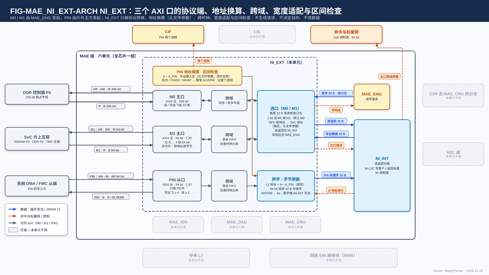
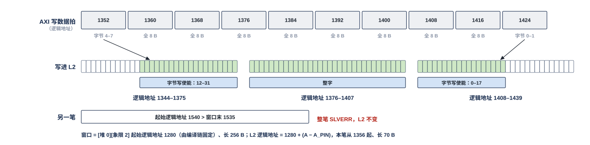

# MAE 片外接口（NI_EXT）需求

> Owner: WangYizhao｜2026-11-05｜正式稿第一版，待用户审阅。按用户 11-05 夜确认的目录（`../V17_3_MODULE_TOC_MAE_NI_EXT_20261104.md` 第三版）编写；依据 `Claude_Design_Spec/V1.7_3/Modules/MAE_NI_EXT.md`（冻结基线）、片上数据传输协议篇 `DATA_TRANSFER_PROTOCOL.md`（下称"协议篇"）、L2 正式稿、`Claude_Design_Spec/V1.8_DESIGN_REVISIONS.md`（V18-TP-09 / 24 / 25、V18-L2-02），SoC 事实以 `Chip_Framework_Design/SoC_Architecture_20261027/SOC_ARCHITECTURE_20261027.md` 为准（V1.8 §3）。
> 11-05 夜审阅：M0 / M1 / PIN 三口都必须支持异步跨域（§8.1）；$f_{\mathrm{IO}}$、$t_{\mathrm{rt,IO}}$、外设写等待上界、跨域 FIFO 延迟交设计者（§3、§7.7、§11）。
> 11-05 夜核间协议改版（V18-NIE-02、V18-TP-26…34）：PIN 窗口改由编译链按（调用种类, 输入种类）固定、初始化装一次，撤运行期窗口配置与 MAE 的窗口收回 / 释放命令；读返回按请求时记下的 (去向, 目的逻辑地址) 分路，不定义目的标签；PIN 的 B 响应以 L2 到达计数经 NI-L2C 仲裁器归属为准，不再按末拍 + 固定时延；存储字带 addr（24 bit 逻辑地址）、be、dest，撤抢占优先级（§1.2、§2、§7、§8.6、§9–§12）。
> 11-06（V18-TP-37，附录 `_build/TP_REVISION_BRIEF_20261106_ADDENDUM.md`）：**一个 AXI 写事务对应一个搬运单位，突发长度由外部主方定、NPU 不假设大小；PIN 的 B 响应依据改为 L2 NI 写口的写计数（写进 bank 时加一）经 NI-L2C 仲裁器归属到该笔**（§2、§7.2、§7.6、§11.2、§12）。
> 11-06 第二次（V18-TP-41…43，任务书 `_build/TP_RENAME_NOLAST_BRIEF_20261106.md`）：**片内侧信号与核内 RRAM 口同名（addr / be / dest），撤 last：一个 AXI 写事务是 NI-L2C 仲裁器记账的一个单位（按拍数记），链路上无标记，尾字在 AXI WLAST 拍交出、不另设时间界；L2 写计数按（入链路, 象限）分别维护，NI-L2C 仲裁器为每笔 PIN 事务记各象限项数，四象限都到齐才回 B**（§2.1、§7.2、§7.6、§8、§11、§12）。AXI 对外口的标准信号（AWADDR、WSTRB、WLAST、BRESP 等）不改。
> 11-06 清晰度遍历：改写了 §2.1（写响应对应关系要定什么）、§4.3（在飞是对 NI_EXT 的要求）、§7.2（拼字要定什么、约束）、§7.3（常量表每项内容）、§7.8（在飞的含义与超出时的行为）、§11.1（"只作背景"的速率改为本侧义务表）；并在 §3、§6、§7、§9 开头加了解释句。
> 11-06 深夜第二次（V18-TP-50）：**写入完成只分核内、核间两类；片外写的 AXI 写响应即核间写入握手的片外形式，PIN 不变**（§2.1、§12）。
> 11-06 深夜（V18-TP-47、V18-L2-04）：**PIN 的 B 响应改为"每笔事务取一个发令号、该号的写入握手数满才回"，撤按象限写计数与四象限到齐；L2 集合器里 NI 写与 L2WP 的先后改为 RTL 头文件参数；外设输入区放在一个象限的一堆内，PIN 事务不跨象限**（§2、§7.2、§7.6、§11、§12）。
> 11-06 第三次（V18-NII-03 修订、V18-L2-03，任务书 `_build/TP_L2WP128_BRIEF_20261106.md`）：**MAE_WSU 没有片外出口，NI_EXT 的写出数据只来自 L2 返回读与区域复制**（§2.1）。L2 写侧改为四核各一条写链路后，NI 写口仍是一条 32 B，在各象限集合器里与四核的先后按 MAE 装的 5 来源静态表（PIN 等待上界的依据不变）。
> 11-06 第四次（V18-NAME-01 / MAE-01…09，任务书 `_build/MAE_TYPE_AGNOSTIC_BRIEF_20261106.md`）：名称按外部输入信息篇（`L3PU_EXTERNAL_INFORMATION.md`）统一：命令 → 指令（命令与标量网的网名不变），MAE 通道 → MAE 搬运引擎，MAE_WSU → MAE_DSU（数据整形单元），共享内存 → 共享内存 / DDR（需区分时写 HSRAM 或 DDR）；**M1 承载的记录改用五类名称（指令、配置表、调用描述符、列表、数据），"模板镜像""KV 计划""元数据"退出；M1 读回可按指令目的口落 L2（V18-MAE-09）**（§1、§2、§3.1、§5、§6、§9、§11、§12）。只换词与句，未改结构、数字与规则。
> 11-06 晚修订（V18-MAE-11 / 12 / 13，任务书 `_build/MAE_CRU_MERGE_BRIEF_20261106.md`）：**CRU 并入 MAE 组（MAE_CRU），MAE 组六单元；MAE 不设完成计数器，写往片外的指令在 AXI 写响应收齐时执行完、由 MAE 带指令标号通知 LIC；读返回分路多一个去向 MAE_CRU（兼容能力）；MAE_CRU 的输出不写片外**（§1.1、§2.1、§2.3、§9、§11.2、§12）。§2 的连接图已换为 PPT 式架构图 FIG-MAE_NI_EXT-ARCH（旧 CONN 退役）；§2.1 补"主口错误 → NI_INT"一行。11-06 晚第二次（V18-MAE-26）：调用完成状态改由 CIF 状态寄存器承载，结果记录里不再有状态字（§2.3）。只改词、句与必要的表行。
> 11-06 深夜第三次（V18-TP-51 / NAME-04）：**撤 dest 信号，去哪个存储由发令方的通路选择决定（C2H 由本核 CCU 的 C2H 通道按发送指令的目标存储给 C2H 分流下通路选择，只在单位边界变）；地址不编码"是哪个存储"，addr 只是目的存储内部的位置；远端引擎回 MAE_ENG 的"发送完成"短消息改名"执行完成"**。

> 11-06 晚第三次（V18-NIE-03）：**PIN 改为线性地址换算 L2 逻辑地址 = A − A_PIN，只检查一个允许写入区间（外设输入区），撤 CIF 装载的窗口常量表；M0 / M1 也做 NPU 侧地址 → SoC 地址的按区换算；全部换算参数是 RTL 头文件参数、流片定死**（§2、§6.2、§7.2–§7.4、§11）。

NI_EXT 是 NPU 与 SoC 之间唯一的数据口外沿，有三个 AXI 口：主口 M0（256 bit，独占 DDR P0）、主口 M1（64 bit，经 SoC 片上互联到 HSRAM、DDR P2 与 FMC 主端窗口）、从口 PIN（64 bit，供系统 DMA 与 FMC 从端以任意逻辑地址、任意长度直写中央 L2 的外设输入区），以及它们的时钟边界与宽度适配。**NI_EXT 只做协议转换、地址换算、时钟边界、宽度适配与外设输入区检查；不生成请求、不决定目的、不改数据；选口只看每条请求的选口位。**

## 1 组成与位置

### 1.1 NI_EXT 是 MAE 组的一个单元，全芯片一份

MAE 组由 MAE_ENG（指令执行与搬运引擎）、NI_INT（片内网络接口）、MAE_IDN（入站分发网）、MAE_DSU（数据整形）、MAE_CRU（合并单元）与 NI_EXT 六个单元组成（用户 11-05 夜，V18-NII-03 / 04；用户 11-06，V18-MAE-11）。NI_EXT 全芯片一份。三个口在 NPU 一侧只共用 NI_INT 的读返回分路与 L2 客户通道 NI-L2C，彼此没有直接数据通路。**与 MAE 组外的连接经 MAE 组的对外口**；口的个数、驱动与共享方式见 MAE 集成篇 §3（`MAE_INTEGRATION.md`）。

### 1.2 三个口都是协议转换，只是发起方不同

| 口 | 谁发起 | NI_EXT 做的转换 |
|---|---|---|
| M0、M1（AXI 主口） | **MAE_ENG**：地址、长度、选口位都由它给 | MAE 的 32 B 请求 ⇄ AXI 事务：发读写地址与写数据，收回读数据与写响应交回；读返回按请求时记下的去向分路（§9）。**读写两个方向都经过 NI_EXT**，M0 上的权重、KV 等大流量主要是读 |
| PIN（AXI 从口） | **片外主设备**：系统 DMA、FMC 从端 | AXI 写 → L2 写：地址换算成 L2 逻辑地址、WSTRB 换成字节写使能；附带外设输入区检查与 B 响应时点 |

### 1.3 做什么、不做什么

- 做：协议转换、地址换算（三口，头文件参数）、跨时钟、宽度适配、外设输入区检查。
- 不做：不生成请求，不决定读哪些数据、写到哪里（MAE_ENG）；不补字、不读改写——按 AXI 地址与字节选通生成字节写使能；不转置、不量化、不解码。
- 不连外设数据口、不发起外围 DMA、不直连 eMMC。NPU 不作为 M55 的从设备被推送数据；APB 只承载控制，经 CIF。

### 1.4 SoC 侧的名字与分工

在 SoC 架构稿中本 NPU 称 **L3PU**；M0、M1 同名，PIN 即"L3PU SRAM 口"。SoC 互连内部、桥与时钟 / 位宽转换、PLL、时钟树与切频驱动归 SoC 设计者（用户 10-25）。

## 2 数据从哪来、到哪去

NI_EXT 内部按三个口各一行：M0 主口（256 bit，接 DDR 控制器 P0）、M1 主口（64 bit，接 SoC 片上互联，32 B 拆成 4 拍 64 bit）、PIN 从口（64 bit，系统 DMA / FMC 从端写入），每个口后面是自己的跨域级——M0 同步 / 异步可选，M1、PIN 为任意时钟比率的异步 FIFO。M0、M1 汇到一个选口点（按选口位选路，不是独立模块）：MAE_ENG 的每笔 32 B 请求按选口位送 M0 或 M1，并按区把 NPU 侧地址换成 SoC 地址（§6.2），读返回 32 B 交 NI_INT，写响应交回 MAE_ENG。PIN 一路按 L2 逻辑地址 = $A - A_{\text{PIN}}$ 线性换算（§7.2）、拼字，把 AXI 地址换成 L2 逻辑地址、WSTRB 换成 be，存储字交 NI_INT 的 NI-L2C 写客户；NI_INT 在该笔四个象限都写到之后放行 B 响应。地址换算按 RTL 头文件参数（$A_{\text{PIN}}$ 与一个允许写入区间，流片定死）做，落在外设输入区外、FIXED、WRAP 的事务整笔回 SLVERR，首个违规报 CIF。主口错误交 NI_INT，由 NI 控制道转报 LIC。LIC、中央 L2、四核 IDN 接收桥与 MAE_IDN、MAE_DSU、MAE_CRU 都画灰：NI_EXT 与它们没有直接往来。

### 2.1 MAE 组内的接口

| 接口 | 对端 | 方向 | 内容 |
|---|---|---|---|
| 读写请求 | MAE_ENG | 入 | 每笔 32 B，带选口位；同一 64 B 单元的两笔背靠背、成批按地址升序。每笔读请求的 (去向, 目的逻辑地址) 由 NI 记下，供返回时分路（§9） |
| 写响应 | MAE_ENG | 出 | 每笔写的 AXI 写响应（即核间写入握手的片外形式，V18-TP-50）；MAE 按指令给的数据量数写响应，数满即该指令的数据已写到片外、该指令执行完，由 MAE 带指令标号通知 LIC（协议篇 §7.4，V18-MAE-13）。**响应与指令的对应关系【设计者定】**：要定的是用 AXI ID、请求序号队列还是别的方式把每个写响应对回发出它的指令；约束是 MAE 能按指令分别数满，任何一个写响应不得计入别的指令（同一 AXI ID 内写响应按序，跨 ID 可乱序） |
| 读返回 | NI_INT（读返回分路） | 出 | 32 B 一笔；**每笔返回按发出时记下的 (去向, 目的逻辑地址) 分路**，不定义标签格式（V18-TP-34） |
| PIN 存储字 | NI_INT（NI-L2C） | 出 | **每个存储字带自己的 L2 逻辑地址（addr）与字节写使能（be）**；**一个 AXI 写事务是 NI-L2C 仲裁器记账的一个单位（按拍数记），链路上无标记；事务的尾字在 AXI WLAST 时交出**（§7.2）；突发长度由外部主方定，NPU 不假设大小（协议篇 §2.2、§5、§7.5） |
| PIN 落地依据 | NI_INT（NI-L2C） | 入 | **每笔 PIN 事务取一个发令号；L2 写进一项就回一个带 `src` 的写入握手，NI-L2C 数满该事务号的项数才通知本单元回该笔 B 响应**（§7.6，V18-TP-47） |
| 写出数据 | NI_INT | 入 | 要写出的 32 B 数据与字节使能；**来源只有 L2 的 NI 返回读口（L2 → DDR / M1）与 DDR → DDR 区域复制的读返回，MAE_DSU 的整形输出与 MAE_CRU 的合并输出都不写片外**（V18-NII-03 修订：DDR 只存前向形式的权重；MAE_CRU 的输出只去核 L1、L2 与 CCU，V18-MAE-12） |
| 主口错误 | NI_INT（NI 控制道） | 出 | M0 / M1 主口收到的 AXI 错误响应（口号、地址、原因），交 NI 控制道转报 LIC（§10；NI_INT 篇 §9：转发、不是检查） |

### 2.2 经 MAE 组对外的接口

| 接口 | 对端 | 方向 | 内容 |
|---|---|---|---|
| M0 | DDR 控制器 P0 | 出 / 入 | AXI4 主口，256 bit，独占专线 |
| M1 | SoC 片上互联总线 | 出 / 入 | AXI4 主口，64 bit |
| PIN | 系统 DMA、FMC 从端 | 入 / 出 | AXI4 从口，64 bit；回 B 响应或 SLVERR |
| PIN 首个违规 | CIF | 出 | 首个落在外设输入区外、或 FIXED / WRAP 的事务的地址与原因（§7.4）；**CIF 不再向 NI_EXT 装窗口表**：PIN 与 M0 / M1 的地址换算参数都是 RTL 头文件参数、流片定死（V18-NIE-03） |
| 主口错误 | 命令与标量网（经 NI 的端点） | 出 | 口号、地址、原因，报 LIC（§10） |

### 2.3 由别的模块保证的事项

| 事项 | 由谁保证 |
|---|---|
| 请求的地址、长度、目的与选口位；持续大流量只填 M0 | MAE_ENG |
| 同一 64 B 单元两笔背靠背、升序成批 | MAE_ENG |
| 调用结果"数据先落地、完成状态后给"与完成判定 | LIC：收到写结果记录那条指令的 MAE 完成通知（AXI 写响应已收齐，带指令标号）后，才写 CIF 的调用完成状态寄存器、由 CIF 发中断；结果记录里不再有状态字（用户 11-06："我认为状态字应该是 CIF 的事情"，V18-MAE-13 / 26） |
| 每个读请求记下 (去向, 目的逻辑地址)、返回按此分路；用几个 AXI ID、队列多深、放在 MAE_ENG 还是 NI_INT | MAE_ENG、NI_INT（【设计者定】） |
| **PIN 固定窗口**：每种片外输入在 L2 的落点按（调用种类, 输入种类）固定，并行到达时两个窗口按调用奇偶轮换；窗口落在外设输入区内 | 编译链 |
| 外部主方写到本次调用对应的固定窗口（$A_{\text{PIN}}$ + 窗口起点）；写完通知与实际长度（调用描述符 + CIF 门铃） | M55 软件、编译链 |
| 地址换算参数（$A_{\text{PIN}}$、外设输入区、M0 / M1 各区的起点 / 长度 / SoC 基址）与 SoC 地址图一致 | SoC 集成（RTL 头文件，流片定死） |
| NI-L2C 仲裁（记下各来源单位的先后）与外设写等待上界的实现 | NI_INT |
| L2 各象限写集合器里 NI 写与 L2WP 的先后 | L2（RTL 头文件参数，V18-L2-04） |
| DDR 控制器的在飞深度、互联拓扑与仲裁、桥与时钟 / 位宽转换、DDR 三口优先级、复位树、NPU 断电时的错误响应代答 | SoC 方 |
| 共享内存 / DDR 的缓存属性与 M55 侧缓存维护 | CIF / M55 |

## 3 端口与时钟合同

NPU 内部只有一种 32 B 的存储字和一个核时钟，片外却有三种位宽、两到三个时钟；本节把三个口的"外沿"固定下来，§4–§8 再分别说每个口怎样与内部的 32 B 存储字对上。

### 3.1 三个口一览

| 口 | 方向 | 对外位宽 | 时钟 | 对端 | 承载 |
|---|---|---|---|---|---|
| M0 | 主 | 256 bit | 核时钟 $f_{\mathrm{core}}$，参考 1 GHz，与 DDR P0 同频同源 | DDR 控制器 P0（独占） | 持续大流量：权重、KV、激活与残差往返、训练数据 |
| M1 | 主 | 64 bit | $f_{\mathrm{IO}}$【设计者定】 | SoC 片上互联总线 → HSRAM P2、DDR P2、FMC 主端窗口 | 小流量、时延敏感：指令、配置表（含 KV 段表）、调用描述符（及随它的调用输入记录与结果记录）、M55 产的列表、调用输入数据（Token ID、图像等）、输出缓冲追加 |
| PIN | 从 | 64 bit | $f_{\mathrm{IO}}$（与 M1 同频） | 系统 DMA、FMC 从端 | 外设数据直写 L2 外设输入区里编译链固定的窗口；调试读 |

**M1 与 PIN 对外 64 bit、二者同频，公共接口时钟记作 $f_{\mathrm{IO}}$，数值【设计者定】（与 SoC 集成对齐）；本篇不选 200 MHz / 800 MHz / 1 GHz，不定它与核时钟的关系**（用户 10-25；SoC 稿亦不标频率；11-05 夜交设计者）。APB 32 bit，经 CIF。

### 3.2 DDR 三口与时钟域

- DDR 三口分工（SoC 10-30）：**P0 256 bit 归本 NPU 的 M0 专用，在 DDR 控制器上优先级最高**；P1 512 bit 接小核 NPU 侧 AXI 互联；P2 64 bit 接 SoC 片上互联总线（M55、系统 DMA、本 NPU 的 M1）。三口共享同一份 DDR 带宽（LPDDR5 x32 · 6400 MT/s）。
- 三个时钟域：核时钟 $f_{\mathrm{core}}$（参考 1 GHz、最低 200 MHz）、$f_{\mathrm{IO}}$、APB 时钟。
- NPU 内部存储字宽 32 B，地址以字节计，默认按 32 B 对齐使用、支持非对齐紧密访存（协议篇 §2.5），与端口位宽无关。

### 3.3 M1 / PIN 的时间写成拍数 ÷ $f_{\mathrm{IO}}$ 加往返

**M1 / PIN 上传 $n$ B 的时间 = $4\lceil n/32 \rceil$ 个 64 bit 数据拍 ÷ $f_{\mathrm{IO}}$ + SoC 片上互联往返 $t_{\mathrm{rt,IO}}$**（$t_{\mathrm{rt,IO}}$【设计者定】，用户 10-25）。各类记录的字节数由 CIF 与数据流篇给出，本篇不汇总。

## 4 M0 主口：DDR P0 专线

### 4.1 本口由 MAE_ENG 发起，NI_EXT 只做协议转换，读写两个方向都经过它

M0 是 AXI4 主口、读写各一，经独占的 256 bit 专线接 DDR 控制器 P0，一笔一拍 32 B。

### 4.2 每笔 32 B，同一 64 B 单元的两笔背靠背

- 每次请求固定 32 B，不加宽请求或数据总线。
- **同一 64 B 单元两笔地址连续的请求保持背靠背发出**，由 DDR 控制器合成一次 64 B 突发。
- 写支持字节使能；单个字节的写不做读改写。

### 4.3 接口能力、DDR 带宽与在飞是三件事

（用户 10-25）

- **接口能力** $B_{\mathrm{M0,if}} = 32\ \mathrm{B} \times f_{\mathrm{core}}$：1 GHz 时 32 GB/s；$f_{\mathrm{core}} < 600$ MHz 时低于 19.2 GB/s 分析点，M0 接口成为瓶颈。
- **在飞**：读、写各 32 笔 × 32 B = 1 KB，取 SoC 侧 DDR 控制器的在飞深度配置值，NPU 不在其上自行加深。**对 NI_EXT 的要求是 M0 侧能同时维持读 32 笔、写 32 笔未完成事务，不因自身的事务名额、ID 或读返回对应关系（§9）少于 32 而限速**；NI_INT 的读请求记录容量随之不少于 32（NI_INT 篇 §3.2）。维持 $B_{\mathrm{DDR}}$ 需端到端读延迟 $t_{\mathrm{rd}} \le 1024\ \mathrm{B} / B_{\mathrm{DDR}}$（19.2 GB/s 时约 53 ns）。
- **有效吞吐**：

$$B_{\mathrm{M0,eff}} \le \min\big(32\ \mathrm{B} \cdot f_{\mathrm{core}},\ B_{\mathrm{DDR}} - B_{\mathrm{P1}} - B_{\mathrm{P2}},\ 1024\ \mathrm{B} / t_{\mathrm{rd}}\big)$$

  $B_{\mathrm{P1}}$、$B_{\mathrm{P2}}$ 为 P1、P2 两口占用的 DDR 带宽。19.2 GB/s 只是 DDR 分析工作点，不是 M0 接口上限；验收不预设 DDR 有效率。

### 4.4 M0 是唯一承载持续大流量的口

哪笔请求走 M0 由 MAE 指令的选口位决定（MAE 不感知数据类型，V18-MAE-01）；按数据种类的流量清单在数据流篇。

## 5 M1 主口：共享内存 / DDR 的记录读写

### 5.1 本口由 MAE_ENG 发起，可达 HSRAM P2、DDR P2 与 FMC 主端窗口

M1 是 AXI4 主口、读写各一，对外 64 bit、接口时钟 $f_{\mathrm{IO}}$；经 SoC 片上互联总线可达 HSRAM P2、DDR P2 与 FMC 主端窗口。到 DDR 经 P2，与 M55、系统 DMA 共享 P2，并与 P0 / P1 共享 DDR 总带宽（SoC 10-27 总线矩阵）。**NI_EXT 只做协议转换，读写两个方向都经过它。**

### 5.2 一笔 32 B 拆成 4 拍；共享内存 / DDR 一侧的逻辑地址可以不按 32 B 对齐

- 一笔 32 B 拆成 4 拍 INCR 突发，每拍 8 B；读返回在 NI 内拼回 32 B 再交 NI_INT。
- **共享内存 / DDR 里的源或目的地址可以不按 32 B 对齐**（V18-TP-25）：读入时 NI 按目的 L2 逻辑地址把字节放进存储字、带字节写使能；写出时按目的地址把字节放到对应位置，WSTRB 只选有效字节。例如生成循环的输出缓冲每次追加一个 3 B 的 token。

一笔 32 B 的写只写其中 18 B（存储字内字节 3–20）时，4 拍的 WSTRB（位 $i$ 对应该拍的第 $i$ 字节）：

| 拍 | 覆盖的字节 | 有效字节 | WSTRB |
|---|---|---|---|
| 0 | 0–7 | 3–7 | `1111 1000` |
| 1 | 8–15 | 8–15 | `1111 1111` |
| 2 | 16–23 | 16–20 | `0001 1111` |
| 3 | 24–31 | 无 | `0000 0000` |

### 5.3 承载的流量

M55 放在共享内存 / DDR 里的小流量、时延敏感数据：调用描述符（及随它的调用输入记录与结果记录）、指令、配置表源（含 KV 段表；段位置回写即写回 KV 段表）、M55 产的列表（KV 编辑列表等）、调用输入数据（Token ID、图像等）、输出缓冲追加写。**这类数据不走 APB**，APB 只写指针与门铃。各类记录的内容、落点与写出次序在 CIF、外部输入信息篇（`L3PU_EXTERNAL_INFORMATION.md`）与数据流篇。

**M1 读回可按指令的目的口落 L2**（Token ID、图像等 SoC 侧数据，V18-MAE-09）：与外部主方经 PIN 从口直写 L2 固定窗口（§7）并列，两条路都必须支持；NI_EXT 对 M1 读回只做协议转换，落 L2 还是交 LIC 直连口由 NI_INT 按读请求记录分路（§9）。

### 5.4 接口能力与在飞

- 每方向 $8\ \mathrm{B} \times f_{\mathrm{IO}}$；有效吞吐另受 SoC 片上互联竞争与目标从方限制。
- **调用描述符与配置表的读不得因同口写事务占满在飞资源而阻塞**；在飞名额（参考 ≤ 8 笔）与 AXI ID 分配【设计者定】。

## 6 选口与 M0 / M1 的地址换算

### 6.1 按选口位分流

选口是 MAE 的决定、不是 NI_EXT 的决定：NI_EXT 不知道一笔数据是什么、有多大，也就无从判断它该走大流量口还是低时延口；把这一位放进请求，NI_EXT 就只是一个按位选路的开关。

**选口位（port 位）是 MAE_ENG 给每条读写请求带的 1 bit，指定这笔事务从 M0 还是 M1 发出；NI_EXT 只看这一位分流，不看数据。** 默认 M0。

| 口 | 能到哪里 | 适合 |
|---|---|---|
| M0 | DDR（经 P0 独占专线） | 持续大流量 |
| M1 | HSRAM、DDR（经 P2）、FMC 主端窗口 | 小而时延敏感的记录 |

HSRAM 与 FMC 主端窗口只能经 M1 到达；DDR 两条路都能到，大流量走 M0、M55 放在 DDR 共享区的小记录可走 M1。同一类数据在不同场合可能放在 HSRAM 或 DDR，所以**选口不写死在 NI_EXT 里，由 MAE 的指令按数据所在位置填**。

### 6.2 M0 / M1 的地址换算：NPU 侧地址 → SoC 地址，头文件参数、流片定死

MAE 指令里的片外字节地址是 **NPU 侧地址**（L3PU 自己看到的 DDR / 共享内存地址）；SoC 有统一的地址图，L3PU 能访问的各段只占其中一部分。**NI_EXT 发 AXI 请求前把它换成 SoC 地址：SoC 地址 = NPU 侧地址 − 该区 NPU 侧起点 + 该区 SoC 基址**（用户 11-06："对 M0 和 M1 的口其实也有一样的地址转换需求，但是配置的逻辑会在流片时定死"，V18-NIE-03）。

| 口 | 区 | 每区参数（RTL 头文件，流片定死） |
|---|---|---|
| M0 | 1 个：DDR（经 P0） | NPU 侧起点、长度、SoC 基址 |
| M1 | 至少 3 个：HSRAM、DDR 共享区（经 P2）、FMC 主端窗口；区数【设计者定】 | 同上 |

- 换算只是按区减去起点、加上基址，不改数据、不拆请求；同一 64 B 单元两笔背靠背的性质保持（§4.2）。
- **不落在任何区内的请求不发出**，作主口错误经 NI 控制道转报 LIC（§10）。
- 参数不经 CIF、不在运行期改；改 SoC 地址图要改头文件重新综合。

## 7 PIN 从口：外设以任意逻辑地址与长度直写 L2

PIN 是三个口里唯一由片外主设备发起的口，所以 NPU 在这里要做两件主口上不需要的事：**守门**（只让写落进编译链固定的窗口，§7.3–§7.4）和**给出可信的完成时点**（B 响应要等数据真正写进 L2，§7.6）。其余部分——地址换算与拼字——与 M1 的非对齐写是同一类工作。

### 7.1 支持的事务

- AXI4 从口，对外 64 bit，接口时钟 $f_{\mathrm{IO}}$。
- 只支持 INCR；FIXED 与 WRAP 回 SLVERR。独占访问回 OKAY，表示独占失败。读只用于调试。
- **支持字节使能、非 2 的 $n$ 次方字节数与任意逻辑地址起点的写**（用户 11-05 夜，V18-TP-25）。

### 7.2 地址换算与拼字：L2 逻辑地址 = A − A_PIN

**SoC 有一张统一的地址图，L3PU 的 PIN 只占其中一段；NI_EXT 把外部主方发来的 AXI 地址 $A$ 线性换成 L2 逻辑地址：L2 逻辑地址 = $A - A_{\text{PIN}}$**，$A_{\text{PIN}}$ 是 SoC 地址图给 L3PU PIN 的基址（用户 11-06："外部的 SoC 架构会有一个统一的地址注册，而 L3PU 的地址只在其中的一小部分，因此需要做转换"，V18-NIE-03）。**$A_{\text{PIN}}$ 是 RTL 头文件参数，流片时定死**，不经 CIF 配置；L2 逻辑地址的格式见协议篇 §2.2（用户 11-05 夜：统一叫逻辑地址）。
- 64 bit 数据拍按逻辑地址放进所属存储字的对应字节位置，WSTRB 转成该存储字的字节写使能。
- **每个存储字带自己的逻辑地址与字节写使能交 NI-L2C**：addr = 该存储字的 L2 逻辑地址（24 bit），be = 字节写使能；**一个 AXI 写事务是 NI-L2C 仲裁器记账的一个单位（取一个 PIN 发令号，各拍带这个 `src`），链路上没有单位标记；突发长度（8 B × 1…256 拍）由外部主方定，NPU 不假设大小**（用户 11-06；V18-TP-42 / 43）。L2 的 NI 写口按地址落位、不累加（协议篇 §5）。存储字经 NI-L2C 进 L2 各象限的写集合器，与本象限对应核的 L2WP 链路的先后是 **RTL 头文件参数**（V18-L2-04，协议篇 §6.2）；外设输入区由编译链放在一个象限的一堆之内，一笔 PIN 事务不跨象限；不经 hub 写口、不给 L2 加口。
- **NI_EXT 不补字、不读改写，未写字节保持原值**（L2 正式稿 §5.4）。
- **拼字的组织【设计者定】**：要定的是 64 bit 拍拼成 32 B 存储字的结构（拼字寄存器个数、何时交出）。约束：(1) 每个字节按逻辑地址放到所属存储字的对应位置，字节写使能只对真正写到的字节为 1；(2) 一个存储字交出时带它自己的 addr 与 be；(3) 换到下一个存储字时交出当前字；**一笔写事务的尾字在 AXI WLAST 那一拍交出（事务结束即交），不另设时间界，不等后续突发**（§7.6）。

本例外设输入区就是一个窗口：[堆 0][象限 2]，起始逻辑地址 1280、长 256 B（区间参数与窗口都由编译链 / 头文件给定）。一笔 70 B 的写从逻辑地址 1356 开始，按 8 B 拍边界是 10 个 AXI 数据拍（1352、1360、…、1424）：首拍只有字节 4–7 有效，末拍只有字节 0–1 有效。落进 L2 时跨三个存储字——逻辑地址 1344–1375 里写 1356–1375（字节写使能 12–31）、1376–1407 整字、1408–1439 里写 1408–1425（字节写使能 0–17），其余字节保持原值。另一笔从逻辑地址 1540 开始，越过外设输入区末 1535，整笔回 SLVERR、数据丢弃，L2 不变。脚本断言写入字节与 AXI 数据逐字节相同。

### 7.3 外设窗口由编译链固定，硬件只认一个允许写入区间

**每种片外输入在 L2 的落点按（调用种类, 输入种类）由编译链固定，外部主方往固定窗口写**（用户 11-05 夜，V18-NIE-02）：窗口 = 起始逻辑地址 + 长度上限，落在外设输入区内、不跨堆与象限；同一种输入在相邻两次调用并行到达时，用两个固定窗口按调用奇偶轮换。外部主方的写地址 = $A_{\text{PIN}}$ + 窗口起始逻辑地址 + 窗口内偏移。

**硬件不按窗口查表，只检查写是否落在一个允许写入区间（外设输入区）内**（用户 11-06 选方案 B，V18-NIE-03）。区间由两个 RTL 头文件参数给出，流片定死：

| 参数 | 含义 | 位宽 |
|---|---|---|
| $A_{\text{PIN}}$ | SoC 地址图给 L3PU PIN 的基址 | 按 SoC 地址图 |
| 外设输入区起始逻辑地址 | 允许 PIN 写入的 L2 首字节，[堆 1][象限 2][字节号 21] | 24 bit（协议篇 §2.2） |
| 外设输入区长度 | 字节数 | 【设计者定】 |

- 各窗口在区内怎样排、各种输入落在哪，是编译链与 M55 软件的约定；**窗口之间不由硬件互相保护**，写错窗口只会落在外设输入区内，不会碰到区外的权重、激活与列表。
- **运行期不配置窗口**：MAE 没有窗口收回 / 释放指令，CIF 不装窗口表。运行期只剩"写完了、实际多长"，由调用描述符与 CIF 门铃给出（已有机制）。

### 7.4 区间检查：违规整笔回 SLVERR，不拖住互联

- **不落在外设输入区内的写或读、FIXED / WRAP，一律整笔回 SLVERR、写数据丢弃**；记录首个出错地址与原因，经 CIF 上报 M55。
- **违规不靠拉低 WREADY 拖住对端**；合法写在 NI-L2C 拥塞时按 AXI 握手拉低 WREADY，让对端停发。
### 7.5 写完通知与实际长度：由调用描述符与 CIF 门铃给出

NI_EXT 不计 PIN 的写字节数、不产生外设写事件。外部主方写完后，由 M55 在调用描述符里给出实际长度、经 CIF 门铃通知 NPU；NPU 只在门铃之后读该窗口。

### 7.6 写响应晚于数据落入 L2：以该事务号的写入握手数满为准

**每笔 PIN 写事务从 NI-L2C 的号池取一个发令号，事务的各拍带这个 `src` 进 L2；L2 把一项写进 bank 的那一拍就回一个带 `src` 的写入握手；NI-L2C 数满该事务的项数，才通知本单元回 B 响应，随后释放这个号**（协议篇 §2.6、§5.2、§7.4，V18-TP-47）。号池个数【设计者定】：约束是不小于本口可同时在飞的写事务数（§7.7 的 4 笔），号用完时 NI-L2C 停收新事务。这样各象限写进 bank 的先后即使与链路顺序不同，也不会把后一笔的项算到前一笔——每笔只数自己的号；11-06 白天的"L2 按象限写计数、仲裁器记各象限项数、四象限到齐才回 B"（V18-TP-43）撤。判据不含任何固定拍数，NI-L2C 与 L2 写口之间插几级流水都不影响正确性。同一 AXI ID 按序。**事务的尾字（不满的存储字，带字节写使能）在 AXI WLAST 那一拍交出**，不另设时间界，不等后续突发；链路上不带单位标记（V18-TP-42）。

### 7.7 优先级与等待上界

- PIN 写与 DDR 写 L2 同属 NI-L2C 写客户、共用 L2 的 NI 写口；在 L2 各象限写集合器里，NI 写与 L2WP 的先后是 RTL 头文件参数（协议篇 §6.2，V18-L2-04）。
- **外设写等待有上界，参考 ≤ 256 拍，具体值【设计者定】**：这是对 SoC 外部访问的时延承诺（用户 11-03 D1.5；11-05 夜交设计者），定下后与 CIF 篇写同一个值。仲裁与老化方法【设计者定】，须同时满足 NI 写持续带宽（归 MAE 与系统带宽预算）与 H2C 四道不饿死。
- **PIN 读只用于调试，在全部 L2 客户中优先级最低**，只要求最终完成、不阻塞其他客户，不定等待上界。

### 7.8 在飞

写 4 笔、读 2 笔（SOW，要求值）：**PIN 从口能同时接收、尚未回 B 响应的写事务至少 4 笔，尚未回完读数据的读事务至少 2 笔**；名额用满时按 AXI 握手拉低 AWREADY / ARREADY，让外部主方等待，不回错。由于 B 响应要等该笔数据写进 L2（§7.6），写名额占用的时间包含 NI-L2C 与 L2 写口的等待。

## 8 时钟边界与宽度适配

### 8.1 三个口都必须支持异步跨域

**M0、M1、PIN 三个口都必须支持异步跨域**（用户 11-05 夜）。M0 参考配置下与 DDR P0、核时钟同频同源，此时可工作在零跨域代价的同步模式；但异步跨域能力必须具备，以应对时钟关系变化与 SoC 端口处的实现差异。跨域的具体结构与同步 / 异步的切换方式【设计者定】。

### 8.2 M1 / PIN 按任意时钟比率异步

按任意时钟比率异步实现，跨域只用 FIFO，不用握手停顿换带宽。PIN 的时钟域转换在 NPU 接口单元内由 NPU 方完成；M1 接入 SoC 片上互联一侧的时钟 / 位宽转换由 SoC 方完成（用户 10-25 保留跨时钟边界）。

### 8.3 宽度适配

| 口 | 内部 ↔ 对外 |
|---|---|
| M0 | 与内部 32 B 等宽，不拆拼 |
| M1 | 一笔 32 B ↔ 4 拍 64 bit；不对齐时按逻辑地址放字节、给 WSTRB（§5.2） |
| PIN | 64 bit 拍按逻辑地址放进存储字并生成字节写使能，不补字（§7.2） |

### 8.4 字节序与对齐

小端，低地址在低位字节；宽度转换不改变字节序与地址对齐。M0 的请求按 32 B 对齐发出；M1 可按任意逻辑地址发出（AXI 非对齐起始 + WSTRB）。

### 8.5 全频段功能正确

$f_{\mathrm{core}}$ 为 200 MHz 到 1 GHz 的任一档都功能正确；以拍计的结构参数（在飞深度、FIFO 深度、流水级数）不随频率改变，以时间计的性能按 $f_{\mathrm{core}}$ 缩放；跨时钟 FIFO 按"两侧独立、各自可变"设计。

### 8.6 切频的前提

NPU 处于空闲或就绪态、三个口无在飞事务、系统侧不再发起 PIN 访问（窗口固定，由 M55 软件保证）；切频前后不需重装表或重配 CIF。**切频流程与复位序列归 CIF 与 SoC 集成。**

## 9 事务的共同规则

本节是三个口都遵守的规则，读的时候可以把它看作 NI_EXT 与 NI_INT 之间的约定：NI_EXT 保证"片外的完成时点与数据原样交到"，NI_INT 保证"按请求时记下的去向分路"，两边都不缓冲、都不解释数据。

- **写响应是落地点，也是核间写入握手的片外形式**：NPU 对共享内存 / DDR 的每笔写，以收到 AXI 写响应为"已落地、对他方可见"的时刻；片内各核间写链路的写入握手本来就取自 AXI 写响应通道 B 的做法（从机写完回 BRESP、主机据此判写完成；协议篇 §2.6 / §5.8，V18-TP-50），片外一侧直接用 AXI B，不另加信号；NI_EXT 把写响应交回 MAE_ENG，MAE 按指令给的数据量计数，收齐即该指令执行完、由 MAE 带指令标号通知 LIC；MAE 不设完成计数器（协议篇 §7.4，V18-MAE-13）。
- **读返回按请求对应关系分路**（用户 11-05 夜，V18-TP-34）：**NI 对每笔读请求记下 (去向, 目的逻辑地址)，返回数据按请求对应关系分路**——去 MAE_IDN、MAE_DSU、MAE_CRU（兼容能力，V18-MAE-12）、NI-L2C、LIC 或 NI_EXT 写通道；NI_EXT 不解释去向。对应关系怎样维持——用几个 AXI ID、队列多深、记录放在 MAE_ENG 还是 NI_INT——【设计者定】；不定义"目的标签"格式。
- 同一 AXI ID 内按序；**跨 ID 的乱序返回不重排**，每笔按自己记下的目的逻辑地址落位；需保序的读由 MAE 用同一 ID 发出。该指令的 MAE 搬运引擎数着还有几笔没回，用于发送完成计数，不上链路（协议篇 §7.4.3）。
- **NPU 侧不设入站缓冲**：NI_INT 下游停发时经 NI_EXT 拉低 M0 / M1 的 RREADY，只降速、不丢数；DDR 读满带宽由 MAE 读序与指令编译保证（用户 11-05 夜，V18-NII-01）。
- 逐位无损：读写数据在跨时钟、宽度拆拼前后逐字节相等，字节使能逐位保持。
- 只做协议与适配：不转置、不量化、不解码、不补字。

## 10 错误、计数与复位

- **错误**：
  - PIN 违规（越窗、FIXED / WRAP）的首错地址与原因经 CIF 上报 M55。
  - **主口收到 SLVERR / DECERR 时记口号、地址与原因，经 NI 的命令与标量网端点报 LIC，按致命错误处理**（协议只分致命一类，V18-TP-09）。
- **计数**：没有独立的性能计数，也不计 PIN 的写字节数（写完通知与实际长度由调用描述符与 CIF 门铃给出，§7.5）。
- **复位**：三个口在各自时钟域内同步释放；任一口复位期间不向对端发出半个事务；NPU 电源域关断或复位期间，PIN 的访问由系统侧错误响应逻辑代答 SLVERR。复位源与序列归 CIF 与 SoC 集成。

## 11 要求值与验收

### 11.1 要求值

| 项 | 要求值 | 说明 |
|---|---|---|
| M0 接口能力 | $32\ \mathrm{B} \times f_{\mathrm{core}}$；在飞读写各 32 笔 | 在飞取 DDR 控制器配置值 |
| M1、PIN | 每方向 $8\ \mathrm{B} \times f_{\mathrm{IO}}$；PIN 在飞写 4、读 2 | $f_{\mathrm{IO}}$【设计者定】 |
| 异步跨域 | M0、M1、PIN 三口都必须支持；跨域 FIFO 延迟参考 ≤ 6 个核拍，M0 同步同源时可为 0 | 结构与延迟【设计者定】 |
| 外设写等待 | 有上界，参考 ≤ 256 拍 | 【设计者定】 |
| 地址换算参数 | PIN：$A_{\text{PIN}}$、外设输入区起点与长度；M0：1 区；M1：≥ 3 区（HSRAM、DDR 共享区、FMC 主端窗口），每区起点 / 长度 / SoC 基址 | RTL 头文件参数，流片定死（V18-NIE-03）；M1 区数【设计者定】 |
| 门数 | ≤ 50 k 门（NAND2 等效）：M0 约 15–25 k、M1 约 8–12 k、PIN 约 8–12 k；另加约 1.5 KB 寄存器堆 | 建议值，不含 SRAM / RF 宏 |

**与 NI-L2C 写客户的速率衔接**：M0 读返回（目的为 L2 的部分）、M1 读返回、PIN 写三路都进 NI_INT 的同一条 32 B/拍 NI 写口，三路峰值之和可能超过 32 B/拍（推导值与参考工况见 NI_INT 篇 §5.6）。NI_EXT 一侧要做的只有下面三条，写口不够时由它们把停发传回片外，不丢数、不报错：

| 口 | NI-L2C 不收时 NI_EXT 的动作 | 依据 |
|---|---|---|
| M0 | 拉低 M0 的 RREADY | §9、V18-NII-01 |
| M1 | 拉低 M1 的 RREADY | §9 |
| PIN | 拉低 PIN 的 WREADY（合法写）；违规写不靠拉低 WREADY，整笔回 SLVERR | §7.4 |

参考工况：$f_{\mathrm{IO}} \le 0.8$ GHz、核频 1 GHz 时三路持续需求 $19.2 + 16\,f_{\mathrm{IO}}[\mathrm{GHz}]$ B/核拍不超过 32 B/拍（推导值，不是要求值）；$f_{\mathrm{IO}}$ 更高时只是更常停发。

### 11.2 验收

| 对象 | 方法 | 用例 |
|---|---|---|
| 端口与时钟（§3、§8） | 审查 | 端口宽度、读写通道与时钟关系 |
| M0 事务（§4.2） | 断言 | 请求恒为 32 B；同一 64 B 单元两笔背靠背 |
| 字节写（§4.2、§5.2） | 逐位比对 | 单字节尺度写后相邻字节不变、无读改写事务 |
| 选口（§6） | 断言 | 随机选口位，事务只出现在对应口 |
| PIN 与 M1 的非对齐写（§5.2、§7.2） | 逐位比对 | 随机起点、长度与 WSTRB 的写；写入字节与 AXI 数据逐字节相同，未写字节保持原值；逻辑地址按换算式 |
| 外设输入区与区间检查（§7.3、§7.4） | 错误注入 | 按编译链窗口（含奇偶两个窗口交替调用）写入各自落位；落在外设输入区外、FIXED / WRAP 整笔 SLVERR 且 L2 不变 |
| M0 / M1 地址换算（§6.2） | 逐笔比对 | 每区首尾地址换算后的 SoC 地址与参照一致；区外请求不发出、报主口错误 |
| 全频段与异步跨域（§8.1、§8.5） | 周期仿真 | 三个口各在同步与异步两种时钟关系下；随机 $f_{\mathrm{IO}} / f_{\mathrm{core}}$ 比率与 200 MHz–1 GHz 各档功能正确 |
| 写响应时点（§7.6、§9） | 周期仿真 | 写响应回交晚于 AXI 写响应；**PIN 的 B 响应晚于该事务号的写入握手数满**；随机化 NI-L2C 到 L2 写口之间的流水级数与 ready 时序、各象限写进先后、并与 M0 / M1 / DSU / CRU 写 L2 交错，B 响应仍不早于该笔最后一个存储字写入 L2、且不误归属到相邻一笔 |
| 读返回分路、乱序与复位（§9、§10） | 周期仿真 | 随机跨 ID 乱序返回，每笔按记下的 (去向, 目的逻辑地址) 分路、落位与顺序返回时相同，不外溢；复位注入下无半个事务 |

## 12 为什么

- **三个口的地址换算都是头文件参数、流片定死；PIN 只认一个允许写入区间**（用户 11-06："外部的 SoC 架构会有一个统一的地址注册，而 L3PU 的地址只在其中的一小部分，因此需要做转换……我需要它在 RTL 里写成头文件可配，并且我认为这里对 M0 和 M1 的口其实也有一样的地址转换需求，但是配置的逻辑会在流片时定死"，V18-NIE-03）：窗口位置本来就由编译链定死，线性映射已能落到正确窗口；保留一个区间检查，防止外部主方写坏外设输入区以外的 L2 数据；撤 CIF 装表，少一个初始化接口。
- **三个口都是协议转换，主口由 MAE_ENG 发起**（用户 11-05 夜确认）：NI_EXT 的职责边界与"传什么、发给谁、写到哪由 MAE 定"（用户 11-03）一致；把"谁发起"写清，读者不会把 NI_EXT 当成只发数据的出口。
- **M0 独占专线与 64 B 合并**：DRAM 效率由 64 B 突发决定、AXI 一拍只有 32 B；大流量要一条不与其他主方竞争互联的通路（SOW；SoC 10-27）。
- **接口能力、DDR 带宽与在飞分开写**（用户 10-25）：降频时接口能力同比下降，DDR 带宽由三口共享，1 KB 在飞只覆盖约 53 ns 读延迟。
- **M1 与选口位**：调用记录每轮只有几 KB、时延敏感但不占带宽，走 M1 不占 M0 的权重流时隙，也不走 APB；同一类数据可放 HSRAM 或 DDR，所以按选口位选口。训练数据走 M0 不走 M1：M1 慢且与系统主方共享 P2。
- **PIN 支持任意逻辑地址与长度**（用户 11-05 夜："这个明显是一个兼容式设计，可以不用，但是不能没有"，V18-TP-25）：外设数据（图像、音频、Token ID 等）的起点与长度不由 NPU 决定；L2 带字节写使能后，NI_EXT 只需把字节放到位、给出使能，既不补字也不读改写。取代同日的"由 M55 按 32 B 对齐"。
- **统一叫逻辑地址**（用户 11-05 夜："不应该叫偏移，统一叫逻辑地址是更合理的设计"）：窗口与换算都用 L2 逻辑地址表述，与协议篇、L2 篇同一种地址。
- **PIN 违规整笔回错、不拖住互联**：越界写不能改写 NPU 正在用的 L2，错误访问不能卡住 SoC 片上互联；系统 DMA 一报完成 M55 就会通知 NPU 用数据，所以 B 响应等数据真正可见；PIN 写优先级低但不能无限期饿死，所以有等待上界（用户 11-03 D1.5）。
- **PIN 窗口由编译链固定**（用户 11-05 夜，V18-NIE-02："某些数据在编译链定死在某个地址了，然后做什么操作只能去这里取，我认为这个设计方案也是可以的，并且更简单"）：每种片外输入的落点按（调用种类, 输入种类）静态确定，并行到达靠奇偶两个窗口轮换，于是运行期不再需要 CIF 逐次配置窗口与 MAE 的窗口收回 / 释放指令；"写完了、实际多长"本来就由调用描述符与门铃给出。与协议篇"类内怎么分只是编译链的地址"同一原则。取代同日的"由 M55 经 CIF 设置窗口"。
- **B 响应以写入完成为准，不用末拍 + 固定时延**（用户 11-05 夜，V18-TP-28："这里不应该是解除固定时延嘛"；11-06 V18-TP-37 写计数在写进 bank 时加一）：核间流水级数由后端定，固定时延会随之失效；写计数与仲裁器记下的先后只取决于握手逻辑。
- **一个 AXI 写事务对应一个搬运单位，突发长度不假设**（用户 11-06："一笔 AXI 写突发 = 一个搬运单位 这个真的合适吗？你认为一个 Burst 是多少数据量？"）：保留对应关系，突发长度（8 B × 1…256 拍）由外部主方定，NPU 由 NI-L2C 按事务分发令号、按写入握手判落地，与突发多长无关；11-06 起链路上不再带末拍标记，尾字在 AXI WLAST 拍交出（用户 11-06："为什么仍然有末拍的 LAST 拍？"；V18-TP-42）。
- **PIN 事务取发令号、按该号的写入握手数满才回 B**（用户 11-06："我认可方案 1"；"链路增加一个信号，它用来表明对应的是哪个 MAE 引擎"；V18-TP-47）：同一笔事务的存储字按象限进不同 FIFO，各象限写进先后可与链路顺序不同，总计数会误归属；每笔只数自己的号即可。取代 11-06 白天的"写计数按象限、四象限到齐才回 B"（V18-TP-43）。
- **读返回只要求"能分到正确去向"，不定义标签**（用户 11-05 夜，V18-TP-34："需要 ID 让 MAE 知道这是它之前发的哪个数据的返回（其实只要有这个功能就可以了，无需基于 ID 实现）"）：对应关系的实现交设计者。
- 存储字带 addr / be / `src`、无抢占优先级（V18-TP-26 / 33；dest 11-06 深夜撤，V18-TP-51，见协议篇 §5、§12）。
- **三个口都支持异步跨域**（SOW；用户 10-25 保留跨时钟边界；用户 11-05 夜："异步跨域的能力，对 M0，M1，PIN 都要支持，其他的可以交给 Designer 确定"）：参考频率相同不等于可以去掉跨域逻辑；$f_{\mathrm{IO}}$ 未定，M1 / PIN 按任意比率异步；M0 同步同源只是参考配置。频率、往返时延、外设写等待上界与 FIFO 延迟的具体值交设计者。
- **写往片外以 AXI 写响应收齐为执行完，由 MAE 带指令标号通知 LIC**（用户 11-06："这里我认为不应该是完成计数器，而是 LIC 和 MAE 的握手机制……MAE 只需要在一个指令执行完的时候，通知 LIC 即可"，V18-MAE-13）。
- **主口错误按致命处理**（V18-TP-09）：协议只分致命一类，由 LIC 经 CIF 报 M55 决定。
- **SoC 事实以 10-27 SoC 架构稿为准**（V1.8 §3）：本 NPU = L3PU；M1 可达 HSRAM P2、DDR P2、FMC 主端；无 LSRAM。
- 本篇各项要求来自 SOW / SoC 稿约束与一步推导，均未仿真。
