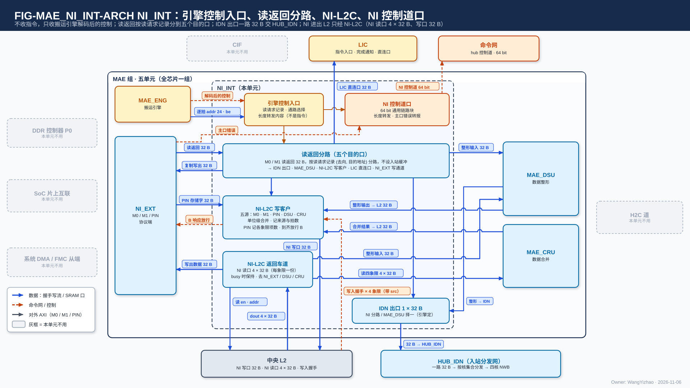

# MAE 片内网络接口（NI_INT）需求

> Owner: WangYizhao｜2026-11-06｜正式稿第一版，待用户审阅。按用户 11-06 确认的目录（`../V17_3_MODULE_TOC_MAE_NI_INT_20261104.md` 第四版，待定项全部关闭）编写；依据 `Claude_Design_Spec/V1.7_3/Modules/MAE_NI_INT.md`（冻结基线）、片上数据传输协议篇 `DATA_TRANSFER_PROTOCOL.md`（下称"协议篇"）、L1 / L2 / MAE_NI_EXT 正式稿、`Claude_Design_Spec/V1.8_DESIGN_REVISIONS.md`（V18-NII-01…07、V18-TP-25…40、V18-NIE-01 / 02）。与 V1.7_3 冲突处以 V1.8 为准。
> 11-06 清晰度遍历：改写了 §1.3（MAE 通道条数）、§2.2（NI 返回读口信号）、§3.1（按命令类列出 NI 要做的动作、队列深度要定什么）、§3.2（读请求记录的内容与容量约束）、§3.3（交 MAE_IDN 的接口量纲）、§3.4（长度转发的格式与发出次序）、§4.2（M0 / M1 先后要定什么、约束）、§5.4（返回车道的读协议与按余量发读）、§5.5（先后记录的内容）、§10.1（各值的性质）；§5.6 / §5.7 为用户点名后的样本。
> 11-06 修订（V18-TP-41…44，任务书 `_build/TP_RENAME_NOLAST_BRIEF_20261106.md`）：**信号与核内 RRAM 口同名（en / ready / din / be / addr / dest，命令与标量网 en / ready / data），撤 last：搬运引擎数着该命令还有几笔没回只用于发送完成计数、不上链路；读返回分路里设 4 × 32 B 拆拍寄存器（结构性寄存器，不是入站缓冲）；相邻命令允许重叠执行；PIN 事务按象限记项数、四象限到齐才回 B；长度转发先发但不要求先到，数据可先落地**（§1.2、§1.3、§2、§3.1–§3.4、§5.3、§5.5、§5.7、§10–§12）。
> 11-06 第二次修订（V18-NII-03 修订、V18-L2-03，任务书 `_build/TP_L2WP128_BRIEF_20261106.md`）：**MAE_WSU 的整形输出只去 L1（经 MAE_IDN）与 L2（经 NI-L2C 写客户），没有片外出口；L2 写侧改为四核各一条 L2WP 写链路后，NI 写口是各象限集合器 5 个来源之一**（§2.1、§2.2、§2.3、§3.1、§4）。
> 11-06 第三次修订（V18-NAME-01 / MAE-01…09，任务书 `_build/MAE_TYPE_AGNOSTIC_BRIEF_20261106.md`）：名称按外部输入信息篇（`L3PU_EXTERNAL_INFORMATION.md`）统一：命令 → 指令（命令与标量网的网名不变），MAE 通道 / DMA 通道 → MAE 搬运引擎，MAE_WSU → MAE_DSU（数据整形单元）；**LIC 直连口收指令、配置表、调用描述符、KV 段表，交 LIC 专用小 SRAM（V18-LIC-01）；读返回分路按目的口写，不按数据类型分去向；配置表装载是一条普通搬运指令、NI 不核对；M1 读回可落 L2（V18-MAE-09）；DSU 两平面合并输出去 L1 全码区**（§1、§2.1、§2.2、§4.1、§5.2、§5.6、§10.1、§11）。只换词与句，未改结构、数字与规则。
> 11-06 晚修订（V18-MAE-11…18，任务书 `_build/MAE_CRU_MERGE_BRIEF_20261106.md`）：**CRU 并入 MAE 组，改名 MAE_CRU（合并单元），MAE 组六单元；MAE 只有搬运指令，源与目的之间的运算级由指令的运算字段经 MUX 选直通 / 经 MAE_DSU 整形 / 经 MAE_CRU 合并；NI-L2C 写客户来源变五个（M0 / M1 / PIN / DSU / CRU），读返回分路与返回车道各多一个去向 MAE_CRU（MAE 读路径进 CRU，兼容能力）；MAE 不设完成计数器，每条指令执行完由 MAE 带指令标号通知 LIC；gather 到核 L1 的应写量同样经长度转发；MAE 不做环形回绕**（开头、§1.1、§1.3、§2.1、§2.3、§3.1–§3.4、§4、§5.2–§5.7、§6、§10.2、§11）。§2 的连接图已换为 PPT 式架构图 FIG-MAE_NI_INT-ARCH（旧 CONN 退役）。只改词、句与必要的表行。
> 11-06 晚第三次（V18-MAE-27）：**NI_INT 不收指令、撤 NI 指令队列与"按指令类开路"；只收搬运引擎解码后的控制信号（读请求记录、通路选择、长度转发内容）**（§1.1、§1.2、§2、§3.1、§5.4、§5.7、§9、§10.1）。
> 11-06 深夜第二次（V18-TP-50 / MAE-30）：**核间写入完成统一为"写入握手 + 发令方计数"**：LIC 直连口每写进一项回握手、经读返回分路按 `src` 交引擎；目的核 L1 的"执行完"改为引擎数满 L1 回来的握手（IDN 落地的握手经 MAE_IDN 回引擎，不经 NI_INT）；CRU 按条目计到达份数（§2.2、§2.3、§6）。
> 11-06 深夜（V18-L2-04、V18-TP-47 / 49）：**NI 写口每拍带发令号 `src` 与象限掩码，可写任一象限、单位不跨象限、可广播；L2 回写入握手（按象限、带 `src`），NI-L2C 按号分发给引擎或留给 PIN 事务，PIN 的 B 响应按事务号数满才回；撤"写计数交两处"与 PIN 按象限记账；长度转发只用于运行期才知道的量**（§2.2、§2.3、§4、§5.5、§9–§11）。下一行 V18-MAE-20 的"写计数交两处"由本行取代。
> 11-06 晚第二次（冲突项裁定，V18-MAE-20）：**NI 写口的 4 个象限写计数同时交 MAE_ENG（L2 写入完成）与 NI-L2C 写客户仲裁器（PIN 的 B 响应）**（§2.2、§5.5）。
> 11-06 深夜第三次（V18-TP-51 / NAME-04）：**撤 dest 信号，去哪个存储由发令方的通路选择决定（C2H 由本核 CCU 的 C2H 通道按发送指令的目标存储给 C2H 分流下通路选择，只在单位边界变）；地址不编码"是哪个存储"，addr 只是目的存储内部的位置；远端引擎回 MAE_ENG 的"发送完成"短消息改名"执行完成"**。

NI_INT 是 MAE 组六个单元之一，全芯片一个。**它把 MAE 发出的搬运指令落实到每一拍：M0 / M1 的读返回回来时，按该请求发出时记下的 (去向, 目的逻辑地址) 分到 MAE_IDN（去各核 L1）、MAE_DSU（去整形）、MAE_CRU（去合并，兼容能力）、NI-L2C（去 L2）、LIC 或 NI_EXT（写回片外）；NPU 进出中央 L2 的 NI 侧流量只经它的 L2 客户通道 NI-L2C。** 它不生成 DDR 请求、不算地址（每拍地址由 MAE 的搬运引擎（V18-MAE-02）给出）、不改字的内容、不缓冲、不做错误检查；核间分发归 MAE_IDN，整形归 MAE_DSU，合并归 MAE_CRU，落地攒字归 L1 / L2 的接收桥。

## 1 组成与位置

### 1.1 三块逻辑加一个控制道端点

NI_INT 由两块数据通路组成：**读返回分路**（按搬运引擎给的读请求记录分到六个目的口，内含 4 × 32 B 拆拍寄存器）与 **L2 客户通道 NI-L2C**（写客户 + 返回车道）；另有 **NI 控制道口**，是命令与标量网在 NI 这一侧的口。**NI_INT 不收指令、不设指令队列，只收搬运引擎解码后的控制信号**（§3.1，V18-MAE-27）。MAE 组的其余五个单元是 MAE_ENG（指令引擎与搬运引擎）、NI_EXT（三个 AXI 口的协议端）、MAE_IDN（入站分发网）、MAE_DSU（数据整形）、MAE_CRU（合并单元：归约、标量合并、读集合并）（用户 11-05 夜，V18-NII-03 / 04；用户 11-06，V18-MAE-11）。与 MAE 组外的连接经 MAE 组的对外口，口的个数、驱动与共享方式见 MAE 集成篇 §3（`MAE_INTEGRATION.md`）。

### 1.2 做什么、不做什么

| 做 | 不做（归谁） |
|---|---|
| 按搬运引擎给的控制执行：读返回分路、写 L2、从 L2 读出交 NI_EXT / MAE_DSU / MAE_CRU | 不收指令、不设指令队列（V18-MAE-27）；不生成 DDR 请求、不决定读什么（MAE_ENG） |
| 把每拍数据与 MAE 搬运引擎给的 addr / be 一起交出 | **不算地址**：每拍目的逻辑地址由 MAE 的搬运引擎生成（V18-TP-27），NI_INT 没有地址生成器 |
| 读返回分路里去 MAE_IDN 的 32 B 读返回经拆拍寄存器拆成 4 拍 8 B（§3.3） | 不为吸收时延抖动设 FIFO |
| NI-L2C 仲裁器记各来源单位的先后 | 不改字的内容：整形在 MAE_DSU；V 与权重 MXINT4 不再展开（V18-NII-02） |
| 长度转发、NI_EXT 主口错误转报（NI 控制道） | 不做核间分发（MAE_IDN）；不攒字、不落地（L1 / L2 接收桥） |
| — | **不设入站缓冲**（V18-NII-01；指不为吸收时延抖动设 FIFO，拆拍寄存器是结构性寄存器，不算入站缓冲）；**不做错误检查**（V18-NII-05）；不报完成（写入完成按写计数，协议篇 §2.6） |

### 1.3 术语

- **逻辑地址**：以字节计的 24 bit 地址 [堆 1][类 2][字节号 21]（协议篇 §2.2）；L2 的类位即象限号。
- **存储字**：32 B，一个 bank 的一个存储单元。
- **读请求记录**：MAE 发每笔 32 B 读请求时记下的 (去向, 目的逻辑地址)，返回时按它分路；实现【设计者定】（V18-TP-34）。
- **MAE 搬运引擎**：MAE 的搬运引擎，逐拍产生源地址与目的地址（协议篇 §2.4.2）；数量按并发指令数【设计者定】、与链路数解耦（同一链路上多条指令在单位边界仲裁；引擎可少于或多于链路数，V18-MAE-10）；搬运引擎的物理位置（MAE 中央或数据源旁）【设计者定】，但逻辑上属于 MAE，NI_INT 只把它给的地址随数据送出。**搬运引擎不按链路配置**：任何一个搬运引擎执行到经过下列链路的指令时，就由它给出该链路上的地址；同一链路上的多条指令在单位边界轮流（V18-MAE-10、V18-TP-36）。与 NI_INT 有关的链路及搬运引擎在其上给出的内容：

  | 链路 | 搬运引擎给出什么 | 归哪篇 |
  |---|---|---|
  | NI → L2 写口 | 写 L2 每拍的 addr / be | 本篇 §5.3 |
  | L2 → NI | 读 L2 每拍的 en / addr，返回车道上每拍的 addr / be | 本篇 §5.4 |
  | MAE_IDN 的四条道 | 每道每拍的 addr / be | MAE_IDN 篇 |
  | MAE_DSU 出口 | 整形输出每拍的 addr / be | MAE_DSU 篇 |
  | MAE_CRU 出口（去 L2） | 合并输出经 NI 写口每拍的 addr / be | MAE_CRU 篇（`MAE_CRU.md`） |
- **搬运单位**：发令方（MAE 搬运引擎）内部的粒度，用于合并点仲裁的切换边界与发出计数；**链路上没有单位标记**（协议篇 §7.5，V18-TP-42）。

## 2 数据从哪来、到哪去

MAE_ENG 的搬运引擎给 NI_INT 的是解码后的控制：每笔读请求的记录 (去向, 目的逻辑地址)、每单位的通路选择、逐拍的 addr / be，以及要发长度转发时的内容；NI_INT 不收指令、不算地址。读返回分路把 NI_EXT 交来的 M0 / M1 读返回（32 B）按读请求记录分到六个目的口：MAE_IDN（经 4 × 32 B 拆拍寄存器拆成 4 道 × 8 B）、MAE_DSU（整形输入）、MAE_CRU（读路径，兼容能力）、NI-L2C 写客户（去 L2）、LIC 直连口（32 B），以及区域复制 DDR → DDR 时的 NI_EXT 写通道。NI-L2C 写客户有五个来源（M0、M1、PIN、DSU、CRU），在单位边界切换，经 32 B 的 NI 写口写 L2；L2 每写进一项沿 NI 写口回一个带发令号的写入握手，写客户按号分给对应引擎，PIN 事务号的由写客户自己数满才放行 B 响应。返回车道向 L2 的 NI 返回读口发 en / addr、收 32 B dout，按余量发读，读出数据交 NI_EXT 写出、交 MAE_DSU 整形或交 MAE_CRU 合并。NI 控制道（64 bit）发长度转发，并转报 NI_EXT 的主口错误。MAE_CRU 的主输入（各核 C2H 上去 MAE_CRU 的单位）和它去核 L1、回 CCU 的输出都不经 NI_INT，所以右侧两个 hub 对端画灰。

### 2.1 MAE 组内的接口

| 接口 | 对端 | 方向 | 内容 |
|---|---|---|---|
| 引擎的控制信号 | MAE_ENG（执行该指令的搬运引擎） | 入 | **不是指令**：每笔读请求的记录 (去向, 目的逻辑地址)；每单位的通路选择（返回车道交 NI_EXT / MAE_DSU / MAE_CRU，写客户接哪个来源）与单位边界；长度转发的内容；随数据的每拍 addr / be（V18-TP-27、V18-MAE-27）。口对与通路选择的对应见 §3.1 表；MAE 不做环形回绕（V18-MAE-17） |
| 读返回 | NI_EXT | 入 | M0 / M1 读返回，32 B 一笔；**按该请求发出时记下的 (去向, 目的逻辑地址) 分路**，不定义标签格式（V18-TP-34） |
| PIN 存储字 | NI_EXT | 入 | 每个存储字带 addr = L2 逻辑地址、be = 字节写使能；一个 AXI 写事务是 NI-L2C 仲裁器记账的一个单位，**取一个 PIN 发令号**（号池 ≥ 4，参考值），事务的各拍带这个 `src`；链路上无单位标记，尾字在 AXI WLAST 拍交出；突发长度由外部主方定（MAE_NI_EXT 篇 §7） |
| 写出数据 | NI_EXT | 出 | 要写到片外的 32 B 数据与字节使能：NI-L2C 返回车道读出的 L2 数据、区域复制 DDR → DDR 的读返回（不经 MAE_ENG 的写聚合，V18-NII-07） |
| PIN 落地依据 | NI_EXT | 出 | NI-L2C 数 L2 回来的、`src` = 该事务发令号的写入握手，**达到该笔事务的项数才通知 NI_EXT 回该笔 B 响应**，随后释放这个发令号（§5.5；MAE_NI_EXT 篇 §7.6，V18-TP-47） |
| 去各核数据 | MAE_IDN | 出 | 4 条 8 B 道的数据，连同 MAE 的 IDN 搬运引擎逐拍给出的 addr / be；每条道接哪些核由 MAE 指令配置 MAE_IDN 的交叉开关（MAE_IDN 篇） |
| 整形输入 | MAE_DSU | 出 | 来自读返回分路（DDR 原形）或 NI-L2C 返回车道（L2 原形）、指令的整形模式不是"原样"的数据（例：权重平面；两平面合并时为同一 key 的 hi 字与 lo 字两处，V18-MAE-04） |
| 整形输出 | MAE_DSU | 入 | $W^{\mathsf T}$ 列字块与旁带行，交 MAE_IDN（去 L1）或 NI-L2C 写客户（去 L2）；两平面合并输出（hi 字 + lo 字相邻的记录，V18-MAE-04）经 MAE_IDN 去 L1 全码区；**没有片外出口**（V18-NII-03 修订：DDR 只存前向形式的权重，反向不另存 $W^{\mathsf T}$） |
| 合并输入（读路径） | MAE_CRU | 出 | 指令运算字段为"经 MAE_CRU"、源为 DDR（读返回分路）或 L2（NI-L2C 返回车道）的数据，交 MAE_CRU 合并；这是 MAE_CRU 的兼容输入，主输入是各核 C2H 上去 MAE_CRU 的单位、不经 NI_INT（V18-MAE-12） |
| 合并输出（写 L2） | MAE_CRU | 入 | MAE_CRU 的合并结果（例：读集合并后的列表）经 NI-L2C 写客户写 L2，每拍 addr / be 由执行该指令的 MAE 搬运引擎给出；合并结果去核 L1 经 H2C 道、标量合并值经命令与标量网回 CCU，都不经 NI_INT（V18-MAE-12） |

### 2.2 经 MAE 组对外的接口

| 接口 | 对端 | 方向 | 内容 |
|---|---|---|---|
| NI 写口 | 中央 L2 | 出 | 核间从口（带地址的握手写流，信号与核内 RRAM 口同名）：en / ready / din 32 B / be / addr 24 bit / `src`（发令号：执行该指令的搬运引擎号，或 PIN 事务号）/ 象限掩码 4 bit（全 0 = 按 addr 象限位写一个象限；非 0 = 广播到掩码内各象限的同一象限内地址）；**可写任一象限，一个单位不跨象限**；是各象限写集合器的两个来源之一（另一个是本象限对应核的 L2WP 写链路），两者先后为 RTL 头文件参数（V18-L2-04；协议篇 §5、§6.2；L2 篇 §5） |
| NI 写口写入握手 | 中央 L2 | 入（反向旁带） | 4 个象限各一组，每拍至多一项：valid + 该项的 `src`；**NI-L2C 按 `src` 分发：引擎号的交 MAE_ENG 对应引擎（L2 写入完成），PIN 事务号的留给自己数（PIN 的 B 响应）**（V18-TP-47） |
| LIC 直连口写入握手 | LIC 专用小 SRAM | 入（反向旁带） | 每拍至多一项：valid + `src`；LIC 小 SRAM 每写进一项回一个，**读返回分路按 `src` 交 MAE_ENG 对应引擎**，引擎数满后通知 LIC（V18-TP-50、MI8） |
| NI 返回读口 | 中央 L2 | 入 | L2 的读口之一，1 道 × 32 B，可读任一象限。NI → L2：en、addr（每拍一个存储字的逻辑地址，由 L2 → NI 搬运引擎给出）；L2 → NI：dout 32 B、vld、busy。不撞 bank 时 dout 在固定拍数 $t_{\text{r}}$【设计者定，L2 篇 §5.6】后出现；busy 时 NI 保持 en / addr 到下一拍重发；读出按发出顺序返回（L2 篇 §5.1、§5.3） |
| **LIC 直连口** | LIC | 出 | M1 读回的指令、配置表、调用描述符、KV 段表，由读返回分路直接交 LIC 专用小 SRAM（V18-LIC-01）；**口宽 32 B（一个存储字，省去位宽转换，V18-NII-08）**；不经 MAE_IDN，不走命令与标量网（用户 11-06，V18-NII-06） |
| NI 控制道 | 命令与标量网 | 出 | 长度转发（搬运变长对象或 gather 到核 L1 时先于数据发出、不要求先于数据到达，发往目的核 CCU：类位、基址、长度、记录数，内容由 MAE 给）；NI_EXT 的 AXI 主口错误转报 LIC；不发完成消息（协议篇 §8.1） |

### 2.3 由别的模块保证的事项

| 事项 | 由谁保证 |
|---|---|
| **DDR 读始终满带宽**：读序、预取距离与缓冲轮转 | MAE_ENG、编译链（LIC 操作 15）（V18-NII-01） |
| 每拍目的逻辑地址、be、链路分配；单位边界（内部信号，不上链路）；去 MAE_IDN 时一个存储字由同一条道送全 | MAE 搬运引擎（V18-TP-27 / 42） |
| 读请求记录 (去向, 目的逻辑地址) 的维持：用几个 AXI ID、队列多深、放 MAE_ENG 还是 NI_INT | 【设计者定】（V18-TP-34） |
| 需保序的读（整形输入：列尺度行先于列字、先 hi 后 lo）用同一 AXI ID 发出 | MAE_ENG |
| 目的空间在数据到达时已读完；压紧激活按位点窗口静态分配 | 编译链（LIC 操作 15、V18-TP-40） |
| 同一阶段并发写总需求 ≤ 写集合口道数 × 32 B/拍 | 编译链 |
| NI-L2C 两方向的排程（MAE_DSU 从 L2 读、写回 L2 时两方向同时占用） | 编译链 |
| L2 各象限写集合器里 NI 写与 L2WP 的先后 | L2（RTL 头文件参数，V18-L2-04） |
| 逻辑地址到 bank 的换算、攒字、写计数（L1）与写入握手（L2） | L1、L2 接收桥 |
| NI 写一个单位不跨象限、象限掩码与应写量一致 | MAE 搬运引擎 |
| 整形读序与输出地址 | MAE_DSU 篇、MAE 搬运引擎 |
| 合并算法、合并输出地址；CRU 按 CRU 内地址计到达份数、一组合并完成报 MAE_ENG | MAE_CRU 篇（`MAE_CRU.md`）、MAE 搬运引擎（V18-MAE-12 / 30） |
| 环形缓冲不用于 MAE 搬运，跨环尾拆成两条指令 | 编译链（V18-MAE-17） |
| 核间所有流水级与端点是通用链路块的实例（寄存器输出、skid 可配） | 各设计者（协议篇 §5.3.2） |

## 3 引擎给的控制：读请求记录、通路选择、长度转发

### 3.1 NI_INT 不收指令，只收搬运引擎解码后的控制信号

**搬运指令只交给执行它的搬运引擎；NI_INT 是数据通路，不设指令队列、不按指令类开路**（用户 11-06："为什么搬运引擎会给 INT 发指令？不应该是已经由 MAE 完成解码的控制命令了吗？"，V18-MAE-27）。执行一条指令的搬运引擎把它解码成三类控制，随请求或随单位交给 NI_INT：

| 控制 | 什么时候给 | NI_INT 用它做什么 |
|---|---|---|
| 读请求记录 (去向, 目的逻辑地址) | 每笔 M0 / M1 读请求发出时 | 读返回回来时按它分到去向，并把目的地址随数据交出（§3.2） |
| 通路选择 | 每个单位开始时 | 返回车道这一单位交 NI_EXT 写通道、MAE_DSU 还是 MAE_CRU；写客户这一单位接哪个来源；单位发完的边界供写客户合并切换（§5.3、§5.4） |
| 长度转发的内容 (类位, 基址, 长度, 记录数) | 搬运变长对象或 gather 到核 L1、第一拍数据之前 | 经 NI 控制道口发给目的核 CCU（§3.4） |

**相邻两条指令可以重叠**：后一条的读请求可以在前一条的读返回还没回完时发出。正确性不靠指令之间的间隔，而靠读请求记录（§3.2）：每笔返回按自己的记录落位，同一 AXI ID 内保序。

下表是各口对下引擎给出的通路选择（口对见 MAE_ENG 篇 §4.2）；括号里是例子：

| 口对 | 读返回的去向 | NI-L2C 写客户 | NI-L2C 返回车道 | NI 控制道口 |
|---|---|---|---|---|
| M0 / M1 → L2 | NI-L2C 写客户 | 接收，送 NI 写口 | — | — |
| M0 → 核 L1（经 MAE_IDN） | MAE_IDN | — | — | 搬运变长数据或 gather 时先发长度转发（§3.4） |
| L2 → DDR / 共享内存 | 无读返回 | — | 读 L2，交 NI_EXT 写通道 | — |
| DDR → DDR（区域复制） | NI_EXT 写通道（V18-NII-07） | — | — | — |
| L2 → L2 | 无读返回 | 接返回车道的数据 | 读 L2 | — |
| 经 MAE_DSU，源 DDR | MAE_DSU | 目的 L2 时接 MAE_DSU 输出 | — | — |
| 经 MAE_DSU，源 L2 | 无读返回 | 目的 L2 时接 MAE_DSU 输出 | 读 L2，交 MAE_DSU | — |
| 经 MAE_CRU，源为各核 C2H（去 MAE_CRU 的单位）、目的 L2 | 无读返回 | 接 MAE_CRU 输出 | — | — |
| 经 MAE_CRU，源 DDR（兼容能力） | MAE_CRU | 目的 L2 时接 MAE_CRU 输出 | — | — |
| 经 MAE_CRU，源 L2（兼容能力） | 无读返回 | 目的 L2 时接 MAE_CRU 输出 | 读 L2，交 MAE_CRU | — |
| M1 → LIC 直连口（指令、配置表、调用描述符、KV 段表的装载） | LIC 直连口 | — | — | — |

整形输出去 L1 时经 MAE_IDN、去 L2 时经 NI-L2C 写客户，由 MAE_DSU 篇定；整形输出不去片外（V18-NII-03 修订）。**合并输出去 L2 时经 NI-L2C 写客户；去核 L1 时经 H2C 道（作该道的第二源），不经 NI_INT、不经 MAE_IDN**（V18-MAE-12）。DSU 与 CRU 是运算级的两路，并列、互不依赖，一条指令只选其一。

**NI_INT 不能提前排队控制信号**：控制随请求或单位到达，NI_INT 不缓冲"未来的指令"；某一路下游未就绪时，经握手让引擎停发（§4.3）。
### 3.2 按读请求记录分路，NI_INT 不算地址

**每笔读返回按该请求发出时记下的 (去向, 目的逻辑地址) 分到去向，目的逻辑地址随数据交出——去 L2 时就是 NI 写口那一拍的 addr，去各核时交给 MAE_IDN 作该拍 addr**（V18-TP-27 / 34）。AXI 保证同一 ID 内按序返回，所以记录是按 ID 排的队列；**跨 ID 的乱序返回不重排**，每笔按自己的记录落位；相邻两条指令重叠执行时（§3.1），各自的返回同样只按各自的记录落位，记录里不需要指令号。用几个 ID、队列多深、记录放在 MAE_ENG 还是 NI_INT，由设计者定（用户 11-06："只要有这个功能就可以了，无需基于 ID 实现"）。

读请求记录可以理解为"把发请求时就已知道的目的，存到数据回来时再用"：AXI 读返回本身不带目的，DDR 又可能乱序，所以目的只能在发请求那一刻记下。

| 记录的内容 | 位宽 | 来源 |
|---|---|---|
| 去向：MAE_IDN / MAE_DSU / MAE_CRU / NI-L2C 写客户 / LIC 直连口 / NI_EXT 写通道 | 六选一 | 发该请求的搬运引擎按口对给出（§3.1） |
| 目的逻辑地址 | 24 bit（协议篇 §2.2） | 该请求所属搬运引擎发请求时生成的目的地址 |

**记录实现【设计者定】**：要定的是 AXI ID 的个数、每个 ID 的记录队列深度、记录放在 MAE_ENG 还是 NI_INT；约束是**能同时存的记录数不少于 M0、M1 两口同时在飞的读请求数**（推导值：M0 读在飞 32 笔，MAE_NI_EXT 篇 §4.3；M1 读在飞参考 ≤ 8 笔，MAE_NI_EXT 篇 §5.4），否则在飞名额用不满、DDR 读流断续。

**搬运引擎数着该指令还有几笔没回，用于发送完成计数，不上链路**（协议篇 §7.4.1、§7.4.3，V18-TP-42）：最后一笔离开通道时该指令"发送完成"；该指令何时算执行完按目的判定（§6），执行完由 MAE 带指令标号通知 LIC（V18-MAE-13）；链路上不打任何末拍标记。

### 3.3 去各核的数据

去各核的数据连同 MAE 的 IDN 搬运引擎给出的每拍 addr / be 交 MAE_IDN；每条道接哪些核由 MAE 指令配置 MAE_IDN 的交叉开关。交 MAE_IDN 的接口是 **4 条 8 B 道，每道每拍 din 64 bit + addr 24 bit（本拍 8 B 所在目的存储字的字节地址）+ be 8 bit + `src`**，各道各自握手（§5.7 的通用链路块实例），合计 32 B/拍。**一个 32 B 存储字整字由一条道 4 拍送全**，由 IDN 搬运引擎的地址排法保证（W / S 类本来只整字写；L1 的 NWB 四拍凑满整字即写、没有末拍标记，所以各类都必须如此，MAE_IDN 篇 §2.3、L1 篇 §7.5，V18-TP-42）。

**拆拍寄存器在读返回分路里**（V18-TP-42 的结构性推论）：M0 的读返回一笔 32 B，而一个存储字要由一条 8 B 道分 4 拍送出，所以**每条道配一个 32 B 拆拍寄存器（共 4 × 32 B），收进一笔 32 B 读返回、按顺序交出 4 个 8 B**，交出时 addr 按 8 B 递增、由 IDN 搬运引擎给出。它是结构性寄存器——没有它 32 B 读返回进不了 8 B 道——不是入站缓冲；"不设入站缓冲"（§4.2）指不为吸收时延抖动设 FIFO。某条道的拆拍寄存器未交完时，下一笔去该道的读返回在分路处按握手等待。**V 行字散写的行位交错、gather 的目的地址都在 MAE 搬运引擎内展开，归 MAE_ENG 篇**；NI_INT 不持任何地址生成器。**MAE 搬运的数据不用环形缓冲，MAE 不做环形回绕**：编译链按静态窗口与 ping-pong 分配，跨环尾时拆成两条指令（V18-MAE-17）。

### 3.4 长度转发先于数据发出，不要求先于数据到达

gather 到某核 L1、或搬运长度运行期才知道的外部对象时，NI 控制道端点先向目的核 CCU 发长度转发（类位、基址、长度，内容由 MAE 从指令或列表计数取得；gather 的应写量 = 列表计数 × 项字节数，V18-MAE-15；按槽存储的变长对象不需要，V18-TP-49），再启动数据（协议篇 §7.3、§8.7）；目的核 CCU 用它做读地址推理、"最后一块按剩余有效量处理"与写计数比对。

**长度转发走命令与标量网、数据走 MAE_IDN 的数据链路，两张时延无关的网保证不了到达先后**（V18-TP-44）：数据可以先落地（L1 接收桥无状态、按 addr 写），长度转发只门控目的核 CCU 的消费与写计数比对；晚于数据到达不是错误。"数据到达而配置未就绪 = 致命错误"只指位点指令尚未装入 CCU 的情形（协议篇 §8.7、§10）。

- **消息格式**：首字 + 1 个载荷字（协议篇 §8.1、§8.6），载荷 = 类位、基址、长度、记录数；各字段位宽归 ISA。经 NI 控制道（64 bit 通用链路块实例，§5.7）发出。
- **本侧次序**：**该指令的第一拍数据在长度转发的最后一字于 NI 控制道上成交之后才发出。** 这只约束 NI 这一侧的发出次序，不保证目的核的到达次序。指令不需要长度转发（定长对象）时直接启动数据。
- 长度转发是 L1 写计数比对的"应写量"来源之一（另一来源是位点指令，协议篇 §2.6）；可以把它理解为替目的核 CCU 补上编译期不知道的那部分指令内容。

## 4 读返回分路：按目的口直接分到六处，不设入站缓冲

### 4.1 六个目的口

**读返回只按指令给的目的口分路，不按数据类型分**（V18-MAE-01）；括号里的数据只是例子。

| 目的口 | 数据 |
|---|---|
| L1，经 MAE_IDN | 一切目的为核 L1 的读（例：权重平面、K / V、激活、位置数组） |
| MAE_DSU | 指令的整形模式不是"原样"的读（例：要转置的权重平面、要两平面合并的 K / V hi 与 lo） |
| MAE_CRU | 指令运算字段为"经 MAE_CRU"、源为 DDR 的读（兼容能力；MAE_CRU 的主输入是各核 C2H 上去 MAE_CRU 的单位，不经读返回分路，V18-MAE-12） |
| L2，经 NI-L2C 写客户 | 一切目的为 L2 的读（例：权重 tile、调用输入、chunk、装进 L2 固定区的配置表（阈值表）；M1 读回的 Token ID、图像等 SoC 侧数据，V18-MAE-09） |
| LIC 直连口 | 目的为 LIC 直连口的读：M1 读回的指令、配置表、调用描述符、KV 段表，交 LIC 专用小 SRAM（V18-NII-06、V18-LIC-01） |
| 片外写出，经 NI_EXT 写通道 | 区域复制 DDR → DDR 的读返回，直接写出；整行拷贝不需要攒，行起点不对齐时由 NI_EXT 按目的地址给写掩码（V18-NII-07） |

**配置表装进 LIC 专用小 SRAM 或 L2 固定区，由一条搬运指令完成（源 = 共享内存 / DDR 中的配置表源），NI 不核对表头**；表的版本由调用描述符引用、LIC 在下一调用入口切换（`L3PU_EXTERNAL_INFORMATION.md` §3）。

### 4.2 不设入站缓冲

**DDR 读返回的时延抖动不由 NI 吸收**：由 MAE 的预取距离（LIC 操作 15）与 L1 的逻辑区消化；**DDR 读始终满带宽是 MAE 读序与指令编译要保证的事**（用户 11-05 夜，V18-NII-01）。M0、M1 两路读返回同时到达时的先后【设计者定】，没轮到的一路经 RREADY 停住。

这一条的意思是：NI 不靠缓冲"抹平" DDR，而是让 DDR 的节奏直接传到下游；抖动被上游（预取距离）与下游（L1 逻辑区）吸收，NI 本身是一段直通的握手流水。

**M0 / M1 先后【设计者定】**：要定的是两口读返回同拍都有效时先收哪一路。约束：
1. 读返回分路合计 32 B/拍（§10.1），所以两路是真竞争；
2. **两路去同一去向时，这里就是一个合并点，只能在单位边界换源**（协议篇 §5.9，V18-TP-36；单位边界由两路各自的 MAE 搬运引擎给出，属发令方能看到单位边界的合并点，V18-TP-45）；
3. M1 读返回去 L2 时还要过 NI-L2C 写客户的仲裁，须满足 §5.6 的要求 1（DDR 来源持续带宽）。

### 4.3 下游停发时经 RREADY 回到 DDR

多播在等最慢的核、NWB 将满、L2 集合器让四核 L2WP 链路先写——任何下游停发都只让 NI 的流水停住，经 NI_EXT 拉低 M0 / M1 的 RREADY；AXI 允许，只降速、不丢数、不报错（协议篇 §5.3）。

## 5 L2 客户通道 NI-L2C：唯一一条 32 B 双向通道

### 5.1 NI 进出 L2 的流量只经它

写客户接 L2 的 NI 写口，返回车道接 L2 的 NI 返回读口。两方向各 ≤ 32 B/拍。两个方向的性质不同：写客户是核间握手写流（L2 用 ready 让它停），返回车道是对 L2 读口的读（没有 ready，靠发读前判余量，§5.4）；所以本节分开写两侧的规则。

### 5.2 写客户的五个来源

DDR 读返回（目的为 L2 的读，M0）、M1 读返回（调用输入等）、PIN 写（NI_EXT 交来的存储字）、MAE_DSU 输出（整形后写 L2，V18-NII-03）、MAE_CRU 输出（合并结果写 L2，例：读集合并后的列表，V18-MAE-12）。

**M1 读回 → L2**（Token ID、图像等 SoC 侧数据，V18-MAE-09）：NPU 按搬运指令经 M1 读回、目的口为 L2，走写客户；**外部主方经 PIN 从口直写 L2 固定窗口是并列的另一条路**，两条都必须支持（兼容性）。

### 5.3 写 L2 逐拍带地址与字节写使能，单位不交错

**写 L2 的每一拍带目的逻辑地址（addr）与字节写使能（be）**，对齐使用时整字写，紧密对象（PIN、M1 读入的调用输入）首尾不满的存储字只写有效字节（协议篇 §2.5、V18-TP-25）。**五个来源在写客户合并时只在单位边界切换，一个单位的各拍连续，写客户上单位不交错**（V18-TP-36；这里是发令方能看到单位边界的合并点：NI-L2C 仲裁器按拍记来源，PIN 事务边界来自 AXI WLAST，V18-TP-45）。**单位边界是发令侧交给写客户仲裁器的内部信号，不上链路**（V18-TP-42）：M0 / M1 读返回、MAE_DSU 输出与 MAE_CRU 输出的单位由各自的 MAE 搬运引擎给出；PIN 的单位是一笔 AXI 写事务，以 AXI WLAST 为界（MAE_NI_EXT 篇 §7.2）。写客户本身不改字：数据过了写客户就不再经 MAE_DSU、MAE_CRU 与 MAE_IDN。

### 5.4 返回车道的三个去向

L2 读出的数据交 NI_EXT 写出（L2 → DDR / M1），或交 MAE_DSU 作整形输入（L2 → 整形，V18-NII-03），或交 MAE_CRU 作合并输入（L2 → 合并，兼容能力，V18-MAE-12）；去哪一个由搬运引擎给的通路选择定（§3.1）。NI 返回读口带 busy，busy 时 NI 保持请求；L2 不回通知（L2 篇 §5.3）。

返回车道的读法与核内读 L1 相同，而与核间写流不同：**L2 的读口没有 ready，读出的数据一定会在 $t_{\text{r}}$ 拍后出来，所以"有没有地方放"必须在发读之前判断**（协议篇 §4.1："谁发 en，谁承担'有没有地方放'的判断"）。具体要求：

1. **发读**：L2 → NI 通道每拍给一个 en / addr；busy 时原样保持到下一拍。读请求里没有长度与请求号，读多少由搬运引擎按指令的数据量计数（L2 篇 §5.3）。
2. **按余量发读**：读出数据进入返回车道的第一级通用链路块（§5.7 第二行）；**这一级按"深度 − 在途拍数 $L$"给发读方一个将满信号，将满时通道停发新的读**（协议篇 §4.4）。$L$ = 已发未回的读数上限，含 $t_{\text{r}}$ 与通道停发所需的拍数；这一级的 skid 深度【设计者定】，须不小于 $L$。这不是另设的入站缓冲，而是通用链路块 skid 在"上游没有 ready"时的用法。
3. **下游停发**：NI_EXT 写通道（AXI WREADY 低）、MAE_DSU 入口或 MAE_CRU 入口拉低 ready 时，返回车道的通用链路块停住，第一级随之到将满、通道停发，L2 上不会有读出的数据被丢弃。
4. 返回车道上每拍的 addr / be 由 L2 → NI 搬运引擎给出；交 NI_EXT 时 addr 是片外目的地址（§5.7）。

### 5.5 每拍带发令号；写入握手按发令号分发，PIN 的 B 响应按事务号数满才回

**送上 NI 写口的每一拍都带发令号 `src`：M0 / M1 / DSU / CRU 四个写客户的拍用执行该指令的搬运引擎号（由引擎随控制给出），PIN 的拍用该笔事务从号池取的事务号**（V18-TP-47）。L2 每把 NI 写口的一项写进 bank，就在该象限那一组回一个写入握手（valid + `src`）。**NI-L2C 按 `src` 分发握手：引擎号的转交 MAE_ENG 里对应的引擎（判 L2 写入完成），PIN 事务号的由自己数，某笔事务数满它的项数才通知 NI_EXT 回 B 响应，随后释放这个号**（MAE_NI_EXT 篇 §7.6）。

这样做的原因：NI 写口被几个搬运引擎与 PIN 事务共用，各象限写进 bank 的先后又可以与链路上的先后不同，接收方的累计计数只能靠"累计目标值"或"象限记账表"间接归属。握手带发令号后，**每个发令方只数自己的号，归属自然完成**，NI-L2C 不再需要"按单位、按象限"的记账表，L2 也不再维护写计数（用户 11-06："链路增加一个信号，它用来表明对应的是哪个 MAE 引擎呢？相当于不对数据打标签，但是区分数据的通道"）。PIN 号池的个数【设计者定】：约束是不小于外部主方可同时在飞的写事务数（参考 ≥ 4），号用完时 NI-L2C 对 NI_EXT 停收新事务。**广播**：MAE 指令给出象限掩码时，同一拍写进掩码内各象限，每个象限各回一个握手，引擎按象限数倍计应写量。11-06 白天的"仲裁器为每笔 PIN 事务记各象限项数、四象限写计数到齐才回 B"（V18-TP-43、V18-MAE-L0）撤。各来源之间的仲裁与老化【设计者定】，须同时满足 PIN 外设写等待上界（MAE_NI_EXT 篇，【设计者定】，参考 ≤ 256 拍）与 NI 写持续带宽不低于 DDR 入流。

### 5.6 写客户的带宽要求：一条 32 B/拍写口承接三个片外来源

写客户只有一条 32 B/拍的 NI 写口，要承接三个片外来源同时写 L2 的数据（整形输出写 L2 是第四个来源，与 DDR 来源分时，不同时达峰；MAE_CRU 合并输出写 L2 是第五个来源，与其余来源同一阶段的并发写总需求由编译链排程，§2.3）：

| 来源 | 每拍最大 | 来源的时钟 | 说明 |
|---|---|---|---|
| DDR 读返回（目的为 L2 的读） | 32 B / 核拍 | 核时钟 | M0 口 256 bit，持续读时每核拍一笔 32 B；参考工况下 DDR 可用带宽 19.2 B/核拍（Ref19.2，1 GHz 核频） |
| M1 读返回（调用输入、装进 L2 固定区的配置表；Token ID、图像等 SoC 侧数据） | 8 B / IO 拍 | $f_{\mathrm{IO}}$ | M1 口 64 bit；每轮调用只有几 KB |
| PIN 写（外设输入） | 8 B / IO 拍 | $f_{\mathrm{IO}}$ | PIN 口 64 bit；突发长度由外部主方定 |

**要求**：
1. **持续带宽**：写客户送上 NI 写口的持续速率不得低于 DDR 读返回中目的为 L2 的那部分的到达速率；否则 RREADY 被反复拉低，DDR 读流断续（V18-NII-01 的"DDR 满带宽"失效）。参考工况下这意味着 NI 写口在 DDR → L2 阶段至少 19.2 B/核拍留给 DDR 来源。
2. **PIN 等待上界**：PIN 来源在写客户里等待的时间不得超过 MAE_NI_EXT 篇 §7.7 的外设写等待上界（【设计者定】，参考 ≤ 256 核拍），否则外部主方的 AXI 写事务超时。仲裁要保证这一条，而不是只按先到先发。
3. **超额时的行为**：三个来源的峰值之和 $32 + 2 \times 8\,f_{\mathrm{IO}}/f_{\mathrm{core}}$ B/核拍可能超过 32 B/拍。超额不是错误：没轮到的来源在各自的口上停发——DDR 来源经 NI_EXT 拉低 M0 的 RREADY，M1 / PIN 来源由 NI_EXT 拉低对应 AXI 口的就绪信号——只降速、不丢数、不报错。协议不要求写口加宽。
4. $f_{\mathrm{IO}}$ 与核频的关系【设计者定】（MAE_NI_EXT 篇 §3）；$f_{\mathrm{IO}} \le 0.8$ GHz、核频 1 GHz 时 M1 + PIN 峰值 12.8 B/核拍，与 DDR 的 19.2 B/核拍之和恰在 32 B/拍以内，这是"一条写口够用"的参考依据，不是要求值。

### 5.7 NI_INT 里的通用链路块实例

协议篇 §5.3.2 规定核间所有握手链路由同一个通用链路块例化（V18-TP-38）。NI_INT 里要例化的实例、各自的参数如下；**设计者按此例化，不得自写握手流水**：

| 实例 | 方向 | 数据位宽 $W$ | 旁带 $S$ | 说明 |
|---|---|---|---|---|
| NI 写口（写客户 → L2 的 NI 写接收桥） | 出 | 256 bit | addr 24 + be 32 + `src` | 数据网链路；ready 来自 L2 接收桥的入口 FIFO |
| NI 返回读口之后的读出流水（L2 → 返回车道） | 入 | 256 bit | addr 按目的定 + be 32 | L2 的读口本身是 L2 内部的 SRAM 口（带 busy），从读出数据进入 NI-L2C 返回车道起算通用链路块 |
| 返回车道 → NI_EXT 写通道 | 出 | 256 bit | addr（片外地址，位宽按 NI_EXT 定）+ be | — |
| 读返回分路 → MAE_IDN | 出 | 4 × 64 bit（四条道各一个实例，各接在本道的 32 B 拆拍寄存器之后，§3.3） | 每道 addr 24 + be 8 + `src` | 四条道各自独立，不要求同拍 |
| 读返回分路 → MAE_DSU、MAE_DSU → 写客户 | 出 / 入 | 256 bit | addr 24 + be 32 + `src` | — |
| 读返回分路 / 返回车道 → MAE_CRU、MAE_CRU → 写客户 | 出 / 入 | 256 bit | addr 24 + be 32 + `src` | 与 MAE_DSU 一行同参数（V18-MAE-12） |
| 读返回分路 → LIC 直连口 | 出 | 256 bit（32 B，V18-NII-08） | 无 | V18-NII-06 |
| 引擎控制入口（MAE_ENG → NI_INT） | 入 | 读请求记录、通路选择、长度转发内容的位宽【设计者定】 | 单位边界 | 组内接口，不是命令与标量网链路；形式见 MAE 集成篇 |
| NI 控制道（NI_INT → 命令与标量网） | 出 | 64 bit | 无（消息长度在首字） | 长度转发、错误转报 |

每个实例的 **skid 深度 = 从本块拉低 ready 到上游真正停发之间的在途拍数**（单级寄存器为 1），**流水级数**按后端布线需要定；两者都是例化参数【设计者定】，可以逐实例不同。**功能定义里不出现任何固定拍数**：在任一实例的任一位置再插一级，NI_INT 的行为不变。验收按协议篇 §5.3.2：随机化每个实例的流水级数与 ready 时序，逐位一致、不丢拍、不重复（V18-TP-32）。

## 6 完成：收发两端按指令数据量计数，NI_INT 不报完成

NI_INT 处在发送方（MAE 搬运引擎）与接收方（L1 / L2 / 片外）之间，是一段只管搬、不记账的管道：两本账一本在发令方、一本在落地处，管道里有多少级流水都不影响对账结果。

- **发送侧**：NI 路径（DDR → L2、L2 → DDR、区域复制、整形搬运、合并搬运）的 MAE 搬运引擎数自己发出的拍，数到指令给的数据量即"发送完成"（协议篇 §7.4.1）。
- **接收侧**（统一判据，协议篇 §2.6）：写 L2 的数据由 L2 在存储字写进 bank 时回写入握手（带发令号），发令的搬运引擎按指令的应写量数（V18-TP-47）；去各核（经 MAE_IDN）的由各核 L1 的接收桥计写计数交 CCU 比对；**写往片外以 AXI 写响应为准**，由 NI_EXT 交 MAE。不设排空信号。
- **"执行完"按目的判定，执行完由 MAE 带指令标号通知 LIC**（V18-MAE-13）：目的 L2 = 引擎数写入握手达到；目的 DDR / 共享内存 = AXI 写响应收齐；目的核 L1 = 引擎数满 L1 回来的写入握手（IDN 落地的握手由各核 NWB 回到 MAE_IDN、再按 `src` 交引擎，不经 NI_INT；多播按目的核数倍计；消费由目的核 CCU 按核内写计数判断，V18-TP-50）；目的 MAE_CRU = MAE_CRU 按 CRU 内地址计到达份数、一组合并完成报 MAE_ENG，同样由 MAE 通知 LIC（V18-MAE-30）。**MAE 不设完成计数器**，指令不带等待条件。
- NI_INT 不发完成消息；链路上没有单位标签、没有请求号。

## 7 时序关系

1. 长度转发先于对应数据发出；不要求先于数据到达，目的核 CCU 等它到了再消费与比对（§3.4，V18-TP-44）。
2. 目的空间在数据到达前已读完、驻留区按份轮转、压紧激活按位点窗口预留（编译链经 LIC 操作 15；V18-TP-40）。
3. 整形输入的读序（列尺度行先于列字、先 hi 后 lo）由 MAE_ENG 用同一 AXI ID 保证（MAE_DSU 篇）。
4. 通路选择随单位切换；指令的先后由 LIC 与搬运引擎决定，NI_INT 只按到达的控制与数据执行。

## 8 不得破坏的合同

- **逐位无损**：读返回、L2 读写、交给 MAE_IDN / MAE_DSU / NI_EXT / LIC 的数据不改任何数据位，字节写使能逐位保持。
- **每笔读返回落到且只落到它的读请求记录给出的位置**；跨 ID 乱序返回下结果与顺序返回相同。
- **每条指令经 NI 发出的拍数等于指令给的数据量**。
- NI_INT 内发令方能看到单位边界的合并点（NI-L2C 写客户、M0 / M1 读返回去同一去向）单位不交错（V18-TP-36 / 45）。

## 9 计数与复位

- **不做错误检查**（用户 11-05 夜，V18-NII-05）；NI_EXT 的 AXI 主口错误经 NI 控制道端点转报 LIC，这是转发、不是检查。
- 不上报计数；停顿由 MAE 计入位点计数。
- 复位与位点边界：清在途读请求记录与 NI-L2C 仲裁器的先后记录；没有跨调用驻留的状态。

## 10 要求值与验收

### 10.1 要求值

| 项 | 值 | 性质与依据 |
|---|---|---|
| 读返回分路 | 32 B/拍（核时钟） | 要求值：等于 M0 每核拍一笔 32 B 的接口能力（MAE_NI_EXT 篇 §4.3），分路不得成为 M0 的瓶颈 |
| NI-L2C | 两方向各 ≤ 32 B/拍 | 口宽（一条 32 B 通道，L2 篇 §5.1）；写客户一侧的持续带宽要求见 §5.6 |
| 去 MAE_IDN | 32 B/拍（4 道 × 8 B） | 要求值，与 MAE_IDN 合计口宽相同（MAE_IDN 篇 §9.1） |
| 拆拍寄存器 | 4 × 32 B（每道一个） | 结构性寄存器：一笔 32 B 读返回由一条 8 B 道分 4 拍送出（§3.3）；不是入站缓冲 |
| LIC 直连口 | 口宽 32 B（V18-NII-08） | 要求值（用户 11-06："直接设置成 32B，省去位宽转换"）；约束：不经 MAE_IDN、不走命令网（V18-NII-06）。流量：指令每调用几十 KB（调用之间装载，不在关键路径）、配置表若干 KB、调用描述符约 256 B |
| 在途通路选择 | 随单位，不排队 | 见 §3.1：NI_INT 不缓冲"未来的指令" |
| 在途读请求记录数 | 【设计者定】 | 约束见 §3.2：≥ M0 + M1 在飞读数 |
| 返回车道第一级的 skid 深度 | 【设计者定】 | 约束见 §5.4：≥ 在途拍数 $L$ |
| 通用链路块的 skid 深度与流水级数 | 【设计者定】 | 见 §5.7 |
| 门数 | 读返回分路、NI-L2C 仲裁（参考 8–12 k 门）、通用链路块实例，NAND2 等效，建议值【设计者定】；不设存储（拆拍寄存器 4 × 32 B 另计） | 8–12 k 为 V1.7_3 NII-R-190 的一阶推导值，其余未估 |

### 10.2 验收

| 项 | 方法 | 判据 |
|---|---|---|
| 分路 | 随机跨 ID 乱序返回 | 每笔按记录分路、落位与顺序返回时逐位相同 |
| 去各核 | 逐位比对 | 交 MAE_IDN 的数据与 MAE 搬运引擎给的 addr / be 逐拍对应；拆拍寄存器把一笔 32 B 按序拆成同一条道上的 4 拍 |
| 指令重叠 | 随机指令间隔与跨 ID 乱序 | 后一条指令的请求在前一条返回未回完时发出，各返回按各自记录落位，与串行执行逐位相同 |
| NI-L2C 写 | 逐位比对 + 断言 | 逐拍地址与字节写使能落位；五来源单位不交错；每拍的 `src` 正确；握手按 `src` 分发到正确的引擎；象限掩码广播时各象限内容相同 |
| PIN | 周期仿真 | 等待上界内写入；该事务号的握手数满后才回 B 响应；几笔事务与引擎写交替、各象限写进先后与链路顺序相反时不误归属；号池用完时停收、不丢 |
| 停发 | 随机 ready / busy | RREADY 拉低且不丢拍、不重复 |
| 长度转发 | 随机化两张网的相对时延 | NI 侧先发长度转发后发数据；目的核数据先于长度转发到达时结果不变、不报错 |
| 时延无关 | 随机化流水级数与 ready 时序 | 逐位一致、不丢拍、不重复（协议篇 §5.3.2） |

## 11 为什么

- **NI_INT 只做"引擎控制 → 分路 → 通道"，不收指令**（用户 11-06："为什么搬运引擎会给 INT 发指令？不应该是已经由 MAE 完成解码的控制命令了吗？"，V18-MAE-27）；**拆出 MAE_IDN、MAE_DSU**（用户 11-05 夜拆出 MAE_IDN、MAE_DSU："我认为 IDN 通路也应该是独立的模块""权重整形必然需要，但是我认为可以调整下它的位置"）。
- **不设入站缓冲**（用户 11-05 夜："MAE 要保证的是 DDR 在读取的时候能始终满带宽利用，这里应该是指令编译要考虑的时候，根本不需要 NIB 这个模块"）：时延抖动由预取距离与 L1 逻辑区消化。
- **撤 V 4 bit 展开与权重 MXINT4 展开**（用户 11-05 夜："它的存在没有任何意义，MXU 本身就支持算 MXINT4"）。
- **不做错误检查**（用户 11-05 夜："我认为不需要错误检查"）。
- **每拍地址由 MAE 搬运引擎给出、核边界两侧各一个主**（用户 11-05 夜："我建议统一每个数据的每一拍地址都是 MAE 算来的"；11-06 "谁拥有源，谁发令"，V18-TP-27 / 35）。
- **读返回只要求能分到正确去向、不定义标签**（用户 11-06："只要有这个功能就可以了，无需基于 ID 实现""现在已经有 address 的话，ID 确实可以取消了"，V18-TP-34）。
- **完成改计数制、不发完成消息**（用户 11-05 夜："指令是可以规范一个 MAE 指令发的数据量的"；11-06 统一写计数判据，V18-TP-37）。
- **LIC 直连口**（用户 11-06："Q6 可以增加直连口"）：调用描述符约 256 B、配置表若干 KB，走 64 bit 命令网太慢，经 MAE_IDN 又要占核的链路。
- **LIC 直连口交 LIC 专用小 SRAM、配置表装载不核对、读返回按目的口分路**（用户 11-06："这些由 LIC 消费的信息，建议当前在 LIC 放一个专用的小 SRAM 消费这些数据"，V18-LIC-01；"MAE 不需要感知它发的是什么数据"，V18-MAE-01）：装表就是一条目的口为 LIC 直连口或 L2 固定区的普通搬运指令，NI 只看目的口。
- **区域复制不经写聚合**（用户 11-06："区域复制 DDR->DDR 无需过 WKE"）：整行拷贝的每拍已是连续 32 B。
- **NI-L2C 一条通道**（现）：所有进出 L2 的 NI 侧数据在一条通道里排队，写客户一侧在 $f_{\mathrm{IO}} \le 0.8$ GHz 时不超过一条 32 B 写口。
- **信号与核内 RRAM 口同名、撤 last**（用户 11-06："这里我叫你统一和 RRAM 的命名，你也没有统一，并且为什么仍然有末拍的 LAST 拍？"；V18-TP-41 / 42）：通道自己数还有几笔没回就能判发送完成，接收方按写计数判写完成，链路上的末拍标记没有消费者。
- **拆拍寄存器放在读返回分路**（11-06 协调者定）：W / S 类及一切经 IDN 的存储字要由一条 8 B 道送全，32 B 读返回必须拆成 4 拍；这是结构性寄存器，与"不为抖动设缓冲"不冲突。
- **相邻指令可重叠、PIN 按象限归属、长度转发不要求先到**（11-06 协调者定，V18-TP-43 / 44）：重叠靠读请求记录保证落位；按象限计数避免各象限写进先后不同造成的误归属；两张时延无关的网保证不了到达先后。
- **CRU 并入 MAE、运算级 MUX、NI-L2C 写客户五源**（用户 11-06："要不咱们重新划分下，CRU 归纳到 MAE 中，和 DSU 并行"；"我认为可以选择一个 MUX，决定数据要不要过 CRU 还是直接传……DSU 和 CRU 可以是并行的，因为他们没有依赖关系"；V18-MAE-11 / 12）：读集合并后的列表要落 L2，NI-L2C 写客户因此多一个来源；MAE 读路径进 CRU 是兼容能力（"C1 可以接"）。
- **LIC ↔ MAE 握手，不设完成计数器**（用户 11-06："这里我认为不应该是完成计数器，而是 LIC 和 MAE 的握手机制……MAE 只需要在一个指令执行完的时候，通知 LIC 即可"；V18-MAE-13）。
- **gather 的应写量经长度转发**（用户 11-06 ME9："我认为应该选 A"；V18-MAE-15）：撤"列表到齐计数"消息。
- **MAE 不做环形回绕**（用户 11-06："对于环形缓冲问题，我认为 MAE 不感知这件事"；V18-MAE-17）。
- 本篇各项细节按"非 MXU 模块只要求符合协议篇且能实现"交设计者（V1.8 §3）。
- 被否方案各一句：NIB、目的标签 / 单位标签、NI 内置地址生成器与 V 散写、NI 报完成、末拍 + 固定时延、LIC 作 IDN 的逻辑客户、区域复制经 WKE、链路上的末拍标记、每条入链路一个总写计数、MAE 完成计数器与指令等待条件、搬运引擎内的环形回绕、L2 写计数交两处与 PIN 按象限记账（改写入握手 + 发令号，V18-TP-47）。
