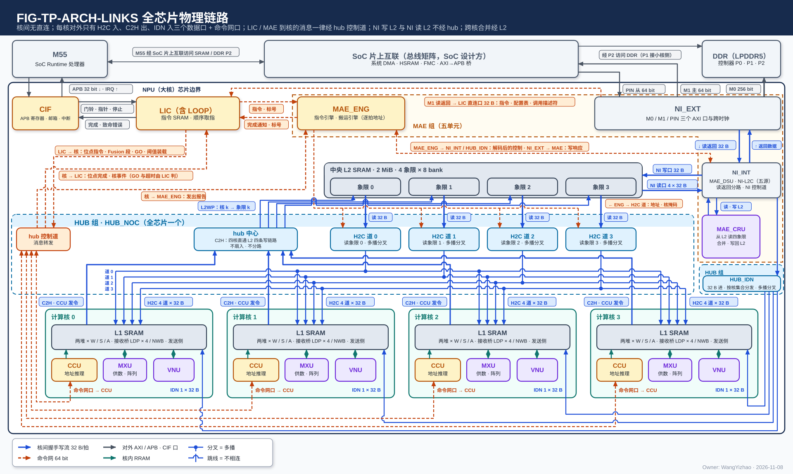
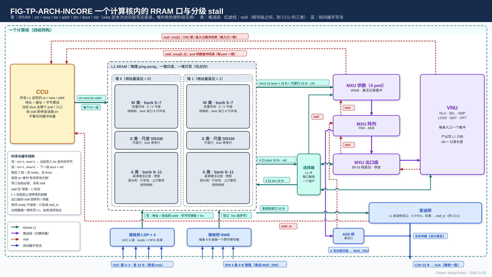
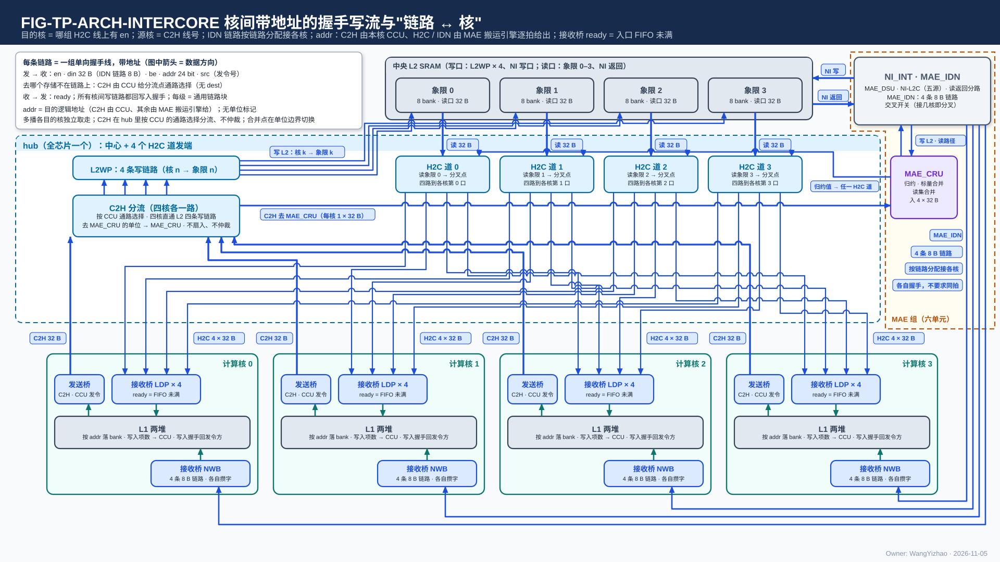
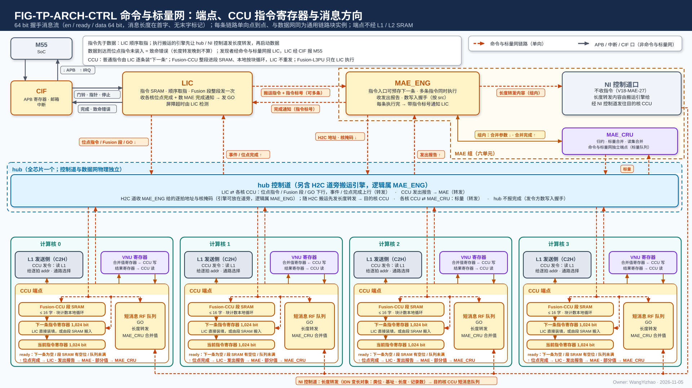

# 片上数据通路架构

> Owner: WangYizhao｜2026-11-08

**本篇回答"有什么、谁连谁、每个口每拍多宽"**：存储、链路、端口、条数、方向、发令方。链路上怎样成交、背压、多播、写入完成归传输协议篇；数据在存储里怎么摆归数据组织篇；每类数据走哪条路归登记篇。**§7 的全口宽总表是各模块篇引用口宽与条数的唯一出处**（用户 11-07 A3）；本篇只给预设位宽，不写实际利用带宽、不标定利用率（用户 11-08 T3）。

## 0 一句话

L3PU 的片上数据通路由四个计算核、中央 L2、HUB 组（HUB_NOC + HUB_IDN）、MAE 组（MAE_ENG、NI_EXT、NI_INT、MAE_DSU、MAE_CRU）、LIC、CIF 之间的全部存储、链路与端口组成。**全芯片只有三种总线——核内 RRAM 协议、核间带地址的握手写流、64 bit 命令网——每种只有一种格式，不按数据类型分形态；每条数据链路单向、点到点、同一组信号、同一位宽 32 B。** 每个核对外只有 H2C 入（4 × 32 B）、C2H 出（1 × 32 B）、IDN 入（1 × 32 B）三个数据口和一个命令网口；核间没有直连，所有跨核数据都经中央 L2 流转，所有跨核合并都在 L2 一侧完成。

## 1 全芯片拓扑与三种总线

图中每一条线都是一条物理链路，三种颜色对应三种总线：**核内 RRAM 协议（青）只在计算核的框内**；**核间带地址的握手写流（蓝）**是 L2 四个象限读口 → HUB_NOC 的四条 H2C 道 → 四核各自的同号道、四核的 C2H（来源 = 各核的集成输出端口）→ L2WP 的本核写链路、NI_INT 的 IDN 出口 → HUB_IDN → 各核 NWB 的一条 32 B 链路、NI_INT ↔ L2 的 NI 写口 / NI 读口，以及 MAE_CRU ⇄ NI_INT（从 L2 读四象限、合并、写回 L2，不连核间链路）；**命令网（橙）**每条线单向：LIC → hub 控制道（位点指令、Fusion 段、GO、阈值装载，下行到核）、hub 控制道 → LIC（位点完成、核事件）、hub 控制道 → MAE_ENG（核的发出报告）、LIC ⇄ MAE_ENG（搬运指令 / 完成通知），**LIC 与 MAE 到各核的消息一律经 hub 控制道，没有直达核的线**；另一条橙线 MAE_ENG → H2C 道 0–3 是搬运引擎给 H2C 道的解码后控制（逐拍 L2 读 en / addr、目的 addr / be、核掩码），不是消息。灰线是对外 AXI（M0 / M1 / PIN）与 CIF 的 APB。HUB 组画成两个虚线框（HUB_NOC、HUB_IDN）都标 HUB 组：二者不必放在一起，但同属"只传输"的 HUB（用户 11-07）。

### 1.1 部件清单

| 部件 | 全芯片个数 | 在数据通路里的角色 |
|---|---|---|
| 计算核（CCU、MXU 组、L1 组、VNU 组） | 4，物理同构 | 数据的产出方与消费方；每核一个 L1（两堆 × W / S / A 三类）；本核 CCU 是核内一切读写与 C2H 的发令方 |
| 中央 L2 | 1（四象限 × 两堆） | 全部跨核数据的中转与跨核合并的输入缓冲；**象限 $n$ 与核 $n$ 绑定写**（V18-L2-04） |
| HUB 组 · HUB_NOC | 1 | 四条 H2C 道（L2 象限读口 → 四核，含多播分叉点）、四条 C2H 直通链路（核 $n$ → L2WP 第 $n$ 条）、hub 控制道；只传输、不寻址、不仲裁（V18-TP-51 / L2-03） |
| HUB 组 · HUB_IDN | 1 | 把 NI_INT 给的一路 32 B 按每个存储字随带的 4 bit 核集合送到各核的 NWB（每核一条 32 B 链路）；只做分发与多播分叉，不拆拍、不缓存、不算地址（V18-HUB-01 / 04） |
| MAE 组（MAE_ENG、NI_EXT、NI_INT、MAE_DSU、MAE_CRU） | 1 | 源在核外的一切搬运的发令方（搬运引擎）、三个片外 AXI 口、搬运途中的整形（DSU）与合并（CRU） |
| LIC | 1 | 指令分发与调度：顺序取指、向四核 CCU 与 MAE 下发、收完成与事件、发 GO；专用小 SRAM 不在段选体系内 |
| CIF | 1 | APB 寄存器、门铃、中断；与 M55 的调用边界 |

**"HUB" 不是缩写**，取英文 hub（hub-and-spoke 的中心枢纽）之义：指中央端（L2、NI）与四核之间的全部核间数据链路，以及命令网的转发（V18-NAME-05）；HUB_NOC 的 NoC = Network-on-Chip。

### 1.2 三种总线

| 总线 | 在哪里 | 传什么 | 信号 | 一拍 |
|---|---|---|---|---|
| **核内 RRAM 协议**（协议篇 §5 / §6；RRAM 是给核内 SRAM 口总线起的名字，用户 11-05） | 一个计算核内部，每个单元与 L1 之间 | 数据 | en、wea、be、addr、din、dout、vld；相邻级之间另有 stall | 32 B |
| **核间带地址的握手写流**（协议篇 §3 / §4 / §7；**信号与核内 RRAM 口同名，核间只多 ready、段选 `seg`、发令号 `src` 与反向的写入握手**） | 核 ↔ hub ↔ L2，HUB_IDN → 核，NI ↔ L2 | 数据 | en、ready、din、be、addr、`seg`、`src`；反向写入握手 | 32 B |
| **命令网**（协议篇 §8；64 bit 握手消息流） | LIC、MAE_ENG、hub 控制道、NI 控制道、各核 CCU 之间（VNU、MAE_CRU 不在网上；**标量不走本网**，是数据，V18-TP-55） | 指令（MAE 指令带指令标号）、事件、发出报告、长度转发、完成通知 | en、ready、data | 64 bit |

**每种总线只有一种格式，不按数据类型分形态**（用户 11-04）。数据总线之间的转换只发生在产出数据的模块里（§3.4 的集成输出端口、§3.5 的接收桥），不设独立的转换单元。三种总线的链路都由同一个参数化的**通用链路块**例化（协议篇 §3.3），所以数据网和命令网的 skid、寄存器输出、时延无关这些条款只写一次。

### 1.3 谁发令：核边界两侧各一个主

**源在核内的搬运由本核 CCU 发令，源在核外的搬运由 MAE 搬运引擎发令；每条链路的发送端只有一个主**（V18-TP-27 / 35，用户："谁拥有源，谁发令"）：

| 链路 | 发令方（给每拍地址） |
|---|---|
| 核内全部 RRAM 口、C2H | 本核 CCU |
| H2C 道、IDN、NI 写口 / NI 读口、MAE_DSU 进出口、MAE_CRU 进出口 | MAE 搬运引擎（MAE_ENG 的实例，按并发指令数例化、与链路数解耦，V18-MAE-02 / 10） |
| PIN 直写 L2 | 外部主方（系统 DMA、FMC 从端），窗口由编译链固定（V18-NIE-02） |

因此 hub、NI_INT、HUB_IDN 和所有接收方都是无状态的转运与落位逻辑：不寻址、不记对象、不数单位。

### 1.4 不在本篇

成交 / 握手 / 背压 / 多播 / 写入完成（协议篇）；三档打包、长度表、列表、各并行模式的落点（数据组织篇）；每类数据走哪条路（登记篇）；hub 内部 MUX 与分叉点实现（HUB_NOC 篇）、交叉开关（HUB_IDN 篇）；L1 / L2 的 bank 换算、冲突规则、容量建议（L1 / L2 篇）；各口为什么是这个位宽的仿真依据（设计记录篇）。

## 2 存储

**只列有哪些存储、分几个物理分段、每个分段多宽；容量与地址换算归 L1 / L2 篇，分段里装什么归数据组织篇。**

### 2.1 每核 L1：两堆 × 三类

| 类（类选） | bank | 每 bank 宽度 | 装什么（由编译链地址决定） | 读 / 写口 |
|---|---|---|---|---|
| W 类 | 0–7（两来源位点 W0 = 0–3、W1 = 4–7） | 32 B，字节写使能 | 权重列块、K / V 平面（行字区 / 列字区两种字形态，V18-L1-09） | 权重 lane 读口（§3.1）、W 类写集合口（§3.2） |
| S 类 | 尺度 SRAM | 32 B | 权重尺度行、bias 旁带行（BF16 不量化） | 尺度 / 旁带读口、S 类写口 |
| A 类 | 8–11（改配时加 4–7，共 8 bank） | 32 B，字节写使能 | 紧凑激活记录、停放值、部分和、行状态、上行暂存 | 激活类读口 × 4、A 类写集合口 |

**两堆是物理的 ping-pong：位点内一堆只读、一堆只写，读哪堆写哪堆由指令的堆选显式给出，L1 没有堆角色状态**（V18-L1-02）。24 个 bank 都是 32 B 宽的字节写使能宏；**A 类 bank 数 4 或 8 可改配，改配只改容量、不改口宽**（V18-L1-02）。A 类读口出口带字节对齐器，各类写口接受从任意字节开始的一拍（V18-L1-13）。

### 2.2 中央 L2：四象限 × 两堆

| 项 | 值 |
|---|---|
| 分段 | 4 个象限，每象限两堆；象限选 2 bit + 堆选 1 bit |
| 每象限 bank | ≥ 2 个 32 B bank 交织（参考 8 个，图 1 的 "2 MiB · 4 象限 × 8 bank"），相邻存储字落不同 bank |
| 写侧 | 每象限一个写集合器，2 条入口 FIFO（本象限对应核的 L2WP 链路、NI 写口）→ 4 条 bank 道 |
| 读侧 | 象限读口 $n$（固定接 H2C 道 $n$）+ NI 读口的本象限一份；每象限两个读者 |
| 绑定 | **核 $n$ 的 C2H 只写象限 $n$；象限 $n$ 的读口只送 H2C 道 $n$**（V18-L2-04）；NI 写口可写任一象限、可同址广播 |

**L2 没有逻辑分区**：区域名只是编译链的地址名（L2 篇 §3.5）。四核分别产出的同一张量的四份落在四个象限的同一象限内地址（同址异象限），MAE_CRU 一拍读四份合并；按 $m$ 切分的变长激活则四象限各一个独立数据块（数据组织篇 §5）。

### 2.3 不在段选体系内的小存储

这些存储有自己的口、不走 24 bit 段内地址 + 段选，本篇只登记"有"：

| 存储 | 在哪 | 装什么 | 口 |
|---|---|---|---|
| LIC 专用小 SRAM（TCM 式） | LIC | 指令区两份（当前 / 下一调用）、配置表区、调用描述符区（V18-LIC-01） | NI_INT 的 LIC 直连口 32 B 写入；LIC 取指 |
| CCU 指令端点 | 每核 CCU | 当前 / 下一条两个 1,024 bit 指令寄存器 + Fusion-CCU 段 SRAM（参考 ≤ 16 条指令 = 2 KB【设计者定】）+ 短消息 RF 队列（协议篇 §8.2） | 命令网 |
| 集成输出端口发送 FIFO | 每核 | 待上 C2H 的 addr / data / en（深度【设计者定】：> CCU 停算到最后一拍进 FIFO 的在途拍数 $L$，将满阈值 = 深度 − $L$，B4） | §3.4 |
| 接收桥与集合器入口 FIFO | 每核 LDP × 4、NWB × 1；L2 每象限 2 条；L1 A 类写集合器每写者 1 条 | 在途的一项（32 B + be + addr + `src`） | §3.2 / §3.5 |
| MAE 在用列表缓存 | MAE_ENG | 正在用的列表（大批列表在 L2，V18-MAE-08） | MAE 内部【设计者定】 |

### 2.4 地址与段选的位宽

**芯片上任何读写地址都是 24 bit 的段内字节地址；落在哪个物理分段由 5 bit 段选 `seg` = 堆选 1 bit + 段掩码 4 bit（独热）单独给出，所有链路同宽**（V18-TP-57 / 61）。L1 侧段掩码 4 位里用 3 位（W / S / A），L2 侧 4 位对应四象限；一拍只许一位为 1，多位为 1（同址广播）只出现在 NI 写口。24 bit 为参考值【设计者定】：要定的是段内地址位宽，约束是覆盖 L1 任一类、L2 任一堆的全部字节，并与 ISA 地址字段同宽。地址以字节计；默认按 32 B 存储字对齐使用，紧密访存是兼容能力（协议篇 §2.5）。

## 3 核内口：收到 L1 读写口与集成输出端口这一级

**本篇对核内只收到两层：L1 的读口 / 写口，以及核的唯一核间发送口（集成输出端口）与两个接收桥；单元内部（pod、VNU 各单元）的口归各模块篇**（用户 11-07 A2）。

图中 L1 画成两堆、每堆三类（W / S / A）；CCU 在左侧发核内发起的所有 en / addr；右侧 MXU 供数、阵列（到 AEB 为止）、VNU（NLU 的出口级子模块先收 AEB 条目）顺序相连，VNU 经 L1 外的选择器用激活类口读写 L1；下方是两个接收桥（LDP、NWB，写地址来自随数据到达的 addr）与计算核的集成输出端口（C2H 的唯一来源：L1 发送侧读出、VNU 输出由 CCU 选一路；MXU 输出经出口级透传后算 VNU 输出，V18-TP-59）；红色虚线是 stall，规则在协议篇 §6。

### 3.1 L1 读口

| 口 | 每核 | 每拍 | 客户 | 说明 |
|---|---|---|---|---|
| **权重 lane 读口** | 1 | 8 道 × 32 B = 16 条 lane × 16 B（256 B） | 4 个 pod 的 WWB | 每道固定接一个 W 类 bank，各道可不同深度；每条 lane 固定接各 pod 的相邻两个段位，随 lane 带 4 bit pod 掩码、段位位、半段位（L1 篇 §2.2）；列字区经每 bank 一个读口重组器交出，直通 / 重组由每个读请求带的 1 bit 选（V18-L1-12）；8 bank 配置时 4 道 |
| **尺度 / 旁带 / bias 读口** | 1 | 1 道 × 32 B | 4 个 pod | 与 lane 同拍交出该列块该段的尺度行或 bias 旁带行 |
| **激活类读口** | 4 | 各 1 道 × 32 B | pod 激活记录缓冲、VNU（含 NLU 的出口级子模块）、L1 发送侧 | **任一口可读任一 A 类 bank，同拍撞 bank 由 CCU 排开，dout 送哪个客户由 CCU 定**；出口带字节对齐器（紧密读移位，V18-L1-13）；发送侧读占一个激活类读口的时隙 |

每次读的 en / wea / addr 都由本核 CCU 发出，读固定 1 拍返回、无 ready 无 busy（协议篇 §5）。

### 3.2 L1 写口

| 口 | 每核 | 每拍 | 来源 | 说明 |
|---|---|---|---|---|
| **A 类写集合口** | 1 | 4 道 × 32 B（8 bank 配置 8 道），每项带 32 位字节写使能 | ≤ 9 条入口 FIFO：落地 5 条（LDP × 4、NWB）+ 核内写者 ≤ 4 条（QNT、NLU（含出口级子模块）、SEL / SMP / LOSS / OPT，分条见 L1 篇 §6.4） | **每拍为每道按优先级选"队头落在该 bank"的写者，落地来源优先级最高**；核内写者 FIFO 将满拉 wr_stall 回自己，接收桥 FIFO 将满拉低 ready 回 hub / HUB_IDN |
| **W 类写集合口** | 1 | 8 道 × 32 B | NWB 或 H2C 多播的权重块，按位点二选一 | 权重整字写（IDN 与 H2C 每拍都是一个整字） |
| **S 类写口** | 1 | 1 道 × 32 B | NWB、LDP | 尺度行、bias 旁带行 |

**每个写口接受从任意字节地址开始的一拍，跨两个存储字时在 L1 内部拆成两个 bank 的写、同拍完成**（V18-L1-13）；写当拍写入、无应答，写入项数在写进 bank 时加一、交本核 CCU 比对（协议篇 §2.6）。

### 3.3 核内推送链与 AEB

**MXU 组的边界到阵列出口缓冲 AEB 为止**（V18-MXU-06）：供数 → 阵列 → AEB → VNU → L1 写集合器是一条推送链，上游按节拍往下送，相邻级之间一根 stall（协议篇 §6）。

| 口 | 每核 | 每拍 | 方向 | 说明 |
|---|---|---|---|---|
| **AEB 条目** | 4（每 pod 一条） | 每条 256 bit = 16 × BF16（一个（token 或查询行, 列块）的 16 个输出通道）+ valid / ready | MXU 阵列 → NLU 的出口级子模块 | 出口级是 NLU 的强制子模块，与 NLU 共用 BF16 向量通路，由 CCU 指令调配；**出口级对 AEB 的接收不得使 FBA 持续反压**（AEB 深度参考每 pod 8 项，深度、优先级由 NLU、MXU 设计者与 CCU 对接【设计者定】，V18-NLU-06） |
| 出口级 → VNU 各单元 | — | 每核每拍至多 16 个元素 | NLU 本体、QNT、SEL + LOSS、SMP | 组内链路，每拍 256 bit + 握手（V18-VNU-02） |

### 3.4 计算核的集成输出端口：C2H 的唯一来源

**每核只有一个核间发送口。核内两个来源——L1 发送侧读出（经一个激活类读口）、VNU 输出（含经 NLU 出口级子模块透传的 MXU 输出，如 K 切分部分和、位点指令选直接写 L2 的结果）——由本核 CCU 按指令在单位边界选一路，进发送 FIFO，上 C2H**（V18-TP-56 / 59）。MXU / VNU 的输出每条指令只能选写 L1 或写 L2，不两边都写。CCU 逐拍给出 C2H 上的 L2 地址（段内 24 bit + 段选，象限由链路固定）；发送 FIFO 将满时拉 stall_tx 门控 CCU（停发全部 en、停算，等 C2H ready），这是核内唯一的全局门控。L2 沿 C2H 反向回的写入握手由 CCU 计数，数满即对象已写进 L2，再经命令网向 MAE 发出报告。

| 项 | 值 |
|---|---|
| 入 | L1 发送侧 32 B/拍；VNU 输出 32 B/拍（二选一进 FIFO） |
| 出 | C2H：en / ready / din 32 B / be 32 / addr 24 / `seg` 5 / `src`（本核 CCU 的号） |
| 反向 | ready（来自 L2WP 第 $n$ 条的入口 FIFO）；写入握手 1 bit/拍 |
| FIFO | addr、data、en 三条同步 FIFO 即可；深度与将满阈值【设计者定】（阈值 = 深度 − 门控时延 $L$） |

### 3.5 接收桥

| 桥 | 每核 | 入 | 落到 | 说明 |
|---|---|---|---|---|
| **LDP** | 4（H2C 四道各一） | 每条 en / ready / din 32 B / be 32 / addr 24 / `seg` 5 / `src` | 按 `seg` 进 W / S / A 类写口（A 类经写集合器） | ready = 本桥入口 FIFO 未满；写进 bank 的那一拍沿本道回写入握手（valid + `src`）给发地址的 MAE 引擎；另按核内一类计写入项数交本核 CCU |
| **NWB** | 1（一条 32 B 链路） | en / ready / din 32 B / be 32 / addr 24 / `seg` 5 / `src`，与 LDP 相同 | 按 `seg` 进 W / S / A 类写口，整字直写（IDN 每拍一个整字、be 全 1） | **与 LDP 是同一种接收桥**（V18-HUB-04）；ready = 入口 FIFO 未满；写进 bank 时沿本链路回写入握手 |

**接收桥的写地址就是随数据到达的 addr，由 MAE 搬运引擎给出，不经 CCU**；接收桥是通用链路块的实例，落地来源在集合器里优先级最高。

### 3.6 核内预设位宽小账（只列预设位宽，不写实际利用带宽）

| 方向 | 组成 | 合计 |
|---|---|---|
| L1 读 | 权重 lane 8 × 32 + 尺度 32 + 激活类 4 × 32 | 416 B/拍（8 bank 配置：lane 4 × 32，288 B/拍） |
| L1 写 | A 类 4 × 32 + W 类 8 × 32 + S 类 32 | 416 B/拍（A 类 8 道时 544 B/拍） |
| 核间入 | H2C 4 × 32 + IDN 1 × 32 | 160 B/拍 |
| 核间出 | C2H 1 × 32 | 32 B/拍 |

数字是口宽的和，表示同拍最多能交多少字节；哪些口在一个位点里同时忙、忙到几成，由数据流篇与各模块篇按位点算，本篇不标定（用户 11-08："只需要给出咱们的预设位宽即可"）。

## 4 核间链路

**所有核间数据链路单向、点到点、同一组信号（正向 en / din 32 B / be 32 / addr 24 / `seg` 5 / `src`，反向 ready 与写入握手），同一位宽；数据链路上没有核号字段，目的核 = 哪组线上有 en，源核 = 线号**（V18-TP-41 / 42 / 61）。成交、skid、背压、多播、写入握手的规则见协议篇 §3。

图中上方是中央 L2（写口 L2WP × 4、NI 写口；读口象限 0–3、NI 读口）；HUB_NOC 框里是"C2H → L2WP"一个框（四核各一路直通、核 $n$ 只写象限 $n$，框内没有逻辑、只是四条线穿过）与四条 H2C 道（各带分叉点、四路到各核的同号 LDP）；右侧 MAE 组框里的 MAE_CRU 只与 NI_INT 相连；HUB 组另一框是 HUB_IDN（一路 32 B 进，按每字的核集合分发、接几核即分叉点，每核一条 32 B 链路）；下方四核各有集成输出端口（C2H 唯一来源）、LDP × 4、NWB 与 L1 两堆。

### 4.1 链路表

| 链路 | 方向 | 条数 | din | 每拍地址 | 目的与核的标识 |
|---|---|---|---|---|---|
| **H2C** | hub → 核 | 每核 4 道，全芯片 16 条 | 32 B | 24 + `seg` 5，MAE 引擎给 | 核 L1。每核独立一组线，目的核 = 哪组线上有 en；多播在分叉点按已取位复制、各目的核独立取走（V18-TP-53）；分叉点之前的段带 4 bit 核掩码，到核的最后一段不带；各核 LDP 写进 L1 时沿本道回写入握手 |
| **C2H** | 核 → hub | 每核 1，全芯片 4 | 32 B | 24 + `seg` 5，本核 CCU 给 | L2。源核 = 线号；**来源是该核的集成输出端口；只到 L2，直通 L2WP 第 $n$ 条，没有通路选择**（V18-CRU-07）；不与其他核合并 |
| **L2WP** | hub → L2 | 每核 1，全芯片 4（合计 128 B/拍） | 32 B | 同 C2H | **第 $n$ 条只写象限 $n$**（象限由链路固定，V18-L2-03 / 04），直接进象限 $n$ 集合器里核 $n$ 的入口 FIFO；ready = 该 FIFO 未满；反向回写入握手 1 bit/拍 |
| **L2 象限读口** | L2 → hub | 4（各接 H2C 道 $n$） | 32 B | 24，MAE 引擎给（经 H2C 道的 L2 读 en / addr） | 象限 $n$ 只送 H2C 道 $n$；撞 bank 回 busy |
| **IDN** | HUB_IDN → 核 | 每核 1 条，全芯片 4 条 | 32 B | 24 + `seg` 5，MAE 引擎给 | 核 L1（NWB）。**与 H2C 到核的链路同一组信号**；每个存储字随带 4 bit 核集合，HUB_IDN 按它分发、接几核即多播分叉点；每拍一个整字一个地址，DDR 标准布局 / LSC 一拍里分属几个核或几个存储字的粒子先由 MAE_DSU 按字重排（V18-MAE-35）；几核共享 M0 带宽 = MAE_ENG 把各核的整字轮流排出（单核 32 B/拍，四核按 $m$ 切分平均每核 8 B/拍、每拍到达的仍是整字）；NWB 写进 L1 时沿本链路回写入握手（V18-HUB-04） |
| **IDN 出口** | NI_INT → HUB_IDN | 全芯片 1 | 32 B | 24 + `seg` 5 + 随字 4 bit 核集合 | HUB_IDN 的唯一数据源：NI_INT 读返回分路与 MAE_DSU 输出在 NI_INT 内择一（V18-HUB-03 / 04） |
| **NI 写口** | NI_INT → L2 | 全芯片 1 | 32 B | 24 + `seg` 5，MAE 引擎给 | L2 任一象限，一个单位不跨象限；**`seg` 段掩码多位为 1 = 同址广播到掩码内各象限**（V18-L2-04 / TP-61）；反向写入握手 4 象限 × (valid + `src`)；五个写客户 M0 / M1 / PIN / MAE_DSU / MAE_CRU 在 NI-L2C 单位级合并 |
| **NI 读口** | L2 → NI_INT | 全芯片 1，4 × 32 B（每象限一份） | 每象限 32 B | 每象限一套 en / addr，MAE 引擎给 | MAE 与 L2 之间唯一的读口；**可同拍读四个象限拼成 128 B**（V18-MAE-32）；去 NI_EXT 写出、MAE_DSU 整形或 MAE_CRU 合并（四象限同址） |
| **MAE_DSU 进 / 出** | NI_INT → DSU / DSU → NI_INT | 各 1 | 32 B | 24，MAE 引擎给 | 入自读返回分路（DDR 原形）或 NI-L2C 返回车道（L2 原形）；出去 IDN 出口（→ L1）或 NI-L2C 写客户（→ L2）；无片外出口（V18-NII-03） |
| **MAE_CRU 进 / 出** | NI_INT 返回车道 → CRU / CRU → NI-L2C 写客户 | 各 1 | 进 4 × 32 B，出 32 B | 24，MAE 引擎给 | **MAE_CRU 不连核间链路、不在命令网上**（V18-CRU-07 / TP-55）：从 L2 读、写回 L2；输入 / 输出编码由指令给（V18-CRU-08） |
| **LIC 直连口** | NI_INT → LIC 小 SRAM | 1 | 32 B | 24，MAE 引擎给 | 只收 M1 读回的指令、配置表、调用描述符（V18-NII-06 / 08） |

`src`（发令号）参考 5 bit，按发令方总数（MAE 引擎数 + 4 个 CCU + 在途 PIN 事务号）取 ⌈log₂⌉【设计者定】（B5）；只有一个发令方的链路上为常数。

### 4.2 对称性与总量

| 位置 | 入 | 出 |
|---|---|---|
| 中央 L2 | 写：L2WP 4 × 32 + NI 写 32 = 160 B/拍 | 读：象限读口 4 × 32 + NI 读口 4 × 32 = 256 B/拍 |
| 每核 | H2C 4 × 32 + IDN 1 × 32 = 160 B/拍 | C2H 32 B/拍 |
| MAE 组 ↔ L2 | NI 读口 128 B/拍 | NI 写口 32 B/拍 |
| 片外进 | M0 32 B/拍（256 bit × $f_{\mathrm{core}}$）；M1 / PIN 8 B × $f_{\mathrm{IO}}$ | — |

**L2 写侧四条 32 B 链路与读侧四个象限读口对称（各 128 B/拍），四核同时回写互不等待**（V18-L2-03，用户 11-06："它应该被设计成 128B"）；NI 读口加宽到 128 B 只为 MAE_CRU 一拍取四份，写口不加宽（每拍只出一个结果）。每核出 32 B 远小于入 160 B，是因为每核的产出只有自己那一份，而输入要收权重、K / V、多核产出的激活。

### 4.3 时钟与插级

**核间链路全部在同一时钟域；任意位置插任意级寄存器，协议功能不变，流水级数【设计者定】**（V18-TP-26 / 31）。后端可调的 A1–A7（每段级数独立、每级满吞吐、分叉点可移动可拆级、不依赖同拍到达、回程级数独立、门限是 RTL 头文件参数、验收随机化）在协议篇 §3.3。

## 5 命令网拓扑

图中 LIC 在上排左；MAE 组在上排右，画出有命令网端点的 MAE_ENG 与 NI 控制道口（二者合一个端点）；hub 控制道横贯中间；四核的 CCU 端点在下排（各含当前 / 下一条两个 1,024 bit 指令寄存器、Fusion-CCU 段 SRAM、短消息 RF 队列，以及它控制的集成输出端口）。每条线单向、线上标消息类型。

| 端点 | 个数 | 收 | 发 |
|---|---|---|---|
| LIC | 1 | 位点完成 / 核事件（经 hub 控制道）、MAE 的完成通知（带指令标号） | 位点指令 / Fusion 段 / GO / 阈值装载（经 hub 控制道到核）、搬运指令（到 MAE_ENG，可多条、带指令标号） |
| MAE_ENG（与 NI 控制道合一个端点） | 1 | 搬运指令、各核 CCU 的发出报告、远端引擎的执行完成（可选） | 完成通知（到 LIC）、长度转发（经 hub 控制道 / NI 控制道到目的核）、H2C 搬运指令（只到道旁的远端引擎，若有） |
| 各核 CCU | 4 | 位点指令 / Fusion 段 / GO / 长度转发 | 位点完成 / 事件（到 LIC）、发出报告（到 MAE_ENG） |
| hub 控制道 | 1 | — | 只转发，不解析 |

**不在命令网上的**：VNU 各单元（指令由本核 CCU 给）、MAE_CRU（合并参数是 MAE 组内信号）、L1 / L2 / hub 数据道（不报完成，完成按写计数）、CIF（APB 与中断不属于命令网）。**标量不走命令网**：它是数据，经 C2H 写 L2、由 MAE_CRU 合并（V18-TP-55）。每条链路 64 bit、单向、与数据网物理分开、同一通用链路块例化（协议篇 §8）。

## 6 对外口

| 口 | 方向 | 对外位宽 | 时钟 | 对端 | 承载 |
|---|---|---|---|---|---|
| M0 | AXI4 主 | 256 bit | 核时钟 $f_{\mathrm{core}}$（参考 1 GHz，与 DDR P0 同频同源） | DDR 控制器 P0（本 NPU 独占） | 权重、K / V、激活与残差往返、训练数据 |
| M1 | AXI4 主 | 64 bit | $f_{\mathrm{IO}}$ | SoC 片上互联（HSRAM P2、DDR P2、FMC 主端窗口） | 指令、配置表、调用描述符、M55 产的列表、调用输入、结果记录 |
| PIN | AXI4 从 | 64 bit | $f_{\mathrm{IO}}$（与 M1 同频） | 系统 DMA、FMC 从端 | 外设数据直写 L2 的编译链固定窗口；调试读 |
| APB | 从 | 32 bit | APB 时钟 | M55 | CIF 寄存器、门铃、中断 |

**片外 AXI 口的频率 $f_{\mathrm{IO}}$ 可能与 L3PU 核时钟不一致，取值及其与核时钟的关系交设计者（与 SoC 集成对齐）；本篇不选具体值**（用户 11-07 A5："直接交给设计者，只需要说明，外部的 AXI 频率可能和 L3PU 不一致即可"）。核时钟 1 GHz 是参考点，须兼容 200 MHz 下调。三个时钟域（核、$f_{\mathrm{IO}}$、APB）的跨时钟域边界都在 NI_EXT（NI_EXT 篇 §3）；NPU 内部只有一种 32 B 存储字和一个核时钟，与端口位宽无关。其余（DDR 三口分工、burst、ID 用法、PIN 窗口）归 NI_EXT 篇。

## 7 全口宽总表（各模块篇引用口宽与条数的唯一出处）

**本表每个口一个固定编号 PORT-nn，其他篇引用口宽、条数、方向时写"架构篇 PORT-nn"，不各自给数字；发现不一致以本表为准并报告**（用户 11-07 A3；编号给条目、不给表行，用户 11-08）。每个条目：位置｜条数｜每拍位宽｜方向｜发令方 → 接收方｜一拍对应什么｜依据。

### 7.1 核内口

- **PORT-01 权重 lane 读口**：核内｜每核 1｜8 道 × 32 B（16 条 lane × 16 B，256 B；8 bank 配置时 4 道）｜L1 W 类 → 4 个 pod 的 WWB｜本核 CCU 发 en / addr → L1｜一拍 = 8 个存储字 = 一个权重段的 16 个 16 B 布局字（行字区直通；列字区经读口重组器）｜V18-L1-02 / 09 / 12，L1 篇 §2.1 / §6.1a。
- **PORT-02 尺度 / 旁带 / bias 读口**：核内｜每核 1｜1 × 32 B，与 PORT-01 同拍｜L1 S 类 → 4 个 pod｜本核 CCU｜一拍 = 一个（32 列块, 段）的 32 个 E8M0，或一行 bias｜V18-L1 bias 旁带行，L1 篇 §2.1。
- **PORT-03 激活类读口**：核内｜每核 4｜各 1 × 32 B｜L1 A 类 → pod 激活记录缓冲 / VNU（含 NLU 的出口级子模块）/ L1 发送侧｜本核 CCU（任一口可读任一 A 类 bank，撞 bank 由 CCU 排开，dout 去向由 CCU 定）｜一拍 = 一个存储字，出口按 CCU 给的移位量对齐（紧密读）｜V18-L1-02 / 13，L1 篇 §2.1 / §3.4a。
- **PORT-04 A 类写集合口**：核内｜每核 1｜4 道 × 32 B（8 bank 配置 8 道），每项 32 位字节写使能｜≤ 9 条入口 FIFO（LDP × 4、NWB、QNT、NLU、SEL / SMP / LOSS / OPT）→ L1 A 类｜地址：落地来源由到达的 addr，核内写者由本核 CCU｜一拍每道一个存储字（或其中若干字节）｜V18-L1-02 / 13，L1 篇 §6.4。
- **PORT-05 W 类写集合口**：核内｜每核 1｜8 道 × 32 B｜NWB 或 H2C 多播权重块（按位点二选一）→ L1 W 类｜到达的 addr｜一拍 8 个整存储字｜V18-L1-02 / 09，L1 篇 §7。
- **PORT-06 S 类写口**：核内｜每核 1｜1 × 32 B｜NWB、LDP → L1 S 类｜到达的 addr｜一拍一个尺度行 / 旁带行｜L1 篇 §2.1。
- **PORT-07 AEB 条目**：核内推送链、MXU 组的边界｜每核 4（每 pod 一条）｜每条 256 bit = 16 × BF16 + valid / ready｜MXU 阵列 → NLU 的出口级子模块｜由阵列完成标记推出，出口级拉 ready｜一拍一条条目 = 一个（token 或查询行, 列块）的 16 个输出通道｜V18-NLU-06 / MXU-06，VNU_NLU 篇 §1.7 / §3.6。
- **PORT-08 出口级 → VNU 各单元**：核内组内链路｜每核 1 组｜每拍至多 16 个元素（256 bit + 握手）｜NLU 出口级子模块 → NLU 本体 / QNT / SEL + LOSS / SMP｜CCU 指令给去向｜一拍 ≤ 16 个 BF16｜V18-VNU-02 / NLU-06。
- **PORT-09 计算核的集成输出端口**：核内 ↔ 核间的桥｜每核 1｜入：L1 发送侧 32 B / VNU 输出 32 B（二选一）；出：C2H 32 B｜本核 CCU 选来源、逐拍给 L2 地址｜一拍一个存储字上 C2H；发送 FIFO 将满拉 stall_tx 门控 CCU｜V18-TP-56 / 59，协议篇 §7.1。
- **PORT-10 接收桥 LDP**：核内 ↔ 核间的桥｜每核 4｜每条 en / ready / din 32 B / be 32 / addr 24 / `seg` 5 / `src`｜H2C 道 $n$ → L1（经 PORT-04 / 05 / 06）｜地址随数据到达（MAE 引擎）｜一拍一个存储字；写进 bank 回写入握手 valid + `src`｜V18-TP-50 / 53，L1 篇 §7.3。
- **PORT-11 接收桥 NWB**：核内 ↔ 核间的桥｜每核 1（一条 32 B 链路）｜en / ready / din 32 B / be 32 / addr 24 / `seg` 5 / `src`，与 LDP 相同｜HUB_IDN → L1 W / S / A 类｜地址随数据到达（MAE 引擎）｜一拍一个整字写入；写进 bank 回写入握手｜V18-HUB-04，L1 篇 §7.5。

### 7.2 核间链路

- **PORT-12 H2C 道**：核间｜每核 4 道、全芯片 16 条｜32 B + addr 24 + be 32 + `seg` 5 + `src`，反向 ready 与写入握手｜L2 象限读口 $n$ → HUB_NOC 道 $n$（分叉点）→ 各核 LDP 第 $n$ 口｜MAE 搬运引擎（给 L2 读 en / addr 与目的 addr / be / 核掩码）｜一拍一个存储字，多播在分叉点复制｜V18-TP-26 / 53 / 57 / 61，HUB_NOC 篇 §2。
- **PORT-13 C2H**：核间｜每核 1、全芯片 4｜32 B + addr 24 + be 32 + `seg` 5 + `src`，反向 ready 与写入握手 1 bit/拍｜核 $n$ 集成输出端口 → HUB_NOC 直通 → L2WP 第 $n$ 条｜本核 CCU｜一拍一个存储字；只到 L2 象限 $n$｜V18-TP-35 / 56 / CRU-07 / L2-04。
- **PORT-14 L2WP**：核间｜全芯片 4（每核一条）｜32 B（合计 128 B/拍）｜HUB_NOC → L2 象限 $n$ 集合器里核 $n$ 的入口 FIFO｜本核 CCU（地址随数据）｜一拍一个存储字；ready = FIFO 未满｜V18-L2-03 / 04，L2 篇 §5.2。
- **PORT-15 L2 象限读口**：核间｜4（各接 H2C 道 $n$）｜各 32 B，带 busy｜L2 象限 $n$ → H2C 道 $n$｜MAE 搬运引擎（经 H2C 道的 en / addr）｜一拍一个存储字｜V18-L2-04，L2 篇 §2.2。
- **PORT-16 IDN 链路**：核间｜每核 1 条、全芯片 4 条｜32 B + addr 24 + be 32 + `seg` 5 + `src`，反向 ready 与写入握手，与 H2C 到核的链路同一组信号｜HUB_IDN 分叉点 → 各核 NWB｜MAE 搬运引擎｜一拍一个整字一个地址（分属几核的粒子先经 MAE_DSU 按字重排，V18-MAE-35）；哪一拍到哪个核由该字的核集合定，几核共享 = 各核整字轮流（单核 32 B/拍）｜V18-HUB-04 / MAE-35，HUB_IDN 篇 §3 / §4。
- **PORT-17 IDN 出口**：核间（MAE 组 → HUB 组）｜全芯片 1｜32 B + addr 24 + be 32 + `seg` 5 + `src` + 随字 4 bit 核集合（旁带），en / ready｜NI_INT（读返回分路与 MAE_DSU 输出择一）→ HUB_IDN｜MAE 搬运引擎｜一拍一个存储字，HUB_IDN 按核集合分发、不拆拍｜V18-HUB-03 / 04，MAE_INTEGRATION 篇 D6。
- **PORT-18 NI 写口**：核间（MAE 组 → L2）｜全芯片 1｜32 B + addr 24 + be 32 + `seg` 5（段掩码可多位 = 同址广播）+ `src`，反向写入握手 4 象限 × (valid + `src`)｜NI_INT 的 NI-L2C 写客户（M0 / M1 / PIN / MAE_DSU / MAE_CRU 五源单位级合并）→ L2 任一象限｜MAE 搬运引擎（PIN 为外部主方）｜一拍一个存储字；一个单位不跨象限｜V18-L2-04 / TP-61 / MAE-32，MAE_INTEGRATION 篇 D4。
- **PORT-19 NI 读口**：核间（L2 → MAE 组）｜全芯片 1，4 × 32 B（每象限一份）｜每象限 en / addr / dout / vld / busy｜L2 → NI_INT 返回车道（→ NI_EXT 写出 / MAE_DSU / MAE_CRU）｜MAE 搬运引擎（每象限独立地址，可同拍读四象限同址）｜一拍至多 4 个存储字｜V18-MAE-32，MAE_INTEGRATION 篇 D5。
- **PORT-20 MAE_DSU 进 / 出**：MAE 组内｜各 1｜32 B + addr 24 + `seg` + `src`，en / ready｜进：NI_INT 读返回分路或 NI-L2C 返回车道 → DSU；出：DSU → IDN 出口或 NI-L2C 写客户｜MAE 搬运引擎｜一拍一个存储字｜V18-MAE-03 / 04 / NII-03，MAE_DSU 篇 §2。
- **PORT-21 MAE_CRU 进 / 出**：MAE 组内｜各 1｜进 4 × 32 B（四象限同址一拍，或残差加指令的两路对象分拍）；出 32 B + addr / be + `src`｜NI_INT 返回车道 → CRU → NI-L2C 写客户｜MAE 搬运引擎｜一拍进至多四份、出一个结果；不连核间链路｜V18-CRU-07 / 08 / MAE-32，MAE_CRU 篇 §2.1。
- **PORT-22 LIC 直连口**：MAE 组 → LIC｜1｜32 B + addr，en / ready，反向写入握手 valid + `src`｜NI_INT 读返回分路 → LIC 专用小 SRAM｜MAE 搬运引擎｜一拍一个存储字｜V18-NII-06 / 08 / LIC-01，MAE_INTEGRATION 篇 D7。

### 7.3 命令网

- **PORT-23 hub 控制道**：命令网｜全芯片 1（每个方向、每个端点对一条单向线）｜64 bit，en / ready｜LIC ⇄ 四核 CCU（位点指令 / Fusion 段 / GO / 阈值装载下行；位点完成 / 事件上行）；MAE_ENG → 核（长度转发）；核 → MAE_ENG（发出报告）｜消息首字含长度，无末字标记｜一拍一个 64 bit 字；一条 CCU 指令 16 字｜V18-TP-07 / 42 / 55，协议篇 §8。
- **PORT-24 LIC ⇄ MAE_ENG**：命令网｜2 条单向｜64 bit｜下行搬运指令（带指令标号，可多条在飞）；上行完成通知（带指令标号）｜—｜V18-MAE-13，MAE_INTEGRATION 篇 C1 / C2。
- **PORT-25 NI 控制道**：命令网｜1｜64 bit｜MAE_ENG + NI 控制道端点 → 目的核 CCU：IDN 搬运的长度转发（段选、基址、应写量）；NI 控制道不收指令（V18-MAE-27）｜—｜V18-TP-58 / MAE-27，MAE_INTEGRATION 篇 C3。

### 7.4 对外口

- **PORT-26 M0**：片外｜1｜AXI4 主 256 bit，$f_{\mathrm{core}}$｜NI_EXT ⇄ DDR P0（独占）｜MAE 搬运引擎（经 NI_EXT 请求仲裁）｜一拍 32 B，与核内存储字同宽｜NI_EXT 篇 §3 / §4。
- **PORT-27 M1**：片外｜1｜AXI4 主 64 bit，$f_{\mathrm{IO}}$【设计者定】｜NI_EXT ⇄ SoC 片上互联（HSRAM、DDR 共享区、FMC 主端）｜MAE 搬运引擎｜4 拍凑一个存储字（NI_EXT 攒字）｜V18-MAE-09 / NII-08，NI_EXT 篇 §5。
- **PORT-28 PIN**：片外｜1｜AXI4 从 64 bit，$f_{\mathrm{IO}}$｜系统 DMA / FMC 从端 → NI_EXT → NI-L2C → L2 固定窗口｜外部主方（窗口由编译链固定）｜4 拍凑一个存储字；B 响应在四象限都写到后回｜V18-NIE-02 / TP-43，NI_EXT 篇 §7。
- **PORT-29 APB**：片外｜1｜32 bit，APB 时钟｜M55 ⇄ CIF｜M55｜寄存器读写、门铃、中断｜CIF 篇。

### 7.5 写入握手回程（所有核间写链路共有）

- **PORT-30 写入握手**：核间反向旁带｜每条核间写链路一条｜L2WP 1 bit/拍；其余 valid + `src`｜接收方（L2 象限集合器、L1 LDP / NWB、LIC 小 SRAM、片外为 AXI 写响应）→ 发令方（CCU 或 MAE 引擎）｜接收方每把一项写进最终存储回一个，只有 valid 没有 ready｜V18-TP-47 / 50，协议篇 §3.8。

## 8 由谁保证

| 事项 | 性质 | 由谁 |
|---|---|---|
| 各口的条数、每拍位宽、方向 | 定值（本篇 §7） | 架构，各模块篇引用 |
| 链路的流水级数、分叉点位置、skid 深度、各 FIFO 深度、`src` 位宽、将满阈值 | RTL 头文件参数，无运行期配置 | 后端 / 各模块设计者（协议篇 §3.3 A1–A7） |
| A 类 bank 4 / 8 改配 | 改配只改容量、不改口宽 | L1（V18-L1-02） |
| 段内地址 24 bit 覆盖 L1 任一类、L2 任一堆 | 参考值【设计者定】 | L1 / L2 设计者与 ISA 对齐 |
| 象限 ↔ 核的绑定（核 $n$ ↔ 象限 $n$ ↔ H2C 道 $n$） | 由接线固定 | L2 / HUB_NOC |
| IDN 每字的核集合、H2C 多播核掩码 | 随搬运指令（IDN 的核集合由引擎状态机逐字给出） | MAE 搬运引擎、编译链 |
| 片外 AXI 频率 $f_{\mathrm{IO}}$ 与核时钟的关系 | 交设计者 | NI_EXT 设计者与 SoC 集成（A5） |
| 哪些口在同一位点同时忙、忙到几成 | 本篇不标定 | 数据流篇、各模块篇 |

## 9 为什么

- **三种总线各一种格式**（用户 11-04）：旧协议按数据类型分四种流控形态、20 条链路，读者无法掌握；统一后每种总线一页写完，所有链路是同一个通用链路块的实例。
- **核内 RRAM、核间握手写流、命令网独立**（用户 11-05）：核内 L1 已物理 ping-pong、无仲裁，固定 1 拍无握手的口面积与时延最低；核间链路长、要插寄存器，必须时延无关；指令与数据分网后互不阻塞，VC 没有意义。
- **目的 / 源核按物理链路，链路上没有核号**（用户 11-05 / 11-06）：四核对中央端各一组独立线，直连零开销；有了地址线与链路标识，单位标签、ID、dest 都不需要（V18-TP-42 / 51）。
- **L2 写侧每核一条 32 B 链路（128 B/拍）**（用户 11-06："L2 为什么共享写口位宽是 32B？这明显不合理，它应该被设计成 128B"；V18-L2-03）：与读侧四象限读口对称，四核同时回写互不等待，hub 不再扇入仲裁，写计数天然按（核链路, 象限）分开。
- **象限按核绑定写入**（用户 11-06："不然在此之前，象限的意义是什么？"；V18-L2-04）：象限在读写两侧意义一致，每象限一进一出。
- **NI 读口 4 × 32 B、写口不加宽**（用户 11-07："这个 128B 可以是 4 个象限的读拼接"；"我认为无需加宽写口"；V18-MAE-32）：MAE_CRU 一拍要四份才出一个结果。
- **IDN 每核一条 32 B 链路、核集合随字、不拆 8 B**（用户 11-08："32B 拆 8B 传输的意义是什么？32B 先走道 0 到核 0，然后是下一个 32B 走道 1 到核 1，不是也可以吗？而且这样也不会降低利用率，同时控制逻辑更简单"；V18-HUB-04）：链路上只发整字的前提是 MAE_DSU 先攒行把一拍里分属几个核或几个存储字的粒子重排成各核的整字（DDR 标准布局一拍 = 同一 $k$ 行 4 个列组各 8 B，是输入维度稀疏按 $k$ 行读所必需的排法，不能改成按列组排字——用户 11-08："我无法接收统一列字布局，因为这会使得输入维度稀疏完全无法减少 EMA"；重排归 MAE，V18-MAE-35）；16 × 8 B 与 4 × 32 B 线数相同，一核一条链路就没有 11-05 夜担心的"4 道同拍耦合"（V18-TP-30 的由来），没有拆拍寄存器、攒字寄存器、4 拍同地址与交叉开关，每字时延 1 拍，IDN 与 H2C 成为同一种口；开核少时 IDN 仍全力供给这几个核（用户 11-05），总量由 M0 封顶，怎样分只是 MAE_ENG 排字的次序。
- **IDN 归 HUB 组、MAE 只给一路 32 B**（用户 11-07；V18-HUB-01 / 03）：IDN 不寻址、不数单位、不改数据，与 H2C 道同一类"只传输"的部件；两源（NI 分路 / MAE_DSU）在 MAE 内择一。
- **C2H 唯一来源 = 集成输出端口，核内来源只剩两种**（用户 11-07："对于 C2H 口，它只有一个来源，即 CC 的集成输出端口"；11-08："如果需要走 C2H，先过 VNU 透传"；V18-TP-56 / 59）：发送端只有一个主（本核 CCU）；MXU 输出经 NLU 的出口级子模块透传，集成输出端口不必在 MXU 与 VNU 之间再做一级选择。
- **C2H 只到 L2，跨核合并经 L2**（用户 11-07："相当于把 CRU 的 FIFO 复用 L2 SRAM"；"先写到 L2，再交到 L1，这样的设计会比较有序"；V18-CRU-07）：C2H 只剩一个去向、H2C 只剩一个源，HUB 里没有通路选择与两源 MUX，MAE_CRU 不需要入口、计数与存储。
- **MXU 组到 AEB 为止，出口级归 NLU**（用户 11-08；V18-NLU-06 / MXU-06）：出口级与 NLU 的 BF16 向量加法本是一套，两者的指令都来自 CCU，合成一套由 CCU 调配；推送链少一级。
- **标量是数据、不走命令网**（用户 11-07："他们不属于控制网，需要走数据通信协议"；V18-TP-55）：标量与部分和、读集同一条路（C2H → L2 → MAE_CRU），VNU 与 MAE_CRU 都不需要命令网端点。
- **段选 `seg` 统一 5 bit**（用户 11-07："统一定宽"；"以 (b) 定"；V18-TP-61）：所有链路同一组信号，不为某条链路少一位；NI 写口的广播不再需要独有的旁带。
- **HUB 命名**（用户 11-07："HUB 为什么要叫 HUB？"；V18-NAME-05）：不是缩写，取中心枢纽义；NoC 与 IDN 不必放一起，但都标 HUB。
- **$f_{\mathrm{IO}}$ 交设计者、只说明可能与核时钟不一致**（用户 10-25 不选具体值；11-07 A5）：M1 / PIN 的频率是 SoC 集成的事，架构只约束跨时钟域边界在 NI_EXT。
- **只列预设位宽、不标定利用率**（用户 11-08 T3；存储类不标吞吐的规则同源）：口宽是接线事实，利用率随位点与调度变，归数据流篇。
- 被否方案各一句：L2 共享 32 B 写口 + C2H 四核扇入；IDN 每核 4 条 8 B 链路 + 拆拍 / 攒字 / 4 拍同地址（11-08 撤）；同一拍按字节切给几个核（与 V18-L1-09 的整字布局不符）；C2H 去 MAE_CRU 的分支与 H2C 第二源；MXU 输出直接进集成输出端口（三源）；IDN 四道同拍耦合；`seg` 按链路定宽；dest 信号；链路上的核号 / 单位标签 / 末拍标记；星形 / star 命名（10-21 撤）。
