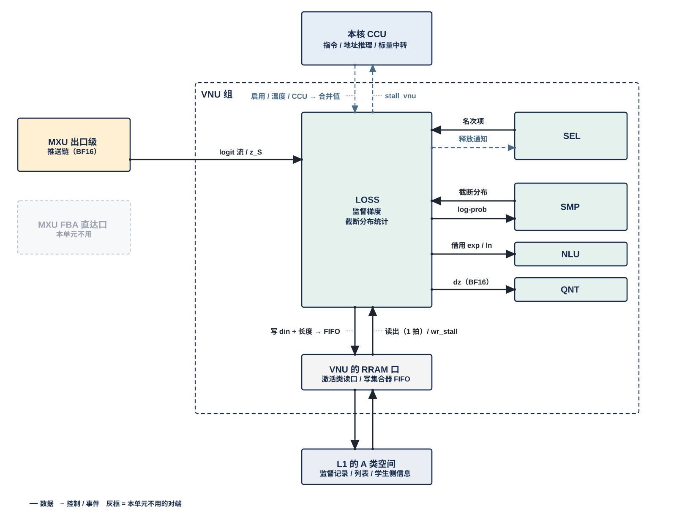
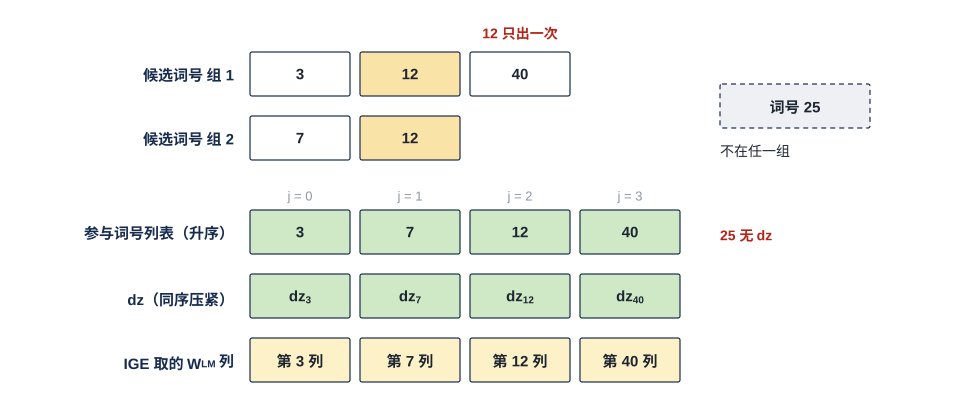
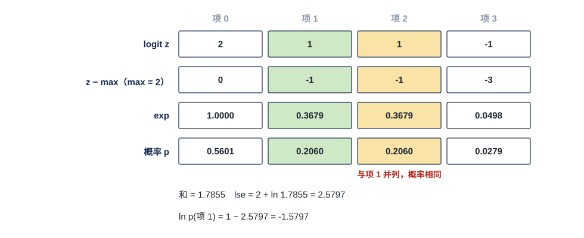

# VNU 损失单元（LOSS）需求

> Owner: WangYizhao｜2026-11-08

## 1 组成与位置

### 1.1 LOSS 做两件事：形成链首梯度、给出截断分布的 log-prob

LOSS（Loss Unit，损失单元）做两件事：

- **监督梯度**。LM Head 对一个 token 给出一行 logits：$z = \mathbf h\,W_{\text{LM}}$，$\mathbf h$ 为该 token 的 hidden 行向量（$1 \times d_{\text{hidden}}$），$W_{\text{LM}}$ 为 $d_{\text{hidden}} \times V_{\text{vocab}}$，词表项是输出列。LOSS 在**参与词号集合** $\mathcal S$ 上形成**链首梯度** $\mathrm dz_{\mathcal S}$。$\mathcal S$ 是这一行里参与梯度计算的若干列下标，$\lvert\mathcal S\rvert \ll V_{\text{vocab}}$；链首梯度是反传链的第一跳，下游 MXU 用它求 $\mathrm d\mathbf h = \mathrm dz_{\mathcal S}\,W_{\mathcal S}^{\mathsf T}$，$W_{\mathcal S}$ 是 $W_{\text{LM}}$ 按 $\mathcal S$ 取出的列（$d_{\text{hidden}} \times \lvert\mathcal S\rvert$）。
- **截断分布统计**。**截断分布**是只在一个采样位置的 $K_{\text{top}}$ 个候选项上归一化的分布。LOSS 给出所选 token 在这个分布里的对数概率（log-prob），可选给出熵与最大概率。

### 1.2 LOSS 不做什么

- 不做矩阵乘（MXU）、选择与排序（SEL）、采样与监督信息的产生（SMP）、量化（QNT）、跨核合并（MAE_CRU）。
- 不发 DDR 请求，不参与调度。
- **M55 算好损失、随调用输入给出的 logits 梯度（入口梯度）不经 LOSS**，LOSS 没有与它相关的功能。

### 1.3 LOSS 是 VNU 组的一个单元，每核一个

一个计算核由 CCU、MXU 组、L1 组、VNU 组四组拼成。LOSS 是 VNU 组的六个单元之一，其余五个是 NLU、SEL、QNT、SMP、OPT。**LOSS 与 VNU 组外的模块交换数据，都经 VNU 组的对外接口**；访问 L1 和向核外上行，经 VNU 的共用口。VNU 对外口的个数与共享方式由 VNU 集成篇定义（待写）。

每个计算核一个 LOSS，全芯片 4 个，物理相同。

### 1.4 只规定要求，不规定损失算法

**本篇只规定三条要求（§3.1）与输出合同，不规定损失怎样算**（用户 11-02）。以下内容由设计者与算法侧共同确定：

- 监督信息从哪来；
- 损失公式；
- $\mathcal S$ 怎样选；
- **学生侧信息**保存什么。学生侧信息是 Draft 一侧在监督样本产生时就要记下、等监督到齐后才用的量，例如该 token 的 $\mathbf h$。

硬件与同步更新的算法参考模型逐位一致；某个口径硬件实现太难时，交回算法侧修改并同步参考模型（用户 11-02）。

### 1.5 两项功能各自由指令启用

两项功能各自由指令启用；都不启用时 LOSS 不工作。**LOSS 同一时刻只执行一种功能**，先后由指令与 CCU 排定（用户 11-04，V18-VNU-03）。本篇不写指令字段，指令定稿后另补。

### 1.6 exp、ln 可分时借 NLU 的元件

LOSS 需要的 exp、ln 等可分时借用 NLU 的元件，**NLU 只执行**。使用时段由 CCU 与指令安排。

## 2 数据从哪来、到哪去

虚线框是 VNU 组：

- **框内**是 LOSS，以及和它直接往来的 SEL、SMP、NLU、QNT。这些连线不出 VNU 组。
- **跨出框的连线**都是 VNU 组的对外接口：
  - 框内右列的 NLU（含出口级子模块）送来的 logit 流与按 $\mathcal S$ 重算的 logit $z_{\mathcal S}$（图中写作 z_S）——AEB 条目经出口级分发，是组内链路，左侧 MXU 阵列 AEB 画灰；
  - 上方：本核 CCU 给的指令（虚线），以及 LOSS 给 CCU 的入口 stall；CRU 的合并值是数据：MAE_CRU 在 L2 合并后经 H2C 落 L1，LOSS 从 L1 读入；LOSS 自己不出部分和（V18-TP-55 / 56、V18-CRU-07）。**LOSS 在命令网上没有端口**；合并值是 FP32（MAE_CRU 与 L2 在 L1 之后，图中不画）。
- **下方的 L1 口**：LOSS 不直接连 L1 或核上行链路（C2H），而是经 **VNU 的 RRAM 口**（RRAM 即核内 SRAM 口协议，传输协议篇 §5）访问 L1 的 A 类空间：读经 L1 外的选择器用一个激活类读口；**写**进 L1 的 A 类写集合器里本单元自己那条 32 B 入口 FIFO，集合器每拍按优先级把各写者的队头分到对应 bank 的道上，FIFO 将满时拉 **wr_stall** 回本单元（只到本单元，不到 CCU；传输协议篇 §5.2）。要上行的数据（参与词号列表、学生侧信息）也先经这个口写入 L1，再由 L1 发送侧经 C2H 发出（由本核 CCU 按位点指令发令、发读 L1 并逐拍给出 C2H 上的地址，对象发完后 CCU 向 MAE 发出报告）（用户 11-04 / 11-06，V18-L1-03、V18-TP-35、传输协议篇 §2.4、§7.1）。

### 2.0 组内链路只限定位宽

**LOSS 与同组单元之间经组内链路交换数据。链路只规定位宽：全组统一每拍 256 bit（32 B），另加握手位**（用户 11-04，V18-VNU-02）。链路上是什么格式、什么精度，由 LOSS 与对端单元的控制逻辑按指令解码，链路本身不区分格式。所以下面的接口表只写"交什么"；LOSS 须能解码的格式列在 §4.3。

链路条数与组内互连方式由 VNU 集成篇定义。

### 2.1 VNU 组内的接口

| 接口 | 对端 | 方向 | 内容 |
|---|---|---|---|
| 名次项 | SEL | 入 | 流式 TOPK 的名次项（序号 + 评分）。SEL 可在同一条评分流上同时跑两组流式 TOPK，结果可按序号升序输出 |
| 释放通知 | SEL | 出 | LOSS 用完名次项后通知释放；**此前 SEL 保持名次项，不被下一个选择域覆盖** |
| 截断分布 | SMP | 入 | 一个采样位置的 $K_{\text{top}}$ 项分布与所选 token；算法需要时另有 TOPK 项的精确 logit |
| 统计结果（可选，默认关闭） | SMP | 出 | 指令启用时：log-prob，另可选熵与最大概率；由 SMP 组装进结果记录 |
| 元件借用 | NLU | 入 / 出 | 分时使用 exp、ln 等元件（§1.6） |
| 链首梯度 | QNT | 出 | $\mathrm dz_{\mathcal S}$，按 BF16 交出；**由 QNT 量化成流动梯度格式后写本核 L1，LOSS 不设量化器**（用户 11-04，V18-LOSS-03） |

### 2.2 经 VNU 组对外的接口

| 接口 | 对端 | 方向 | 内容 |
|---|---|---|---|
| logit 流 | NLU 的出口级子模块（组内链路，V18-NLU-06） | 入 | LM Head 的 logit 流，按词表序到达；与 SEL 收到的是同一条流 |
| 按 $\mathcal S$ 重算的 logit | NLU 的出口级子模块（组内链路） | 入 | $z_{\mathcal S} = \mathbf h\,W_{\mathcal S}$，按词号升序到达 |
| L1 读写 | 读：L1 外选择器 → 激活类读口；写：A 类写集合器里 LOSS 的入口 FIFO | 入 / 出 | 读：经 HUB 组的入站分发网 HUB_IDN 落入 L1 的监督记录、读回的学生侧信息；写：要上行的数据（见下一行）。整字 32 B；写只给 din 与记录长度 |
| 写握手 | L1 的 A 类写集合器 | 入 | LOSS 那条入口 FIFO 将满时的 wr_stall |
| 上行 | 写 L1 后由 L1 发送侧经 C2H 发出，或经集成输出端口直接写 L2（CCU 二选一，V18-TP-56；本核 CCU 按位点指令发令、给地址） | 出 | 参与词号列表，写入 L2 |
| 跨核合并值 | 经 L2 → H2C 落 L1，LOSS 从 L1 口读入（V18-TP-55 / 56、V18-CRU-07） | 入 | MAE_CRU 合并后的值（部分和由 NLU 累加后写 L2）；FP32；落进 L1 后 CCU 才发使用它的指令 |
| 指令 | 本核 CCU | 入 | 启用哪项功能、温度、个数等 |
| 入口 stall | 本核 CCU | 出 | 每条由 CCU 发读的入口一根 stall_vnu[i] |

**表中输入是可用输入，是否使用由所选损失算法决定。** 这些都是 VNU 组已有的口，不为 LOSS 新增通路；新算法需要现有通路以外的输入时，再记入 V1.8 修订文档。

**RRAM 口的用法**（传输协议篇 §5、§6）：
- L1 没有仲裁：读经 L1 外的选择器用激活类读口（每口 32 B/拍），读时隙由 CCU 排；**写**进 L1 的 A 类写集合器里本单元自己那条 32 B 入口 FIFO，集合器每拍按优先级把各写者的队头分到对应 bank 的道上，FIFO 将满时拉 **wr_stall** 回本单元（只到本单元，不到 CCU；传输协议篇 §5.2）；读写哪一堆由堆选选（用户 11-04 / 11-05，V18-L1-02）。
- **每次读写的 en / wea / addr 都由本核 CCU 发出**；LOSS 写 L1 时只给 din（一个存储字，32 B）与本条记录的长度；FIFO 将满时 LOSS 保持 en / wea / addr / din。读出固定 1 拍到达。
- **每条由 CCU 发读的入口给 CCU 一根 stall_vnu[i]**，入口缓冲占到"深度 − $L$"时拉起；$L$【设计者定】。写侧只有本单元 FIFO 的 wr_stall，不到 CCU。

### 2.3 由别的模块保证的事项

以下事项 LOSS 不检查，由对应模块保证。这张表划出 LOSS 的实现与验证边界：表里的事项 LOSS 既不实现也不检查，验收时把它们当作输入前提、用断言核对（§6）。

| 事项 | 由谁保证 |
|---|---|
| 监督信息的产生与写出 | SMP，或算法选定的生产者 |
| 监督记录与学生侧信息的 DDR 读写，经 HUB_IDN 落 L1 | MAE |
| 名次项的选出 | SEL |
| logit 与 $z_{\mathcal S}$ 的计算；logit 流同时交 SEL 与 LOSS | MXU；扇出与放行先后归 CCU 与指令 |
| 按参与词号列表 gather $W_{\text{LM}}$ 的列；列表的实际长度经发出报告交 MAE 后再放行 | MAE；CCU（发出报告，传输协议篇 §4.3，V18-TP-35） |
| 读写 L1 的地址（基址 + 字节累加）与 dout 去向 | CCU |
| 变长列表按位点窗口静态分配，每位点的封顶值（两组 $k$）与窗口由算法侧给出；其余 A 类地址段的分配、写入前旧数据已读完；同一阶段并发写者总需求 ≤ 道数 × 32 B/拍 | 算法侧（模型表）；编译链（指令中的基址与窗口长，LIC 操作 15） |
| 交给 LOSS 的是哪一份截断分布（拒绝采样时为父节点未经残差更新的分布） | SMP |
| 跨核合并按固定次序（LOSS 只接收合并值） | MAE_CRU |
| 合并值落 L1 之后才发使用它的指令 | CCU（传输协议篇 §7.1）；MAE（合并指令收齐发出报告后执行） |
| 链首在哪个核、何时执行；监督未就绪时等待 | LIC、CCU 与数据流篇 |
| 入口梯度的读入与落位 | MAE、LIC |
| $\mathrm dz$ 的量化 | QNT |
| 同一单元的不同功能不在时间上重叠 | CCU 与指令 |
| 上行数据写 L1 后经 C2H 发出 | 本核 CCU（按位点指令发令、发读 L1、逐拍给 C2H 地址；发完后向 MAE 发出报告） |
| 组内链路条数与互连；VNU 对外口的个数与共享方式 | VNU 集成篇（待写） |

## 3 运算形态

| 形态 | 按矩阵维度说做什么 | 输入 | 输出 | 典型用途 |
|---|---|---|---|---|
| 监督梯度 | 在一行 logits 的参与列 $\mathcal S$ 上形成 $\mathrm dz_{\mathcal S}$ | 选定算法所需的监督信息、学生侧信息与 logit | 升序去重的参与词号列表；同序压紧的 $\mathrm dz_{\mathcal S}$ | Draft 同步训练的链首梯度 |
| 截断分布统计（**可选输出，默认关闭**） | 在一个采样位置的 $K_{\text{top}}$ 项上求所选 token 的 log-prob | $K_{\text{top}}$ 项 logit、所选 token、温度 | log-prob；可选熵与最大概率 | RL rollout 记录的 log-prob |
| 关闭 | 不工作 | — | — | 两项都不启用 |

### 3.1 监督梯度：在一行 logits 的参与列上形成 dz

#### 3.1.1 三条要求

监督梯度的算法不固定（§1.4），所以本节用三条可验收的要求代替公式：第 1、2 条约束硬件开销，第 3 条约束训练效果；§3.1.2 的输出合同则约束交给下游（QNT、MAE 搬运引擎、MXU）的数据形状。设计者在这四者之内选算法。

LOSS 的监督梯度只需满足三条要求（用户 11-02；条文用户 11-04 定，V18-LOSS-01 / 02）：

1. **计算量低**：
   - 满足第 2 条；
   - **不反压 logit 流**；
   - 门数建议值 ≤ 18 k 门（NAND2 等效），借用的 NLU 元件计入 NLU。

   不规定处理时间的拍数预算，处理时间按 §5 与相关模块的设计者对接。
2. **不算 logits 的全部维度**：**LOSS 自身不对一行的全部 $V_{\text{vocab}}$ 个 logit 逐项计算或逐项 exp。** 为出 TOPK 而跑的 LM Head 高位平面遍不计入（用户 11-02）。
3. **监督效果好**：同步训练后，Draft 接受长度 AL 相对对照基线的下降 < 0.1%。AL 是 Target 一次验证平均接受的 Draft token 数；对照基线是现行截断分布 teacher 方案按 FP32 理想值计算；量不出 0.1% 时以算法侧噪声带为准【待标定】。

#### 3.1.1a 数据怎样流过 LOSS 交设计者；偏好：能在 logit 流上流式处理完最好

**监督梯度的数据流设计交设计者，本篇不预先标定**（用户 11-06："我认为监督梯度具体的流设计，可以交给 Designer，咱们不要预先标定，但是可以写出设计偏好，即如果能流式处理完是最好的"；V18-LOSS-06）。两类做法都在三条要求（§3.1.1）与输出合同（§3.1.2）之内：

| 做法 | 怎样做 | 代价 |
|---|---|---|
| 流式处理（**偏好**） | 在 Draft LM Head 的 logit 流到达时就地完成所需的统计（例如全词表归一化项），流过即用、不留存整行 logit | LOSS 须跟上 logit 流、不反压（§5.2）；只要流过一遍就能出结果，不额外占 L1 / L2、不多一次读回 |
| 预存后处理 | 把教师的 $K_{\text{top}}$ 项、Draft 的 top-$k$ 项（词号 + logit）与学生侧信息先存进 L1 / L2，监督到齐后再读回计算；缺的 logit 用 $z_{\mathcal S} = \mathbf h\,W_{\mathcal S}$ 重算（$W_{\mathcal S}$ 反传本来就要 gather） | 要占存储并多一次读回；若只在 $\mathcal S$ 上归一化，监督效果须由算法侧按第 3 条验证 |

**设计偏好：能在 logit 流上一遍流式处理完的方案优先**；流式做不到或代价过高时可以取预存方案，或两者组合，由设计者与算法侧按第 3 条（AL 下降 < 0.1%）选定。本篇其余各节写到"logit 流"的地方，只在设计选择消费 logit 流时适用。

#### 3.1.2 输出合同：词号升序去重，dz 与列表同序压紧

- **参与词号列表按词号升序、去重。**
- **$\mathrm dz_{\mathcal S}$ 与列表同序压紧**：第 $j$ 个 $\mathrm dz$ 对应列表第 $j$ 个词号；$\mathcal S$ 外不输出。MAE 搬运引擎按同一列表 gather $W_{\mathcal S}$，MXU 不重排。
- $\mathrm dz$ 经 QNT 量化成**流动梯度格式**（反传梯度在算子之间流动时的格式，默认 MXFP6 g32 单平面，可选 FP8 E4M3 / BF16 / FP16，格式集合在整体集成篇定义）。
- **$\mathcal S$ 为空时不输出，不产生 NaN。**
- **参与词号列表是数据组织篇 §1.1 的 ③ 档变长对象**：每个监督行的列表是一条记录，记录按实际长度紧挨、记录内按词号升序紧凑排（V18-TP-58，传输协议篇 §2.5、数据组织篇 §1.2）；每条记录的字节数由 CCU 写进该对象单独存储的长度表，该行的项数 $\lvert\mathcal S\rvert$ = 长度 ÷ 3 B（数据组织篇 §2.2）。**参与词号列表按位点窗口静态分配**（用户 11-06，传输协议篇 §4.3、数据组织篇 §2.5，V18-TP-40）：**窗口容量 = 两组流式 TOPK 的 $k$ 之和对应的 token 长度上限 × 监督行数**（$k$ 之和用户 11-05 认可），基址、窗口长与长度表地址在指令里，CCU 不做运行期分配；列表写进 L2 后由本核 CCU 向 MAE 发出报告（只带目的起始地址）。**用这张列表做 gather 时 MAE 从长度表取每行的项数**（引擎先读表，MAE_ENG 篇 §6.2），不需要定长或槽尾填充；升序去重的合同照旧，V18-LOSS-06 的"项数规则【设计者定】"随之关闭。

缩小例只画 1 个监督行。两组候选词号 {3, 12, 40} 与 {7, 12} 合并、去重、按升序排成列表 {3, 7, 12, 40}，$\mathrm dz$ 按同一顺序压紧成 4 项，MAE 搬运引擎按同一列表取 $W_{\text{LM}}$ 的第 3、7、12、40 列。重复的词号 12 只出一次；列表外的词号 25 没有 $\mathrm dz$。$\mathrm dz$ 的值怎样算由选定算法决定，图中只用符号表示。

#### 3.1.3 输入齐备才形成

某行的 $\mathrm dz$ 在选定算法所需的全部输入都已就绪之后才形成；**不读写到一半的记录**。

LOSS 这一侧不判断就绪：落进 L1 的监督记录与学生侧信息是否写完，以写入口的写计数达到应写量为准（传输协议篇 §2.6），由本核 CCU 比对；CCU 确认后才发读这些记录、发形成 $\mathrm dz$ 的指令（§2.3"监督未就绪时等待"一行）。LOSS 收到指令即可按读回的数据计算，不设有效位。

#### 3.1.4 跨调用保存学生侧信息

算法需要跨调用保存学生侧信息时：

- 经上行写出，下次经 L1 读回；**消费前完整可读**；
- 字节数不超过数据组织篇给的训练区预算；
- 格式由生产者与消费者共同定义，并供 M55 解读。

### 3.2 截断分布统计：对 K_top 项分布求所选 token 的 log-prob

$$\ln p(y) = \frac{z(y)}{T_{\text{temp}}} - \ln\sum_{v\in\mathcal K} e^{z(v)/T_{\text{temp}}}$$

$\mathcal K$ 为该采样位置的 $K_{\text{top}}$ 个候选项，$y$ 为所选 token，$T_{\text{temp}}$ 为采样温度。**只在 $\mathcal K$ 上归一化，不用全词表。** 贪心采样按同式给出。

**log-prob 是可选输出项，默认关闭，不是采样的默认顺带输出**（用户 11-06："我觉得这一步复用 NLU 的 log 核还是有意义的，毕竟 CPU 处理这个数据也要花很长时间，保留这里的设计，但是我这里不要设计成默认的顺带输出，而是一个可选的输出项，还是把它归在 LOSS 中"；V18-LOSS-05）：

- 由指令逐调用启用（例如 RL rollout 的生成调用），不启用时 LOSS 不做这项计算，SMP 组装的结果记录里也不含 log-prob 字段；
- 留在 LOSS、复用 NLU 的 exp / ln 元件（§1.6），不移交 M55：M55 处理逐位置的 $K_{\text{top}}$ 项要多花时间，结果记录也要多带每位置约 100 B 的 $K_{\text{top}}$ 项；
- **输入用 $K_{\text{top}}$ 项的 logit**（BF16，SMP 给出），不用 Proposal 输出记录里 2 B 编码的归一化概率：2 B 概率的精度不足以给 RL 的重要性比取对数。

- **可选：熵与最大概率。** 截断分布的熵 $H = -\sum_{v\in\mathcal K} p(v)\ln p(v)$ 与最大概率 $P_{\max}$，用来监视分布是否坍缩，不参与训练计算。**可选能力，默认关闭**；是否实现由设计者与算法侧按实验需要定（用户 11-04，V18-LOSS-04）。
- 不改变采样分布；不要求同时启用监督梯度。

缩小例 $K_{\text{top}} = 4$、$T_{\text{temp}} = 1$，项 0…3 的 logit 为 2.0、1.0、1.0、−1.0，所选为项 1（logit 1.0，与项 2 并列）。先减去最大值 2.0 再求 exp，和为 1.7855，$\ln$ 和加回最大值得 2.5797；所选项的 log-prob 为 $1.0 - 2.5797 = -1.5797$。并列的两项概率相同，各为 0.2060。实际 $K_{\text{top}}$ 参考 20。

### 3.3 关闭

两项功能都不启用时，LOSS 不工作。

## 4 精度要求、传输位宽与格式解码

### 4.1 精度要求：集成到算法后任务精度下降 < 0.1%

**LOSS 的计算方案集成到算法后，任务精度下降 < 0.1%；中间计算精度不规定，由设计者定**（用户 11-04，V18-VNU-01）。口径：

- 下降量按绝对百分点计；
- 基线为该模块各运算按 FP32 理想值计算的结果；
- 评测集为算法侧的标准评测集；
- 硬件实现与算法参考模型逐位一致，作为验证手段；参考模型随硬件实现同步。

对监督梯度，"任务精度"取 §3.1.1 第 3 条的 Draft AL。截断分布统计不设元件精度目标（用户 11-04，V18-LOSS-02）。

### 4.2 组内链路只限定位宽，格式由控制逻辑解码

LOSS 经组内链路收发的数据按每拍 256 bit 传输（§2.0）。**LOSS 的控制逻辑按指令解码收到的是什么格式、按什么精度处理，并按指令编码交出的数据。**

### 4.3 LOSS 须能解码的输入

以下是 LOSS 的解码能力，不作为口的定义：

| 类别 | 格式 | 来源 |
|---|---|---|
| 向量 | BF16 | logit 流、$z_{\mathcal S}$、名次项评分、截断分布的 logit |
| 序号 / 词号 | 位宽覆盖词表（15 万词需 18 bit，现行 3 B） | 名次项、所选 token |
| 临时格式 | 由生产者与 LOSS 共同定义，供 M55 解读；设计者可选择在 QNT 统一成 BF16 / MXFP6（V18-VNU-01） | 监督记录（现行为 teacher 概率，每项词号 3 B + 概率 3 B）、学生侧信息 |
| 标量 | FP32 语义：结果与"按 FP32 计算、只在最后舍入一次"的参照一致，实现可用更窄的内部格式 | CRU 合并值（经 H2C 落 L1 后读入，FP32）、指令给出的温度 |

### 4.4 LOSS 交出的数据

- $\mathrm dz_{\mathcal S}$：BF16，交 QNT 量化成流动梯度格式（§2.1）。
- log-prob、熵、最大概率：FP32 语义标量。
- 参与词号列表：每项一个词号，位宽同 §4.3。

### 4.5 结果规则

- **同一行的结果只取决于该行的输入**，与 Batch 大小、同批其他行无关。
- 由 CCU 写入的合并值与消息到达次序无关。
- 与同步更新的算法参考模型逐位一致（§1.4）。
- $\mathcal S$ 为空时不产生 NaN。

## 5 速率与时延

### 5.1 每拍处理能力与处理时间匹配上下游模块

**LOSS 每拍能处理的元素数和处理时间，须匹配上下游各口的需求，由 LOSS 设计者与以下模块对接确定**（用户 11-04，V18-LOSS-01）。下表的参考值只作背景，不是 LOSS 的定值：

| 相关模块 | 接口 | 现行参考值 |
|---|---|---|
| NLU 的出口级子模块 | logit 流 | 15 万词 × 24 个 token 在约 10.8 ms 内送完，约 0.33 个/拍 |
| QNT | 链首梯度 | QNT 的统一请求接口（所有量化请求的唯一入口，QNT 篇 §2.3）每拍 16 个元素；参考 7 个监督行 × 84 项 = 588 个，约 37 拍 |
| SMP | 截断分布、统计结果 | 每个采样位置 $K_{\text{top}}$ 次 exp 与 1 次 ln；SMP 所在 LM Head 尾段的时间需求（由数据流篇给，本篇不定拍数预算，V18-LOSS-01） |
| SEL | 名次项、释放通知 | 名次项保持期间占用 SEL 的名次缓冲，LOSS 用完即通知释放 |
| NLU | 元件借用 | 借用时段由 CCU 与指令安排 |
| MAE 搬运引擎 | 参与词号列表 | 参考每拍 1 个词号；列表发完、发出报告到 MAE 的时点决定 $W_{\mathcal S}$ 的 gather 何时开始 |
| L2 / MAE_CRU | 合并值 | 一次往返（NLU 部分和写 L2 → MAE_CRU → 写回 L2 → H2C 落 L1）；往返时延不定要求值，CRU 并行 lane 可配（传输协议篇 §7.4） |
| L1（经 VNU 的 RRAM 口） | 监督记录、学生侧信息、上行数据 | 激活类读口 32 B/拍，与其他客户分时；读出固定 1 拍；入口将满时拉 stall_vnu[i]；写进集合器 FIFO，将满 wr_stall |

### 5.2 LOSS 自己承诺：不反压 logit 流、不丢失

**LOSS 不对 logit 流施加反压，也不丢失 logit。** 这是 LOSS 能单方面保证的唯一速率承诺；**设计选择消费 logit 流时（§3.1.1a 的偏好做法）适用**，取预存方案时 LOSS 不接 logit 流，这条随之不适用。

这条承诺的含义：logit 流同时交 SEL 与 LOSS（§2.3），LOSS 不得因自己来不及而让出口级停发这条流，所以 LOSS 对 logit 流的持续处理能力不低于出口级送这条流的速率（参考约 0.33 个/拍，§5.1），突发由 LOSS 自己的入口吸收，做法【设计者定】。验收按 logit 流峰值注入、同时形成链首梯度（§7.2）。其他口（L1 读回、组内链路）来不及时照常经 stall_vnu[i] 或组内握手停发，只降速、不是错误。

## 6 计数与复位

- **计数**：LOSS 不设计数。
- **复位**：清在线状态与归并状态，不跨调用保留。学生侧信息存在 DDR，不由 LOSS 持有。
- **不设运行时错误事件**：§2.3 所列前提由对应模块保证，验收时用断言检查。参与词号列表不超位点窗口由 SEL 的两组流式 TOPK 封顶保证（§3.1.2）；万一超出，属传输协议篇 §9 的致命错误，由本核 CCU 转报。

## 7 要求值与验收

### 7.1 要求值

| 项 | 要求值 | 说明 |
|---|---|---|
| 运算形态 | 监督梯度、截断分布统计（可选输出，默认关闭）、关闭 | 由指令启用 |
| 计算量 | 不对一行全部 $V_{\text{vocab}}$ 个 logit 逐项计算或 exp | 为出 TOPK 的 LM Head 高位平面遍不计入 |
| 每拍处理能力与处理时间 | 匹配上下游各口（§5.1） | 由 LOSS 设计者对接确定 |
| logit 流 | 不反压、不丢失 | — |
| 监督效果 | Draft AL 相对对照基线下降 < 0.1% | 【待标定】 |
| 精度 | 集成到算法后任务精度下降 < 0.1%（绝对百分点） | 中间精度由设计者定 |
| 组内链路 | 每拍 256 bit + 握手位 | 全组统一 |
| L1 口与握手 | RRAM 口：读经激活类读口，每条由 CCU 发读的入口一根 stall_vnu[i]；写进 A 类写集合器里本单元的入口 FIFO（只给 din 与长度），将满 wr_stall 回本单元 | $L$【设计者定】 |
| CRU 的合并值 | 从 L1 读入（经 H2C 落地），FP32；LOSS 在命令网上无端口、无有效位 | 传输协议篇 §7.1、§7.4 |
| 门数 | 建议值 ≤ 18 k 门（NAND2 等效），另加 < 1 KB 状态 | 借用的 NLU 元件不计 |

### 7.2 验收

| 对象 | 方法 | 用例 |
|---|---|---|
| 输出合同（§3.1.2） | 断言 | 列表升序、去重；$\mathrm dz$ 与列表同序；$\mathcal S$ 外无输出；$\mathcal S$ 为空时无输出、无 NaN；各行列表记录紧挨、长度交 CCU 写进长度表；在窗口内不超窗口 |
| 计算量（§3.1.1） | 审查 | 无全词表逐项计算或 exp |
| 不反压 logit 流（§5.2） | 周期仿真 | logit 流峰值注入，同时形成链首梯度 |
| 输入齐备（§3.1.3） | 断言 | 输入未齐时不形成 $\mathrm dz$；不读写到一半的记录 |
| 截断分布 log-prob（§3.2） | 与算法参考模型逐位比对 | 不同 $K_{\text{top}}$ 与温度；并列 logit；贪心采样 |
| 结果规则（§4.5） | 逐位比对 | Batch 1 / 8 / 32 结果相同；合并值到达次序不同时结果相同 |
| 监督效果（§3.1.1） | 算法侧回放对拍 | 同模型、同数据、同调用配置的同步训练 |
| 集成精度（§4.1） | 算法侧评测 | 目标模型在标准评测集上下降 < 0.1% |
| 门数（§7.1） | 综合 | 待 RTL |

## 8 为什么

- **只规定要求、不规定方案**（用户 11-02）：监督损失的算法还在演进，硬件固定一种算法会限制算法侧。所以本篇只规定计算量、监督效果与输出合同。设计 Spec 保留现行算法基线（两级 lse、截断分布 teacher 等），作为监督效果的对照。
- **不算全部维度**：词表有十几万项，LOSS 若对每个位置逐项处理，会成为训练的主要开销；为出 TOPK 的 LM Head 高位平面遍在前向本来就要跑，不计入。
- **词号与梯度同序**：MAE 搬运引擎按列表直接 gather $W_{\mathcal S}$，$\mathrm dz$ 按同一顺序到达 MXU，MXU 不必再重排。
- **监督梯度的数据流交设计者，偏好流式一遍处理完**（用户 11-06："我认为监督梯度具体的流设计，可以交给 Designer，咱们不要预先标定，但是可以写出设计偏好，即如果能流式处理完是最好的"；V18-LOSS-06）：流式不额外占 L1 / L2、不多一次读回；预存方案（教师与 Draft 的截断项 + 学生侧信息存在 L2）同样满足合同，留作设计者的选项。
- **log-prob 按截断分布**：采样只在 $K_{\text{top}}$ 项上进行，rollout 记录的 log-prob 必须与实际采样空间一致，训练端才能算对重要性比。
- **log-prob 留在 LOSS、作可选输出、默认关闭**（用户 11-06："复用 NLU 的 log 核还是有意义的，毕竟 CPU 处理这个数据也要花很长时间……不要设计成默认的顺带输出，而是一个可选的输出项，还是把它归在 LOSS 中"；V18-LOSS-05）：每位置只有 $K_{\text{top}}$ 次 exp 与 1 次 ln，借 NLU 元件几乎不占额外面积；移交 M55 要多搬 $K_{\text{top}}$ 项、多花 CPU 时间；只有 RL rollout 需要，所以不做成采样的默认副产物。被否：移交 M55 重算、由 SMP 在采样时默认顺带输出。
- **入口梯度不经 LOSS**：独立训练的损失由 M55 算，NPU 从入口梯度直接反传。
- **dz 交 QNT 量化**（用户 11-04）：VNU 组内向量的量化统一由 QNT 执行，LOSS 不另设量化器。
- **组内链路只限定位宽**（用户 11-04）：格式由两端控制逻辑按指令解码，换算法、换格式不改链路。
- **精度按集成后掉点要求**（用户 11-04）：$\mathrm dz$ 与 log-prob 都要经过量化或只作统计用，元件误差只需明显小于下游影响，所以不规定元件误差界。
- **速率由设计者对接**（用户 11-04）：LOSS 所在的 LM Head 尾段由 SMP、SEL、NLU、MAE 共同决定，拍数预算不由 LOSS 单方面决定，所以本篇列出相关模块与参考值，只保留"不反压 logit 流"这一项自身承诺。
- **对外接口经 VNU 组封装**（用户 11-04）：LOSS 访问 L1、向核外上行都经 VNU 的共用口；对外口怎样划分由 VNU 集成篇统一定义。
- **按传输协议篇同步**（用户 11-05，V18-TP-01…16）：核内与 L1 之间只有 RRAM 一种口，地址只在 CCU 一处推理；CCU 不看下游余量，所以每条入口给 CCU 一根 stall；CRU 的合并值经 L2 → H2C 落 L1 后读入（11-07 晚 V18-TP-55）；参与词号列表长度运行期才知道，实际长度由 CCU 报 MAE；空间按位点窗口静态分配（用户 11-06："可以在算法侧预先给出一个典型窗口，去保证每个数据都能被存储到该窗口，这样还可以极大程度简化调度逻辑"，V18-TP-40，取代 11-05 第二轮的 bump 分配），窗口由两组流式 TOPK 的 $k$ 定；写侧改为集合器 FIFO 与 wr_stall。
- **标量经 CCU 中转**（用户 11-05："直接发给 CCU，由 CCU 直接配置 VNU 内部需要计算数据的寄存器吧……VNU 的控制命令本来就来自 CCU，那么刚好可以统一调配"，V18-TP-21）：LOSS 在命令网上不设端口；合并值到达与使用它的指令在 CCU 一处排序，LOSS 不需要有效位、不因标量未到而 stall。

- **标量走数据协议、输出可直接写 L2、跨核合并经 L2**（用户 11-07："如果是控制网，我认为他们不属于控制网，需要走数据通信协议"；"VNU 和 MXU 的输出可以由 CCU 直接推算要写在 L2 SRAM 的地址，然后走核间协议，不过也要支持输出写回到 L1 SRAM"；"MAE 可以读取 L2 SRAM 的数据，去做整合"；V18-TP-55 / 56、V18-CRU-07）：结果寄存器 / 合并值寄存器的专用接口与"经 CCU 中转""上行一律先写 L1""C2H 直送 MAE_CRU"撤；下面几条中与此冲突的旧写法以本条为准。