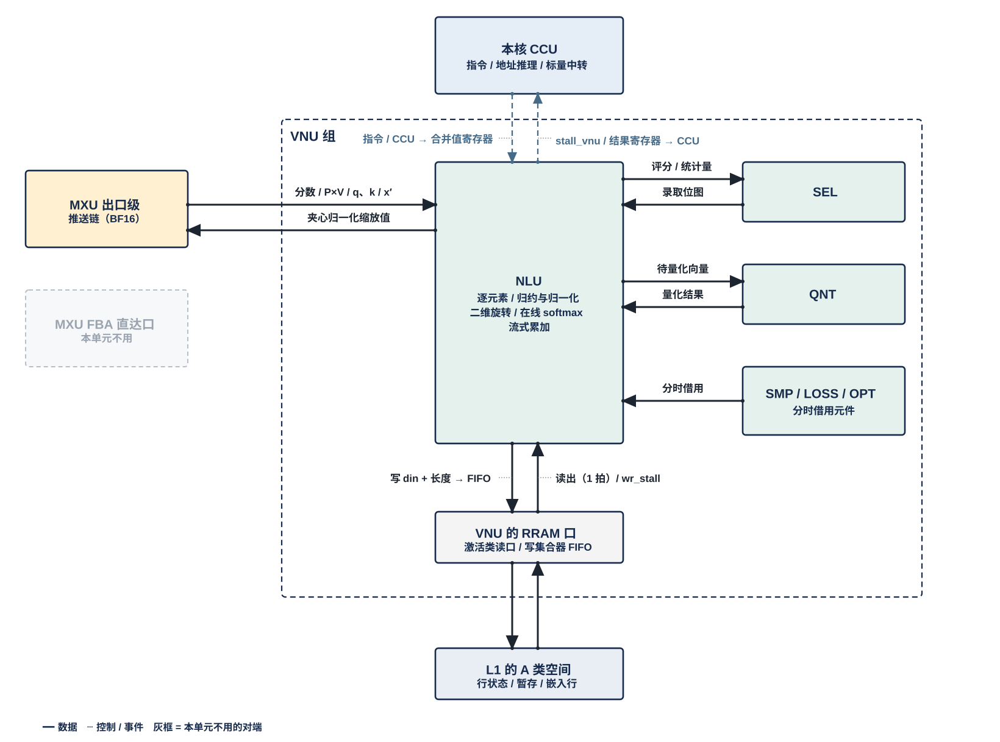
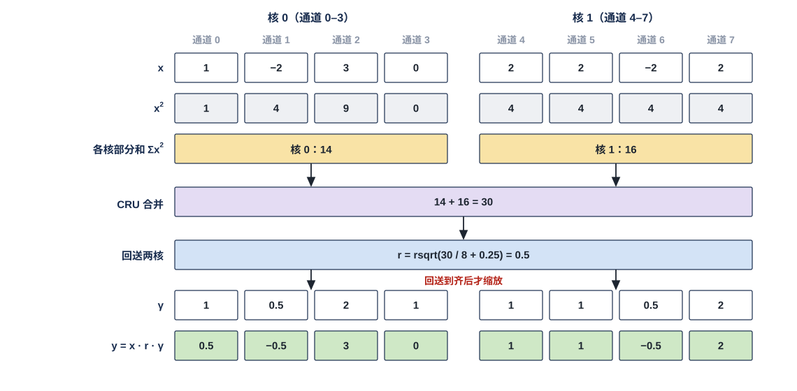
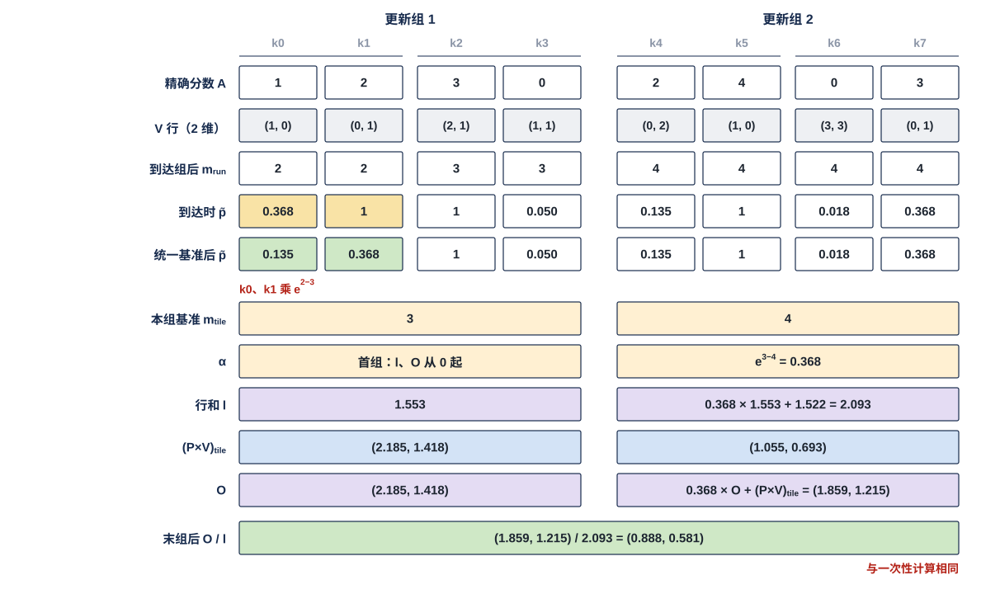
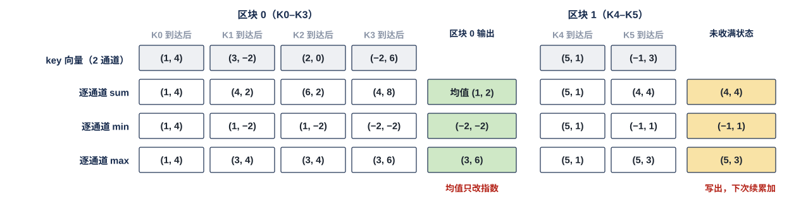

# VNU 非线性单元（NLU）需求

> Owner: WangYizhao｜2026-11-08

## 1 组成与位置

### 1.1 NLU 做两次矩阵乘之间的非矩阵、非选择运算

NLU（Nonlinear Unit，非线性单元）做**两次矩阵乘之间所有非矩阵、非选择的运算**：

- 逐元素函数，例如激活与门控乘；
- 沿一条向量的归约与归一化，例如 RMSNorm；
- 按位置的二维旋转，例如 RoPE；
- attention 的在线 softmax 与输出累加；
- 跨向量的流式累加，例如区块摘要。

**比较与判决交 SEL（含 keep：按门限决定下一位点输入的各搬运引擎是否保留），量化与按判决位压紧、打包交 QNT；NLU 不做矩阵乘、不搬数据。** 深度卷积（DFlash2 的动态卷积、Gated DeltaNet（GDN）的短卷积）本体在 MXU 的逐通道 FIR，NLU 只合成动态卷积的系数（用户 11-05）。**GDN 层的状态更新（每个头一个状态矩阵逐 token 递推）由 MXU、NLU、CCU 的设计者后续设计，本篇暂不规定 NLU 承担哪些步骤**（用户 11-05）。NLU 也不做跨核合并（MAE_CRU）、采样、loss 与参数更新（SMP、LOSS、OPT），不发 DDR 请求，不参与调度。

**NLU 还承担 MXU 阵列出口之后的全部 BF16 域动作：这些动作由 NLU 的强制子模块"出口级"执行（§1.7、§3.6，用户 11-08）**——接收 4 个 pod 的阵列出口缓冲（Array Egress Buffer，AEB）条目，按位点去向直通或扇出给 VNU 各单元，做核内残差位点的残差加、bias 加、残差与特征行的格式还原、部分和的停放写与读改写，以及把要出核的 MXU 输出透传给计算核的集成输出端口。MXU 组的边界到 AEB 为止（V18-MXU-06）。

### 1.2 NLU 是 VNU 组的一个单元，每核一个

一个计算核由 CCU、MXU 组、L1 组、VNU 组四组拼成。NLU 是 VNU 组的六个单元之一，其余五个是 SEL、QNT、SMP、LOSS、OPT。**NLU 与 VNU 组外的模块交换数据，都经 VNU 组的对外接口**；访问 L1 和向核外上行，经 VNU 的共用口。VNU 对外口的个数与共享方式，由 VNU 集成篇定义（待写）。

每个计算核一个 NLU，全芯片 4 个，物理相同。

### 1.3 固定运算元件加可装载序列，组合出各种运算

NLU 由一组固定的运算元件和可装载的序列组成。**序列**是一段运算步骤：一条向量依次经过哪些元件、各步参数从哪来、结果交给哪个去向。同一组元件按不同序列组合出 §3 的五种运算形态；**新模型的新算子只要能由现有元件表达，就只换序列、不改硬件。**

序列与**参数表**（$\gamma$、$\epsilon_{\text{norm}}$、旋转表、近似系数与查找表）都是编译产物。**每个位点跑哪条序列、用哪张参数表，由指令给出**；**位点**是一层里的一个算子实例，例如 gate/up 投影、一段 attention。元件的种类、个数与近似方法由设计者定。本篇不写序列格式与指令字段，指令定稿后另补。

**NLU 同一时刻只执行一种功能**（用户 11-04）：一次跑一条序列，先后由指令与 CCU 排定。VNU 内各单元都按此原则；以后有并行需求时再调整。

### 1.4 NLU 独占 attention 行状态

attention 的**查询行**是 $Q$ 的一行：一个 token 在一个 q 头上的 $d_h$ 个元素，$d_h$ 为 head_dim（128 / 256 / 512）。NLU 为每个查询行保存 **attention 行状态**：

- 行最大值 $m_{\text{run}}$：本行已到达分数的最大值；
- 行和 $l$：本行 softmax 分母的累加值；
- 输出累加值 $O$：$d_h$ 维。

行状态是在线 softmax（§3.4）在一行的两次更新之间要记住的全部内容。它放在 L1 而不寄存在 NLU 内部，NLU 每次只读改写正在更新的那一行（§5.3）。

行状态存在 L1 的 A 类空间里编译链分配的一段地址，**由 NLU 独占读写**，别的单元不读不写；读改写按 L1 的两堆规则做——从一堆读旧值、向另一堆写新值（用户 11-04，V18-L1-02）。读哪堆、写哪堆由 CCU 给的堆选显式选，L1 没有堆角色状态；两堆按 tile 切换，切换条件 = 写完成 ∧ 最后读者完成，由 CCU 在下一 tile 的堆选里体现（传输协议篇 §2.2、§4.1）。行状态是 ② 档定长项对象（数据组织篇 §1.1）。存储格式由设计者定，参考每行 $2 d_h + 8$ B（$O$ 为 BF16，$m_{\text{run}}$ 与 $l$ 为 FP32；head_dim 128 时 264 B）。

### 1.5 与 OPT 的合作通路

NLU 的元件可为 OPT 计算，例如梯度裁剪系数所需的开方与除法。**NLU 与 OPT 怎样合作或折叠，由指令设计考虑，具体指令由两个模块的设计者配合确定；本篇只留出这条通路。** 裁剪系数的计算与使用属于 OPT 的功能，见 OPT 篇。

### 1.6 元件可分时供 SMP、LOSS 使用

NLU 的元件可分时供 SMP、LOSS 的序列使用，**NLU 只执行**。使用时段由 CCU 与指令安排，借用时段内 attention 不运行（§2.3）。

### 1.7 出口级是 NLU 的强制子模块：三路输入、两路输出、与 NLU 共用 BF16 通路

**出口级（Exit Stage）是 NLU 里必须实现的一个子模块**（用户 11-08："它应该成为NLU模块中一个被强制需求的子模块"）。MXU 的 AEB 之后没有 MXU 自己的运算，**MXU 组的边界到 AEB 为止**（V18-MXU-06）；本子模块的各动作对应 V1.7_3 `MXU_ARR` §4.7–§4.8。

- **做什么**：把 AEB 交来的归约完成结果（每条 = 一个（token 或查询行, 列块）的 16 个输出通道、各 1 个 BF16）按位点去向交给下一个消费者，并在交出之前做位点要求的 BF16 域动作——残差加（核内残差位点）、bias 加、残差 / 特征行从 MXFP6 还原成 BF16、归约未完成部分和的停放写与读改写、夹心归一化位点的"先归一化再加残差"。动作清单与接口见 §3.6。
- **输入三路**：① MXU 阵列的 AEB（本核 4 个 pod 各一条，valid / ready）；② L1（经 VNU 的 RRAM 口：残差读入、停放值、经 H2C 落 L1 的 MAE_CRU 合并值、bias 行随尺度行到达）；③ VNU 其他单元（夹心归一化的缩放值等组内向量）。**输出两路**：① L1（停放写、PS 部分和写、$x'$ 等）；② VNU（NLU 本体、QNT、SEL + LOSS、SMP）。**要出核的 MXU 输出（如 K 切分的部分和、直接写 L2 的结果）由出口级透传给计算核的集成输出端口，作为 VNU 输出上 C2H**（用户 11-08："如果需要走C2H，先过VNU透传"；V18-TP-59）。
- **与 NLU 共用一套 BF16 向量通路**：残差加、bias 加、读改写这些逐元素加法与 NLU 的 $O \leftarrow \alpha O + PV$、缩放、dK / dV 相加用同一组 lane，不各备一套（用户 11-08："它的功能是应该被合并的"）。哪一拍跑哪个动作由 CCU 指令调配（§1.3 的"NLU 同一时刻只执行一种功能"对子模块同样成立；AEB 排空的优先级见下条）。
- **设计者须按 MXU 与 CCU 的实际要求调整**（用户 11-08）：(1) **AEB 条目的排空不得使 FBA 持续反压**——MXU 的 AEB 每 pod 参考 8 项、满则反压 FBA，所以出口级对 AEB 的接收能力与 CCU 的调度（AEB 排空的动作优先于 NLU 其他指令，或 AEB 深度按两者并发定）要与 MXU、CCU 设计者对接定【设计者定】（V1.7_3 ARR-R-810 由此改写为对本子模块、CCU 与 AEB 深度的联合要求）；(2) 交 VNU 各单元的元素速率（§5.1）；(3) 每个动作的输入源、去向、时隙都是 CCU 指令字段，子模块不自定。
- **不做**：不量化（QNT）；不向 FBA 回注数据——停放值由 FBA 首访预取经 L1 激活读口装回（MXU 篇）；不做核间 K 切分位点的残差加（MAE_CRU 的残差加指令，V18-CRU-08）。

## 2 数据从哪来、到哪去

虚线框是 VNU 组：

- **框内**是 NLU（含出口级子模块），以及和它直接往来的 SEL、QNT 和 SMP / LOSS / OPT。后三者分时借用 NLU 的元件、并接收出口级分发的向量，合画一个框。这些连线不出 VNU 组。
- **跨出框的连线**都是 VNU 组的对外接口：
  - 左侧：MXU 阵列的出口缓冲 AEB（本核 4 个 pod 各一条，每条 16 × BF16）送进 NLU 的出口级子模块（MXU 组到 AEB 为止，V18-MXU-06）；HUB 组的入站分发网 HUB_IDN（Inbound Distribution Network）送来的嵌入行先由 L1 的接收桥 NWB 落地 L1，NLU 再从 L1 读入；要跨核合并的标量（交 MAE 组的合并单元 MAE_CRU，Cross-Core Reduction Unit，简称 CRU）**与其他输出一样是数据**（V18-TP-55 / 56、V18-CRU-07）：NLU 把部分值作为输出写 L1 或经集成输出端口直接写 L2，由 MAE_CRU 在 L2 合并；合并值经 L2 → H2C 落 L1 后由 NLU 从 L1 读入。**NLU 在命令网上没有端口**；
  - 上方：本核 CCU 给的指令与参数表（虚线），以及 NLU 给 CCU 的入口 stall。
- **下方的 L1 口**：NLU 不直接连 L1 或核上行链路（C2H），而是经 **VNU 的 RRAM 口**（RRAM 即核内 SRAM 口协议，传输协议篇 §5）访问 L1 的 A 类空间：读经 L1 外的选择器用一个激活类读口（4 个读口都可读任一 A 类 bank，撞 bank 由 CCU 排开）；**写**进 L1 的 A 类写集合器里本单元自己那条 32 B 入口 FIFO，集合器每拍按优先级把各写者的队头分到对应 bank 的道上，FIFO 将满时拉 **wr_stall** 回本单元（只到本单元，不到 CCU；传输协议篇 §5.2）。要出核的数据由 CCU 按指令选：先写 L1 再由 L1 发送侧经 C2H 发出，或经计算核的集成输出端口直接写 L2（二选一，V18-TP-56）；两种都由 CCU 逐拍给出 C2H 上的地址（由本核 CCU 按位点指令发令、发读 L1 并逐拍给出 C2H 上的地址，对象发完后 CCU 向 MAE 发出报告）（用户 11-04 / 11-06，V18-L1-03、V18-TP-35、传输协议篇 §2.4、§7.1）。

### 2.1 VNU 组内的接口

**组内链路只规定位宽：全组统一每拍 256 bit（32 B），另加握手位**（用户 11-04，V18-VNU-02）。链路上是什么格式、什么精度，由 NLU 与对端单元的控制逻辑按指令解码，链路本身不区分格式；下表"元素格式"一列是两端须能解码的内容，不是链路的定义。链路条数与组内互连方式由 VNU 集成篇定义。对端来不及收时经该链路的握手让 NLU 停发，NLU 保持待发数据、不丢。

| 接口 | 对端 | 方向 | 内容 | 元素格式 |
|---|---|---|---|---|
| 评分与统计量 | SEL | 出 | FFN 评分 $\lvert\mathrm{SiLU}(\tilde g)\rvert$ 与 $\lvert\tilde s\rvert$（§3.1）；区块能量 $\mathcal E_J$（§3.5）；token 复用比值 $s_{\text{self}}$（§3.4）；判别器（一个旁路小分类网络，矩阵部分在 MXU）的三类分数；相对阈值所用的统计量，例如 Q 一行的 $\mathrm{mean}_d\lvert q_d\rvert$、下一位点保留判断所用的 $\sum\lvert x\gamma\rvert$（§3.2，用户 11-04）；Q 一行的逐维幅值 $\lvert q_d\rvert$，取 RoPE 之后、量化之前的值（用户 11-04） | BF16 |
| 录取位图 | SEL | 入 | 哪些 key 被录取（§3.4）；$P'$ 只对录取 key 折出，连同 key 位置交 QNT 组装 $P'$ 记录 | 每 key 1 bit |
| 待量化向量 | QNT | 出 | 需要量化的结果，连同目标格式；K 读时旋转时另交待解码的 K 存储码（§3.3）。**序列以"交 QNT 量化"一步结尾，NLU 内不设量化器** | BF16；K 存储码为 MXINT8 g32 的 hi / lo 平面 |
| 量化结果回送 | QNT | 入 | $\tilde p$ 两平面量化值之和（按 key，§3.4）；解码后的 K；归约完成的投影结果、q 与梯度 | MXFP6 g32 或 BF16（§4.2） |
| 出口级分发（§3.6） | QNT | 出 | 残差加结果 $x'$、归约完成的投影结果（q、gate、up、v 等）、反传归约完成的梯度、已还原的特征行，交 QNT 量化 / 编码 | BF16 |
| 出口级分发（§3.6） | SEL 并同时扇出 LOSS | 出 | LM Head 的粗 logit 流（两目的 ready 相与后注册） | BF16 |
| 出口级分发（§3.6） | SMP | 出 | LM Head 候选 lo 精算的精确 logits | BF16 |
| 夹心归一化缩放值 | 出口级 ↔ NLU 本体（子模块内） | — | 投影结果先归一化、缩放值再与残差相加（§3.2、§3.6） | BF16 |
| 元件借用 | SMP、LOSS、OPT | 入 / 出 | 分时使用 NLU 的元件（§1.5、§1.6） | — |

### 2.2 经 VNU 组对外的接口

| 接口 | 对端 | 方向 | 内容 | 元素格式 |
|---|---|---|---|---|
| AEB 条目 | MXU 阵列的出口缓冲 AEB，本核 4 个 pod 各一条 | 入 | 归约完成的结果：每条 = 一个（token 或查询行, 列块）的 16 个输出通道，各 1 个 BF16，valid / ready；P×V 条目带（行号, 列块号）标签；K 切分的部分和（经出口级透传出核）。进出口级子模块后按位点去向分发：精确分数（§3.4）、区块打分的粗分数（§3.5）、$(P \times V)_{\text{tile}}$（§3.4）、q / k 的投影结果给 NLU 本体，其余见 §2.1 的分发行。**4 个 pod 瞬时合计每拍至多 32 个元素，由 AEB 吸收；出口级持续接收能力须使 AEB 不持续反压 FBA**（§1.7、§5.1） | BF16，每条 256 bit |
| L1 读写 | 读：L1 外选择器 → 激活类读口；写：A 类写集合器里 NLU 的入口 FIFO | 入 / 出 | 见下文；出口级子模块的残差读入、停放值读入、停放写、PS 部分和写与读改写也经这个口 | 整字 32 B；内容格式见 §4 |
| 写握手 | L1 的 A 类写集合器 | 入 | NLU 那条入口 FIFO 将满时的 wr_stall | 1 bit |
| 输出（含要跨核合并的部分值、透传的 MXU 输出） | 写 L1，或经计算核的集成输出端口直接写 L2（CCU 按指令二选一）（V18-TP-55 / 56 / 59、V18-CRU-07） | 出 | attention 部分状态 $(m_{\text{run}}, l)$、归一化平方和部分和（§3.2）、梯度平方和 $\sum g^2$ 部分和（只在 NLU 累加）等 FP32 部分值，与其他输出一样是数据；要跨核合并时写进 L2 本核象限的同一段内地址，由 MAE_CRU 合并。**MXU 输出要上 C2H 时（K 切分部分和、直接写 L2 的结果）由出口级子模块透传到集成输出端口，算 VNU 输出**（集成输出端口的核内来源只有 L1 发送侧与 VNU 输出） |
| 合并值 | 经 L2 → H2C 落 L1，NLU 从 L1 口读入（V18-TP-55 / 56、V18-CRU-07） | 入 | MAE_CRU 在 L2 合并后的标量（FP32），由一条 L2 → L1 指令送到本核 L1 |
| 嵌入行 | HUB_IDN → L1 接收桥 NWB 落地 L1，再经 RRAM 口读入 | 入 | 嵌入行，以及随行尾到达的两个标量（第 0 层的 $\sum x^2$ 与 $\sum\lvert x\gamma\rvert$，§3.2） | 嵌入行 MXFP6 g32；标量 FP32 语义 |
| 指令 | 本核 CCU | 入 | 序列选择、屏蔽位等指令 | — |
| 入口 stall | 本核 CCU | 出 | 每条由 CCU 发读的入口一根 stall_vnu[i] | 1 bit |
| 参数表 | 本核 CCU | 入 | $\gamma$、$\epsilon_{\text{norm}}$、旋转表、近似系数与查找表，带版本（§4.4） | — |

**NLU 经 VNU 的 RRAM 口访问 L1 的 A 类空间**：

- 读：V 尺度表、行状态、分数暂存、CRU 归约值与标量合并值（MAE_CRU 在 L2 合并后，由一条 L2 → L1 指令经 H2C 写进 L1，传输协议篇 §7.4）、区块摘要部分和、夹心归一化暂存、经 HUB_IDN 落地的嵌入行；K 在 RoPE 之前量化存储时，读未旋转的 K 存储码（§3.3）；出口级子模块读残差（残差格式）、特征行、停放值（BF16）、bias 行（S 类，随尺度行到达 pod 后由 MXU 交来还是由出口级从 L1 读【设计者定】）；
- 写：行状态、分数暂存、区块摘要部分和、夹心归一化暂存；出口级子模块写停放值（BF16，每项 2 B）、PS 部分和、读改写的新值。lse 的跨核合并就是 $(m_{\text{run}}, l)$ 状态合并：部分状态作为输出写进 L2，由 MAE_CRU 合并，合并值经 H2C 落 L1 后 NLU 读入再算 lse（§3.4，传输协议篇 §8.1）。

**RRAM 口的用法**（传输协议篇 §5、§6）：
- L1 没有仲裁：读经 L1 外的选择器用激活类读口（每口 32 B/拍，从一堆读旧值），读时隙由 CCU 排；**写**进 L1 的 A 类写集合器里本单元自己那条 32 B 入口 FIFO，集合器每拍按优先级把各写者的队头分到对应 bank 的道上，FIFO 将满时拉 **wr_stall** 回本单元（只到本单元，不到 CCU；传输协议篇 §5.2），向另一堆写新值（用户 11-04 / 11-05，V18-L1-02）；VNU 对 L1 的口怎样划分，由 VNU 集成篇定义。
- **每次读写的 en / wea / addr 都由本核 CCU 发出，读出的 dout 送哪条入口也由 CCU 定**；NLU 写 L1 时只给 din（一个存储字，32 B）与本条记录的长度；FIFO 将满时 NLU 保持 en / wea / addr / din。读出固定 1 拍到达。
- **每条由 CCU 发读的入口给 CCU 一根 stall_vnu[i]**，入口缓冲占到"深度 − $L$"时拉起；$L$ = CCU 停发 1 拍 + L1 读返回 1 拍，【设计者定】。写侧只有本单元 FIFO 的 wr_stall，不到 CCU；同一阶段并发写者总需求 ≤ 道数 × 32 B/拍由编译链保证。
- 各地址段的基址与长度由指令给出（编译链分配），容量建议值见 §7.1。

### 2.3 由别的模块保证的事项

以下事项 NLU 不检查，由对应模块保证。这张表划出 NLU 的实现与验证边界：表里的事项 NLU 既不实现也不检查，验收时把它们当作输入前提、用断言核对（§6）；读者若在别处看到 NLU 与这些事项有关，指的只是 NLU 消费其结果。

| 事项 | 由谁保证 |
|---|---|
| 量化、按判决位压紧与打包；Q 粗算记录与 $P'$ 记录的组装与写出 | QNT |
| keep 判断（下一位点输入各搬运引擎的保留） | SEL |
| 比较与判决 | SEL |
| 屏蔽位的内容（§3.4） | 指令 |
| $(P \times V)_{\text{tile}}$ 条目带（行号, 列块号）标签；AEB 条目 = 归约完成的 BF16（RNE）、一条 16 个输出通道 | MXU 阵列（FBA 导出、AEB） |
| AEB 的深度与将满水位；停放值的装回（FBA 首访预取经 L1 激活读口，出口级不回注） | MXU |
| 出口级每个动作的输入源、去向与时隙；AEB 排空的优先级 | CCU 指令与调度（与 NLU、MXU 设计者对接，§1.7） |
| 核间 K 切分位点的残差加与编码 | MAE_CRU（V18-CRU-08） |
| P×V 在该更新组的 $P'$ 记录写完后才放行；序列在位点边界切换；算子融合与放行先后 | CCU 与指令 |
| 同一单元的不同功能不在时间上重叠 | CCU 与指令 |
| 参数表的装载时机 | LIC |
| 标量跨核合并的次序 | MAE_CRU |
| 部分值的去向（写 L1 / 写 L2）与地址；合并值落 L1 之后才发使用它的指令 | CCU（传输协议篇 §7.1）；MAE（合并指令在收齐发出报告后执行） |
| 读写 L1 的地址（基址 + 字节累加、环形回绕）与 dout 去向 | CCU |
| 区块摘要未收满部分和的跨次写回与读回，次序不变 | MAE |
| K 存储码搬入本核 L1（只按字节搬运，不做变换） | MAE |
| 旋转后的 K 量化、写本核 L1，由 L1 发送侧经 C2H 写 L2（本核 CCU 发令），再由 MAE 指令经 H2C 多播进需要的核的 L1；K 存储码的解码 | QNT、本核 CCU、MAE（用户 11-04 / 11-06，V18-L1-05、V18-TP-35） |
| K 读时旋转按核调度，与 K 落地、粗分数计算的先后 | LIC 与 CCU |
| A 类各地址段的分配，以及写入前旧数据已读完 | 编译链（指令中的基址与长度，LIC 操作 15） |
| 借用时段内 attention 不运行 | CCU 与指令 |
| VNU 对外口的个数与共享方式（RRAM 读侧经选择器接哪个激活类读口；写侧在集合器里的优先级） | VNU 集成篇（待写）；集合器优先级表由 CCU 随位点指令装 |
| 临时格式统一转换成 BF16 / MXFP6（若设计者选用，§4.2） | QNT |
| 深度卷积本体（DFlash2 动态卷积、GDN 短卷积及其反传，逐通道 FIR） | MXU |
| GDN 层状态更新在各模块之间的分工 | MXU、NLU、CCU 的设计者后续设计（用户 11-05） |

## 3 运算形态

一个位点之后通常跑一到三条序列，例如归一化 → 旋转 → 交 QNT 量化。各种用途都是下面五种运算形态换了序列与参数，同一形态的不同用途不另设机制。读这一节时可把每种形态看成一类数据通路：设计者按形态准备元件与通路，"典型用途"一列只说明这条通路会被哪些序列用到，不是要另做的功能。

| 运算形态 | 按矩阵维度说做什么 | 输入 | 输出 | 典型用途 |
|---|---|---|---|---|
| 逐元素运算 | 对一条或两条同长向量逐元素计算，元素之间不交换数据 | 向量、标量参数 | 同长向量 | FFN 门控与评分、嵌入的 $\sqrt{d_{\text{hidden}}}$ 缩放、GDN 门与每层嵌入（PLE）门控、DFlash2 动态卷积系数合成、判别器隐层激活、K 减均值、$P'$ 折叠、反传导数 |
| 沿向量的归约与归一化 | 沿一个 token 的 hidden 维（$d_{\text{hidden}}$ 个元素）或一个头的 head_dim（$d_h$ 个元素）求统计量，再用统计量缩放这条向量 | 向量；统计量（本核算出、经 CRU 合并后回送或随数据到达） | 统计量；缩放后的向量 | 层入口 RMSNorm、按头归一化、夹心归一化、相对阈值的行均值、梯度范数、判别器归一化 |
| 二维旋转 | 把向量里成对的两维看作二维坐标，按位置给出的角度旋转 | 向量、位置 | 同长向量 | q / k 位置编码、K 读时旋转（K 在 RoPE 之前量化存储时）、K 段位移复用、反传 |
| 在线 softmax 与 attention 输出累加 | 对分数矩阵 $S = Q K^{\mathsf T}$ 的一行按 key 分组到达做 softmax，同时把 $PV$ 累加进该行的 $O$ | 精确分数、$(P \times V)_{\text{tile}}$、QNT 回送的量化值 | $P'$ 与 $\tilde p$（交 QNT）、$O / l$、lse、token 复用比值 | attention |
| 跨向量的流式累加 | 一串向量逐通道累加到一个状态向量 | 一串向量；读回的部分和 | 状态向量；区块结束时的摘要 | 区块摘要、区块能量、dK / dV 跨 chunk 累加 |

### 3.1 逐元素运算：每个元素独立计算

- **激活**：SiLU $\mathrm{SiLU}(x) = x\,\sigma(x)$，其中 $\sigma(x) = 1/(1 + e^{-x})$；GELU 的 tanh 近似 $\mathrm{GELU}(x) \approx \tfrac12 x\big(1 + \tanh(\sqrt{2/\pi}\,(x + 0.044715\,x^3))\big)$；sigmoid；tanh。**SiLU、GELU tanh 近似、sigmoid、tanh 必须支持**；GELU 的 erf 形式 $\tfrac12 x\,(1 + \mathrm{erf}(x/\sqrt2))$ 由现有元件以序列拼出（用户 11-04）。
- **门控乘**：$\tilde s = \tilde u \odot \mathrm{SiLU}(\tilde g)$。$\tilde g$、$\tilde u$ 是 gate、up 两个投影的输出（一个 token 一行，$d_{\text{ff}}$ 个元素）。FFN 评分 $\lvert\mathrm{SiLU}(\tilde g)\rvert$ 与 $\lvert\tilde s\rvert$ 以 BF16 交 SEL 判决，不另量化；$\tilde s$ 交 QNT 量化。
- **算术**：加、减、乘、乘加、按标量缩放、绝对值、平方、饱和。
- **加减通道均值**：减去或加回一个逐通道均值向量 $\mu$（每个通道一个值），例如 K 在旋转之后减均值。
- **通道置换**：按编译期固定的置换表重排一条向量的搬运引擎。
- **尺度折叠与反量化**：乘一个 2 的幂尺度，只加指数，例如 $P'_j = \tilde p_j \cdot S_{V,j}$（§3.4）；反量化即码 × 尺度。
- **逐元素导数**：$\mathrm{SiLU}'(x) = \sigma(x)\big(1 + x(1 - \sigma(x))\big)$、GELU′，用于反传。
- **动态卷积系数**：DFlash2 的两抽头动态卷积，系数 $k_{\text{dc}} = k_{\text{dc,base}} + \delta_{\text{dc}}$ 由 NLU 逐元素相加得出，交 QNT 量化后写 L1；**卷积本体在 MXU 的逐通道 FIR，NLU 不做卷积**（用户 11-05，V18-D-01）。

### 3.2 沿向量的归约与归一化：先求统计量，再缩放

**归约维**是一个 token 的 hidden 维，或一个头的 head_dim（$d_h$ = 128 / 256 / 512）。NLU 沿归约维求 sum、max、均值，以及 MX 组（32 个元素）内的最大幅值 amax，并用统计量做归一化：

- **RMSNorm**：$y_i = x_i \cdot \mathrm{rsqrt}\!\Big(\tfrac{1}{d}\textstyle\sum_{j} x_j^2 + \epsilon_{\text{norm}}\Big)\cdot \gamma_i$，$d$ 为归约维长度，$\gamma$、$\epsilon_{\text{norm}}$ 取自参数表。
- **QK-Norm**：对 q、k（以及带 v 归一化的模型里的 v）按头做 RMSNorm，归约维为 $d_h$。
- **LayerNorm**：$y_i = (x_i - \bar x)\cdot \mathrm{rsqrt}(\sigma_x^2 + \epsilon_{\text{norm}})\cdot \gamma_i + \beta_i$，$\bar x$、$\sigma_x^2$ 为沿归约维的均值与方差。
- **$1+\gamma$ 变体**：RMSNorm 中 $\gamma_i$ 换成 $1 + \gamma_i$。

**统计量有三种来源**：

1. **本核算出**：整条向量都在本核，例如按头的 QK-Norm。
2. **各核部分和经 CRU 合并后回送**：一个 token 的 hidden 维分散在几个核上，例如层入口 RMSNorm。各核对自己持有的那段 hidden 维求部分和（FP32），**作为输出写进 L2 本核象限的同一段内地址（或先写 L1 再发），由 MAE_CRU 在 L2 合并；合并值经 L2 → H2C 落各核 L1，NLU 从 L1 读入**（用户 11-07，V18-TP-55；传输协议篇 §7.1、§7.4）。层入口用两个标量：平方和 $\sum x^2$，以及供下一位点 keep 判断使用的增益加权绝对值和 $\sum\lvert x\gamma\rvert$，由 NLU 交 SEL 作相对阈值的统计量。
3. **随数据到达**：第 0 层的两个标量预先算好存在嵌入表里，随嵌入行的行尾经 HUB_IDN 落地 L1，NLU 随嵌入行一并读入，只转发、不重算。

**统计量到齐后才缩放。** 到齐由 CCU 判断：合并值落进本核 L1（核内写计数达到应写量）后 CCU 才发出缩放的指令，NLU 不设有效位、不因标量未到而 stall。回送到齐之前，待缩放的向量（BF16，每 token 一条本核持有的那段 hidden 通道）由 NLU 经 RRAM 口写进 L1 的 A 类空间暂存，缩放指令到达后再读回。**暂存容量【设计者定】**：要定的是这段地址至少容纳多少个 token 的待缩放向量。约束：须容下"部分和写 L2 → MAE_CRU 合并 → 写回 L2 → H2C 落 L1"一次往返期间本核继续产出的全部 token 向量，否则 NLU 只能停上游；这一往返时延不定要求值、随 CRU 并行 lane 配置变化（§5.1 CCU 一行、传输协议篇 §7.4），所以容量由设计者与 CCU、CRU 对接后定。地址段由指令给出（编译链分配）。缩放后的向量交 QNT 量化；**夹心归一化**（o / down 投影之后、残差加之前另做一次 RMSNorm 的模型结构，如 Gemma 类）的缩放值则交回出口级子模块（同在 NLU 内，§3.6），由它再与残差相加。

缩小例：一条 8 通道的向量，核 0 持通道 0–3，核 1 持通道 4–7；实际 hidden 维为几千（例如 2,560），分在参与计算的各核上。$\epsilon_{\text{norm}}$ 取 0.25 只为好算，实际约 $10^{-6}$。

- 两核各算平方和部分和 14、16，CRU 合并得 30。
- $r = \mathrm{rsqrt}(30/8 + 0.25) = 0.5$ 回送两核。
- 两核各用 $r$ 与自己通道的 $\gamma$ 缩放，结果与单核对整条向量直接计算相同。

核 0 若不等回送、只用自己的 14 按 4 个通道算，会得到 $\mathrm{rsqrt}(14/4 + 0.25) \approx 0.516$，结果错误。

**归约类的其他运算**：

- **归一化的导数**：RMSNorm′、QK-Norm′ 需要一次沿归约维的归约。以 RMSNorm 为例，$\mathrm dx_j = r\,\gamma_j\,\mathrm dy_j - \tfrac{r^3}{d}\,x_j \sum_i x_i \gamma_i\,\mathrm dy_i$，其中 $r = \mathrm{rsqrt}(\tfrac1d\sum_i x_i^2 + \epsilon_{\text{norm}})$。
- **softmax′ 的行内归约**：$P$ 为 softmax 概率矩阵（行为查询行，列为 key），$\mathrm dP$ 为它的梯度。NLU 先求 $D^{\text{sm}}_i = \sum_j P_{ij}\,\mathrm dP_{ij}$，再逐元素算 $\mathrm dS_{ij} = P_{ij}\,(\mathrm dP_{ij} - D^{\text{sm}}_i)$。
- **梯度平方和部分和**：对本核持有的梯度矩阵累加 $\sum g^2$（FP32），作为输出写进 L2，由 MAE_CRU 合并；合并值经 H2C 落 L1，由 OPT 读用（§1.5）。
- **相对阈值所用的行均值**：SEL 的相对阈值判断需要本域均值时，由 NLU 求好交 SEL。例如对 Q 的一行沿 $d_h$ 维选维时，NLU 求 $\mathrm{mean}_d\lvert q_d\rvert$，SEL 再与逐维幅值 $\lvert q_d\rvert$ 比较。**两者同源：都取 RoPE 之后、量化之前的 BF16 值**（用户 11-04）。

### 3.3 二维旋转：按位置旋转成对的两维

把向量中成对的两维 $(a_i, b_i)$（哪两维成对随模型而定，由参数表给出）看作二维坐标，旋转角度 $\theta_i = p\,\omega_i$，$p$ 为位置，$\omega_i$ 取自旋转表的频率：

$$a_i' = a_i\cos\theta_i - b_i\sin\theta_i,\qquad b_i' = a_i\sin\theta_i + b_i\cos\theta_i .$$

- **正向旋转**：可只旋转前若干维，其余维不变。
- **按位置差重旋转**：已旋转到位置 $p$ 的向量再转 $\theta_i = \Delta_{\text{pos}}\,\omega_i$，即得位置 $p + \Delta_{\text{pos}}$ 的结果。用于已存的 K 段换到新位置复用。
- **逆旋转**：$\theta_i$ 取负，用于反传（RoPE′）。
- **位置 = 基址 + 记录内偏移**，基址与偏移由指令与记录给出。

**K 读时旋转**（用户 11-04）。K 可以在 RoPE 之前量化存储：QK-Norm 之后、旋转之前，由 QNT 量化成 MXINT8 g32 的高位、低位两个 4 bit 平面（hi / lo），另每个 key 1 B 的 kmax。这时从 L1 读出的 K 存储码还没有旋转，NLU 在使用前先做读时旋转。**它与本次新算出的 K 走同一条链，只是输入不同**：

1. 解码：由 QNT 把存储码重建成数值；
2. 加回源均值：若写入时减过；
3. 按 key 的绝对位置旋转；
4. 减目标均值：可配；
5. 交 QNT 量化：通道置换若用，在量化时施加。

两段用法：

| 段 | 输入 | 重建 | 输出 |
|---|---|---|---|
| 粗算段 | 本核负责的那部分 key 的 hi 平面、E8M0 与 kmax | 只用 hi 平面 | 量化后只取 hi 平面 + E8M0 + kmax，写本核 L1，由 L1 发送侧经 C2H 写 L2，再经 H2C 多播进需要的核的 L1 的 W 类空间，供粗分数计算 |
| 精算段 | 录取 key 的 hi 与 lo 平面 | 用全部数字 | 量化成完整的 hi + lo，同上路径写 L2、多播进需要的核的 L1，供精确分数计算 |

**旋转后的 K 由 QNT 写本核 L1，再由本核 CCU 按位点指令发令、经 L1 发送侧与 C2H 写 L2（源在核内，CCU 发令，V18-TP-35），由 MAE 指令经 H2C 多播进需要的核；NLU 不写 K 的存储区。** K 存储码由 MAE 只按字节搬入本核 L1；多个核需要同一批 K 时，key 可按核切分，各核旋转自己那一部分后互相多播，不重复旋转（用户 11-04，V18-L1-05）。位置来源（随 K 流读入的位置数组，或段基址 + 偏移）【待确认】；旋转后作粗分数的精度【待标定】。

### 3.4 在线 softmax 与 attention 输出累加：分数分组到达，按更新组统一基准

attention 按 AW 写法为 $S = Q K^{\mathsf T}$、$P = \mathrm{softmax}(S)$（按行）、$O = P V$，其中 $Q$ 为 $T \times d_h$，$K^{\mathsf T}$ 为 $d_h \times N$，$V$ 为 $N \times d_h$，$T$ 为查询行数，$N$ 为 key 数。对一个查询行：

- **录取 key** 是 SEL 为该行选中的 key；
- **精确分数** $A_j$ 是该行对录取 key $j$ 的分数，由 MXU 用 K 的全部数字算出；
- **到达组**是连续 $N_{\text{u}}$ 个录取 key，精确分数按到达组到达；
- **更新组**是连续 $N_{\text{adm}}$ 个录取 key，$P'$、$\alpha$、$l$ 与 $O$ 按更新组各更新一次。

$N_{\text{u}}$、$N_{\text{adm}}$ 由指令给出（参考 $N_{\text{u}} = 32$，$N_{\text{adm}} = 128$–512）。

下面四步按粒度分层：第 1 步随到达组走，只动 $m_{\text{run}}$ 与 $\tilde p$；第 2、3 步随更新组走，动 $P'$、$l$ 与 $O$；第 4 步每行一次。读者可把到达组理解为数据到达的粒度、更新组理解为状态写回的粒度。

**第 1 步：到达组到达时更新行最大值。** 一个到达组里本行的录取 key 集合记 $\mathcal A_u$：

$$m'_{\text{run}} = \max\!\Big(m_{\text{run}},\ \max_{j\in\mathcal A_u} A_j\Big),\qquad \tilde p_j = e^{\,A_j - m'_{\text{run}}}\quad (j \in \mathcal A_u),$$

以 $m'_{\text{run}}$ 作本行新的 $m_{\text{run}}$。录取以外的 key 不进 exp。更新组结束前，早到 key 的中间结果存在 L1 的分数暂存；保存哪些量【设计者定】，不得改变 $P'$、$\alpha$ 与 $l$ 的数值。

**第 2 步：更新组结束时统一基准。** 基准 $m_{\text{tile}}$ 取本组最后一个精确分数到达后的 $m_{\text{run}}$：

- 早到的 $\tilde p_j$ 乘 $e^{\,m_{\text{old}} - m_{\text{tile}}}$ 统一到基准，$m_{\text{old}}$ 为算它时所用的 $m_{\text{run}}$；
- $\alpha = e^{\,m_{\text{tile,prev}} - m_{\text{tile}}}$，$m_{\text{tile,prev}}$ 为上一更新组的基准；
- 折出 $P'_j = \tilde p_j \cdot S_{V,j}$。V 以 MXINT8 存储，$S_{V,j}$ 为 key $j$ 那一行 V 的组尺度，读自 V 尺度表；它是 2 的幂，乘法只加指数；
- $P'$ 与 $\tilde p$ 交 QNT，各量化成两个 MXFP6 平面，例如 $P'_1 = \mathrm{MX}(P')$、$P'_2 = \mathrm{MX}(P' - P'_1)$，$\mathrm{MX}(\cdot)$ 表示按 MXFP6 g32 量化；
- **行和与 $P'$ 同口径**：用 QNT 回送的两平面量化值之和更新

  $$l \leftarrow \alpha\, l + \sum_{j}\Big[\mathrm{MX}(\tilde p_j) + \mathrm{MX}\big(\tilde p_j - \mathrm{MX}(\tilde p_j)\big)\Big];$$

- **$P'$ 记录由 QNT 组装并写 L1**（用户 11-04）：QNT 手里已有两个平面、组尺度与共用基准，按录取位置与数据组织篇的格式拼成 $P'$ 记录，供 MXU 做 P×V。NLU 只收回 $\tilde p$ 的两平面和值，不组装、不写 $P'$ 记录。

**第 3 步：按标签累加输出。** MXU 用 $P'$ 记录与该组 key 的 V 行算出 $(P \times V)_{\text{tile}} = \sum_{j \in \text{本组}} P'_j V_j$，按**列块**（head_dim 中连续 16 维）交出，每个条目带（行号, 列块号）标签。NLU 按标签读出该行 $O$ 的这 16 维，做

$$O \leftarrow \alpha\, O + (P \times V)_{\text{tile}}$$

后写回行状态。**条目次序不必与行序一致。** 本组没有录取 key 的行不出条目，$O$ 与 $l$ 不变。**$m_{\text{run}}$ 变大时，此前的 $O$ 与 $l$ 只乘 $\alpha$，不重新量化。** head_dim > 128 且 V 每 128 维一个尺度时，同一行的 $(P \times V)_{\text{tile}}$ 按 128 维分组到达，各组写行状态中互不重叠的维段【待确认】。

**第 4 步：末组之后输出。**

- $O / l$ 交 QNT 量化，作下一位点（o 投影）的输入；
- 给出 $\mathrm{lse} = m_{\text{run}} + \ln l$；
- 多个核各持一行的一部分 key 时，各核的部分状态 $(m_{\text{run}}, l)$（FP32）作为输出写进 L2，由 MAE_CRU 合并（$m = \max(m_a, m_b)$，$l = l_a e^{m_a - m} + l_b e^{m_b - m}$）；合并值经 H2C 落本核 L1 后，CCU 再发算 lse 的指令。

**对录取 key 的子集另算行和。** 对录取 key 中由指令指定的一个子集，用同一 $m_{\text{run}}$ 与 $\alpha$ 另累加行和 $l_{\text{self}}$，与全部录取 key 的行和 $l_{\text{total}}$ 相除得 token 复用比值 $s_{\text{self}} = l_{\text{self}} / l_{\text{total}}$；跨 q 头的聚合方式（如取均值）由序列给出，结果交 SEL 判决。

**参与 softmax 的元素集合**（用户 11-04）：

- **被屏蔽的位置不得计入行最大值、行和与输出，等价于权重为 0。** 屏蔽的来源包括因果截断、树形 token 之间的祖先关系、有效 key 范围、被剪掉的 token；屏蔽位由指令给出。
- **整行全被屏蔽时输出零向量，不产生 NaN。**
- 本篇只写这一需求。逐元素置 $-\infty$ 后照算是最差的做法：**被屏蔽的元素不应白占运算拍**，做法应均衡各运算元件的利用率，【设计者定】。

缩小例：一个查询行的 8 个录取 key，到达组 $N_{\text{u}} = 2$（灰色短线），更新组 $N_{\text{adm}} = 4$；V 只取 2 维，$S_V = 1$，不画两平面量化。实际参考 $N_{\text{u}} = 32$、$N_{\text{adm}} = 128$–512，$d_h = 128$，$O$ 每个列块 16 维。

- **更新组 1**：到达组 {k0, k1} 到达后 $m_{\text{run}} = 2$，k0、k1 按 2 算 $\tilde p$；到达组 {k2, k3} 到达后 $m_{\text{run}}$ 升到 3。组末统一基准 $m_{\text{tile}} = 3$，早到的 k0、k1 乘 $e^{2-3}$，得 0.135、0.368。首组的 $l$ 与 $O$ 从 0 起：$l = 1.553$，$O = (2.185,\ 1.418)$。
- **更新组 2**：第一个到达组就把 $m_{\text{run}}$ 升到 4，第二个到达组不变，所以组内不必统一。$\alpha = e^{3-4} = 0.368$；$l = 0.368 \times 1.553 + 1.522 = 2.093$；$O = 0.368 \times O + (1.055,\ 0.693) = (1.859,\ 1.215)$。
- **末组后** $O / l = (0.888,\ 0.581)$，与对 8 个分数一次性做 softmax、再加权 V 的结果相同（脚本断言，浮点容差内）。

### 3.5 跨向量的流式累加：逐通道累加，可从读回的部分和继续

一串向量逐通道累加到一个状态向量，**结果与一次性成批计算一致**：

- **区块摘要**：**区块**是连续 $L_{\text{blk}}$ 个 key（参考 128，取 2 的幂），**区块摘要**是区块内 K 的逐通道聚合量。NLU 对每个到达的 key 向量（$d_h$ 维）按 key 升序累加：
  - 逐通道 sum，区块收满后乘 $1/L_{\text{blk}}$ 得均值；$L_{\text{blk}}$ 为 2 的幂，乘法只改指数；
  - 逐通道 min / max。

  两种摘要都必须能做，用哪种由序列选择。收满的摘要交 QNT 量化。
- **区块能量**：MXU 用查询行与区块摘要算出区块打分的粗分数 $S_{iJ}$（查询行 $i$ 对区块 $J$），经出口级交 NLU。NLU 按（query 行块, q 头, 区块）把同一区块的 $S_{iJ}$ 聚合成区块能量 $\mathcal E_J$，交 SEL 做区块选择。聚合形式由序列给出；**聚合按行号升序进行，结果与到达次序无关。**
- **两个部分和相加**：attention 反传按 query 分块（chunk）计算时，本块的 dK / dV 部分和与读回的累加值逐元素相加。
- **从读回的部分和继续累加**：区块未收满时，部分和由 MAE 写出；下次读回后从这个状态继续累加，次序不变，结果与一次性成批计算一致。

缩小例：6 个 key，每个 2 个通道，区块长 $L_{\text{blk}} = 4$；实际参考 128 个 key、$d_h = 128$ 个通道。

- 区块 0 收满 K0–K3 后输出：均值 $= \text{sum} \times 2^{-2} = (1,\ 2)$，min $(-2,\ -2)$，max $(3,\ 6)$，与对 4 个 key 成批计算相同。
- 区块 1 只到了 K4、K5，sum $(4,\ 4)$、min $(-1,\ 1)$、max $(5,\ 3)$ 是未收满的部分状态。写出、下次读回后从这个状态继续累加，结果与对整个区块成批计算相同（脚本以 2 个后续 key 断言）。

### 3.6 出口级子模块：AEB 条目的分发、残差加与部分和读改写

**出口级子模块对每条 AEB 条目按 CCU 指令给的动作与去向处理；全部动作只在 BF16 域，由 §3.1 的逐元素算术与 §3.5 的两部分和相加这两种形态实现，不新增运算形态**（用户 11-08；原 V1.7_3 `MXU_ARR` §4.7–§4.8 条款的内容迁入本节，条款含义不变）。

| 动作 | 输入 | 运算 | 输出去向 | 说明 |
|---|---|---|---|---|
| 直通与扇出 | AEB 条目 | 无，不改数值 | NLU 本体（精确分数、区块打分粗分数、$(P \times V)_{\text{tile}}$、q / k）；QNT（归约完成的投影结果 psum 2、v、反传梯度）；SEL 并扇出 LOSS（LM Head 粗 logit，两目的 ready 相与后注册）；SMP（精确 logits） | 精确分数必须不加、不改地直通在线 softmax，不得留存录取对的粗分数（原 ARR-R-710） |
| 残差加（核内残差位点） | AEB 条目 + 同一 token、同 16 个通道的残差（从 L1 读，**两种存储格式都支持**：稠密残差格式 MXFP6 E2M3 g32，或紧凑记录——按段头 keep 展开、缺位补 0；还原为 BF16，精确；V18-DORG-02） | 逐元素加，BF16 RNE | $x'$ 交 QNT 一次编码成稠密残差格式，或（位点配置为紧凑时）等 SEL 判完后编码成紧凑记录；同时交 NLU 本体累加归一化统计 | **相加之前不量化投影结果；残差不预装为 FBA 初值；残差只加一次、加完只编码一次**（原 ARR-R-730 / 850）。核间 T / M 切分位点在此加；**核间 K 切分位点不在此加**（各核部分和不含残差，归约与残差加由 MAE_CRU 两条指令完成，V18-CRU-08） |
| bias 加 | AEB 条目 + 该列块的 BF16 bias 行（S 类旁带行） | 逐元素加 | 同条目去向 | 在累加侧预装 FBA 初值还是在出口级加，【设计者定】（V18 bias 旁带行）；与残差加同一处逻辑 |
| 夹心归一化 | AEB 条目 → NLU 本体归一化（§3.2）→ 缩放值 → 再与残差相加 | 子模块内两步 | QNT | **缩放结果回到出口级之后才相加**（原 ARR-R-740）；暂存经 L1 还是内部队列【设计者定】 |
| 残差 / 特征行还原 | L1 里的残差对象（稠密残差格式或紧凑记录，V18-DORG-02） | 码 × 尺度（精确）；紧凑记录先按段头 keep 展开、缺位补 0 | 特征行还原后交 QNT 不归一量化；残差用于残差加 | 同一还原逻辑（V18-QNT-06）；按段头展开与 L1 段解包器同一规则 |
| 停放写 | AEB 条目（K 段末、$K_t$ 分块末、attention 块间部分分数等归约未完成的条目） | 无 | L1 部分和停放区（BF16，每项 2 B，一个停放条目 ≤ 8 项） | **停放只许本核 L1，同一 psum tile 只有一份活拷贝，不量化**；装回由 FBA 首访预取经 L1 激活读口完成，不经出口级 |
| PS 部分和写与读改写 | AEB 条目 + L1 里的部分和 | 逐元素加（§3.5 两部分和相加） | L1（继续累加）或 QNT（归约完成） | 读旧堆、写新堆（L1 两堆规则）；down 沿 $k$ 分遍的 psum 1 用此路 |
| 透传上 C2H | AEB 条目（K 切分部分和、位点指令选直接写 L2 的结果） | 无 | 计算核的集成输出端口（算 VNU 输出） | 每拍 L2 地址由 CCU 给；C2H 不 ready 时 CCU 被门控（V18-TP-56 / 59） |

- **接口位宽**：AEB 每 pod 一条，256 bit（16 × BF16）+ valid / ready；交 VNU 各单元每核每拍至多 16 个元素（§5.1）；L1 经 VNU 的 RRAM 口 32 B/拍。
- **不反压 FBA 的联合要求**：AEB 深度（MXU 参考每 pod 8 项）、出口级接收能力与 CCU 的调度共同保证 AEB 不持续反压 FBA；做法（AEB 排空优先 / 加深 AEB / 两者）由 NLU、MXU 设计者与 CCU 对接定【设计者定】（§1.7、§5.1）。
- 每个动作由 CCU 指令调配：输入源、动作、去向、L1 地址都是指令字段（CCU 篇、ISA）；子模块不自定去向。

## 4 精度要求与数据格式

### 4.1 精度要求：集成到算法后任务精度下降 < 0.1%

**NLU 的计算方案集成到算法后，任务精度下降 < 0.1%。中间计算精度不规定，由设计者定**（用户 11-04）。口径：

- 下降量按绝对百分点计；
- 基线为同一算法下 VNU 各运算按 FP32 理想值计算的结果；
- 评测集为算法侧的标准评测集；
- 硬件实现与算法参考模型逐位一致，作为验证手段；参考模型随硬件实现同步。

### 4.2 输入格式：向量只有 BF16 与 MXFP6 g32 两类

| 类别 | 格式 | 来源 |
|---|---|---|
| 向量 | BF16 | MXU 阵列的 AEB 条目（经出口级子模块）、VNU 内部、L1 里的停放值 |
| 向量 | MXFP6 g32：每个元素 6 bit（E2M3 码），每 32 个元素共享一个 8 bit 指数尺度（E8M0） | 存储（L1 读回、经 HUB_IDN 落地的嵌入行；残差与特征行由出口级子模块还原）、QNT 回送 |
| 标量 | FP32 语义：结果与"按 FP32 计算、只在最后舍入一次"的参照一致，实现可用更窄的内部格式 | 合并值（MAE_CRU 合并后经 L2 → H2C 落 L1，FP32）、随嵌入行经 HUB_IDN 落地 L1 |

还有几种需要临时处理的格式：

- OPT 自己的格式：MXINT8 权重副本、优化器状态；
- 可选格式：MXFP6 装不下时的 FP8 / BF16 / FP16 梯度；元素位宽取 8 的位点所用的 MXFP8 E4M3；
- 经 HUB_IDN 交 LOSS 的 teacher 概率。

**设计者可选择在 QNT 把这些格式统一成上述两类后再交 NLU**（用户 11-04）。

### 4.3 输出格式

- 交 QNT、SEL、SMP、LOSS 的向量为 BF16；出口级写 L1 的停放值与 PS 部分和为 BF16（每项 2 B）。
- 要跨核合并的标量为 FP32，按 ② 档定长项排列，可紧密排、也可单个发（一拍、be 只开有效字节，不补 32 B；数据组织篇 §1.1，V18-TP-58），与其他输出一样写 L1 或直接写 L2（V18-TP-55 / 56、V18-CRU-07）。
- 反传逐元素运算的输出经 QNT 按位点配置的流动梯度格式（反传梯度在算子之间流动时的格式，默认 MXFP6 g32 单平面）量化后才离开 VNU。$\mathrm dS$ 取其中哪一种格式、梯度 MXFP6 的组轴（逐 token 沿通道或沿 token）【待确认】。

### 4.4 结果规则

- **在线 softmax 的结果与 key 的到达次序无关。** 例外是两平面量化：它按更新组内每 32 个录取 key 一段分组，段的成员随到达次序变化，输出在量化舍入级与次序有关【待标定】。
- 区块能量与到达次序无关。
- 流式区块摘要与一次性成批计算一致，跨次读回后续累加时次序不变。
- K 读时旋转与本次新 K 的复算链是同一条链，同一输入下逐位相同。
- **序列在位点边界切换，切换不打断在途向量。**
- **参数表带版本；在途序列一直用旧版，直到用完。** 不出现半更新状态。

## 5 速率与时延

本节分两类：§5.1 列出须与相关模块对接的速率，参考值只作背景；§5.2–§5.5 是 NLU 自身的能力要求与超载时的行为。

### 5.1 每拍处理能力匹配上下游模块

**NLU 每拍能处理的元素数，须匹配上游各口的产出速率与下游各口的接收要求，由 NLU 设计者与以下模块对接确定**（用户 11-04）。下表的参考值只作背景，不是 NLU 的定值；**现行每拍 16 个元素是参考值，设计者可按需求加大并行数**（用户 11-05："NLU可以增加它并行处理的数量，当前的值可以是一个Reference值"）：

| 相关模块 | 接口 | 现行参考值 |
|---|---|---|
| MXU 阵列（AEB） | AEB 条目 | 4 个 pod 瞬时合计每拍至多 32 个元素、持续约 16 个（旧供数结构下的值【待标定】），由 AEB 吸收；**出口级子模块的接收与 NLU 的合计负载不得使 AEB 持续反压 FBA**（与 MXU 设计者、CCU 对接，§1.7） |
| VNU 各单元（出口级分发） | 出口级 → NLU 本体 / QNT / SEL + LOSS / SMP | 每核每拍至多 16 个元素 |
| QNT | 待量化向量、量化结果回送 | QNT 的统一请求接口（所有量化请求的唯一入口，QNT 篇 §2.3）每拍 16 个元素 |
| SEL | 评分与统计量 | SEL 的 NLU 口每拍 16 个评分 |
| L1（经 VNU 的 RRAM 口） | 行状态读改写、分数暂存 | 每个有录取的（行, 更新组）读改写一次行状态（§5.3）；读出固定 1 拍；入口将满时拉 stall_vnu[i]；写进集合器 FIFO，将满 wr_stall |
| L2 / MAE_CRU | 标量部分值、合并值 | 层入口归一化每 token 一次往返（写 L2 → MAE_CRU 合并 → 写回 L2 → H2C 落 L1）；往返时延不定要求值，CRU 并行 lane 可配（传输协议篇 §7.4） |
| MAE（K 存储码流入） | K 读时旋转 | 粗算段的旋转不得慢于本核 K 存储码的流入：每（key, kv 头）69 B，DDR 参考 19.2 B/拍时全芯片约 0.28（key, kv 头）/拍、约 36 元素/拍，按参与的核分摊；单核时约 36 元素/拍，约为向量路径的 2.2 倍【待标定】 |

### 5.2 exp 能力匹配录取率上限下的精确分数到达速率

**exp 的能力须匹配"精确分数到达速率 × 录取率上限 $\phi_{\max}$"**（用户 11-04）：按录取率达到上限 $\phi_{\max}$（一行里被录取的 key 所占比例的上限）时的精确分数到达速率定容。现行参考：粗算每核每拍扫过约 21.8 个 key，$\phi_{\max} = 0.5$ 时精确分数约 11 个/拍，即 exp 约 11 次/拍；SiLU 等逐元素场合每拍 16 个。参考值来自旧供数结构下的粗算节奏【待标定】。

### 5.3 O 更新每（行, 更新组）d_h / 16 拍

每个有录取的（行, 更新组）读改写一次 $O$，耗时 $d_h / 16$ 拍（head_dim 128 时 8 拍）。耗时与 $N_{\text{adm}}$ 无关；$N_{\text{adm}}$ 越大，一行的更新次数越少。

### 5.4 自身流水深度

投影后处理（投影结果进 NLU 后跑的归一化、旋转等序列）的流水深度，即一条向量的首个元素从进入 NLU 到交给 QNT 的拍数，≤ 40 拍【待标定】。整条向量的耗时另按每拍 16 个元素计，例如 2,560 个元素约 160 拍。

### 5.5 exp 超载时经握手停上游，不丢分数

精确分数的到达超过 exp 的能力时，NLU 经握手让上游停发，**不丢分数**。握手只用传输协议篇 §6 的相邻级 stall：对 MXU 阵列是出口级子模块对 AEB 条目拉低 ready（AEB 堆满后反压 FBA）；对由 CCU 发读的入口是 stall_vnu[i]。

本节与 §5.1"不得使 AEB 持续反压 FBA"的分界：

| 工况 | NLU 的要求 |
|---|---|
| 录取率 ≤ $\phi_{\max}$（§5.2 的定容点） | exp 与 $O$ 更新跟得上，**不因 NLU 让 AEB 堆满、进而反压 FBA** |
| 录取率 > $\phi_{\max}$ | 允许经上述 ready 降速；**只降速、不丢分数、不是错误** |

## 6 计数与复位

- **计数**：溢出按饱和处理，饱和次数计数，供 LIC / MAE 读取。
- **复位**：清行状态、分数暂存、平方和暂存与各部分和。**NLU 没有需要跨次保留的状态**：区块摘要的未收满部分和由 MAE 写出、下次读回。
- **不设运行时错误事件**：§2.3 所列前提由对应模块保证，验收时用断言检查。

## 7 要求值与验收

### 7.1 要求值

| 项 | 要求值 | 说明 |
|---|---|---|
| 运算形态 | 逐元素、沿向量的归约与归一化、二维旋转、在线 softmax 与 attention 输出累加、跨向量的流式累加 | 序列与参数由指令与参数表给出；GDN 状态更新的分工待 MXU、NLU、CCU 设计者后续设计 |
| 出口级子模块（强制） | 输入 AEB（4 条 × 256 bit + valid / ready）/ L1 / VNU，输出 L1 / VNU；动作：直通与扇出、残差加、bias 加、夹心归一化、残差 / 特征行还原、停放写、PS 读改写、透传上 C2H（§3.6） | 与 NLU 共用 BF16 lane，由 CCU 指令调配；AEB 不持续反压 FBA 的做法与 MXU、CCU 对接【设计者定】 |
| 每拍处理能力 | 匹配上下游各口（§5.1） | 由 NLU 设计者对接确定；向量路径参考每拍 16 个元素，可加大 |
| exp 能力 | 匹配录取率上限下的精确分数到达速率（§5.2） | 参考约 11 次/拍【待标定】；逐元素场合每拍 16 个 |
| $O$ 更新 | 每（行, 更新组）$d_h / 16$ 拍 | head_dim 128 时 8 拍 |
| K 读时旋转 | 粗算段不慢于本核 K 存储码流入（§5.1） | 单核参考约 36 元素/拍【待标定】；并行度【设计者定】 |
| 流水深度 | 投影后处理 ≤ 40 拍 | 【待标定】 |
| head_dim | 128 / 256 / 512 | 归一化、旋转、$O$ 更新都要支持 |
| 精度 | 集成到算法后任务精度下降 < 0.1%（绝对百分点） | 基线为 VNU 各运算按 FP32 理想值；中间精度由设计者定 |
| 门数 | 参考 ≤ 150 k 门（NAND2 等效），另加 3–5 KB 存储 | 不含 L1 中的行状态与记录；行状态更新与归一化缩放部分的门数增量【待标定】 |
| L1 建议值 | 分数暂存：$N_{\text{adm}} = 512$ 时约 19 KB；区块摘要部分和每 kv 头 $d_h \times 4$ B（均值）或 $2 d_h \times 4$ B（min / max）；行状态每行 $2 d_h + 8$ B（head_dim 128 / 256 / 512 时 264 / 520 / 1,032 B） | A 类地址段由编译链分配 |
| L1 口与握手 | RRAM 口：读经激活类读口，每条由 CCU 发读的入口一根 stall_vnu[i]；写进 A 类写集合器里本单元的入口 FIFO（只给 din 与长度），将满 wr_stall 回本单元 | 将满阈值 = 深度 − $L$，$L$【设计者定】 |
| 要跨核合并的标量 | 作为输出写 L1 或直接写 L2；合并值从 L1 读入；FP32；NLU 在命令网上无端口 | 传输协议篇 §7.1、§8 |

### 7.2 验收

| 对象 | 方法 | 用例 |
|---|---|---|
| 逐元素运算（§3.1） | 与算法参考模型逐位比对 | 各激活、门控乘、导数；饱和与大幅值输入 |
| 归约与归一化（§3.2） | 逐位比对 | hidden 与 head_dim 两种归约维；head_dim 128 / 256 / 512；三种统计量来源；多核部分和合并后与单核整体计算相同；全零输入给出有限值 |
| 二维旋转（§3.3） | 逐位比对 | 正向、部分维、按位置差重旋转、逆旋转 |
| K 读时旋转（§3.3） | 与"解码 → 同一条链 → 重量化"的参照逐位比对；周期仿真 | 粗算段与精算段；单核与多核；旋转不拖慢粗分数计算 |
| 在线 softmax（§3.4） | 逐位比对 | 多种 $N_{\text{u}}$、$N_{\text{adm}}$；条目乱序到达与行序到达结果相同；本组无录取的行 $O$ 不变；多核部分状态合并后与单核结果相同 |
| 参与 softmax 的元素（§3.4） | 逐位比对；周期仿真 | 因果、树形祖先、有效范围、被剪掉的 token；整行全屏蔽输出零向量、无 NaN；被屏蔽元素不白占运算拍 |
| 流式累加（§3.5） | 逐位比对 | 均值与 min / max；未收满部分和写出、读回后续累加；区块能量乱序到达 |
| 结果规则（§4.4） | 断言 | 序列在位点边界切换、在途向量用旧序列完成；在途序列不读新版参数表 |
| 集成精度（§4.1） | 算法侧评测 | 目标模型在标准评测集上下降 < 0.1% |
| 不使 AEB 持续反压 FBA（§5.1） | 周期仿真 | 4 个 pod 的 AEB 峰值注入（瞬时 32、持续 16 个元素/拍），在线 softmax、$O$ 更新、归一化缩放与残差加同时进行 |
| 出口级子模块（§3.6） | 逐位比对；断言 | 八种动作各自与参考一致：精确分数直通不改值；残差加一次舍入（与"BF16 导出、BF16 相加、一次 MXFP6 编码"的参照逐位同）；停放 / 读改写与"停放边界一次 BF16 舍入"的参照逐位同；透传条目逐位不变 |
| RRAM 口与入口 stall（§2.2） | 周期仿真；断言 | 写只给 din 与长度；stall_vnu 拉起后入口缓冲不溢出；wr_stall 拉起后不丢写；行状态读写堆选一致 |
| 标量走数据协议（§3.2、§3.4） | 断言 | 部分值作为输出写 L1 或 L2、合并值从 L1 读入；不经命令网；多核合并后与单核结果相同 |
| exp 超载（§5.5） | 周期仿真 | 录取率扫描，超过上限时经 stall 停上游、不丢分数 |
| $O$ 更新与流水深度（§5.3、§5.4） | 周期测量 | head_dim 128 / 256 / 512 |
| 复位（§6） | 检查状态 | 运算进行中复位 |
| 门数（§7.1） | 综合 | 待 RTL |

## 8 为什么

- **两次乘加之间的运算落 NLU**：MXU 只做矩阵乘加，两次乘加之间的非矩阵、非选择运算都落到 NLU；比较与判决在 SEL，量化与打包在 QNT，各单元只做一类事。
- **对外接口经 VNU 组封装**（用户 11-04）：NLU 是 VNU 组内的单元，访问 L1、向核外上行都经 VNU 的共用口；对外口怎样划分由 VNU 集成篇统一定义。
- **固定元件 + 可装载序列**：新模型的新算子只要能由现有元件表达就不改硬件；序列与参数表是编译产物，换模型只换序列与参数。
- **精度按集成后掉点要求，中间精度交设计者**（用户 11-04）：NLU 的输出几乎都要再量化成 MXFP6 这类块格式，元件误差只需明显小于下游量化步。所以本篇不规定元件误差界与内部格式，只规定集成后的任务精度，由设计者在精度与门数之间取舍。
- **输入格式两类**（用户 11-04）：NLU 只面对 BF16 与 MXFP6 g32 两类向量，元件不必为每种格式各备一套；其余格式可在 QNT 先统一。
- **在线 softmax 的到达组与更新组**：精确分数按到达组到达，$m_{\text{run}}$ 随之更新，不等整行分数到齐；一个更新组的 $P'$ 要以同一个基准折成，才能作为一组交 MXU 做 P×V，所以组末统一基准。$N_{\text{u}}$、$N_{\text{adm}}$ 由指令给出，硬件只固定粒度；更新组越大，$O$ 的读改写越少。$N_{\text{adm}}$ 的参考值来自 11-01 的真实位图回放（旧供数结构下仿真【待标定】）。
- **行和与 $P'$ 同口径**：MXU 用两平面量化后的 $P'$ 做 P×V，分子带量化；分母也用 $\tilde p$ 的两平面量化值累加，分子分母才同口径，而不是用未量化的 $\tilde p$。
- **$O$ 与行状态归 NLU**（用户 11-03）：$\alpha O$ 要乘任意实数 $\alpha$，MXU 的累加器与 CRU 都没有这一乘法；$m_{\text{run}}$、$l$ 与 $O$ 同在 NLU 读写，$\alpha$、$l$ 与 $O$ 更新的先后只在单元内部排序。这与 TPU（矩阵单元只出累加结果，逐元素与归一化在向量单元）和昇腾（Cube 单元只做矩阵乘，向量后处理在 Vector 单元）的分工一致。
- **按传输协议篇同步**（用户 11-05，V18-TP-01…16）：核内与 L1 之间只有 RRAM 一种口，地址只在 CCU 一处推理，NLU 只给数据与长度；CCU 不看下游余量，所以每条入口给 CCU 一根 stall；交 CRU 的标量与合并值不经 L1 / L2，部分和与合并值都是几个 FP32，没有必要占数据网与 L1 的时隙；HUB_IDN 与 H2C 只落 L1，所以嵌入行先落地再读入。
- **标量经 CCU 中转**（用户 11-05："直接发给 CCU，由 CCU 直接配置 VNU 内部需要计算数据的寄存器吧……VNU 的控制命令本来就来自 CCU，那么刚好可以统一调配"，V18-TP-21）：NLU 在命令网上不设端口；合并值到达与使用它的指令在 CCU 一处排序，NLU 不需要有效位、不因标量未到而 stall。
- **统计量跨核合并后再缩放**：一个 token 的 hidden 维分散在各核，RMSNorm 要整行的平方和；只用本核部分和会算错缩放系数（FIG-VNU_NLU-NORM-SPLIT 的 0.516 对 0.5）。
- **K 读时旋转归 NLU**（用户 11-04 晚）：K 在 RoPE 之前量化存储时，读出后要先旋转。把旋转放到各核 NLU，工作量随核并行、每核只旋自己要用的头；MAE 只按字节搬运，不设专门的旋转通路。
- **Q 粗算记录改由 QNT 写**（用户 11-04）：QNT 组装 Q 全维记录时已有 SEL 给的选维位与全部码，顺带写出只保留选中维的粗算记录，不必由 NLU 再从 L1 读回重打包。**$P'$ 记录同理由 QNT 组装**（用户 11-04）：两个平面、组尺度与共用基准都在 QNT 手里，省去两平面回送 NLU 一程和 NLU 的一次 L1 写。
- **屏蔽只写需求，优先均衡利用率**（用户 11-04）：屏蔽位由指令给出，NLU 只需保证被屏蔽元素不计入结果；逐元素置 $-\infty$ 后照算会让被屏蔽元素白占运算拍，所以做法交设计者，以均衡利用率为先。
- **与 OPT 只留合作通路**（用户 11-04）：裁剪系数是 OPT 的功能；它需要的开方与除法可借 NLU 的元件，怎样配合由指令设计与两个模块的设计者确定。
- **每拍处理能力由设计者对接**（用户 11-04）：上游出口级与下游 QNT、SEL 的节奏都随相关模块的设计而定，所以本篇列出相关模块与参考值，不写死跨模块的数字。
- **GDN 状态更新暂不写实现需求**（用户 11-05："不要现在写入GDN的实现需求了……GDN的状态更新，留出MXU，NLU，CCU的设计者后续设计"）：状态更新跨 MXU、NLU、CCU 三个模块，分工与数据通路由三方设计者后续共同设计。
- **深度卷积留在 MXU 的逐通道 FIR**（用户 11-05："MXU利用率再低，它的输出维度也能保持在64并行输出（4个Pod）"）：FIR 没有专用缓冲，只是激活进阵列的接线选择加控制；NLU 只合成 DFlash2 的动态系数。
- **每拍元素数只是参考值**（用户 11-05）：新负载按需加大并行数，由设计者与上下游对接。
- **覆盖目标模型**：Qwen3-4B、MiniCPM5-1B 与现行 Draft 模型的全部非矩阵、非选择算子；新增目标 Qwen3.5-4B（GDN 门的逐元素部分、head_dim 256；状态更新的分工待后续设计）与 Gemma 4 E2B（GELU、q / k / v 归一化、嵌入 $\sqrt{d_{\text{hidden}}}$ 缩放、PLE 门控的逐元素乘）；Llama 类结构作同类覆盖。不能由现有元件表达的新算子记为缺口，不承诺任意函数可配。

- **标量走数据协议、输出可直接写 L2**（用户 11-07："如果是控制网，我认为他们不属于控制网，需要走数据通信协议"；"VNU 和 MXU 的输出可以由 CCU 直接推算要写在 L2 SRAM 的地址，然后走核间协议，不过也要支持输出写回到 L1 SRAM"；V18-TP-55 / 56）：结果寄存器 / 合并值寄存器的专用接口与"经 CCU 中转"撤；下面几条中与此冲突的旧写法以本条为准。
- **出口级并入 NLU、作强制子模块**（用户 11-08："出口级作为一个模块，但是它的功能是应该被合并的（只合并出口级和NLU的对应功能），因为MXU和VNU的指令都是CCU来的，因此它本身是可以被调配的"；"它应该成为NLU模块中一个被强制需求的子模块，并且这个模块的设计者还要受MXU，CCU的实际要求做调整"；V18-NLU-06）：11-03 把出口级留在 MXU 组后，BF16 向量加法在出口级与 NLU 各有一套；两者的指令都来自 CCU，合成一套通路由 CCU 调配即可，残差还原也只留一处。保留"出口级"之名与强制地位，是因为 MXU 的 AEB 排空与 FBA 不反压是硬要求，必须有一个明确的责任子模块与 MXU、CCU 对接。MXU 输出上 C2H 先经出口级透传，使集成输出端口的核内来源只剩两种。核间 K 切分位点的残差加随 11-08 的 MAE_CRU 编码兼容改在 L2 一侧（V18-CRU-08），出口级只做核内位点的残差加。