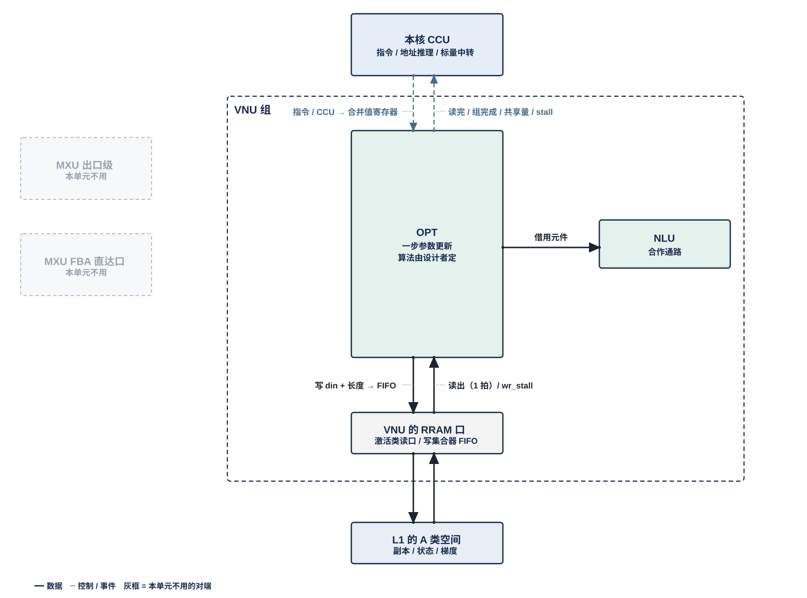

# VNU 优化器单元（OPT）需求

> Owner: WangYizhao｜2026-11-07

用户 11-04："最大程度放权，OPT 可以直接给它接口规范，然后设计者来自行决定权重更新该怎么做；AdamW 无需作为强制需求，可以由设计者基于算法仿真来设计"。所以本篇只规定接口、时序协议与集成精度。

## 1 组成与位置

### 1.1 OPT 对一组参数做一步更新

OPT（Optimizer Unit，优化器单元）对一组可训练参数做**一步更新**：输入当前参数 $\boldsymbol\theta$、同形的梯度矩阵 $\mathbf G$ 与优化器状态，输出新参数 $\boldsymbol\theta'$ 与新状态。

例如一个线性位点 $Y = XW$（$W$ 为 $K \times M$）旁加 LoRA 支路 $XAB$，$A$ 为 $K \times r_{\text{LoRA}}$、$B$ 为 $r_{\text{LoRA}} \times M$；训练只更新 $A$、$B$，OPT 的一组参数就是 $A$ 或 $B$ 的一段，$\mathbf G$ 是对应的 $\mathrm dA$ 或 $\mathrm dB$。**组**是随同一段权重流到达、一次更新完的一段参数，由指令给出。

### 1.2 更新算法不规定，由设计者基于算法仿真确定

**AdamW 不是强制需求。** 以下都由设计者基于算法仿真确定，只要满足 §4 的集成精度（用户 11-04，V18-OPT-01）：

- 更新规则；
- 是否做梯度裁剪；
- 优化器状态存什么、用什么格式；
- 新参数写回时怎样舍入；
- 是否另存更高精度的参数平面。

### 1.3 OPT 不做什么

- 不做反传，不形成梯度矩阵（训练核的 MXU 与 NLU）；
- 不做跨核归约（MAE_CRU）；
- 不发 DDR 读写请求（MAE 与 NI），不参与调度。

### 1.4 OPT 是 VNU 组的一个单元，每核一个

一个计算核由 CCU、MXU 组、L1 组、VNU 组四组拼成。OPT 是 VNU 组的六个单元之一，其余五个是 NLU、SEL、QNT、SMP、LOSS。**OPT 与 VNU 组外的模块交换数据，都经 VNU 组的对外接口**；VNU 对外口的个数与共享方式由 VNU 集成篇定义（待写）。

每个计算核一个 OPT，全芯片 4 个，物理相同；按指令启用，不启用时不工作。**OPT 同一时刻只执行一种功能**，先后由指令与 CCU 排定（用户 11-04，V18-VNU-03）。本篇不写指令字段，指令定稿后另补。

### 1.5 不另开 DDR 读流，不新增引擎与链路

**OPT 不引入新的 DDR 读流、MAE 引擎或片上链路**（用户 09-28 / 09-29 复用哲学）：

- 当前参数读 L1 中前向已读入的一份，不从 DDR 重读；
- 状态与梯度随同组权重流同序进入；
- 写回走现有的上行通路。

DDR 只多出状态、梯度与可选平面的字节。

### 1.6 与 NLU 的合作通路

OPT 的算法需要开方、除法、归约等运算时，可经合作通路借用 NLU 的元件。**NLU 与 OPT 怎样合作或折叠，由指令设计考虑，具体指令由两个模块的设计者配合确定；本篇只留出这条通路**（用户 11-04，V18-NLU-03）。

## 2 接口规范

虚线框是 VNU 组：

- **框内**是 OPT，以及和它直接往来的 NLU（合作通路）。
- **跨出框的连线**都是 VNU 组的对外接口：
  - 上方：本核 CCU 给的指令与标量（虚线），OPT 报出的读完、组完成事件、跨组共享量与入口 stall；跨核归约结果是数据：由 MAE_CRU 在 L2 合并、经 H2C 落 L1 后 OPT 读入，部分和由 NLU 作为输出写 L2（V18-TP-55 / 56、V18-CRU-07）。**OPT 在命令网上没有端口**（MAE_CRU 与 L2 在 L1 之后，图中不画）。
- **下方的 L1 口**：OPT 经 **VNU 的 RRAM 口**（RRAM 即核内 SRAM 口协议，传输协议篇 §5）访问 L1 的 A 类空间：读经 L1 外的选择器用一个激活类读口；**写**进 L1 的 A 类写集合器里本单元自己那条 32 B 入口 FIFO，集合器每拍按优先级把各写者的队头分到对应 bank 的道上，FIFO 将满时拉 **wr_stall** 回本单元（只到本单元，不到 CCU；传输协议篇 §5.2）。参数副本、经 HUB 组的入站分发网 HUB_IDN 落入 L1 的状态与梯度都从这个口读；新参数与新状态也经这个口写入 L1，再由 L1 发送侧经 C2H 发出（由本核 CCU 按位点指令发令、发读 L1 并逐拍给出 C2H 上的地址，对象发完后 CCU 向 MAE 发出报告）、由 MAE 发令经 L2 写回 DDR（用户 11-04 / 11-06，V18-L1-03、V18-TP-35、传输协议篇 §2.4、§7.1）。
- **RRAM 口的用法**：每次读写的 en / wea / addr 都由本核 CCU 发出，OPT 写 L1 时只给 din（一个存储字，32 B）与本条记录的长度，进 A 类写集合器里 OPT 的入口 FIFO，将满时 wr_stall 回 OPT、OPT 保持；读出固定 1 拍；**每条由 CCU 发读的入口给 CCU 一根 stall_vnu[i]**，入口缓冲占到"深度 − $L$"时拉起，$L$【设计者定】；写侧只有 wr_stall，不到 CCU（传输协议篇 §5、§6）。

### 2.0 组内链路只限定位宽

**OPT 与同组单元之间经组内链路交换数据，链路只规定位宽：全组统一每拍 256 bit（32 B），另加握手位**（用户 11-04，V18-VNU-02）。链路上是什么格式、什么精度，由两端的控制逻辑按指令解码。

### 2.1 输入

下面两张表的"格式规定到什么程度"一列是本篇放权的边界：写死的只有前向直接消费的副本格式与跨核标量的 FP32；其余写"由设计者定"的，设计者可随算法改，但须保持与副本同组、同序到达（§1.5）。

| 输入 | 从哪来 | 经哪个口 | 格式规定到什么程度 |
|---|---|---|---|
| 当前参数副本 | L1 中前向已读入的一份 | VNU 的 RRAM 口 | **MXINT8 g32 合同格式**：每元素 8 bit 码，拆成高位、低位两个 4 bit 平面；每 32 个元素共享一个 E8M0 尺度 |
| 梯度矩阵 $\mathbf G$ | 训练核累加完成后写 DDR，随同组权重流到达 | 经 HUB_IDN 落入 L1，经 VNU 的 RRAM 口读 | **暂定 BF16；是否优化到 MXFP6 g32 由设计者决定**（用户 11-04）。与副本同布局、同组、同序 |
| 优化器状态与可选持久平面 | DDR，随同组权重流到达 | 同上 | **内容、格式、每参数字节由设计者定**；与副本同组同序。没有状态的算法可以不用 |
| 跨核归约结果 | MAE_CRU 合并后的值，例如全局梯度范数平方 $\lVert g\rVert^2$ | 经 L2 → H2C 落 L1，OPT 从 L1 口读入（V18-TP-55 / 56、V18-CRU-07）；落进 L1 后 CCU 才发使用它的指令；FP32 |
| 标量与超参 | 指令 | 本核 CCU | 个数与含义由设计者定，例如学习率、与训练步数相关的系数、衰减系数；**OPT 不跨组保留标量** |

这里的梯度矩阵指参数梯度，例如 $\mathrm dA$、$\mathrm dB$，与参数同形；不是反传时读入的激活，也不是在算子之间流动的梯度，那两类已是 MXFP6。若设计者改用 MXFP6，只在累加完成后量化一次，跨块累加面仍为 BF16，并在 §3 的仿真中验证 AL。

### 2.2 输出

| 输出 | 去向 | 格式规定到什么程度 |
|---|---|---|
| 新参数副本 | 经 RRAM 口写 L1，由 L1 发送侧经 C2H 发出（本核 CCU 按位点指令发令、发读，写到 L2 哪里由 CCU 的发送指令给出），经 L2 写回 DDR；**写到 DDR 哪里由 MAE 指令给出** | **MXINT8 g32 合同格式，是底线，不放开**（用户 11-04）：码、E8M0 尺度与尺度规则按整体集成篇的量化合同，前向 MXU 直接读它。设计者可另存更高精度的持久平面，但交给前向的一份必须是 MXINT8。舍入方式由设计者定 |
| 新状态与可选持久平面 | 同上 | 设计者自有格式 |
| 读完信号 | 本核 CCU | 副本读完，作为该副本段的"最后读者完成"事件（传输协议篇 §4.1） |
| 入口 stall | 本核 CCU | 每条由 CCU 发读的入口一根 stall_vnu[i] |
| 组完成事件 | 本核 CCU，转 LIC | 本组全部输出已写回（§2.3） |
| 跨组共享量 | 本核 CCU，转 LIC 持有，随后续各组的指令下发 | 设计者的算法需要跨组共享的量时才有，例如裁剪系数 |

**副本的重量化由 OPT 执行**：输出必须是合同格式的副本，重量化随更新算法在 OPT 内完成，按与 QNT 相同的量化规则（V18-QNT-04 所列例外之一）。

### 2.3 时序协议：放权后仍固定的部分

这六条只管"什么时候能开始、什么时候算完、什么时候可以覆盖"，与更新算法无关；设计者无论选什么算法都按这六条与 CCU、MAE、LIC 对接。其中第 2、3 条是 OPT 对外发的两个事件（读完信号、组完成事件），第 4、5 条是别的模块保证的前提，第 1、6 条是 OPT 自身的行为。

1. **启动条件**：以下三者齐了才开始一组更新；不齐时等待，等待拍数计入迟到计数（定义见 §6）：
   - 指令标明本组更新；
   - 本组所需的标量已给齐。跨核归约结果（若算法使用）**落进本核 L1 之后，CCU 才发本组的更新指令**，所以这一条在指令到达时已成立，OPT 不检查有效位；
   - 本组的副本、状态与梯度已在 L1 中就绪（写完成：各入链路写计数达到应写量，由 CCU 比对判定，传输协议篇 §2.6）。
2. **读完才释放**：OPT 读完副本才发读完信号；**读完信号就是该副本段的"最后读者完成"事件**，编译链安排的下一组数据只在这个事件之后才写进同一段地址（传输协议篇 §4.1：目的空间是否空闲归编译链与指令，L1 不带段标志）。
3. **全部输出写回完成后才报组完成事件。**
4. **前向不读到半更新的参数**：OPT 只承诺第 3 条；版本怎样轮换、新版写到哪、前向读哪一版，由 MAE、LIC 与 CCU 保证。
5. 副本不在本核 L1 时，由 MAE 在现有通路内送进本核 L1，**OPT 只读本核 L1**。
6. OPT 不区分参数属于哪个模型、哪种训练方式，同一套接口与时序。

### 2.4 由别的模块保证的事项

以下事项 OPT 不检查，由对应模块保证。这张表划出 OPT 的实现与验证边界：表里的事项 OPT 既不实现也不检查，验收时把它们当作输入前提、用断言核对（§6）。

| 事项 | 由谁保证 |
|---|---|
| 梯度矩阵的形成与跨块累加 | 训练核（MXU、NLU） |
| 跨核归约的部分和与合并 | NLU（默认）、MAE_CRU |
| 跨核归约结果落 L1 之后才发使用它的指令；部分和由 NLU 作为输出写 L2 | CCU（传输协议篇 §7.1）；MAE（合并指令收齐发出报告后执行） |
| 标量的产生、持有与下发；跨组共享量的持有与下发 | LIC、CIF |
| 更新哪一组、在哪个核、何时更新 | LIC 与数据流篇 |
| 读写 L1 的地址（基址 + 字节累加）与 dout 去向 | CCU |
| 副本段在读完信号之前不被覆盖；下一组数据的写入等读完信号（最后读者完成） | 编译链（LIC 操作 15 的预取距离与缓冲轮转）、CCU |
| 状态、梯度与可选平面随组权重流同组同序到达 | MAE |
| 副本不在本核 L1 时送进本核 L1 | MAE |
| 写回地址与版本轮换 | MAE、LIC |
| 前向读本组前等组完成事件 | CCU、LIC |
| MXINT8 码与尺度规则 | 整体集成篇的量化合同 |
| 写 L1 的数据经 C2H 发出 | 本核 CCU（按位点指令发令、发读 L1、逐拍给 C2H 地址；发完后向 MAE 发出报告） |
| 同一单元的不同功能不在时间上重叠 | CCU 与指令 |
| VNU 对外口的个数与共享方式；组内链路条数与互连 | VNU 集成篇（待写） |

## 3 更新算法：由设计者基于算法仿真确定

### 3.1 设计者要交付的

- 所选的更新规则、状态内容与格式、写回舍入方式；
- 支撑它满足 §4 的算法仿真结果；
- 同步更新的算法参考模型。

### 3.2 可以调的范围

- 逐元素或按组的更新规则；
- 是否使用状态，用几份；
- 是否使用跨核归约结果，例如是否做全局范数裁剪；
- 副本写回的舍入：就近舍入、无偏舍入或其他；
- 是否另存持久平面，例如更高精度的参数主值或余数。

### 3.3 不可以改的

- §2 的接口与时序协议；
- 交给前向的参数副本是 MXINT8 合同格式；
- 不另开 DDR 读流、不新增 MAE 引擎与片上链路（§1.5）。

### 3.4 现行参考：设计者的起点

设计 Spec V1.7_3 的 VNU_OPT 篇有一套现行参考：AdamW 加全局范数裁剪，以及四种写回形态，即就近舍入写回、无偏写回、副本加 16 bit 余数、FP32 主值。有限仿真（SIM-OPT-MXINT8-MASTER-ONLINE-QUALITY-20261012）中四种形态的 AL 相对参照依次为 −1.36%、+0.04%、−0.54%、+0.27%。**这些只作设计者的起点，不是本篇的条款。**

## 4 精度要求

**OPT 的更新方案集成到在线训练后，Draft 接受长度 AL 相对 AdamW（按 FP32 理想值更新）的下降 < 5%**（用户 11-04）。

- 这是 OPT 对 VNU 统一口径（集成后掉点 < 0.1%，V18-VNU-01）的放宽。
- 中间计算精度不规定，由设计者定。
- 硬件实现与算法参考模型逐位一致，作为验证手段；参考模型随硬件实现同步。

## 5 资源与速率

### 5.1 每拍处理能力与 DDR 字节匹配相关模块

**OPT 每拍能更新的参数数、每参数每步的 DDR 字节，须匹配相关模块的需求，由 OPT 设计者与以下模块对接确定。** 下表的参考值按现行 AdamW 估算，只作背景：

| 相关模块 | 接口 | 现行参考值 |
|---|---|---|
| MAE（经 HUB_IDN 灌入） | 状态与梯度 | DDR 峰值 19.2 B/拍；现行每参数灌入 10 B（两份 FP32 状态 8 B + BF16 梯度 2 B），约 1.9 个参数/拍 |
| 数据组织篇 | 训练区 DDR 预算 | 现行每参数每步 21.03 B（就近舍入 / 无偏写回）、25.03 B（加 16 bit 余数）、29.03 B（FP32 主值） |
| L1（经 VNU 的 RRAM 口） | 副本读、状态与梯度读、写回数据写 | 激活类读口 32 B/拍，与其他客户分时；现行副本读平均约 0.36 B/拍；读出固定 1 拍；入口将满时拉 stall_vnu[i]；写进集合器 FIFO，将满 wr_stall |
| L1 发送侧经 C2H 发出、L2 | 写回 | L2 共享写口的占用归 HUB 与数据流篇 |
| 数据流篇 | 组窗口 | 一组更新能否在下一次前向读本组之前完成 |

### 5.2 OPT 自己承诺：及时读走落地数据，不让 HUB_IDN 落地停顿

状态与梯度经 HUB_IDN 落入 L1 的 A 类空间，OPT 经 VNU 的 RRAM 口读取（用户 11-05 确认）。落地段按 ping-pong 两份轮转（MAE 搬运的数据不按环形使用，V18-MAE-17），每拍地址由 MAE 搬运引擎逐拍给出；IDN 接收桥的 ready = 入口 FIFO 未满，正常情况下几乎恒高；落地来源在集合器里优先级最高（传输协议篇 §3.4、§7.2）。**HUB_IDN 何时可以写入一段，由编译链按预取距离与 OPT 的读完事件安排（LIC 操作 15）；OPT 须按编译链排定的节奏读走已落地的状态与梯度并及时报读完，使下一轮落地不因 OPT 而推迟；读取不丢失、不重复。**

## 6 计数与复位

- **计数**：迟到计数（V1.7_3 OPT 篇的计数定义，未被取代），两部分相加：① 本组启动条件不满足而推迟的拍数；② 下一次前向读本组时等本组组完成事件的拍数。计入 CCU 的位点计数快照，供观察组窗口是否够用（§5.1 数据流篇一行）。由于第 2、3 个启动条件由 CCU 在发更新指令前判定（§2.3），这两部分都在 CCU 侧可见，OPT 本身只需给出组完成事件的时点。
- **复位**：OPT 不跨组保留状态；跨组共享的量由 LIC 持有。
- **不设运行时错误事件**：§2.4 所列前提由对应模块保证，验收时用断言检查。

## 7 要求值与验收

### 7.1 要求值

| 项 | 要求值 | 说明 |
|---|---|---|
| 接口 | §2.1、§2.2 | 输入输出固定；状态格式由设计者定 |
| 参数副本 | MXINT8 g32 合同格式 | 底线，不放开 |
| 时序协议 | §2.3 | 启动条件、读完才释放、全部写回后报完成 |
| 精度 | 在线训练后 Draft AL 相对 AdamW（FP32）下降 < 5% | 中间精度由设计者定 |
| 每拍处理能力与 DDR 字节 | 匹配相关模块（§5.1） | 由 OPT 设计者对接确定 |
| 组内链路 | 每拍 256 bit + 握手位 | 全组统一 |
| L1 口与握手 | RRAM 口：读经激活类读口，每条由 CCU 发读的入口一根 stall_vnu[i]；写进 A 类写集合器里本单元的入口 FIFO（只给 din 与长度），将满 wr_stall 回本单元 | $L$【设计者定】 |
| 跨核归约结果 | 从 L1 读入（MAE_CRU 合并后经 H2C 落地）；部分和由 NLU 累加；FP32；OPT 在命令网上无端口、无有效位 | 传输协议篇 §7.1、§7.4 |
| 门数 | 参考 ≤ 90 k 门（NAND2 等效） | 按现行 AdamW 估算，只作参考 |

### 7.2 验收

| 对象 | 方法 | 用例 |
|---|---|---|
| 启动条件（§2.3） | 断言 | 三条件之一缺失时不启动，并计入迟到计数；使用跨核归约结果的组，更新指令晚于该结果落进 L1 |
| RRAM 口与入口 stall（§2） | 周期仿真；断言 | 写只给 din 与长度；stall_vnu 拉起后入口缓冲不溢出 |
| 读完才释放（§2.3） | 断言 | 读完信号之前该副本段无覆盖写；相邻两组 |
| 组完成事件（§2.3） | 断言 | 组完成事件晚于全部输出写回 |
| 副本格式（§2.2） | 逐位检查 | 输出副本的码与尺度符合量化合同 |
| 更新算法（§3） | 与设计者交付的算法参考模型逐位比对 | 随机组；边界值（全零梯度、大幅值参数） |
| 集成精度（§4） | 算法侧在线训练对拍 | Draft 同步训练与独立训练；对照 AdamW（FP32） |
| 不另开 DDR 流（§1.5） | 审查 | 无 OPT 专用 DDR 读流、MAE 引擎与片上链路 |
| HUB_IDN 落地不因 OPT 停顿（§5.2） | 周期仿真 | DDR 峰值灌入 |
| 门数（§7.1） | 综合 | 待 RTL |

## 8 为什么

- **最大程度放权，只给接口**（用户 11-04）：优化器是算法侧仍在演进的部分，固定 AdamW 会限制设计者按仿真选更合适的方法。所以本篇只规定别的模块依赖的东西：接口、时序、交给前向的格式和集成精度。
- **接口与时序固定**：
  - 前向 MXU 直接读 MXINT8 副本，这个格式一变就牵动 MXU、L1 与 MAE，所以 MXINT8 是底线（用户 11-04）；
  - 前向不能读到只更新了一半的参数，所以全部写回后才报完成；
  - 已读进片上的数据不从 DDR 重读（用户 09-28 / 09-29），所以 OPT 读前向那份副本，状态与梯度搭同组权重流进入。
- **精度放宽到 5%**（用户 11-04）：对照仍是 AdamW；给设计者留出在精度、DDR 字节与门数之间取舍的空间。
- **现行方案作起点**：设计 Spec 保留 AdamW 与四种写回形态及其仿真结果，设计者可以从这里出发。
- **与 NLU 只留合作通路**（用户 11-04）：开方、除法等可借 NLU 的元件，怎样配合由指令设计与两个模块的设计者确定。
- **组内链路只限定位宽**（用户 11-04）：状态格式由设计者定，链路不区分格式，换算法不改链路。
- **对外接口经 VNU 组封装**（用户 11-04）：OPT 访问 L1、向核外写回都经 VNU 的共用口；对外口怎样划分由 VNU 集成篇统一定义。
- **按传输协议篇同步**（用户 11-05，V18-TP-01…16）：核内与 L1 之间只有 RRAM 一种口，地址只在 CCU 一处推理；CCU 不看下游余量，所以每条入口给 CCU 一根 stall；L1 没有段级状态，"不被覆盖"由编译链按最后读者完成事件安排，所以原 L1 段上的保留标记撤销，OPT 的读完信号就是这个事件；跨核归约结果是 FP32 标量，不占 L1 与数据网。
- **标量经 CCU 中转**（用户 11-05："直接发给 CCU，由 CCU 直接配置 VNU 内部需要计算数据的寄存器吧……VNU 的控制命令本来就来自 CCU，那么刚好可以统一调配"，V18-TP-21）：OPT 在命令网上不设端口；合并值到达与本组更新指令在 CCU 一处排序，OPT 不需要有效位、不因标量未到而 stall。

- **标量走数据协议、输出可直接写 L2、跨核合并经 L2**（用户 11-07："如果是控制网，我认为他们不属于控制网，需要走数据通信协议"；"VNU 和 MXU 的输出可以由 CCU 直接推算要写在 L2 SRAM 的地址，然后走核间协议，不过也要支持输出写回到 L1 SRAM"；"MAE 可以读取 L2 SRAM 的数据，去做整合"；V18-TP-55 / 56、V18-CRU-07）：结果寄存器 / 合并值寄存器的专用接口与"经 CCU 中转""上行一律先写 L1""C2H 直送 MAE_CRU"撤；下面几条中与此冲突的旧写法以本条为准。