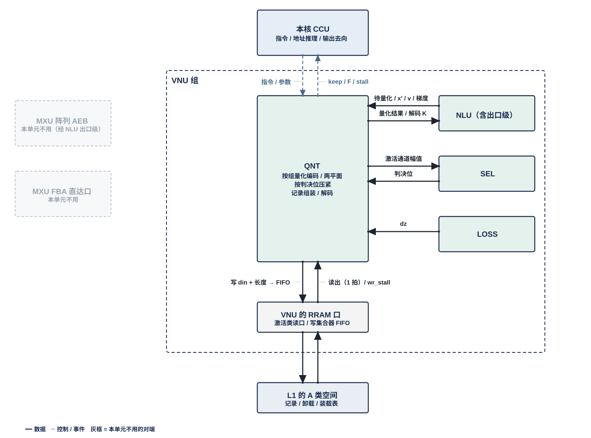
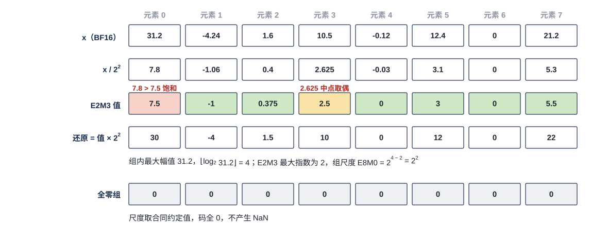
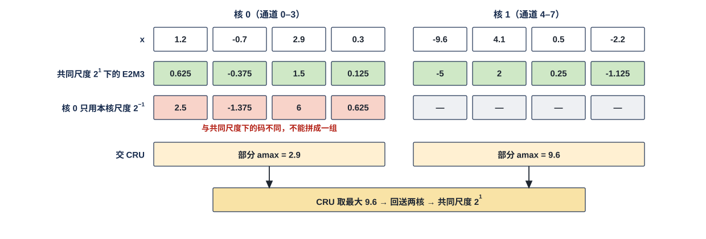
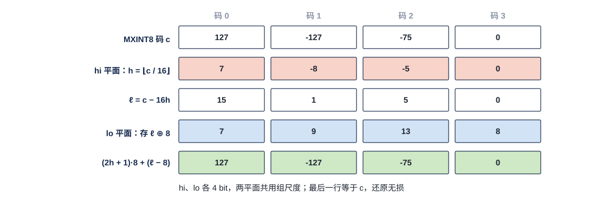
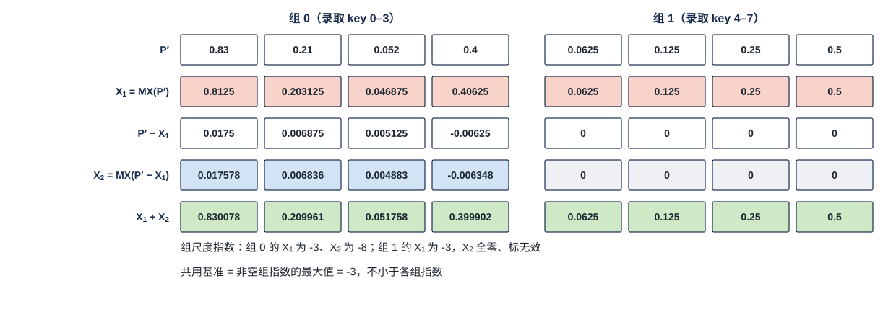
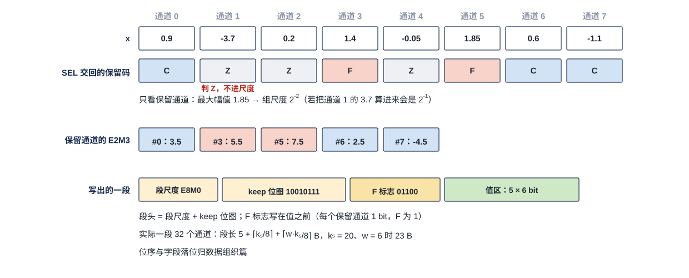
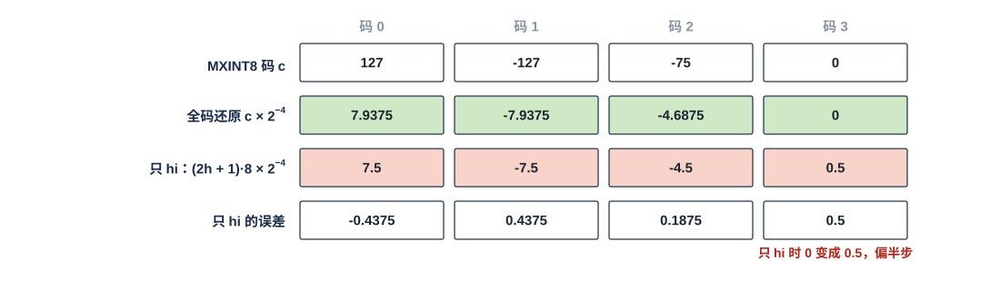

# VNU 量化单元（QNT）需求

> Owner: WangYizhao｜2026-11-08

## 1 组成与位置

### 1.1 QNT 只做量化、编码、压紧、组装与解码

QNT（Quantization Unit，量化单元）把高精度向量变成存储或传输格式，反方向把 K 的存储码还原成计算用的值。它做五件事（§3）：
- 按组量化编码：沿向量的一维每 $g$ 个元素求一个共享尺度，逐元素编码成窄码；
- 两平面表示：把一个码按位拆成高、低两个平面，或把量化误差再量化一次；
- 按判决位压紧：按 SEL 给的判决位去掉不读的元素；
- 定长记录组装：把码、尺度与附带字段拼成记录，写往指令给的去向；
- 解码与还原：码乘尺度，还原成计算用的值。

**QNT 不做比较与判决，也不做向量算术。** 具体地：
- Norm、RoPE、加减均值、softmax、$O$ 更新在 NLU；
- 残差加、BF16 直通、残差与特征行的还原在出口级——出口级是 NLU 的强制子模块（V18-NLU-06）；核间 K 切分位点的残差加与编码在 MAE_CRU（V18-CRU-08）；
- 一切逐元素阈值判断，包括下一位点输入各搬运引擎是否保留，在 SEL（用户 11-04）；
- 跨核合并在 MAE_CRU；
- QNT 不决定用什么格式、不调度、没有 DDR 口、不发访存指令。

### 1.2 QNT 是 VNU 组的一个单元，每核一个

一个计算核由 CCU、MXU 组、L1 组、VNU 组四组拼成。QNT 是 VNU 组的六个单元之一，其余五个是 NLU、SEL、SMP、LOSS、OPT。**QNT 与 VNU 组外的模块交换数据，都经 VNU 组的对外接口**；访问 L1 和向核外上行，经 VNU 的共用口。VNU 对外口的个数与共享方式，由 VNU 集成篇定义（待写）。

每个计算核一个 QNT，全芯片 4 个，物理相同。

### 1.3 格式与去向由指令和模型级配置给出

**QNT 只提供运算形态（§3）。** 每个请求出什么格式、组长多少、是否拆平面、是否压紧、结果交到哪里，由指令与模型级配置给出。本篇不写指令字段，指令定稿后另补。

**QNT 同一时刻只执行一种功能**（用户 11-04）：一次处理一个请求，先后由指令与 CCU 排定。VNU 内各单元都按此原则；以后有并行需求时再调整。

### 1.4 执行范围：VNU 组内向量的量化都由 QNT 执行

**VNU 组内向量的量化、编码与记录打包由 QNT 执行，同一格式只有这一处实现**（用户 11-04）。请求来自 NLU（含其出口级子模块，V18-NLU-06）与 LOSS。另有两处在 QNT 以外量化，都按同一套量化规则（§6.1）：
- MAE_CRU 对合并结果的编码：核间按归约维 $k$ 切分时的归约结果，以及归约结果加残差后的残差格式 / 按 keep 列表压缩的紧凑记录（输出编码由搬运指令给，V18-CRU-08）；
- OPT 对自有格式（权重副本、优化器状态）的重量化。

### 1.5 训练反传经过量化点：梯度直通

训练反传时，梯度要穿过前向的量化点。以线性位点为例：前向把激活 $X$（$T \times K$）量化成 $\hat X$ 再算 $Y = \hat X W$；反传先得 $\mathrm d\hat X = \mathrm dY\,W^{\mathsf T}$，再由 $\mathrm d\hat X$ 得 $\mathrm dX$。

- **需求：梯度直通**，$\mathrm dX = \mathrm d\hat X$，即反传时把量化看成恒等。这一步不需要 QNT 有任何动作。
- **饱和截断由设计者思考方案**（用户 11-04）：前向被饱和的元素（超出格式最大值），改变 $x_{t,k}$ 不再改变 $\hat x_{t,k}$，可选让其梯度置零。这需要前向为每个元素记下是否饱和（一张 $T \times K$ 的位图），并保存、传递到反传。是否支持、怎样记录与传递，由设计者与算法侧对齐后定【设计者定】。

## 2 数据从哪来、到哪去

虚线框是 VNU 组：
- **框内**是 QNT，以及和它直接往来的 NLU、SEL、LOSS。这些连线不出 VNU 组。
- **跨出框的连线**都是 VNU 组的对外接口：
  - 左侧：MXU 阵列的 AEB 条目经 NLU 的出口级子模块分发给 QNT 的 BF16 向量（组内链路，图中画为来自 NLU，AEB 画灰）；置换表与量化参数（经 H2C 落地 L1，再经 RRAM 口读入）；要跨核取最大的 amax **与其他输出一样是数据**（V18-TP-55 / 56、V18-CRU-07）：QNT 把本核的 amax 部分值作为输出写 L1 或直接写 L2，由 MAE_CRU 在 L2 取最大；共同 amax 经 L2 → H2C 落 L1 后 QNT 读入。**QNT 在命令网上没有端口**（amax 为 FP32）；
  - 上方：与本核 CCU 之间的指令、档号（虚线）、交给 CCU 分组单元的 keep / F 位图、入口 stall，；
  - 下方：**VNU 的 RRAM 口**（RRAM 即核内 SRAM 口协议，传输协议篇 §5），读经 L1 外的选择器用一个激活类读口（每口 32 B/拍，4 个读口都可读任一 A 类 bank，读时隙由 CCU 排）；**写**进 L1 的 A 类写集合器里本单元自己那条 32 B 入口 FIFO，集合器每拍按优先级把各写者的队头分到对应 bank 的道上，FIFO 将满时拉 **wr_stall** 回本单元（只到本单元，不到 CCU；传输协议篇 §5.2）；读写哪一堆由堆选选，L1 不仲裁（用户 11-04 / 11-05，V18-L1-02）。**要出核的记录一律先经这个口写 L1，再由 L1 发送侧经 C2H 发出（由本核 CCU 按位点指令发令、发读 L1 并逐拍给出 C2H 上的地址，对象发完后 CCU 向 MAE 发出报告）**（用户 11-04 / 11-06，V18-L1-03、V18-TP-35、传输协议篇 §2.4、§7.1）。读时旋转后的 K 也走这条路写 L2，再由 MAE 指令经 H2C 多播进需要它的核（V18-L1-05）。
- QNT 不直接连 L1 或 C2H，都经 VNU 的 RRAM 口。

### 2.1 VNU 组内的接口

**组内链路只规定位宽：全组统一每拍 256 bit（32 B），另加握手位**（用户 11-04，V18-VNU-02）。链路上是什么格式、什么精度，由收发两端按指令解码，链路本身不区分格式；下表"格式"一列写内容的规范格式，是两端须能解码的内容，不是链路的定义。链路条数与组内互连方式由 VNU 集成篇定义。QNT 来不及收时经该链路的握手让 NLU、LOSS 停发（§7.2）。

| 接口 | 对端 | 方向 | 内容 | 格式 |
|---|---|---|---|---|
| 待量化向量 | NLU | 入 | RoPE 之后的 q；k（直接处理时为 RoPE 与减目标均值之后，先 RoPE 再处理时为 QK-Norm 之后，或读时旋转之后）；$P'$ 与 $\tilde p$，连同录取 key 的位置；按 RMS 缩放后的下一位点输入；$O/l$；门控激活 $\tilde s$；嵌入行 $x_0$；区块摘要；反传逐元素输出 | BF16，每拍至多 16 个元素 |
| 待解码的 K 存储码 | NLU | 入 | 读时旋转从 L1 读出的 K 存储码：粗算段为 hi 原码 + E8M0 + kmax，精算段为 hi + lo 原码 | MXINT8 g32 的 hi / lo 平面 |
| 量化结果回送 | NLU | 出 | $\tilde p$ 两平面量化值之和（按 key，§3.3）；解码后的 K（全码 / 只 hi，§3.6）；量化后的投影结果与流动梯度；（可选）统一格式后的临时格式向量（§3.6） | BF16 或 MXFP6 g32 |
| 待量化梯度 | LOSS | 入 | $\mathrm dz$（LM Head logit 的梯度），按流动梯度格式量化（用户 11-04） | BF16 |
| 待判断幅值 | SEL | 出 | 下一位点输入一个 token 各搬运引擎的幅值 $\lvert x_k\rvert$，供保留判断 | BF16 |
| 判决位 | SEL | 入 | Q 一行的选维位（每维 1 bit）；下一位点输入各搬运引擎的保留码 Z / C / F（每搬运引擎 2 bit） | 每元素 1 或 2 bit |
| 临时格式 | OPT | 入 / 出 | 只在设计者选择统一临时格式时存在（§3.6） | — |

Q 一行的逐维幅值由 NLU 直接交 SEL，不经 QNT（用户 11-04）。

### 2.2 经 VNU 组对外的接口

| 接口 | 对端 | 方向 | 内容 | 格式 |
|---|---|---|---|---|
| 出口级请求 | NLU 的出口级子模块（组内链路，V18-NLU-06） | 入 | 残差加结果 $x'$、归约完成的投影结果（q、gate、up 等）、v、反传归约完成的梯度、已在出口级还原的特征行（用户 11-04）。**QNT 来不及收时经组内链路的握手让出口级停发**（出口级再对 AEB 拉低 ready，NLU 篇 §3.6） | BF16，与 NLU 其余请求合计每拍至多 16 个元素 |
| L1 读写 | 读：L1 外选择器 → 激活类读口；写：A 类写集合器里 QNT 的入口 FIFO | 出 / 入 | 写：Q 全维记录、Q 粗算记录、$P'$ 记录，以及要出核的全部记录（下一行）。卸载：来不及处理的请求数据、等数据到齐时的暂存，写到 L1 再读回（§2.3）（用户 11-04）。读：卸载读回、经 H2C 落地的置换表与量化参数 | 整字 32 B；写只给 din 与记录长度（§3.7） |
| 写握手 | L1 的 A 类写集合器 | 入 | QNT 那条入口 FIFO 将满时的 wr_stall（只到 QNT） | 1 bit |
| 上行（记录 / KV 等） | 经 RRAM 口写 L1 → L1 发送侧经 C2H 发出（本核 CCU 按位点指令发令、发读） | 出 | K / V 存储记录与本次 attention 用的新 K、读时旋转后的 K、紧凑记录、残差记录、反传流动梯度，写 L2，目的地址由本核 CCU 的发送指令给出（V18-L1-03、V18-TP-35）。读时旋转后的 K 进 L2 后，由 MAE 指令经 H2C 多播进需要它的核的 L1（V18-L1-05） | 见 §3.5、§3.7 |
| 输出：amax 部分值 | 写 L1，或经计算核的集成输出端口直接写 L2（CCU 按指令二选一）（V18-TP-55 / 56、V18-CRU-07） | 出 | 一组跨核时本核的 amax 部分值（F5 amax，FP32），与其他输出一样是数据；写进 L2 本核象限的同一段内地址，由 MAE_CRU 取最大 |
| 共同 amax | 经 L2 → H2C 落 L1，QNT 从 L1 口读入（V18-TP-55 / 56、V18-CRU-07） | 入 | MAE_CRU 取最大后的共同 amax；落进本核 L1 后 CCU 才发出按共同尺度编码的指令，QNT 不设有效位 |
| 装载表 | 经 H2C 落地 L1，再经 RRAM 口读入 | 入 | 按（层, kv 头）装载的搬运引擎置换表与量化参数 | 表 |
| 指令与档号 | 本核 CCU | 入 | 每个请求的格式、组长、拆平面、压紧与否、去向；每个 token 的 2 bit 档号（档号 3 表示该 token 不参与） | — |
| keep / F 位图 | 本核 CCU 分组单元（CCU_GRP） | 出 | 每（token, 位点）的 keep 字数、每段 keep 位图与 F 位图 | keep 位图每段 32 bit（一段 32 个输入通道，每搬运引擎 1 bit，与写进记录段头的那份相同，§3.4）；F 位图每个保留通道 1 bit；keep 字数的位宽归 CCU 篇 |
| 入口 stall | 本核 CCU | 出 | 每条由 CCU 发读的入口一根 stall_vnu[i]（卸载读回、装载表读入） | 1 bit |

### 2.3 统一请求接口：一次处理一个请求，来不及处理的卸载到 L1

- **所有量化请求经一个入口进入。** 每个请求说明目标格式、组长、是否拆平面、是否压紧、去向。BF16 直通的去向不进 QNT。
- **一次处理一个请求**，先后由指令与 CCU 排定（§1.3）。
- **来不及处理的数据卸载到 L1**：QNT 正忙时到达的请求数据（例如 $P'$），以及等跨核 amax 回送、等 SEL 判决位期间的暂存，可经 RRAM 口写到 L1 的 A 类空间，之后读回处理，不在入口排队等待。卸载的地址段由指令给出，每次写的地址由 CCU 推理，QNT 只给 din 与长度。**卸载与否、容量与时机【设计者定】**：要定的是哪些请求在 QNT 忙或等待时写到 L1、卸载区要多大、何时读回。约束：
  1. QNT 与 NLU 的合计负载不得使出口级积压、进而让阵列出口缓冲 AEB 持续反压 FBA（§7.1）——卸载就是为满足这一条而设，不卸载的请求只能在入口等或拉 stall；
  2. 卸载区只用指令给出的 A 类地址段，容量计入 L1 建议值（§9.1）；
  3. 读回须等两堆切换（下一条）；读回后的处理结果与直接处理逐位相同（§9.2）。
- **卸载写进一堆，读回要等两堆切换之后**（V18-L1-02）：L1 的 bank 分成两堆 ping-pong，同一时刻一堆只读、一堆只写，**读哪堆、写哪堆由 CCU 给的堆选显式选，L1 没有堆角色状态**。卸载的数据写入当前写的一堆，切换条件 = 写完成 ∧ 另一堆的最后读者完成，由 CCU 在下一阶段的堆选里体现，此后才能从这一堆读回（传输协议篇 §4.1）；两次卸载与读回之间的切换时机由 CCU 与指令安排。
- **读回的握手**：读回由 CCU 发 en，QNT 的读回入口缓冲将满（深度 − $L$）时拉 stall_vnu[i] 让 CCU 停发；$L$ = CCU 停发 1 拍 + L1 读返回 1 拍，【设计者定】。写侧只有本单元 FIFO 的 wr_stall，不到 CCU。

### 2.4 由别的模块保证的事项

以下事项 QNT 不检查，由对应模块保证。这张表划出 QNT 的实现与验证边界：表里的事项 QNT 既不实现也不检查，验收时把它们当作输入前提、用断言核对（§8）。

| 事项 | 由谁保证 |
|---|---|
| 每个请求的格式、组长、拆平面与去向 | 指令 |
| 模型级配置的装载 | LIC |
| 向量的算术（Norm、RoPE、softmax、缩放、残差加） | NLU（含出口级子模块） |
| 残差与特征行还原成 BF16 | NLU 的出口级子模块 |
| 核间 K 切分位点的残差加与编码 | MAE_CRU（V18-CRU-08） |
| 一切逐元素阈值判断、门限按档号选、偏置 | SEL |
| 相对阈值所用统计量（行均值、$\sum\lvert x\gamma\rvert$）与 Q 逐维幅值 | NLU 求并交 SEL；跨核合并由 MAE_CRU |
| 档号的给出与在位点边界翻转 | CCU_CTL |
| 跨核 amax 的合并与次序；核间归约值的量化 | MAE_CRU |
| amax 部分值的去向与地址；共同 amax 落 L1 之后才发按共同尺度编码的指令 | CCU（传输协议篇 §7.1）；MAE（合并指令收齐发出报告后执行） |
| amax 部分值与共同 amax 经 C2H → L2 → MAE_CRU → L2 → H2C 往返（数据协议，不走命令网） | 传输协议篇 §7、HUB |
| 放行先后与算子融合 | CCU 与指令 |
| 同一单元的不同功能不在时间上重叠 | CCU 与指令 |
| 写 L1 的地址：对象基址、逐记录字节累加、权重驻留下每 token 一个写累加器、环形回绕 | CCU（§3.7） |
| 变长对象按位点窗口静态分配（窗口 = 封顶后的记录长度上限 × token 数）；每位点的封顶值与窗口 | 编译链（指令中的基址与窗口长）；算法侧（模型表）；SEL 的封顶模式（选出个数 ≤ $k$ + 强制入选数） |
| 变长对象发完后的实际长度报 MAE（发出报告，V18-TP-35） | CCU |
| 写 L2 的目的地址（位点窗口内，V18-TP-40） | 编译链（CCU 的发送指令） |
| C2H 发出的数据：由本核 CCU 发令、按指令数据量计数（V18-TP-35） | CCU |
| K 入站按字节搬运；未旋转的 K 存储码落 L1 | MAE |
| 读时旋转序列的调度 | LIC |
| V 4 bit 码按 MXINT4 单平面存放、不展开（MXU 以标准数字模式直接算，V18-NII-02） | 数据组织篇 / MXU |
| A 类各地址段（记录对象、token 长度表、卸载区）的分配，以及写入前旧数据已读完 | 编译链（指令中的基址与长度，LIC 操作 15） |
| VNU 对外口划分、组内链路位宽 | VNU 集成篇（待写） |
| 上行产出写 L1 后经 C2H 发出；读时旋转后的 K 从 L2 多播进需要的核 | 本核 CCU（按位点指令发令、发读 L1、逐拍给 C2H 地址）；MAE（H2C 多播） |
| VNU 的 RRAM 口的时隙；两堆的切换（堆选） | CCU 与指令 |
| 各记录的字段布局 | 数据组织篇 |
| BF16 / FP16 激活拆段进阵列 | MXU |

## 3 运算形态

### 3.1 五种运算形态一览

| 形态 | 按矩阵维度说做什么 | 输入 | 输出 | 典型用途 |
|---|---|---|---|---|
| 按组量化编码 | 沿向量的一维每 $g$ 个元素求一个 2 的幂尺度，逐元素编码 | BF16 向量；可选共同 amax | 码 + 组尺度 + 每行最大指数 | Q、K、V、投影结果、下一位点输入、残差、嵌入行、区块摘要、流动梯度 |
| 两平面表示 | 一个码按位拆成 hi / lo；或量化误差再量化一次 | 码，或 BF16 向量 | 两个平面 + 共用尺度或基准 | K、V 8 bit 存储；$P'$ |
| 按判决位压紧 | 去掉判决位未选的元素，其余按原序连续存放 | 向量或码 + SEL 判决位 | 压紧的段 | 下一位点输入的紧凑记录、Q 粗算记录 |
| 定长记录组装 | 码、尺度与附带字段拼成记录，写往指令给的去向 | 上面三种的输出 | 记录 | Q 记录、$P'$ 记录、残差记录、K / V 存储记录、读时旋转后的 K |
| 解码与还原 | 码 × 尺度 | K 存储码 | 计算用的值 | 先 RoPE 再处理的 K 链 |

五种形态在一个请求里常常串起来用：前四种是写出方向的步骤（编码、拆平面、压紧、组装成记录；压紧与编码的先后随记录而定，见 §3.4），第五种是读入方向的逆过程。所以读者可把一个请求理解为"走这条流水的哪几段"，请求里的格式、拆平面、压紧与去向字段（§5.3）就是在选段。

术语：
- **位点**：一层里的一个算子实例，例如第 5 层的 o 投影 $Y = O W_o$。
- **MX 组格式**：沿向量的某一维每 $g$ 个元素（$g$ = 32 或 128）一组，组内共用一个 8 bit 的 2 的幂尺度（E8M0，表示 $2^{e}$），每个元素只存窄码。MXFP6 E2M3 是 6 bit 浮点码（1 符号、2 指数、3 尾数，可表示的最大幅值 7.5），MXINT8 是 8 bit 整数码，FP8 E4M3 是 8 bit 浮点码。

### 3.2 按组量化编码：沿一维每 g 个元素求共享尺度，逐元素编码

**成组方式**：

| 张量 | 沿哪一维成组 | 组长 |
|---|---|---|
| 激活（投影结果、下一位点输入、残差、嵌入行、流动梯度） | 一个 token 内沿 hidden 维 | 32 通道 |
| Q、K | 一个 token、一个头内沿 head_dim，Q 按 K 的搬运引擎置换组序 | 32 维 |
| V | 一个 key、一个 kv 头内沿 head_dim | 128 维 |
| BF16 / FP16 激活（元素位宽 $w = 16$ 的位点） | 不成组，整值交出；**同样按 32 通道段写成紧凑记录（keep 压紧、F 标志、长度表），只是段里没有尺度字段**（V18-TP-63 / QNT-12，11-08）；进阵列时的拆段在 MXU 侧【设计者定】 | 32 通道一段（无尺度） |

**目标格式**：MXFP6 E2M3（$w = 6$）、FP8 E4M3（$w = 8$）、E5M2、MXINT8、4 bit（V）、BF16 / FP16 整值（$w = 16$）。**紧凑激活记录的元素位宽 $w \in \{6, 8, 16\}$ 是位点属性，由位点指令给出；BF16 / FP16 激活是 L3PU 的底层需求，与 MX 格式走同一套紧凑格式**（用户 11-08："L3PU需要支持FP16和BF16的激活值格式，这也是底层需求"；V18-TP-63）。

**默认选码规则**（量化合同；按 §6.1 第 3 层，可在掉点 < 0.1% 的约束下改动）：

| 格式 | 组尺度指数 | 元素舍入 | 越界 |
|---|---|---|---|
| MXFP6 E2M3 | $\lfloor\log_2 a_{\max}\rfloor - 2$（E2M3 最大指数为 2） | RNE | 饱和到 ±7.5 |
| FP8 E4M3 | $\lfloor\log_2 a_{\max}\rfloor - 8$ | RNE | 饱和到 ±448 |
| MXINT8 | $\lfloor\log_2 a_{\max}\rfloor - 6$ | RNE | 限幅 ±127 |
| 4 bit（V） | $\lfloor\log_2 a_{\max}\rfloor - 2$ | RNE | 限幅 ±7 |

$a_{\max}$ 是本组参与量化的元素的最大幅值（§4）。

**可选前置步骤：通道置换。** 按编译期固定的置换表重排一个 token 的全部通道，再分组。用于 K 与区块摘要：直接处理在量化入口施加，先 RoPE 再处理在读时旋转后的重量化入口施加。PairFold（RoPE 通道对的缩放）离线折入 Q、K 归一化权重，QNT 不做折叠；是否需要运行时可选【设计者定】。

**附带输出**：每行各组尺度中的最大指数——Q 的 qmax、K 的 kmax、紧凑记录的 tokmax（**11-08 用户定：放在 token 长度表项里，每项 24 bit = 16 bit 长度 + 8 bit tokmax，单独存、不进数据**，V18-TP-60；QNT 随每条记录的长度把 tokmax 交 CCU，§7.1）。MXU 以 qmax + kmax 作 $S = QK^{\mathsf T}$ 的累加基准。

**凑组。** MXU 一拍只交出一个 token 的 16 个输出通道，凑不满一组。QNT 按 token 凑满 32 个通道再量化：**打包单位是 MX 组**（一个 token 的 32 个相邻输出通道），阵列两个 pass 凑一组，QNT 即量化、按 SEL 判决压紧，产出"该 token 该组"的一段（数据组织篇 §5.7）。段怎样拼成记录见 §3.7。

**尺度有两种来源**：
- **本核求出**：一组的 32 个通道都在本核。
- **跨核取最大**：输出维 $m$ 切分到多核（$Y = XW$ 中 $W$ 的列分给不同核）时，一组 32 个通道可能分在两核上。各核把本核的部分 amax（FP32）作为输出写进 L2 本核象限的同一段内地址，MAE_CRU 取最大后写回 L2，再由一条 L2 → L1 指令把共同 amax 送到各核 L1（V18-TP-55、V18-CRU-07）；**共同 amax 落进 L1 之后 CCU 才发按共同尺度编码的指令**，QNT 不设有效位、不因 amax 未到而 stall，等待期间的数据可卸载到 L1（§2.3）。同一部分值只发一次。档号 3 的 token 不进跨核 amax。

**K 在 RoPE 之前存储、读入后先旋转再处理必须支持**（用户 11-04；由指令配置"直接处理"或"先 RoPE 再处理"，V18-KV-01）：两种处理用同一格式，区别只在量化位置。

缩小例一组 8 个元素，实际一组 32 个。组内最大幅值 31.2，组尺度 $2^{4-2} = 2^2$。各元素除以 4 后按 E2M3 取最近的可表示值：
- 元素 0 的 7.8 超过 E2M3 最大值 7.5，饱和到 7.5；
- 元素 3 的 2.625 恰在可表示值 2.5 与 2.75 正中，按 RNE 取尾数为偶的 2.5；
- 元素 2 的 0.4 落在非规格化区，取 0.375。

全零组给出确定的尺度与零码，不产生 NaN；尺度取值由量化合同约定。

一组 8 个通道（实际 32 个），核 0 持通道 0–3、核 1 持通道 4–7。两核的部分 amax 为 2.9 与 9.6，CRU 取最大 9.6，共同尺度 $2^{1}$，两核按它编码，拼起来就是整组一起量化的结果。若核 0 只用本核尺度 $2^{-1}$，得到的码与共同尺度下的码不同，两半不能拼成一组。

### 3.3 两平面表示：一个码按位拆成 hi / lo，或把量化误差再量化一次

**码位拆分**（K 存储与读时重量化、V 8 bit）：
- MXINT8 码 $c = 16h + \ell$，$h$ 为有符号 4 bit，$\ell \in [0, 15]$；
- hi 平面存 $h$，lo 平面存 $\ell \oplus 8$、读作 $\ell - 8$；两平面共用一个组尺度；
- **还原式** $(2h+1)\cdot 8 + (\ell - 8) = c$；
- 只读 hi 的消费者（粗算）按 $(2h+1)\cdot 8$ 近似 $c$，即取 hi 区间的中点。

四个码 127、−127、−75、0 拆成 hi / lo，最后一行按还原式算回原码，无损。

**残差再量化**（$P'$）。$P'$ 是 P×V（$O = PV$）的左操作数，一个查询行对录取 key $j$ 的元素为 $P'_j = \tilde p_j \cdot S_{V,j}$（未归一化的 softmax 权重乘该 key 的 V 尺度）。它要拆成两个 MXFP6 平面：

$$X_1 = \mathrm{MX}(P'),\qquad X_2 = \mathrm{MX}(P' - X_1),$$

$\mathrm{MX}(\cdot)$ 表示按 MXFP6 E2M3、每 32 个录取 key 一组量化。
- **只量化录取位置。**
- **两平面共用一个基准指数**：一个查询行在一个 P×V 录取 tile 内、两平面所有非空组的最大指数。MXU 以它为累加基准，所以基准须不小于各组的指数；具体取法【设计者定】。
- 全零的第二平面组标无效，不参与基准。
- head_dim 为 256 / 512 时，V 每 128 维一个尺度，$P'$ 按 128 维组出 2 / 4 套，每套各自两平面。

**和值回送。** 对同一批 $\tilde p_j$ 做同样的两次量化，按 key 把 $\mathrm{MX}(\tilde p_j) + \mathrm{MX}(\tilde p_j - \mathrm{MX}(\tilde p_j))$ 回送 NLU 累加行和 $l$，使分母与分子同口径。行和只累加一次，不随套数增加。

一行 8 个 $P'$ 分 2 组（实际每组 32 个录取 key），图中数值保留 6 位小数。组 0 的 $X_1$ 尺度指数 −3，残差再量化后 $X_2$ 尺度指数 −8，$X_1 + X_2$ 的误差比只用 $X_1$ 小一个数量级以上。组 1 的值恰好可表示，$X_2$ 全零，标无效、不参与基准。共用基准取非空组指数的最大值 −3。

### 3.4 按判决位压紧：去掉不读的元素，其余按原序连续存放

**判决位一律来自 SEL，QNT 不做比较**（用户 11-04）。下一位点输入的保留判断：QNT 把一个 token 各搬运引擎的幅值交 SEL，暂存对应的一段向量，收回保留码后再压紧。**暂存与往返的时序【设计者定】**：要定的是等保留码期间这段向量放在 QNT 内部还是卸载到 L1（§2.3），以及同时有几段在等。约束：压紧的记录晚于该 token 的判决位（§6.4）；SEL 保留判断每拍至多 16 个通道（§7.1），往返期间到达的数据都要有地方放或经握手停上游；内部暂存计入自有存储（§9.1）。

保留码的含义：下一位点 $Y = XW$ 中，token $t$ 的输入通道 $k$——
- **Z**：不读，下一位点跳过 $W$ 的第 $k$ 行；
- **C**：只读权重 hi 平面；
- **F**：读权重 hi + lo 两个平面。

**先压紧后量化**（下一位点输入的紧凑记录、尾部特征行）：
- 按保留码去掉 Z 通道，**组尺度只取保留通道的最大幅值**，再编码；
- 每段（32 个输入通道）写出：段头（MX 格式为段尺度 E8M0 + keep 位图；**$w = 16$ 的 BF16 / FP16 段只有 keep 位图、没有尺度字段**）、F 标志（每个保留通道 1 bit，写在值之前）、值区；
- 段长：$w = 6, 8$ 时 $5 + \lceil k_s/8\rceil + \lceil w\,k_s/8\rceil$ B，$w = 16$ 时 $4 + \lceil k_s/8\rceil + 2 k_s$ B，$k_s$ 为该段保留的通道数，$w$ 为元素位宽 6 / 8 / 16（位点属性，V18-TP-63 / QNT-12）；
- 同时把每（token, 位点）的 keep 字数、keep 位图与 F 位图交 CCU 分组单元；
- 输出维 $m$ 切分到多核时，各核写本核的子记录；
- **所有位点写出时即压紧**（用户 11-04）。

**先量化后压紧**（Q 粗算记录）：
- 码与组尺度逐位不变，只去掉未选的元素；
- SEL 给的选维位按 NLU 的维序，QNT 用 K 的搬运引擎置换表把它重排成 Q 记录的维序；
- Q 粗算记录与 Q 全维记录同时写出（§3.5），粗分数 $\tilde S = Q K_{\text{hi}}^{\mathsf T}$ 只在选中维上求和。

一段 8 个通道（实际 32 个），以 SEL 交回的保留码为输入。通道 1 的幅值 3.7 最大，但被判 Z，不进组尺度：保留通道的最大幅值 1.85，组尺度为 $2^{-2}$；若把 3.7 也算进来会是 $2^{-1}$，保留通道都要多丢一位精度。写出的一段依次是段尺度、keep 位图、F 标志（5 个保留通道中通道 3、5 为 F）、5 个 6 bit 值。实际一段 32 个通道、保留 20 个、$w = 6$ 时段长 23 B。

### 3.5 定长记录组装：码、尺度与附带字段拼成记录，按指令给的去向写出

**所有记录都先经 RRAM 口写本核 L1。** 去向写"L2"的，再由本核 CCU 按位点指令发令、经 L1 发送侧与 C2H 写 L2（V18-TP-35）；写"L1"的留在本核。"打包档"一列是数据组织篇 §1.1 的三档（② 定长项 + 有效计数，③ 变长紧挨 + 单独存储的 token 长度表）。

| 记录 | 组成 | 每单位字节（head_dim 128、hidden 2,560 时） | 去向 | 打包档 |
|---|---|---|---|---|
| Q 全维记录 | MXFP6 码 + 每 32 维一个 E8M0 + qmax + 选维位 | 每（行, q 头）码 96 B + 尺度 4 B + qmax + 选维位 16 B | L1；不落 DDR | 数据组织篇定 |
| Q 粗算记录 | 选中维的码 + 段 E8M0，与全维记录逐位一致 | 随选中维数 | L1 | ③（随选中维数变长） |
| $P'$ 记录 | 两平面、组尺度、共用基准、录取位置 | 每（行, 32 个录取 key）两平面各 24 B 码 + 各 1 B 尺度 | L1 | ③（随录取 key 数变长） |
| 残差记录（稠密残差格式） | 64 通道一个 tile：48 B 码 + 2 B E8M0 | 每 tile 50 B，每 token 2,000 B | L1 或 L2 | 定长项（数据组织篇 §4.1） |
| 残差记录（紧凑格式，位点配置为紧凑时） | 与紧凑记录同一段格式，按本 token SEL 判决的 keep 压紧；**只能在 SEL 判完后写出**，与写下一位点的紧凑输入记录同一动作（V18-DORG-02） | 随保留数 | L1 或 L2（K 切分位点写回 L2 残差流） | ③（数据组织篇 §4.1） |
| 紧凑记录 | 各段首尾相接（§3.4），无记录头 | 全保留、$w = 6$ 时每段 33 B，每 token 80 × 33 = 2,640 B | L2 | ③ |
| 反传流动梯度记录（dX / dY / dH / dP / dS / dz） | 各段首尾相接，按流动梯度格式量化 | 随格式与保留数 | L2 或 L1（由指令给去向） | ③（用户 11-05） |
| K 存储记录（两种处理同） | hi 平面 + E8M0 + kmax；lo 平面 | 每（key, kv 头）hi 68 B（64 B 码 + 4 B 尺度）+ kmax 1 B；lo 64 B | L2（再经 MAE 写 DDR） | ② |
| V 存储记录 | 8 bit：hi、lo 两平面；4 bit：单平面；尺度写入每存储 tile 的尺度数组 | 每（key, kv 头）8 bit 128 B + 1 B 尺度；4 bit 64 B + 1 B 尺度 | L2 | ② |
| 本次 attention 用的新 K | 同 K 存储记录 | 同上 | L2 | ② |
| 读时旋转后的 K | 粗算段：hi + E8M0 + kmax；精算段：录取 key 全码 | 粗算段每（key, kv 头）68 B + 1 B；精算段 128 B（hi 4 字 + lo 4 字，尺度另落 S 类，V18-MAE-04） | 写 L1 → L1 发送侧经 C2H 进 L2 → 经 H2C 多播进需要的核的 L1 | ② |
| 区块摘要 | MXINT8，与 K 同一通道置换 | 每（区块, kv 头）128 B 码 + 4 B 尺度 | L2 | 数据组织篇定 |

要点：
- **Q 全维记录在选维位回来之后才写出完整记录头**；同时写 Q 粗算记录（用户 11-04）。
- **$P'$ 记录由 QNT 组装**（用户 11-04）：两平面、组尺度、共用基准都在 QNT 手里，NLU 随 $P'$ 交来录取 key 的位置，QNT 拼成记录写 L1，供 MXU 算 $(P \times V)_{\text{tile}}$。NLU 只收回 $\tilde p$ 的两平面和值。
- **残差只在出口级残差加之后编码一次**（核内位点；核间 K 切分位点由 MAE_CRU 的残差加指令按同一规则加并编码一次，V18-CRU-08）；第 0 层的嵌入行按同一规则编码；不设大值旁路、不设 BF16 旁带（用户 10-23）。**残差流两种存储格式都支持、按位点配置**（V18-DORG-02）：稠密残差格式在残差加后即编码；紧凑格式要等 SEL 对 $\mathrm{RMSNorm}(x'')$ 判完 keep 后才编码（K 切分位点 CRU 先写稠密 $x''$ 到 L2，核读入后由本单元压缩写回）。
- K 的**粗算部分 = hi 平面 + 尺度 + kmax，补读部分 = lo 平面**（用户 11-04）：粗算只读粗算部分，录取的 key 才补读 lo。
- **读时旋转后的 K 按 K 存储记录的字节格式上行写 L2，再由 MAE 指令经 H2C 多播进需要它的核的 L1**（用户 11-04，V18-L1-05）：格式与直接处理的 K 相同，进核时与入站 K 同一条落地路径，由落地一侧排成 MXU 读 K 区所需的存储形态。多个核需要同一批 K 时，key 可按核切分：各核只旋转一部分，再互相多播，不必每核重复旋转全部 key；切分由 LIC 安排。QNT 不排 L1 的存储形态。
- 各记录的字段位置与位序归数据组织篇。

### 3.6 解码与还原：码 × 尺度，还原成计算用的值

**K 存储码的还原**（先 RoPE 再处理的 K 链）。该选项下，K 以未旋转的码存储；用之前要解码、交 NLU 旋转、再交 QNT 重量化。本次新算出的 K 与从 L1 读出的历史 K 走**同一条链**，只是输入不同：

| 还原方式 | 用到的平面 | 算式 | 用途 |
|---|---|---|---|
| 全码 | hi + lo | $c \cdot 2^{e}$ | 精算段（录取 key） |
| 只 hi | hi | $(2h+1)\cdot 8 \cdot 2^{e}$ | 粗算段 |

按本层 K 存储精度码选还原方式（§5.1）。

与 FIG-VNU_QNT-PLANE-BITSPLIT 同一组码，组尺度取 $2^{-4}$。只 hi 时取区间中点，误差不超过半个 hi 步长（$8 \cdot 2^{-4} = 0.5$）；码 0 只 hi 还原为 0.5，正好偏半步。

**残差与特征行的还原不在 QNT**，在 NLU 的出口级子模块（用户 11-04 定在出口级；11-08 出口级归 NLU，V18-NLU-06）。

**可选：统一临时格式**（用户 11-04）。VNU 的规范输入只有 BF16 与 MXFP6 g32 两类，下列临时格式可由设计者选择在 QNT 统一成这两类之一，再交其他单元：
- OPT 自有格式（MXINT8 权重副本、优化器状态 $m$、$v$）；
- MXFP6 装不下时可选的 FP8 / BF16 / FP16 梯度；
- 元素位宽 8 位点的 MXFP8 E4M3；
- 交 LOSS 的 teacher 概率。

是否做、做哪些【设计者定】。

### 3.7 写出：记录按实际长度紧挨，段首尾相接，权重驻留下每个窗口一个对象

本节是 QNT 写 L1 时须遵守的传输协议篇 §2.4、§2.5、§5.4、数据组织篇 的规则（用户 11-05 / 11-07，V18-TP-03 / 10 / 11 / 16 / 58）。读者可按分工理解：QNT 决定每个存储字里装什么（数据、段头），CCU 决定它写到哪里（地址）并写出长度表，编译链决定整块空间够不够（位点窗口）；三者各管一层，QNT 不需要知道地址。

**QNT 写 L1 只给数据与长度，地址由 CCU 推理。** QNT 经 RRAM 口交出 din（一个存储字，32 B）与本条记录的字节长度，进 A 类写集合器里 QNT 的入口 FIFO（将满时 wr_stall 回 QNT）；en / wea / addr 由 CCU 发出：CCU 按记录长度累加字节地址，环形回绕也由 CCU 做；**对象写完后，CCU 把各条记录的长度写成单独存储的 token 长度表**（每项 24 bit = 16 bit 长度 + 8 bit tokmax，地址由编译链给在位点指令里，数据组织篇 §2.2，V18-TP-60）；tokmax（该记录各段 E8M0 的最大指数）由 QNT 随每条记录的长度一并交 CCU。QNT 不算地址、不解析 L1 的空间布局、不写长度表。

**记录按实际长度紧挨**（用户 11-07："Token 长度无需统一，可以按需压缩"；传输协议篇 §2.5、数据组织篇 §1.2，V18-TP-58）。**对象**是一个 token 组的紧凑激活记录、一段反传流动梯度、一张位图、一个列表、一组 TOPK 项、一组 K / V 平面等；**记录**是对象里按 token（或按项）独立取用的单位。规则：
- 对象起点在存储字边界（编译链分配）；记录 $t$ 从记录 $t-1$ 结束的下一个字节起，不补 0、不分槽；
- 记录内部按 MX 组分段，**段按字节对齐**：一段 = 段尺度 8 bit + keep 位图 32 bit + 每个保留通道 (F 1 bit + 码 6 bit)，末尾补到字节边界（§3.5；压缩格式按现行，用户 11-07："我建议咱们先确定当前的这个压缩方法"）；
- **QNT 攒满 32 B 才写一个存储字，跨记录连着攒**；对象的最后一个存储字带字节写使能写出；一个存储字可以含两条记录的字节；
- 没有对象头，没有记录头：类型、总长、记录数、首 token 序号、token 数编译链已知，不记；记录长度在长度表里；不记 token 序号（落位校验留给 debug 架构）。

**存储字**是传输协议篇给 32 B 单位起的名字（用户 11-05，§2.1），地址里的字号就是它的序号；本篇里"行"只指矩阵的行与 token 行。
- 代价：对象末字的空余（≤ 31 B）与段按字节对齐的平均 3.5 bit/段。

② 档对象（K / V 平面）按定长项存放，有效个数由指令给，末尾未填的项填 0（数据组织篇 §1.1、数据组织篇 §3）。

**段按 MX 组产生；两种驻留的产出次序不同**（数据组织篇 §5.7）：

| 驻留 | 段的产出次序 | QNT 写出 |
|---|---|---|
| token 驻留（先算完一个 token 的全部输出通道） | token 0 的组 0、1、…；再 token 1 | 段连着攒、记录紧挨；一个对象 = 这组 token 的整条记录；CCU 一个写累加器 |
| 权重驻留（权重窗口 $W_{\text{win}}$ 列驻 L1，token 逐个流过，过完换下一个窗口） | 窗口 0 的 token 0…$T-1$；窗口 1 的 token 0…$T-1$；… | **每个窗口的 $T$ 片紧挨成一个对象**（片 = 该 token 在这 $W_{\text{win}}$ 列上的 $W_{\text{win}}/32$ 个段），各配一张长度表；CCU 一个写累加器 |

两种驻留下产出都是顺序的，所以 **QNT 只需要一个 32 B 攒字寄存器**（V18-QNT-11）。权重驻留的产出按窗口分开，下一位点要按 token 整条读时由 MAE 按各窗口对象的长度表聚集，或由消费方按窗口分段算、停放部分和（数据组织篇 §5.7，归数据流篇）；QNT 不感知。

**变长对象按位点窗口静态分配。** 紧凑记录、反传流动梯度、Q 粗算记录、$P'$ 记录是 ③ 档变长对象，**按算法侧给的位点窗口由编译链静态分配，基址、窗口长与长度表地址在指令里，CCU 不做运行期分配**（用户 11-06，传输协议篇 §4.3、V18-TP-40）。窗口容量 = token 长度上限 × token 数（数据组织篇 §2.5）；**token 长度上限由 SEL 的封顶模式给出**：（$k$ + 本域强制入选数）× 7 bit + 段头，补到字节（V18-SEL-13；存储或传输的位点一律封顶）。**QNT 保证写出的记录不超过 token 长度上限**；对象超出位点窗口是传输协议篇 §9 的致命错误。上限只用于容量与这条检查，不决定记录位置（V18-TP-58，用户 11-07："可以作为保留设计"）；对象写进 L2 后由 CCU 经命令网向 MAE 发出报告（只带目的起始地址），QNT 不报。

**反传在算子之间流动的梯度**（dX / dY / dH / dP / dS / dz）按 ③ 档打包：段首尾相接、记录紧挨、配长度表，与前向紧凑记录同一种结构，元素按位点配置的流动梯度格式量化（用户 11-05，数据组织篇 §1.1）。

**用整行统计量判决的位点**（相对阈值、QDS 行均值）在权重驻留下，判决要等全部窗口算完：这些位点的输出先以 BF16 写 L1，行统计就绪、SEL 给出判决位后，QNT 再从 L1 读回、压紧与量化。哪些位点如此，由 CCU 篇按 SEL 的选择模式逐位点列出（用户 11-05）。

**散写不由 L1 解析。** token 切分时各核的记录散写到各自位置，核间每拍地址由该链路的发令方给出（C2H 为本核 CCU，H2C 为 MAE 搬运引擎，传输协议篇 §2.4）；记录的位置由消费方 CCU 读长度表得到，L1 不按 token 定位（数据组织篇 §2.4、数据组织篇 §5.2）。

## 4 参与量化的元素与特殊值

本节回答"一组的尺度由哪些元素决定、哪些元素不出码"。它和 §3 的形态正交：无论哪种形态，凡被排除的元素既不出码，也不影响组尺度。

1. **只量化请求给出的位置**：$P'$ 只有录取位置。
2. **判为 Z 的搬运引擎不参与组尺度**（§3.4）。
3. **档号 3 的 token 不量化、不出记录、不进跨核 amax。**
4. **全零组**给出确定的尺度与零码，不产生 NaN；全零的第二平面组标无效（§3.3）。
5. **超出格式范围的值**按 §3.2 的饱和或限幅处理，并计数（§8）。

## 5 参数与配置的来源

### 5.1 模型级配置在调用开始时锁存

以下配置在调用开始时锁存，调用内不变（用户 11-03）：
- **K 处理选项**：直接处理或先 RoPE 再处理，由指令配置，两种都必须支持（V18-KV-01）。
- **逐层 K 存储精度码**：4 bit，0000 表示每个有效元素存 8 bit（尺度等元数据另计），其余 15 码保留。**同一层的量化写入与 QNT 的解码共用这一个码；MAE 不感知它（V18-MAE-01），K 的地址与长度由编译链折进搬运指令的几何字段。**
- **V 位宽**：4 bit 或 MXINT8，与 K 存储位置无绑定。

### 5.2 通道置换表

按（层, kv 头）装载。先 RoPE 再处理时本次新 K 的复算与读时旋转共用同一张表。

### 5.3 每个请求的参数由指令给出

格式、组长、是否拆平面、是否压紧、元素位宽 $w$、流动梯度格式都由指令给出。**新配置在位点边界生效，在途的向量按旧配置做完。**

### 5.4 QNT 不存门限

保留判断的门限、按档号选门限、偏置都在 SEL（用户 11-04）。QNT 只按 SEL 的判决位与 CCU 的档号行事。

## 6 精度要求、格式合同与结果规则

### 6.1 精度要求分三层

QNT 的输出会被别的模块按约定解读：MXU 把码乘上 $2^{e}$，对 hi 取 $(2h+1)\cdot 8$ 直接乘；MAE 按字节搬 K / V 平面；DDR 中的 KV 下次调用、其他核还会再读。所以要求分三层（用户 11-04）。**MAE_CRU 的 MXFP6 编码器（稠密输出与按 keep 列表压缩的紧凑记录）按本节同一规则实现，对同一向量与 QNT 逐位相同**（V18-CRU-08；两处各一套硬件，用户 11-08："先做这个功能，如果没必要后续再简化"）：

1. **格式定义逐位一致**：码与尺度的含义、hi / lo 的拆法与只 hi 时取中点的还原、各记录的字节布局。解码方不在 QNT 里，这一层错一位就是功能错误。
2. **同一个量在多处产生时逐位一致**（§6.2）。
3. **选码规则按集成后掉点 < 0.1% 放开**：QNT 的计算方案集成到算法后，任务精度下降 < 0.1%（按绝对百分点；基线为同一算法下各运算按 FP32 理想值计算；评测集为算法侧标准评测集）。§3.2 的规则是默认；设计者要改尺度指数、舍入或饱和规则，须交回算法侧同步参考模型并重测。$P'$ 的共用基准只约束"不小于各组指数"。

中间精度不规定。与参考模型逐位比对只作验证手段，参考模型随硬件实现同步。

### 6.2 同一个量在多处产生时必须一致

- **先 RoPE 再处理时本次新 K 复算与读时旋转是同一条链**：同一存储码、同一 key 位置、同一均值与置换设置下，输出逐位相同。所以本次用的 K 与后续调用、训练前向重算读入后旋转得到的 K 相同。
- 残差的编码（出口级残差加之后、第 0 层嵌入行）与出口级的还原按同一残差格式定义。
- q 经出口级交出的格式无论取 MXFP6 g32 还是 BF16，RoPE 之后都得到同一种 Q 格式。

### 6.3 确定性

- 结果与请求到达的先后、所在的核无关。
- 线性位点的结果与同批 token 数无关。
- $P'$ 的分组是否随同批其他行变化【设计者定】。

### 6.4 写出次序

- 一段的 F 标志先于该段的值可读：它决定下一位点每行读一个权重平面还是两个。
- 压紧的记录晚于该 token 的判决位到达。
- Q 全维记录晚于该行的选维位。

### 6.5 输入与输出

输入为 BF16 向量、FP32 语义的标量（amax）与 K 存储码；输出见 §3。

### 6.6 交设计者定的格式项

以下各项由设计者定（用户 11-04）；**属于格式合同的项定下后，须同步算法参考模型与各解码方**：
- q 经出口级交出的格式（MXFP6 g32 或 BF16）的取法；
- BF16 / FP16 激活进阵列时的拆段位置（MXU 侧）；
- 流动梯度的组轴与尺度：逐 token 沿通道成组，还是为 $\mathrm dW$ 的跨 token 归约沿 token 成组；
- $\mathrm dP$ / $\mathrm dS$ 用流动梯度格式集合中的哪一种；
- $P'$ 共用基准的取法；
- PairFold 是否需要运行时可选。

## 7 速率与时延

### 7.1 每拍处理能力匹配上下游模块

**QNT 每拍能处理的元素数，须匹配上下游各口的需求，由 QNT 设计者与以下模块对接确定**（用户 11-04）。参考值只作背景，不是 QNT 的定值：

| 相关模块 | 接口 | 现行参考值 |
|---|---|---|
| NLU 的出口级子模块 | 出口级请求 | 每拍至多 16 个元素。**QNT 的接收不得使出口级积压、进而让 AEB 持续反压 FBA**（NLU 篇 §1.7 / §5.1） |
| NLU | 待量化向量、回送 | 每拍至多 16 个元素 |
| NLU（读时旋转） | 待解码的 K 存储码、解码后的 K、旋转后的 K | K hi 入流单核约 36、2 核约 18、4 核约 9 元素/拍；**每个元素经 QNT 两次**（解码、重量化），单核约需每拍 72 元素·次；并行度【设计者定】 |
| SEL | 待判断幅值、判决位 | 选维每行一次往返；保留判断每拍至多 16 个通道 |
| L2 / MAE_CRU | amax 往返（写 L2 → MAE_CRU 取最大 → 写回 L2 → H2C 落 L1） | 每（token, 跨核组）一次往返；FP32，一个存储字 8 个；往返时延不定要求值，CRU 并行 lane 可配（传输协议篇 §7.4） |
| CCU 分组单元 | keep / F 位图 | 每（token, 位点）一次 |
| LOSS | $\mathrm dz$ | 随 LM Head logit 流 |
| 集成输出端口 | 上行 | 写 L1 后由 L1 发送侧发出，或直接写 L2（CCU 二选一，V18-TP-56）；本核 CCU 按位点指令发令、逐拍给地址，对象发完后向 MAE 发出报告 |
| VNU 的 RRAM 口 | L1 读写 | 读：经选择器用一个激活类读口（32 B/拍），时隙由 CCU 排，固定 1 拍，读回入口将满时拉 stall_vnu[i]；写：进 A 类写集合器里 QNT 的入口 FIFO，写整字，将满 wr_stall 回 QNT；同一阶段并发写者总需求 ≤ 道数 × 32 B/拍由编译链保证 |

**若设计上认为读时旋转所需的速率极难支持，可重新考虑由 MAE 加回 RoPE**（用户 11-04），即 K 在入核时就完成旋转，不经 QNT 解码与重量化。

### 7.2 QNT 自身时延

| 项 | 参考 |
|---|---|
| 一条 2,560 元素的向量 | 按每拍 16 个约 160 拍 |

**QNT 不丢请求，只经握手让上游停发**（传输协议篇 §6）；停发只降速，不是错误。对 NLU 的出口级子模块是组内链路的握手（出口级再对 AEB 拉低 ready；AEB 堆满才反压 FBA，NLU 篇 §3.6）；对由 CCU 发读的入口是 stall_vnu[i]；组内来自 NLU、LOSS 的请求按组内链路的握手停发。写 L1 只受本单元写 FIFO 的 wr_stall 控制，QNT 保持待写的字、不丢。

## 8 计数与复位

- **计数**：饱和与限幅的次数，供 LIC / MAE 读取。
- **复位**：清在途量化、凑组缓冲与等判决位的暂存。
- **QNT 不保留跨调用状态**；模型级配置与置换表在调用开始重新装载。
- **不设运行时错误事件**：§2.4 所列前提由对应模块保证，验收时用断言检查。压紧激活对象不超位点窗口由 SEL（封顶模式）与 QNT（记录不超记录长度上限）保证（§3.7）；万一超出，属传输协议篇 §9 的致命错误，报 LIC；QNT 在命令网上没有端口，由本核 CCU 转报（用户 11-05 定；窗口与槽地址在 CCU 指令里、写累加器在 CCU，通常由 CCU 直接发现）。

## 9 要求值与验收

### 9.1 要求值

| 项 | 要求值 | 说明 |
|---|---|---|
| 运算形态 | 按组量化编码、两平面表示、按判决位压紧、定长记录组装、解码与还原 | 格式与去向由指令给出 |
| 目标格式 | MXFP6 E2M3、FP8 E4M3、E5M2、MXINT8、4 bit、BF16 / FP16 整值 | 组长 32 / 128 |
| 每拍处理能力 | 匹配上下游各口（§7.1） | 由 QNT 设计者对接确定 |
| 精度 | 集成后掉点 < 0.1%；格式定义与多处产生的量逐位一致（§6.1） | — |
| 门数 | 参考 ≤ 35 k 门（NAND2 等效，现行估算） | 不含 L1 内的记录区与卸载区 |
| 自有存储 | 凑组缓冲与等判决位的暂存【设计者定】；一个 32 B 攒字寄存器（§3.7，V18-QNT-11） | 不存门限 |
| L1 建议值 | $P'$ 记录 3 份；卸载区【设计者定】 | A 类地址段由编译链分配 |
| 写出 | 记录按实际长度紧挨、段按字节对齐、攒满 32 B 整字写出（对象末字带 be）；每条记录的长度交 CCU（由 CCU 写进单独存储的 token 长度表）；变长对象按位点窗口静态分配，记录不超 token 长度上限；无对象头、无记录头 | 传输协议篇 §2.5、数据组织篇 |
| L1 口与握手 | RRAM 口，写只给 din 与长度；读回入口一根 stall_vnu[i] | $L$【设计者定】 |
| 跨核 amax | 部分值作为输出写 L1 或 L2；共同 amax 从 L1 读入；FP32；QNT 在命令网上无端口、无有效位 | 传输协议篇 §7.1、§7.4 |

### 9.2 验收

| 对象 | 方法 | 用例 |
|---|---|---|
| 按组量化编码（§3.2） | 与参照量化器逐位比对 | 各格式 × 组长；RNE 中点、饱和、全零组；跨核 amax 回送后的共同尺度 |
| 两平面表示（§3.3） | 逐位比对；还原式断言 | hi / lo 拆分全码域；$P'$ 共用基准不小于各组指数；第二平面全零组标无效；head_dim 256 / 512 多套 $P'$ |
| 按判决位压紧（§3.4） | 给定判决位，与参照打包器逐位比对 | 全保留、全 Z、最大幅值通道被判 Z；$w = 6$ / 8；Q 粗算记录与全维记录逐位一致 |
| 记录组装（§3.5） | 与数据组织篇布局逐字节比对 | 各记录 |
| 解码（§3.6） | 逐位比对 | 全码、只 hi |
| 同一量多处产生（§6.2） | 断言 | 新 K 复算与读时旋转对同一存储码输出相同；残差两处编码相同 |
| 确定性（§6.3） | 断言 | 乱序注入、换核运行结果相同；同批 token 数变化不影响线性位点结果 |
| 集成精度（§6.1） | 算法侧标准评测集 | 掉点 < 0.1% |
| 卸载与读回（§2.3） | 周期仿真；逐位比对 | 卸载到 L1 再读回处理的结果与直接处理相同；stall_vnu 拉起后读回入口不溢出 |
| 写出规则（§3.7） | 与数据组织篇布局逐字节比对；断言 | 记录紧挨、段按字节对齐、跨记录连着攒字、末字 be 正确；每条记录交 CCU 的长度等于实际字节数；权重驻留下每个窗口一个对象、各 token 片按产出次序紧挨；记录不超 token 长度上限、对象不超位点窗口；wr_stall 拉起后不丢写 |
| 不使 AEB 持续反压 FBA（§7.1） | 周期仿真 | 出口级分发的峰值注入；读时旋转同窗口 |
| 门数（§9.1） | 综合 | 待 RTL |

## 10 为什么

- **对外接口经 VNU 组封装**（用户 11-04）：QNT 是 VNU 组内的单元，访问 L1、向核外上行都经 VNU 的共用口。
- **一个单元同一时刻只执行一种功能**（用户 11-04）：VNU 内各单元的功能由指令排先后，不必为几种功能同时到达预留并行与仲裁；以后有并行需求再调整。
- **来不及处理就卸载到 L1**（用户 11-04）：$P'$ 等请求不必在入口排队，经 L1 读写接口写到 L1 再读回。
- **旋转后的 K 经 L2 多播**（用户 11-04，V18-L1-05）：经 C2H 写 L2 再多播，多个核需要同一批 K 时可各转一部分、互相多播；进核后与入站 K 同一条落地路径，QNT 只按 K 存储记录的格式交出。
- **上行先写 L1、由 L1 发送侧发出；L1 不仲裁**（11-07 晚起输出也可直接写 L2，见上一条）（用户 11-04 / 11-05，V18-L1-02 / 03、V18-TP-06）：发送源只有 L1 发送侧与 AEB 直达口两个，VNU 的 RRAM 口按 CCU 排的时隙分时使用。
- **按传输协议篇同步**（用户 11-05，V18-TP-01…16）：地址只在 CCU 一处推理，QNT 只给数据与长度；amax 是几个 FP32，不占 L1 与数据网；记录级 32 B 对齐（用户 11-05："以 32B 为单位去对齐，这样还可以和一个 Bank 的位宽匹配"），没有跨字与字内偏移，CCU 只记每条记录的首地址，L1 不需要跨深度拼接（11-05 夜起 L1 支持紧密访存，但 QNT 的产出仍按对齐使用）；第二轮（用户 11-05）写侧改为集合器 FIFO + wr_stall；权重驻留下段按列块顺序到达，必须按 token 槽拼接；记录头带 token 序号，落位可校验。**11-07 夜撤对齐、槽与序号（V18-TP-58 / QNT-11）**：记录紧挨、长度表单独存由 CCU 写，权重驻留下按窗口成对象、QNT 只留一个攒字寄存器（用户 11-07："这样就可以保证 Token 长度无需统一，可以按需压缩"）。
- **变长对象按位点窗口静态分配，记录长度上限由封顶模式给**（用户 11-06："我认为 Activation 数据虽然要被压缩，但是可以在算法侧预先给出一个典型窗口，去保证每个数据都能被存储到该窗口，这样还可以极大程度简化调度逻辑。并且这个窗口需要以每个计算为单位去调整"；V18-TP-40、V18-SEL-13，取代 11-05 的 bump 分配与"不封顶位点按全保留长度留槽"）：地址全在编译期确定，CCU 没有对象间的运行期依赖；代价是窗口留在上限时空间空着，封顶值由算法侧按位点调。
- **amax 经 CCU 中转**（用户 11-05："直接发给 CCU，由 CCU 直接配置 VNU 内部需要计算数据的寄存器吧……VNU 的控制命令本来就来自 CCU，那么刚好可以统一调配"，V18-TP-21）：QNT 在命令网上不设端口；共同 amax 到达与按共同尺度编码的指令在 CCU 一处排序，QNT 不需要有效位、不因 amax 未到而 stall。
- **量化与打包只在 QNT 一处做**（用户 11-03）：同一格式只有一处实现，逐位一致的检查也落在一处；出口级只做 BF16 域的运算。
- **判断统一在 SEL**（用户 11-04）：保留判断与 Q 选维、F / C / Z、gate 先筛是同一种逐元素阈值判断，统一在 SEL 做，门限、档号选法、偏置只存一份；QNT 只做量化与打包。
- **Q 粗算记录与 $P'$ 记录都由 QNT 组装**（用户 11-04）：码、尺度与基准都在 QNT 手里，省去回送 NLU 一程与 NLU 的一次 L1 读写。
- **Q 逐维幅值由 NLU 交 SEL**（用户 11-04）：NLU 求行均值时已逐维算过，与均值同源自动成立。
- **残差与特征行在出口级还原**（用户 11-04）：QNT 只面对 BF16 输入。
- **所有位点写出时即压紧**（用户 11-04）：o 位点原有"写出不压紧、读入时再判"的变体，没有意义，已取消。
- **Q 恒为 MXFP6 单平面**（用户 10-24）：新算法的开发不以改动 Q 或其他组件的操作数格式为前提。
- **残差纯 MXFP6、加完只编码一次、不设大值旁路**（用户 10-23）：实测 ΔKL Qwen3-4B +0.084、MiniCPM5-1B +0.054（10-12）。
- **$P'$ 用两平面**：精度上的妥协，单平面误差 1.9–2.3%；FP8 E4M3 单平面在试。两平面共用基准，MXU 才能按一个基准累加；全零的第二平面不参与基准，免得拉低基准。
- **凑满 32 个通道再成组**：MXU 一拍只交出 16 个。
- **跨核按共同尺度编码**：一组的尺度必须由整组决定，否则两核的码拼不成一组（FIG-VNU_QNT-AMAX-SPLIT）。
- **组尺度只看保留通道**：被判 Z 的大值通道不读，不该拉大尺度、损失保留通道的精度（FIG-VNU_QNT-KEEP-PACK）。
- **F 标志写在值之前**：它决定下一位点每行读一个权重平面还是两个。
- **两种 K 处理同格式，读时旋转复用新 K 复算的链**（用户 11-04 晚，D25）：存储码不含位置相位，前缀复用与压实不改写已存 K；速率极难支持时可回退为 MAE 加回 RoPE（用户 11-04）。
- **K 量化前减通道均值；E4M3 饱和取 ±448**（OCP MX v1.0）。
- **流动梯度默认 MXFP6 单平面**：依据 E30 证据。
- **KV 低位宽是后续可能拓展的方向**（用户 11-04）：沿 token 成组、2 + 2 bit 等格式当前不考虑支持方法。

- **标量走数据协议、输出可直接写 L2、跨核合并经 L2**（用户 11-07："如果是控制网，我认为他们不属于控制网，需要走数据通信协议"；"VNU 和 MXU 的输出可以由 CCU 直接推算要写在 L2 SRAM 的地址，然后走核间协议，不过也要支持输出写回到 L1 SRAM"；"MAE 可以读取 L2 SRAM 的数据，去做整合"；V18-TP-55 / 56、V18-CRU-07）：结果寄存器 / 合并值寄存器的专用接口与"经 CCU 中转""上行一律先写 L1""C2H 直送 MAE_CRU"撤；下面几条中与此冲突的旧写法以本条为准。