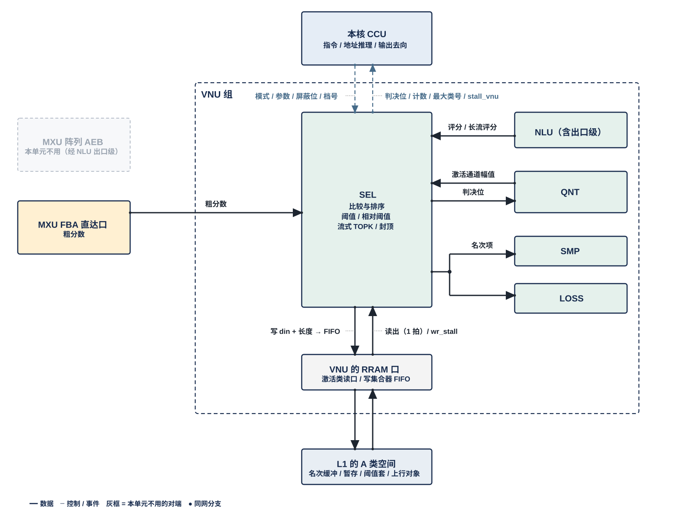
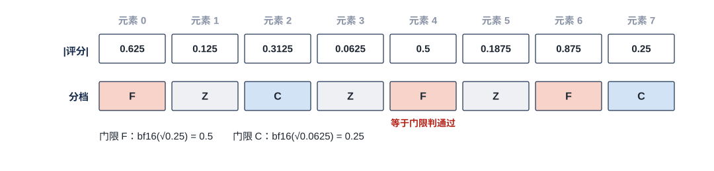
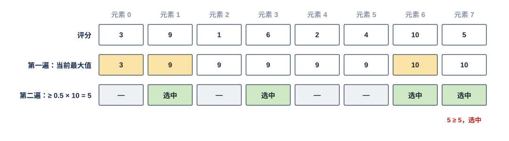
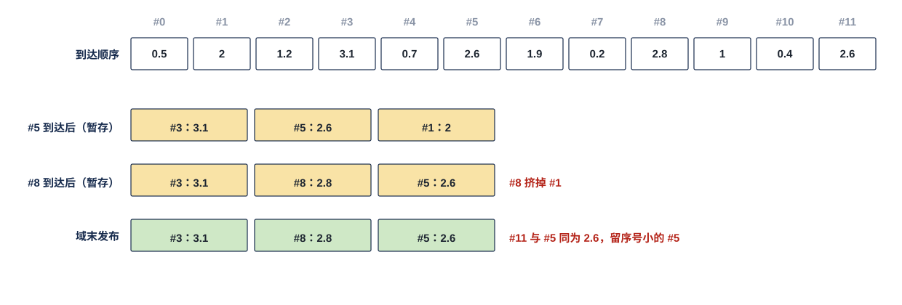
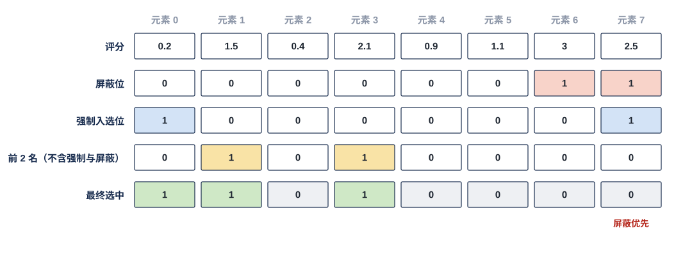

# VNU 选择单元（SEL）需求

> Owner: WangYizhao｜2026-11-08

## 1 组成与位置

### 1.1 SEL 只做比较与排序

SEL（Selection Unit，选择单元）从一组评分里挑出成员：每个元素与门限比较，或在一组元素里取前若干名。**SEL 只做比较与排序。** 门限上的运算只有两种：乘相对系数 $\alpha$（§3.3），以及只收紧的偏置（§5.3）。SEL 不改评分值、不量化、不取数；需要求和的统计量（如均值）由 NLU 算好交来。

### 1.2 SEL 是 VNU 组的一个单元，每核一个

一个计算核由 CCU、MXU 组、L1 组、VNU 组四组拼成。SEL 是 VNU 组的六个单元之一，其余五个是 NLU、QNT、SMP、LOSS、OPT。**SEL 与 VNU 组外的模块交换数据，都经 VNU 组的对外接口**；访问 L1 和向核外上行，经 VNU 的共用口。VNU 对外口的个数与共享方式，由 VNU 集成篇定义（待写）。

每个计算核一个 SEL，全芯片 4 个，物理相同。

### 1.3 模式与参数由指令给出

**SEL 只提供选择模式（§3）。** 一次选择用哪种模式、门限从哪来、取前几名、结果交给哪个接口，都由指令给出。本篇不写指令字段，指令定稿后另补。

**SEL 同一时刻只执行一种功能**（用户 11-04）：一次做一种选择，先后由指令与 CCU 排定。VNU 内各单元都按此原则；以后有并行需求时再调整。

### 1.4 稠密计算不经 SEL

**指令把一次计算配置成稠密时，SEL 关闭**：不先算粗分数，也不产生任何选择结果，全部元素都参与后续计算。

## 2 数据从哪来、到哪去

虚线框是 VNU 组：
- **框内**是 SEL，以及和它直接往来的 NLU、QNT、SMP、LOSS。这些连线不出 VNU 组。
- **跨出框的连线**都是 VNU 组的对外接口：
  - 左侧从 MXU 进来的粗分数与长流评分；
  - 阈值表：经 H2C 落地本核 L1，再经 VNU 的 RRAM 口读入 SEL 的门限表（§5.1；落地在 L1 之后，图中只在 L1 框里写"阈值套"，即阈值表）；
  - 上方与本核 CCU 之间的指令、档号（虚线）、判决结果与入口 stall。
- **下方的 L1 口**：SEL 不直接连 L1 或 C2H。
  - **VNU 的 RRAM 口**（RRAM 即核内 SRAM 口协议，传输协议篇 §5）分读、写两侧（用户 11-05）：**读**经 L1 外的选择器用 L1 的一个激活类读口（4 个读口都可读任一 A 类 bank，同拍撞 bank 由 CCU 排开，固定 1 拍）；**写**是向 L1 的 A 类写集合器里 SEL 自己那条 32 B 入口 FIFO 写，集合器每拍按优先级把各写者的队头分到对应 bank 的道上，FIFO 将满时拉 **wr_stall** 回 SEL（传输协议篇 §5.2）。读写哪一堆由堆选选，L1 内无仲裁。**每次读写的 en / wea / addr 都由本核 CCU 发出**；SEL 写 L1 时只给 din 与本条记录的长度，不算地址（传输协议篇 §5.4）。
  - **要出核的产出由 CCU 按指令选写 L1 再由 L1 发送侧发出，或经计算核的集成输出端口直接写 L2（二选一）**：位图与序号列表写进 L1 的 A 类空间，再由 L1 发送侧发出——**由本核 CCU 按位点指令发令**（目标存储与目的地址、长度或按对象实际长度），CCU 发读 L1 并逐拍给出 C2H 上的地址，对象发完后 CCU 向 MAE 发出报告（用户 11-04 / 11-06，V18-L1-03、V18-TP-35、传输协议篇 §2.4、§7.1）。**要做读集合并的位图**（读集合并：把几个核各自要读的数据集合合成一份并集，只读一次再多播；对象分录取读集、区块读集、lo 读集，用户 11-05 定名）写进 L2 本核象限的同一段内地址，由 MAE_CRU 从 L2 读四个象限取并、写回 L2，要用时经 H2C 道回核写 L1（V18-CRU-07）（传输协议篇 §3.2、§7.1）。

FBA 粗分数口是核内唯一的直达口，图中直接穿过 VNU 边界到 SEL；其他 VNU 单元篇里这个对端画灰。

### 2.1 VNU 组内的接口

**组内链路只规定位宽：全组统一每拍 256 bit（32 B），另加握手位**（用户 11-04，V18-VNU-02）。链路上是什么格式、什么精度，由 SEL 与对端单元的控制逻辑按指令解码，链路本身不区分格式；下表"元素格式"一列是两端须能解码的内容，不是链路的定义。链路条数与组内互连方式由 VNU 集成篇定义。对端来不及收时经该链路的握手让 SEL 停发，SEL 保持待发数据、不丢。

| 接口 | 对端 | 方向 | 内容 | 元素格式 |
|---|---|---|---|---|
| NLU 口 | NLU | 入 | 评分，每拍 16 个；相对阈值所用的统计量（如按行均值、$\sum\lvert x\gamma\rvert$）；Q 的逐维幅值：一个 query 行的 head_dim 个 $\lvert q_d\rvert$ | BF16；Q 逐维幅值取 RoPE 之后、量化之前的值，与求均值用的数值同源（用户 11-04） |
| QNT 口 | QNT | 入 | 待做保留判断的幅值：下一位点输入激活一个 token 各搬运引擎的 $\lvert x_k\rvert$ | BF16 |
| 判决位交 QNT | QNT | 出 | 阈值判断的逐元素判决位（例如 Q 一行 head_dim 个维的选维位、下一位点输入激活各搬运引擎的保留位），QNT 按它压紧与打包 | 每元素 1 bit 或 2 bit |
| 名次口 | SMP、LOSS | 出 | 流式 TOPK 的名次项（§3.4） | 序号 + 评分 |

### 2.2 经 VNU 组对外的接口

| 接口 | 对端 | 方向 | 内容 | 元素格式 |
|---|---|---|---|---|
| 粗分数口 | MXU 定基累加器（Fixed-Base Accumulator，FBA）出口，直达，不经出口级 | 入 | 粗分数，即 $\tilde S = Q\,K_{\text{hi}}^{\mathsf T}$ 的元素：一个 query 行对一个 key 的近似分数，只用 K 的高位平面算出。MXU 每核 4 个同构 pod（计算分组），每个 pod 每算完一个（query 行, 16 个 key）交出 16 个粗分数。**SEL 不反压这个口，判完即丢，不保存粗分数** | BF16 级判决格式 |
| 长流评分口 | NLU 的出口级子模块（组内链路；AEB 条目经它分发，V18-NLU-06） | 入 | 一条按存储序到达的长评分流，例如 LM Head 的 logit：$Z = H\,W_{\text{head}}$，$W_{\text{head}}$ 为 $d \times V$，每个 token 一行 $V$ 个 logit（$V$ 约 15 万） | BF16 |
| 指令与档号 | 本核 CCU | 入 | 选择模式、参数、每个元素的屏蔽位与强制入选位（§4）；每个 token 一个 2 bit 档号，用来选门限档（§5.2） | — |
| 阈值表 | 经 H2C 落地 L1，再经 RRAM 口读入 | 入 | 当前层的阈值表（§5.1） | — |
| 判决口 | 本核 CCU | 出 | 每元素 1 bit 或 2 bit 判决、按行计数、最大类号 | — |
| 入口 stall | 本核 CCU | 出 | 每条由 CCU 发读的入口一根 stall_vnu[i]（§2.3） | 1 bit |
| 写握手 | L1 的 A 类写集合器 | 入 | SEL 那条入口 FIFO 将满时的 wr_stall（只到 SEL，不到 CCU） | 1 bit |
| 上行 | 写 L1 → L1 发送侧经 C2H 发出（本核 CCU 按位点指令发令、发读） | 出 | 升序序号列表、不需跨核合并的位图（写入 L2，目的地址由本核 CCU 的发送指令给出）；要做读集合并的位图写进 L2 本核象限的同一段内地址，由 MAE_CRU 读四个象限取并、写回 L2，要用时经 H2C 道回核（V18-CRU-07） | 见 §6.1；③ 档变长对象，按位点窗口静态分配（§6.7） |
| L1 读写 | 读：L1 外选择器 → 激活类读口；写：A 类写集合器里 SEL 的入口 FIFO | 入 / 出 | 名次缓冲与暂存（§2.3） | 整字 32 B |

**每个结果交给哪个接口由指令选。**

### 2.3 经 VNU 的 RRAM 口读写 L1 的 A 类空间

SEL 经 VNU 的 RRAM 口访问 L1 的 A 类（激活类）空间里的一段地址，存放流式 TOPK 的名次缓冲和相对阈值第一遍的暂存。读经 L1 外的选择器用一个激活类读口，与 SMP、LOSS、OPT 及其他客户分时，读时隙由 CCU 排；写进 A 类写集合器里 SEL 自己的入口 FIFO，与其他写者并行排队，由集合器按优先级分道；L1 内不仲裁（用户 11-04 / 11-05）。**比较结果不等 L1 读回**，L1 访问不在比较的关键路径上。地址段的基址与长度由指令给出，容量建议值见 §9.1。

**RRAM 口的用法**（传输协议篇 §5、§6）：
- **写**：SEL 交 din（一个存储字，32 B）与本条记录的长度；en / wea / addr 由 CCU 发出，进 SEL 在 A 类写集合器里的入口 FIFO，集合器选中的那拍写入，无应答；**FIFO 将满时集合器拉 wr_stall 回 SEL，SEL 保持 en / wea / addr / din**（传输协议篇 §5.2、§6.2）。**记录按实际长度紧挨**（V18-TP-58）：位图、列表、名次项各是独立对象、各有编译链地址；每条记录（一个选择域的位图、列表或一组名次项）从上一条结束的下一个字节起，CCU 累加长度、对象写完后把各条长度写成单独存储的长度表（传输协议篇 §2.5、数据组织篇 §1.2、数据组织篇 §2.2）。
- **读**：CCU 发 en / addr，下一拍 dout 整字到达 SEL 的入口缓冲；读一条记录就是从长度表给的起点起连续读到终点，跨字时读口出口移位（数据组织篇 §2.4）。
- **握手**：**SEL 每条由 CCU 发读的入口给 CCU 一根 stall_vnu[i]**，入口缓冲占到"深度 − $L$"时拉起，CCU 停发该入口的读；$L$ = CCU 停发 1 拍 + L1 读返回 1 拍，【设计者定】。
- **两堆**：读哪一堆、写哪一堆由 CCU 给的堆选决定；第一遍暂存与第二遍读回之间的堆切换，条件是写完成 ∧ 最后读者完成，由 CCU 在下一阶段的地址里体现（传输协议篇 §4.1）。

### 2.4 由别的模块保证的事项

以下事项 SEL 不检查，由对应模块保证。这张表划出 SEL 的实现与验证边界：表里的事项 SEL 既不实现也不检查，验收时把它们当作输入前提、用断言核对（§8）。

| 事项 | 由谁保证 |
|---|---|
| 评分与统计量怎样算；NLU 求均值用的数值与它交来的逐维幅值同源 | MXU、NLU、QNT |
| 阈值表的内容，以及装载前按最松一档离线核过 H2C 口宽 | 编译链 |
| 阈值表在首次使用前经 H2C 落地 L1 并读入门限表 | LIC、MAE、CCU |
| 档号的给出，以及在位点边界翻转 | CCU_CTL |
| 每个元素的屏蔽位与强制入选位 | 指令 |
| 稠密计算时被屏蔽的位置不进 softmax | NLU（只写需求，见 VNU_NLU 篇）；屏蔽位由指令给出；被屏蔽元素不白占运算拍，由 CCU、MXU、NLU 设计者均衡利用率 |
| 判决结果与下游计算的放行先后；判决结果转发给其他核（作 ③ 档小消息经 C2H → L2 → H2C，传输协议篇 §7.1） | CCU 与指令 |
| 同一单元的不同功能不在时间上重叠 | CCU 与指令 |
| 读集合并（录取读集 / 区块读集 / lo 读集） | MAE_CRU：各核位图写 L2，MAE_CRU 从 L2 读四个象限取并、写回 L2，要用时经 H2C 道回核；CRU 的合并参数随 MAE 搬运指令（用户 11-05 / 11-06，传输协议篇 §3.2、§7.1、§8.3，V18-MAE-12） |
| VNU 对外口的个数与共享方式（RRAM 读侧经选择器接哪个激活类读口；写侧在集合器里的优先级） | VNU 集成篇（待写）；集合器优先级表由 CCU 随位点指令装 |
| 读写 L1 的地址（基址 + 字节累加、环形回绕）与 dout 去向 | CCU |
| 上行产出写 L1 后经 C2H 发出；变长对象的实际长度报 MAE | 本核 CCU：按位点指令发令、发读 L1、逐拍给 C2H 地址；对象发完后向 MAE 发出报告 |
| 名次项何时可以释放 | 消费方（发释放通知） |
| 变长对象按位点窗口静态分配，每位点的封顶值与窗口由算法侧给出；定长的名次缓冲与暂存段够用、写入前旧数据已读完；同一阶段并发写者总需求 ≤ 道数 × 32 B/拍 | 算法侧（模型表）；编译链（指令中的基址与窗口长，LIC 操作 15） |

## 3 选择模式

### 3.1 五种模式一览

**选择域**是一次选择面对的元素集合和它的结束点，结果只在相应时点发布。例如：
- 一个 query 行在连续 $N_{\text{ct}}$ 个 key 上的粗分数，$N_{\text{ct}}$ 默认 64，称为一个录取窗口；
- 一个 token 的整行 logit；
- 一个（query 行块, q 头）的全部区块能量。区块是连续 128 个 key，区块能量由 NLU 按摘要分数聚合得到。

| 模式 | 比较什么 | 输出 | 何时发布 | 典型用途 |
|---|---|---|---|---|
| 阈值 | 每个元素与 1 个或 2 个门限 | 每元素 1 bit 或 2 bit | 元素到达即出 | FFN gate 先筛、FFN 输出通道分档、attention 固定阈值录取、区块绝对阈值、token 复用判决 |
| 相对阈值 | 每个元素与 $\alpha$ × 本域统计量 | 每元素 1 bit | 统计量就绪后 | 区块相对阈值、Q 一行各维的选维 |
| 流式 TOPK | 本域内取前 $k$ 名 | 名次项或位图 | 选择域结束 | attention 每行每窗口录取、区块名次选择、LM Head 词表、判别器取最大类（$k = 1$） |
| 阈值后封顶 | 过门限的元素里取前 $k$ 名 | 名次项或位图 | 选择域结束 | attention 封顶录取 |
| 关闭 | — | — | — | 稠密计算 |

五种模式的区别只在"拿什么比"和"何时能下结论"：阈值模式每个元素独立判，所以到达即出；相对阈值要先有本域统计量；流式 TOPK 与阈值后封顶要看完整个域才知道名次。读者可按"发布时点"一列理解各模式对下游放行先后的影响，放行本身由 CCU 与指令安排（§2.4）。

### 3.2 阈值模式：与 1 个或 2 个门限比较

- **1 个门限**：$x \ge \tau$ 输出 1，否则 0。
- **2 个门限**（$\tau_{\text{hi}} \ge \tau_{\text{lo}}$）：输出 2 bit 分档，即 $\ge \tau_{\text{hi}}$、$[\tau_{\text{lo}}, \tau_{\text{hi}})$、$< \tau_{\text{lo}}$ 三档。用于 FFN 输出通道分档时，三档记作 F / C / Z：F 读权重高位与低位两个平面，C 只读高位平面，Z 不参与后续计算。
- 可选**按幅值比较** $\lvert x\rvert$。
- **评分按 BF16 进比较器，不另量化。** 有的阈值在算法侧定义在平方尺度上，例如 FFN 分档的 $\tau_F$、$\tau_C$ 定义在 $\tilde s^2$ 上。这类阈值由编译链换算成 BF16 平方根门限后装表，SEL 只比较 $\lvert\tilde s\rvert \ge \mathrm{bf16}(\sqrt{\tau})$，**不做开方**。
- 门限取"恒通过""恒不通过"两个哨兵值时，判决与算法参考模型一致。

缩小例只画 8 个元素，实际 NLU 口每拍交 16 个。平方尺度阈值 $\tau_F = 0.25$、$\tau_C = 0.0625$ 换算成门限 0.5 与 0.25，各元素按 $\lvert\text{评分}\rvert$ 分档：

| 元素 | 0 | 1 | 2 | 3 | 4 | 5 | 6 | 7 |
|---|---|---|---|---|---|---|---|---|
| 评分 | 0.625 | 0.125 | 0.3125 | 0.0625 | 0.5 | 0.1875 | 0.875 | 0.25 |
| 分档 | F | Z | C | Z | F | Z | F | C |

元素 4 的 0.5 等于门限 F，判 F；元素 7 的 0.25 等于门限 C，判 C。

### 3.3 相对阈值模式：门限随本选择域的统计量变化

**门限 = $\alpha$ × 本选择域的统计量**，$\alpha$ 由指令给出。统计量有两种：

- **最大值，由 SEL 自己求。** 第一遍扫完本域，求出最大值，评分暂存在 L1 的 A 类空间；第二遍逐个与 $\alpha \times \max$ 比较。例如区块相对阈值 $\mathcal E_J \ge \alpha_{\text{blk}} \cdot \max_{J'} \mathcal E_{J'}$。
- **均值，由 NLU 求好随评分交来**（用户 11-04）。SEL 只算 $\alpha$ × 均值再比较。例如对 Q 的一行沿 head_dim 维判断 $\lvert q_d\rvert \ge \alpha \cdot \mathrm{mean}_d \lvert q_d\rvert$，输出 head_dim bit 的选维位，粗分数只在选中维上求和。

**阈值判断沿哪一维、对哪条向量做，由指令给出**（用户 11-04）：
- FFN 输出通道的分档（F / C / Z）、gate 先筛、下一位点输入激活的保留判断（keep）、Q 一行各维的选维，都是同一种逐元素阈值判断；
- 区别只在被判断的向量、门限个数与门限来源（固定值或相对于本域统计量）。

所以本篇不为它们各设机制。保留判断原在 QNT，现在也由 SEL 执行，QNT 只按 SEL 给的判决位压紧与打包。

**用整行统计量判决的位点**（相对阈值、QDS 行均值）在权重驻留下，行统计量要等全部列块算完才有，判决前的值须先存 BF16、再判决与压紧，不能逐 MX 组流式打包。规则见数据组织篇 §5.7；**哪些位点如此，由 CCU 篇按 SEL 的选择模式逐位点列出**（用户 11-05）。

$\alpha$ × 统计量的舍入与算法参考模型一致。

**最大值统计量的两遍暂存【设计者定】**（用户 11-01）。要定的是：第一遍的评分以什么格式、按什么次序暂存，第二遍怎样读回。约束：
1. 暂存放在 L1 的 A 类空间里指令给出的地址段（§2.3），经 VNU 的 RRAM 口读写，按记录级 32 B 对齐；
2. 一个选择域至多 512 项（§9.1）；参考规模：32K 上下文、128 key 区块时一个域有 256 个区块能量；
3. 第二遍读回的评分须与第一遍到达的值逐位相同（结果须与参考模型逐位一致，§6.5）；
4. 第二遍不慢于评分的产出节奏，256 项选择域参考 ≤ 12 拍（§7.2）。

8 个元素，$\alpha = 0.5$。第一遍逐个更新当前最大值，扫完得 10；第二遍与 $0.5 \times 10 = 5$ 比较，元素 1、3、6、7 选中，其中元素 7 的 5 等于门限、判选中。

### 3.4 流式 TOPK 模式：边到达边插入，选择域结束时发布前 k 名

- **每到一个评分，与本域暂存的第 $k$ 名比较，胜出就插入。整个选择域结束才发布，中途不发布。** 发布内容是前 $k$ 个名次项（序号 + 评分），或对应的位图。
- **无近似**：结果与对整个域排序后取前 $k$ 名逐位相同。并列取序号小者。
- **选择域长度不限**：一个窗口的几十个元素、一个 token 的整行 logit、超长上下文的全部区块，都用这一个模式。同时在选的域可以有多个，例如一个窗口里多个 query 行各一个域，一条 logit 流上多个 token 各一个域。
- **$k$ 由指令配置，不设硬上限**，只受名次缓冲所在 A 类地址段的长度约束：

  $$n_{\text{dom}} \times k \times b_{\text{item}} \le L_{\text{rank}},$$

  其中 $n_{\text{dom}}$ 为同时在选的域数，$b_{\text{item}}$ 为每个名次项的字节数（参考 5 B：序号 3 B + BF16 评分 2 B），$L_{\text{rank}}$ 为名次缓冲地址段的长度（指令给出）。参考值：attention 录取 $k \le N_{\text{ct}}/4$（$N_{\text{ct}} = 64$ 时 $\le 16$），LM Head 20，判别器取最大类 $k = 1$。
- **一条评分流上可同时跑两组流式 TOPK**，$k$ 各自配置（可为 0），各组结果都可按序号升序输出。
- **名次项保持到消费方通知释放**，此前不被下一个选择域覆盖。

12 个评分按 #0…#11 的顺序到达，$k = 3$。#5 到达后暂存的前 3 名是 #3、#5、#1；#8（2.8）到达后挤掉 #1；#11 与 #5 同为 2.6，按并列规则留序号小的 #5。域末发布 #3、#8、#5。如果在 #5 到达后就发布，下游会用到最终不在前 3 名的 #1。

### 3.5 阈值后封顶模式

先按门限判决，**过门限的元素里再按流式 TOPK 取前 $k$ 名**，在选择域结束时发布。过门限的不足 $k$ 个时，只发布过门限的，不补。

### 3.6 关闭

SEL 不工作，见 §1.4。

## 4 哪些元素参与选择：屏蔽与强制入选

本节的规则对所有选择模式都成立：先确定哪些元素有资格参与，再按 §3 的模式在有资格的元素里选。屏蔽与强制入选都是逐元素的位，SEL 只按位施加，不解读它们的算子含义。

### 4.1 屏蔽位与强制入选位由指令给出

每个元素可以带一个屏蔽位和一个强制入选位，**都由指令给出**（用户 11-04）；以区间、位图还是其他形式给出，随指令定。典型来源：
- 屏蔽：attention 的因果截断、树形 token 之间的祖先关系、有效 key 范围。
- 强制入选：序列开头的若干 key、对角区块等。

### 4.2 强制入选的元素不占名额

在流式 TOPK 和阈值后封顶模式里，强制入选的元素不参与名次竞争，也不占 $k$ 个名额。

### 4.3 屏蔽优先

**被屏蔽的元素一律不选中，即使同时带强制入选位。** 选择按以下先后进行：
1. 去掉被屏蔽和强制入选的元素，在其余元素里按模式选；
2. 把结果与强制入选位按位 OR；
3. 被屏蔽的元素置 0。

### 4.4 档号 3 的 token 不参与

档号为 3 的 token（§5.2）不参与选择，也不产出任何结果。

8 个元素，取前 2 名：
- 元素 6、7 被屏蔽，元素 0、7 强制入选。
- 前 2 名只在其余元素 1–5 里取，得元素 3（2.1）与元素 1（1.5）。
- 与强制位 OR 后加入元素 0。
- 元素 7 既强制入选又被屏蔽，按屏蔽优先不选中。元素 6 的评分 3.0 最高，但被屏蔽，同样不选中。

## 5 门限

门限按三级确定：当前层的阈值表决定"这一层用哪组数"（§5.1），档号决定"这个 token 用其中哪一档"（§5.2），偏置只在此基础上统一收紧（§5.3）。三级各自独立变化，生效时机见 §6.6。

### 5.1 只存当前一套阈值

**阈值表**是**当前层的阈值表**（按层装载，SEL 持本层那张，V18-SEL-14），即这一层运行要用的全部门限：attention 录取表（固定阈值或 $k$）、各阈值判断的门限与相对系数 $\alpha$（FFN 分档的 $\tau_F$ 与 $\tau_C$、gate 先筛的 $\tau_g$、保留判断的门限、选维的系数）等，每（层, 位点）一组。**位点**是一层里的一个算子实例，例如 gate/up 投影。

编译期准备多套阈值存在 L2，由控制方选一套经 H2C 落地本核 L1（H2C 只接 L1 的接收桥，传输协议篇 §7.2），再经 RRAM 口读入 SEL 的门限表，读地址由 CCU 给出。**SEL 只存当前一套**，装入新的一套之前一直有效。**装载完成前不读表。** 保留判断（keep）的门限也在这一套里，只存这一份，QNT 不存门限（用户 11-04）。

### 5.2 按档号选门限

**同一次选择里，不同 token 可以用不同门限。** 每个门限按档存最多 4 个值：档 0、1、2 有效，档 3 表示该 token 不参与。比较时按评分所属 token 的档号选档。

- 档号由控制方（本核 CCU_CTL）给出，每 token 2 bit。**以什么形式交给 SEL【设计者定】**：要定的是档号从 CCU 到 SEL 的载体，例如随指令下发一张按 token 排的档号表，或随每个评分附带。约束：
  1. SEL 比较每个评分时能按该评分所属 token 取到 2 bit 档号；
  2. 参与按档选门限的 token ≤ 128（§9.1），档号表须容得下这么多 token；
  3. 档号只在位点边界翻转，一个位点内不变（§6.6），所以 SEL 在位点开始时取一次即可，不需要逐拍更新的通路。
- 选套与选档两级独立：一套门限在装入新套之前不变，档号逐 token 选。

示例（数值只作说明，gate 先筛门限 $\tau_g$ 按档存 0.05 / 0.10 / 0.20，同一个评分 0.12）：

| token | 档号 | 用的 $\tau_g$ | 评分 0.12 的判决 |
|---|---|---|---|
| t0 | 0 | 0.05 | 选中 |
| t1 | 1 | 0.10 | 选中 |
| t2 | 2 | 0.20 | 不选 |
| t3 | 3 | — | 不参与 |

### 5.3 偏置只能收紧门限

门限可以加偏置 $b$：$\tau' = \tau \cdot 2^{b}$，**只允许 $b \ge 0$，只收紧**。给出负值时钳为 0，并计数（§8）。偏置是否开启、$b$ 取多大由指令给出，默认关。

偏置与平方根换算的舍入先后【设计者定】，同一套里所有门限（含保留判断的门限）用同一口径，选定后同步算法参考模型。

## 6 输出形式与结果规则

### 6.1 输出形式

| 形式 | 内容 | 位宽 |
|---|---|---|
| 判决位 | 每元素 1 bit 或 2 bit | — |
| 位图 | 一个选择域一张，每元素 1 bit | attention 录取窗口的位图按 128 bit 参数化（$N_{\text{ct}} \le 128$）；区块位图 512 bit 定宽 |
| 按行计数 | 选中个数 ≥ 1 的行：行号与本域选中个数 | — |
| 升序序号列表 | 选中元素的序号按升序排列 | 序号每项 3 B（行号载荷统一 3 B，任意词表都放得下的冗余设计，V18-MAE-06 修订）；无个数字段，项数 = 该列表的长度表项 ÷ 3（V18-SEL-15） |
| 名次项 | 序号 + 评分 | 参考每项 5 B |
| 最大类号 | 取最大类的结果（$k = 1$ 的流式 TOPK） | — |
| 判决位（交 QNT） | 一条向量每元素 1 bit 或 2 bit | Q 一行 head_dim 128 时 16 B |

**交 MAE 搬运引擎用作列表的产出（位图、升序序号列表）载荷只有位图或行号两种，列表没有头、不带模板号**；哪条指令用哪张列表由指令引用列表地址表达（V18-MAE-06，`L3PU_EXTERNAL_INFORMATION.md` §5）。

### 6.2 选择域结束才发布

**选择域结束前的暂存结果不交下游。** 有效元素不足 $k$ 个时，不补无效项。

### 6.3 并列取序号小者

评分相等时，取元素序号（key 号、词号或区块号）小者。

### 6.4 结果只依赖评分与配置

**结果只依赖评分、所属（层, 位点, token）、当前门限与档号，与评分到达的先后、所在的核无关。**

### 6.5 与算法参考模型逐位一致

全部选择结果必须与算法参考模型在 NPU 格式下逐位一致（用户 11-02）。某种比较口径硬件实现太难时，交回算法侧修改口径并同步参考模型，**硬件不自行换比较方式**。

### 6.6 生效时机

- 选择模式与参数在位点边界随指令生效。
- 档号在位点边界由 CCU_CTL 翻转后才被采用，一个位点内不会出现新旧档号混用。

### 6.7 变长对象按位点窗口静态分配；存储或传输的位点一律用有封顶的选择模式

选择结果决定的变长对象——SEL 自己写出的位图、序号列表、名次项，以及 QNT 按 SEL 判决位压紧写出的紧凑记录——属数据组织篇 §1.1 的第 ③ 档。**这些对象按算法侧给的位点窗口由编译链静态分配，基址与窗口长在指令里，CCU 不做运行期分配**（用户 11-06，传输协议篇 §4.3、V18-TP-40）。窗口 = 封顶后的记录长度上限 × token 数（数据组织篇 §2.5）。

**凡产出要存进 L1 / L2 或经链路传输的压紧激活的位点，选择模式必须有封顶**（V18-SEL-13）：流式 TOPK，或阈值后封顶（阈值 + 最多 $k$ 个）。纯阈值、相对阈值（不封顶）只用于不落盘、不传输的判决。封顶值 $k$ 由算法侧按精度与容量定、按位点配置，算法评测按封顶后的结果测精度。

| 选择模式 | 每个选择域的选中个数上限 | 能否用于存储或传输的压紧激活 |
|---|---|---|
| 流式 TOPK | $k$ | 能 |
| 阈值后封顶 | $k$ | 能 |
| 阈值、相对阈值（无封顶） | 选择域长度 | 不能，只用于不落盘、不传输的判决 |
| 关闭 | 不产生选择结果 | — |

强制入选的元素不占 $k$ 个名额（§4.2），所以**上限 = $k$ + 本域强制入选个数**（用户 11-05 认可）。**SEL 保证按所选模式选出的个数不超过上限**；对象超出位点窗口是传输协议篇 §9 的致命错误。对象按实际长度紧挨存放，长度写进单独存储的长度表（V18-TP-58）；上限只用于窗口容量。对象写进 L2 后由本核 CCU 向 MAE 发出报告（只带目的起始地址），SEL 不报。

## 7 速率与时延

### 7.1 每拍处理能力匹配上下游模块

**SEL 每拍能处理的元素数，须匹配上游各口的产出速率与下游各口的接收要求，由 SEL 设计者与以下模块对接确定**（用户 11-04）。下表的参考值只作背景，不是 SEL 的定值：

| 相关模块 | 接口 | 现行参考值 |
|---|---|---|
| MXU（FBA） | 粗分数口 | 4 个 pod 的 FBA 都直连 SEL，每个 pod 一次交 16 个；同拍是否会 4 个 pod 一起交【待确认】。四 pod 平均约 21.8 个/拍/核（理想粗算节奏），真实掩码回放约 17.2 个/拍/核（旧供数结构下仿真【待标定】） |
| NLU 的出口级子模块 | 长流评分口 | 15 万词 × 24 个 token 约 3.6 M 次比较，须在出口级送完这条流的约 10.8 ms 内完成 |
| NLU | NLU 口 | 每拍 16 个评分 |
| QNT | QNT 口、判决位交 QNT | 跟随 QNT 量化的节奏；保留判断每拍至多 16 个通道 |
| 本核 CCU | 判决口 | 判决位交出时延见 §7.2 |
| 集成输出端口 | 上行 | 位图与序号列表写 L1 后由 L1 发送侧发出，或直接写 L2（CCU 二选一，V18-TP-56）；上行负载归 HUB 流量预算 |
| VNU 的 RRAM 口 | L1 读写 | 读：经选择器用一个激活类读口（32 B/拍），与 SMP、LOSS、OPT 等分时，时隙由 CCU 排，固定 1 拍，入口缓冲将满时拉 stall_vnu[i]；写：进 A 类写集合器里 SEL 的入口 FIFO，将满时 wr_stall 回 SEL；同一阶段并发写者总需求 ≤ 道数 × 32 B/拍由编译链保证 |
| SMP、LOSS | 名次口 | 选择域结束时一次 |
| CCU_CTL | 判决口（最大类号）、档号 | 档号在位点边界翻转 |

SEL 能单方面承诺、与对接结果无关的只有下面三条，**各口在超额时的行为不同**：

| 口 | SEL 的承诺 | 超额时 |
|---|---|---|
| FBA 粗分数口 | **不施加反压，也不丢失粗分数** | 这个口没有 stall 线，超额不允许发生。所以 SEL 须同时满足：① 持续处理能力不低于四个 pod 合计的粗分数持续产出（参考 21.8 个/拍/核）；② 在四个 pod 同拍各交 16 个（共 64 个）的峰值下不丢，靠并行比较还是入口缓冲吸收【设计者定】。在上表"同拍是否 4 个 pod 一起交"【待确认】定下之前，验收按这个峰值注入（§9.2） |
| 长流评分口（推送链上） | 不丢 | 来不及处理时经组内链路的握手让 NLU 的出口级子模块停发（出口级再对 AEB 拉低 ready，AEB 堆满才反压 FBA；NLU 篇 §3.6）。只降速，不是错误 |
| 由 CCU 发读的入口（L1 读回） | 不丢 | 只用 stall_vnu[i] 让 CCU 停发（§2.3）。只降速，不是错误 |

### 7.2 SEL 自身时延

| 项 | 要求 |
|---|---|
| 粗分数到达到选中位交出（阈值模式） | ≤ 2 拍【待标定】 |
| 评分到达到判决位交出 | ≤ 4 拍【待标定】 |
| 相对阈值第二遍 | 不慢于评分的产出节奏；256 项选择域参考 ≤ 12 拍 |
| 流式 TOPK 插入 | 不低于评分到达速率 |

## 8 计数与复位

- **计数**：偏置负值钳 0 的次数，供 LIC / MAE 读取。
- **复位**：清当前阈值表、名次缓冲与暂存内容。档号不由 SEL 持有。SEL 没有需要跨次保留的状态。
- **不设运行时错误事件**：§2.4 所列前提由对应模块保证，验收时用断言检查。压紧激活对象不超位点窗口由 SEL 按封顶模式保证（§6.7）；万一超出，属传输协议篇 §9 的致命错误，报 LIC；SEL 在命令网上没有端口，由本核 CCU 转报（用户 11-05 定；窗口与槽地址在 CCU 指令里、写累加器在 CCU，通常由 CCU 直接发现）。

## 9 要求值与验收

### 9.1 要求值

| 项 | 要求值 | 说明 |
|---|---|---|
| 选择模式 | 阈值（1 / 2 bit）、相对阈值（最大值 / 均值）、流式 TOPK、阈值后封顶、关闭 | 模式与参数由指令给出 |
| 每拍处理能力 | 匹配上下游各口（§7.1） | 由 SEL 设计者对接确定 |
| NLU 口 | 每拍 16 个评分 | — |
| 时延 | 选中位 ≤ 2 拍，判决位 ≤ 4 拍 | 【待标定】 |
| $k$ | 指令配置，无硬上限 | 受名次缓冲地址段长度约束（§3.4） |
| 门限档 | 每个门限最多 4 档；档号每 token 2 bit | 参与按档选门限的 token ≤ 128 |
| 位图位宽 | 录取窗口按 128 bit 参数化；区块位图 512 bit | 与 CRU、HUB 一致 |
| 相对阈值选择域 | ≤ 512 项 | — |
| 门数 | 参考 ≤ 28 k 门（NAND2 等效），另加约 2 KB 门限表 | 不含 L1 内的缓冲 |
| L1 缓冲 | 建议值 3–10 KB | A 类地址段由编译链分配 |
| 入口 stall | 每条由 CCU 发读的入口一根 stall_vnu[i]，在"深度 − $L$"处拉 | $L$【设计者定】 |
| 写握手 | A 类写集合器里 SEL 的入口 FIFO 将满 → wr_stall 回 SEL | FIFO 深度【设计者定】 |
| 变长对象 | 按位点窗口静态分配；存储或传输的位点一律封顶，选出个数 ≤ $k$ + 强制入选数（§6.7） | 超出位点窗口为致命错误 |

### 9.2 验收

| 对象 | 方法 | 用例 |
|---|---|---|
| 阈值模式（§3.2） | 与算法参考模型逐位比对 | 1 个门限、2 个门限、哨兵门限、评分恰等于门限 |
| 相对阈值（§3.3） | 逐位比对 | 最大值与均值两种统计量；8 / 256 / 512 项选择域 |
| 流式 TOPK（§3.4） | 与整体排序结果逐位比对；断言中途无发布 | 不同 $k$、并列评分、同一条流两组 TOPK |
| 阈值后封顶（§3.5） | 逐位比对 | 过门限者少于 $k$、多于 $k$ |
| 屏蔽与强制入选（§4） | 逐位比对 | 强制不占名额；强制且屏蔽的元素不选中；档号 3 的 token 无输出 |
| 按档号选门限（§5.2） | 逐位比对 | 4 档混合的 token 序列 |
| 偏置（§5.3） | 逐位比对 | $b = 0 \ldots 4$ 扫描下选中集合单调变小；负值钳 0 并计数 |
| 结果规则（§6） | 断言 | 域末前无发布；不足 $k$ 不补；乱序注入、换核运行结果逐位相同 |
| 不反压、不丢失（§7.1） | 周期仿真 | 四个 pod 同拍各交 16 个粗分数的峰值注入 |
| RRAM 口与入口 stall（§2.3） | 周期仿真；断言 | 写只给 din 与长度；入口缓冲到"深度 − $L$"时 stall_vnu 拉起后不溢出；记录紧挨、每条长度交 CCU 写进长度表 |
| 封顶上限（§6.7） | 断言 | 存储或传输的位点选中个数 ≤ $k$ + 强制入选数，token 驻留与权重驻留两种顺序；强制入选与 $k$ 同时存在 |
| 写 FIFO 与 wr_stall（§2.3） | 周期仿真 | 与其他写者同拍撞 bank 时 SEL 的 FIFO 吸收、将满拉 wr_stall 后不丢写 |
| 自身时延（§7.2） | 周期测量 | 各模式 |
| 关闭（§3.6） | 审查 | 稠密配置下 SEL 无活动 |
| 门数（§9.1） | 综合 | 待 RTL |

## 10 为什么

- **对外接口经 VNU 组封装**（用户 11-04）：SEL 是 VNU 组内的单元，访问 L1、向核外上行都经 VNU 的共用口；对外口怎样划分由 VNU 集成篇统一定义，各单元篇只写本单元的接口。
- **按选择模式提供能力，配置由指令完成**（用户 11-04）：attention 录取、区块选择、FFN 判决、LM Head 选词、判别器，都是同几种比较与排序换了参数。模式少且与用途无关，换模型、换算子只换参数与门限，不改硬件。算子融合与放行先后归 CCU 与指令设计。
- **全录取就是关闭**（用户 11-04）：稠密计算不需要先算粗分数再选。
- **屏蔽位与强制入选位由指令给出**（用户 11-04）：因果、树形祖先关系、有效范围都是算子语义，SEL 只按位施加。
- **均值由 NLU 求**（用户 11-04）：NLU 已有求均值的运算（归一化统计），SEL 不做算术。
- **流式 TOPK 作为一个模式**（用户 11-04）：每个域只需存 $k$ 项，域长不限，结果无近似。所以区块名次选择也用它，不再需要直方图近似。
- **选择域结束才发布**：名次要看完整个域才确定，中途发布会让下游用到最终被挤掉的元素（FIG-VNU_SEL-TOPK 的 #1）。
- **粗分数直达、判完即丢**：粗分数每拍几十个，经出口级排队或量化都会成为瓶颈，所以 FBA 直接送 SEL；精确分数由 MXU 用全部数字重算，不以粗分数为初值，所以 SEL 不保存粗分数。
- **比较口径与参考模型逐位一致**（用户 11-02）：FFN 分档阈值定义在平方尺度上，按 $\lvert\tilde s\rvert \ge \mathrm{bf16}(\sqrt{\tau})$ 比较是算法侧当前配置采用的口径。有限精度下它与"先平方再比较"在舍入边界可能不同；用户判断影响很可能极小，这个判断尚未实测。
- **按档号选门限、偏置只收紧**（用户 10-14 定 2 bit 档号与四档）：档号由建树方按 token 被接受的路径概率给出，让算力集中到更可能被接受的 token 上。每套阈值装载前已按最松一档核过 H2C 口宽；偏置只收紧，档号只在 0 / 1 / 2 之间改，核过的约束一直成立。
- **结果只依赖评分与配置**：多个核对同一组评分各自判决时必须得到相同结果，训练时也要能重现前向的选择。
- **区块位图 512 bit 定宽**：区块大小为 $64 \cdot 2^{e}$ 个 key（$e = 0 \ldots 3$），32K 上下文按最细的 64 key 计有 512 个区块。
- **每拍处理能力由设计者对接**（用户 11-04）：四个 pod 是否同拍交出、下游各口的接收节奏，都随相关模块的设计而定，所以本篇列出相关模块与参考值，不写死跨模块的数字。
- **按传输协议篇同步**（用户 11-05，V18-TP-01…16）：核内与 L1 之间只有 RRAM 一种口，地址只在 CCU 一处推理，SEL 只给数据与长度；CCU 不看下游余量，所以每条入口给 CCU 一根 stall；出核数据写 L1 后由 L1 发送侧发出，或直接写 L2（11-07 晚 V18-TP-56）；变长对象的上限只能来自选择模式，所以由 SEL 按模式保证。
- **第二轮同步**（用户 11-05）：写侧改为集合器——每个写者一条入口 FIFO，集合器按优先级分 bank 道，写者只看自己的 wr_stall，L1 内仍无仲裁；要做读集合并的位图经 C2H 直送 CRU，不再经 L2；32 B 单位改称存储字，免与矩阵的行混淆。
- **存储或传输的压紧激活一律封顶、按位点窗口静态分配**（用户 11-06："我认为 Activation 数据虽然要被压缩，但是可以在算法侧预先给出一个典型窗口，去保证每个数据都能被存储到该窗口，这样还可以极大程度简化调度逻辑。并且这个窗口需要以每个计算为单位去调整"；V18-SEL-13、V18-TP-40）：有封顶才有确定的窗口，地址可全部在编译期定下，CCU 没有对象间的运行期依赖；代价是窗口留在上限时空间空着，所以 $k$ 是算法侧按精度与容量一起定、按位点调的旋钮。被否：11-05 的运行期 bump 分配与"不封顶位点按全保留长度留槽"。
- **CRU 的该项功能改称读集合并**（用户 11-05："OR，我认为它不应该叫这个命名，它会严重影响名称"；"读集合并是更合理的叫法"，V18-TP-24）：名字说的是功能——把几核各自要读的集合合成一份并集、只读一次再多播，而不是实现它的逻辑运算；SEL 内部"与强制位 OR"一类按位运算不改名。目的 CRU 不占地址类码（用户 11-05 夜："不要归纳进地址"）；11-06 深夜起也不设 dest 信号，由本核 CCU 给 C2H 分流的通路选择决定（V18-TP-51，协议篇 §3.9）。
- **不在本篇的数字**：阈值表装载拍数是传输时延，位图上行负载是 HUB 流量预算，都不由 SEL 决定。一次通过在线录取（One-Pass Online Admission，OPOA）的在线阈值是扩展项，不实现。

- **标量走数据协议、输出可直接写 L2、跨核合并经 L2**（用户 11-07："如果是控制网，我认为他们不属于控制网，需要走数据通信协议"；"VNU 和 MXU 的输出可以由 CCU 直接推算要写在 L2 SRAM 的地址，然后走核间协议，不过也要支持输出写回到 L1 SRAM"；"MAE 可以读取 L2 SRAM 的数据，去做整合"；V18-TP-55 / 56、V18-CRU-07）：结果寄存器 / 合并值寄存器的专用接口与"经 CCU 中转""上行一律先写 L1""C2H 直送 MAE_CRU"撤；下面几条中与此冲突的旧写法以本条为准。