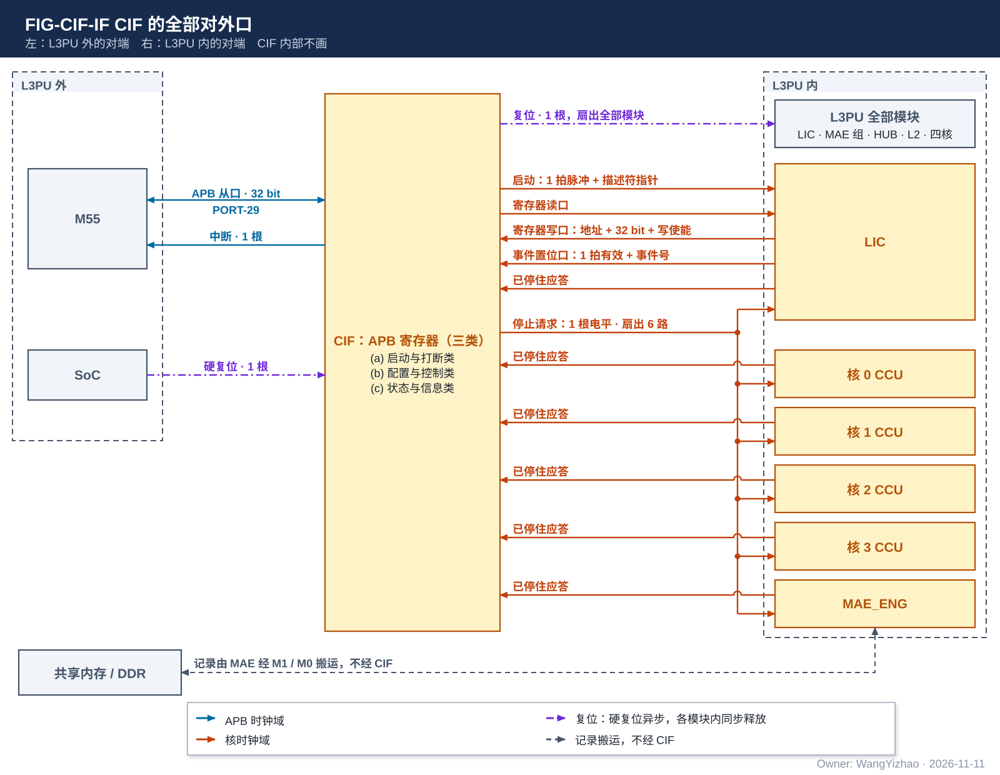
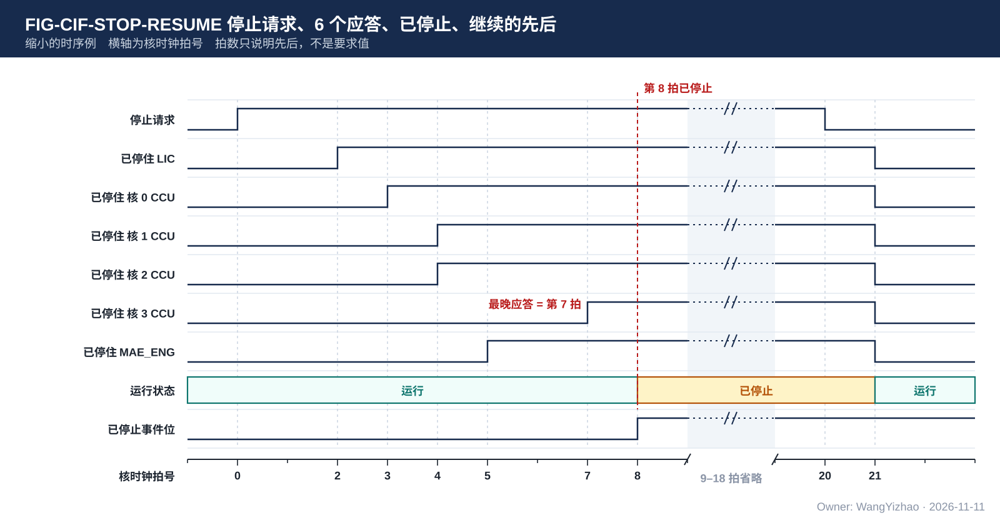

# CIF 需求：M55 与 L3PU 之间的寄存器接口

> Owner: WangYizhao｜2026-11-11

## 1 概述

**CIF 是挂在 APB 上的一组寄存器，全芯片 1 个，是 M55 与 L3PU 之间唯一的控制通路。** M55 写其中一部分寄存器，让 L3PU 启动、停止、继续、复位，或调整 L3PU 的功能与行为；L3PU 写另一部分寄存器，把关键信息留给 M55 经 APB 查询；L3PU 需要 M55 介入时，经 1 根中断线通知 M55。调用参数与全部数据都放在共享内存 / DDR（M55 与 L3PU 共用的片上系统 SRAM 与 DDR 共享区，外部信息篇 §1），由 MAE 的搬运引擎搬运，不经 CIF。

寄存器按"谁写、谁读"分三类：

| 类 | 谁写 | 谁读 | 用途 |
|---|---|---|---|
| (a) 启动与打断类 | M55 | L3PU 持续监听 | 决定 L3PU 是否启动、是否被打断、是否复位 |
| (b) 配置与控制类 | M55 | LIC | LIC 据此调整功能、改写行为、做 KV 地址编辑等 |
| (c) 状态与信息类 | L3PU | M55 经 APB 查询 | 运行状态、中断事件、L3PU 留给 M55 的关键信息 |

**本篇不标定具体有哪些寄存器。** 本篇定死的只有：APB 口、三类寄存器的读写规则、复位与启停、中断，以及最初登记的四项寄存器（§2.2.2）。其余寄存器由 CIF 设计者向相关模块（LIC、CCU 等）的设计者采集需求后，登记在 §2.2.2 的寄存器登记表里。M55 与 L3PU 共用的共享内存记录（调用描述符、调用输入记录、调用结果记录）同样处理：本篇只写框架（§2.8），字段由相关模块的设计者定后登记。

本篇给三类读者用：CIF 设计者按第 2–6 章实现各口与规则、按登记表实现寄存器；LIC、CCU 等模块的设计者需要哪个寄存器就提出并登记；M55 Runtime 的开发者按登记表读写寄存器、按 §3.4 的顺序启动调用。

不属于本篇的内容：

- 数据的搬运（M1、M0、PIN 三个口）归 MAE 组，见 MAE_NI_EXT 篇与外部信息篇。
- 一次调用在 L3PU 内怎样推进、有哪些调用种类，归 LIC。
- CIF 不在命令网上（架构篇 §2.5）。
- 本篇不含容错设计。

## 2 接口需求

### 2.1 架构图与接口汇总

图中只画 CIF 一个框与它的全部口，不画内部。左侧是 L3PU 外的对端（M55、SoC 给的硬复位），右侧是 L3PU 内的对端；蓝色线在 APB 时钟域，橙色线在核时钟域。共享内存 / DDR 里的记录由 MAE 搬运，图上用灰色虚线标出，不经 CIF。

| 口 | 对端 | 方向 | 位宽 | 握手 | 时钟域 |
|---|---|---|---|---|---|
| APB 从口（架构篇 PORT-29） | M55（经 SoC 的 AXI → APB 桥） | M55 读写 CIF | 32 bit | APB（带 PREADY） | APB 时钟 |
| 中断输出 | M55（经 SoC 中断控制器） | CIF → M55 | 1 根 | 无 | APB 时钟 |
| 硬复位输入 | SoC | SoC → CIF | 1 根 | 无 | 异步 |
| 复位输出（架构篇 PORT-41） | L3PU 全部模块 | CIF → 各模块 | 1 根，扇出到全部模块 | 无 | 各模块自己的时钟域内同步释放 |
| 启动 | LIC | CIF → LIC | 1 拍脉冲 + 调用描述符指针 | 无（空闲时 LIC 必须能收） | 核时钟 |
| 停止请求（架构篇 PORT-42，与下一行同号） | LIC、MAE_ENG、四个核的 CCU | CIF → 6 个发令方 | 1 根电平，扇出 6 路 | 请求 / 应答 | 核时钟 |
| 已停住应答 | LIC、MAE_ENG、四个核的 CCU | 6 个发令方 → CIF | 每个发令方 1 根电平，共 6 根 | 请求 / 应答 | 核时钟 |
| 寄存器读口 | LIC | CIF → LIC | (b) 类寄存器的当前值 | 【设计者定】（§2.7） | 核时钟 |
| 寄存器写口 | LIC | LIC → CIF | 寄存器地址 + 32 bit 数据 + 写使能 | 无（CIF 当拍收下） | 核时钟 |
| 事件置位口 | LIC | LIC → CIF | 1 拍有效 + 事件号 | 无（CIF 当拍收下） | 核时钟 |

**APB 时钟与核时钟可以不同频、不同相；两个时钟域之间的同步全部在 CIF 内完成，L3PU 一侧的各口都是核时钟域的同步信号。**

### 2.2 APB 从口：M55 读写寄存器

APB 从口是架构篇的 PORT-29：32 bit 数据，APB3 及以上（带 PREADY），对端是 M55。SoC 的系统 DMA 不访问 CIF。APB 上只有寄存器，没有批量数据口，也没有通向 L1 / L2 的存储窗口。

#### 2.2.1 三类寄存器的读写属性

| 类 | M55 一侧 | L3PU 一侧 |
|---|---|---|
| (a) 启动与打断类 | 读写 | 只读（CIF 把它变成复位、启动、停止请求三个口，§2.4–§2.6） |
| (b) 配置与控制类 | 读写 | LIC 只读（§2.7 寄存器读口） |
| (c) 状态与信息类 | 只读；其中的事件位写 1 清 | LIC 写（§2.7 寄存器写口、事件置位口）；运行状态由 CIF 自己维护 |

#### 2.2.2 寄存器登记表

**每个寄存器在本表登记一行后才存在。** 登记项的栏目固定为：名称、类别、位宽、谁写谁读、何时生效、复位值、提出的模块。CIF 设计者向 LIC、CCU 等相关模块的设计者采集需求，填写本表并分配 APB 地址；M55 Runtime 按本表读写。寄存器的 APB 地址与位布局由 CIF 设计者定后写进本表。

最初登记的四项：

| 名称 | 类别 | 位宽 | 谁写谁读 | 何时生效 | 复位值 | 提出的模块 |
|---|---|---|---|---|---|---|
| 运行控制 | (a) | 3 个控制位：启动位、停止请求位、复位位 | M55 写；CIF 自己使用 | 启动位写 1 生效、自清；停止请求位写 1 置位、写 0 撤销，运行状态为空闲时恒为 0（§3.5）；复位位写 1 生效、自清 | 0 | 本篇 |
| 调用描述符指针 | (b) | 【设计者定】：等于 M1 口的 AXI 地址位宽，**由 CIF 设计者与 SoC 外围架构负责方（DS）对接后确定**；要定的是 SoC 地址图里共享内存 / DDR 所在范围的地址位数；超过 32 bit 时占两个 32 bit 字 | M55 写；随启动交 LIC | 在写启动位的那一刻整体采样（§2.2.3） | 0 | 本篇 |
| 运行状态与中断状态 | (c) | 运行状态 2 bit；事件位每个 1 bit | CIF 与 LIC 写；M55 读，事件位写 1 清 | 立即 | 运行状态 = 空闲，事件位全 0 | 本篇 |
| 中断屏蔽 | (b) | 每个事件位对应 1 bit | M55 写；CIF 自己使用 | 立即 | 全 1（全部屏蔽） | 本篇 |

已知要由相关模块提出后登记、现在不给内容的两组：

- **调用完成时 L3PU 留给 M55 的信息**（例如这次调用的调用号、接受长度）：由 LIC 设计者提出，属 (c) 类；LIC 在置调用完成事件之前写好。
- **PIN 相关寄存器**（§3.9）：由 LIC 设计者提出。

#### 2.2.3 超过 32 bit 的字段分几次写入

**M55 分几次 APB 写入的多字字段，在 L3PU 一侧要么看到写之前的完整值，要么看到全部写完之后的完整值，不会看到只写了一部分的值。** 调用描述符指针按"写启动位的那一刻整体采样"满足这一条：M55 先写指针的两个字，再写启动位；CIF 在启动位生效的同时把两个字一起交给 LIC。其余多字字段的采样时刻写在各自登记项的"何时生效"一栏。

#### 2.2.4 M55 读与 L3PU 写同时发生

**M55 读 (c) 类寄存器时，读到的是 L3PU 某一次写入之前或之后的完整值。** 一个 (c) 类寄存器超过 32 bit 时，M55 分几次读出的一致性由该寄存器的登记项规定（例如"置事件位之前写好、之后不改"）。

### 2.3 中断输出：L3PU 通知 M55

CIF 向 M55 输出 1 根中断线。每个事件在中断状态里占 1 个事件位 $\mathrm{STAT}_i$，在中断屏蔽里占 1 个屏蔽位 $\mathrm{MASK}_i$：

$$\mathrm{IRQ} = \bigvee_i \left(\mathrm{STAT}_i \wedge \lnot\,\mathrm{MASK}_i\right)$$

事件位由 CIF 或 LIC 置位，由 M55 写 1 清除；**置位与清除在同一拍发生时置位优先，事件不丢**。**中断线是电平信号、高有效**：只要有未屏蔽的事件位为 1 就保持有效，M55 把这些事件位清掉或屏蔽之后才撤销。

### 2.4 复位：一根输入，一根分发给全部模块

- **输入**：SoC 给 L3PU 的硬复位，1 根。
- **输出**：分发给 L3PU 全部模块的复位，1 根——LIC、MAE 组各单元、HUB_NOC、HUB_IDN、L2，以及四个核的 CCU、MXU、VNU、L1、接收桥。
- **每个模块只有一个复位输入，不区分这次复位来自硬复位还是软复位**（软复位见 §3.3）。各模块复位后的状态见各篇"复位"一节。
- 复位的极性与复位树的实现归后端。

### 2.5 启动：只交给 LIC

M55 写启动位后，CIF 在核时钟域给 LIC 一个 1 拍的启动脉冲，同时给出调用描述符指针；指针在下一次启动之前保持不变。**启动只在运行状态为空闲时发出（§3.8），此时 LIC 必须能收，所以本口没有握手。**

**其余模块没有启动输入。** MAE 收到 LIC 写入的搬运指令才动；各核 CCU 收到 CCU 指令与 GO（架构篇 PORT-35）才动；MXU、VNU、L1 只听本核 CCU；HUB 与 L2 只听链路上的握手。

### 2.6 停止请求与已停住应答：送给三类发令方

L3PU 内发起访问的只有三类模块，本篇称**发令方**：LIC（取指令、下发指令与 GO）、MAE_ENG（搬运引擎给出每拍地址）、各核 CCU（给出核内全部读使能，以及 VNU 写与 C2H 的地址）。数据通路上的其余模块（MXU、VNU、L1、L2、HUB、接收桥、MAE 的其余单元）只在发令方发起访问时才动。

- **停止请求**：1 根电平，CIF 同时送给 6 个发令方（LIC、MAE_ENG、四个核的 CCU）。
- **已停住应答**：每个发令方回 1 根电平，共 6 根。**发令方把应答拉高，表示它不再发起新的访问，并且它已经发起的访问都已做完：已发出的读写全部落地（写进了目的 SRAM，或读回的数据已被接收方收下），链路上没有它发起的在途数据，由此产生的写完通知、完成通知都已发出。** 在途的数据没有落地之前不拉高应答。
- **停住期间的通知当场发**：在途数据落地时产生的写完通知、完成通知照常发出，接收方照常收下并记住，继续之后再使用；不压到继续之后再发。
- 停止请求撤销后，各发令方撤销应答并接着做；撤销应答的拍数不作要求。
- **6 个应答全部撤销之前，CIF 不送出新的停止请求**：M55 在这段时间里再把停止请求位写 1，请求要等应答全部撤销之后才送到发令方。这样 CIF 不会把上一轮还没撤完的应答当成新一轮的应答。

各发令方从收到停止请求到拉高应答的拍数上界，由各自的设计者给出并登记到 §4.3【待标定】。

### 2.7 L3PU 一侧的寄存器读写口：只对 LIC

**LIC 是 CIF 在 L3PU 一侧唯一的寄存器读写方。** 其他模块与 M55 之间的往来都经 LIC：M55 给 CCU 的配置，由 LIC 读出后经命令网写进 CCU 的配置寄存器；CCU 等模块要给 M55 看的信息，由该模块的设计者提出，并与 LIC 设计者对接怎样交到 LIC。

| 口 | 方向 | 内容 | 要求 |
|---|---|---|---|
| 寄存器读口 | CIF → LIC | 每个 (b) 类寄存器的当前值 | LIC 读到的多字字段满足 §2.2.3；形式【设计者定】：要定的是给全部寄存器的并行电平，还是带寄存器地址的读口；约束是 LIC 取到某个寄存器的值不超过若干拍，拍数由 CIF 与 LIC 设计者对接 |
| 寄存器写口 | LIC → CIF | 寄存器地址 + 32 bit 数据 + 写使能 | 写 (c) 类里由 LIC 负责的寄存器；CIF 当拍收下，不反压 |
| 事件置位口 | LIC → CIF | 1 拍有效 + 事件号 | 把中断状态里对应的事件位置 1；事件号 0 = 调用完成（§3.7） |

### 2.8 与 M55 共用的共享内存记录

这一节不是硬件口：这些记录放在共享内存 / DDR，由 MAE 的搬运引擎经 M1 / M0 读写（外部信息篇 §2.2），CIF 不经手。它们是 M55 Runtime 与 L3PU 之间的格式约定，所以在本篇登记。

**本篇只写框架**：有哪几类记录、谁写谁读、放在哪、经哪个口进出、什么时候不能改。具体有哪些记录、每种记录有哪些字段，由 LIC、VNU_SMP 等相关模块的设计者定后登记在 §2.8.1。

| 记录 | 谁写 | 谁读 | 放在哪 | 经哪个口进出 L3PU | 什么时候不能改 |
|---|---|---|---|---|---|
| 调用描述符：M55 每次调用写的一份参数记录 | M55 | LIC | 共享内存 | M1 读入，经 LIC 直连口进 LIC 专用小 SRAM | 从写启动位到 LIC 把它整份读入 |
| 调用输入记录：这次调用要用的输入数据 | M55（外设数据可由外部主方写） | 各核，经 L2 / L1 | 共享内存 / DDR；外设数据可直写 L2 | M1 或 M0 读入；外设数据经 PIN 直写 L2（§3.9） | 从写启动位到调用完成 |
| M55 给的列表（例如 KV 编辑列表） | M55 | MAE 搬运引擎 | 共享内存 | M1 读入 | 从写启动位到调用完成 |
| 调用结果记录：L3PU 写回的结果 | L3PU | M55 | 共享内存，地址由调用描述符给 | M1 写出 | M55 在调用完成事件之后才读 |

#### 2.8.1 格式登记表

每种与 M55 共用的格式在本表登记一行：格式名、写方、读方、定义在哪一篇。已有定义的直接引用，本篇不重复字段。

| 格式 | 写方 | 读方 | 定义在哪 |
|---|---|---|---|
| 树记录组、条件概率记录、Verify 等调用的结果内容 | M55 或 VNU_SMP | VNU_SMP 或 M55 | VNU_SMP 篇 §3.8（监督信息见 §3.9） |
| 条件概率的 2 B 编码 | VNU_SMP | M55、VNU_SMP | 由 SMP 设计者定后在本表登记，是与 M55 共用的唯一定义（参考 BF16）【设计者定】 |
| 随机数的位级绑定：种子、调用号、轮号、编号、Batch 行号怎样装进 Philox-2x32-10 的 key 与计数器，取哪个输出字，怎样变成 $[0, 1)$，随机数向量每项的格式 | VNU_SMP、M55 | M55（离线重放）、VNU_SMP | 由 SMP 设计者定后在本表登记，是与 M55 共用的唯一定义（参考绑定见 VNU_SMP 篇 §7.3）【设计者定】 |
| 调用描述符的字段 | M55 | LIC | 由 LIC 设计者定后在本表登记【设计者定】 |

## 3 功能描述

### 3.1 功能一览

| 功能 | 输入 | 输出 | 触发 / 生效条件 |
|---|---|---|---|
| 寄存器读写（§3.2） | M55 的 APB 访问；LIC 的寄存器写与事件置位 | 寄存器的值 | 按三类的读写属性；每个寄存器按登记项生效 |
| 复位（§3.3） | SoC 硬复位；M55 写复位位 | 给全部模块的复位 | 任何时候 |
| 启动一次调用（§3.4） | M55 写调用描述符指针与启动位 | 给 LIC 的启动脉冲与指针 | 运行状态为空闲 |
| 停止与继续（§3.5） | M55 写停止请求位；6 个已停住应答 | 给 6 个发令方的停止请求；运行状态；已停止事件 | 运行状态为运行或已停止 |
| 中断（§3.7） | 事件位、屏蔽位 | 中断线 | 有未屏蔽的事件位为 1 |
| 运行状态（§3.8） | 启动、停止请求、应答、调用完成事件、复位 | 运行状态寄存器 | 见状态转移表 |

### 3.2 寄存器读写：按三类的属性，按登记项生效

- M55 对 (a)(b) 类可读可写，对 (c) 类只读，对事件位写 1 清。
- LIC 对 (b) 类只读，对 (c) 类里由它负责的寄存器可写。
- **(b) 类寄存器在调用进行中被 M55 改写时，新值从什么时候起作用，写在该寄存器登记项的"何时生效"一栏**（例如"下一次调用开始""下一个位点开始""立即"）。本篇不给统一规定，由提出该寄存器的模块设计者定。

### 3.3 复位：硬复位与软复位，对各模块效果相同

- **硬复位**：SoC 的复位输入。异步置位，各时钟域各自同步释放。
- **软复位**：M55 写运行控制寄存器的复位位。写 1 生效，位自己清 0。
- CIF 把两者合成一根复位，分发给 L3PU 全部模块（§2.4）；复位有效的拍数下限【设计者定】，约束是每个模块的每个时钟域都能采到。
- 两种复位只在 CIF 自己的寄存器上有差别：

| 寄存器 | 硬复位后 | 软复位后 |
|---|---|---|
| 运行控制（启动位、停止请求位、复位位） | 0 | 0 |
| 其余 M55 写的寄存器（调用描述符指针、中断屏蔽、登记的 (b) 类） | 复位值 | **保持原值** |
| L3PU 写的寄存器（运行状态、事件位、登记的 (c) 类） | 复位值 | 复位值 |

- **复位释放之后、启动之前，L3PU 不发起任何访问**：不读写 DDR 与共享内存，核间链路与命令网上没有有效拍。
- 复位后 L1、L2 的内容是否保持，见 L1 篇与 L2 篇"复位与内容保持"一节。

### 3.4 启动一次调用：写指针，再写启动位

启动一次调用的顺序：

1. M55 在共享内存写好调用描述符与这次调用的输入记录。
2. M55 写调用描述符指针（两个 32 bit 字）。
3. M55 写启动位。
4. CIF 给 LIC 一个启动脉冲与指针，运行状态由空闲变为运行。
5. LIC 按指针把调用描述符读入，开始这次调用。
6. LIC 判定这次调用完成后，经事件置位口置调用完成事件；运行状态回到空闲，中断线有效（未屏蔽时）。
7. M55 读状态，写 1 清事件位，读结果记录。

**同一时刻只有一个活动调用，不设队列**：启动位只在运行状态为空闲时起作用。调用进行中 M55 可以在共享内存里准备下一次调用的描述符与输入记录，等调用完成事件之后再写指针与启动位。

### 3.5 调用中途的停止与继续：请求 / 应答，继续后不丢、不重

**M55 可以在一次调用进行中让 L3PU 停住，之后让它从停住的地方接着做；停过再继续的调用不丢数据、不重复计算，任务精度与没有停过时相同。** 不要求两次的结果逐位相同：停住会改变数据到达各模块的时刻，MXU 累加的先后可以随之不同（MXU 集成篇的精度口径）。 M55 对 L3PU 的"打断"就是这里的停止请求，不另设别的打断方式。

**停止的做法是"停发后原地继续"**：各发令方不再发起新的访问，已经发出的照常做完，各模块的状态原样保持；继续时从停住的地方接着做。不丢弃在途的数据，也不重做已经做过的部分。

1. M55 把停止请求位写 1。
2. CIF 把停止请求送给 6 个发令方。
3. 每个发令方在自己的拍数上界之内不再发起新的访问，等它已经发起的访问全部落地、由此产生的通知都发出之后，把已停住应答拉高（§2.6）；全部状态原样保持。**停在哪一步由各发令方自己定**，本篇只要求有上界、状态不丢。
4. CIF 收齐 6 个应答后，把运行状态置为已停止，并置已停止事件位（事件号 1）。
5. 已停止期间 M55 可以读 (c) 类寄存器、改 (b) 类寄存器（§3.6）、让外部主方经 PIN 写数据（§3.9），也可以写复位位。
6. M55 把停止请求位写 0。**停止请求撤销的下一拍，运行状态回到运行**；各发令方撤销应答、接着做。

图中是一个缩小的时序例。拍号按核时钟计，都指信号在发令方一侧看到的时刻；M55 写 APB 到这一时刻之间还有跨时钟同步的拍数，例中没有画。停止请求在第 0 拍到达各发令方；LIC 在第 2 拍、核 0–3 的 CCU 分别在第 3、4、4、7 拍、MAE_ENG 在第 5 拍拉高应答；最晚的一个在第 7 拍，所以运行状态在第 8 拍变为已停止，已停止事件位同拍置 1；停止请求在第 20 拍撤销，第 21 拍运行状态回到运行，例中各应答也在这一拍撤销；第 9–18 拍各信号不变，图上省略。例中的拍数只为说明先后，不是要求值。

三种边界情形：

- **停住时可能有搬运或计算只做了一半。** 停发后原地继续不等一条指令做完：停住的那一刻，某条搬运指令可能只搬了一部分，某个位点可能只算了一部分；它们用到的源数据与已经写出的那部分结果都还在 L2、L1 里，继续之后接着用。**所以已停止期间，M55 改写的寄存器、让外部主方经 PIN 写入的数据，都不能落在这些没做完的搬运与计算所用的源地址或目的地址上**；否则继续之后，同一份数据的前一半是旧的、后一半是新的。硬件不检查这一点，由软件（M55 Runtime）与编译链在安排停止期间的写入位置时避开（§5.2）。
- **停止请求置位之后、应答收齐之前，这次调用正好完成**：运行状态回到空闲，置调用完成事件，不置已停止事件。
- **运行状态为空闲时，停止请求位恒为 0**：运行状态进入空闲时 CIF 把停止请求位清 0；空闲期间 M55 对它写 1 不起作用，读回仍是 0。所以一次调用启动时不会带着停止请求，空闲时 CIF 也不向发令方送停止请求。

### 3.6 已停止期间改写寄存器

M55 可以在已停止期间改 (b) 类寄存器，用来调整 L3PU 的功能、改写它的行为、做 KV 地址编辑等。**具体能做哪些操作、各由哪个寄存器承担，由 LIC 设计者提出后登记；每个寄存器的新值在继续之后从什么时候起作用，按该登记项的"何时生效"一栏。** "停过再继续任务精度不变"（§3.5）只对 M55 在停止期间没有改写任何寄存器的情形成立。

### 3.7 中断：最初只有两个事件

| 事件号 | 事件 | 谁置位 | 什么时候置位 |
|---|---|---|---|
| 0 | 调用完成 | LIC（事件置位口） | LIC 判定这次调用完成，并且结果记录已经全部写进共享内存之后 |
| 1 | 已停止 | CIF | 收齐 6 个已停住应答的下一拍（§3.5） |

**其他需要 M55 介入的情形，由 LIC 设计者提出后各登记一个事件号。** 事件位的总数【设计者定】，约束是为后续登记留有余量。屏蔽位复位后全为 1，M55 按需打开。

### 3.8 运行状态：空闲、运行、已停止

运行状态是 (c) 类里由 CIF 自己维护的 2 bit。

| 当前状态 | 写启动位 | 停止请求位置 1 | 停止请求位写 0 | 调用完成事件 | 复位 |
|---|---|---|---|---|---|
| 空闲 | → 运行 | 不起作用 | 不起作用 | 不会出现 | → 空闲 |
| 运行 | 不起作用 | 应答收齐后 → 已停止 | 不起作用 | → 空闲 | → 空闲 |
| 已停止 | 不起作用 | 不起作用 | → 运行 | 不会出现 | → 空闲 |

停止请求位已置 1、应答还没收齐的这段时间，运行状态仍是运行。任何一格里进入空闲时，停止请求位同时被清 0。

### 3.9 外部数据经 PIN 写入：保留 PIN 相关寄存器

PIN 是 L3PU 的 AXI 从口（架构篇 PORT-28）：SoC 里的外部主方经它把外设数据直接写进 L2。数据在 L2 里的位置与长度有两个来源：

- **指令里的**：多数情况，位置与长度由编译链标定，写在指令里。
- **M55 配置的**：M55 在运行期经 CIF 的 PIN 相关寄存器给出。

**LIC 要能知道这一次取哪一份。** 需要哪些 PIN 相关寄存器（例如位置、长度、取哪一份的选择），以及"取哪一份"的选择放在指令里还是寄存器里，由 LIC 设计者提出后登记（§2.2.2）。这些寄存器只给 LIC 用：LIC 据此填写搬运指令或 CCU 指令里的地址与长度。MAE_NI_EXT 把 AXI 地址换算成 L2 地址的参数仍是固定常量，不由 CIF 装载（MAE_NI_EXT 篇）。

**外部数据经 PIN 写入期间，L3PU 处于空闲或已停止。** 也就是外部数据的写入与 L3PU 的运行在时间上分开：M55 在启动调用之前，或在把 L3PU 停住之后，让外部主方写入；写完后再启动或继续。**这是为简化设计而采用的当前做法，是否允许外部数据写入与 L3PU 运行同时进行，是后续需要考虑的设计点。**

## 4 性能指标

### 4.1 时钟

**APB 时钟与核时钟在任意频率组合、任意相位关系下，CIF 的功能都相同**：启动不丢、不重复；多字字段没有半更新；事件位不丢。M55 与 L3PU 的核时钟参考点为 1 GHz；**APB 时钟频率【设计者定】：由 CIF 设计者与 SoC 外围架构负责方（DS）对接后确定**，约束是上面这句对定下的频率成立。

### 4.2 同时使用的口

M55 的 APB 读写、LIC 的寄存器写与事件置位、停止请求与应答，可以在同一拍发生，各自的结果不受其他几项影响。CIF 不访问 L1 与 L2，不涉及架构篇的存储并发约定。

### 4.3 要求值表

| 项 | 要求 | 说明 |
|---|---|---|
| 一次启动的 APB 写次数 | 至多 3 次 | 指针（超过 32 bit 时两个字）+ 启动位 |
| 启动位写入 → LIC 收到启动脉冲 | 【待标定】 | 只含跨时钟同步 |
| 复位位写入 → 复位输出有效 | 【待标定】 | 只含跨时钟同步 |
| 事件置位 → 中断线有效 | 【待标定】 | 只含跨时钟同步 |
| 停止请求 → 已停止 | 不超过 6 个发令方各自上界中的最大值，加跨时钟同步的拍数【待标定】 | 各发令方的上界见下三行 |
| LIC：收到停止请求 → 回已停住 | 【待标定】 | 由 LIC 设计者登记 |
| MAE_ENG：收到停止请求 → 回已停住 | 【待标定】 | 由 MAE_ENG 设计者登记 |
| 各核 CCU：收到停止请求 → 回已停住 | 【待标定】 | 由 CCU 设计者登记 |

## 5 约束与由使用者保证的事项

### 5.1 硬约束

1. 全芯片 1 个 CIF。
2. APB 上只有寄存器，没有批量数据口与存储窗口。
3. CIF 在 L3PU 一侧只对 LIC 提供寄存器读写；CIF 不在命令网上。
4. 每个寄存器先登记、后存在（§2.2.2）。
5. 本篇不含容错设计：不检查 M55 的写入是否合法，不设看门狗，不报错误。

### 5.2 由使用者保证的事项

| 事项 | 由谁保证 |
|---|---|
| 只在运行状态为空闲时写启动位 | M55 Runtime |
| 写启动位之前，调用描述符与输入记录已写进共享内存，并且对 L3PU 可见（已做缓存清洗） | M55 Runtime |
| 从写启动位到 LIC 读入调用描述符，不改该描述符；到调用完成，不改这次调用的输入记录 | M55 Runtime |
| 调用完成事件之后才读结果记录，读之前做缓存失效 | M55 Runtime |
| 调用描述符与寄存器的内容合法，并与已装入 L3PU 的指令、配置表配套 | M55 Runtime、编译链 |
| 外部数据经 PIN 写入只在 L3PU 空闲或已停止时进行 | M55 Runtime 与外部主方 |
| 已停止期间经 PIN 写入的数据、改写的寄存器，不落在停住时尚未做完的搬运与计算所用的源地址或目的地址上（§3.5） | M55 Runtime、编译链；硬件不检查 |
| 一次调用只置一次调用完成事件，并且在结果记录全部写完之后 | LIC |
| 收到停止请求后在登记的上界内停住并应答；继续后不丢数据、不重复计算 | LIC、MAE_ENG、各核 CCU |
| 提出寄存器时把登记项写全（位宽、何时生效、复位值） | 提出该寄存器的模块设计者 |
| 硬复位、中断的接法、AXI → APB 桥、L3PU 断电期间对 APB 访问的应答 | SoC 集成 |
| 共享内存区的缓存属性（M55 写入的记录何时对 L3PU 可见、M55 读结果前是否要做缓存失效） | SoC 集成；**由 CIF 设计者与 SoC 外围架构负责方（DS）对接后确定**【设计者定】 |

## 6 验收

### 6.1 本模块验收项

| 编号 | 验收项 | 出处 |
|---|---|---|
| CIF-A-01 | 三类寄存器的读写属性：M55 写 (c) 类不改变其值（事件位写 1 清除外）；LIC 写口只能改 (c) 类 | §2.2.1 |
| CIF-A-02 | 硬复位后全部寄存器为复位值；软复位后 M55 写的寄存器保持、运行控制与 L3PU 写的寄存器回到复位值 | §3.3 |
| CIF-A-03 | 调用描述符指针的两个字只在启动位生效时一起交给 LIC；之前改写任一个字，LIC 一侧不变 | §2.2.3 |
| CIF-A-04 | 启动位只在空闲时产生启动脉冲，且每次写入恰好一个脉冲 | §2.5、§3.4 |
| CIF-A-05 | 6 个应答按任意先后到达，运行状态都在最后一个到达的下一拍变为已停止，并置已停止事件位 | §3.5 |
| CIF-A-06 | 状态转移表的每一格 | §3.8 |
| CIF-A-07 | 两种边界情形：停止途中调用完成；空闲时写停止请求位 | §3.5 |
| CIF-A-08 | 中断线 = 未屏蔽事件位的或；事件位写 1 清；置位与清除同拍发生时置位优先 | §2.3、§3.7 |
| CIF-A-09 | APB 时钟与核时钟的若干种频率比与随机相位下，以上各项结果相同 | §4.1 |

### 6.2 与上下游模块的对接检查

| 编号 | 检查项 | 对端 |
|---|---|---|
| CIF-I-01 | 启动脉冲与指针、寄存器读口、寄存器写口、事件置位口的信号与时序 | LIC |
| CIF-I-02 | **在一次调用的任意时刻停止再继续，整次调用不丢数据、不重复计算，任务精度与不停时相同**（不要求逐位相同） | LIC、MAE_ENG、各核 CCU（全芯片仿真） |
| CIF-I-03 | 已停止期间，核间链路、命令网、M0 / M1 上没有新的访问发出 | LIC、MAE_ENG、各核 CCU |
| CIF-I-04 | 复位输入接到每个模块；复位释放后、启动之前没有任何访问 | 全部模块 |
| CIF-I-05 | 寄存器登记表里每一项的位宽、生效时机与提出模块的用法一致 | LIC、CCU 等 |
| CIF-I-06 | 寄存器的 APB 地址、启动顺序与格式登记表 | M55 Runtime |
| CIF-I-07 | 格式登记表里引用的章节与登记的两种格式 | VNU_SMP 篇 |
| CIF-I-08 | PORT-29 的口宽；复位、停止请求与已停住应答在架构篇的登记 | 架构篇 |
| CIF-I-09 | 调用描述符指针的位宽与 M1 口的 AXI 地址位宽、SoC 地址图一致 | SoC 外围架构负责方（DS）、MAE_NI_EXT 篇 |

### 6.3 仿真断言

- 启动脉冲只在运行状态为空闲的拍出现。
- 运行状态为已停止时，6 个已停住应答都为高。
- 事件位置位的那一拍之后，在 M55 写 1 之前不会自己变回 0。

## 7 参考实现

本章内容可以换；换了之后别的模块不用改。

### 7.1 内部组成

四部分：寄存器堆（APB 一侧）、两个时钟域之间的同步、中断汇聚、停止应答的汇齐（6 个应答相与）与运行状态。

### 7.2 跨时钟同步的参考做法

- 启动位、复位位、事件置位：用脉冲同步（翻转一个电平，在对面时钟域检出边沿）。
- 调用描述符指针：两个字在 APB 域保持不变，启动脉冲同步到核时钟域之后再采样，不必逐位同步。
- 停止请求与已停住应答、运行状态：电平，两级触发器同步。
- (b) 类多字寄存器：按登记项的生效时刻一次采样后再跨域。

### 7.3 三类发令方停住的参考做法

- **LIC**：不再取下一条指令，不再下发指令与 GO；已下发的不收回。
- **MAE_ENG**：各搬运引擎不再发出新的地址，保持上下文与握手计数；已发出的拍按链路握手走完、写进目的 SRAM，写完通知与完成通知照常发出；M0 / M1 上已发出的读请求，返回数据照常接收并送到目的。这些都做完之后回应答。
- **各核 CCU**：停发全部读写使能、停发新的配置与脉冲，做法与 C2H 收不下时门控 CCU 相同（计算核集成）；已发出的读，读回的数据由 MXU、VNU 收下；发送侧已发出的数据走完 C2H。这些都做完之后回应答。MXU 与 VNU 各有自己的控制器：CCU 停发之后，它们把已经收到的数据处理到能处理的地方，然后停在原地等新的数据，不需要另收停止请求。

核间链路都是握手链路，发令方不再发新的访问之后，在途的数据自己走完，其余模块随后停在原地；核内没有握手的 L1 读口，读使能全部来自 CCU，CCU 停住即停；经接收桥落进 L1 的写，源头是 MAE_ENG，它停住之后不再有新的数据到达。因此不需要给数据通路上的其余模块另送停止信号。

### 7.4 规模参考

寄存器的个数随登记表而定；按几十个 32 bit 寄存器估算，门数在 2 万门（NAND2 等效）以内。

### 7.5 调用边界往返时间的估算

一次调用结束到下一次调用开始之间，M55 要响应中断、读状态、写指针与启动位，L3PU 要读入调用描述符。一阶估算约 15–20 µs（不是实测），与一次调用本身的时长相比很小，这是不设调用队列的依据（§8.1）。

### 7.6 各模块的性能计数

各模块的性能计数、停顿计数不是需求。哪个模块将来要让 M55 看到某个计数，按 §2.2.2 登记一个 (c) 类寄存器，经 LIC 交到 CIF 即可。

## 8 为什么

### 8.1 需求的理由

- **CIF 只是一组寄存器，本篇不标定具体寄存器**（用户 11-11："我认为CIF本身就是一堆寄存器……而我认为当前不需要标定都需要哪些寄存器，这些是随着设计，尤其是LIC和CCU设计要去考虑的问题"）：需要哪些寄存器取决于 LIC、CCU 怎样设计，现在定下来只会反过来限制它们；本篇只固定读写规则与登记办法。
- **与 M55 共用的格式同样只写框架**（用户 11-11："我认为与M55共用的格式要同样处理"）。
- **复位与启停统一定义**（用户 11-11："我认为当前的L3PU缺少复位与启动信号，我希望这些是统一的"）：每个模块一个复位输入；启动只有一个入口（LIC），其余模块由指令、GO 与握手带动；做法取最通用的一种（用户 11-11："复位与启停你直接采用最标准通用的设计就可以了"）。
- **停止与继续发生在调用中途，用请求 / 应答**（用户 11-11："停止，继续指的就是调用中途"）：哪里能停只有各发令方自己清楚，所以 CIF 不规定停在哪一步，只要求在有上界的拍数内应答、继续后不丢不重。
- **停发后原地继续，在途的数据先落地再算停住，通知当场发**（用户 11-11："对于停止，我倾向于停发后原地继续"；"如果L3PU要停止，也应该等这些链路上或者计算上的在飞数据完成后再停止，这样比较安全"）：这是暂停后继续最常见的做法——已经发起的访问必须走完，不设中途撤回；各模块不需要为停止增加功能，它与"发令方暂时不送数据"是同一种情形。在途数据落地之后再应答，M55 看到已停止时链路上是空的。
- **停住时没做完的搬运与计算用到的地址，停止期间不能被改写，文稿里明确写出，由软件和编译链避开**（用户 11-11："我认为这里需要明确写出可能会存在这种情况，并且要在软件和编译链上避开"）：原地继续不等一条指令做完，硬件又不检查 M55 的写入。
- **只把停止请求送给发令方**：片上全部访问都由 LIC、MAE_ENG、CCU 三类模块发起，它们停住，其余模块就没有事可做。
- **双向都要能打断**（用户 11-11："当LIC判断完成推理后，需要向M55发中断说明，或者其他需要M55介入的情况，这里两个中断都要考虑"）：L3PU 到 M55 用中断线，M55 到 L3PU 用停止请求。
- **LIC 是 L3PU 一侧唯一的寄存器读写方**（用户 11-11 认可）：CIF 与 LIC 相邻，四个核与 CIF 之间没有连线；M55 给核的配置本来就可以由 LIC 经命令网下发。
- **保留 PIN 相关寄存器**（用户 11-11："虽然大部分情况，一个写入数据的地址可以被编译链标定……因此LIC最好还是知道当前要采取哪个信息，是从指令来的还是从M55配置来的"）；**外部数据写入期间 L3PU 暂停**是为简化设计的当前做法（用户 11-11："这里可以标注成一个需要考虑的设计，当前这么做是为了简化设计"）。
- **数据不经 CIF**（用户 10-21）：调用描述符有一两百字节，输入记录可达数 KB，不适合经 32 bit 的 APB 逐字写。
- **同一时刻一个活动调用、不设队列**：调用边界的往返时间与调用本身相比很小（§7.5）。
- **调用完成由 CIF 的事件位与寄存器给出，不写进共享内存**（用户 11-06："我认为状态字应该是 CIF 的事情，L3PU 完成某个字的输出，给到 CIF 的某个寄存器"）。
- **不含容错设计**（用户 11-10："我希望当前的架构设计无需包含任何容错设计，最后统一加"）。

### 8.2 参考实现的选型理由

- **软复位保留 M55 写的寄存器**：M55 复位 L3PU 之后不必重写配置。
- **停住的做法沿用已有机制**：CCU 的门控在 C2H 收不下时已经存在；搬运引擎只要不发新的地址，链路上在途的数据自己会走完，不必为停止另加一套逻辑。
- **被否的做法**：丢弃在途的数据、继续时把本段重发一遍（每个模块都要有清空通路并退回段首的做法，并且每一段的输入在段内不能被覆盖；VNU 有跨 pass 的状态，权重边搬边算时算过的窗口可能已被覆盖，能重发的最小单位只能取到 LIC 指令序列的同步点；需要中止重做时用软复位后重新启动这次调用）；只在位点边界才能停（响应时间等于最长的一个位点，并且一个位点可能要等 LIC 不再下发的后续搬运才能做完）；CIF 直接给每个模块送停止信号（数据通路模块没有需要它的地方）；多深度的调用队列；经 APB 传批量数据。
