# 片上数据组织（数据组织篇）

> Owner: WangYizhao｜2026-11-11

## 1 概述

本篇是四篇约定篇之三（架构篇 `ONCHIP_DATAPATH_ARCH.md`、协议篇 `DATA_TRANSFER_PROTOCOL.md`、本篇、登记篇 `TRANSFER_DATA_REGISTRY.md`），回答**"数据在存储里怎么摆"**：数据块、token 记录、通道片、MX 组、元数据项、列表怎样定义与定位；三种打包方式；每一类数据的格式与落点；W 类两种字形态；**每一种核间切分方式下 token 与通道怎样分、各份落在哪里、相邻位点怎样衔接**；以及权重、激活在 DDR 侧的排布。**某类数据推荐怎样存放（是否对齐到存储字、片尾是否补齐、四个象限怎样并存、块怎样分段）只在本篇整理**；存储篇（L1、L2）只写存储的能力，MAE、HUB 篇只写搬运的能力，都引用本篇的放法。

**一句话**：存储里的一切都是编译链分配了地址的数据块；数据块按三种方式之一打包——定长（长度由指令给）、定长项（项宽固定、有效个数由指令给）、变长（每一项的长度记在别的定长项里）；列表是独立的数据块，不嵌在数据里。紧凑 token 记录按通道片切开，一个通道片分四部分：元数据项（项首放码块片长与 F 项数，后接 keep 位图）、F 列表、码块在 L1 A 类，E8M0 项在 S 类；**SRAM 支持紧密存储，数据组织默认 32 B 对齐**——四部分每片各自从存储字边界开始、片尾补到 32 B；数据里没有任何头。四核并行时数据按位点的切分轴落在本核 L1 或本核象限：要合并的份同址异象限；产出方按下一位点的读法分块写 L2，变长数据四个象限用同一套基址（放法；NI 读口四路可各给各的读地址）；相邻位点切分轴不同时在 L2 里换读法，不回 DDR；**落到消费核 L1 的激活一律一个完整 token 接下一个，默认对齐下所有换排列的搬运都是整字拷贝**。**稀疏取数只有"读集"一条路**：MAE 只按读集搬、按读集次序落 L1，被挑的是输出维的数据按列字区的列位落（§3.5）。

### 1.1 本篇的范围与相邻各篇的分工

| 内容 | 归属 |
|---|---|
| 数据块与三种打包方式；紧凑 token 记录、列表、定长项与各类数据的格式；W 类两种字形态；定位规则；各核间切分方式的落点与衔接；L2 四个象限的并存关系；DDR 布局；某类数据的推荐放法 | 本篇 |
| 存储、链路、端口与口宽（PORT-nn）；`seg` 与逻辑地址、"象限""堆"的定义；存储并发约定 CONC-1…6；两种工作模式与各运算的对应 | 架构篇（§2.7、§3.3、§3.4、§3.6） |
| 链路上怎样成交、背压、多播、写入完成；专用信号组的载荷；切换段不交错 | 协议篇 |
| 每类数据走哪条路、谁发令、怎样判完成 | 登记篇 |
| 地址怎样累加、通道片怎样在硬件里定位（MAE 搬运引擎、CCU 的做法） | MAE_ENG 篇、`CCU_STAGING.md` |
| L1 / L2 的物理组织与地址换算 | L1 篇、L2 篇（各自第 7 章） |

**本篇只对两类数据定格式**：进 MXU / VNU 数据通路的张量（权重、激活、残差、K / V、梯度、部分和、标量）与交 MAE 列表驱动地址生成的列表。**离线静态参数——阈值表、每片保留上限 $k$、NLU 的配置表（$\gamma$、RoPE 表、查找表等，V18-NLU-07）、OPT 的状态格式等——由指令与配置表给出，不在本篇定格式与落点；在线产生的小表（行状态之外的工作区）怎样存由各单元设计者定**。阈值表只是编译链 / LIC 填写比较指令门限字段的离线来源，不进核（V18-SEL-17 / 18）。嵌入表是数据，格式见 §2.8。

### 1.2 术语

本篇用到的术语如下；数据格式的字段与字节在第 2 章逐项定义。改名前后的对照见架构篇 §1.2。

| 词 | 含义 |
|---|---|
| 存储字 | 32 B；段内字节地址除以 32 取整是它的序号（存储字号） |
| **数据块** | 编译链分配了一个起始地址（`seg` + 24 bit 段内字节地址，架构篇 §3.3）的一整块数据，是搬运、发送、完成计数的单位。例：一个 token 组在某位点的码块；一组元数据项；一块权重的一个 K 组单元；一张位图；一个列表 |
| **记录** | **token 记录、key 记录、查询行记录三者的总称**；只在同时指三者、或不必区分是哪一种时使用，指具体一种时写全称 |
| **token 记录** | 一个 token 在一个位点的一条激活向量；attention 里按内容叫 **key 记录**（一个 key 的 K 或 V 平面）或**查询行记录**（如 Q 粗算查询行记录）。P×V 的 $P$ 是不出核的稠密 BF16 向量，不是查询行记录（§2.10）。**紧凑 token 记录不是一段连续字节**：它由若干通道片组成，每个通道片分四部分、落在 A 类与 S 类两类（§2.5） |
| **通道片** | **一条 token 记录按消费方的 $k$ 边界切成的若干段之一，含该 token 在一段连续通道范围上的全部数据（元数据项、E8M0 项、F 列表、码块四部分）；是对齐与定位的单位**。片长 $P$（通道数）由编译链按位点定：核间按 $k$ 四分时取 $K/4$，沿 $k$ 分遍的位点取 $K_t$，权重驻留按权重窗口产出时取 $W_{\text{win}}$，无需求时一个通道片 = 整条；$P$ 为 $G$ 的倍数；每 token 的通道片数在位点内固定（V18-DORG-03 / 04、TP-65）。例：$K = 2{,}560$、按 $k$ 四分时每 token 4 个通道片、$P = 640$ |
| **MX 组** | 激活里共用一个 E8M0 尺度的 $G$ 个相邻通道。**组长 $G$ 是位点属性，由指令给：32 的倍数，上限【设计者定】（要定的是硬件支持的最大组长，约束是不大于片长 $P$）；32 是精度基准、验收工况与效果最好的配置**（V18-MXU-10）。Q / K / V 的组长同样由指令给（V18-ATT-04）；**权重的 MX 组固定 32 个 $k$**。例：$G = 32$ 时一个 640 通道的通道片有 20 个 MX 组 |
| **码块** | **紧凑 token 记录一个通道片四部分之一，只装保留通道的码**（元素位宽 $w = 6$ 时是 6 bit 码，$w$ 取 8 或 16 时装对应宽度的码） |
| **码块片长** | 本片的码在 A 类占的字节数**按 32 B 取整**，记在元数据项的项首（§2.5.1） |
| **F 列表片长** | 本片 F 列表在 A 类占的字节数 = $\lceil 2f/32 \rceil \times 32$（$f$ = 本片 F 项数，每项 2 B）；由元数据项项首的 F 项数算出、不另存（§2.5.3、§3.2） |
| 压紧单位 | pod 一拍沿 $k$ 送进阵列的 32 个压紧后的归约位置；是 MXU 的硬件单位，不出现在数据格式里（MXU_FEED 篇 §2.5） |
| **发读步长** | CCU 往 pod 送紧凑激活时算读地址的步长（V18-NAME-08）；不是一段存储空间。定义与用法属 CCU 的设计（`CCU_STAGING.md`） |
| **容量窗口** | 编译链按位点为变长数据静态分配的容量（§3.3） |
| **列表** | 外部输入信息五类之一（`L3PU_EXTERNAL_INFORMATION.md`）：位图或序号列表，供 MAE 列表驱动地址生成与 CCU 使用（§2.6） |
| **读集** | 用某份数据（权重、K、V、LM Head 列副本）的所有源各自的选择位图逐位取并的结果（§3.5） |

## 2 接口需求：数据格式

**本篇是约定篇，"接口"就是数据格式**：生产方按这些格式写，消费方按这些格式读，MAE 与 L1 / L2 不解析它们。2.1 给总览与格式汇总，2.2–2.4 是对所有格式都成立的规则（打包、对齐、没有头），2.5 起每种格式一节（定义、字段、字节、落在哪类）。

### 2.1 总览图与格式汇总

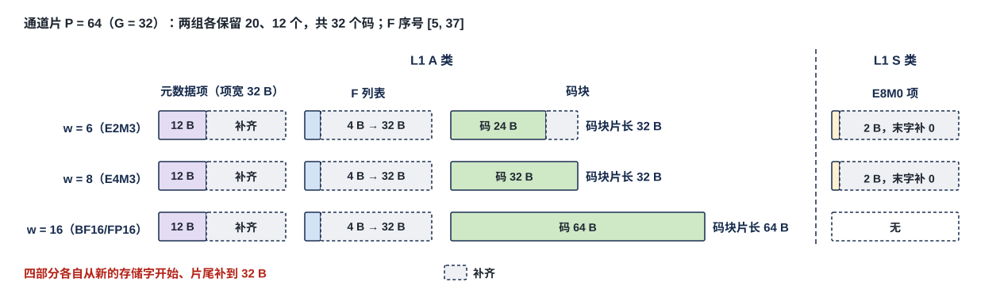

图中是紧凑 token 记录的一个通道片（本篇格式里最复杂的一种）：四部分各是一个数据块里的一项，元数据项、F 列表、码块落 L1 A 类，E8M0 项落 S 类，每部分按默认对齐补到 32 B；三行是元素位宽 $w = 6 / 8 / 16$ 三种情形（数值见 §2.5 的缩小例）。其余格式都是它的简化：稠密残差格式只有码块 + E8M0 项，定长项没有元数据项。

| 格式 | 内容 | 打包方式 | 落在哪 | 谁产出 | 节 |
|---|---|---|---|---|---|
| 紧凑 token 记录 | 每通道片：元数据项 + E8M0 项 + F 列表 + 码块 | 元数据项、E8M0 项定长项；F 列表、码块变长 | 元数据项、F 列表、码块 L1 A 类；E8M0 项 L1 S 类；跨核时四部分各成数据块写 L2 | QNT（keep 位图与 F 列表来自 SEL）；MAE_CRU 压缩输出 | §2.5 |
| 位图 / 序号列表 | 选择结果 | 位图定长；序号列表变长、项数另存 | L2；CCU 要用的在 L1 A 类 | SEL、LOSS、MAE_CRU（读集合并） | §2.6 |
| 定长项与标量 | 部分和、标量、行状态、$P$ 向量等 | 定长项 + 有效计数 | L1 A 类或 L2 | 各产出单元 | §2.7 |
| 残差流与嵌入行 | 稠密残差格式（码块 + E8M0 项）或紧凑 token 记录 | 定长项（稠密）/ 同紧凑 | L1 A / S 类或 L2 | EPI → QNT；MAE_CRU；嵌入表来自 DDR | §2.8 |
| 前向激活、反传流动梯度、Q 查询行记录 | 紧凑 token 记录或其简化 | 同紧凑；Q 全维记录为定长项 | L1 A / S 类；跨核经 L2 | QNT | §2.9 |
| $P$ 向量 | 每（查询行, tile）录取 key 的 $\tilde p$，BF16 | 定长项 | 本核，不出核 | NLU | §2.10 |
| TOPK 重算词号列表 | 词号升序 | 序号列表 | L2 | SEL | §2.11 |
| W 类两种字形态 | 行字区 / 列字区 | — | L1 W 类 | MAE_DSU、QNT | §2.12 |
| K / V 平面、全码 key 记录、K / V 尺度数据块 | 一个 key 一项 | 定长项 | DDR、L2、L1 W / S 类 | QNT、MAE_DSU | §2.13 |
| 权重 | 数字块、尺度数据块、bias 数据块 | 定长 | DDR、L2、L1 W / S 类 | 离线 | §2.14 |
| 跨核合并的定长份 | 部分和、标量、读集位图 | 定长项 | L2 各象限同址 | 各核 | §2.15 |
| 调用输入与结果记录 | 与 M55 共用 | 由 CIF 定义 | L2 | 外部主方、属主核 | §2.16 |

### 2.2 三种打包方式：定长、定长项 + 有效计数、变长

| 打包方式 | 长度从哪来 | 用于 | 规则 |
|---|---|---|---|
| **定长** | 指令给出（行字节数 × 行数等几何） | 权重数字块、权重尺度数据块、bias 数据块、配置表 | 不规定内部打包；编译链排布，数据块尾部补一次到存储字 |
| **定长项 + 有效计数** | 项宽固定，**有效个数由指令给** | K / V 平面（一个 key 一项）、稠密残差格式（§2.8）、行状态、未归约的 BF16 部分和、跨核合并的标量、定长位图、attention 的 $P$ 向量（§2.10）、**紧凑 token 记录的元数据项与 E8M0 项**（一个通道片一项，项宽为元数据项宽与 $\lceil (P/G)/32 \rceil \times 32$ B） | 位置 = 数据块起点 + 项号 × 项宽；末尾未填的项填 0；**标量紧密排列、可单个写出（一拍、be 只开有效字节）、不补 32 B**（§2.7） |
| **变长** | 每一项的长度由生产方在线给出，记在别的定长项里 | **紧凑 token 记录的码块与 F 列表**（长度在元数据项里）、序号列表（项数另存：选中项序号列表、TOPK 重算词号列表、参与词号列表；项数在单独的计数项里，§2.6） | 码块与 F 列表默认每个通道片从存储字边界开始、片尾补齐；序号列表以选择域为单位只在末尾补齐（§2.3）；容量按位点的容量窗口静态分配（§3.3） |

哪类数据归哪种方式，按 §2.5–§2.16 各节。**MAE 与 L1 / L2 不感知这三种方式，它们只看指令给的地址、长度与 be**（V18-MAE-01）。

### 2.3 对齐：SRAM 支持紧密存储，数据组织默认 32 B 对齐

**SRAM 支持紧密存储，数据组织默认 32 B 对齐。** 本节分两层：**SRAM 的能力**（硬件保证，定义在架构篇 §3.3 / §3.5.4）——L1 的 A / W 类与 L2 支持紧密存储：同一发送方的数据按字节首尾相接、不补齐，一次至多 128 B，字节移位在 SRAM 内部、使用者不移位；W 类权重读口与 S 类一律整字。**数据组织的默认**（编译链与生产方保证，本节规定）——数据块与通道片各部分的起点落在存储字边界、片尾补到 32 B。默认对齐下每次访问从存储字边界开始、≤ 128 B 一拍做完，换排列的搬运都是整字拷贝；**不对齐只降速（架构篇 §3.4 CONC-3：从字边界起一拍，否则允许多拍）、不出错**，所以默认对齐是数据组织的选择，不是存储能力的上限（V18-TP-74）。

- **数据块默认从编译链分配的、32 的倍数的字节地址开始。** 按口分：W 类权重读口与 S 类读写只按整字；A 类读写口、W 类写口与 L2 可从任意字节起访问。
- **一个通道片的四部分（元数据项、E8M0 项、F 列表、码块）默认各自从存储字边界开始、片尾补到 32 B；一个存储字只属于一个通道片的一部分**（V18-DORG-04）：
  - **码块**：片内的码按通道序紧密排列、每码 $w$ bit，不按 MX 组或字节补齐，片尾补到 32 B（V18-TP-64）。
  - **元数据项**：定长、项宽 $\lceil (4 + P/8)/32 \rceil \times 32$ B，天然从字边界开始。
  - **E8M0 项**：每片 $P/G$ B，补到 $\lceil (P/G)/32 \rceil \times 32$ B。
  - **F 列表**：每片 $2f$ B（$f$ = 本片 F 项数），补到 $\lceil 2f/32 \rceil \times 32$ B；一个 token 只有一片时就是"token 末尾补齐"。
  - 序号列表（选中项序号列表、TOPK 重算词号列表、参与词号列表）以选择域为单位只在末尾补齐（V18-DORG-03）。
- **写**：每片每部分的最后一个字在 A 类只写有效字节（有效字节用 be 或长度表达，形式见架构篇 §2.1.2），**在 S 类整字写、不带 be，生产方把末字的空余字节补 0**（S 类写口只收整字，架构篇 PORT-06；V18-DORG-04）。
- **读**：CCU 按元数据项定位，默认每次从字边界读（§3.4）。**默认对齐时读写都不需要移位；首地址不在字边界时由 SRAM 内部移位，使用者（pod、VNU、CCU、MAE、接收桥、HUB、IDN）一侧不设移位器；核间链路（含 IDN）只按字节有效位原样传、不感知整字**（V18-TP-74 / DORG-10 (4)）。例：首地址 176（字 5 的字节 16）写 31 B，落字 5 的字节 16–31 与字 6 的字节 0–14，下一批从地址 207 起。
- **一次访问 = 首地址 + 长度、≤ 128 B**（A / W 类读写口与 L2，架构篇 §3.4 CONC-3）：从存储字边界开始的一拍做完，否则允许多拍。默认 MAE、hub、CCU 给的地址是 32 的倍数，A 类末字的有效字节由 be（或长度）给出。
- **代价**：码块、E8M0 项、F 列表每片末字平均空 16 B、最多 31 B，元数据项补到 32 B 的倍数；按片补齐使存储约多 5%，只出现在一条 token 记录拆成多片的位点（V18-DORG-04）。

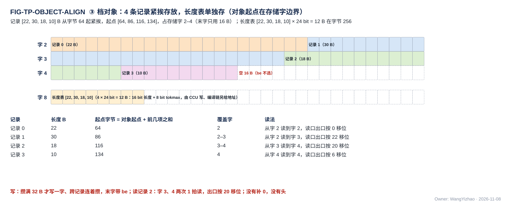

图中 4 个 token 各一个通道片，码块里各片的码长 22、30、18、10 B，从字节 64 起、每片从一个新的存储字开始：起点 64、96、128、160，占存储字 2–5，各片末字空 10、2、14、22 B（be 不选）；每片的码块片长 32 B 记在它的元数据项的项首字里（A 类里的另一个数据块；元数据项只有项首两个计数与 keep 位图）；读第 2 片的码 = 起点 $64 + 32 + 32 = 128$（前面各片码块片长之和），从字 4 起整字读 1 个字（默认对齐，读时不需要移位）。元数据项、E8M0 项（S 类）、F 列表是另外三个数据块，同样每片从新字起、片尾补到 32 B，按 §3.2 定位。

**默认对齐的第二个例子（三片码块与元数据项）**：一个码块（$P = 64$、$w = 6$，每片码至多 48 B），片 0、1、2 的码分别是 17 B、40 B、32 B，片尾补齐后码块片长 32 / 64 / 32 B，起点 = 前几片码块片长之和 = 0 / 32 / 96，占字 0–3；字 0 只有前 17 B 有效、字 2 只有前 8 B 有效。三片的元数据项各占一个存储字（码块片长 2 B + F 项数 2 B + keep 8 B = 12 B，补齐到 32 B），在编译链另给的元数据项数据块里（例中字 8–10）：（码块片长, F 项数）=（32, 1）、（64, 0）、（32, 2）。读片 1 的码块 = 先读片 0、1 的元数据项（字 8、9）得起点 32、码块片长 64，再从字 1 起整字读 2 个字，读回与写入逐字节相同。**这只是推荐放法的例子，SRAM 本身可从任意字节起紧密存放**（架构篇 §3.5.4）。

### 2.4 数据里没有头

**数据里没有头。** 没有数据块头（类型、总长、token 记录数、首 token 序号、token 数）、没有记录头、没有列表头的项数字段、没有固定槽：**码块片长、F 项数、keep 位图都在每个通道片的定长元数据项里，元数据项与码、E8M0、F 列表各自成块；编译链已知的不记**。通道片在各块里的位置由片序号与元数据项推出（§3.2），不由数据里的任何起点表给出；码块与 F 列表的起点由 CCU / MAE 按元数据项累加，这是读方的工作，不是存储格式的一部分。本篇不使用"token 槽 / 槽长 / 步长"这些词：长度只说每片的码块片长与 F 项数（实际值，在元数据项里），容量只说容量窗口与每片保留上限 $k$（§3.3）。

**元数据项、码块、E8M0 项、F 列表、列表是彼此独立的数据块，互不内嵌**（V18-TP-58 / 65）。**数据里也没有每 token 或每片的最大指数一类字段**：MXU 累加器按标准 FP32 设计，开算前不需要知道各组的最大指数（V18-MXU-12）。

### 2.5 紧凑 token 记录：一个通道片 = 元数据项 + E8M0 项 + F 列表 + 码块

**一条紧凑 token 记录按通道片切开；一个通道片的内容分成四部分，元数据项、F 列表、码块在 L1 A 类，E8M0 项在 S 类；每部分各自属于一个数据块（一个位点一组数据块装所有 token 的所有通道片），基址都在指令里；数据组织默认四部分每片各自从存储字边界开始、片尾补到 32 B（§2.3）**（V18-TP-65 / 68、L1-20 / 21、DORG-04）：

| 部分 | 每个通道片的内容 | 每片字节 | 落在哪 | 打包 | 谁产出 |
|---|---|---|---|---|---|
| **元数据项** | 项首 4 B = 码块片长 16 bit（字节数，32 的倍数）+ F 项数 16 bit；后接 keep 位图（每通道 1 bit：位 $i$ = 1 表示通道 $i$ 保留，被判 F 或 C；0 表示被判 Z、不出码） | $\lceil (4 + P/8)/32 \rceil \times 32$（定长） | **L1 A 类** | 定长项，片 $q$ 在 基址 + $q$ × 项宽 | QNT 写；keep 位图原样是 SEL 的判决位图（§2.5.1） |
| **E8M0 项** | 每个 MX 组（$G$ 个通道）一个 E8M0 尺度，被判 Z 的通道不进尺度；$w = 16$ 时没有 | $P/G$，补到 $\lceil (P/G)/32 \rceil \times 32$（定长） | **L1 S 类**（放在哪由编译链分配；S 类读口一拍可接收 2 个地址，架构篇 §3.4 CONC-6） | 定长项，片 $q$ 在 基址 + $q$ × 项宽 | QNT（按 $G$ 取 amax） |
| **F 列表** | 片内 F = 1 的通道序号（片内相对序号），升序，每项 2 B；F = 1 表示下一位点读该通道对应的权重 hi + lo 两个平面，F = 0 只读 hi | $2 f$，补到 $\lceil 2f/32 \rceil \times 32$（$f$ = 本片 F 项数，变长） | **L1 A 类** | 变长，每个通道片从存储字边界开始、片尾补齐 | SEL 的序号列表输出，**每片末尾补到存储字边界由 SEL 做**；QNT 只写 SEL 交来的内容（V18-QNT-14 (3)） |
| **码块** | 保留通道的码，按通道序紧密排列，每码 $w$ bit；$w = 6$：MXFP6 E2M3，$w = 8$：FP8 E4M3，$w = 16$：BF16 或 FP16 整值（哪一种由位点指令给） | 码 $\lceil w\,k_p/8 \rceil$，码块片长 $\lceil w\,k_p/256 \rceil \times 32$（$k_p$ = 本片保留通道数） | **L1 A 类** | 变长，每个通道片从存储字边界开始、片尾补齐 | QNT |

**元素位宽 $w \in \{6, 8, 16\}$ 与 MX 组长 $G$ 是位点属性，由位点指令给**（V18-TP-63 / QNT-12、V18-MXU-10）：BF16 / FP16 自带指数、不成组，所以 $w = 16$ 的通道片没有 E8M0 项；keep 位图、F 列表、元数据项对三种位宽同一套规则。**稠密残差格式是同一套格式去掉元数据项与 F 列表：只有码块 + E8M0 项**（§2.8）。

**缩小例（FIG-DORG-PIECE-BLOCKS）**：一个通道片 $P = 64$ 个通道（$G = 32$，2 个 MX 组），keep 位图里两个组各保留 20、12 个通道（共 $k_p = 32$），F = 1 的通道序号 [5, 37]。元数据项 = 项首 4 B（码块片长 + F 项数）+ keep 位图 8 B = 12 B，补到 32 B（A 类）；F 列表 4 B，补到 32 B（A 类）；两者与位宽无关。$w = 6$ 时 E8M0 项 2 B 补到 32 B（S 类）、码 24 B（码块片长 32 B，A 类）；$w = 8$ 时 E8M0 项 2 B 补到 32 B、码 32 B（码块片长 32 B）；$w = 16$ 时没有 E8M0 项、码 64 B（码块片长 64 B）。实际片长几百到几千个通道，四部分的补齐只是每部分末字的空余；脚本按公式断言。

#### 2.5.1 元数据项：每个通道片一项，定长，计数在项首，存 L1 A 类

| 项 | 规定 |
|---|---|
| 字段 | **项首 4 B = 码块片长 16 bit + F 项数 16 bit，后接 keep 位图 $P$ bit**（V18-TP-68）：CCU 与 MAE 读项首字就拿到两个计数，读位图接着读后面的字；字段偏移与 $P$ 无关 |
| 码块片长 | 本片码在 A 类占的字节数按 32 B 取整 = $\lceil \mathrm{popcount}(\text{keep}) \cdot w/256 \rceil \times 32$；可由 keep 位图算出，存下免 CCU / MAE 重算；**只用于定下一片码的起点**（§3.2） |
| F 项数 | 本片 F 列表的项数 $f$；F 列表本片占 $\lceil 2f/32 \rceil \times 32$ B，用于定下一片 F 列表的起点 |
| 项宽 | $\lceil (4 + P/8)/32 \rceil \times 32$ B，补齐的字节填 0；例 $P = 640$：84 B → 96 B，$P = 2{,}560$：324 B → 352 B |
| 写出 | 项首字的两个计数要等本片判完才知道；生产方怎样写出属生产方的做法（参考见 §7.1），消费方在该批写完之后才读（§3.4.2） |
| 地址 | 编译链分配一组元数据项的基址，写在位点指令、发送指令与搬运指令里；第 $q$ 个通道片的项在 基址 + $q$ × 项宽 |
| 谁写 | 本核产：QNT 经 VNU 写口按 `seg` 写进本核 L1 A 类（keep 位图来自 SEL，码块片长、F 项数由 QNT 填）；**MAE_CRU 按列表压缩输出时**，元数据项由执行该指令的 MAE_ENG 搬运引擎按基址写，**其中 F 项数：SEL 按通道片补齐 F 列表，并按片把 F 项数写成定长计数项（每片一项）进本核 L1 A 类；生产核 CCU 随 F 列表把它经 C2H 送进 L2；MAE_ENG 先读它、再整字搬 F 列表，按片把 F 项数交 MAE_CRU 填写**（V18-CRU-08、V18-DORG-11 (4)、V18-TP-83 (5)，MAE_ENG 篇 §3.15；与序号列表的项数计数项同一做法，§2.6）；**核间按 $m$ 切分的产出落消费核时，MAE 逐项整字照抄四个象限的元数据项**（V18-MAE-36，§3.6.3） |
| 谁读 | 消费核 CCU（经 L1 外的 A 类读 MUX 读进 CCU，定位与发读，§3.2、§3.4；CCU 一侧的缓冲属 CCU 的设计，见 `CCU_STAGING.md`）；MAE（搬紧凑 token 记录时先搬元数据项，由它算定码块与 F 列表各片的地址，V18-TP-69，§3.2、§3.6） |
| 跨核 | 生产核 CCU 的发送指令从 A 类读出 → A 类读 MUX 的发送 FIFO 入口去向 → C2H → L2 → MAE 搬运指令 → H2C → 接收桥按 `seg` 落消费核 A 类；L2 里是普通数据块（V18-L1-20）。同一片的 E8M0 项从 S 类经 S 类读 MUX 的发送 FIFO 入口去向出核（V18-L1-21）。跨核来的数据何时可读见 §3.4.2 |

#### 2.5.2 E8M0 项：每个通道片一项，定长，存 L1 S 类

每个 MX 组一个 E8M0（1 B），被判 Z 的通道不进组尺度；一片 $P/G$ B，补到 $\lceil (P/G)/32 \rceil \times 32$ B，末字空余补 0（S 类整字写）。$w = 16$ 的通道片没有 E8M0 项。第 $q$ 片 = 基址 + $q \times \lceil (P/G)/32 \rceil \times 32$。读出经 S 类读 MUX 直接进 pod 的激活旁带或进 VNU / EPI，不经 CCU（§3.4.3、§3.4.5）。

#### 2.5.3 F 列表：每个通道片一段，变长，存 L1 A 类

片内 F = 1 的通道序号（片内相对序号），升序，每项 2 B；一片 $2f$ B 补到 $\lceil 2f/32 \rceil \times 32$ B（一个存储字装 16 项）；**补齐由 SEL 做，QNT 只写 SEL 交来的内容**（V18-QNT-14 (3)、V18-DORG-11 (4)）。F 列表是序号列表（§2.6）：F = 1 的通道只占少数，按序号写比按位图省。**F 列表只由 CCU 读、转成随码交 pod 的 F 掩码（§3.4.3），不交 MAE 列表驱动地址生成**；MAE 把它当普通数据块整字搬。MAE_CRU 解码紧凑输入不读 F 列表（§3.4.5）。

#### 2.5.4 码块：每个通道片一段，变长，存 L1 A 类

保留通道的码按通道序紧密排列、每码 $w$ bit、不按 MX 组或字节补齐，片尾补到 32 B；码块片长记在元数据项项首。**码块里第 $i$ 个码对应 keep 位图里第 $i$ 个 1**；被判 Z 的通道不出码，所以码块随保留数变短——这是输入维稀疏压掉激活的唯一形式（§2.6）。

### 2.6 列表：位图与序号列表是同一条选择结果的两种编码，两种都保留

**位图与序号列表表达的是同一件事——"从 $N$ 个候选里选中了哪些"——只是写法不同，可以互相换算；它们不对应不同的稀疏种类。** 8 个候选、选中第 1、4、6 个：

| 候选序号 | 0 | 1 | 2 | 3 | 4 | 5 | 6 | 7 |
|---|---|---|---|---|---|---|---|---|
| 是否选中 | 0 | 1 | 0 | 0 | 1 | 0 | 1 | 0 |
| 位图写法 | 0 | 1 | 0 | 0 | 1 | 0 | 1 | 0 |
| 序号列表写法 | [1, 4, 6] | | | | | | | |

位图 = 每个候选占 1 bit、不论选没选，8 bit = 1 B；序号列表 = 只写选中的候选序号，3 项 × 3 B = 9 B。信息相同，差别只有三点：

1. **大小随什么变**：位图 $N/8$ B、只随候选总数 $N$；序号列表 $3k$ B、只随选中数 $k$。LM Head 词表 $N = 151{,}936$ 选 $k = 40$：位图 18,992 B、列表 120 B；一个 64 key 的粗算 tile 录取 30 个：位图 8 B、列表 90 B。分界 $k = N/24$。
2. **怎么产生**：逐元素阈值判决（SEL 对每个候选比一次门限）按候选序逐个得到 0 / 1，顺手就是位图；流式 TOPK 手里只有 $k$ 个胜出者的序号，天然是列表。
3. **怎么使用**：MAE 列表驱动地址生成对位图是"逐位扫，位 $i$ 为 1 就发地址 基址 $+ i \times$ 项字节"，对列表是"逐项读，项值 $j$ 就发地址 基址 $+ j \times$ 项字节"，两种都支持、不转换；**跨核合并只能用位图**——四核各选一批 key 要合成并集，位图逐位 OR 一拍完成，列表合并要排序去重，所以读集合并的位点一律出位图。

**与稀疏维度无关**：输入维稀疏（这个 token 哪些通道是 F / C / Z，沿归约维 $k$）与输出维稀疏（算哪些输出通道 / key / 词，沿 $m$）都可以用任一种编码表达——F 行并集、录取读集、TOPK 词号都是独立列表数据块，选位图还是序号只看 $k$ 相对 $N$ 的大小和要不要跨核按位取并。**F 行并集、录取读集都是读集**（§3.5）。**只有输入维稀疏能把激活本身压掉**（被判 Z 的通道不出码，码块变短，§2.5.4）；输出维稀疏不压缩输入激活，而是让 MAE 只 gather 被选中的权重列、阵列只算这些列，算出的结果成为下一位点的输入——上一位点的输出稀疏就这样变成下一位点紧凑 token 记录的 keep 位图。

**紧凑 token 记录里的两种选择结果**：**keep 位图是位图**（候选 = 通道片内全部 $P$ 个通道、保留的居多），在元数据项里；**F 列表是序号列表**（候选同样是片内通道、但 F = 1 的只占少数，每项 2 B 的片内序号），在 A 类、自成一个数据块。两者都由 SEL 的一条比较指令一遍产出（V18-SEL-18），只由 CCU 读来解码（§3.4），不交 MAE 列表驱动地址生成。下表的二选一说的是独立成块、给 MAE 用、候选数从几十到十几万不等的那些列表：

| 格式 | 每项 | 大小 | 排列 | 谁产 |
|---|---|---|---|---|
| **位图** | 候选每个 1 bit | 定长 $N/8$ B（$N$ = 候选数），一个存储字 256 位 | 按候选序排，位 $i$ 对应候选 $i$ | SEL 的逐元素阈值判决（录取、gate 筛选）、读集合并的并集 |
| **序号列表（项数另存）** | 选中项的候选序号 3 B（任意词表都放得下，V18-MAE-06） | 变长 $3k$ B（$k$ = 选中数），以选择域为单位只在末尾补齐 | 按序号升序 | SEL 的流式 TOPK / 阈值后限个数（名次项转序号）、SEL 的 TOPK 重算词号列表（V18-SMP-02）、LOSS 的参与词号列表 |

**序号列表的项数由生产核 CCU 写成一个定长计数项**（编译链给地址，与列表同在 L2），**MAE 读列表前先读它**（V18-DORG-05 / DORG-10 (5)）；列表本身没有头。MAE 自己消费的列表（读集并集、TOPK 重算词号列表、gather 序号列表）在 L2，正在用的在 MAE 的列表本地副本里；核里 CCU_RTR 要用的列掩码来源是本核 L1 A 类里的普通数据块，跨核的由一条 L2 → L1 指令经 H2C 送到（登记篇 REG-22 / 28）。

**两种都保留、按位点二选一由编译链定，不转换**：本篇只给分界 $k = N/24$ 作参考；MAE 列表驱动地址生成两种都收（位图按位扫描、序号列表按项步进），SEL 按指令出哪一种（V18-SEL-15）；读集合并只对位图做（MAE_CRU 篇 §3.6，读集并集是位图的一种）。

### 2.7 定长项与标量

**定长项数据块每项定长，位置 = 数据块起点 + 项号 × 项宽，没有头；有效个数由位点指令或搬运指令给出**（真实长度在调用描述符里，编译链折进指令），末尾未填的项填 0。项宽按元素类型：BF16 2 B、E8M0 1 B、FP32 4 B，复合项按各节。

| 定长项 | 项宽 | 一个存储字 | 说明 |
|---|---|---|---|
| 跨核合并的标量（$\sum x^2$、$\sum\lvert x\gamma\rvert$、F5 amax、$\sum g^2$） | FP32 4 B | 8 个 | **紧密排列、可单个发送（一拍、be 只开有效字节）、不补 32 B** |
| $(m_{\text{run}}, l)$ 对 | 2 × FP32 8 B | 4 对 | 两个相邻，作为一项合并 |
| 未归约的 BF16 部分和 | BF16 2 B | 16 个 | 跨核归约的输入（§2.15）、核内停放项（FFN 补 lo、down 部分和、attention 块间部分分数：MXU 累加器的 FP32 部分和以 BF16 停放、装回时扩成 FP32 接着累加，V18-MXU-12；装回经 pod 的 128 B 激活入口、带"装回"标志，一拍 4 条，MXU 集成篇 §2.3.4，V18-MXU-17；相邻 pass 接着同一组累加项继续加时累加项可直接留在阵列、不停放，MXU 集成篇 §2.5.1；LM Head TOPK 列补算整列 hi + lo 一遍算完、不停放，V18-MXU-09） |
| attention 的 $P$ 向量 | BF16 2 B | 16 个 | 一个录取 key 一项，只在本核（§2.10） |
| attention 行状态 | $O$ BF16 $2 d_h$ B + $m_{\text{run}}$ / $l$ 各 4 B = $2 d_h + 8$ B | — | $d_h = 128$ 时 264 B（参考）；只在本核 L1，由 NLU 读写 |
| K / V 平面 | 一条 key 记录一项（§2.13） | — | 有效 key 数由指令给 |
| 紧凑 token 记录的元数据项、E8M0 项 | $\lceil (4 + P/8)/32 \rceil \times 32$ B / $\lceil (P/G)/32 \rceil \times 32$ B | — | 一个通道片一项，位置 = 基址 + 片序号 × 项宽（§2.5、§3.2） |

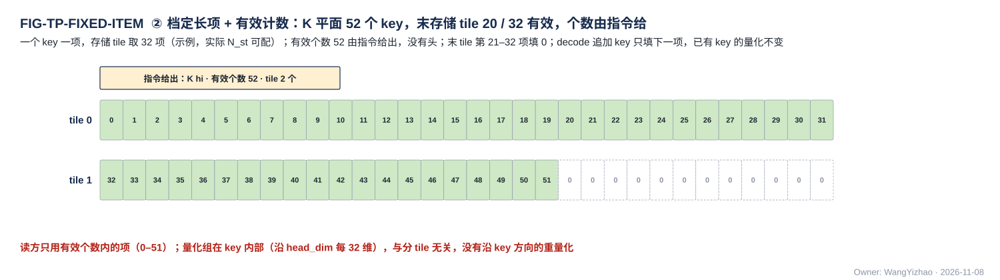

图中一个 K 平面数据块一个 key 一项、按存储 tile 分（示例 32 项一 tile），最后一个 tile 只到第 20 个 key，第 21–32 项填 0，有效个数 52 由指令给出；decode 追加 key 只填下一项，已有 key 的量化（沿 head_dim 每 $g_K$ 维一组，$g_K$ 由指令给，在 key 内部）不变。

### 2.8 残差流与嵌入行：两种存储格式（稠密残差格式 / 紧凑 token 记录），硬件都支持，按位点配置

**残差流 $x$（一个 token 一行 $d_{\text{hidden}}$ 个元素）在存储里有两种格式，硬件两种都实现，用哪种由位点配置给出**（V18-DORG-02）：

| 格式 | token 记录 | 打包 | 怎么产生 |
|---|---|---|---|
| **稠密残差格式** | **码块 + E8M0 项**（V18-TP-65）：码块一个通道片一项 = $P$ 个 MXFP6 E2M3 码紧密排列（$P \times 6/8$ B，补到 32 B 的倍数），E8M0 项一个通道片一项 = $P/G$ 个 E8M0、补到 $\lceil (P/G)/32 \rceil \times 32$ B、在 L1 S 类（$G$ 由位点指令给，按片补齐同 §2.3）；不切片时一片 = 一整行 $d_{\text{hidden}}$ 个通道；没有元数据项与 F 列表；组内全部值参与组尺度，没有 BF16 极端值子记录。Qwen $d_{\text{hidden}} = 2{,}560$、$G = 32$、一片一行：码 1,920 B + E8M0 80 B → 96 B | 定长项，码块与 E8M0 项各一个数据块 | 残差加之后一次编码（核内：后处理子模块 EPI → QNT；K 切分：MAE_CRU） |
| **紧凑 token 记录** | 与 §2.5 同一种格式：元数据项、E8M0 项、F 列表、码块，被判 Z 的通道不出码 | 元数据项、E8M0 项定长项；F 列表、码块变长（长度在元数据项里） | **只能在 SEL 判决之后产生**：核侧 QNT 拿到本 token 的 keep 后，把 $x''$ 按它压缩写出（与写下一位点输入用的紧凑 token 记录是同一动作）；K 切分位点写回 L2 残差流（比稠密多一次残差写），核内位点写 L1 |

**残差加的两侧都按稠密做**：

| 位点的核间切分轴 | 残差流驻在哪 | 残差加在哪 | 残差输入 | 相加结果 |
|---|---|---|---|---|
| T / M 切分（及单核） | 本核 L1 A 类 | 后处理子模块 EPI（VNU_EPI 篇 §3.3） | 两种格式都能还原（紧凑 token 记录的 keep 位图由 CCU 交给 EPI，码与 E8M0 读入后按 keep 位图展开、缺位补 0，§3.4.5） | $x'$（BF16）交 QNT；按位点配置编码成稠密残差格式，或等 SEL 判完后编码成紧凑 token 记录 |
| K 切分 | **L2**（V18-CRU-08） | MAE_CRU 的残差加指令（MAE_CRU 篇 §3.3，图 FIG-MAE_CRU-RESID） | 两种格式都能解码（指令的输入编码字段给出） | **稠密**（BF16 / FP16 / MXFP6 稠密残差格式）写 L2——$x''$ 的 keep 要等核里 SEL 判完 $\mathrm{RMSNorm}(x'')$ 才有，CRU 加完当拍没有掩码；要紧凑格式时由核侧 QNT 在 SEL 之后写回 |

紧凑格式的残差用哪张掩码（下一位点输入 token 记录的 keep，或残差自有阈值）归算法侧；残差流按 keep 压缩相当于残差流稀疏化（被判 Z 的通道从 $x$ 里丢掉、也改变后续层 RMSNorm 的整行统计量），**位点配置里启用紧凑残差以算法侧 A 级验证为前提；算法侧验证之前默认不启用紧凑残差**（V18-TP-83 (5)）。

**嵌入行是数据，格式 = 稠密残差格式，三张表单独存、单独访问**（V18-DORG-03）：码表（每词 $d_{\text{hidden}} \times 6/8$ B 补到 32 B 的倍数，落消费核 L1 A 类）、E8M0 表（每词 $d_{\text{hidden}}/G$ B 补到 32 B 的倍数，Qwen 80 → 96 B，落 L1 S 类）、标量表（每词第 0 层的两个 FP32 标量 $\sum x^2$、$\sum\lvert x\gamma\rvert$，8 B，落 L1 A 类、由 NLU 读），都是定长项、按词号连续；MAE 按 token id 列表对三张表各 gather 一次，第 0 层直接作残差。**码表与 E8M0 表每词按上式补到 32 B 的倍数（数据组织默认对齐），按词号 gather 是整字拷贝；标量表不补齐，每词 8 B 紧挨存**（V18-DORG-08）：8 B 整除 32 B，一项不跨存储字；按词号 gather 时源端从 DDR 的字内字节起点取 8 B（NI_EXT 按 AXI 地址与字节选通把有效字节按次序交出），落 L1 A 类时目的不在字边界由 SRAM 内部移位（§2.3）；词 $n$ 的项在 基址 + $8n$，例词 5 在字 1 的字节 8–15。

### 2.9 前向激活、反传流动梯度与 Q 查询行记录：变长；Q 全维查询行记录：定长项

| 数据 | token 记录 / 查询行记录 | 元素位宽 | 段选 |
|---|---|---|---|
| 紧凑 token 记录（前向激活，线性位点的输入） | 一个 token 一条，按通道片切开：元数据项 + E8M0 项 + F 列表 + 码块（§2.5） | 位点属性 $w \in \{6, 8, 16\}$，默认 6 | 本核消费：元数据项、F 列表、码块在 L1 A 类，E8M0 项在 L1 S 类；跨核：四部分各成数据块写 L2 本核象限（四个象限同一套基址，§3.6），再经 H2C 按 `seg` 落消费核对应的类 |
| 反传流动梯度（dX / dY / dH / dP / dS / dz） | 同上 | 默认 MXFP6 单平面；MXFP6 承载不了时 FP8 / BF16 / FP16（同一格式、换 $w$） | 同上 |
| Q 粗算查询行记录 | 一个查询行一条：元数据项（keep 位图 = 选中维）+ E8M0 项 + 码块，无 F 列表；码只有选中维，随选中维数变长；**Q 的 MX 组长与 K / V 一样由指令给、硬件任意分组**（32 的倍数，V18-ATT-04）；**Q 粗算查询行记录与 Q 全维记录的 E8M0 项按查询行成一项：一个查询行全部 q 头的 E8M0 连续存，只在行末补到 32 B**（V18-DORG-08），码块与元数据项的结构不变；例 $d_h = 128$、组长 32、每头 4 个 E8M0：一核 8 个 q 头时每行 $8 \times 4 = 32$ B，恰为 1 个存储字；6 个 q 头时 24 B，行末补到 32 B | 6 | 本核 L1：码块与元数据项 A 类、E8M0 项 S 类 |
| Q 全维查询行记录（精算 $QK^{\mathsf T}$ 的左操作数） | 一个查询行一条：码块（全部 head_dim 维的 MXFP6 码，稠密，每（行, q 头）$d_h \times 6/8$ B，$d_h = 128$ 时 96 B）+ E8M0 项（按查询行成一项，全部 q 头连续、行末补到 32 B，同上一行）；**定长项，无元数据项与 F 列表**；与 Q 粗算查询行记录由 QNT 同时写出（VNU_QNT 篇 §3.5） | 6 | 本核 L1：码块 A 类、E8M0 项 S 类；不出核 |

前三者都按 §2.5 的格式存放：四部分每片从存储字边界开始、片尾补齐，码块与 F 列表按位点的容量窗口分配，在 L1 里的排法与读法按 §3.4。**产出按驻留方式成块**：token 驻留（先算完一个 token 的全部输出通道）时一组数据块装这组 token 的整条记录；权重驻留时每个权重窗口一组数据块、装 $T$ 个 token 在该权重窗口上的片（§3.6.8）。

### 2.10 attention 的 $P$ 向量：稠密 BF16，不出核

**P×V（$O = PV$）的左操作数 $P$ 是每（查询行, tile）一条按录取次序排列的稠密 BF16 向量 $\tilde p$，不设 keep 位图与 E8M0、不压缩、不量化、不出核**（V18-ATT-02）：

| 项 | 规定 |
|---|---|
| 一项 | 一个录取 key 的 $\tilde p_j$，BF16 2 B。**$\tilde p$ 不折 V 的尺度**：V 的每 key 尺度作为权重一侧的尺度经 S 类读 MUX 进 pod 的权重旁带，由 pod 处理（V18-MXU-15，架构篇 §3.6.2）；$l$ 的累加不变 |
| 一条 | 一个查询行在一个 tile 里的全部录取 key，按录取次序；长度 = 录取 key 数 × 2 B |
| key 对应 | 由 SEL 的录取位图给出，pod 逐源压紧器按它挑 V 段行；向量本身不带序号 |
| 打包 | 定长项；**有效个数 = 录取位图在该 tile 里置 1 的个数，由 CCU 从录取位图数出，NLU 不另交**（V18-DORG-09） |
| 落点 | **本核 L1 A 类**：经 VNU 写口写入，再经 A 类读 MUX 进 pod 激活入口（MXU 集成篇 §2.3）；VNU → pod 的直送通路不是需求；不进 L2、不进 DDR |

### 2.11 TOPK 重算词号列表：序号列表

LM Head TOPK 列补算的**TOPK 重算词号列表**是 SEL 在选择域结束时按词号升序写出的序号列表（项数另存，§2.6，V18-SMP-02）；**MAE 按它从 $W_{\text{head}}$ 的按列全码副本（§3.7.4）每列取 hi 段接 lo 段的连续一段，按列表次序、按列字区的列位落 L1 W 类全码区（列字区里放全码的那一段地址），阵列按 8 bit 权重模式一遍算完**（V18-MXU-09、V18-DORG-08，§3.5）：列表里第 $j$ 个词得列号 $j$，它的 hi 字、lo 字依次是该列的各个存储字（每字仍是一个平面的 64 个连续 $k$），不按列连续落；与 attention 精算同一运算形态（输出稀疏，架构篇 §3.6），不停放 hi 结果。

### 2.12 W 类两种字形态：行字区与列字区

**L1 W 类里的右操作数（权重 hi / lo 平面、K / V 平面、LM Head 列副本）只有两种字形态，对应计算核的两种工作模式（架构篇 §3.6）；本节是两种字形态的唯一定义处，L1 篇、QNT 篇、MAE_DSU 篇引用本节**：

| 字形态 | 一个存储字（32 B）装什么 | 工作模式 | 用到的地方 |
|---|---|---|---|
| **行字区** | **4 个相邻归约位置 $k$ × 16 列 $m$**，每元素 4 bit（一个平面）；稀疏时这 4 个 $k$ 是读集次序里相邻的 4 个被选行（§3.5.2） | 输入稀疏（挑归约维） | 线性位点 hi / lo、attention 粗算的 K hi、P×V 的 V、LoRA 权重梯度的权重侧操作数 |
| **列字区** | **一列（一个输出通道 $m$）的 64 个连续 $k$**，每元素 4 bit（一个平面） | 输出稀疏（挑输出维） | gate / up 的列补算、精算 $QK^{\mathsf T}$ 的全码 key、LM Head TOPK 列补算 |
| **列字区（反传排法）** | $\mathrm dX = \mathrm dY\,W^{\mathsf T}$ 的 $W^{\mathsf T}$ 的一列 = **1 个 $k$ × 64 个连续 $m$**，恰是 DDR 标准布局的一拍（§3.7.1） | 输出稀疏 | 训练核的传播梯度 |

- **一个存储字只装一个平面**；hi、lo 各是整字、平面分开，lo 稀疏读副本进 L1 前转成与 hi 相同的行字区字形态，L1 没有另外的 lo 稀疏读副本字形态（V18-MAE-41）。
- **列字区的列位**：被挑的是输出维的数据按读集次序得列号 $j$，列 $j$ 的第 $p$ 个存储字（$p$ = 0、1、…）放在编译链分配的地址上；**约束只有一条：一拍要一起读的 4 列，其存储字号除以 4 的余数各不相同**（W 类读口第 $b$ 路只读字号除以 4 余 $b$ 的字，架构篇 §3.4 CONC-4）。推荐放法见 §3.5.2。
- **字形态由谁排成**：DDR 来的由 MAE_DSU 直通或转置排成，核内产生的由 QNT 直接排成；H2C、IDN、接收桥、L1 都不变形（V18-MAE-41、V18-VNU-09，§2.13、§2.14）。

### 2.13 K / V 平面、全码 key 记录与 K / V 尺度数据块

| 数据 | 一项（$d_h = 128$） | 说明 |
|---|---|---|
| K hi 平面 | **64 B 码**（$d_h$ × 4 bit），DDR 与 L2 驻留区里按 key 连续（DDR 原形） | **粗算部分 = hi 平面 + K 尺度** |
| K 尺度数据块 | 每 key $d_h/g_K$ 个 E8M0（$g_K$ = K 的 MX 组长，由指令给，V18-ATT-04；$g_K = 32$ 时 4 个），**与码分开、单独成数据块；一个存储字 = 32 个 key 在同一尺度组上的 E8M0，DDR 与片上同一排法**（见下）；片上落 S 类 | hi、lo 共用 |
| K lo 平面 | 64 B | **补读部分 = lo 平面**；lo 不带尺度，复用同 key hi 的尺度 |
| V 平面 | 8 bit：hi、lo 两平面各 64 B；4 bit：单平面 64 B；另每 key $d_h/g_V$ 个 E8M0（$g_V$ = V 的尺度分组长度，由指令给，硬件对任意分组长度都支持，V18-ATT-02 / ATT-04） | 尺度单独成数据块、按 key 连续、每存储 tile 一个尺度数组；片上落 S 类，**作为权重一侧的尺度经 S 类读 MUX 进 pod 的权重旁带**（V18-MXU-15） |
| **全码 key 记录**（精算用） | **一个录取 key 的 hi 与 lo 全部码：hi 2 个存储字 + lo 2 个存储字，共 128 B；每个存储字只装一个平面——该 key 在 64 个连续 head_dim 维上的 64 个 4 bit 码；进 L1 时 4 个字各落各的列位：列号 $j$ = 该 key 在本次录取读集里的序号，列内依次是 hi 的 2 个字、lo 的 2 个字，不按 key 连续落**（V18-DORG-08，§3.5）；E8M0 不在记录内，落 S 类（见下） | 驻留模式 hi 取自 L2 的 K hi 驻留区（经 NI 读口）、lo 取自 DDR，重读模式 hi、lo 都取自 DDR；**都经 MAE_DSU 直通（只给地址，两路源按指令次序接续）→ IDN 出口 → HUB_IDN → NWB 落 L1 W 类全码区**（全码区 = 列字区里放录取 key 全码的那一段地址，编译链的地址名；V18-ATT-03、V18-MAE-41） |

**K 没有每 key 的最大指数字段**（V18-MXU-12）。**K、V 在 attention 里是右操作数，码在 W 类、经 W 类权重读口读出；K、V 的尺度都作为权重一侧的尺度经 S 类读 MUX 进 pod 的权重旁带**（V18-L1-21、V18-MXU-15）；放在哪由编译链分配（S 类同拍读路数见架构篇 §3.4 CONC-6）。

**K、V 的码到达 L1 W 类时已是 W 类的字形态（§2.12）**。各用法的工作模式见架构篇 §3.6，MAE_DSU 的参数见 MAE_DSU 篇 §3.2 典型用法表：

| 用法 | 被挑的维（工作模式） | L1 W 类字形态 | 形态由谁调 |
|---|---|---|---|
| 粗算 $QK^{\mathsf T}$ 的 K hi | 归约维 head_dim（输入稀疏） | 行字区：一个存储字 = 4 个相邻 head_dim 维 × 16 个 key | MAE_DSU 转置；驻留模式下的路径见下 |
| 精算 $QK^{\mathsf T}$ 的录取 key 全码 | 输出维 key（输出稀疏） | 列字区的列位（全码区） | MAE_DSU 直通，只给地址 |
| P×V 的 V | 归约维 key（输入稀疏） | 行字区：一个存储字 = 读集次序里 4 个相邻录取 key × 16 个 head_dim 维 | MAE_DSU 转置（把 key 当作行），按录取读集次序 |
| 读时旋转后的 K、本核产生的 K / V | 同上各用法 | 落列字区的（一个 key 一列）与 QNT 的产出次序一致，QNT 经 VNU 写口直接写；要行字区字形态的，几条路见下 | QNT 或 MAE_DSU |

**数据进 L1 前的整形有几条路，硬件都支持，由编译链按位点选**（V18-MAE-45 (5)，架构篇 §3.8）：L2 里存 DDR 原形时走 NI 读口 → MAE_DSU → IDN 出口 → NWB；先经 MAE_DSU 整形成 L1 字形态存进 L2 的走 H2C；核内产生的由 QNT 直接排成目的字形态写 L1。于是：**粗算 K hi 驻留在 L2 时**，L2 驻留区存 DDR 原形、经 NI 读口 → MAE_DSU 转置 → IDN 下发，或先整形后存 L2、经 H2C 下发，编译链按位点选；**读时旋转后的 K、本核产生的 K / V 要行字区字形态时**，由 QNT 攒 key 转置后写（QNT 把 key 攒成行字区字形态直接写进 W 类必须支持，写入地址与次序由 CCU 给，V18-QNT-14 (1)），或按 key 写进 L2、再经 NI 读口 → MAE_DSU 转置 → IDN 送回，同样由编译链按位点选；**给别的核用的 K 也可以先由 QNT 排成 L1 的字形态、经 C2H 写 L2、再经 H2C 多播**，这是同一能力的可选用法（V18-QNT-14 (2)）；暂存计入所属模块（QNT 或 MAE_DSU），约束是不丢、不覆盖。**读时旋转后的 K 由 QNT 分两块写出——码与 E8M0**（V18-DORG-10 (1)）：**本核产生、本核消费的 K / V 可由 VNU 写口直接写本核 L1——码写 W 类（已是 W 类字形态）、E8M0 写 S 类——不必绕 L2**；给别的核用的那一份经发送 FIFO 入口出核、多播落消费核（码落 W 类、E8M0 落 S 类）。

**K 尺度数据块的排法：一个存储字 = 32 个 key 在同一尺度组上的 E8M0**（V18-MAE-41）：key 每 32 个一组，组内第 $j$ 个字装这 32 个 key 在第 $j$ 个尺度组上的 E8M0（$j = 0 \ldots d_h/g_K - 1$），一组的 $d_h/g_K$ 个字相邻，key 组按序接续；**DDR 里的 K 尺度数据块与片上同一排法**，粗算顺序流按字直落 S 类。例 $d_h = 128$、$g_K = 32$：每 32 个 key 占 4 个字 = 128 B，与按 key 紧排的字节数相同；key 40 在第 2 个尺度组上的 E8M0 在 key 组 1 的第 2 个字的字节 $40 - 32 = 8$，即数据块内字节 $(1 \times 4 + 2) \times 32 + 8 = 200$。QNT 写读时旋转后的 E8M0 块时用同一排法，最后一组不足 32 个 key 时空余字节补 0（S 类整字写，V18-DORG-04）。

**精算录取 key 的 K、V 尺度由 MAE_DSU 按录取次序排成整字：一个字 = 32 个录取 key 在同一尺度组上的 E8M0，落 S 类**（V18-MAE-41）。**源端对同一个尺度字只读一次**，MAE_DSU 的输入侧按搬运引擎给的选择位图（本次录取读集）只取被选中 key 的元素（元素宽 = 指令给的元素位宽，1 B）：K 尺度在 DDR 已是"32 个 key 一字"，所以是直通加按位图取元素；V 尺度在 DDR 按 key 连续，所以是转置加按位图取元素（参数见 MAE_DSU 篇 §3.2 典型用法表）。排好后 K 的尺度字与精算列（录取次序）对齐、V 的尺度字与 V 段行的录取次序对齐，**两者都进 pod 的权重旁带**（V18-MXU-15），使用方不挑字节；最后一字不足 32 个录取 key 时空余字节补 0。**本篇不写**：DDR 存储 tile 的 key 数 $N_{\text{st}}$（交 MAE_ENG 设计者，参考算法侧对 KV 的读取需求）、驻留 / 重读按位点的配置与默认值（归 MAE 与各调用的默认配置）。

**K 只有一条处理路径，指令选"直接处理"或"先 RoPE 再处理"，两种的存储格式相同**（V18-KV-01）；精算 K hi 的来源有驻留与重读两种模式，按位点配置（V18-ATT-01）：**驻留 = 粗算用过的 K hi 平面留在 L2**（DDR 原形），重读 = 从 DDR 再读；两种模式下 L1 收到的都是全码 key 记录、按列字区的列位落、走同一个 IDN 出口（V18-ATT-03，L1 篇 §7.9）。

### 2.14 权重：数字块、尺度数据块、bias 数据块三个独立数据块

**权重在 DDR 与片上都只有"数字 + 尺度"两种内容，数字、尺度、bias 是三个独立的数据块**（V18-DORG-01）：

| 数据块 | 内容 | DDR 排布 | 片上落点 | 打包 |
|---|---|---|---|---|
| 数字块 | $W$（$K \times M$）的 hi / lo 平面，MXINT8 码 $c = 16h + \ell$ 拆成 hi 平面（4 bit $h$）与 lo 平面（4 bit $\ell \oplus 8$）；MXINT4 只有 hi | 标准布局（§3.7.1）或列深度优先布局（§3.7.2），按位点由编译链选 | L1 W 类：行字区（输入稀疏）/ 列字区（输出稀疏）；反传 $\mathrm dX = \mathrm dY\,W^{\mathsf T}$ 的训练核用列字区的反传排法（§2.12）；或 L2 任一象限（存的已是 L1 字形态） | 定长 |
| 尺度数据块 | 每（层, 位点）$\lceil K/32 \rceil \times M$ 个 E8M0（1 B，只 hi 平面有；lo 与 lo 稀疏读副本复用） | 无填充；**两种排序二选一**（§3.7.1）；LM Head 列副本的尺度另成一个按列主序的数据块（§3.7.4） | L1 S 类的尺度行（一个存储字 = 一个 K 组下 32 个输出通道的 32 个 E8M0，按（32 列块, K 组）定位；放在哪由编译链分配），经 S 类读 MUX 进 pod 的权重旁带；或 L2 | 定长 |
| bias 数据块 | $M$ 个 BF16（不量化） | 无填充、按 $m$ 连续（两种排序退化为同一种） | **L1 S 类**（放在哪由编译链分配；每 32 列块两个存储字；与权重尺度分时读，CONC-6），经 S 类读 MUX 进后处理子模块 EPI（V18-EPI-02 / L1-21）；核间 K 切分位点落 L2，由 MAE_CRU 的归约指令加一次（V18-CRU-09 / 10） | 定长 |

**lo 平面与 lo 稀疏读副本不另写尺度行，复用同（32 列块, K 组）hi 已写入 S 类的尺度行；hi 尺度行在 S 类里保留到同一（32 列块, K 组）的 lo 用完，由编译链按此分配 S 类地址**（V18-MAE-41；从 L1 篇移入）。

**数字块从 DDR 布局到 L1 字形态的转换全部由 MAE_DSU 做，只有直通与转置两种运算**（V18-MAE-41 / L1-30，参数见 MAE_DSU 篇 §3.2 典型用法表）：

| DDR 布局 | 前向核（L1 字形态） | 反传 $\mathrm dX$ 的训练核（列字区反传排法） |
|---|---|---|
| 标准布局（一拍 = 1 个 $k$ × 64 个 $m$，§3.7.1） | 转置成行字区字形态 | 直通：DDR 一拍正好是 $W^{\mathsf T}$ 列字区的一个存储字 |
| 列深度优先布局（一拍 = 1 个 $m$ × 64 个连续 $k$，§3.7.2） | 不转换：一拍正好是列字区的一个存储字，原样落位（不经运算级，双目的时也如此：读返回直达 IDN 出口） | 转置成 $W^{\mathsf T}$ 的列字区字形态 |

**双目的**（一次 DDR 读同时给前向核与训练核，V18-MAE-16）时两份各按自己要的字形态走——标准布局训练那一份经 MAE_DSU 直通、前向那一份转置；列深度优先布局训练那一份经 MAE_DSU 转置、前向那一份不经运算级——权重仍只读一次（V18-L1-30、V18-MAE-44 (1)）。三个数据块各由一条普通搬运指令搬运（口对 + 地址生成器 + 几何），MAE 不感知类型。**MAE_DSU 只动数字**：训练核要的尺度数据块由普通搬运指令直送训练核 S 类、与前向共用一种格式（尺度行 = 一个 K 组 × 32 个 $m$），反传的块尺度由 pod 读入时在线算；一次计算里的列来自不同 K 组时各读各的尺度行（V18-MXU-11 / L1-30；pod 一侧怎样用尺度行见 MXU_FEED 篇 §3.6.2，读哪一行属 CCU 的设计，见 `CCU_STAGING.md`）。

### 2.15 跨核合并的定长份

| 份 | 项 | 一个存储字 | 合并 |
|---|---|---|---|
| K 切分的部分和 $Y^{(c)} = X_{:,\mathcal K_c} W_{\mathcal K_c,:}$ | BF16 | 16 个 | MAE_CRU 归约指令逐元素相加，输出编码由指令给（BF16 / FP16 / MXFP6 稠密或按列表压缩） |
| 标量 | FP32 | 8 个 | 按类合并 |
| 读集位图 | 1 bit / 候选 | 256 位 | 按位取并 |

**各参与核把自己的份写进 L2 本核象限的同一段内地址（同址异象限）**，MAE 一拍从 NI 读口的四路各读一份交 MAE_CRU（MAE_CRU 篇 §2.1）。**同址异象限是本篇给跨核合并定长份的推荐放法，不是 NI 读口的限制**：NI 读口四路各给各的读地址、可以不同址，四路 ready 各自独立（V18-L2-08）；放成同址时四路的读地址相同，一条指令一套基址即可。四个象限的完整并存关系见 §3.6.7。

### 2.16 调用输入与结果记录

调用输入（token id、图像块等）与结果记录（输出 token、可选 log-prob 等）是与 M55 共用的格式，**唯一定义处在 CIF 篇 §2.8.1 格式登记表**；它们在 L2 的 PIN 输入地址段 / 属主核结果区紧密存放（PIN 直写与 M1 读回，MAE_NI_EXT 篇）。**片外窗口的起点由编译链固定，按存储字对齐只是数据组织的默认、不作硬限制**：外部主方从片外窗口起点顺序写、长度任意、尾字带 be；默认对齐时读侧从起点整字读，起点不在字边界时由 SRAM 内部移位（§2.3）（V18-TP-67 / DORG-10 (11)）。**PIN 的每种输入只有一个固定的 PIN 窗口，一帧传完之后推理才开始**（V18-MAE-44 (3)，MAE_NI_EXT 篇）。

## 3 功能描述：定位、读取、切分与落点、DDR 排布

### 3.1 规则一览

| 规则 | 输入 | 输出 | 谁依赖 | 生效条件 | 节 |
|---|---|---|---|---|---|
| 定位 | 片序号、各部分基址、元数据项 | 第 $q$ 个通道片四部分的起点 | CCU、MAE | 恒定 | §3.2 |
| 容量窗口 | 每片保留上限 $k$、F 项数上限 | 码块与 F 列表的静态容量 | 编译链、SEL | 按位点 | §3.3 |
| 紧凑 token 记录在 L1 的排法与读取 | 四部分数据块 | 一个完整 token 接下一个；CCU 解码、pod 无解包器 | 生产方、CCU、MAE、pod、VNU、MAE_CRU | 按位点 | §3.4 |
| 稀疏取数：读集 | 各源的选择位图 | 按读集次序落 L1；输出维数据按列字区的列位落 | SEL、CCU、MAE、MAE_CRU、pod | 按位点 | §3.5 |
| 并行切分与落点 | 位点的核间切分轴 | 各核拿什么、产出写哪、相邻位点怎样衔接 | 编译链、CCU、MAE | 按位点；切分方式是编译链建议 | §3.6 |
| DDR 侧排布 | 权重、激活、K / V | DDR 布局与到 L1 字形态的关系 | 编译链、MAE、MAE_DSU | 按位点 | §3.7 |

### 3.2 定位：定长部分按片序号乘项宽，变长部分按元数据项累加

**第 $q$ 个通道片（$q$ = token 号 × 每 token 通道片数 + 片号）四部分的起点**（V18-TP-68、DORG-04）：

| 部分 | 第 $q$ 个通道片的起点 |
|---|---|
| 元数据项（A 类） | 基址 + $q$ × $\lceil (4 + P/8)/32 \rceil \times 32$ |
| E8M0 项（S 类） | 基址 + $q$ × $\lceil (P/G)/32 \rceil \times 32$ |
| F 列表（A 类） | 基址 + $\sum_{i<q} \lceil 2 f_i/32 \rceil \times 32$（$f_i$ = 第 $i$ 片元数据项里的 F 项数） |
| 码块（A 类） | 基址 + $\sum_{i<q}$ 码块片长$_i$（元数据项里的码块片长，32 的倍数） |

**通道片的位置只来自片序号与元数据项，数据里没有头。** 消费方怎样累加与定位（顺序消费、组内随机读）属 CCU 的设计（`CCU_STAGING.md`）。

**MAE 搬紧凑 token 记录的每条搬运指令都先搬元数据项，由它得出码块与 F 列表的长度与各片地址，再搬码块与 F 列表；整数据块顺序搬也如此**（V18-TP-69）：变长部分的长度只在元数据项里，不先读它就不知道搬多少。**约束：码块与 F 列表的每个字发出时，它的源地址与目的地址已由它所在片及前面各片的元数据项算定**；在这条约束下，元数据项分几批先搬、怎样累加属 MAE 的做法（参考见 §7.2，MAE_ENG 篇 §3.10）。**L1 / L2 不解析数据，不按 token 序号定位。**

### 3.3 容量窗口：码块与 F 列表按每片保留上限静态分配

每个位点的紧凑 token 记录有算法侧按位点给的**容量窗口**，编译链按它静态分配 L1 源空间与 L2 目的空间，基址全在指令里（V18-TP-40）：

- **码块** = 每通道片码块片长上限 × 通道片数；每通道片码块片长上限 = $\lceil w \cdot \min(P, k_{\text{cap}}) / 256 \rceil \times 32$ B，$k_{\text{cap}}$ 为该通道片的保留数上限（每片保留上限 $k$ + 强制入选数）。**每片保留上限按通道片给**，与 SEL 比较指令由 CCU 按通道片发的粒度一致（V18-SEL-18 / DORG-05 / DORG-10 (6)）。
- **F 列表** = 每通道片 F 列表片长上限 × 通道片数；每通道片 F 列表片长上限 = $\lceil 2 f_{\text{cap}}/32 \rceil \times 32$ B，F 项数上限 $f_{\text{cap}} \le k_{\text{cap}}$。
- 元数据项与 E8M0 项是定长，容量 = 项宽 × 通道片数，不需要容量窗口。
- 序号列表（选中项序号列表、TOPK 重算词号列表、参与词号列表）= 上限项数 × 3 B 按 32 B 取整，另加一个定长计数项（§2.6）。

**存储或传输压紧激活的位点一律用限个数选择模式**（流式 TOPK 或阈值后限个数，VNU_SEL 篇，V18-SEL-13），每片保留上限 $k$ 由算法侧按精度与容量按位点给；**SEL 保证每次比较的保留数 ≤ 每片保留上限，所以码块与 F 列表不会超出容量窗口**。容量窗口只用于容量，不用于读：读方按元数据项的实际值读。一个位点的产出分几批搬进 L1 时见 §3.6.10。

### 3.4 紧凑 token 记录在 L1 的排法与读取

**本节把"紧凑 token 记录在 L1 里怎么摆"和"消费方怎样读到它"写成一份约定：生产方、CCU、MAE、L1 各自保证一部分（表见 §5.2），pod 与 VNU 据此工作，不需要解包器或记录头，使用者一侧也不设字节移位器（§2.3）**（V18-TP-64 / 65 / 68、L1-20 / 21、DORG-04、MAE-36）。前向激活、反传流动梯度、Q 粗算查询行记录、紧凑格式的残差流都按本节存放与读取。**L1 只暴露 RRAM 口；读出送给谁由 L1 外、本核 CCU 控制的读 MUX 决定，写口每拍收哪个来源由 L1 外的写 MUX 在 H2C 接收桥、NWB、VNU 写口之间按固定规则自己轮流，不由 CCU 逐拍选**（架构篇 §3.7，V18-L1-32）；本节说到"经 A 类读 MUX / S 类读 MUX / 写 MUX"都指这些 L1 外的部件（V18-L1-21 / 24 / 32）。

#### 3.4.1 排法：A 类三个数据块、S 类一个，都按 token、片序排，一个完整 token 接下一个

**一个位点的紧凑 token 记录在 L1 里占四个数据块：元数据项、F 列表、码块在 A 类，E8M0 项在 S 类；每个数据块里都按"token 0 的通道片 0、1、…，token 1 的通道片 0、…"排，一个完整 token 接下一个；每片的每部分默认从存储字边界开始**（V18-DORG-04）。**核间按 $m$ 切分的产出落到消费核时同样按这个顺序**：MAE 先搬元数据项（整字照抄），按码块片长与 F 列表片长的前缀和给码块与 F 列表的目的地址，四部分都是整字拷贝（§3.6.3）；权重驻留按权重窗口产出、由 MAE 聚集的 token 记录相同（§3.6.8）。

#### 3.4.2 位置与跨核数据何时可读

| 项 | 规定 |
|---|---|
| 通道片的位置 | 按 §3.2：元数据项与 E8M0 项按片序号乘项宽，码块与 F 列表按元数据项累加 |
| 本核产、本核用 | QNT 经 VNU 写口写四部分：元数据项、F 列表、码块进 A 类，E8M0 项进 S 类（S 类整字写；VNU 集成篇 §2.6）；**VNU 只交数据与有效字节数，写地址与 `seg` 由本核 CCU 按计数推出**（V18-VNU-12，VNU_CONTROLLER 篇 §3.9） |
| 跨核 | 四部分各是一个数据块：生产核 CCU 的发送指令从 A 类、S 类读出，经读 MUX 的发送 FIFO 入口去向上 C2H 写 L2 本核象限，数满 L2 回来的写入握手后发出报告（目的起始地址 = 码块的容量窗口基址，V18-DORG-05 / DORG-10 (8)）；由 MAE 搬到消费核对应的类（登记篇 REG-13 / 22） |
| 核间按 $m$ 切分 | 四个象限的同一部分用同一套基址存放（V18-DORG-06；各片地址随各象限的码块片长而不同）；MAE 先搬四个象限的元数据项、按 token、片序逐项整字照抄到消费核 A 类，并按码块片长与 F 列表片长的前缀和给每道的码块与 F 列表目的地址；E8M0 项按片序号乘项宽落消费核 S 类（V18-MAE-36 / TP-69） |
| 跨核来的数据何时可读 | **消费核 CCU 收到该批的写完通知后才读该批的元数据项**；写完通知怎样发见架构篇 §3.9 与协议篇 §3.8。**一条指令搬紧凑 token 记录四块时，写完通知带码块的目的基址，字数 = 四块之和**，元数据项、E8M0 项、F 列表的位置由 CCU 按元数据项与编译链给的基址推出（V18-MAE-42）。**跨核搬运与消费按批流水**：结合 LIC 的 Fusion 段，先搬一批、算一批，算的同时搬下一批，一批 = 一条搬运指令的一次执行、各发一次写完通知；**不要求整份产出搬完**（V18-TP-70 / DORG-10 (10)） |

#### 3.4.3 CCU 读紧凑 token 记录交 pod：码的位置由 keep 位图唯一决定，旁带随码交 pod

**码的位置由 keep 位图唯一决定：码块里第 $i$ 个码对应 keep 位图里第 $i$ 个 1，码按 $w$ bit 紧排、不按 MX 组或字节补齐**（§2.5.4，V18-TP-65）。**解码由 CCU 承担，发读节拍由 CCU 事先确定、不靠 pod 反压**；CCU 读元数据项、F 列表与码的步骤、发读步长的定义与每步长交 pod 的拍数属 CCU 的设计（`CCU_STAGING.md`，V18-TP-84 (9)）。

**CCU 随码交 pod 的旁带**（V18-DORG-05 / DORG-10 (3)）：

| 旁带 | 内容 |
|---|---|
| keep 掩码 | 本次送的码对应的 keep 位图段：位 $i$ = 1 表示通道 $i$ 有码 |
| F 掩码 | 由 F 列表的片内序号得出：位 $i$ = 1 表示通道 $i$ 要读权重的 lo 平面 |
| MX 组边界 | $G$ 来自位点指令，pod 据此把每个 E8M0 配到通道 |
| 首字起始位偏移 | 本次第一个码在第一个码字里的起始位 |

MXU 一侧收旁带的口见 MXU 集成篇 §2.5.3；旁带的物理通路、位宽与分段属 CCU 的设计（`CCU_STAGING.md`）。

- **E8M0**：CCU 发 S 类读，经 S 类读 MUX 直接进 pod 的激活旁带，不经 CCU（V18-L1-21 / DORG-05）；S 类读口一拍可接收 2 个地址（架构篇 §3.4 CONC-6）。
- **码字**：经 A 类读 MUX 交 MXU（带 pod 号；pod 号 = CCU 这一拍服务哪个 pod，源属于哪个 pod 是固定的，码不带源序号，MXU 集成篇 §2.3.2，V18-MXU-24 / 25）。**每拍 A 类读出只给一个使用者，4 个 pod 算一个使用者：pod 入口 1 道 128 B，CCU 分时给各 pod 压入不同 token**（V18-L1-21；pod 激活缓冲见 MXU 集成篇 §2.3.3）。
- **MX 组边界**：$G = 32$、保留率低时，一个压紧单位（一拍 32 个压紧后的归约位置）可能跨 3 个以上 MX 组；**一拍 ≤ 3 个组的约束由 pod 的取数保证**（V18-MXU-10，MXU_FEED 篇 §3.6.1）。
- **读写带宽**：CCU 读元数据的拍、给 pod 读码的拍、VNU 与发送 FIFO 入口读的拍都由 CCU 排进 A 类读出；**编译链不做读写带宽保证，需求超出时使用者自己等**（V18-L1-21）。

#### 3.4.4 pod 无解包器：码流就是压紧后的激活

**pod 收到的码流就是压紧后的激活：第 $i$ 个码对应 keep 掩码里第 $i$ 个 1**，逐源压紧器据 keep 掩码挑对应的权重行，F 掩码决定这一行读不读 lo 平面，旁带里的 MX 组边界决定每个 E8M0 管哪几个通道；**pod 侧只有按 $w$ 与首字起始位偏移把码对齐成元素的移位，没有解包器**；pod 不感知 $G$、片长与元数据项（pod 一侧的做法见 MXU_FEED 篇 §3.5、§3.6.1）。

#### 3.4.5 VNU 与 MAE_CRU 读紧凑 token 记录：同样先拿元数据再读码

QNT 以外的 VNU 单元读紧凑记录，**都先拿元数据项（keep 位图，A 类）与 E8M0（S 类）、需要时拿 F 列表，再读码**：码按 keep 位图展开回 $P$ 个通道，缺位补 0，每 $G$ 个通道换一个尺度。VNU 的读地址由 CCU 按 §3.2 给出；**元数据项与码经 A 类读 MUX 的 VNU 去向进 VNU 读口，E8M0 经 S 类读 MUX 的 VNU / EPI 去向进入**（V18-L1-21，VNU 集成篇 §2.4）。

**EPI 还原紧凑格式的残差与还原特征行时，keep 位图都由 CCU 交给 EPI，EPI 不自己读元数据项**——CCU 本来就要读该片的元数据项来定码的地址，读到后把 keep 位图交 EPI；码与 E8M0 仍分别经 A 类读 MUX、S 类读 MUX 进 VNU（V18-DORG-09 / VNU-10，VNU_EPI 篇 §3.3）。keep 位图交给 EPI 的通路与位宽【设计者定】：要定的是 CCU → EPI 这一路的形式，约束是交给 EPI 的 keep 位图与该片的码对应、不丢。

**码在字内按位紧排，按 $w$ 取位、按 keep 展开由读入后的 VNU 单元做**；默认对齐下 A 类读口不移位，首地址不在字边界时的字节移位在 L1 内部（§2.3），VNU 读口一侧不移位。**MAE_CRU 解码紧凑输入只用元数据项里的 keep 位图、E8M0 项与码，不读 F 列表**（F 只标记下一位点该通道要不要读权重的 lo 平面，不改变被加的数值）；MAE_CRU 为控制简单把一个通道片的几部分当一块数据读进来时可以读进 F 列表，但不处理（V18-MAE-44 (2)，MAE_CRU 篇）。

#### 3.4.6 写侧：四部分按片补齐

QNT 把一个通道片写成四部分——元数据项（keep 位图原样来自 SEL 的判决位图）、E8M0 项、F 列表（SEL 的序号列表输出，SEL 已按片补到存储字边界，QNT 照写，V18-QNT-14 (3)）、码——**每片每部分从存储字边界开始、片尾补齐到字**：A 类三部分的末字带 be，S 类的 E8M0 项整字写、末字空余补 0；下一片的每一部分从新的字地址开始；元数据项首字含两个计数（V18-TP-68 / DORG-04）。怎样攒字、何时写出属生产方的做法（参考见 §7.1）。A 类一次写至多 128 B（架构篇 §3.4 CONC-3），S 类一次 1 个整字；**VNU 写口按 `seg` 选 A 类、S 类或 W 类**（写进 W 类的数据由 QNT 直接排成 W 类字形态，§2.12；用于本核产生、本核消费的 K / V 等，§2.13；V18-VNU-09），VNU 只交数据与有效字节数，写地址由 CCU 按计数推出（V18-VNU-12）；每拍哪个来源写由 L1 外的写 MUX 在三个来源之间自己轮流，写与读碰到同一个堆时写让读（V18-L1-32）；**核内写 L1 的完成由 CCU 判定，L1 不提供完成信号；CCU 怎样得知 VNU 的写已写进——由写 MUX 告知 CCU 或由 VNU 报完成——【设计者定】**（V18-L1-32，架构篇 §3.9）。生产方的一种写出次序见 §7.1。

### 3.5 稀疏取数统一成读集：按读集次序落 L1，被挑的是输出维的数据按列字区的列位落

**稀疏取数只有一条路——读集：读集 = 用这份数据（权重、K、V、LM Head 列副本）的所有源各自的选择位图逐位取并的结果，位 $i$ = 1 表示候选 $i$ 至少被一个源选中；MAE 只按读集搬、按读集次序落 L1，pod 再按各源自己的位图在读集次序里取**（V18-DORG-08）。"源"是消费这份数据的一条激活行或查询行（pod 逐源压紧器的一个源）；候选是这份数据的行（一个归约位置）或列（一个输出通道）。F 行并集（§2.5.3 的 F 列表取并）、录取读集、TOPK 重算词号列表都是读集；读集用位图还是序号列表表达按 §2.6 选，跨核取并只能用位图。

#### 3.5.1 五步：出位图、取并、按读集搬、按读集次序读出、逐源取

| 步 | 谁做 | 做什么 | 产出 |
|---|---|---|---|
| ① 出位图 | SEL | 对每个源按位点的判法出一张选择位图（候选序） | 每源一张位图 |
| ② 取并 | 核内：SEL 或 CCU【设计者定】；跨核：MAE_CRU 读集合并（§2.15） | 用这份数据的所有源的位图逐位取并 | 读集（一张位图，或换成升序序号列表） |
| ③ 按读集搬 | MAE（列表驱动地址生成） | 只从 DDR / L2 搬读集里为 1 的行或列，**按读集次序（候选序升序）紧密落 L1 W 类**；从 DDR 来的按 MAE_DSU 篇 §3.2 典型用法表经 MAE_DSU 转置或直通成 W 类字形态，DDR 一拍已是 L1 字形态的（列深度优先布局的列、LM Head 按列全码副本）不经运算级（§2.13、§2.14、§3.7.2、§3.7.4） | L1 W 类里按读集次序排好的数据 |
| ④ 按读集次序读出 | CCU 发读、L1 W 类权重读口 | 按读集次序读出，**每路带 4 位"哪些 pod 收"，各 pod 各自要**：几个 pod 这一拍要同一个字时只读一次、同拍送给这几个 pod（4 个 pod 步调一致时就是每个字都送 4 个 pod），要的字不同时 4 路各读各的（V18-CCU-01，MXU 集成篇 §2.2.1）；**字到 pod 后放在哪由 MXU 的控制器定，不随读出给**（V18-MXU-19，MXU 集成篇 §2.2.2） | 每拍至多 4 个存储字 |
| ⑤ 逐源取 | pod 逐源压紧器 | 按该源的位图在读集次序里挑它要的行或列（MXU_FEED 篇 §3.3） | 送进阵列的压紧后数据 |

②的【设计者定】要定的是核内取并由 SEL 还是由 CCU 做（VNU 与 CCU 设计者协商）；**约束是读集在 MAE 发起按读集搬运之前就绪**。⑤ 的选择位图按读集次序随数据交 pod（MXU 集成篇 §2.5、MXU_FEED 篇 §3.3）；源位图怎样换算到读集次序属 CCU 的设计（`CCU_STAGING.md`）。**pod 只有逐源压紧器，每个 pod 不设并集压紧器**：取并只在搬运前做一次。

#### 3.5.2 只按被挑的维分两类；hi 是读集为全部行的情形

**读集只按被挑的是归约维还是输出维分两类，对应计算核的两种工作模式（架构篇 §3.6）；hi 与 lo 同一套做法，hi 是读集为全部行的情形；两种模式都能降级成稠密（读集为全部行 / 全部列）**：

| 被挑的维 | 工作模式 | 用到的地方 | 读集的候选 | 落 L1 的字形态 |
|---|---|---|---|---|
| **归约维** | 输入稀疏 | 线性位点 hi / lo 的行（F 行并集）、attention 粗算（Q 的选中 head_dim 维）、P×V（录取 key） | 右操作数的行（一个 $k$、一个 head_dim 维或一个 key） | **行字区：按读集次序每 4 个被选行排成一个存储字（4 行 × 16 列，32 B）**；稠密时这 4 行就是相邻 $k$；最后一组不足 4 行时尾字只写有效行 |
| **输出维** | 输出稀疏 | gate / up 的列、精算 $QK^{\mathsf T}$ 的录取 key、LM Head TOPK 列补算的词、dX | 右操作数的列（一个输出通道、一个 key 或一个词） | **列字区的列位：读集里第 $j$ 个被选列得列号 $j$，该列的各个存储字（每字一个平面的 64 个连续归约位置）落列字区的列位，不按列连续落；hi、lo 仍是整字、平面分开** |

**被挑的是输出维的数据**——全码 key 记录（§2.13）、LM Head 列副本（§3.7.4）、gate / up 的列（§3.7.2）——**进 L1 都按列字区的列位落**。列号 $j$、列内第 $p$ 个字放在哪个地址由编译链分配；**约束是一拍要一起读的 4 列的存储字号除以 4 的余数各不相同**（架构篇 §3.4 CONC-4）。**推荐放法：字号 $pC + j$**（$C$ = 列窗口的列数，取 4 的倍数；列号 $j$ 的第 $p$ 个字）：同一个 $p$ 上相邻 4 列的字号除以 4 余 $j \bmod 4$、各不相同，一拍可读 4 列的同一个字。

#### 3.5.3 按通道片分段流水只支持不需要整行统计量的判法

**按通道片分段流水（SEL 判完一片、MXU 算这一片的同时判下一片）只支持不需要整行统计量的判法；需要整行统计量的位点（相对阈值、QDS 行均值）不支持分段流水**：这类位点要整行判完才有读集，权重驻留下先存 BF16、整行判完再压紧（§3.6.8）。哪些位点属于这一类由 CCU 按 SEL 的选择模式逐位点列出（`CCU_STAGING.md`）。

#### 3.5.4 数值例

**归约维（8 行选 5 行）**：候选行 0–7，源 A 选 {1, 2, 5}、源 B 选 {2, 4, 7}，位图 A = 0110 0100、B = 0010 1001（按候选 0 → 7 写），取并得读集 0110 1101 = {1, 2, 4, 5, 7}。MAE 只搬这 5 行，按读集次序落 L1：行 1、2、4、5 在读集里的位置 0–3，排成行字区的第 0 个存储字（每行 16 列各 4 bit = 8 B，4 行 = 32 B）；行 7 在位置 4，是第 1 个存储字的第一行，其余 3 行空、只写有效的 8 B。按读集次序读出时，这两个字的"哪些 pod 收"含源 A、源 B 所在的 pod；源 A 在读集次序里取位置 {0, 1, 3}，源 B 取位置 {1, 2, 4}。线性位点的 hi 平面是同一做法、读集 = 全部 8 行。

**输出维（4 个录取 key）**：两个查询行分别录取 key {3, 9} 与 {9, 12, 20}，取并得读集 {3, 9, 12, 20}，列号 $j$ = 0、1、2、3。每个 key 的全码 4 个存储字（$p$ = 0、1 为 hi，2、3 为 lo）按推荐放法 $C = 4$ 落字号 $4p + j$：key 9（$j = 1$）的 4 个字落字号 1、5、9、13，都由 W 类读口第 1 路读出；读第 $p$ 个字的那一拍，4 个 key 的字号 $4p + 0 \ldots 4p + 3$ 分属第 0–3 路，一拍读完。

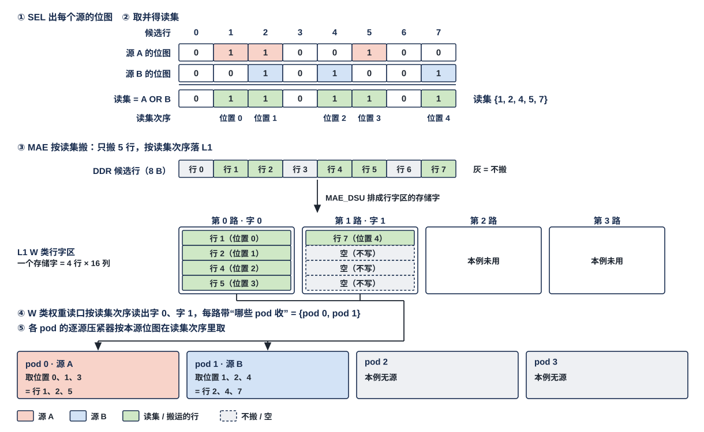

图按上面的归约维数值例自上而下画：①② 源 A、源 B 的位图与取并得到的读集（8 选 5）；③ MAE 从 DDR 只搬这 5 行、按读集次序落 L1 行字区的两个存储字（字 0、字 1，字 1 只有 1 行有效）；④⑤ W 类权重读口按读集次序读出这两个字，每路带"哪些 pod 收"（这里是 pod 0 与 pod 1），源 A（图中在 pod 0）与源 B（图中在 pod 1）各按自己的位图在读集次序里取 3 行。

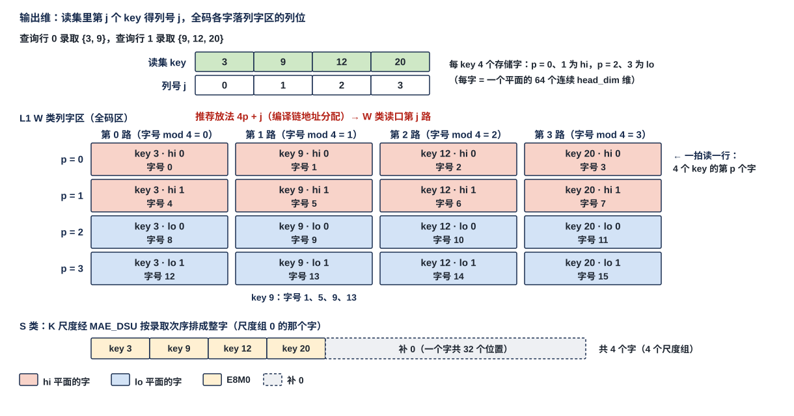

图按上面的输出维数值例画：4 个录取 key 各 hi 2 个字、lo 2 个字，按推荐放法 $4p + j$ 落字号（列 $j$ 由 W 类读口第 $j$ 路读出、列内第 $p$ 个字），一拍读出 4 个 key 的同一个字；录取 key 的 K 尺度经 MAE_DSU 按录取次序排成整字落 S 类（§2.13）。推荐放法只是满足 CONC-4 的一种地址分配，编译链可用别的满足 CONC-4 的放法。

### 3.6 并行切分与落点

每种切分一个小节，每节按同一顺序写：谁切什么轴 → 各核 / 各 pod 拿到哪一块 → 产出写哪里（段选、同址 / 各成数据块）→ 残差 / 尺度 / bias / 元数据项跟着谁 → 下一位点怎么读。**各运算的核间切分方式是编译链建议，硬件对切分方式不设限制**（V18-DORG-11 (3)，架构篇 §3.6）：核间切分轴是位点配置，由编译链按模型表给出；本节写每种切分方式下数据怎样落，不规定哪个位点必须用哪种。

#### 3.6.1 核内 pod 之间：固定按 T

**一个核的 4 个 pod 各算不同的 token 或查询行，不出现几个 pod 读同一条紧凑 token 记录**（V18-D-02）；**每拍 A 类读出只给一个使用者，4 个 pod 算一个使用者：pod 入口 1 道 128 B，CCU 分时给各 pod 压入不同 token，不向多个 pod 广播**（V18-L1-21）；**W 类权重读口读出的右操作数（权重、K、V）则按读集次序读出、每路带 4 位"哪些 pod 收"，各 pod 各自要：几个 pod 同拍要同一个字时只读一次、同拍送这几个 pod**（V18-CCU-01，MXU 集成篇 §2.2），各 pod 的逐源压紧器按本源位图在读集次序里取（§3.5，MXU_FEED 篇 §3.3）。各 pod 读的 token 记录来自同一组数据块（编译链安排一组 token 连续分配），产出按产出次序交 QNT、由本核 CCU 按序写进同一组数据块，每个通道片的每部分从新字起（散写只是"几段连续写"，L1 不按 token 序号查找）。残差、尺度、bias、元数据项都是核级的，与 pod 无关。

#### 3.6.2 核间按 T 切分：各核算不同 token，产出留本核

| 项 | 规定 |
|---|---|
| 切什么 | 一个 token 组按 token 分给四核，核 $c$ 算 token 组 $T_c$ 的全部输出通道（编译链让同一核的 token 连续） |
| 各核拿到 | 自己那组 token 的整条输入 token 记录（一组数据块）+ 全部权重（权重多播，核集合 1111） |
| 产出写哪 | 本核 L1（本核消费），或 L2 本核象限 $c$（跨核消费）：**象限 $c$ 放核 $c$ 那组 token 的整条 token 记录：码块、元数据项、E8M0 项、F 列表各一个数据块；四个象限同址**（同一组段内基址，内容与长度各不相同，V18-DORG-06）。**下一位点按 K 切分时，产出按片号分 4 个子块写**：子块 $j$ 放各 token 的第 $j$ 片，子块基址由编译链给 |
| 跟着谁 | 残差与 token 记录同驻本核 L1；尺度 / bias 随权重多播到各核 S 类；元数据项随 token 记录各在本核象限；读集合并的位图写本核象限同址（§2.15） |
| 下一位点怎么读 | T → T：分送，象限 $c$ 只送核 $c$（每核 32 B/拍）；T → M：合并送多播（四个象限的读出合并成一路、核集合 1111，128 B/拍），消费核 L1 里四组 token 依次接成一组数据块（L2 里的放置即"块分四段连续"，象限 $c$ 放第 $c$ 段，V18-MAE-36）；T → K：合并送单核，每个目的核 $j$ 一条指令、四道各读本象限的子块 $j$，依次执行（§3.6.6，V18-MAE-37） |

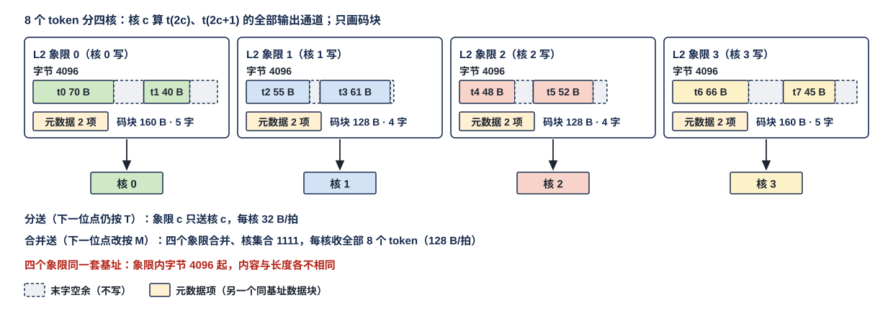

图中 8 个 token（$t_0 \ldots t_7$）分给四核，核 $c$ 算 $t_{2c}$、$t_{2c+1}$；各核两个 token 各一个通道片（码长举例 70 / 40、55 / 61、48 / 52、66 / 45 B），每片的码从新字起写进象限 $c$ 从同一段内字节 4096 起的码块（四个象限同一套基址，只是放法；虚线为末字空余），码块长按字取整为 160 / 128 / 128 / 160 B；两个元数据项写在象限 $c$ 的元数据项数据块（另一个同址的基址）。下一位点仍按 T 时用分送：核 $c$ 只收象限 $c$；改按 M 时用合并送多播：每核收到全部 8 条 token 记录。脚本断言每个象限的码块长 = 两片的码按字取整之和。

#### 3.6.3 核间按 M 切分：各核算不同输出通道，四个象限同址

| 项 | 规定 |
|---|---|
| 切什么 | 输出通道 $M$ 分四份，核 $c$ 算全部 token 在它那 $M/4$ 列上的输出，**核 $c$ 那 $M/4$ 列是连续的一段**（$m = c \cdot M/4 \ldots (c+1) \cdot M/4 - 1$） |
| 各核拿到 | 全部 token 的整条输入 token 记录（多播）+ 自己那 $M/4$ 列的权重：**编译链排 DDR 标准布局单元时，让每个单元的列组 $g$ 装核 $g$ 那 $M/4$ 列里的 16 列**（单元 $u$ 的列组 $g$ = 输出通道 $g \cdot M/4 + 16u \ldots g \cdot M/4 + 16u + 15$），经 MAE_DSU 转置成行字区字形态后列组 $g$ 的字给核 $g$，**每核拿到连续的 $M/4$ 列**（V18-DORG-11 (1)，§3.7.1；MAE_DSU 篇 §3.2 典型用法表） |
| 产出写哪 | **核 $c$ 在象限 $c$ 里把所有 token 在它那 $M/4$ 列上的通道片写成一组数据块（码块、元数据项、E8M0 项、F 列表各一个，每部分每片从新字起）；四个象限同址**（一条指令一套基址，四个象限的内容与长度各不相同，V18-DORG-06）；片长 $P = M/4$ 正是下一位点按 $k$ 四分的片。**下一位点按 T 切分时，产出按下一位点的 token 组分 4 个子块写**：子块 $j$ 放给核 $j$ 的那组 token，子块基址由编译链给，使 H2C 读出只做顺序读 |
| 跟着谁 | 尺度 / bias 按列块跟权重走（核 $c$ 只收自己列块的尺度行与 bias 行）；残差（M 切分位点）驻本核 L1、各核只加自己列块的残差；元数据项每象限一组 |
| 下一位点怎么读 | M → M：合并送多播，**消费核 L1 里每个数据块都按 token、片序排，一个完整 token（4 片）接下一个**（片交织，V18-MAE-36）；M → K：分送，象限 $q$ 只送核 $q$（核 $q$ 正要这 $K/4$ 个通道）；M → T：合并送单核，每个目的核 $j$ 一条指令、四道各读本象限的子块 $j$，依次执行（§3.6.6，V18-MAE-37，MAE_ENG 篇 §3.10）；CCU 按元数据项与片序号定位、解码（§3.4） |

**合并送时消费核 L1 里的排列**：MAE 先搬四个象限的元数据项，**按 token、片序把它们逐项照抄到消费核 L1 A 类**（每 token 4 项：片 $n$ 的项来自象限 $n$），按码块片长与 F 列表片长的前缀和给各道目的地址：**道 $n$ 写 token $t$ 片 $n$ 的码 = 码块基址 + 它前面各片的码块片长之和**，F 列表同理按 $\lceil 2f/32 \rceil \times 32$ 的前缀和；元数据项的目的地址 = 基址 + 片序号（$4t + n$）× 项宽，E8M0 项 = 基址 + 片序号 × $\lceil (P/G)/32 \rceil \times 32$。**四部分每片从字边界开始、片尾补齐，四道各写自己那一片的整字，不会有两道写同一个存储字**（V18-DORG-04）。**合并送的目的排法（片交织 / 段接续）由指令的 1 bit 给出**（V18-MAE-45 (6)，MAE_ENG 篇 §3.10）；元数据项由谁读、各道的目的地址序列怎样得出属 MAE 的做法（参考见 §7.2），约束是每道的字在目的地址上连续、消费核 L1 里的排列符合本节与 §3.6.6 的衔接表。**四道并行达到 128 B/拍以每道的目的地址连续为前提，不连续只降速、不出错**（架构篇 §3.4 CONC-3）；S 类写口一次只收一个整字。

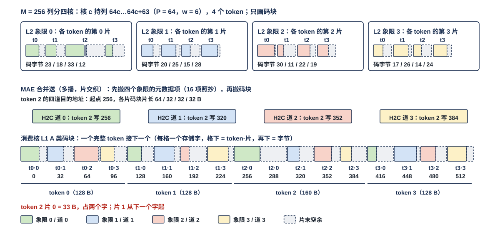

图中只画码块。$M = 256$ 列分四核（核 $c$ 持列 $64c \ldots 64c + 63$，一片 $P = 64$，$w = 6$），4 个 token；核 $c$ 把 4 个 token 第 $c$ 片的码依次写成象限 $c$ 的码块（四个象限同址；码字节举例：象限 0 为 23 / 18 / 33 / 12 B，象限 1 为 20 / 25 / 15 / 28 B，象限 2 为 30 / 11 / 22 / 19 B，象限 3 为 17 / 26 / 14 / 24 B，每片从新字起），各配元数据项。MAE 先搬四个象限的元数据项逐项照抄（16 项，码块片长除 token 2 片 0 为 64 B 外都是 32 B），token 起点 0 / 128 / 256 / 416；合并送（片交织）时 token 2 在 H2C 道 0–3 上的码目的地址 = 256 / 320 / 352 / 384（图中不画 MAE 的引擎组织，那是参考实现）。下方是消费核 L1 的码块：每格一个存储字，颜色表示来自哪个象限（哪一道），四个 token 依次首尾相接。元数据项、E8M0 项、F 列表按同一顺序排，图中不画。脚本断言每片码字节都对应 ≤ 64 个 6 bit 码、照抄的 16 项、token 起点、token 2 的四道地址与码块共 544 B。MAE 侧的同一例子见 MAE_ENG 篇图 FIG-MAE_ENG-QSPLICE。

#### 3.6.4 核间按 K 切分：各核算部分和，同址异象限，MAE_CRU 归约

| 项 | 规定 |
|---|---|
| 切什么 | 归约维 $K$ 分四份，核 $c$ 算 $Y^{(c)} = X_{:,\mathcal K_c} W_{\mathcal K_c,:}$（全部 token、全部输出通道的部分和） |
| 各核拿到 | 输入 token 记录里自己那 $K/4$ 个通道的片（片长 $P = K/4$）+ 自己那 $K/4$ 行的权重：上一位点按 M 切分时象限 $c$ 正好是这一片，用分送；上一位点按 T 切分时产出已按片号分 4 个子块，用合并送单核依次送（§3.6.6） |
| 产出写哪 | **BF16 部分和（定长项，16 个一字）经 C2H 写 L2 本核象限 $c$ 的同一段内地址（同址异象限）**；核内不加残差 |
| 合并 | MAE 收齐四核的发出报告后，**归约指令**：NI 读口一拍取四份 → MAE_CRU 逐元素相加（有 bias 的位点四份相加之后加一次 bias，V18-CRU-09 / 10）→ 按指令编码（BF16）写 L2；残差位点再一条**残差加指令**：归约结果 + L2 里的残差流 → 一次 MXFP6 编码写回 L2 残差流。**残差加输出一律稠密**；要紧凑格式由核侧 QNT 在 SEL 之后写回（§2.8，V18-CRU-08 / DORG-02） |
| 跟着谁 | 尺度随各核自己那 $K/4$ 行的权重；**残差流驻 L2**；有 bias 的位点 bias 数据块也在 L2，由 MAE_CRU 的归约指令加一次（各核不加，MAE_CRU 篇 §3.4）；判决（gate 先筛、keep）在归约结果回核后由 SEL 做、位图写 L2 本核象限同址 → 读集合并 |
| 下一位点怎么读 | **MAE_CRU 的结果经 NI 写口按下一位点的读法写 L2**：下一位点按 T 时按核放象限（核 $k$ 的 token 放象限 $k$，分送），按 M 时块分四段连续（象限 $n$ 放第 $n$ 段，合并送多播），按 K 时片 $q$ 放象限 $q$（分送）（V18-MAE-37）；K 切分的判决与小消息同样当数据走 C2H → L2 → H2C，单核产出的小消息用只开一个象限的合并送多播 |

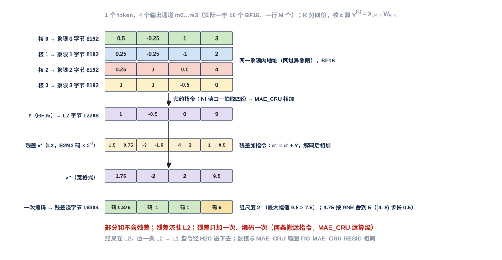

图中 1 个 token、4 个输出通道（实际 16 个一字、一行 $M$ 个）：核 0–3 的部分和（BF16）各写象限 0–3 的同一段内字节 8192；归约指令一拍读四份相加得 1.0 / −0.5 / 0 / 9.0，BF16 写 L2 字节 12288；残差加指令读它与同 token 同 4 个通道的残差（E2M3 码 1.5 / −3 / 4 / 1，组尺度 $2^{-1}$），相加得 1.75 / −2 / 2 / 9.5，按组一次编码（尺度 $2^{1}$，码 0.875 / −1 / 1 / 5）写回残差流字节 16384。脚本断言四份之和与编码后的码。数值与 MAE_CRU 篇图 FIG-MAE_CRU-RESID 相同。

#### 3.6.5 attention 的按头 / 按 key 切分

| 切分 | 各核拿到 | 产出与合并 |
|---|---|---|
| 按 kv 头分核（Qwen 8 个 kv 头、每核 2 个；编译链建议的默认） | 自己 kv 头的 K / V 平面（行字区、列字区里的全码区各核自持）、全部查询行的 Q | 各核的 $O$ 行状态只含自己 kv 头，不跨核合并；反传 dK / dV 不跨核 |
| 按 key 分核（kv 头少于核数时，如 MiniCPM 2 个 kv 头） | 同一 kv 头的不同 key 段、全部查询行的 Q | $(m_{\text{run}}, l)$ 对与 $O$ 部分值作标量 / 定长份写 L2 同址异象限、MAE_CRU 合并；录取读集按位取并（§2.15） |
| 按 query chunk 的反传 | 不同 chunk 的查询行、全部 key | dK / dV 跨 chunk 累加：BF16 部分和经 MAE_CRU 归约，累加区在 DDR（BF16，按 [层][kv 头][key] 可寻址） |

#### 3.6.6 相邻位点切分轴不同的衔接：在 L2 里换读法，L2 → L1 只有合并送与分送

**L2 → L1 经 H2C 只有两种用法，各一条 MAE 指令**（V18-MAE-37，架构篇 §3.8）：

| 用法 | 读法 | 送给谁 | 每核收到 |
|---|---|---|---|
| **合并送：参与的象限合并成一路** | 参与的象限读出合并送一个核集合，H2C 四道并行；目的排法（片交织 / 段接续）由指令的 1 bit 给出 | 一个核集合：多播 1111，或只含一个核 | 128 B/拍（四个象限都开时） |
| **分送：象限 $c$ 只送核 $c$** | 指令给一个段内读起始地址与一个 L1 写起始地址；各道先读本象限的元数据项得出本道长度、再顺序搬；各核的写地址从同一起点各自推进，到达先后与结束时刻可以不同 | 核 $c$ | 每核 32 B/拍 |

**写完通知**的发法见架构篇 §3.9：分送、多播与 IDN 共享时每个目的核在写进本核的数据数满后各自收写完通知，不等其他核（V18-TP-83 (5) / TP-84 (8)）；搬紧凑 token 记录四块时通知带码块的目的基址、字数 = 四块之和（V18-MAE-42，§3.4.2）。同一时刻 L2 四个象限读口服务几条 L2 → L1 指令是 MAE 的约定（MAE_ENG 篇 §3.10）。**按元数据项聚集（§3.6.8）是源端的一种地址生成方式，不算第三种搬运用法**（V18-MAE-41）。**不设"一个象限服务四个核"的读法**：大块数据由产出方按下一位点的读法摆放（MAE_CRU 的结果经 NI 写口按下一位点读法分四段或按核放象限），单核产出的小消息用只开一个象限的合并送多播。

| 上一位点 → 下一位点 | 产出方在象限 $q$ 里放什么 | 用法 | 目的排法 | 每核收到 |
|---|---|---|---|---|
| T → T | 核 $q$ 那组 token 的整条记录 | 分送 | — | 32 B/拍 |
| T → M | 同上（即"块分四段连续"，象限 $q$ 放第 $q$ 段） | 合并送，多播 1111；消费核里四组 token 依次接成一组数据块 | 段接续 | 128 B/拍 |
| T → K | 核 $q$ 那组 token 的记录，**按片号分 4 个子块**（子块 $j$ 放各 token 的第 $j$ 片） | 合并送单核：每个目的核 $j$ 一条指令、四道各读本象限的子块 $j$，四条指令依次执行 | 段接续 | 128 B/拍（四个目的核轮流） |
| M → M | 所有 token 的第 $q$ 片 | 合并送，多播 1111；MAE 先搬四个象限的元数据项逐项照抄、按前缀和给各道地址，消费核里按 token、片序排 | 片交织 | 128 B/拍 |
| M → K | 所有 token 的第 $q$ 片 = 下一位点归约维的第 $q$ 个通道片 | 分送（核 $q$ 正要这 $K/4$ 个通道） | — | 32 B/拍 |
| M → T | 所有 token 的第 $q$ 片，**按下一位点的 token 组分 4 个子块**（子块 $j$ 放给核 $j$ 的那组 token） | 合并送单核：每个目的核 $j$ 一条指令、四道各读本象限的子块 $j$，按前缀和接成完整 token，四条指令依次执行 | 片交织 | 128 B/拍（四个目的核轮流） |
| K → T / M / K | MAE_CRU 的结果按下一位点读法放：按核放象限 / 块分四段连续 / 片 $q$ 放象限 $q$ | 分送 / 合并送多播 / 分送 | — / 段接续 / — | 32 / 128 / 32 B/拍 |

**片交织** = 每个 token 的第 $q$ 片来自道 $q$，消费核里 token $t$ 的片 $q$ 是第 $4t + q$ 片；**段接续** = 道 $q$ 送来的全部片接在道 $q - 1$ 的之后（定长流的块分四段同理，道 $q$ 的目的 = 目的基址 + $q$ × 段长）。**产出方按下一位点读法分块写 L2，子块基址由编译链给；变长数据的码块、F 列表、元数据项、E8M0 项在四个象限一律用同一套基址，一条指令一套基址**（V18-DORG-06；NI 读口四路可各给各的地址，§3.6.7）；H2C 读出只做顺序读。**这些衔接都在 L2 内完成，不回写 DDR**；MAE 不感知数据类型，衔接只是搬运指令的地址几何与元数据项（MAE_ENG 篇 §3.10）。

#### 3.6.7 L2 里四个象限的并存关系

**核 $n$ 写进 L2 的数据只在象限 $n$（架构篇 §3.3）。四核分产的数据与要四道并行送出的数据按下表并存；变长数据（元数据项、E8M0 项、F 列表、码块）在四个象限一律同址，一条 MAE 指令只带一套基址**（V18-TP-48、V18-MAE-36 / 37、V18-DORG-06）。**这里的"同址"指编译链给四个象限同一套基址，是放法，不是端口限制**：NI 读口四路各给各的读地址、可以不同址（V18-L2-08）；变长数据四个象限的内容长短不同，同一套基址之下各象限读到的位置随之各不相同，由发读方按各象限的元数据项推进。

| 生产方式 | 象限 $q$ 里放什么 | 段内地址 |
|---|---|---|
| **跨核合并的定长份**：核间按归约维 $k$ 切分的部分和、要合并的标量、读集位图（定长项或定长位图，§2.15） | 核 $q$ 的那一份 | **四份的段内地址相同（同址异象限），只差象限**；MAE 一拍从 NI 读口取四份交 MAE_CRU |
| **核间按输出通道 $m$ 切分的变长激活**（每核算 $M/4$ 列，§3.6.3） | 所有 token 的第 $q$ 个通道片组成的**一套四个数据块（元数据项、E8M0 项、F 列表、码块）**（核 $q$ 负责的 $m$ 范围；对下一位点就是归约维 $k$ 的第 $q$ 个通道片），四部分按片补齐（§2.3）；**下一位点按 token 切分时，核 $q$ 按下一位点的 token 组分成 4 个子块写，子块 $c$ 放给核 $c$ 的那组 token** | **四个象限同址**：每个数据块（子块）的基址在四个象限相同，由编译链给 |
| **核间按 token 切分的变长激活**（每核算一组 token，§3.6.2） | 核 $q$ 那组 token 的整条 token 记录（一套四个数据块）；**下一位点按归约维 $k$ 切分时，核 $q$ 按片号分成 4 个子块写，子块 $c$ 放各 token 的第 $c$ 片** | 同上：四个象限同址 |
| **一条要经 H2C 四道并行送出的流**（进 L2 的权重 tile、DDR 重装的数据块等） | **按"块分四段连续"放：数据块切成四段，象限 $q$ 放第 $q$ 段，段内存储字连续，不按字交织**（V18-MAE-36） | 四段的地址由编译链给；只放在一个象限的流单道 32 B/拍 |
| NI 写进来的数据（DDR 重装、L2 → L2 重排、MAE_CRU 的结果） | 由 MAE 指令按上表任一种摆放（MAE_CRU 的结果按下一位点的读法分四段或按核放象限，V18-MAE-37），或按段掩码同址写到几个象限（NI 写口的能力，架构篇 §3.3） | 同上 |

**按下一位点的读法分块写**：经 H2C 的读出只有合并送与分送两种用法，下一位点用哪一种由两位点的切分轴定（§3.6.6）；产出方事先把每个目的核要的那部分摆成一个连续子块，H2C 读出就只做顺序读，不需要"一个象限服务四个核"的读法。L2 不感知子块：子块只是编译链给的基址。**块分四段连续**：合并送要达到 128 B/拍，条件是各道的目的地址各自连续（架构篇 §3.4 CONC-3）；H2C 道 $q$ 只读象限 $q$，按段连续放时每道送出的存储字在目的地址上连续，按字交织放时每道的字在目的地址上间隔 4 个字。不连续只降速、不出错，四道之间不要求等齐。

**例**：一个位点 4 个 token、核间按 $m$ 切分（$M = 256$，核 $q$ 持一片 $P = 64$ 个通道，$w = 6$）。四个核的码块都放在 [堆 0][象限 $q$][段内字节 4096] 起（四个象限同址），4 个通道片的码块起点按字对齐（象限 0 各片码 23 / 18 / 33 / 12 B，码块片长 32 / 32 / 64 / 32 B，起点 0 / 32 / 64 / 128）；元数据项（每片一项，项宽 32 B）放 [堆 0][象限 $q$][段内字节 8192] 起，E8M0 项、F 列表各放编译链给的、四个象限相同的地址。下一位点同样按 $m$ 切分时，由一条合并送指令（片交织）把四个象限的读出合并成一路多播给四核：**四个通道片的码块在目的核 L1 里接成一条物理连续的 token 记录，元数据项逐项整字照抄过去**（§3.6.3）。核间按 $k$ 切分的部分和（BF16 定长）则四核写同一段内地址，MAE_CRU 一拍取四份。

**两个堆的用法**：编译链通常把读、写放在两堆（ping-pong）：第 $l$ 位点从四个象限的堆 $1-h$ 读上一位点的输出，同时把自己的输出写进四个象限的堆 $h$（核 $n$ 写象限 $n$）；一读一写分落两堆时都不降速（架构篇 §3.4 CONC-1）。

#### 3.6.8 权重驻留位点的产出：每个权重窗口一组数据块，MAE 按元数据项聚集

**打包单位是片**：QNT 按 MX 组（$G$ 列）量化、按 SEL 判决压紧，写进该 token 当前通道片的四部分（码块、元数据项、E8M0 项、F 列表）；怎样攒、何时写出属生产方的做法（§7.1）。两种驻留的产出次序不同：

| 驻留 | 片的产出次序 | 数据块怎么成 |
|---|---|---|
| token 驻留（先算完一个 token 的全部输出通道） | token 0 的片 0、1、…；再 token 1 | 一组数据块装这组 token 的整条记录 |
| 权重驻留（权重窗口 $W_{\text{win}}$ 列驻 L1，token 逐个流过，过完换下一个权重窗口） | 权重窗口 0 的 token 0…$T-1$；权重窗口 1 的 token 0…$T-1$；… | **每个权重窗口一组数据块装 $T$ 个 token 的片（片长 $P = W_{\text{win}}$，四部分每片从新字起）、各配一组元数据项**（V18-MAE-33；生产方按产出次序顺序写出，§7.1） |

下一位点的 pod 要按 token、沿 $k$ 读整条，两种衔接都支持，选哪种由编译链按位点定：**MAE 按元数据项聚集**（V18-MAE-33 / TP-69：L2 → L1 指令先搬各权重窗口的元数据项（整字照抄），由码块片长与 F 项数得出各片地址，从每个权重窗口取 token $t$ 的那一片——四部分各取各的、都是整字拷贝——按权重窗口次序接续写进消费核 L1，与 §3.6.3 的合并同一种排法；**按元数据项聚集是源端的一种地址生成方式，所在的搬运仍是合并送或分送之一**，V18-MAE-41）；或**消费方按权重窗口分段算、部分和停放 L1**（MAE 只顺序搬）。**用整行统计量判决的位点（相对阈值、QDS 行均值）不支持按通道片分段流水**（§3.5.3）：在权重驻留下须先存 BF16、整行判完再压紧。

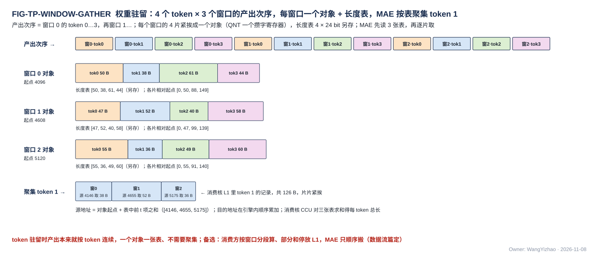

图中只画码块：权重窗口 0 / 1 / 2 的码块起点 4096 / 4608 / 5120；权重窗口 0 的四片码 50 / 38 / 61 / 44 B、权重窗口 1 的 47 / 52 / 40 / 58 B、权重窗口 2 的 55 / 36 / 49 / 60 B（举例），每片从新字起依次成该权重窗口的码块（各片相对起点 0 / 64 / 128 / 192），各权重窗口元数据项（另存，A 类）里的码块片长均为 64 B。**MAE 聚集 token 1**：同一条搬运指令先搬三个权重窗口里 token 1 的元数据项（整字照抄），由码块片长算出源地址 = 码块起点 + 前面各片码块片长之和 = 4160 / 4672 / 5184，各取 38、52、36 B，写进消费核 L1 时各片从新字起（相对 token 起点 0 / 64 / 128），token 1 的码占 192 B；四部分都是整字拷贝。元数据项、E8M0 项、F 列表按同一顺序各取各的，同样按片补齐。MAE 数满本指令应写量的写入握手后，给消费核 CCU 发写完通知（带码块的目的基址，字数 = 四块之和），CCU 收到这一批的通知才读这一批的元数据项（§3.4.2）。实际 $W_{\text{win}}$ 由位点配置，权重窗口数 $M_{\text{core}} / W_{\text{win}}$。

#### 3.6.9 DDR 卸载与重装

| 方向 | 通路 | 规则 |
|---|---|---|
| 卸载 L2 → DDR | NI 读口（4 × 32 B，每象限一路）→ NI_EXT → DDR | 码块、元数据项、E8M0 项、F 列表各按数据块整体拷贝，DDR 布局由编译链定；同址异象限的合并份按同一段内地址依次或同拍换象限读出（只是地址几何，V18-MAE-28；NI 读口四路也可各给不同地址，V18-L2-08） |
| 重装 DDR → L1 | 经 IDN 出口 → HUB_IDN 直进核，不经 L2 | 与象限无关 |
| 重装 DDR → L2 | NI 写口（可写任一象限，一个切换段不跨象限，可按段掩码同址写几个象限） | 可重新选象限，按下一位点的读法摆放（§3.6.6）；**下一步要用合并送读出的流按"块分四段连续"放，象限 $n$ 放第 $n$ 段、不按字交织**，使每道的字在目的地连续（V18-MAE-36，§3.6.7）；只放一个象限的流单道 32 B/拍 |

重装时的段选与地址由搬运指令给。**"单核产出、多次重读"不在本篇考虑范围**：单核调用的 token 数小、激活驻在本核 L1，重读走 L1。

#### 3.6.10 分批搬运：一份产出分几批搬进 L1，下一批的起点由 MAE 接续

**一份产出在 L2 是一个大数据块、分几批搬进 L1 时，第 $j$ 批在象限 $q$ 的起点 = 前面各批在该象限实际搬走的长度之和，四个象限各不相同、编译期未知**；定长的元数据项、E8M0 项起点仍是静态的，变的只有码块与 F 列表（V18-MAE-38）。**分批搬运时下一批的起点由 MAE 接续：下一批的指令不写实际起点，MAE 从上一批搬到的位置接着读**（V18-MAE-45 (1)）；MAE 怎样记录与续接属 MAE 的做法（参考见 §7.3，MAE_ENG 篇）。CCU 的发出报告因此要能与流配对，属 CCU 的设计（`CCU_STAGING.md`）。

**跨核搬运与消费按批流水**（V18-DORG-10 (10)）：**LIC 的 Fusion 段里搬运指令与计算指令成对循环，一批 = 一条搬运指令的一次执行；先搬一批、算一批，算这一批的同时搬下一批**。每次执行各发一次写完通知（带该批码块的目的基址、字数 = 该批四块之和），**消费核 CCU 收到某批的通知后读该批的元数据项、开始算这一批，不要求整份产出搬完**（§3.4.2）。各批在消费核 L1 里的目的空间由编译链分配，约束是正在算的那一批不被下一批覆盖。

### 3.7 DDR 侧排布

只写两种权重布局与激活值布局；其余小参数（阈值表、位置数组、区块摘要等）的 DDR 排布由设计者定。**DDR 布局只为省片外访存定；L1 的 W 类只有行字区、列字区两种字形态（§2.12）；两者之间的差全部由 MAE_DSU 的直通或转置调，L1、接收桥、pod 都不调**（V18-MAE-41 / L1-30）。DDR 字节都按前向消费的方向存；反传 $\mathrm dX = \mathrm dY\,W^{\mathsf T}$ 要的 $W^{\mathsf T}$ 不在 DDR 另存：用列字区的反传排法（$W^{\mathsf T}$ 的一列 = 1 个 $k$ × 64 个连续 $m$），标准布局经 MAE_DSU 直通即得，列深度优先布局经 MAE_DSU 转置得到（§2.14）。

#### 3.7.1 权重标准布局：一拍一个 $k$ 行 × 4 个列组，尺度与 bias 另成数据块

**标准布局用于输入维度稀疏的位点**（q / k / v、o、down 的 hi 与 lo，fc、kernel_projection，LM Head hi）：按 F 行（被选中的输入通道 $k$）读时一行就是一拍，是输入维度稀疏减少片外访存的前提。

| 项 | 规定 |
|---|---|
| 单元 | **1 KB = 一个平面同一 K 组的 32 个 $k$ 行 × 32 B，纯数字**；hi / lo 单元等长（V18-DORG-01） |
| 一行（一拍） | **32 B = 4 个列组各 8 B，每个列组 = 16 个输出通道在该 $k$ 下的 16 个 4 bit 码**；一个单元覆盖 64 个输出通道 |
| 列组装哪 16 列 | **由编译链按位点的核间切分定，布局格式不变**：不按 M 切分（单核或按 T 切分）时单元 $u$ 装连续 64 列，列组 $g$ = $m_{64u+16g} \ldots m_{64u+16g+15}$；**按 M 切分时单元 $u$ 的列组 $g$ 装核 $g$ 那 $M/4$ 列里的第 $u$ 组 16 列 = 输出通道 $g \cdot M/4 + 16u \ldots g \cdot M/4 + 16u + 15$，使每核拿到连续的 $M/4$ 列**（V18-DORG-11 (1)） |
| 单元排列 | 同一单元覆盖的输出通道的各 K 组单元连续；单元按 $u$ 升序 |
| 尺度数据块 | $\lceil K/32 \rceil \times M$ 个 E8M0 无填充，**排序二选一**：(a) **K 组主序**——一个 K 组的 $M$ 个尺度连续（每 32 个 $m$ 恰为 L1 的一个尺度行；按 F 行选读时一个被选 K 组 = 列表一项、$M$ 字节）；(b) **32 列段主序**——一个 32 列段的所有 K 组连续（权重驻留按列段取时一次连续读）。按位点与模式由编译链选。**LM Head 列副本的尺度是另一个数据块，按列主序、每列补到 32 B 的倍数（§3.7.4）** |
| bias 数据块 | $M$ 个 BF16 按 $m$ 连续；片上落 L1 S 类（放在哪由编译链分配，§2.14） |
| lo 稀疏读副本 | 一行 64 B = 4 核各 16 B（32 个输出通道 × 4 bit），不带尺度，只按 F 行读；lo 复用同（32 列块, K 组）hi 的尺度行；**进 L1 前由 MAE_DSU 转置成与 hi 相同的行字区字形态**（V18-MAE-41） |

**与 L1 的关系**：L1 行字区的一个存储字 = 一个列组的 4 个相邻 $k$ × 16 个 $m$（§2.12；按 F 行稀疏读时是读集次序里相邻的 4 个被选行，§3.5），与 DDR 一拍（1 个 $k$ × 4 个列组）正交。核间按 M 切分时列组 $g$ 归核 $g$；单核或按 T 切分时 4 个列组都归同一核。**MAE_DSU 转置**：连续 4 个 $k$ 行（被选中的行按读集次序）、每行 4 个列组各 8 B，转置后交出 4 个整字，字 $g$ = 列组 $g$ 在这 4 行上的码，即行字区的一个存储字，按核集合整字发出；lo 稀疏读副本同样转置成与 hi 相同的行字区字形态（参数见 MAE_DSU 篇 §3.2 典型用法表，V18-MAE-41）。链路上只有"整字直接发"一种方式。**送反传训练核时标准布局经 MAE_DSU 直通**：DDR 一拍（1 个 $k$ × 64 个 $m$）正好是 $W^{\mathsf T}$ 列字区的一个存储字（§2.14，V18-L1-30）。

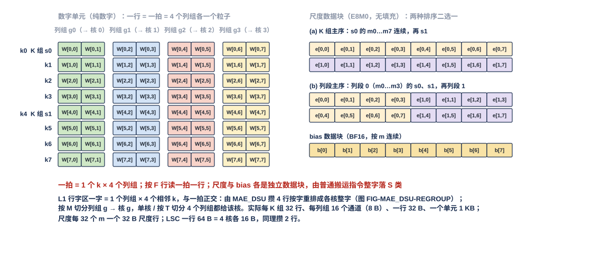

图按 8 个 $k$ 行 × 4 个列组、每列组 2 个输出通道缩画（实际 32 行、每列组 16 个通道、一行 32 B）：左为数字单元，一行一拍，经 MAE_DSU 转置成行字区字形态后列组 $g$ 的字按 M 切分归核 $g$（图中另注：按 M 切分时单元 $u$ 的列组 $g$ 装核 $g$ 的 16 列，列号 $g \cdot M/4 + 16u$ 起，V18-DORG-11 (1)）；右上为尺度数据块的两种排序（K 组主序：$s_0$ 的 $m_0 \ldots m_7$ 连续；列段主序：列段 0 的 $s_0, s_1, \ldots$ 连续），右下为 bias 数据块（$m_0 \ldots m_7$ 各 BF16）。脚本断言两种排序含同一集合的 $(s, m)$、数字单元不含尺度字节。

#### 3.7.2 权重列深度优先布局：一拍一列 64 个连续 $k$，尺度另成数据块

**列深度优先布局用于输出维度稀疏的位点**（up hi、gate / up lo、LM Head 反传 $\mathrm dH$ 用到的被选词列（MAE_DSU 篇 §3.4 称 S 列））：按列（输出通道）gather 时一列连续。LM Head 补算用的是按列连续的全码副本（§3.7.4）。

| 项 | 规定 |
|---|---|
| 一列 | 一个输出通道 $m$ 沿 $k$ 展开的码，在 DDR 连续，长 $K/2$ B（hi 或 lo 一个平面），列起点 64 B 对齐，只在列尾补齐 |
| 一拍 | **32 B = 该列 64 个连续 $k$（相邻两个 K 组）**，正好是 L1 列字区的一个存储字（§2.12），送前向核时字内内容不变、经 IDN 整字直写（不经运算级，MAE_DSU 篇 §3.2 典型用法表下的"不进 DSU 的数据"；双目的时前向那一份同样不经运算级）；输出维稀疏按列 gather 时按读集次序、按列字区的列位落（§3.5）；送反传训练核时经 MAE_DSU 转置成 $W^{\mathsf T}$ 的列字区字形态（§2.14） |
| 尺度数据块 | 与 §3.7.1 同一数据块、同两种排序；由另一条普通搬运指令整字落 L1 S 类，训练核要用时同样直送（V18-MXU-11） |

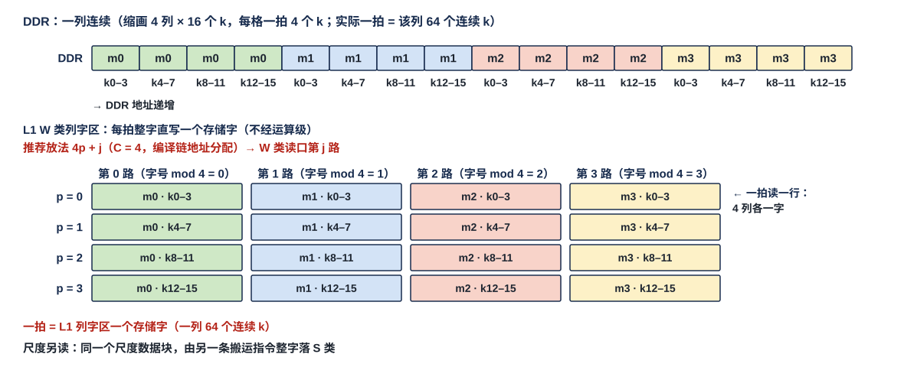

图按 4 列 × 16 个 $k$（每拍 4 个 $k$）缩画（实际一拍 64 个 $k$，一列 $K/2$ B）：列 $m_0$ 的 4 拍连续，然后列 $m_1$；每拍落 L1 列字区一个字。列 $j$ 的第 $p$ 个字放在哪个地址由编译链分配，约束见 §2.12（架构篇 §3.4 CONC-4）；图按推荐放法字号 $pC + j$（$C$ = 4，列 $j$ 由 W 类读口第 $j$ 路读出）画并标"推荐"；尺度另读。脚本断言每拍的 $k$ 范围连续、列间不交织。

#### 3.7.3 激活值、残差与 K / V 在 DDR

| 数据 | DDR 排布 | 说明 |
|---|---|---|
| 紧凑 token 记录 / 流动梯度（L2 放不下时卸载，或 L2 驻权重的位点） | **与片上相同：码块、元数据项、E8M0 项、F 列表各成数据块（四部分每片从新字起、片尾补齐）**，数据块起点 32 B 对齐 | 卸载 / 重装整块拷贝（§3.6.9）；按 token 定位同 §3.2 |
| 残差流（稠密残差格式） | 码表与 E8M0 表，各一个通道片一项（按片补齐，§2.8），按 token 连续 | 定长项 |
| K / V | **每类一个平面**：K hi 64 B/key、K lo 64 B/key、V hi / lo 各 64 B/key（4 bit 时单平面 64 B），码平面内按 key 连续；**K 尺度数据块每 32 个 key 一组、一个字 = 一个尺度组上 32 个 key 的 E8M0**（$g_K = 32$ 时每组 4 个字，与片上同一排法，§2.13）；V 尺度每 key $d_h/g_V$ 个 E8M0、按 key 连续；尺度单独成数据块、每存储 tile 一个数组 | 粗算顺序流读 K hi 平面 + K 尺度，录取后按读集 gather K lo 与 V；录取 key 的 K、V 尺度由 MAE_DSU 按录取次序排成整字，源端每个尺度字只读一次（§2.13）；$N_{\text{st}}$ 交 MAE_ENG 设计者 |
| 嵌入表 | 码表、E8M0 表、标量表三张表单独存，各按词号连续；码表、E8M0 表每项补到 32 B 的倍数，**标量表每项 8 B 紧挨存、不补齐**（§2.8） | MAE 按 token id 列表各 gather 一次 |

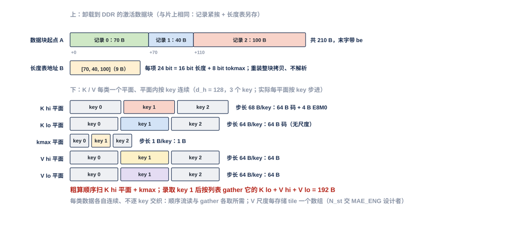

图上半是一个卸载到 DDR 的激活码块（3 个 token 各一片，码 70 / 40 / 100 B，起点 +0 / +96 / +160，共 9 个存储字，虚线为片末空余）与它的元数据项数据块（例 $P = 256$：每片 36 B 补到 64 B；E8M0 项、F 列表各在另一地址、图中不画）；下半是 3 个 key 的 K hi（64 B/key）、K lo（64 B/key）、V hi / lo（64 B/key）各自的平面与 K 尺度（每 32 个 key 一组，一个字 = 一个尺度组上 32 个 key 的 E8M0；图按 4 个 key 一组缩画、实际 32 个，§2.13），粗算只扫 K hi 平面与 K 尺度，录取 key 1 后 gather 它的 K lo 与 V（另 V 尺度 $d_h/g_V$ B）。脚本断言各平面的 key 步长与录取 gather 的码字节数（64 + 128 = 192 B）。

#### 3.7.4 LM Head 的按列全码副本：一列 = hi 段接 lo 段，连续存放

**$W_{\text{head}}$（$K \times V_{\text{vocab}}$，$K = d_{\text{hidden}}$）除了标准布局（hi 平面供粗算，§3.7.1）外，另存一份按列连续的全码副本：一列 = 该词 $m$ 沿 $k$ 的 hi 段（$K/2$ B）接 lo 段（$K/2$ B），共 $K$ B 连续，平面分开、不按字节交织**（V18-MXU-09）。

| 项 | 规定 |
|---|---|
| 一列 | hi 段 $K/2$ B（每个 $k$ 一个 4 bit hi 码，按 $k$ 升序）接 lo 段 $K/2$ B（同序的 lo 码）；Qwen $K = 2{,}560$：1,280 B + 1,280 B = 2,560 B |
| 列间 | 按词号连续，列起点 64 B 对齐 |
| 尺度 | 不进副本，**单独成一个尺度数据块：按列主序，每列 $K/32$ 个 E8M0，每列补到 32 B 的倍数（$K = 2{,}560$ 时 80 → 96 B），按列 gather 整字**，搬运时落 L1 S 类（放在哪由编译链分配，§2.14）（V18-MXU-09 / DORG-05 / DORG-10 (2)） |
| 怎么读 | MAE 按 TOPK 重算词号列表（§2.11）每列读一段 $K$ B，经 IDN **按列表次序、按列字区的列位落 L1 W 类全码区**：列表里第 $j$ 个词得列号 $j$，它的 $K/64$ 个 hi 字与 $K/64$ 个 lo 字依次是该列的第 $0 \ldots K/32 - 1$ 个存储字，各落列位，不按列连续落（§3.5，V18-DORG-08）；每个存储字仍是一个平面的 64 个连续 $k$；阵列按 8 bit 权重模式一遍算完（输出稀疏，架构篇 §3.6） |
| 代价 | DDR 净增约一份 $K \times V_{\text{vocab}}/2$ B（Qwen 词表约 194 MB） |

## 4 性能指标

**本篇不定口宽与存储速率**（口宽在架构篇 §2.7，存储并发在架构篇 §3.4）；本章只列本篇的放法带来的、各方要按其排拍的速率与拍数要求值。哪些口在一个位点里同时忙由各模块篇按位点算。

### 4.1 各种衔接下每核收到的速率

| 衔接 | 每核收到 | 成立条件 |
|---|---|---|
| 合并送（四个象限都开，多播或单核） | 128 B/拍 | 产出方按 §3.6.7 放置，使每道的目的地址各自连续（架构篇 §3.4 CONC-3）；不连续只降速 |
| 合并送（开 $n$ 个象限） | $n \times 32$ B/拍 | 同上 |
| 分送 | 32 B/拍 | — |
| T → K、M → T（合并送单核，四个目的核依次） | 每条指令 128 B/拍，四个目的核轮流 | 同合并送 |

### 4.2 发读步长的码交 pod 的拍数：属 CCU 的设计

一个发读步长的码交 pod 用几拍取决于 CCU 的读法，参考值移到 `CCU_STAGING.md`（V18-TP-84 (9)）。本篇只约定码的位置与旁带内容（§3.4.3）。

## 5 约束与由使用者保证的事项

### 5.1 硬约束

- **数据里没有头**：没有数据块头、记录头、列表头的项数字段、固定槽；运行期才知道的长度只在元数据项与列表的定长计数项里（§2.4）。
- **元数据项、码块、E8M0 项、F 列表、列表彼此独立成块，互不内嵌**（§2.4）。
- **MAE、L1、L2 不感知打包方式与数据类型**，只看指令给的地址、长度与 be（V18-MAE-01）。
- **所有尺度与 bias 都落 L1 S 类**；S 类写只按整字，生产方把末字空余字节补 0（§2.3）。
- **pod 没有解包器，使用者一侧不设字节移位器**（§2.3、§3.4.4）。
- **L1 只暴露 RRAM 口**；读出去向与写入来源由 L1 外、CCU 控制的 MUX 选（架构篇 §3.7）。
- **编译链不做读写带宽保证**；每拍 A 类读出只给一个使用者，需求超出时使用者等待（V18-L1-21）。
- **本篇不含容错设计**（V18-TP-75）：地址与长度符合编译期的分配由编译期检查保证。

### 5.2 由使用者保证的事项

| 事项 | 由谁保证 |
|---|---|
| 四部分数据块（码块、元数据项、E8M0 项、F 列表）的基址；码块与 F 列表的容量窗口 | 编译链（算法侧给每片保留上限 $k$） |
| 位点指令给出 $w$、$G$、片长 $P$ 与每 token 通道片数 | 编译链 |
| 数据组织默认 32 B 对齐（数据块起点、四部分每片的起点在存储字边界、片尾补齐） | 编译链与生产方；首地址不在字边界时由 SRAM 内部移位（§2.3，V18-TP-74） |
| 元数据项的写出（码块片长、F 项数、keep 位图） | 生产核 QNT（keep 位图来自 SEL）；MAE_CRU 压缩输出时由执行该指令的 MAE_ENG 搬运引擎按基址写，F 项数由 SEL 按片写成计数项进本核 L1 A 类、CCU 随 F 列表送 L2、MAE_ENG 先读后按片交 MAE_CRU 填写（V18-DORG-11 (4) / TP-83 (5)，§2.5.1）；核间按 $m$ 切分时由 MAE 逐项照抄 |
| 四部分每片从存储字边界开始、片尾补齐（A 类末字带 be，S 类整字写、末字补 0） | 生产方（QNT 写元数据项、E8M0 项、码，F 列表照写 SEL 交来的内容；**F 列表每片补到存储字边界一律由 SEL 做**，V18-QNT-14 (3) / DORG-11 (4)；MAE_CRU 产出的元数据项、E8M0 项与码由搬运引擎按基址写，F 列表由 MAE 整字搬） |
| 搬紧凑 token 记录的每条搬运指令先搬元数据项，再按它算定的地址搬码块与 F 列表；四部分默认整字拷贝；核间按 $m$ 切分时元数据项逐项照抄、按前缀和给目的地址；权重驻留聚集时各通道片按同一顺序接续 | MAE |
| 跨核来的数据按批在消费核写完后才被读：数满该批应写量的写入握手后发写完通知（带码块的目的基址、字数 = 四块之和） | MAE 发通知；消费核 CCU 收到该批的通知后才读该批（V18-TP-70 / DORG-10 (10) / MAE-42） |
| 读元数据项、F 列表与码并事先定发读节拍；发 S 类读让 E8M0 经 S 类读 MUX 进 pod；旁带（keep 掩码、F 掩码、MX 组边界、起始位偏移）随码交 pod；EPI 还原紧凑残差与特征行时把 keep 位图交 EPI；排定每拍 A 类读出给哪个使用者 | 消费核 CCU（§3.4.3；做法见 `CCU_STAGING.md`） |
| 第 $i$ 个码对应 keep 掩码里第 $i$ 个 1；按 $w$ 与起始位偏移移位对齐；按组边界把 E8M0 配到通道；一拍 ≤ 3 个 MX 组 | pod（MXU_FEED 篇 §3.5、§3.6.1） |
| 读紧凑记录时先拿元数据再读码，按 keep 位图展开、每 $G$ 个通道换尺度；MAE_CRU 不处理 F 列表 | VNU 单元、MAE_CRU（§3.4.5） |
| 默认按字地址落位、读整字；A 类末字只写有效字节，S 类整字写；首地址不在字边界时在 SRAM 内部移位；L1 只暴露 RRAM 口、不做选择 | L1 / L2（架构篇 §3.3 / §3.5.4） |
| 同一核的各条 token 记录在数据块里连续分配 | 编译链 |
| 数据块的写入与读出在同一种 A 类 / W 类容量调配下 | 编译链（架构篇 §3.5.1） |
| 跨核合并的定长份同址异象限；变长数据四个象限用同一套基址；产出按下一位点读法分块写 L2（子块基址） | 编译链；CCU 发送指令按它给目的地址 |
| 合并送读出的流在 L2 里按块分四段连续放置；MAE_CRU 的结果按下一位点读法放象限 | 编译链、MAE |
| 核间按 M 切分的位点，DDR 标准布局单元的列组 $g$ 装核 $g$ 那 $M/4$ 列里的 16 列 | 编译链（V18-DORG-11 (1)） |
| 每片保留上限与容量窗口：容量窗口按每片保留上限静态分配，码块与 F 列表不超出容量窗口 | 算法侧给值、编译链分配；SEL 对存储与传输的压紧激活一律用限个数选择模式（V18-SEL-13） |
| 尺度数据块的排序与权重布局一致；反传 $\mathrm dX$ 用前向的尺度行（一个 K 组 × 32 个 $m$），一次计算里的列来自不同 K 组时各读各的尺度行（V18-MXU-11 / L1-30）；lo 与 lo 稀疏读副本复用 hi 的尺度行、hi 尺度行保留到同（32 列块, K 组）的 lo 用完（§2.14） | 编译链（排搬运指令次序）；pod 怎样用尺度行见 MXU_FEED 篇 §3.6.2，读哪一行归 CCU（`CCU_STAGING.md`） |
| 哪类尺度放在 S 类哪里；同拍需要的 S 类读多于 2 路时错开 | 编译链（S 类地址分配）；CCU（架构篇 §3.4 CONC-6） |
| 列字区的列位：一拍要一起读的 4 列的存储字号除以 4 的余数各不相同 | 编译链（架构篇 §3.4 CONC-4；推荐放法 §3.5.2） |
| DDR 布局与 L1 字形态之间的转换（标准布局 / lo 稀疏读副本转置成行字区字形态，列深度优先布局送前向核不经运算级、原样落列字区；送反传训练核时标准布局直通、列深度优先布局转置） | MAE_DSU（直通 / 转置，参数由搬运指令给，MAE_DSU 篇 §3.2 典型用法表）或不经运算级，由 MAE_ENG 的搬运指令选 |
| 进 L1 前的整形走哪条路（NI 读口 → MAE_DSU → IDN；先整形存 L2 → H2C；QNT 直接排） | 编译链按位点选（V18-MAE-45 (5)） |
| 精算录取 key 的 K、V 尺度成整字（一个字 = 32 个录取 key 的同一尺度组，按录取次序） | MAE_DSU 按选择位图取元素后排字（K 直通、V 转置），源端每个尺度字只读一次（§2.13） |
| 读集：各源位图、取并、按读集搬并按读集次序落 L1，输出维数据按列字区的列位落；读集在按读集搬运之前就绪 | SEL 出各源位图；核内取并 SEL 或 CCU【设计者定】、跨核 MAE_CRU；MAE 按读集搬；列位地址由编译链分配（§3.5） |
| 分批搬运时下一批的起点 | MAE 接续（V18-MAE-45 (1)，§3.6.10） |
| 合并送的目的排法（片交织 / 段接续） | 编译链在指令的 1 bit 里给出（V18-MAE-45 (6)） |
| 地址与长度符合编译期的分配（字边界、段选、容量窗口内） | 编译期检查；本篇不含容错设计（V18-TP-75） |

## 6 验收

### 6.1 本篇条目的验收项

本篇是格式约定，验收以生图脚本的断言、编译链产物检查与 RTL 对拍时的逐字节比对为主。

| 验收项 | 方法 | 用例 | 出处 |
|---|---|---|---|
| 通道片四部分的字节数与补齐 | 脚本断言 | $P = 64$、保留 32、F 序号 [5, 37]：元数据项 12 → 32 B；F 列表 4 → 32 B；$w = 6 / 8 / 16$ 时 E8M0 项 2 → 32 / 2 → 32 / 无，码块片长 32 / 32 / 64 B | §2.5、FIG-DORG-PIECE-BLOCKS |
| 默认对齐的码块与元数据项 | 逐字节比对 | 4 片码 22 / 30 / 18 / 10 B 从字节 64 起，起点 64 / 96 / 128 / 160；三片 17 / 40 / 32 B，码块片长 32 / 64 / 32、起点 0 / 32 / 96，读片 1 = 先读字 8、9 得起点 32、码块片长 64，再读字 1–2 | §2.3、FIG-TP-OBJECT-ALIGN |
| 不对齐写不出错 | 逐字节比对 | 首地址 176 写 31 B，落字 5 的字节 16–31 与字 6 的字节 0–14，下一批从 207 起 | §2.3 |
| 定位 | 脚本断言 | 第 $q$ 片四部分起点按 §3.2 的四个公式；元数据项项宽 $P = 640$ → 96 B、$P = 2{,}560$ → 352 B | §2.5.1、§3.2 |
| 码与 keep 位图的对应 | 脚本断言 | $P = 256$、$w = 6$、keep 位图 8 个字段 popcount 20 / 28 / 32 / 12 / 16 / 24 / 8 / 30：码数 = 170 = keep 位图里 1 的个数，第 $i$ 个码对应第 $i$ 个 1、按 6 bit 紧排；码块片长 128 B、项宽 64 B（每个发读步长的码数与读的存储字归 CCU 的验收，`CCU_STAGING.md`） | §2.5.4、§3.4.3 |
| 定长项 | 逐字节比对 | K 平面 52 个有效 key、32 项一 tile：第 21–32 项（第二个 tile）填 0 | §2.7、FIG-TP-FIXED-ITEM |
| 列表两种编码 | 逐字节比对 | 8 选 {1, 4, 6}：位图 0100 1010（候选 0 → 7）= 1 B，序号列表 [1, 4, 6] = 9 B；MAE 两种都能驱动相同的地址序列 | §2.6 |
| 嵌入标量表紧挨存 | 逐字节比对 | 词 5 的 8 B 在字 1 的字节 8–15 | §2.8 |
| Q 的 E8M0 按查询行成一项 | 逐字节比对 | $d_h = 128$、组长 32：8 个 q 头每行 32 B；6 个 q 头 24 B 补到 32 B | §2.9 |
| K 尺度数据块排法 | 脚本断言 | $d_h = 128$、$g_K = 32$：每 32 key 4 个字；key 40 尺度组 2 在数据块内字节 200 | §2.13、FIG-DORG-DDR-ACT |
| 读集 | 脚本断言 | 源 A {1, 2, 5}、源 B {2, 4, 7} → 读集 {1, 2, 4, 5, 7}；行字区字 0 = 行 1、2、4、5，字 1 = 行 7；源 A 取位置 {0, 1, 3}、源 B 取 {1, 2, 4} | §3.5.4、FIG-DORG-READSET |
| 列位推荐放法满足 CONC-4 | 脚本断言 | 读集 {3, 9, 12, 20}、$C = 4$：key 9 落字号 1、5、9、13；同一 $p$ 上 4 列的字号除以 4 余数各不相同 | §3.5.2、FIG-DORG-COLPOS |
| 核间按 T 切分 | 脚本断言 | 四个象限同址；码块长 160 / 128 / 128 / 160 B | §3.6.2、FIG-DORG-SPLIT-T |
| 核间按 M 切分（片交织） | 脚本断言 | 照抄 16 项元数据项；token 起点 0 / 128 / 256 / 416；token 2 四道码目的地址 256 / 320 / 352 / 384；码块共 544 B | §3.6.3、FIG-DORG-SPLIT-M |
| 核间按 K 切分 | 脚本断言 | 四份和 1.0 / −0.5 / 0 / 9.0；残差加后 1.75 / −2 / 2 / 9.5，尺度 $2^1$、码 0.875 / −1 / 1 / 5 | §3.6.4、FIG-DORG-SPLIT-K |
| 权重驻留聚集 | 脚本断言 | token 1 的源地址 4160 / 4672 / 5184，目的相对 0 / 64 / 128，共 192 B | §3.6.8、FIG-TP-WINDOW-GATHER |
| M 切分的列组装法 | 编译链产物检查 | $M = 1{,}024$：单元 $u$ 的列组 $g$ = $256g + 16u \ldots 256g + 16u + 15$，核 $g$ 收到的列为连续的 $256g \ldots 256g + 255$ | §3.7.1 |
| DDR 标准布局 | 脚本断言 | 尺度两种排序含同一集合的 $(s, m)$；数字单元不含尺度字节 | §3.7.1、FIG-DORG-DDR-STD |
| DDR 列深度优先布局 | 脚本断言 | 每拍的 $k$ 范围连续、列间不交织；推荐放法下同一 $p$ 的 4 列分属第 0–3 路 | §3.7.2、FIG-DORG-DDR-COL |
| DDR 激活与 K / V | 脚本断言 | 码块起点 +0 / +96 / +160、共 288 B；录取 gather 码 192 B；元数据项项宽 64 B | §3.7.3、FIG-DORG-DDR-ACT |

### 6.2 与上下游模块的对接检查项

| 对接项 | 对端 | 检查内容 |
|---|---|---|
| 紧凑 token 记录的写出 | VNU_QNT 篇、VNU_SEL 篇、VNU 集成篇 §2.6 | QNT 写四部分、每部分每片从新字起、片尾补齐；元数据项首字含两个计数；keep 位图与 F 列表来自 SEL，F 列表的按片补齐由 SEL 做、QNT 照写；VNU 写口按 `seg` 选 A / S / W 类 |
| 紧凑 token 记录的读取 | `CCU_STAGING.md`、MXU 集成篇 §2.3 / §2.5.3 | CCU 读元数据项与码、事先定发读节拍；旁带内容（keep 掩码、F 掩码、MX 组边界、起始位偏移）随码交 pod；pod 第 $i$ 个码对应 keep 第 $i$ 个 1 |
| VNU 与 MAE_CRU 读紧凑记录 | VNU 集成篇 §2.4、VNU_EPI 篇 §3.3、MAE_CRU 篇 | 先拿元数据再读码；EPI 的 keep 位图由 CCU 交；MAE_CRU 不处理 F 列表 |
| 搬运先搬元数据项、按前缀和给地址 | MAE_ENG 篇 §3.10 | 每条搬运指令先搬元数据项；合并送片交织 / 段接续由指令 1 bit 给出；目的排列符合 §3.6.6 衔接表 |
| 写完通知 | 架构篇 §3.9、协议篇 §3.8、MAE_ENG 篇 | 搬紧凑 token 记录四块时通知带码块目的基址、字数 = 四块之和；按批发；分送、多播、IDN 共享时各目的核在本核数满后各自收 |
| 分批搬运 | MAE_ENG 篇、`CCU_STAGING.md` | 下一批起点由 MAE 接续；发出报告与流配对 |
| MAE_CRU 压缩输出的 F 项数 | MAE_ENG 篇 §3.15、MAE_CRU 篇、VNU_SEL 篇 | SEL 按通道片补齐 F 列表并按片写 F 项数计数项进本核 L1 A 类；CCU 随 F 列表送 L2；MAE_ENG 先读计数后按片交 MAE_CRU 填进元数据项；三篇说法一致（§2.5.1） |
| W 类字形态 | L1 篇、VNU_QNT 篇、MAE_DSU 篇 §3.2 | 行字区 / 列字区按 §2.12 定义；QNT 与 MAE_DSU 排出的字一致 |
| 列字区列位与 W 类读口 | 架构篇 §3.4 CONC-4、`CCU_STAGING.md` | 一拍一起读的 4 列字号除以 4 余数各不相同；CCU 按列所在的路排读序列 |
| S 类尺度 | 架构篇 §3.4 CONC-6、MXU 集成篇 §2.4 | S 类读口一拍可接收 2 个地址，可以是同一个堆里的两个数据，同拍多于 2 路由 CCU 错开；V 尺度进 pod 权重旁带；$\tilde p$ 不折 V 尺度 |
| DDR 布局到 L1 字形态 | MAE_DSU 篇 §3.2 典型用法表 | 标准布局 → 行字区转置、→ 训练核直通；列深度优先 → 前向不经运算级、→ 训练核转置 |
| 列表与计数项 | VNU_SEL 篇、MAE_ENG 篇 | 序号列表的项数计数项先于列表被读；位图 / 序号列表两种都能驱动地址生成 |

## 7 参考实现

**本章内容可以换；换了之后别的模块不用改。** 本篇是格式约定，这里只放几处"怎样做到"的参考，完整做法在各模块篇第 7 章或暂存文档。

### 7.1 生产方的写出次序：每条输出流一个流写出缓冲字，元数据项首字片结束再写

QNT 每条输出流（码块、元数据项、E8M0 项、F 列表各一条）用一个流写出缓冲字（32 B）凑满一个存储字写一个；**元数据项先写 keep 位图后面的字（凑满一字写一字），片结束时再写项首字（含两个计数与位图的开头 28 B），所以元数据流多一个 32 B 的暂存**（VNU_QNT 篇）。权重驻留时生产方按产出次序顺序写出，每条流只用一个流写出缓冲字，产出因此按权重窗口成块（§3.6.8），由 MAE 按元数据项聚集或消费方分段算来还（V18-QNT-11 / MAE-33）。

### 7.2 合并送时各道的目的地址：引擎总控与道引擎

一种做法（MAE_ENG 篇 §3.10 的参考组织）：H2C 四道各由一个搬运引擎（道引擎）控制，MAE 的引擎总控按指令（含片交织 / 段接续的 1 bit）与元数据项把各道的目的地址序列分给四个道引擎；例如总控先读四个象限的元数据项、边搬边累加每片的码块片长与 F 项数算出每道每片的源地址与目的地址，元数据项逐项整字照抄（V18-MAE-36 / 40 / 42 / TP-69）。分送时四个道引擎各自先读本象限的元数据项得出本道长度、再顺序搬。换成别的做法只要满足 §3.6.3 / §3.6.6 的排列与"每道目的地址连续"，别的模块不用改。

### 7.3 分批搬运的续接：MAE 为每条流的每一道记游标

MAE 为每条流的每一道维护码块与 F 列表两个游标；下一批的指令从游标接着读，起点不写在指令里；要定游标的清零与续接规则，发出报告按目的起始地址配对时另加流标号（MAE_ENG 篇，V18-MAE-45 (1)；CCU 一侧见 `CCU_STAGING.md`）。

### 7.4 合并送达到 128 B/拍的接收侧做法

H2C 接收桥的一种做法是每道一条道 FIFO，有字的道之间轮流，轮到的道把队头地址连续的至多 4 个字作为一次写交 L1 外的写 MUX；S 类每次只交 1 个字（接收桥篇 `L1_LANDING_BRIDGE.md`，架构篇 §7.3）。所以每道目的地址连续时四道合计 128 B/拍，按字交织放时每道每次只能写 1 个字。

### 7.5 默认对齐下的一次访问在存储里怎样落

L1 的 A / W 类与 L2 每个堆的参考组织是 4 个 32 B 宽的单端口 bank、相邻存储字依次落 4 个 bank（L1 篇、L2 篇第 7 章，架构篇 §7.1 / §7.2）：从字边界开始的连续 4 个字落 4 个不同 bank、一拍做完；128 B 不从字边界开始时覆盖 5 个存储字、同一 bank 要访问两个深度，分两拍；首地址不在字边界时按地址低 5 位拆到相邻 bank、生成各 bank 的字节写使能，读时把首字节移到输出第 0 字节。W 类读口第 $b$ 路在这套组织下就是 bank $b$，所以 §3.5.2 的推荐放法字号 $pC + j$ 使列 $j$ 落 bank $j \bmod 4$、深度 $\lfloor (pC + j)/4 \rfloor$。这些是存储篇的参考实现，数据组织只依赖架构篇 §3.4 的 CONC-3 / 4。

### 7.6 参考实现的自检项

| 自检项 | 方法 |
|---|---|
| QNT 每条流的写出次序：元数据项首字最后写、其余凑满一字写一字 | QNT 模型与 RTL 对拍 |
| 引擎总控给四道的目的地址序列与 §3.6.6 衔接表一致 | MAE 模型逐地址比对（FIG-MAE_ENG-QSPLICE 例） |
| 游标续接：分 3 批搬一份产出，各象限各批起点 = 前面各批实际长度之和 | MAE 模型 |
| 推荐列位放法在 4 bank 参考组织下同一 $p$ 的 4 列落 4 个不同 bank | 脚本断言（FIG-DORG-COLPOS、FIG-DORG-DDR-COL） |

## 8 为什么

### 8.1 需求的理由

- **紧凑 token 记录按通道片拆成四部分，CCU 解码、pod 无解包器**（V18-TP-65，用户 11-09："CCU 始终以32B去发数据的话，它不就得等Pod根据解包内容返回的结果去停吗……我认为必须要重构Token的压缩格式"；"直接单独存该Token的位图或者列表，后续紧密存储各个有值数据，CCU只需要根据位图或者列表去计算每次跳转的地址即可"；"我认为Pod不需要解包器了，解包的任务由CCU承担了"）：位图与码交织存放时，CCU 每发一个 32 B 字都不知道其中有几个码，只能等 pod 解完再停；位图单独存后 CCU 先读位图、popcount 就知道每个发读步长要读几个码字，发读节拍事先算定。F 用列表（稀疏时更省，用户 11-09："F位图以列表形式构成更好"）；E8M0 单独存进 S 类，与所有尺度同类（V18-L1-21，用户 11-09："E8M0，它是单独存储的"；"全部的尺度都应该放在S区的Bank"）。
- **计数在元数据项的项首，元数据项与 F 列表放在 A 类**（V18-TP-68 / L1-20，用户 11-09："码块占位是什么东西？以及我认为对于后三者应该在于数据的最前面，这样可以让CCU最先接触到这些信息"；"那我认为还是取消元数据SRAM区，复用Activation区吧"；"我支持元数据放回A类，CCU增加ping-pong预取缓冲"）：CCU 解一个通道片本来就要先读 keep 位图，两个计数放项首、读首字就知道下一片的起点，字段偏移与片长无关；四部分按片补齐后元数据从字边界开始，与码同在 A 类没有对齐障碍；A 类写口 128 B，四道 H2C 送元数据不被单字写口卡住；元数据约为码的 0.3–0.4 倍（含 F 列表与补齐），与码在 A 类里互相调剂容量，硬件也更少。元数据全部走数据网，MAE 当普通数据块搬。
- **SRAM 支持紧密存储，数据组织默认 32 B 对齐；一个通道片的四部分各自按片补齐**（V18-TP-74 / DORG-04，用户 11-10："紧密存储的粒度我希望128B紧密，只是128B的支持效果可以不好，咱们默认在数据组织的角度保证32B对齐"；11-09："第2条，我认可"）：紧密存储时同一片在源与目的里的字内字节位置不同（例：象限 1 的片 1 在字节 $20t$、消费核里在 $80t + 20$），每次搬运都要移位；按片补齐后 M 切分合并、T 接 K 取第 $q$ 片、权重驻留按权重窗口聚集都是整字拷贝，S 类写口也就只需整字写。**这是数据组织的默认，不是 SRAM 的硬限制**：SRAM 保留从任意字节起读写的能力、字节移位在 SRAM 内部，不对齐的 128 B 访问允许慢。代价约多 5%，只在一条 token 记录拆成多片的位点；一个 token 只有一片时与"token 末尾补齐"相同。
- **通道片按消费方的 $k$ 边界切**（V18-DORG-03，用户 11-09："我希望这里规定下大通道的片的命名"；"只需要以一个 Token 的需求，做最后一个尾的补齐即可"）：消费方按 $k$ 分段取数时一片就是一次取的单位，片内紧凑、片尾补齐，一次写读从字边界开始；序号列表以选择域为单位只补一次。
- **码块每片起点对齐到存储字、列表单独存**（用户 11-09："这里唯一需要额外标定的是每个Token的起始地址需要和Bank对齐，这样避免同一Bank不同深度的写入"）：容量窗口只作容量，运行期才知道的只有每片的码长与 F 项数，放在元数据项里；默认对齐下任何写者的一次写都从字边界开始、一拍做完。**使用者一侧不设字节移位器，首地址不在字边界时的移位在 SRAM 内部**（V18-TP-74，用户 11-10："字节移位逻辑要放在SRAM内部"），pod、VNU、CCU、MAE、接收桥、HUB、IDN 不必各配一套。
- **数据里没有头，编译链已知的不记**（用户 11-07："对于编译链预先应该知道的数据，确实可以取消"）。**容量窗口只用于容量、不用于读**（用户 11-07："可以作为保留设计"）。
- **一个完整 token 接下一个，M 切分在消费核按 token、片序排**（用户 11-09："我希望的存储格式一个完整存在一个Token之后再存下一个"）：MAE 本来就要读元数据项算地址，逐项照抄、按前缀和给各道地址；消费核 CCU 用同一套定位规则，不区分数据来自几个核。
- **MAE 的每条搬运指令先搬元数据项**（V18-TP-69，用户 11-09："我认为元数据是应该先搬运的信息，因为地址推理强需求元数据"）：变长码块与 F 列表的长度只在元数据项里，顺序搬也要先知道搬多少；合并与聚集要的各片地址也从这里来，一套做法覆盖所有搬法。
- **L2 → L1 只有合并送与分送，产出方按下一位点读法分块写 L2，变长数据四个象限用同一套基址**（V18-MAE-37 / DORG-06，用户 11-09："我认为这里可以做一个简单的模式归并，一共存在4种模式……我认为咱们只会碰到模式1和模式2，模式3可以归并到模式1"；"认可，我认为两种模式对于MAE来说都只需要一个指令"；"认可"）：一个象限服务四个核的读法要逐核切换、按切换段边界轮转；让产出方写的时候就按下一位点的读法摆好，H2C 读出只剩顺序读；四个象限同址让一条指令只带一套基址，分送的四个道从同一起点各自推进。
- **合并送的目的排法由指令 1 bit 给出**（V18-MAE-45 (6)，用户 11-11："而对于模式1的排法，这不应该成为一个问题，指令加一位就行，各个模块的设计者需要按需整理都需要哪些指令"）：片交织与段接续是两种不同的目的排列，由编译链显式给出最简单。
- **分批搬运时下一批的起点由 MAE 接续**（V18-MAE-38 / MAE-45 (1)，用户 11-09："MAE可能还需要一个动态维护的指令，它能计算每次的起始地址，根据一个基地址，相当于这就是一个Fusion指令"；11-11："MAE记录此信息（但是可以标注作为参考实现）"）：第 $j$ 批在各象限的起点编译期未知，只有 MAE 搬过才知道，由 MAE 接续最省；记录的做法放第 7 章。
- **激活在 L1 的格式写成约定**（用户 11-09："我认为激活值在 AB（L1 A 类）中的存储格式是需要被文档说明的"）：生产方、CCU、MAE、L1、消费方各管一段，任何一方只看约定就能实现，不必知道别人怎样实现。
- **每拍 A 类读出只给一个使用者，pod 入口 1 道 128 B，CCU 分时给各 pod 压入不同 token**（V18-L1-21，用户 11-09："在一次L1 SRAM使用中，它只能被一个使用者读取……这样对L1 SRAM的控制难度要求太大了"；"编译链不应该保证带宽"；"我认可Pod算一个使用者"；"我觉得不如分时给Pod压入不同的Token"）：L1 不合并两个使用者的读，选择都在 L1 外由 CCU 排；4 个 pod 分时收不同 token，入口统一 128 B。
- **三种打包方式**（用户 11-05 认可三种打包方式、11-08 定名）：静态数据不规定内部打包；激活、位图、列表要规范打包；有并行度的标量按定长项打包、紧密可单发（用户 11-07："首先允许标量以紧密排列的形式去发送，但是也可以支持发送单个标量，并且我认为这里无需上对齐上 32B"）。
- **四核分产的数据：合并的份同址异象限**（用户 11-06："重点在于需要标定好 L2 SRAM 的各个象限的数据并存关系，并且 MAE 需要支持在读取的时候将他们合并，在写回的时候将他们拆分"；用户 11-07："我需要你检查下，MAE 在数据搬运的时候，是否需要知道各个 Token 的字节长度？……纯靠 MAE 来计数字节长度不够"）：合并份定长、同址，MAE 一拍取四份；按 M 切分的四份长度各不相同，各配元数据项；相邻位点切分轴不同只是地址几何，层间数据留在 L2、不回 DDR。L2 四个象限的并存关系因此是本篇的约定（§3.6.7），L2 篇只写端口能力；**NI 读口四路可以不同址**（V18-L2-08，用户 11-11："我认为4路可以不同址，以为4象限各自存完整Token的时候，因为长短不同，就会导致不同址的问题"），同址异象限只是跨核合并定长份的推荐放法。
- **合并送的流在 L2 里块分四段连续**（V18-MAE-36）：合并送满速以各道目的地址连续为前提（架构篇 §3.4 CONC-3）；按字交织放时一道的字在目的地隔 4 个字一个，分段连续后每道各自连续、四道之间不需要等齐。
- **每种切分写清 token 怎么分**（用户 11-07："需要写清 Token 的拆分逻辑，在某个并行模式下，该怎么切分"）；**切分方式是编译链建议，硬件不设限制**（V18-DORG-11 (3)，用户 11-11："我认为这里可以推广给其他位点，但是我认为这只是一个编译链建议，但是咱们的硬件灵活度应该是怎样都可以支持"）。
- **按 M 切分时 DDR 标准布局单元的列组 $g$ 装核 $g$ 的 16 列**（V18-DORG-11 (1)，用户 11-11："我认可这个判断，但是我认为这个需要写在组织信息中"）：单元列组固定为 $m_{16g} \ldots$ 时核 $g$ 拿到的是按 16 列交织、步长 64 的列，与通道片"一段连续通道范围"不符；让编译链按切分装列组，布局格式不变、DDR 不需要第三种布局，每核拿到连续的 $M/4$ 列。
- **位图与序号列表都保留、不转换**（用户 11-08 Q3）：大小随 $N$ 与随 $k$ 各有便宜的一边，产出方式不同，读集合并只能对位图做；转换是无谓的硬件。用户 11-08 追问后定下"两种编码表达同一件事"的解释。
- **残差流两种存储格式、残差加两侧按稠密做**（V18-DORG-02，用户 11-08："我认为残差流在存储的时候，也应该是压缩存储，只是 CRU 对待它应该是按照稠密去做加法……过完 SEL 模块后再压缩"；"不需要说明默认，只需要在硬件直接标注出来两种支持格式"）：稠密格式是定长项、不需要元数据项；紧凑格式只能在 SEL 判决之后由核侧 QNT 产生，所以 CRU 的残差加输出稠密；K 切分位点驻 L2 是因为残差加在 MAE_CRU（V18-CRU-08）。
- **权重 E8M0 与 bias 各为独立紧密数据块、两种排序**（V18-DORG-01，用户 11-08："我希望 E8M0 可以单独紧密存放，偏置可以是一个存放逻辑"；"E8M0 和 Bias 本来就是存在 L1 SRAM 的 S 专项里的，MAE 仍然可以做到无数据感知的读取"；"Bias 和 E8M0 同样可以按照两种布局存储，为了不同的模式"）：尺度本来就落 S 类、MAE 不感知类型；独立成块后数字单元纯数字、hi / lo 等长；MAE_DSU 只转置数字，训练核与前向共用一种尺度格式，反传的块尺度由 pod 在线算（V18-MXU-11，用户 11-09："对于块尺度和写完判断，我完全认可"）。
- **数据里没有最大指数一类的字段**（V18-MXU-12，用户 11-09："这里暂时就以标准的FP32累加器去设计吧"；"这个设计本来就不需要tokmax"）：MXU 累加器按标准 FP32 设计，开算前不需要知道各组的最大指数，元数据项只剩两个计数与 keep 位图。
- **本篇不含容错设计**（V18-TP-75，用户 11-10："我希望当前的架构设计无需包含任何容错设计，最后统一加"）：地址都由硬件地址生成器按编译期给定的指令推出，容量窗口按每片保留上限静态分配、SEL 强制限个数；容错在架构定稿后统一加。
- **标准布局不改成按列组排字**（用户 11-08："我无法接收统一列字布局，因为这会使得输入维度稀疏完全无法减少 EMA"）：按 F 行读一拍一行是输入维稀疏的前提；与 L1 行字区的正交由 MAE_DSU 转置解决。
- **DDR 布局与 L1 字形态之间只由 MAE_DSU 的直通与转置调**（V18-MAE-41，用户 11-10："DSU的需求不应该是，它应该对权重做转置，对Key怎样，对Value怎样，而是，对于一个数据形状，以什么逻辑重排"）：DDR 布局只为省片外访存定，L1 只留行字区、列字区两种字形态；所有形态差都是"一个小矩阵按行进、按列出"或原样，按数据形状给参数，一套逻辑覆盖权重、lo 稀疏读副本、K、V 与尺度，L1、接收桥、pod 都不变形。
- **进 L1 前的整形几条路硬件都支持，编译链按位点选**（V18-MAE-45 (5)，用户 11-11："当前的DSU输出只能走IDN不能走H2C吗？我认为需要留出兼容性"）：L2 里存原形还是先整形后存，只差 L2 的容量与一次读写，由编译链按位点权衡。
- **W 类只有行字区、列字区两种字形态，反传用列字区排法，字形态在本篇定义一次**（V18-L1-30，用户 11-10："对于训练块，它在反传的时候不是也只有归约维稀疏和输出维稀疏两个模式吗？这里需要有第三个模式吗"；"只需要分出行稀疏模式和列稀疏模式即可"；11-11 对"W 类字形态在数据组织篇定义一次"："认可"）：$\mathrm dX = \mathrm dY\,W^{\mathsf T}$ 挑的是输出维，$W^{\mathsf T}$ 的一列（1 个 $k$ × 64 个 $m$）恰是 DDR 标准布局的一拍，标准布局直通即得，双目的时训练那一份直通、前向那一份转置，权重仍只读一次；字形态是 pod 读入的数据格式，L1、QNT、MAE_DSU 都引用同一处，避免冲突定义。
- **稀疏取数统一成读集，只按被挑的维分两类**（V18-DORG-08，用户 11-10："我希望将这类方案能统一，最多分出维度的区别"；"我认为对hi也要用一套方案，相当于不要做区分了"；"如果需要整行统计量，直接说明这个情况不支持即可"）：取并只在搬运前做一次，MAE 只搬被选中的行或列，pod 只要逐源压紧器；输出维数据按列字区的列位落，使一拍要一起读的列落在 W 类读口的不同路；需要整行统计量的判法不做分段流水，换来规则只有一条。
- **读集次序读出时每路带"哪些 pod 收"，各 pod 各自要**（V18-CCU-01，用户 11-11："我认为各pod各自要，是基本的设计需求"）：各 pod 的源稀疏程度不同，用完一个权重字的快慢也不同，不等最慢的 pod；几个 pod 同拍要同一个字时仍只读一次。字到 pod 后放在哪归 MXU 的控制器（V18-MXU-19），所以本篇只约定读集次序，不约定 pod 内的位置。
- **列位只约束"字号除以 4 的余数各不相同"**（架构篇 §3.4 CONC-4）：W 类读口第 $b$ 路只读字号除以 4 余 $b$ 的字，这是全类唯一的落位规则；哪一列放哪个地址是编译链的事，本篇给推荐放法 $pC + j$。
- **S 类读口一拍可接收 2 个地址，bias 与权重尺度分时**（V18-L1-31，用户 11-11："我认为Bias和权重尺度是可以分时的，我认为S类同拍只需要设计到2路"）：同拍要读的尺度只有权重一侧与激活一侧两种，bias 与权重尺度不同时用。
- **V 的尺度由 pod 处理，NLU 交 $\tilde p$**（V18-MXU-15，用户 11-11："对于梯度反传的矩阵转置来说，它的MX组是否由pod直接折叠？那我认为V和K的折叠也不应该放在VNU"；"O=PV在VNU折叠MX的意义到底是什么？咱们已经规定P是FP16或者BF16了……这里也可以折叠呀，没有什么区别"）：右操作数的尺度一律由 pod 处理，与反传逐归约道指数偏移同一套做法；$P$ 不再按 V 的尺度组各折一份。V 的尺度分组长度不写死（用户 11-09："我认为这不是一个应该被写死的设计点，硬件应该是无论组是怎样的都可以支持"）：组长由位点指令给。
- **$P$ 的有效个数由 CCU 数，EPI 还原紧凑残差与特征行的 keep 位图由 CCU 交**（V18-DORG-09 / VNU-10，用户 11-10："CCU数"；"这一步可以让CCU给VNU"；11-11："EPI我认为统一CCU交是对的"）：CCU 本来就持有录取位图、本来就要读元数据项定码的地址，不必让 NLU 或 VNU 再交一次、再读一次。
- **跨核搬运与消费按批流水，写完通知带码块的目的基址**（V18-DORG-10 (10) / MAE-42，用户 11-10："这里会结合Fusion指令，先搬运一批，然后算一批，算的同时搬下一批"；"M1：认可"）：消费核不必等整份产出搬完；一条通知带码块基址、字数为四块之和，其余三块的位置 CCU 按元数据项推出。
- **LM Head 另存按列全码副本**（V18-MXU-09，用户 11-09："我倾向于方案（a），而且这里不需要合流了，直接存储的时候以8bit存就行了"；"E8M0 单独存放"）：补算按列取，标准布局的 hi 在 DDR 里一拍一个 $k$ 行，按列取要逐行拼；另存一份列连续的 hi 接 lo，一列一段连续读，阵列按 8 bit 权重一遍算完，代价是 DDR 多一份 $W_{\text{head}}$ 的一半；列副本的尺度每列补到 32 B，使按列 gather 是整字拷贝（V18-DORG-05 / DORG-10 (2)，用户 11-10："（2）我建议补齐"）。
- **嵌入表三张单独存，标量表不补齐**（V18-DORG-03 / DORG-08，用户 11-09："不希望拼接，而是单独存储，单独访问"；11-10："补到32B的意义是什么？如果当前已经支持紧密读取"）：码、E8M0、标量各落自己的类（A、S、A），三次 gather 换来每张表都是定长项；标量表每项 8 B 整除 32 B、一项不跨字，SRAM 能从字内字节起点读，补齐只多占容量。
- **精算 K hi 驻留模式经 IDN 出口**（V18-ATT-03，用户 11-09："对于第6条：我建议走IDN"）：DSU 每拍出 32 B、IDN 每核一条 32 B 链路正好匹配；先写 L2 再经 H2C 每 key 多写读 256 B 且不会更快。
- **片外窗口起点由编译链固定，按字对齐只是默认**（V18-TP-67 / DORG-10 (11)，用户 11-09："是的，编译链定"；11-10："这里不需要作为强限制，这里强限定在咱们解除了紧密存储限制后还有什么意义？"）：SRAM 已能从任意字节起写，窗口起点不必作硬限制；默认对齐时读写都不需要移位。
- **核内 pod 固定按 T**（V18-D-02）：切分的灵活度只在核间；A 类读出不广播，任一拍只给一个使用者。
- **元素位宽 16 也走紧凑格式、MX 组长可配**（V18-TP-63 / MXU-10 / ATT-04，用户 11-08："L3PU 需要支持 FP16 和 BF16 的激活值格式，这也是底层需求"；11-09："我希望分组可以解放32为一组，他需要支持32，64，128等组的配置"；"不是只支持这三个，我希望它是可配的，只是它可以对32支持效果最好"；"我认为 Attention 也可以解放组"）：BF16 / FP16 激活与 MXFP6 / FP8 同一套通道片与元数据项规则，只是没有 E8M0 项；$G$ 只改变 E8M0 项的大小与尺度旁带的更换频率，32 是精度基准、验收工况与效果最好的配置。
- **attention 的 $P$ 稠密 BF16、不出核**（V18-ATT-02，用户 11-09："我认为P的压缩毫无意义，因为它可以被原地执行，它不可能增加EMA"）：$P$ 每行每 tile 只写读一次、不进片外，压缩与量化省不下访存；key 对应在录取位图里，所以不设元数据项与 E8M0。
- **粗算部分 = K hi 平面 + K 尺度**（用户 11-04）；**bias 不量化**（用户 11-04）；**残差流组内全部值参与组尺度、没有 BF16 极端值子记录**（用户 10-23）；**K / V 的 $N_{\text{st}}$ 与驻留 / 重读的默认不在本篇写**（用户 11-08 Q7）；**其余小参数的 DDR 排布由设计者定**（用户 11-08 Q5）；**在线小表怎样存由各单元设计者定**（用户 11-08 Q2）；**"单核产出、多次重读"不考虑**（用户 11-06）；**嵌入表与残差流格式单独成定长项数据块**（用户 11-08 Q1）。
- **发读步长的定义与 CCU 读紧凑记录的步骤移到 CCU 暂存文档，本篇只约定码的位置与旁带内容**（V18-TP-84 (9) / NAME-08，用户 11-11："D9：认可"；"我认为应该是发布步长"）：发读步长是 CCU 算读地址的步长、不是存储格式；换一种读法，生产方、MAE 与 L1 都不用改，所以归 CCU；格式一侧只需"第 $i$ 个码对应 keep 位图里第 $i$ 个 1、码按 $w$ bit 紧排"与随码交 pod 的旁带内容。
- **尺度、旁带、E8M0 的先后与保持不作需求**（V18-EPI-05 / TP-83 (4)，用户 11-11："我认为bias的先后这种级别的设计是EPI的负责人要考虑的"）：需求只写数据在哪、什么格式、经哪个口；何时到、谁保持归使用者的设计。**S 类读口一拍可接收 2 个地址，可以是同一个堆里的两个数据**（V18-TP-84 (1)，用户 11-11："我觉得S区也可以接受两个地址，相当于能够支持同一堆中两个数据的同时读"）。
- **QNT 怎样攒字、元数据项首字何时写出不作需求**（V18-TP-84 (3) A3）：格式只要每片每部分从字边界起、片尾补齐、首字含两个计数，写出做法归 QNT（参考见 §7.1）。
- **F 项数由 SEL 按片写进本核 L1，CCU 随 F 列表送 L2，MAE_ENG 先读**（V18-TP-83 (5)，用户 11-11："其他的我都可以接受"）：与序号列表的项数计数项同一做法，MAE_ENG 不必自己数 F 列表。
- **紧凑残差在算法侧验证之前默认不启用**（V18-TP-83 (5)）：残差流按 keep 压缩会改变后续层 RMSNorm 的整行统计量，须先有算法侧 A 级结果。
- **删去"核间 K 切分模型的 32 行段轮转平面"**（V18-DORG-11 (2)，用户 11-11："删去"）：现行设计里没有这种用法。

### 8.2 参考实现的选型理由

- **QNT 每条流一个流写出缓冲字**（V18-QNT-11 / MAE-33）：权重驻留产出因此按权重窗口成块，由 MAE 按元数据项聚集或消费方分段算来还；元数据项首字片结束才知道，所以元数据流多一个 32 B 暂存。
- **引擎总控 + 道引擎**（V18-MAE-40 / 42，用户 11-10："我认为这是一个合理的设计"；"如果是模式2，很明显这里的有效带宽就是32B而不是128B"）：各道的目的地址序列落在各自的引擎上；按元数据项聚集只是源端的一种地址生成方式。
- **游标续接**：省 L2 容量窗口的碎片，代价是要定游标的清零与续接规则、发出报告要带流标号。源稿并列的另一种做法——产出方每写满一批就换到下一个数据块基址（一批一块、各有静态容量窗口、四个象限同址），LIC 用 Fusion 段按窗口长循环下发搬运指令——全静态但 L2 预留总量与一个大窗口相同、要 LIC 循环下发；用户 11-11 选 MAE 记录，该做法不作为 MAE 的需求。
- **接收桥每道一条道 FIFO + 轮流**：每道目的地址连续时能把队头连续的至多 4 个字合成一次写，所以本篇要求合并送的流块分四段连续放。
- 被否方案各一句：两平面量化的 $P$；固定槽 / 离线上限分槽；数据块头与记录头 token 序号；起点表；按 token 槽拼接；每 32 通道一段把尺度 / 位图 / F 标志与码交织存放（CCU 不知道每字几个码、要靠 pod 解包反压）；token 记录之间按字节紧挨作为默认放法（每次换排列都要字内移位）；M 切分四片四区（基址错开）；L2 按字交织放四道流；链路级拆字分发；L1 写口一拍多地址；统一列字布局；尺度前置在数字单元里；LM Head 补算 hi 与 lo 分两遍或在线合并；token 长度表（长度与位图分开存，CCU 要读两处）；L1 第四类"元数据类"（CCU 旁独立 SRAM、只有 CCU 读）；元数据项里放每片最大指数供定基累加；F 列表与 E8M0 项以 token 为单位紧排（跨核接续要字内移位）；四个象限各一套基址；一个象限服务四个核的 L2 → L1 读法；数据块超出容量窗口的致命错误；S 类固定三个 bank 并按 bank 名默认分配；S 类不规定读口个数、只靠"同拍要读的不放同一个 bank"；MAE_DSU 按用途分的整形模式（按字重排 / 半字合并 / 两平面合并各作一种模式）；L1 另设 lo 稀疏读副本块与训练块两种 W 类字形态；使用方从存储 tile 的尺度数组按 key 挑字节；嵌入标量表补到 32 B；片外窗口起点强制按字对齐；被挑的输出维数据按 key / 列连续落 L1；每 pod 一个并集压紧器；L2 → L1 合并送用一个引擎加四个道地址寄存器；NLU 把 V 的尺度折进 $P$（每 key 多个 V 尺度时 $P$ 按组各折一份）；按 M 切分时承认各核列交织、由下一位点的通道顺序随之置换；DDR 为按 M 切分另加一种布局；核间 K 切分模型的 32 行段轮转平面。
