# 片上数据传输协议

> Owner: WangYizhao｜2026-11-11

## 1 概述

**本篇回答"一条链路上怎样成交"**：各模块的设计者凡是涉及数据搬运——读写 L1 / L2、上 C2H、收 H2C / IDN、收发命令网上的指令与配置、收发专用信号组上的完成与同步往来——都以本篇为基准参考，并用它对齐彼此的接口。本篇按"接口 → 规则"组织：第 2 章写本篇定义的口、信号与每拍含义（核间链路、核内 RRAM 口、核内相邻级 stall、命令网、专用信号组），第 3 章写成交、背压、多播、写入完成、切换段不交错、变长数据块的发送与完成时序等规则。**正确性只取决于握手逻辑，不取决于物理拍数**：核间时延无关、每级寄存器输出并接住在途拍；核内 RRAM 口读固定 1 拍、写当拍写入，只用于 L1 对计算核内部模块的口。

本篇是约定篇，不是某个模块的需求篇：凡属某个模块内部做法的内容（bank 组织、FIFO 与轮流、搬运引擎怎样组织、分叉点怎样做）只在第 7 章给参考，正式的参考实现以该模块篇第 7 章为准。

### 1.1 本篇的范围与协议家族四篇的分工

| 篇 | 回答什么 |
|---|---|
| **架构篇**（`ONCHIP_DATAPATH_ARCH.md`） | 有什么、谁连谁、每个口每拍多宽、哪些访问能同拍：存储、链路、端口、条数、方向、发令方；**全口宽总表 PORT-nn（架构篇 §2.7）是口宽与条数的唯一出处**；段选信号 `seg` 与"象限""堆"的定义（架构篇 §3.3）；存储并发约定 CONC-1…6（架构篇 §3.4）；计算核两种工作模式（架构篇 §3.6） |
| **本篇** | 链路上怎样成交、背压、多播、写入完成；**专用信号组载荷各字段的语义（只在本篇定义）**；同一链路上切换段不交错 |
| **数据组织篇**（`DATA_ORGANIZATION.md`） | 数据在存储里怎么摆：数据块 / token 记录 / 通道片 / MX 组，紧凑 token 记录一片的四部分（元数据项、E8M0 项、F 列表、码块），定长 / 定长项 / 变长三种打包，W 类两种字形态，各并行模式的落点 |
| **登记篇**（`TRANSFER_DATA_REGISTRY.md`） | 每类数据走哪条路、谁发令、应写量从哪来（REG-nn） |

全芯片链路图 FIG-TP-ARCH-LINKS 在架构篇 §2.1；本篇在第 2 章引用 FIG-TP-ARCH-INTERCORE / -INCORE / -CTRL 说明协议。

本篇用到的几个词（其余术语在首次出现处定义）：

| 词 | 含义 |
|---|---|
| 存储字 | 32 B，L1 / L2 读写的基本单位；段内字节地址除以 32 取整是它的序号（不叫"行"，以免与矩阵的行、token 行混） |
| 写入拍 | 核间写链路上成交的一拍（en ∧ ready），默认 = 一个存储字；写入握手与应写量都按写入拍计 |
| 发令方 | 决定这一拍写到哪、读哪里的一方：核内与 C2H 上是本核 CCU，其余核间链路上是 MAE 的搬运引擎（PIN 写为外部主方，在片内由 NI_INT 给一个发令号） |
| 切换段 | 发令方内部用于合并点换源的一段连续拍；只在发令方一侧可见，链路上没有它的标记（§3.10） |
| 码块 | 紧凑 token 记录一个通道片四部分之一，只装保留通道的码（元素宽 $w$ = 6 时每个 6 bit）；**码块片长**（按 32 B 取整）= 一个通道片的码在 A 类占的字节数按 32 B 取整 |

### 1.2 不在本篇的内容

- 拓扑、口宽、链路条数、对外口 M0 / M1 / PIN / APB 的位宽与时钟：架构篇（对外口的 AXI 桥在 NI_EXT 篇）。
- 数据在存储里怎么摆（打包方式、元数据项与列表的格式、各并行模式的落点、DDR 侧布局、某类数据推荐怎样对齐）：数据组织篇。本篇只保留链路与存储口的对齐口径（§3.4）和变长数据块的发送 / 完成时序（§3.13）；激活在 L1 的存储格式与消费方看到的字节流在数据组织篇 §3.4。
- 每类数据走哪条路、谁发令、应写量从哪来：登记篇 REG-nn。
- 单元对单元的推送段（供数 → 阵列（AEB）→ VNU；AEB 之后由 NLU 的后处理子模块 EPI 接收）的信号归各模块篇（EPI 篇、VNU 集成篇）；本篇只规定它们在握手链里的位置（§3.16）。
- 位点指令、MAE 指令（搬运指令，含指令标号）、CCU 的发送指令的字段位宽，以及专用信号组各载荷字段的位宽归 ISA；本篇只定命令网上指令的骨架（§3.19）与各组载荷有哪些字段、各是什么意思（§2.6）。
- hub 内部的 MUX 与多播分叉点实现归 HUB_NOC 篇，HUB_IDN 的分叉点归 HUB_IDN 篇；接收桥的内部归接收桥篇；L1 / L2 的 bank 组织与同一个堆上几个访问者怎样依次服务归 L1 / L2 篇第 7 章；L1 外四个 MUX 的内部归计算核集成（`CORE_INTEGRATION_STAGING.md`）。本篇只写端口上可观察的行为。
- 各链路为什么是这个位宽：架构篇 §8 与设计记录篇。

## 2 接口需求

### 2.1 架构图与接口汇总：三种总线与专用信号组

全芯片链路图见架构篇 §2.1 的 FIG-TP-ARCH-LINKS；本篇三张总览图分别在 §2.2（核间，FIG-TP-ARCH-INTERCORE）、§2.3（核内，FIG-TP-ARCH-INCORE）、§2.5（命令网与专用信号组，FIG-TP-ARCH-CTRL）。

**全芯片只有三种总线，每种只有一种格式，不按数据类型分形态**；完成与同步往来不在任何总线上，是 hub（或 NI）里的专用信号组：

| 总线 | 在哪里 | 传什么 | 信号 | 一拍 | 本篇哪几节 |
|---|---|---|---|---|---|
| **核间带地址的握手写流**（**信号与核内 RRAM 口同名，核间只多 ready、发令号 `src` 与反向的写入握手**） | 核 ↔ hub ↔ L2，HUB_IDN → 核，NI ↔ L2，MAE 组内（MAE_DSU、MAE_CRU 进出口，LIC 直连口） | 数据 | en、ready、din、be、addr、`seg`、`src`；反向写入握手（valid + `src`）；L2 读口另分读地址流与读数据流 | 32 B | §2.2，§3.5–§3.13、§3.17、§3.18 |
| **核内 RRAM 协议**（RRAM 是本篇给核内 SRAM 口总线起的名字） | 一个计算核内部，L1 与 MXU、VNU 等核内模块之间（经 L1 外的 MUX：读出一侧由本核 CCU 控制，写 MUX 自己轮流） | 数据 | en、wea、addr（首字节地址）、`seg`、有效字节（len 或 be）、din、dout、vld；相邻级之间另有 stall；**口上无握手** | **一次访问 ≤ 128 B**（A 类读、A / W 类写）；W 类权重读口一拍 4 路各一个整字；S 类读一拍 2 个地址、S 类写一个整字 | §2.3、§2.4，§3.15、§3.16 |
| **命令网**（64 bit 带地址的握手写流，**与数据网同一协议格式，每拍带 addr**） | LIC、MAE_ENG、hub 控制道、各核 CCU 之间（**MAE 只有 MAE_ENG 一个端点，NI 一侧没有命令网链路**；VNU、MAE_CRU、L1、L2 不在本网上） | **只传指令与配置**：位点指令与 Fusion 段、搬运指令（带指令标号）、配置写；端点按 addr 写进自己的寄存器或 SRAM；**标量不走本网**，是数据 | en、ready、addr、data | 64 bit | §2.5，§3.19、§3.20 |
| **专用信号组**（不是总线，hub 或 NI 里点到点的线） | LIC ↔ 各核 CCU、MAE ↔ 各核 CCU、MAE_ENG → LIC | GO、位点完成事件、写完通知、完成通知、发出报告 | 每组 valid + 载荷；是否带 ready【设计者定】 | 一组一拍一条 | §2.6，§3.8、§3.9 |

**核间链路一律握手、用同一套逻辑，不做特殊设计；无握手的核内 RRAM 协议只用于 L1 对 MXU、VNU 等计算核内部模块的口**（V18-TP-80）。数据总线之间的转换只发生在产出数据的模块里（§3.17 的集成输出端口与接收桥），不设独立的转换单元。各总线覆盖哪些口、每口几条、每拍多宽，以架构篇 §2.7 的全口宽总表为准；本篇引用口时写 PORT-nn。

本篇定义的接口一览（口宽与条数以架构篇 PORT-nn 为准，本表只为阅读方便列出）：

| 口 / 信号组 | 对端（发 → 收） | 方向 | 位宽 | 握手 | 节 |
|---|---|---|---|---|---|
| 核间写链路正向（C2H、L2WP、H2C 道、IDN、NI 写口、LIC 直连口、MAE_DSU / MAE_CRU 进出口） | 发令方一侧 → 接收方 | 发 → 收 | din 32 B + be 32 + addr 24 + `seg` 5 + `src` 5 bit【待标定】 | en / ready | §2.2.2、§2.2.3 |
| 写入握手（PORT-30） | 接收方 → 发令方 | 收 → 发（反向旁带） | 每个写入方一组，valid + `src` | 只有 valid | §2.2.4 |
| L2 读地址流（PORT-15 / 19） | 发读的 MAE 搬运引擎 → L2 | 入 L2 | addr 24 + `seg` 5（NI 读口每路一套） | en / ready（NI 读口每路各自） | §2.2.5 |
| L2 读数据流（PORT-15 / 19） | L2 → H2C 道 $n$ / NI_INT 的 L2 读出分路 | 出 L2 | 32 B（NI 读口 4 路 × 32 B） | en / ready | §2.2.5 |
| H2C 道的目的信息流 | MAE 搬运引擎 → HUB_NOC 的 H2C 道 $n$ | MAE → hub | 目的 addr 24 / be 32 / `seg` 5 / `src` + 4 bit 核掩码 | en / ready | §2.2.6 |
| IDN 出口（PORT-17）、IDN 链路（PORT-16） | NI_INT → HUB_IDN → 各核 NWB | 核间 | 32 B（出口另带随字 4 bit 核集合） | en / ready；写入握手 | §2.2.7 |
| RRAM 读口（PORT-01…03） | CCU 发 en / addr，L1 → L1 外的读 MUX → 使用者 | 核内 | A 类一次 ≤ 128 B；W 类 4 路 × 32 B；S 类一拍 2 个地址 × 32 B | 无握手，读固定 1 拍 | §2.3 |
| RRAM 写口（PORT-04…06） | 写 MUX → L1 | 核内 | A / W 类 ≤ 128 B；S 类 32 B 整字 | 无握手，当拍写入 | §2.3.3 |
| 相邻级 stall | 下游 → 上游 / CCU | 核内 | 每根 1 bit | — | §2.4 |
| 命令网（PORT-23 / 24） | LIC → hub 控制道 → 各核 CCU；LIC → MAE_ENG | 命令网 | data 64 bit + addr | en / ready | §2.5 |
| 专用信号组（PORT-35…39） | GO / 位点完成事件 / 写完通知 / 完成通知 / 发出报告 | hub（或 NI）点到点 | valid + 载荷 | 是否带 ready【设计者定】 | §2.6 |

### 2.2 核间链路：带地址的握手写流

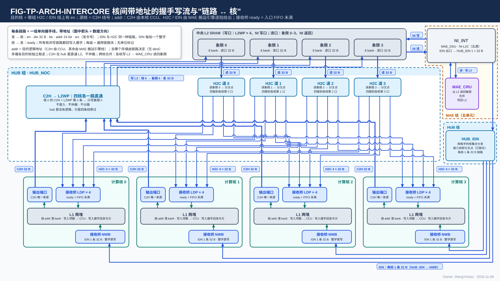

图中模块框内的结构是参考实现（见第 7 章），本章以框外的各口为准。

图中 hub 分中心（四核 C2H 各自直通 L2WP 的本核写链路，4 条 × 32 B，核 $n$ 只写象限 $n$；C2H 只到 L2）与 4 个 H2C 道发端（道 $n$ 读 L2 象限 $n$，经本道的多播分叉点送往四核各自的第 $n$ 道，各目的核按自己的 ready 独立取走；分叉点放在哪、分几级由后端定，§3.5.3）；L2 的读口画成读地址流与读数据流两条握手流；每核三个数据口：H2C 接收桥（四道成一个请求源）、IDN 接收桥 NWB（一条 32 B 链路，来自 HUB_IDN）、集成输出端口（C2H）；右上虚线框是 MAE 组，MAE 的搬运引擎给 H2C 各道读地址与逐拍目的地址（橙色细实线，带握手），NI_INT（含 MAE_DSU、NI 写口一侧）与 MAE_CRU；其下另一个"HUB 组"框是 HUB_IDN，NI_INT 的 IDN 出口一路 32 B 进 HUB_IDN，由它按随字的核集合分发到各核 NWB；MAE_CRU 只与 NI_INT 往来：经 NI 读口读 L2 四个象限（合并定长份时用同址）、合并结果经 NI 写口写回 L2；NI_INT 到 L2 的 NI 写口（32 B）与 NI 读口（4 路 × 32 B，各路各给读地址）不经 hub。每条链路的信号在左上角说明框里统一标出，线上只标名与位宽。

**核间链路是带地址的握手写流**（V18-TP-26）：每拍 en ∧ ready 成交，每拍自带目的地址；**信号与核内 RRAM 口同名（en / din / be / addr / `seg`），核间只多 ready、发令号 `src` 与反向的写入握手**（V18-TP-41 / 47 / 51）；没有地址通道、响应与 burst，也没有切换段标记（V18-TP-42），不是"首拍给地址、后续拍按流解释"的流——就是核内写口加一对握手线拉到核间。核内 RRAM 口的"写当拍、读固定 1 拍、无握手"只在核内（§2.3）。

#### 2.2.1 拓扑规则：目的核与源核由链路标识

**链路清单——每条核间链路的方向、条数、位宽、每拍地址由谁给、目的与核的标识——在架构篇 §2.4.1 与全口宽总表 PORT-12…22，本篇不重复。** 本篇对拓扑只规定四条规则：

1. **数据链路上没有"发给哪个核、来自哪个核"的字段：目的核 = 哪组线上有 en，源核 = 线号**（V18-TP-42 / 51）。每核对中央端各有独立的一组 H2C、C2H、IDN 线；多播由分叉点复制（§3.7）；写到哪个存储由链路决定，addr 只是目的存储内部的字节位置，没有 dest，也没有切换段标签。
2. **每条链路都带同一组信号：正向 en / din / be / addr / `seg` / `src`，反向 ready 与写入握手；`src` 在只有一个发令方的链路上为常数**：链路之间没有位宽差别（din 一律 32 B、be 32 位，IDN 也是），也没有"某条链路少一个信号"的特例；`seg` 全部 5 bit（V18-TP-61）。NI 写口的同址广播由 `seg` 的段掩码表达，没有独有的旁带。
3. **所有核间链路同一时钟域，任意位置插任意级寄存器，协议功能不变；本篇的功能定义里不出现任何固定拍数**（V18-TP-26 / 31）。流水级数【设计者定】：要定的是每段的级数，约束是 §3.5.3 的 A1–A7。对外 AXI 口的跨时钟域在 NI_EXT。
4. **MAE_CRU 不连核间链路**（V18-CRU-07）：它的输入经 NI 读口从 L2 读、输出经 NI 写口写回 L2，两段都在 MAE 组与 L2 之间；各核要合并的数据走 C2H → L2，合并结果要到核 L1 时走 L2 → H2C。

#### 2.2.2 信号与每拍含义

| 信号 | 方向 | 位宽 | 每拍含义 | 核内 RRAM 口对应信号 |
|---|---|---|---|---|
| en | 发 → 收 | 1 | 本拍有一次写 | en（写时 wea = 1） |
| ready | 收 → 发 | 1 | 本拍能收；en ∧ ready 成交 | 无（核内无握手；核间比核内多的唯一一根握手线） |
| din | 发 → 收 | 32 B | 数据，**从第 0 字节起放本拍的有效数据**（V18-TP-74） | din |
| be | 发 → 收 | 32 | 字节有效位：**标出从第 0 字节起连续有效的字节**，接收桥原样带进写请求。默认对齐时只有尾字可不全 1（数据块的尾字、通道片各部分的片尾字、MAE_DSU 转置不足 $N$ 行的尾块）；进 L1 S 类的拍恒全 1（S 类写口整字写）；**IDN 链路不受整字限制、也不需要感知，按 be 原样传**，是否整字由发送方与数据组织定（V18-DORG-10 (4)） | be（或长度） |
| `seg`（段选） | 发 → 收 | **5，所有链路统一 = 堆选 1 + 段掩码 4（独热）**（V18-TP-61 / L1-20） | **本拍落哪个存储范围**：堆、类（L1，段掩码用 3 位 = W / S / A，第 4 位恒 0）或象限（L2，4 位 = 四象限）；定义以架构篇 §3.3 为准。由发令方随指令给出（指令字段是 2 bit 选择，发令方展开成独热）、逐拍携带（V18-TP-57）；**不是地址的一部分，地址累加不会进位到它**；一拍只许一位为 1，多位为 1 只出现在 NI 写口 = 同址广播；象限由链路固定的链路（L2WP 第 $n$ 条、象限读口 $n$）也带 5 bit，接收方忽略段掩码、只用堆选 | `seg`（核内由 CCU 随访问给出） |
| addr | 发 → 收 | 24，两方向同宽 | **本拍第一个有效字节在目的存储范围内的字节地址**（§3.2，默认是 32 的倍数），**逐拍携带；C2H 上由本核 CCU 给出，H2C / IDN / NI 上由 MAE 搬运引擎给出**（§3.3）。**addr 只是目的存储内部的位置，由该存储自己解释；写到哪个存储不编码在地址里，由链路决定**（C2H 到 L2、H2C / IDN 到 L1）（V18-TP-51） | addr |
| `src`（发令号） | 发 → 收 | **5 bit【待标定】**（要求值，架构篇 §2.4，V18-MAE-45）；所有链路都带 | **本拍属于哪个发令方**：每个 MAE 搬运引擎一个号（H2C 各道的道引擎各用自己的号）、每笔在途 PIN 事务一个号（由 NI_INT 分配，MAE_NI_INT 篇 §3.6）、每核 CCU 一个号；MAE_DSU / MAE_CRU 的输出用执行该指令的搬运引擎的号。数据不打切换段标签，只区分发令方（同 AXI4-Stream 的 TID）（V18-TP-47）。**接收方不看 `src`，只把它随写入握手原样带回**；几个发令方共用的链路（NI 写口、H2C 道、IDN）靠它让握手各回各家；只有一个发令方的链路（L2WP 第 $n$ 条）上为常数，**写入握手照样带回 `src`**（与其他链路同形，V18-TP-80） | 无 |

**默认使用时每拍对应目的地的一个存储字**：addr 是 32 的倍数，be 给其中有效的字节。**addr 不是 32 的倍数时这一拍跨两个存储字，由目的 SRAM 内部处理；链路、hub、接收桥、MAE、IDN 都不移位、不拆、不感知**（V18-TP-74，§3.4）。**链路上没有切换段标记**（V18-TP-42，§3.10）：一个切换段从哪拍开始、到哪拍结束只有发令方知道；也没有核号字段（核由链路标识）、切换段标签与请求号。

**发令号的唯一性**：**任何时刻一个 `src` 只对应一条未完成的指令**；引擎换指令时上一条指令的握手还没回齐，同一个号就不能开始给新指令，否则握手会混到两条指令之间。怎样做到（等齐再换，或在两个号之间轮换）归参考实现（§7.8）。

**与 AXI4-Stream 信号名的对照**（核间链路沿用核内 RRAM 口的信号名；读 AXI 风格文稿时对照）：

| AXI4-Stream 名 | 本篇名 | 说明 |
|---|---|---|
| TVALID | en | |
| TREADY | ready | |
| TDATA | din（命令网为 data） | |
| TKEEP | be | |
| TUSER | addr | |
| TDEST | —— | 不设：去哪个存储由链路决定（C2H 只到 L2，V18-TP-51 / CRU-07） |
| TLAST | —— | 不设（V18-TP-42）；命令网同样没有末拍标记 |

#### 2.2.3 握手语义：en ∧ ready 同拍成交

- **ready 是接收方给发送方的一根线，含义是"这一拍我能收"**。发送方把 en 拉高并放好 din / be / addr / `seg` / `src`；**只有 en 与 ready 在同一拍都为 1，这一拍才算交出**，发送方才能换下一拍；ready 为 0 的拍发送方必须原样保持；接收方随时可以拉低，不需要提前通知。ready 不计数、不记账，每条链路只这一根线。
- **发送方的义务**：en 一旦拉起，在成交前不得撤销，其余信号保持。
- **ready 只回答"这一拍能不能进对方"，不回答"目的空间有没有空"**（那是编译链的事，§3.14），也不说明数据已写进存储（那是写入握手的事，§2.2.4）。
- **每一级都寄存器输出，下游拉低 ready 后仍在途的拍由本级接住**；所以 ready 不穿过多级组合逻辑，任意插级功能不变（§3.5）。

#### 2.2.4 写入握手：写进最终存储后逐拍回发令方，每个写入方一组

**所有核间写链路都有反向的写入握手**（V18-TP-50）：**接收方每把一拍的全部有效字节写进最终存储之后，沿这条链路回一个写入握手（valid + 该拍的 `src`），一拍恰回一个**；只有 valid、没有 ready，发令方的计数器每拍都能收。最终存储 = L1 / L2 的存储、LIC 专用小 SRAM；写往片外时 = 收到 AXI 写响应。**写入握手来自 AMBA AXI 的写响应通道 B**（从机写完后回 BRESP，主机据此判写完成）；差别见 §8.1。

**写入握手逐写入方回发令方，不在中途汇总**（V18-TP-78）：**凡多个写入方的握手回到同一发令方，每个写入方一组握手线（valid + `src`）、各回各的，发令方按（写入方, `src`）分别计数；不设中途汇总、归并或仲裁。** 条数（PORT-30）：

| 链路 | 写入方 | 握手回给谁 | 组数 |
|---|---|---|---|
| H2C → 核 L1 | 核 $c$ 的 H2C 接收桥第 $n$ 道 | 道 $n$ 的发令方（MAE 里执行该指令在道 $n$ 上那部分的搬运引擎，即道引擎） | 4 道 × 4 核 = 16 组；道 $n$ 多播给 $k$ 个核时回 $k$ 组，一拍至多收 4 个（各核 1 个） |
| IDN → 核 L1 | 核 $c$ 的 NWB | 发令的搬运引擎（经 HUB_IDN 回去，HUB_IDN 不汇总） | 4 组（每核 1 组） |
| C2H → L2（L2WP） | L2 象限 $n$ 对核 $n$ 的写入 | 核 $n$ 的 CCU | 4 组；**与其他链路同形，valid + `src`**（V18-TP-80） |
| NI 写口 → L2 | L2 象限 $q$ | 发令的搬运引擎（NI_INT 只按 `src` 分发、不归并） | 4 组（每象限一组）；同址广播到 $k$ 个象限时每个象限各回一个 |
| NI → LIC 直连口 | LIC 专用小 SRAM | 发令的搬运引擎（经 NI_INT） | 1 组 |
| NI_EXT → DDR / 共享内存 | 片外 | 发令的搬运引擎 | AXI 写响应（AXI B 本身就是写入握手） |
| PIN → L2 | L2 | 该笔 PIN 事务的发令号，在 NI_INT 数满后由 NI_EXT 回 AXI B 给外部主方 | 同 NI 写口那 4 组 |

全芯片片内 16 + 4 + 4 + 4 + 1 = 29 组，每组 valid + `src`；hub、HUB_IDN 只把这些组连通。规则：

- **一拍的数据写进最终存储的那一拍之后才回握手，不早于它写进**；还在接收方缓冲或链路流水级里的数据不回握手，所以不设排空信号，也不依赖任何固定时延。
- **发送方不必等握手回来才发下一拍**：写入握手只是计数脉冲，吞吐不受影响；它经 HUB 提供的通用链路块的反向旁带回程，同样寄存器输出、可任意插级，回程级数与正向独立（§3.5.3 A5）。
- 握手不带指令号、不带切换段号，只带 `src`；各存储写进的先后可以与链路上的先后不同，归属在发令方一侧按 `src` 完成，接收方不保存计数。

#### 2.2.5 L2 读口：读地址流与读数据流两条握手流

**L2 的两种读口（象限读口 0–3、NI 读口每象限一路）各由两条握手流组成**（V18-TP-80；口宽见架构篇 §2.4.2、PORT-15 / 19）：

| 流 | 方向 | 信号 | 语义 |
|---|---|---|---|
| **读地址流** | 发读方（MAE 搬运引擎）→ L2 | 发读方给 en、addr 24、`seg`；L2 回 ready | en ∧ ready 同拍成交一个读地址；每拍一个地址、读出至多 32 B（架构篇 §3.4 CONC-3）；ready = 0 时发读方保持本拍不变 |
| **读数据流** | L2 → 下游（H2C 道 $n$，或 NI_INT 的 L2 读出分路） | L2 给 en、dout 32 B；下游回 ready | en ∧ ready 同拍交出一拍读出；**每接受一个读地址恰交出一拍，按读地址的成交次序交出，不丢、不乱序、不重复**；读出从首地址那个字节起放在第 0 字节 |

- **下游收不下时，L2 把读地址流的 ready 拉低，卡住发读的 MAE 搬运引擎**；同一个堆同拍几条链路争用时 L2 依次服务（CONC-2），也只表现为读地址流的 ready 拉低，只降速、不出错。
- **读出拍数不规定数值，正确性只取决于两条流的握手**；L2 不向任何一方登记读出拍数，发读方也不按余量发读。
- 读地址里没有请求号；读地址的形式（是否另带读出长度）由 L2 与 MAE 对接【设计者定】，约束：每拍一个地址、读出 ≤ 32 B、按成交次序返回（架构篇 §2.4.2）。
- **NI 读口四路各给各的读地址，可以不同址；四路的读地址流与读数据流 ready 各自独立，与各自的搬运引擎一一对应，一路被卡不影响另三路**（V18-L2-08）。第 $q$ 路读象限 $q$，各路的读数据流各自按序交出、可不同拍。**"四路同址"（同一拍读四个象限的同一段内地址）只是跨核合并定长份时的一种用法**（编译链放法），不是口的限制；这种用法下四份的对齐由使用方做（MAE_CRU 篇 §2.2.1）。
- **读一侧的合并保速**：同一个堆上几条链路争用时，同一条读链路地址连续的读请求，SRAM 须能合并成一次访问、分拍交出，使该链路保持 32 B/拍（架构篇 §3.4 CONC-3，V18-L2-08）。
- 读数据流只带数据：H2C 道上的目的地址、be 与核掩码由发读的搬运引擎另经目的信息流给 H2C 道（§2.2.6）。

#### 2.2.6 搬运引擎给 H2C 道的目的信息流：带握手，道不能收时引擎保持

**H2C 道 $n$ 的发令方是 MAE 里执行该指令在道 $n$ 上那部分的搬运引擎（道引擎，MAE_ENG 篇 §1）**：它给 L2 象限读口 $n$ 的读地址流（§2.2.5），并给道 $n$ 一条**目的信息流**（每拍：目的 addr / be / `seg` / `src` 与 4 bit 核掩码）。

- **H2C 道上有三条流——读地址流、读数据流、目的信息流——各自握手、不要求同拍，道内按次序配对：第 $i$ 个成交的目的信息配第 $i$ 拍读出**（V18-TP-82，用户 11-11："这是正确的，核间协议本来也应该带目的地址"）。
- **目的信息流用 en / ready 握手：道不能收时拉低 ready，引擎保持本拍不变**（V18-TP-80）。
- hub 只把目的信息与 L2 的读出按次序配成一拍送出，不累加地址、不记切换段。
- **核掩码作旁带走到最后一个分叉点，到核的最后一段不带**（§3.5.3 A3）。
- **四道各自停发、互不等待**；四道之间怎样协调归 MAE（MAE_ENG 篇 §3.10）。**需求按搬运引擎在 MAE 内写**；引擎放在哪是后端的事（参考放法与选用道旁放置时附加的接口见 §7.6）。

#### 2.2.7 IDN 链路：每核一条 32 B，核集合随字到 HUB_IDN 为止

**IDN = 每核一条 32 B 的带地址的握手写流，全芯片 4 条；信号与 H2C 完全相同：en / ready / din 32 B / be 32 / addr 24 / `seg` 5 / `src`，反向写入握手（valid + `src`）**（V18-HUB-04；PORT-16）。

**MAE 的 IDN 出口交 HUB_IDN 一路 32 B（PORT-17），每拍一拍数据（默认一个存储字，带 addr / be / `seg` / `src`），随每拍给一个 4 bit 核集合**；核集合是 HUB_IDN 之前的旁带，到核的链路上不带。**HUB_IDN 按每拍的核集合把这一拍送到集合内每个核的 IDN 链路，接几核就是多播（各核独立取走，§3.7）**；它不拆拍、不缓存整字、不算地址、不数切换段，也没有交叉开关（HUB_IDN 篇）。IDN 出口的唯一数据源在 NI_INT 内择一（读返回分路去 L1 的一路、MAE_DSU 去 L1 的输出，§3.10）。

### 2.3 核内 RRAM 口

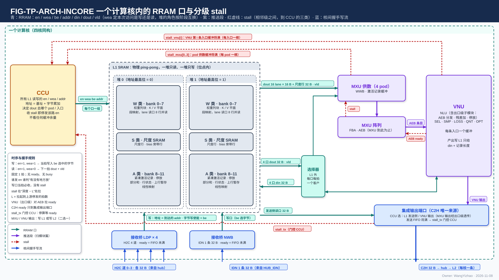

图中模块框内的结构是参考实现（见第 7 章），本章以框外的各口为准。

图中：

- **左列**：CCU 发核内一切 L1 读的 en / wea / addr / `seg` 与有效字节、VNU 写口那一路的写地址与 `seg`，并给 L1 外三个读出一侧部件——A 类读 MUX、S 类读 MUX、W 类读出到 VNU 读口的一路——每拍的去向（图中层"L1 外"）；写 MUX 不由 CCU 逐拍选来源（V18-L1-32）。W 类权重读口每路另带 4 位"哪些 pod 收"；权重字放进 pod 的哪个槽由 MXU_CONTROLLER 内部排，CCU 不给槽号（MXU 集成篇 §2.2、MXU_CONTROLLER 篇 §3.2）。CCU 一侧的缓冲属 CCU 的设计（`CCU_STAGING.md`）。
- **下层**：L1 的 W / S / A 三类，每类两堆，两堆都可读可写；**L1 只暴露 RRAM 口**：W 类权重读口一拍 4 路（各路各给地址）、A 类读口一个（首字节地址 + 长度 ≤ 128 B，交回从首字节起对齐好的数据）、S 类读口一拍 2 个地址（各 32 B）；A / W 类写口各一个（首字节地址可为任意字节，一次 ≤ 128 B）、S 类写口 32 B 整字。框内的 bank 格子是参考组织。
- **上排**：MXU 供数 → 阵列（到 AEB 为止）→ VNU 组。AEB 条目只进 EPI（NLU 的后处理子模块），条目在 EPI 里放在哪由 EPI 设计者定（V18-EPI-06）；累加器粗分数旁路直达 SEL。
- **A 类读出**：A 类读口交回的 ≤ 128 B 进 A 类读 MUX，**读 MUX 只选使用者，整拍只送一个使用者**——MXU（带 pod 号）、VNU 读口 128 B、CCU 128 B、发送 FIFO 入口（集成输出端口的入口）128 B；读 MUX 与使用者入口都不做字节移位。S 类读口的读出经 S 类读 MUX 送 pod 权重旁带、pod 激活旁带、VNU 读口、EPI、发送 FIFO 入口。
- **写入**：三个来源——VNU 写口与两个接收桥（H2C 接收桥四道成一个请求源、NWB；常开，写地址来自随数据到达的 addr）——经中层的写 MUX 进 L1 每类一个写口；**写 MUX 自己按固定规则在三个来源之间轮流，每拍写一个来源一次，没轮到的在自己的 FIFO 里等，写与读碰到同一个堆时写让读，不由 CCU 逐拍选**（V18-L1-32）；三个来源都可写 A、W、S 三类，VNU 写口写 W 类的数据由 QNT 排成 W 类的字形态（V18-VNU-09）。
- **上排右**：计算核的集成输出端口，两个核内来源（发送 FIFO 入口、VNU 输出口；MXU 输出经 EPI 透传后算 VNU 输出）由 CCU 选一路上 C2H。
- **红色虚线是 stall**：供数（每 pod 两根：权重收不下、激活收不下）与 VNU 读入口（一根）回到 CCU；EPI 对 AEB 拉 ready；集成输出端口拉 stall_tx 到 CCU，CCU 被门控、停算（§2.4）。

**RRAM 是核内每个单元与 L1 之间那种口的协议名：按 SRAM 宏的口来定义，写当拍、读固定 1 拍、没有握手**（读者可以把它理解为"把 SRAM 宏的口直接拉到单元边上"）。**L1 只暴露 RRAM 口；来源选择与读出去向都在 L1 外，L1 不感知；读出去向由本核 CCU 控制，写入来源由写 MUX 自己轮流**（V18-L1-21 / 24 / 32）——这四个 MUX 是计算核内、L1 外的部件，内部归计算核集成（`CORE_INTEGRATION_STAGING.md`），规则见架构篇 §3.7；本篇只写口上可观察的行为。

#### 2.3.1 信号与每拍含义

| 信号 | 方向 | 位宽 | 含义 |
|---|---|---|---|
| en | 发起方 → L1 | 每口 1 位（W 类权重读口每路 1 位，S 类读口每个地址 1 位） | **请求本身**：为 1 的拍这个口或这一路就有一次访问 |
| wea | 发起方 → L1 | 每口 / 每路 1 位 | **本次访问是写（1）还是读（0）**；只在 en = 1 的拍有意义 |
| addr | 发起方 → L1 | 每口 / 每路 24 | 段内字节地址，**一次访问的首字节地址**（§3.2）；默认是 32 的倍数；A 类读口与 A / W 类写口可为任意字节；W 类权重读口每路一个、S 类读写按整字（32 的倍数） |
| `seg` | 发起方 → L1 | 5 | 堆选 + 段掩码（类选 W / S / A，第 4 位恒 0），定义见架构篇 §3.3；W / S / A 三类的堆选各自随每次访问给出、互不相关 |
| 有效字节（len 或 be，形式【设计者定】） | 发起方 → L1 | 位宽【设计者定】（A 类读口、A / W 类写口；W 类权重读口与 S 类口整字，没有此信号） | **本次访问从首字节起有多少字节有效（1–128 B）**：用长度还是"从第 0 字节起连续的字节有效位"表达、字段位宽【设计者定】，约束是能表达任意字节起点与 1–128 B 的长度（V18-TP-74）。写时有效字节以外的字节保持原值 |
| din | 发起方 → L1 | A / W 类写口 ≤ 128 B；S 类写口 32 B | 写数据，**从第 0 字节起放本次的有效数据**；地址不是 32 的倍数时由 L1 内部移位（§3.4） |
| dout | L1 → 消费方 | A 类读口 ≤ 128 B；W 类权重读口每路 32 B；S 类读口每个地址 32 B | 读数据：A 类读口交回**从首字节起对齐好**的数据（首地址那个字节在第 0 字节）；W 类权重读口每路、S 类读口每个地址各一个整字 |
| vld | L1 → 消费方 | 每口 / 每路 1 位 | 读数据有效；从字边界起的读 = 读的 en 延 1 拍（不从字边界起的读允许多拍，§2.3.2） |

**wea 不能省：每个堆同一时段可以又读又写（只是不在同一拍），每次访问都要告诉它这次是写还是读。** wea 由发起方逐拍给出，而不是由 L1 按"角色"自己推——L1 没有"哪堆在读、哪堆在写"的状态，堆选和 wea 都来自地址与指令。wea 只区分读写；写哪些字节由有效字节给出。

#### 2.3.2 访问形式：首字节地址 + 有效字节数，读口与写口同形

**读口、写口都是逻辑口：每个堆同一拍只做一次访问（一次读或一次写，架构篇 §3.4 CONC-2）；一次访问 = 首字节地址 + 有效字节数（≤ 128 B），读与写同形**（V18-TP-73）。A 类读口、A 类写口、W 类写口各是一个这样的逻辑口，一次访问一套 en / wea / addr / `seg` / 有效字节。

- **从存储字边界起的 ≤ 128 B 访问一拍完成，否则允许多拍**（架构篇 §3.4 CONC-3，拍数不作规定）。不从字边界起的访问允许慢，只降速、不出错。
- **例外有两个**：W 类权重读口一拍 4 路、各路各给地址、整字（§2.3.5，CONC-4）；S 类读口一拍 2 个地址、整字，S 类写口一次一个整字、不带有效字节（§2.3.6，CONC-6）。
- **L1 对外只有这些 RRAM 口**（V18-L1-21 / 24）。

#### 2.3.3 写口：每类一个，来源由 L1 外的写 MUX 选，当拍写入、无应答

**L1 每类一个写口、共三个，都是 RRAM 写口：A 类、W 类各一个，一次写 = 一个来源的首字节地址（默认在字边界，可为任意字节）+ 有效字节数（≤ 128 B），数据从首字节起给；S 类一个 32 B 口，一次一个存储字、整字写、不带有效字节（生产方把每片末字补 0）**（V18-L1-14 / 20 / 24、DORG-04）。

**写来源只有三个**：H2C 接收桥（四道在桥内成一个请求源，§3.17）、IDN 接收桥 NWB、VNU 写口。各类的来源与内容：

| 写口 | 一次写 | 来源 | 写什么 |
|---|---|---|---|
| A 类 | 首字节地址起 ≤ 128 B | H2C 接收桥、NWB、VNU 写口 | 元数据项、F 列表、码块、稠密残差的码、停放、部分和、行状态、上行暂存 |
| W 类 | 与 A 类同形 | H2C 接收桥、NWB、VNU 写口 | 权重列块、K / V 平面、精算的全码 key 记录（按列字区的列位落）、LM Head 列副本的码；**数据到达时已是 W 类的字形态**（两种字形态的定义见数据组织篇 §2.12）：片外来的由 MAE_DSU 直通或转置（MAE_DSU 篇 §3.2 典型用法表），核内产生的由 QNT 排好、经 VNU 写口写进——本核产生、本核消费的 K / V 码，以及权重梯度里进权重侧的 $\mathrm dY$、$X$（架构篇 §3.6.3）（V18-VNU-09 / MXU-14） |
| S 类 | 1 个存储字，整字 | NWB、H2C 接收桥、VNU 写口（激活 E8M0、OPT 新副本的 E8M0） | 权重尺度行、K 与 LM Head 列副本的尺度、V 的尺度、激活 / Q 的 E8M0、bias；地址由编译链分配 |

规则：

- **不同来源不合并进同一次写，按拍错开**：**每类写口每拍写三个来源之一一次，写谁由 L1 外的写 MUX 决定；写 MUX 不由 CCU 逐拍选来源，自己按固定规则在三个来源之间轮流，没轮到的在自己的 FIFO 里等**（V18-L1-24 / 32，用户 11-11："我认为CCU不应该控制这件事，这个控制不能让LANDING自己做吗？"）。判断规则：请求不是 CCU 发的，就不由 CCU 仲裁——接收桥的落地写地址与数据都来自 MAE。**L1 没有优先级表、没有"选中"信号，不感知来源**；轮流的规则、各来源 FIFO 的深度与写 MUX 跟来源之间的接口归计算核集成（`CORE_INTEGRATION_STAGING.md`），约束：三个来源之间任何一个都不被另两个饿死。
- **写与读碰到同一个堆时写让读**（V18-L1-32）：读由 CCU 发、口上没有握手、不能等，所以这一拍不写、下一拍再写；**由写 MUX 在本地判断，CCU 不参与**；写等久了经 FIFO 与 ready（接收桥）或 wr_stall（VNU 写口）反压，只降速。
- **L1 写口不要求设缓冲，也不拉 stall**；没轮到的来源在自己那里保持、不丢：接收桥来不及收时拉低本道的链路 ready（§3.17）；VNU 一侧的停顿不到 CCU（§2.4）。
- **VNU 写口一次写 = VNU 交的数据与有效字节数（≤ 128 B）+ CCU 给的首字节地址与 `seg`**：**VNU 只交处理好的数据与每一拍的有效字节数，不报地址、不报长度；地址由本核 CCU 内部计数推出**（V18-VNU-12，VNU_CONTROLLER 篇 §3.9）；**按 `seg` 进 A、W、S 三类写口之一**（进 S 类时一次一个整字；写 W 类的数据由 QNT 排成 W 类的字形态）；VNU 各单元的写在 VNU 内合并进这一条（VNU 集成篇 §2.6）。
- **每拍的动作**：写 MUX 把轮到的来源的这一次写交给写口（目标堆这一拍正被读时推迟），写口当拍写进；**被写字节被覆盖，其余字节保持原值；没有应答**。写进之后任何读都读到新值；**同一个堆同一拍只有一次访问：读由 CCU / 编译链排，写让读**（CONC-2）。
- **L1 与接收桥都没有写计数**：落进 L1 的核间数据由发令方数写入握手、发写完通知；核内写 L1 的完成由 CCU 判定（§3.8.3）。
- **写带宽的硬上限 = A 类、W 类各 128 B/拍，S 类 32 B/拍。编译链不做写带宽保证：需求超出时来源在自己那里等、反压上游（接收桥拉低 ready、VNU 写口拉 wr_stall），只降速、不出错**（V18-L1-21）。

#### 2.3.4 读口：固定 1 拍返回，无 ready、无 busy

**en = 1、wea = 0 的那一拍给首字节地址与长度，从字边界起的读下一拍 dout 上就是从该地址起的数据、vld = 1。** 读出时延固定 1 拍；**读由 CCU 排，写口与读口落同一个堆时写让读、由写 MUX 本地判断**（CONC-1 / 2，V18-L1-32）。**A 类读口 = 一个逻辑读口：CCU 给首字节地址与长度（≤ 128 B），L1 把首字节移到输出的第 0 字节后交回**（V18-L1-21 / TP-73 / 74）；不从字边界起的读允许多拍（§2.3.2）。L1 不拼接两个使用者的读、不判断去向，所以没有 ready，也没有 busy。

**A 类读出由 L1 外的 A 类读 MUX 整拍只送一个使用者；读 MUX 只选使用者，不排字序、不移位**（V18-L1-21，架构篇 §3.7）。使用者共四个：

| 使用者 | 入口 | 说明 |
|---|---|---|
| MXU（4 个 pod 算一个使用者，带 pod 号） | 1 道 128 B（MXU 集成篇 §2.3） | pod 号 = CCU 这一拍服务哪个 pod；源属于哪个 pod 固定，码不带源的序号；停放值装回累加器复用这一道（带"装回"标志）；入口宽度、分时、激活缓冲见 MXU 集成篇 §2.3 |
| VNU 读口 | 128 B | 轮到 VNU 的拍这一次读出整个给 VNU（VNU 集成篇 §2.4） |
| CCU | 128 B | 收元数据项与 F 列表；CCU 一侧怎样缓冲属 CCU 的设计（`CCU_STAGING.md`） |
| 发送 FIFO 入口 | 128 B | 计算核集成输出端口的入口，不是 L1 的口（§3.17） |

| A 类读的一方 | 拿到什么 |
|---|---|
| CCU | 发 A 类读口的 en / wea = 0 / 首字节地址 / 长度，给 A 类读 MUX 本拍的使用者 |
| L1 | 下一拍交回从首字节起对齐好的数据 + vld，不知道送给谁 |
| A 类读 MUX | 只选使用者：整拍交 CCU 指定的一个使用者入口，不排字序、不移字节 |
| 使用者入口 | 收对齐好的数据，交本使用者 |

**每拍 A 类读出只给一个使用者，L1 不合并两个使用者的读；编译链不做读带宽保证，需求超出时使用者等 CCU 排拍**（V18-L1-21）。W 类读出另有一路经 L1 外送 VNU 读口（OPT 读前向副本），由 CCU 控制；**L1 不限制 W 类与 A 类同拍读出，VNU 入口一拍怎样收由 VNU 设计者定**（V18-VNU-09）。

#### 2.3.5 W 类权重读口：一拍 4 路，各路各给地址

**W 类权重读口是 §2.3.2 统一访问形式的例外：一拍接收 4 个地址，分属 4 路，各路各自给地址（架构篇 §3.4 CONC-4）；第 $b$ 路读存储字号除以 4 余 $b$ 的字，4 路共用这次访问的堆选，每路每拍读一个整字，不做字节起点**（V18-L1-26）。稀疏取列要求一拍读的几列各在自己的地址上，所以各路各给地址。

- **读序列由 CCU 按列所在的路排，同一路的两列排在不同拍**；"哪一列放在哪个地址"由编译链分配（CONC-4）。
- **每拍送进 pod 的量**：行字区至多 4 个存储字 = 16 个归约位置 $k$ × 16 列（每个存储字 4 个相邻 $k$ × 16 个 $m$）；列字区至多 4 列，每列一个存储字 = 该列在 64 个连续归约位置上的码（前向是一个 $m$ 的 64 个连续 $k$，反传 $\mathrm dX = \mathrm dY\,W^{\mathsf T}$ 是一个 $k$ 的 64 个连续 $m$；两种字形态的定义见数据组织篇 §2.12，各运算用哪种见架构篇 §3.6）。
- **L1 不重组：读什么交什么**。**每路的字带 4 位"哪些 pod 收"**，各 pod 各自要权重，几个 pod 要同一个字时只读一次、同拍送给这几个 pod，同一路（同一个 bank）的两个请求由 CCU 错到不同拍（V18-CCU-01）；**字到达 pod 时不带写入位置，放进哪个槽由 MXU_CONTROLLER 定**（MXU 集成篇 §2.2、MXU_CONTROLLER 篇 §3.2）；**"到达的第 $i$ 列 ↔ 原 hidden state 列号"的映射由 CCU 持有，算完后的排回归 CCU**（`CCU_STAGING.md`），不经 L1。
- 对应的权重尺度由 S 类读口读出、经 S 类读 MUX 进 pod 权重旁带（§2.3.6）。
- 时延同样固定 1 拍；W 类权重读口与 W 类写口落同一个堆时写让读（写 MUX 本地判断，V18-L1-32）。
- W 类只有这一个读口；送 VNU 读口的那一路是它在 L1 外的一个去向，读连续的副本码时 CCU 给出连续字的地址即可。

#### 2.3.6 S 类读口：一拍 2 个地址，按整字读

**S 类读口一拍可接收 2 个地址，可以是同一个堆里的两个数据（架构篇 §3.4 CONC-6，V18-L1-31 / TP-84），每个地址每拍一个整字（32 B），每个地址一套 en / addr；读出经 L1 外的 S 类读 MUX 送 pod 权重旁带、pod 激活旁带、VNU 读口、EPI、发送 FIFO 入口**（V18-L1-21），送哪个去向由 CCU 给。**所有尺度与 bias 都在 S 类，放哪由编译链分配；同拍需要的多于 2 路时由 CCU 错开**（CONC-6）。S 类的读固定 1 拍。S 类的字格式见架构篇 §2.2.2。

### 2.4 核内相邻级 stall 信号

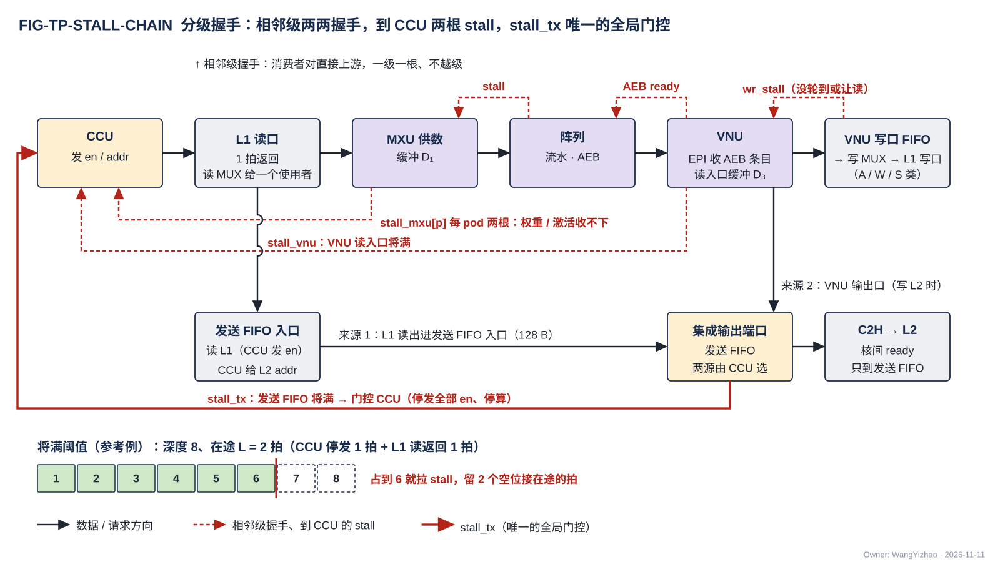

图中数据从左向右：CCU 发 en / addr → L1 读口 1 拍返回（A 类读出经 L1 外的 A 类读 MUX 整拍给一个使用者）→ MXU 供数 → 阵列（AEB）→ VNU（EPI 收 AEB 条目）→ VNU 写口 → 写 MUX → L1 写口（A / W / S 类）。红色箭头指向"谁该停"，分三类画在三处：

- **框上方的短箭头是相邻级握手**：阵列对供数的 stall、EPI 对阵列的 AEB ready、VNU 写口对 VNU 的 wr_stall（写 MUX 没轮到该来源或写让读时拉起）。每根只连相邻两框，消费者只对直接上游握手，不越级。
- **框下方两条车道是到 CCU 的 stall**（stall_mxu[p]、stall_vnu）：只因为这两级的数据是 CCU 发 en 读来的，消费者给发 en 者 stall，不是越级门控；pod 的权重、激活两种读分开停，所以 stall_mxu 每 pod 两根（权重收不下、激活收不下，MXU 集成篇 §2.8）；VNU 只有一个读口，所以只有一根 stall_vnu。
- **最下一行是计算核的集成输出端口**：两个核内来源——发送 FIFO 入口（CCU 发 en 读 L1、A 类 / S 类读 MUX 整拍交来，逐拍给 L2 addr）与 VNU 输出口（写 L2 时；经 EPI 透传的 MXU 输出也在内）——由 CCU 在切换段边界选一路；核间 ready 只到这个端口，端口来不及上 C2H 时拉 stall_tx 从 CCU 左侧进入，这是核内唯一的全局门控。

下方"将满阈值"的数值例（深度 8、在途 2 拍，占到 6 就拉）属参考实现（§7.9）。

**用词**：**握手**指相邻两方之间的一对 valid / ready 线——核内相邻级的 stall（含到 CCU 的 stall_mxu / stall_vnu / stall_tx、写者的 wr_stall）、核间链路的 en / ready 都是握手；**反压**只用来描述握手沿链向上游传播的现象，不是一种机制；本设计**没有全局 stall**。

| 信号 | 谁拉 | 何时拉 | 接收方的动作 |
|---|---|---|---|
| stall_mxu[p]，$p = 0 \ldots 3$，**每 pod 两根：权重收不下、激活收不下** | pod $p$ 的权重缓冲 / 激活缓冲（由 MXU_CONTROLLER 判，MXU 集成篇 §2.8、MXU_CONTROLLER 篇 §3.8） | 空位只够接住在途的拍时（阈值由 MXU 设计者按在途拍数定） | CCU 停发给该 pod 的对应一种读（权重读或激活读）；别的 pod、另一种读不受影响 |
| stall_vnu | VNU 读入口（VNU 只有一个读口，VNU 集成篇 §2.4） | 同上 | CCU 停发送往 VNU 读口的 A 类读 en；各单元的 stall 怎样合成这一根由 VNU 集成设计者定 |
| stall_tx | 计算核集成输出端口（§3.17） | C2H 的 ready 拉低、端口来不及上 C2H 时 | **CCU 被门控：停发全部 en、停算，等 stall_tx 撤销再继续**（V18-TP-56） |
| wr_stall | VNU 写口 | 写 MUX 没轮到 VNU 写口或因让读而推迟、VNU 写口的 FIFO 来不及收时 | 到 VNU 写口；不到 CCU；VNU 一侧保持待写的字、不丢（VNU 内部怎样传给各单元归 VNU 集成篇） |
| AEB ready | EPI → 阵列 | EPI 来不及收时（V18-EPI-03 / 06） | 阵列保持 AEB 条目；AEB 堆满再反压 MXU 累加器 / 供数 |
| 阵列 → 供数的 stall | 阵列 | 阵列来不及收时（何时拉归 MXU 的设计） | 供数停送 |

**CCU 不看任何缓冲的余量，只看这些 stall**；这就是 CCU "只做地址推理和顺序推进"的含义。各 stall 的规则见 §3.16。

### 2.5 命令网

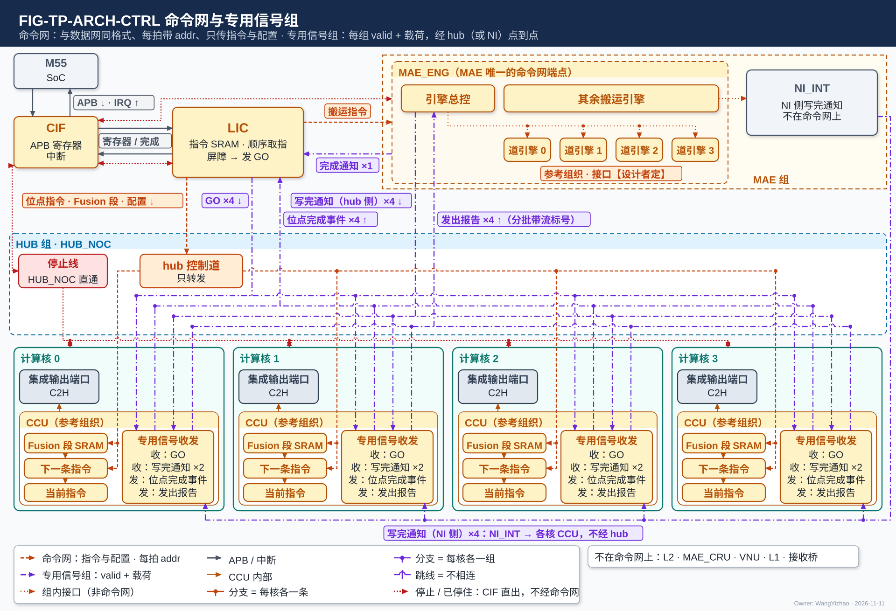

图中模块框内的结构是参考实现（见第 7 章），本章以框外的各口为准。

图中 LIC 在上排左；MAE 组（虚线框）在上排右，**MAE 在命令网上只有 MAE_ENG 一个端点**（收 LIC 的搬运指令），NI 一侧没有命令网链路；MAE_ENG 框内的引擎组织是参考组织（§7.6）；MAE 组里另画 NI_INT，只作 NI 侧写完通知的发出处，不是命令网端点；MAE_CRU 与 L2 不在本网上（V18-TP-55 / 75）。HUB_NOC 框在中间，框内是 hub 控制道与专用信号组的横线；四个核的 CCU 端点在下排，CCU 框内画出指令寄存器、Fusion-CCU 段 SRAM 与收发专用信号的一块（框内组织是参考，属 CCU 的设计，`CCU_STAGING.md`）；VNU 不在本网上。**命令网的线只有指令与配置**：LIC → MAE_ENG 的搬运指令（带指令标号）、LIC 经 hub 控制道 → 各核 CCU 的位点指令与 Fusion 段，每拍带端点内的 addr；每条线单向，都使用 HUB 提供的通用链路块（§3.5）。**专用信号组另画一层**（§2.6）：LIC → 各核的 GO、各核 → LIC 的位点完成事件、MAE → 各核的写完通知（**每核两组**：hub 侧一组给 H2C 搬运、NI 侧一组给 IDN 搬运）、MAE → LIC 的完成通知、各核 → MAE 的发出报告，线上标组名与条数。hub、NI、L1 都不向 MAE 报完成（完成按写入握手，§3.8）；GO 由 LIC 发（屏障 = 位点完成事件 + MAE 完成通知，归 LIC）。CIF ↔ M55 的 APB 与中断不属于命令网。

**命令网只传指令与配置**：LIC → 各核 CCU 的位点指令与 Fusion 段、LIC → MAE 的搬运指令、各种配置写（V18-TP-76）。**它的协议格式与数据网完全一致：en、ready、addr、data，每拍都带 addr，端点按 addr 写进自己的寄存器或 SRAM。** **完成类与同步类往来——GO、位点完成事件、写完通知、完成通知、发出报告——不在命令网上，各是 hub（或 NI）里的一组专用信号线**（§2.6，V18-TP-77）。**标量不走命令网**：它们是数据，经 C2H 写 L2、由 MAE_CRU 合并（V18-TP-55）。命令网、专用信号组与数据网物理分开，数据网再拥堵也不会挡住指令、GO 或写完通知，反之亦然。**L2 不在命令网上，指令也不存 L2**（V18-TP-75）：指令序列在共享内存 / DDR，调用之间经 M1 读口 → NI_INT 的 LIC 直连口装进 LIC 专用小 SRAM 的指令区；LIC 取指后把 MAE 指令经命令网写进 MAE_ENG，把 CCU 指令经命令网写进各核 CCU（指令寄存器与 Fusion 段 SRAM，§3.19）。

#### 2.5.1 信号：与数据网同格式，每拍带 addr

| 信号 | 位宽 | 用法 |
|---|---|---|
| en / ready | 1 / 1 | 握手，与数据网同名同义 |
| addr | 【设计者定】 | **目的端点内的寄存器 / SRAM 地址，每拍都带**，端点按它写入（例：CCU 指令寄存器的第几个 64 bit 字、Fusion 段 SRAM 的字地址、某个配置寄存器）；约束：能寻址一个端点内全部可写的寄存器与 SRAM 字 |
| data | 64 bit | 本拍写入的 64 bit 字 |

**信号与时序与数据网一致：en ∧ ready 同拍成交，每拍自带 addr；端点按 addr 写入，不按往来的种类选目标；网上没有末拍标记与长度字段**，一条指令占几拍由它的字段数决定，何时生效见 §3.19。是否另带 be【设计者定】，约束同 addr。**命令网的每条链路也使用 HUB 提供的通用链路块**（$W$ = 64 bit，旁带 = addr，另带 be 时加 be；V18-TP-38 / HUB-05），与数据网同一块、同一套寄存器输出与接住在途拍的条款；hub 控制道与 LIC → MAE_ENG 的链路是它的实例加各自的仲裁器。

#### 2.5.2 往来与端点：命令网只传指令与配置

| 往来 | 发出 → 接收 | addr 指端点内的哪里 | 拍数（64 bit） | 触发 |
|---|---|---|---|---|
| 位点指令 | LIC → 核 $c$ 的 CCU（经 hub 控制道） | CCU 指令寄存器的 16 个 64 bit 字地址 | 16 | LIC 顺序取指 |
| Fusion-CCU 段 | LIC → 核 $c$ 的 CCU（经 hub 控制道） | Fusion-CCU 段 SRAM 的字地址：段头 + 各成员 | 段头字数 + 16 × 成员数（段头字数归 ISA） | LIC 顺序取指 |
| MAE 指令（搬运指令） | LIC → MAE_ENG | MAE_ENG 指令接收队列的字：指令字段 + **LIC 分配的指令标号**；对 C2H 来源的指令标明"源来自核 $c$ 的 C2H"（§3.19） | $n$（字段位宽归 ISA） | LIC 顺序取指；**可同时下发多条**（V18-MAE-13 / 14） |
| 配置写 | LIC → CCU、MAE_ENG 等端点 | 端点内的配置寄存器 | 每个 64 bit 字一拍 | 编译链在指令序列里安排；各端点有哪些配置寄存器归各端点篇 |

**拓扑**：每条链路单向、点到点，目的端点由链路本身决定；**addr 是目的端点内的寄存器 / SRAM 地址，不是全局地址，hub 不按 addr 选路**；物理上是 hub 控制道与 LIC → MAE_ENG 的一条链路（**NI 一侧没有命令网链路**），与数据网、专用信号组完全独立。端点清单、链路条数见架构篇 §2.5.1、PORT-23 / 24。

| 端点 | 收什么 | 形态 |
|---|---|---|
| 各核 CCU | 位点指令、Fusion-CCU 段、配置写 | 命令网可写的指令寄存器、Fusion-CCU 段 SRAM 与配置寄存器，按 addr 写；一条指令写全才执行（§3.19；内部组织属 CCU 的设计，`CCU_STAGING.md`） |
| MAE_ENG（MAE 在命令网上唯一的端点） | LIC 的搬运指令（带指令标号）、配置写 | 指令接收队列（SRAM 或 RF）与配置寄存器，按 addr 写；队列深度【设计者定】：要定的是能排队的指令数，约束：来不及收时拉低 ready，在途的拍都接得住；队列满时 LIC 停发，只降速 |

NI_INT、HUB_IDN、MAE_DSU、MAE_CRU 不收指令，只收搬运引擎解码后的控制信号（V18-MAE-27）；本网没有标量，MAE_CRU 也不是本网端点：MAE_ENG 给 MAE_CRU 的合并参数是 MAE 组内信号。专用信号组的接收侧不在命令网上（§2.6）。

### 2.6 专用信号组：完成与同步往来的载荷语义

**每类完成或同步往来做成一组专用信号线：每组 = valid + 载荷，单向、点到点，不经命令网、不经数据网；hub（或 NI）的需求就是按下表把各组连通并计条数**（V18-TP-77）。**载荷各字段的语义只在本节定义**，架构篇（PORT-35…39）、HUB_NOC 篇、MAE 各篇与登记篇都引用本节。"hub 控制道"指命令网在 hub 内的链路，专用信号组是另外的线；**NI 一侧只有专用信号组（写完通知的 NI 侧 4 组），没有命令网链路**。

| 信号组 | 发出 → 接收 | 经 | 条数（按端点对） | 载荷与各字段的含义 | 何时发 |
|---|---|---|---|---|---|
| **GO**（PORT-35） | LIC → 各核 CCU | hub | 4（每核一组） | **位点号**：放行该核执行的那个位点 | LIC 收齐本位点各核的位点完成事件并数到所需的 MAE 完成通知（屏障归 LIC，§3.9） |
| **位点完成事件**（PORT-36） | 各核 CCU → LIC | hub | 4 | **事件号**：本核哪一个位点（含 Fusion-CCU 段）完成 | CCU 判本核位点完成（已含写完通知与核内写完成的判断） |
| **写完通知**（PORT-37） | MAE → 各目的核 CCU | H2C 搬运经 hub，IDN 搬运经 NI | **每核两组（hub 侧、NI 侧），全芯片 8 组** | **段选**：写进的是哪个存储范围（堆 + 类）；**目的基址**：这批数据在目的范围里的起始段内地址；**写入字数**：本指令（按批流水时为本批）实际写进该核的写入拍数（默认 = 存储字数）。**一条指令搬紧凑 token 记录四部分时，目的基址 = 码块的目的基址、写入字数 = 四部分之和**，其余三部分的位置由 CCU 按元数据项推出（V18-MAE-42） | **发令的 MAE 数满写往该核的写入握手后发**（§3.8.2）：**每个目的核在写进本核的数据数满后收自己的通知，不等其他核**——H2C 多播、分送、IDN 几核共享都如此，带写进该核的字数（V18-TP-84 / MAE-45）；**合并送时一个核的数据来自几条道，这几条道对该核都数满后发**（V18-MAE-40 / 42）。**目的核 CCU 收到即可消费**；覆盖一切落进 L1 的核间搬运（变长数据块、列表驱动 gather、经 PIN / M1 进来的外部数据块、定长数据块）；按批流水时每批（一条搬运指令的一次执行）发一次 |
| **完成通知**（PORT-38） | MAE → LIC | MAE 组与 LIC 之间，不经核 | 1 | **指令标号**：LIC 下发该搬运指令时分配的号 | **每条 MAE 指令执行完**（判据见 §3.9；每条 MAE_CRU 合并指令同样通知）；写往几个核时全部核都数满后发；MAE 不设完成计数器（V18-MAE-13） |
| **发出报告**（PORT-39） | 各核 CCU → MAE | hub | 4 | **目的起始地址**：本核经 C2H 写进 L2 的这个数据块的码块容量窗口基址（象限由 C2H 链路固定，不带象限选；其余三部分的位置按元数据项与编译链地址推出，V18-DORG-10 (8)）；**分批搬运时另带流标号**：这批属于哪条流（V18-MAE-45） | 数据块经 C2H 发完且写入握手数满（= 已写进 L2，§3.13）；**MAE 按目的起始地址把报告对应到源起始地址相同的那条 MAE 指令**（V18-MAE-14） |

- **每组的载荷宽度按载荷字段定，各字段位宽归 ISA；是否带 ready 与接收侧队列深度【设计者定】，约束：不丢、不重；接收侧来不及收时只降速。** 各组的流水级数由后端定，功能不依赖固定时延（同 §3.5.3 A1 / A4）。
- **从 CCU 一侧看，每核收两路写完通知（经 H2C 落地的一路、经 IDN 落地的一路），两路互不等待、在核前不合并，四核各自独立**；全芯片 8 组是由此推出的数。H2C 搬运的写完通知走 hub 侧那一组，IDN 搬运的走 NI 侧那一组；NI 侧 4 组由 MAE 的 NI 一侧（NI_INT）点到点送各核 CCU，不经 hub。
- **写入握手不在本表**：它们是数据网各写链路反向的旁带（§2.2.4），逐写入方直达发令方；条数见 PORT-30。
- 写完通知与完成通知走不同的组：目的核 CCU 只看写完通知，LIC 只看完成通知与位点完成事件（写往几个核时，各核的写完通知可早于完成通知）。
- 搬运引擎放到远离 MAE 处时另有的"执行完成"一组不是需求，只在参考实现的一种放法下出现（§7.6，架构篇 PORT-40）。

## 3 功能描述

### 3.1 功能一览

| 功能 / 规则 | 输入 | 输出 | 触发 / 生效条件 | 节 |
|---|---|---|---|---|
| 存储字、段内地址与段选 | 指令里的地址、堆选、类选 / 象限选 | 链路与 RRAM 口上的 addr 24 + `seg` 5 | 恒定 | §3.2 |
| 地址由谁给 | 指令的基址、几何、列表 | 每拍的 addr | 核内与 C2H 归本核 CCU，其余核间链路归 MAE 搬运引擎 | §3.3 |
| 紧密存储与对齐 | 首字节地址 + 从第 0 字节起的数据与有效字节 | 数据按字节首尾相接写进；读出首字节在第 0 字节 | 任意字节起点、一次 ≤ 128 B；默认 32 B 对齐 | §3.4 |
| 通用链路块 | 一级 valid / ready | 寄存器输出、接住在途拍 | 所有核间链路与命令网 | §3.5 |
| 背压 | 接收方来不及收 | ready 逐级传回发令方 | 只降速、不丢数 | §3.6 |
| 多播 | 一拍 + 核掩码 / 核集合 | 各目的核独立取走 | H2C 道、HUB_IDN | §3.7 |
| 写入完成 | 写入握手；核内由 CCU 判定 | 发令方数满即写完；落 L1 的发写完通知 | 每条指令（按批流水时每批） | §3.8 |
| LIC ↔ MAE 握手与屏障 | MAE 每执行完一条指令 | 带指令标号的完成通知；LIC 发 GO | 每条 MAE 指令 | §3.9 |
| 切换段不交错 | 几个源合到一条链路 | 合并点只在切换段边界换源 | 发令方看得到切换段边界的合并点 | §3.10 |
| L2 → L1 经 H2C | 一条 MAE 指令 | 合并送（一个核集合）或分送（象限 $c$ → 核 $c$） | 按搬运指令 | §3.11 |
| IDN 分发 | 每拍一个存储字 + 核集合 | 送到核集合内各核 | 按搬运指令 | §3.12 |
| 变长数据块的发送与完成 | 生产方按片写四部分 | CCU 发送 → 发出报告 → MAE 先搬元数据项 → 写完通知 | 每个变长数据块（按批流水时每批） | §3.13 |
| 目的空间与发送许可 | 编译链的地址分配 | 运行期只靠写完成与最后读者事件推进 | 恒定 | §3.14 |
| 核内 RRAM 时序 | en / wea / addr | 写当拍、读固定 1 拍 | 同拍单端口 + CCU 统一排拍 | §3.15 |
| 核内相邻级 stall | 下游来不及收 | stall 回发 en 者或直接上游 | 相邻级之间 | §3.16 |
| 桥 | 核内口 ↔ 核间口 | 集成输出端口上 C2H；接收桥交写 MUX | 常开 | §3.17 |
| MAE_CRU 的握手 | NI 读口四路读出 | 合并结果经 NI 写口写回 L2 | 搬运指令的运算字段选 MAE_CRU | §3.18 |
| 命令网写入与生效 | 每拍 addr + data | 端点按 addr 写；指令写全才执行 | 每条指令 | §3.19 |
| 三种通路之间的顺序 | — | 不保序；依赖只靠判据 | 恒定 | §3.20 |

### 3.2 存储字、段内地址与段选：地址只表示段内字节位置

**存储字**是 32 B：字节地址除以 32 取整就是它的序号。**核内的字、核间的拍、L1 与 L2 的存储字三者同宽，都是 32 B。** 核内 W 类权重读口是 4 路 × 32 B = 128 B/拍、各路各给地址；A / W 类写口与 A 类读口一次访问首地址起 ≤ 128 B（从字边界起时至多 4 个连续存储字、一拍，否则允许多拍，CONC-3）；都不是更宽的字。W 类的两种字形态（行字区、列字区）一个存储字装什么，定义在数据组织篇 §2.12，各运算用哪种见架构篇 §3.6。

**芯片上任何读写地址都是 24 bit 的段内字节地址；落在哪个存储范围不由地址位表达，由与地址并行给出的段选信号 `seg` 单独选**（V18-TP-57 / 61 / 81）。`seg`、"象限""堆"的定义只在架构篇 §3.3：

| 项 | 位宽 | 含义 | 在哪里给出 |
|---|---|---|---|
| **地址** | 24 bit（参考值【设计者定】：要定的是段内地址位宽，约束是覆盖 L1 任一类任一堆、L2 任一象限任一堆的全部字节，并与 ISA 各地址字段同宽） | 所选存储范围内第几个字节，从 0 起 | 指令里的地址字段；链路与 RRAM 口上的 addr |
| **堆选** | 1 bit | 落两堆中的哪一堆。**两堆都可读可写**，L1 / L2 没有"哪堆在读、哪堆在写"的状态；ping-pong 只是编译链排地址的用法（V18-TP-73） | 指令里的堆选字段；`seg` |
| **类选**（L1）/ **象限选**（L2） | 指令里 2 bit 选择；`seg` 里是 4 bit 段掩码（独热；**L1 用 3 位，第 4 位恒 0**；L2 4 位全用） | **L1：W / S / A 三类之一**；L2：象限 0–3 | 指令里的类选 / 象限选字段；`seg`。**多位为 1（同址广播）只出现在 NI 写口**；象限由链路固定的 L2WP 第 $n$ 条、象限读口 $n$ 段掩码恒为象限 $n$，接收方忽略它 |

**`seg` 与 addr、din 同拍走**，它不是地址的一部分：地址生成器的累加只在段内，不会进位到堆、类或象限。**文稿与图里的 [堆 $h$][类 $c$][字节 $a$] 写法是"段选 $(h, c)$ + 段内地址 $a$"的简写**，不是一个数的位段。**地址以字节计**：本篇凡说"基址""长度""环长"，单位都是字节；读口和写口的地址形式相同：**一次访问 = 首字节地址 + 有效字节数（≤ 128 B）**。**L1 的 A / W 类与 L2 接受任意字节起点（§3.4）；S 类与 W 类权重读口只按整字访问。** 地址到存储内部位置的换算归 L1 / L2 篇第 7 章（参考见本篇 §7.1）。

**类内怎么分只是编译链的地址。** 类的存储范围是硬件的；类里哪几个存储字放输入 token 记录的码块、哪几个放停放、哪几个放下一位点预取的权重，是编译链分配的地址，写在指令的基址里，**L1 / L2 不知道、也不需要知道**。所以 L1 / L2 没有分配表、没有分区号；四核物理同构，**多播用同一个地址、在四核落同一位置**。两堆之间的切换也不是 L1 的状态：按 ping-pong 用法时，编译链让这个位点往堆 1 写、从堆 0 读，下个位点反过来，全部体现在指令给出的堆选里；**同一个堆同一时段可以又读又写，只是同一拍只做一次访问**（CONC-2）。

各类装什么（详见架构篇 §3.5.1）：W 类装权重的 hi / lo 平面与 K / V 平面、精算的全码 key 记录与 LM Head 列副本的码（被挑的输出维数据按列字区的列位落，V18-DORG-08）；S 类装所有尺度与 bias（权重、K、V、LM Head 列副本的尺度，激活与 Q 的 E8M0，bias）；A 类装紧凑 token 记录的元数据项、F 列表与码块，稠密残差的码，停放、部分和、行状态、上行暂存。**A 类与 W 类之间的容量按位点可调配，调配前后对外口宽、并行度与并发约定都不变，所以本篇的链路与口协议不随它变**（V18-L1-23；调配范围的参考值见架构篇 §7.1）。L2 同构：象限选 = 象限号（象限 $n$ 的读口固定接 H2C 第 $n$ 道），堆选 = 象限内两堆之一，地址 = 堆内字节。

### 3.3 地址由谁给：核内与 C2H 归本核 CCU，其余核间链路归 MAE 搬运引擎

**谁拥有源，谁发令**（V18-TP-27 / 35）：**源在核内的搬运（L1 的任何数据块，以及 MXU、VNU 的输出经计算核的集成输出端口出核，V18-TP-56）由本核 CCU 发令，核内 RRAM 口与 C2H 的每拍地址都由本核 CCU 给出；源在核外的搬运（DDR、L2、MAE_DSU、MAE_CRU）由 MAE 发令，H2C、IDN、NI 两方向、MAE_DSU 与 MAE_CRU 出口的每拍地址由 MAE 的搬运引擎（V18-MAE-02）给出。** 每条链路的发送端只有一个主。两种都是 §3.2 的同一种地址；L1 / L2 只按地址落位，不做取模、不记状态。

**把"地址由谁给"集中到两个主（核内 CCU、核外 MAE 搬运引擎），hub、NI_INT、HUB_IDN 和所有接收方就都是无状态的转运与落位逻辑**：它们不需要知道数据块或步长，也不检查地址——地址由这两个主按编译期给定的指令推出，正确性由编译期检查与仿真断言保证（§6.3，V18-TP-71）。

#### 3.3.1 核内：CCU 从基址累加

**CCU 从指令取一个基址（字节），然后累加。** 规则：

- 每交出一个存储字，地址加 32；隔字取用（列字、跨步）时步长可配，以字节计、是 32 的倍数。
- **紧凑 token 记录**（V18-TP-65 / 68、DORG-04）：生产方（QNT）每片写出四条流——**元数据项（A 类）、E8M0 项（S 类）、F 列表（A 类）、码（A 类）**——各是一个独立数据块、基址在指令；CCU 为四条流分别给地址（怎样累加属 CCU 的设计）。数据组织默认四部分各自从存储字边界起、片尾补到 32 B（数据组织篇 §3.2）：码块 $a_{j+1} = a_j + \lceil c_j/32 \rceil \times 32$（$c_j$ 为片 $j$ 的码字节数），F 列表 $b_{j+1} = b_j + \lceil 2 f_j/32 \rceil \times 32$（$f_j$ 为片 $j$ 的 F 项数，每项 2 B）；元数据项每片定长，项宽 $\lceil (4 + P/8)/32 \rceil \times 32$ B（首字前 4 B = 码块片长 16 bit + F 项数 16 bit，后接 keep 位图 $P$ bit，$P$ = 片长），E8M0 项每片定长 $\lceil (P/G)/32 \rceil \times 32$ B，二者按"基址 + 片序号 × 项宽"推地址。**每片的码块片长与 F 项数由 QNT 写进该片元数据项的首字，CCU 不另写表**（V18-TP-68）；何时写首字归 QNT（VNU_QNT 篇第 7 章）；读方读元数据项定位片。
- 每个数据块（数据组织篇 §1.2）重置一次基址。
- 环形回绕由 CCU 做：数据块内第 $x$ 个字节的地址 = 基址 + $(x \bmod L)$，$L$ 是数据块所在环的长度（字节），CCU 从指令拿到 $L$。L1 不做取模。
- 段内地址不超出该范围的容量由编译链与 CCU 保证（§5.2；仿真断言见 §6.3）。

**核内单元发起的每一次 L1 读写，en 与 addr 都由本核 CCU 发出；A 类读出每拍送哪个使用者、S 类读出送哪里，也都由 CCU 经 L1 外的 MUX 决定；写 MUX 每拍写哪个来源不由 CCU 选，由写 MUX 自己轮流（V18-L1-32）。** 产出数据的 VNU 单元（QNT、EPI、SEL 等）经 VNU 写口写 L1 时**只交处理好的数据与每一拍的有效字节数，不报地址、不报长度**（V18-VNU-12，VNU_CONTROLLER 篇 §3.9）；CCU 按上面的规则自己计数累加，推出每一拍写到哪里，所以它在数据块写入时就知道每片落在哪个存储字。**一拍属于哪一条流（决定 `seg` 的类选与用哪个累加器，例如 QNT 的元数据项、E8M0 项、F 列表、码四条流）怎样让 CCU 知道——按配置的固定次序推出，还是随拍另带流号——【待确认】**（VNU_CONTROLLER 篇只写"只交数据与有效字节数"）。唯一的例外是来自核间的落地写：接收桥（H2C 接收桥、NWB）的写地址就是每拍随数据到达的核间 addr，由 MAE 搬运引擎逐拍给出，不经 CCU。**读 L1 往发送 FIFO 入口的 en / addr 也由本核 CCU 发，送上 C2H 的每拍 addr 与核内来源的选择同样由 CCU 给出**（§3.3.2、§3.17）。

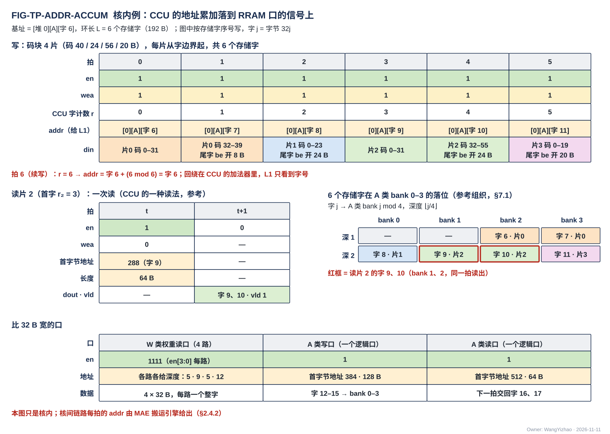

图是核内的例子，按 RRAM 的信号逐拍画，只看地址累加与回绕；图中按存储字的序号写（字 $j$ = 字节号 $32j$）。上半是写：QNT 产出一个码块（4 个 token、每 token 一片，各片码字节数 40、24、56、20 B；同一位点的元数据项、E8M0 项、F 列表三块另有自己的写累加器，图中不画）；按数据组织的默认，每片的码从存储字边界起写、片尾补齐到字，各占 2、1、2、1 个存储字、共 6 个；CCU 为这个码块保有一个字计数 $r$，每拍 addr = 基址字 + ($r \bmod L$)、$r$ 加 1，所以 6 拍的 addr 是字 6…11，第 7 拍回绕到字 6——取模是 CCU 加法器里的事，L1 只看到地址。各片的码块片长（64、32、64、32 B，起点为码块内字 0、2、3、5）由 QNT 写进该片的元数据项。下半是读片 2（码块内首字 3、56 B 码 = 2 个存储字），图中是 CCU 的一种读法（读取步骤属 CCU 的设计，`CCU_STAGING.md`）：CCU 先经 A 类读口读片 0–1 的元数据项（读出由 A 类读 MUX 交 CCU）、累加片长得片 2 起点字 3（基址字 6 + 3 = 字 9），再发一次读：en = 1、wea = 0、addr = 字节 288（字 9）、长度 64 B，下一拍 dout 交回字 9、字 10，同一拍读出；读几个字由 CCU 按该片元数据项里的码块片长（或 keep 位图 popcount）算出。图右侧画出的 6 个存储字在 A 类 bank 里的落位是参考组织（§7.1）。最下面是比 32 B 宽的口：**W 类权重读口 4 路，每路一位 en（en[3:0]）、各路各给地址**；A 类读口与 A / W 类写口都是一个逻辑口，**一次访问 = 首字节地址 + 有效字节数（≤ 128 B）**，有效字节用长度还是 be 表达【设计者定】（§2.3.1）。

#### 3.3.2 核间：C2H 由本核 CCU、H2C / IDN / NI 由 MAE 搬运引擎逐拍给出

**C2H 由本核 CCU 发令**（V18-TP-35）：CCU 按位点里的发送指令取 L2 目的地址、长度或"按数据块实际长度"，选数据来源（读 L1 经发送 FIFO 入口、或 VNU 输出；MXU 输出经 EPI 透传后算 VNU 输出，每条指令二选一：写 L1 或写 L2，V18-TP-56），逐拍给出 C2H 上的 addr；**C2H 只到 L2**（V18-CRU-07），没有通路选择；**计算核的集成输出端口就是 CCU 的 C2H 通道**（§3.17）。**本核的 C2H 只写 L2 象限 $n$，象限由链路固定，发送指令不给象限选**（V18-L2-04、V18-TP-57）。数据块发完、L2 回来的写入握手数满后，CCU 经发出报告信号组向 MAE 发"发出报告"（§3.13、§2.6）。

**MAE = 指令引擎 + 搬运引擎 + 运算级。MAE 的指令只有搬运指令；源与目的之间有一级运算级，由指令的运算字段三选一——不经运算级 / 经 MAE_DSU / 经 MAE_CRU；经 MAE_DSU 时再分直通、转置两种运算（MAE_DSU 篇 §3.1）；MAE_DSU 与 MAE_CRU 并列、互不依赖，地址仍由同一搬运引擎给出**（V18-MAE-12 / 41）。**搬运引擎不按链路配置**：由它给地址的链路是 H2C 道 × 4、IDN × 4、NI → L2、L2 → NI、MAE_DSU 出口、MAE_CRU 出口（经 NI_INT 的 L2 写入合并器写 L2）；任何一个搬运引擎执行到经过某条链路的指令时就在该链路上给地址；搬运引擎的个数按并发指令数定、与链路数无关（V18-MAE-10），组织归 MAE_ENG 篇。**H2C 道 $n$ 上给地址的是道引擎**（MAE 里执行该指令在道 $n$ 上那部分的搬运引擎，MAE_ENG 篇 §1）；一条 L2 → L1 指令怎样分给四道归 MAE（MAE_ENG 篇 §3.10，参考组织见 §7.6）。

- **搬运引擎逐拍产生源地址与目的地址**；线性段、按列表 gather、按元数据项聚集（源端的一种地址生成方式，不算另一种搬运模式）都在搬运引擎内展开。**MAE 不做环形回绕**（V18-MAE-17）：MAE 搬运的数据不用环形缓冲，编译链按静态容量窗口与 ping-pong 分配，跨环尾时拆成两条指令；核内 CCU 的回绕（§3.3.1）不受影响。基址、步长、长度只出现在 ISA 的搬运指令里，作指令字段；**协议与执行方接口上没有基址 / 步长 / 长度**。
- hub、NI_INT、HUB_IDN、MAE_DSU 自己没有寻址逻辑；接收方无状态，按段选与 addr 落位、按有效字节写；addr 不在字边界时由目的 SRAM 内部移位（§3.4）。
- L1 的接收桥（H2C 接收桥、NWB）只按到达的 addr 写 L1，不归 CCU 寻址，也不另算地址。
- **每拍的 addr 由该链路的发令方给出**：hub、NI_INT、HUB_IDN 只把搬运引擎给的地址随数据送出；多播时各核收到同一个地址，落同一位置（§3.2）。搬运的数据块与通道片默认从存储字边界开始：一拍 = 源的一个存储字，尾字用 be 标出有效字节；不从字边界开始时 addr = 本拍第一个有效字节的地址，由目的 SRAM 内部移位。发令方（MAE 搬运引擎或 CCU）、hub 与发送方都不移位、不拆拍。
- **对 DDR 的请求方式：MAE 发请求的方式不使 M0 上的有效带宽低于 DDR 控制器能提供的带宽（参考点 19.2 GB/s）**（V18-MAE-45，MAE_ENG 篇 §4.1）；下游收不下时只降速、不丢数。在其余链路上，一个搬运引擎每拍至多产生一个地址，链路位宽即其上限。搬运引擎内部的并行度（DDR 在飞请求数等）【设计者定】，约束即上面这条带宽要求。
- **搬运引擎的物理位置是后端的事；需求按搬运引擎在 MAE 内写**（参考放法与放到远处时附加的接口见 §7.6）。

### 3.4 紧密存储与对齐：SRAM 支持紧密存储，数据组织默认 32 B 对齐

**L1 的 A / W 类与 L2 支持紧密存储：同一发送方的数据可从任意字节起连续写入、按字节首尾相接，不补齐，一次至多 128 B；字节移位在 SRAM 内部做，使用者（pod、VNU、CCU、MAE、接收桥、HUB、IDN）一侧都不设移位器。数据组织默认 32 B 对齐，不对齐的访问允许慢**（V18-TP-74 / L2-07，架构篇 §3.5.4）。

- **写**：首地址可以是任意字节，数据从第 0 字节起给，SRAM 按地址写进；**写进的字节与给出的字节逐字节相同，有效字节以外的字节保持原值**（部分写只改写有效字节）；超出本存储字的部分落到下一个存储字。
- **读**：首地址可以是任意字节，SRAM 把该字节移到输出的第 0 字节后交出。
- **拍数**：从存储字边界起的 ≤ 128 B 一拍完成，否则允许多拍（架构篇 §3.4 CONC-3，拍数不作规定）。
- **W 类权重读口与 S 类一律整字**：S 类一次读写一个整字（一个存储字 = 32 个 E8M0 或 16 个 bias），S 类写口整字写、不带有效字节；W 类写口与 A 类同形。
- **口上怎样表达有效字节**（长度，或从第 0 字节起连续的前缀字节有效位）、各字段位宽【设计者定】，约束是能表达任意字节起点与 1–128 B 的长度。
- **读改写**：读旧值、写新值放两堆是编译链的默认用法，原地（同一个堆、不同拍）读改写也允许；**硬件只约束同一个堆同一拍一次访问**（CONC-2）。

**数据组织的默认**（数据组织篇 §2.3、§2.5）：数据块与每个通道片各部分的起点落在存储字（32 B）边界、片尾补到 32 B，片与片紧接着放（不按 128 B 行首对齐、不留固定槽位）；**紧凑 token 记录的一个通道片 = 元数据项（A 类）+ E8M0 项（S 类）+ F 列表（A 类）+ 码块（A 类），四部分各是一个独立数据块、基址在指令里**（V18-TP-65、DORG-04、L1-20）。通道片 = 一条 token 记录按消费方的 $k$ 边界切成的若干段，片长 $P$ 是 MX 组长 $G$ 的倍数（数据组织篇 §1.2）。按默认对齐时一拍正好一个存储字、不触发移位、不额外占拍；**一个存储字只属于一片的一部分**，生产方把每片末字的空余字节补 0（S 类写口整字写；A 类尾字可用 be 只开有效字节）。默认对齐的理由见 §8.1；SRAM 内部怎样移位、拆到相邻存储单元的例子见 §7.2。

**片外进来的数据**（经 PIN 写入的外设数据、经 M1 读入的调用输入与结果区、另一颗芯片经 FMC 写来的数据）**写进编译链固定的片外窗口或 PIN 窗口；窗口起点按字对齐是数据组织的默认，不作硬限制；外部主方从窗口起点顺序写、长度任意，尾字带 be；读侧从窗口起点读**（V18-TP-67、V18-DORG-10 (11)）。NI_EXT 按 AXI 地址与字节选通把有效字节按次序交出（首字节在前），窗口起点不在字边界时由 L2 内部移位；PIN 一笔写事务的写入拍可跨存储字，一笔事务不跨象限、不跨堆，有效字节必须连续（V18-NIE-04，MAE_NI_EXT 篇 §2.4）。

### 3.5 通用链路块：HUB 提供、各端点使用，任意插级而功能不变

#### 3.5.1 行为要求

**通用链路块是核间所有握手链路的唯一构件，由 HUB 提供、各端点使用**（V18-TP-32 / 38、HUB-05）：一级 valid / ready 握手流水，参数化（数据位宽、旁带位宽、接住在途拍的深度、流水级数；参数表见 HUB_NOC 篇 §2.9，行为要求见 HUB_NOC 篇 §3.9，skid 拍序例见 HUB_NOC 篇 §7.3）。它要满足：

1. **所有输出寄存器化，相邻块之间无组合路径**；ready 也寄存器输出，不穿过多级组合逻辑。
2. **下游拉低 ready 后，上游仍在途的拍全部由本块接住（skid）**，一拍不丢、不重复；本块再把自己对上游的 ready 拉低。
3. **每一级自身能每拍成交**（满吞吐），插级只增时延、不降吞吐。
4. **数据网与命令网用同一个块**：数据网 $W$ = 256 bit，旁带 = addr 24 + be 32 + `seg` 5 + `src`，所有核间写链路另带反向的写入握手旁带（同样寄存器输出）；命令网 $W$ = 64 bit，旁带 = addr（位宽【设计者定】，§2.5.1）。

hub 的四条 H2C 道、C2H 在 hub 里的四条直通链路、hub 控制道，HUB_IDN 的分叉点与四条 IDN 链路，各核接收桥的链路侧从口（H2C 接收桥每道、NWB）与集成输出端口，L2 各口的链路一侧（NI 写口、L2WP 四条写链路、象限读口与 NI 读口的读地址流 / 读数据流），MAE_DSU 进出口，NI_INT 到 L2 的两个方向，LIC → MAE_ENG 的命令网链路，都是它的实例加各自的仲裁器、MUX 或多播分叉点；传数据、传指令与配置只是参数不同。**专用信号组（GO、位点完成事件、写完通知、完成通知、发出报告）是 hub / NI 里另外的线，每组 valid + 载荷，不是数据网或命令网的链路**（§2.6）。

#### 3.5.2 保序、无应答、无 burst

- **同一链路保序**：先发的拍先到；同一发令方的切换段不交错，合并点上不同源的切换段也不交错（§3.10）。**C2H 分流不合并四核**（V18-L2-03）：各核的 C2H 直通 L2 的本核写链路，核 $n$ 只写象限 $n$（V18-L2-04），不同核的拍永不相遇。
- **无数据应答、无 outstanding、无 burst**：写入握手只是"写进一拍"的计数脉冲，不带数据、不要求发送方等它才发下一拍（§2.2.4）；地址随数据同拍走，源是 SRAM，接收方自带地址。DDR 的突发在 M0 口，不变。时延只是管道长度，不影响吞吐。

#### 3.5.3 可由后端调整的需求（A1–A7，HUB_NOC 与 HUB_IDN 共用）

**协议不定拓扑，不规定中继点、分叉点放在哪、每段插几级；这些由后端按布局定。协议只要求结构能被这样调整而功能不变**（V18-TP-54）：

| 编号 | 需求 | 后端能调什么 |
|---|---|---|
| A1 | **功能与任何一段的级数无关**：任意两个端点之间是一串通用链路块，各段级数是独立参数，可各不相同；改级数只改参数、不改逻辑 | 每段插几级 |
| A2 | **每级满吞吐**：每一级自身能每拍成交，插级只增时延、不降吞吐；接住在途拍只看本级，不随总级数加深 | 插级不掉速 |
| A3 | **多播分叉点可移动、可拆成多级**：分在一处还是逐级分结果相同；**核掩码作旁带走到最后一个分叉点，到核的最后一段不带** | 分叉点的位置与级数 |
| A4 | **任何逻辑不依赖同拍到达或固定的相对时延**：同一核的 4 条 H2C 链路之间、正向与写入握手回程之间、数据网与专用信号组之间都不对齐 | 各条线独立走 |
| A5 | **写入握手回程的级数与正向独立**；握手先到后到不影响发令方的计数 | 回程另走 |
| A6 | **与时延有关的门限是 RTL 头文件参数**，没有运行期配置；后端改级数只改参数 | 改级数时改参数 |
| A7 | **验收随机化**每段级数、分叉位置、ready 时序与回程时延；数据逐位一致，写入握手计数与应写量相符，写完通知到达时数据已全部写进 | — |

### 3.6 背压：逐级传回发令方，只降速、不丢数

**接收方来不及收时拉低 ready；ready 经各级通用链路块一级一级传回，直到发令方停下。全程只降速、不丢数，没有全局 stall。** 接收方的缓冲吸收写 MUX 轮到别的来源或让读、L2 的堆这一拍给了别的链路、合并点让出造成的瞬时顺延；持续堵住时才传回发令方。接收方怎样判"来不及收"（缓冲组织与阈值）归该模块的参考实现（§7.5、§7.9）。

| 链路 | 接收方 | 最终停下的是谁 |
|---|---|---|
| C2H → L2 | L2 象限 $n$ 对核 $n$ 的写入（L2 篇 §7.4） | 本核集成输出端口 → stall_tx → CCU 被门控、停算（§3.16） |
| H2C → 核 L1 | 该核 H2C 接收桥该道（§3.17） | 背压经该核分支、分叉点传到 H2C 道 $n$ → H2C 道 $n$ 对 L2 读数据流拉低 ready → **L2 拉低读地址流的 ready，发读的搬运引擎停住**；同时 H2C 道对目的信息流拉低 ready，引擎保持（§2.2.5、§2.2.6，V18-TP-80） |
| IDN → 核 L1 | 该核 NWB | 背压经 HUB_IDN → NI_INT → NI_EXT 逐级传回、只降速、不丢（NI_INT 篇 §3.4） |
| NI 写口 → L2 | 目标象限（广播时掩码内各象限都能收才成交） | NI_INT 的 L2 写入合并器停发，各来源依次停下；PIN 由 NI_EXT 拉低 AXI 的 WREADY |
| L2 读数据流 → 下游 | H2C 道 $n$ 或 NI_INT 的 L2 读出分路 | L2 拉低读地址流的 ready，发读的搬运引擎停住 |

**一条道堵住不影响别的道。** 同一道多播时，**慢核落后不超过 $M_{\text{mc}}$ 拍时不拖其他核，这段余量由接收桥提供，HUB 不承担；超过时只降速、不丢**（§3.7；分叉点怎样停是参考做法，§7.4）。

**ready 只保护链路与接收方的缓冲，不回答"目的空间有没有空"**（§3.14）；"写没写完"由写入握手回答（§3.8）。

### 3.7 多播：各目的核独立取走，余量由接收桥提供

**一拍发给几个核时，各目的核按自己的 ready 独立取走，不等齐、不要求同拍成交**（V18-TP-29 / 53、HUB-05）。**四核物理同构，多播用同一个 addr、落同一位置。** 单播是核掩码只有一位的特例。多播出现在两处：H2C 道 $n$ 的分叉点（核掩码随搬运引擎的逐拍控制给出，§2.2.6）与 HUB_IDN（核集合随字，§2.2.7）。

- **快慢核的差距：慢核落后不超过 $M_{\text{mc}}$ 拍时不拖其他核；这段余量由接收桥提供，HUB 不承担**（V18-HUB-05）。$M_{\text{mc}}$（多播余量）由接收桥篇定义与登记（接收桥篇 §3.9）；超过时只降速、不丢。
- 分叉点放在哪、分几级由后端定（§3.5.3 A3）；分叉点怎样做（参考：一级通用链路块 + 各核已取标记、全部取走后才收上游下一拍、不另配存储）见 §7.4，正式的参考做法在 HUB_NOC 篇、HUB_IDN 篇第 7 章。
- **多播的写入握手**：$k$ 个目的核各写进一份、各回一个握手，**每个目的核一组握手线直达发令方，分叉点与 hub 不汇总、不按 `src` 归并**；发令方按（核, `src`）分别计数，一拍至多收 $k$ 个（各核 1 个），按 $k$ 倍计应写量；**写完通知各核各自收：每个目的核在写进本核的数据数满后收自己的通知，不等其他核**（§3.8.2）。

**hub 端口上可观察的行为**（HUB_NOC 与 HUB_IDN 的验收以此为准）：任一链路的 ready 可被拉低；同一链路保序；同一道上切换段不交错；**四核 C2H 各自直通 L2 的本核写链路（核 $n$ → 象限 $n$），四核互不等待；所有核间写链路的写入握手沿原链路反向回到发令方，多播时各目的核各一组、不汇总**；多播各目的核独立取走。**hub 自己不仲裁、不另配存储，每条道只有一个源**；hub 另按 §2.6 连通专用信号组，只连通、不处理。

### 3.8 写入完成：核内由 CCU 判定，核间由发令方数写入握手

**写入完成 = 真正写进最终存储的写入拍数达到发写方的应写量**（V18-TP-37）。**谁来判只分两类：核内一类、核间一类**（V18-TP-50）：

| 类别 | 规则 | 谁判 | 应写量从哪来 |
|---|---|---|---|
| **核内**（本核 VNU 写口写 L1） | **核内写 L1 的完成由本核 CCU 判定**：VNU 写口的写由 CCU 发起，但写 MUX 自己轮流、遇读让读，CCU 不知道每一拍何时写进，所以**由写 MUX 告知 CCU，或由 VNU 报完成，二者取一【设计者定】**（V18-L1-32 (3)），约束：CCU 只在数据确已写进 L1 之后判定写完；L1 本身不提供完成信号；CCU 怎样计数属 CCU 的设计（`CCU_STAGING.md`） | 本核 CCU | 位点指令 |
| **核间**（统一协议） | **接收方每把链路上一拍的全部有效字节写进最终存储之后，沿同一链路反向回一个写入握手（valid + `src`）；发令方按（写入方, `src`）数自己的那些，数满应写量即写完**（§2.2.4）。**落进 L1 的数据，发令的 MAE 数满后经写完通知信号组给目的核 CCU 发写完通知**（V18-TP-70） | 发令方 | 发令方自己的指令：多播 $k$ 核、段掩码广播 $k$ 个象限都按 $k$ 倍计；IDN 几核共享时按各核实际收到的拍数分别计 |

**还在接收方缓冲或链路流水级里的数据不计、不回握手**，所以"写者交出了最后一拍"不等于"写完成"，不设排空信号，也不依赖任何固定时延。**因为完成按写入拍数判断，接收方不数切换段，链路上也不带切换段标记**（V18-TP-42，§3.10）。

#### 3.8.1 核间：每条写链路的握手去向与应写量

| 链路 | "写进最终存储"指什么 | 握手回给谁 | 发令方的应写量 |
|---|---|---|---|
| NI 写口 → L2 | 写进 L2 | 执行该指令的搬运引擎（四个象限各一组，NI_INT 只按 `src` 分发、不归并） | 指令的数据量；段掩码广播 $k$ 个象限按 $k$ 倍计 |
| C2H → L2 | 写进 L2 象限 $n$ | 核 $n$ 的 CCU（valid + `src`） | 本次发送的写入拍数（默认 = 存储字数） |
| **H2C → 核 L1** | 写进 L1 | **本道的道引擎**；每个目的核的 H2C 接收桥该道各一组握手线直达，hub 里不设汇总点、不按 `src` 归并；道引擎按（核, `src`）分别计数，一拍至多收 4 个（各核 1 个） | 指令在本道上的数据量；多播 $k$ 核按 $k$ 倍计 |
| **IDN → 核 L1** | NWB 把一拍写进 L1 | **执行该指令的搬运引擎**，各核 NWB 各一组握手线经 HUB_IDN 回去（HUB_IDN 不汇总），引擎按核分别计数 | 每核各自 = 发给该核的写入拍数（按字分核时各核收到的字不同） |
| NI → LIC 直连口 | 写进 LIC 专用小 SRAM | 执行该指令的搬运引擎（经 NI_INT） | 指令的数据量 |
| NI_EXT → DDR / 共享内存 | 收到 AXI 写响应 | 执行该指令的搬运引擎 | 指令的数据量（AXI B 本身就是写入握手） |
| PIN → L2 | 写进 L2 | 该笔 PIN 事务的发令号，由 NI_INT 数满，再由 NI_EXT 回 AXI B 给外部主方 | 该 AXI 事务交给 L2 的写入拍数（默认 = 存储字数） |

**PIN 也走同一个协议**：在片内，一笔 PIN 事务就是一个带 `src` 的发令方，唯一的差别是数满后的动作——别的发令方通知 LIC，PIN 回 AXI B。

**跨核合并不是第三类完成协议**（V18-CRU-07）：各核经 C2H 把要合并的数据写进 L2，按 C2H → L2 一行完成并发出报告；MAE 收齐参与核的报告后从 L2 读、合并、写回 L2，写回同样按核间规则完成。

#### 3.8.2 落进 L1 的核间数据：发令方数满后发写完通知

**落进 L1 的核间数据（H2C、IDN）：发令的 MAE 数满写往目的核的写入握手后，经写完通知信号组给目的核 CCU 发写完通知**（载荷见 §2.6；H2C 搬运经 hub 侧一组、IDN 搬运经 NI 侧一组），**目的核 CCU 收到写完通知即可消费，不做本地比对**（V18-TP-70）；通知在握手数满之后才发，到达时数据已全部写进。另有：

- **各核各自收**（V18-TP-84，用户 11-11："D7：各核各自收"）：**H2C 多播、分送（象限 $c$ 只送核 $c$）、IDN 几核共享（按字分核、多播）时，每个目的核在写进本核的数据数满后收自己的写完通知（带写进该核的字数），不等其他核**；写往全部目的核的数据都数满后，MAE 再带指令标号通知 LIC 指令完成（V18-MAE-45）。
- **合并送**（§3.11）：一个核的数据来自参与的几条道，**这几条道对该核都数满后才给该核发**（V18-MAE-40 / 42）；多播给几个核时仍各核各自收。
- **一条指令搬紧凑 token 记录四部分时，目的基址 = 码块的目的基址，写入字数 = 四部分之和**，其余三部分的位置由 CCU 按元数据项推出（V18-MAE-42）。
- **跨核搬运与消费按批流水**（V18-DORG-10 (10)）：每一批是一条搬运指令的一次执行（LIC 的 Fusion 段里搬运指令与计算指令成对循环），每次执行各发一次写完通知；"收到写完通知才读元数据项"按批判，不要求整份搬完。
- **落进 L1 的数据只数一次**：接收桥与 L1 都没有写计数，写进之后回的写入握手由发令的搬运引擎数；数满即该指令（在该核上）执行完，同时发写完通知。

#### 3.8.3 核内写 L1 与其余情形

- **本核 VNU 写口写进 L1 的数据**：由本核 CCU 判定是否写完，通过才发读这批数据的指令或切堆；**CCU 知道写完的依据由写 MUX 告知或由 VNU 报完成，二者取一【设计者定】**（V18-L1-32 (3)）；L1 本身不回完成信号、不设写计数（V18-L1-24 / VNU-09）。
- **其余情形**（写 L2、LIC 小 SRAM、片外）：发令方数满后通知 LIC——MAE 带指令标号发完成通知（§3.9）；CCU 写 L2 时发出报告（§3.13）或计入位点完成——由 LIC 下发依赖它的后续指令。
- **计数的清零**：发令方的握手计数按指令清零；CCU 对核内写的计数属 CCU 内部（`CCU_STAGING.md`）。

#### 3.8.4 计数单位：写入拍

**计数的单位是链路上的一拍（写入拍）**：一拍的全部有效字节（不论开了几个字节）写进最终存储，计数加一、回一个写入握手（V18-TP-37）。**默认对齐时一拍就是一个存储字**；通道片各部分默认都从字边界起、片尾补到 32 B（§3.4），一个存储字只属于一片的一部分，不会有两次写共用一个存储字，发写方按字数给应写量，两端口径天然一致。**不从字边界起的一拍跨两个存储字，仍按拍计，发写方按拍数给应写量。** 接收方一次写进几拍（例如接收桥一次交 1–4 拍），就在写进之后回几个握手，每拍一个。

#### 3.8.5 发送完成与 NI 路径的乱序返回

- **发令方按指令给的数据量数自己发出的拍，数到即该次搬运"发送完成"**：H2C / IDN / NI / MAE_DSU / MAE_CRU 出口由 MAE 搬运引擎数，C2H 由本核 CCU 数。**发送完成只说明数据都已交出；指令是否执行完按目的以写入完成计——数满写入握手**（§3.9）。**MAE 不设完成计数器**（V18-MAE-13）。
- **DDR 不同 AXI ID 的读返回可能乱序**：搬运引擎数着该指令还有几笔没回，用于发送完成计数，不上链路，不重排；各拍自带 addr，乱序不影响落位。读返回按请求时记下的对应关系分路，只要求功能、不定义目的标签格式（V18-TP-34）。
- **一次搬运发多少数据由指令规定**（MAE 的指令、CCU 的发送指令；变长数据块由 CCU 按实际长度发出、发完后发出报告，§3.13），**不用任何时延常数，不发逐切换段的应答**（V18-TP-28）。

### 3.9 LIC ↔ MAE：每执行完一条指令带指令标号通知 LIC，屏障归 LIC

**LIC ↔ MAE 是握手，不是完成计数器**（V18-MAE-13）：

- **LIC 可同时经命令网向 MAE 下发多条指令，每条带 LIC 分配的指令标号；MAE 每执行完一条，就经完成通知信号组带该标号通知 LIC**（§2.6）。
- **MAE 不设完成计数器，MAE 指令不带等待条件**：指令之间的依赖由 LIC 收到通知后再下发后续指令来表达。
- "执行完"的判据按目的分：

| 指令的目的 | 执行完 = | 写入完成由谁确认 |
|---|---|---|
| L2 | 搬运引擎数 NI 写口回来的写入握手（`src` = 本引擎号）达到应写量 | MAE 搬运引擎 |
| MAE_CRU（合并指令） | 收齐参与核的发出报告后开始；写回 L2 的写入握手数满 | MAE 搬运引擎 |
| DDR / 共享内存 | AXI 写响应收齐 | MAE（经 NI_EXT） |
| 核 L1 | **写入完成**：数满 L1 回来的写入握手（多播 $k$ 核按 $k$ 倍计；写往全部目的核、参与的各道都数满）；给各目的核 CCU 的写完通知按 §3.8.2（各核各自收） | MAE；目的核 CCU 收到写完通知后消费，位点完成事件报 LIC |

**对目的为核 L1 的指令，执行完时给 LIC 发完成通知**（写往几个核时各核的写完通知可以更早，§3.8.2）。**位点屏障归 LIC**：**LIC 收各核 CCU 的位点完成事件（已含写完通知与本核写完成的判断），并数收到的 MAE 完成通知，满足后发 GO**；位点完成事件、完成通知与 GO 都走专用信号组（§2.6）；MAE_CRU 不参与屏障。LIC 操作 15 的按份完成次数由 LIC 保存。

### 3.10 切换段不交错：仲裁只在发令方看得到切换段边界的合并点

**切换段是发令方（本核 CCU、MAE 搬运引擎）内部的粒度：一段连续发出的拍（各拍地址不要求连续），只用于合并点仲裁的切换边界；链路上没有任何切换段标记，发出报告也不带切换段数**（V18-TP-36 / 42 / 45）。

**几个源合到一条链路时，仲裁器在发令方一侧，只在切换段边界换源；同一链路上切换段不交错**，不论两源去的是不是同一个存储。**切换段边界是发令方内部的信号：CCU / MAE 搬运引擎知道自己的切换段何时发完，交给同侧的仲裁器，不上链路。** 这一条只在本篇写，各模块篇引用。这样的合并点：

- **计算核的集成输出端口**（发送 FIFO 入口、VNU 输出口——MXU 输出经 EPI 透传后算 VNU 输出，都在本核 CCU 的域里）：**CCU 在切换段边界选一路**，先后由 CCU 的排程定（§3.17，V18-TP-56 / 59）。
- **NI_INT 的 L2 写入合并器**（M0 / M1 / PIN / MAE_DSU / MAE_CRU 五个来源合到 NI 写口，V18-MAE-12）：按切换段换源；PIN 事务的边界来自 AXI 的 WLAST；**每笔在途 PIN 事务取一个发令号，事务的各拍带这个 `src`，该号的握手数到该事务的写入拍数才回 B**（§3.8.1，V18-TP-47）。PIN 写与推理整体分先后，PIN 写一帧期间 NI 写口只有 PIN 一个来源（V18-L2-07）。
- **NI_INT 的 IDN 出口**（读返回分路去 L1 的一路、MAE_DSU 去 L1 的输出）：MAE_ENG 在切换段边界择一，交 HUB_IDN 的只有一路 32 B（V18-HUB-03）。
- **H2C 道只有 L2 一个源**（V18-CRU-07），不是合并点。

**C2H 不扇入、不仲裁、不分路**（V18-L2-03、V18-CRU-07）：四条 C2H 各自直通 L2WP 第 $n$ 条写链路，只进象限 $n$。四核互不等待：核 $n$ 的 ready 只取决于 L2 象限 $n$ 对核 $n$ 的写入能否收下。hub 不记切换段先后；不同核的写不相遇，核 $n$ 的写在象限 $n$ 里只与 NI 写相遇；完成由核 $n$ 的 CCU 数 L2WP 第 $n$ 条回来的写入握手判定（§3.8.1）。**同一个堆上几条链路同拍到达时怎样依次服务是 L2 的事**：只降速、不丢、不错，每条链路的等待有上界，地址连续的几个写入方各自保持 32 B/拍（架构篇 §3.4 CONC-2 / 3）；L1 每类写口前的写 MUX 自己轮流、每拍写一个来源一次、不同来源不合并（§2.3.3）。

**为什么不需要切换段标记**：

| 需要界定切换段边界的场合 | 怎样做 |
|---|---|
| 判断一批数据写完 | 按写入拍数与应写量比对（§3.8），接收方不数切换段 |
| 尾字 | 尾字也是链路上的一拍，be 只开有效字节；接收方按 be 写，不需要知道它是尾字 |
| 接收桥何时交出块尾不足 4 拍的那一段 | 有几拍连续的就交几拍，块尾的几拍照常交出，不靠块尾标记，不要求冲刷条件与超时（§3.17） |
| 合并点在哪拍换源 | 合并点的仲裁器与发令方同侧，"切换段发完"是发令方交给仲裁器的内部信号 |
| 发出报告 | 只带目的起始地址（分批时另带流标号），不带切换段数、字数与数据块标识（§2.6） |
| PIN 的 B 响应归属 | 每笔在途 PIN 事务一个发令号，该号的写入握手数满才回 B（§3.8.1） |

### 3.11 L2 → L1 经 H2C：合并送与分送，各道目的地址连续才满速

**L2 → L1 经 H2C 只有两种用法，各是一条 MAE 指令**（V18-MAE-37 / 42）：

| 用法 | 读哪里、送哪里 | 每核有效带宽 | 写完通知 |
|---|---|---|---|
| **合并送** | 参与的象限读出合并成一路，H2C 四道并行，送一个核集合：核掩码 1111 多播，或只含一个核；也可只开部分象限（单核产出的小消息只开一个象限） | 开 $n$ 个象限时 $n \times 32$ B/拍，四个象限都开时 128 B/拍 | 每个目的核：该核的数据所来自的各道都数满后给该核发（多播时各核各自收） |
| **分送** | 象限 $c$ 只读本象限、只送核 $c$；指令给一个象限内读起始地址与一个 L1 写起始地址，各道各自先读本象限的元数据项得出本道长度、再顺序搬，各核的写地址从同一起点各自推进，到达先后与结束时刻可不同 | **32 B/拍**（不是 128 B/拍） | 核 $c$ 本道数满即收，不等其他核（V18-TP-84） |

- **合并送用四道并行达到 128 B/拍的条件是各道的目的地址各自连续（架构篇 §3.4 CONC-3）；不连续只降速、不出错**（V18-MAE-36）。四道之间不等齐、不需要同拍。
- **合并送的目的排法（片交织 / 段接续）由指令的 1 bit 给出**（V18-MAE-45，MAE_ENG 篇 §3.10）；目的 L1 里的排列符合数据组织篇的衔接表（数据组织篇 §3.6.6）。各道的目的地址序列怎样展开归 MAE（参考见 §7.11）。
- 同一时刻 L2 的四个象限读口服务几条 L2 → L1 指令是 MAE 对编译链的约定，只在 MAE_ENG 篇写（MAE_ENG 篇 §3.10）。
- 一个象限服务四个核的情形不设专门用法：大块数据由产出方按下一位点的读法摆放（产出方按下一位点读法分块写 L2、变长数据四个象限同址、要四道并行送的流按块分四段连续放，见数据组织篇 §3.6；V18-DORG-06），单核产出的小消息用只开一个象限的合并送。H2C 读出只做顺序读。
- **核间按 $m$ 切分的紧凑 token 记录**（四核各产自己那一片，四个象限的四部分同址存放）**合并送进消费核时，在消费核 L1 里物理连续**：每道的字在目的地址上连续，目的 L1 里的排列符合数据组织篇的衔接表；**元数据项整项照抄**（每片一项，按 token、片序排进消费核的元数据项块），码块与 F 列表按前缀和给目的地址——码块：道 $n$ 写 token $t$ 第 $n$ 片的目的地址 = token $t$ 的码块起点 + 前 $n$ 片码块片长之和；F 列表：按前面各片 F 列表片长之和（每片 $\lceil 2f/32 \rceil \times 32$ B）；E8M0 项按片序号 × $\lceil (P/G)/32 \rceil \times 32$ B。元数据项由谁读、怎样得到各道的目的地址序列【设计者定】，约束即上面两条（参考做法见 §7.11）。**合并后每片在消费核各有一个元数据项，CCU 读元数据项定位片，不需要从数据里判片边界**（数据组织篇 §3.4、§3.6.3；MAE_ENG 篇 §3.10）。按默认对齐（§3.4），合并只是从字边界起的整字拷贝、满速。

例（4 个 token、$M = 256$ 分四核，核 $c$ 持 64 个输出通道，消费方每 token 4 片、$P = 64$、$G$ = 32、$w = 6$，每片码至多 $64 \times 6 / 8 = 48$ B）：四个象限各片的码字节数为象限 0 = 23 / 18 / 33 / 12 B、象限 1 = 20 / 25 / 15 / 28 B、象限 2 = 30 / 11 / 22 / 19 B、象限 3 = 17 / 26 / 14 / 24 B；按 32 B 取整后每片码块片长 32 B，只有 token 2 的象限 0 片 33 B → 64 B。消费核得到 16 个元数据项（每项 $\lceil (4 + 8)/32 \rceil \times 32$ = 32 B，照抄）、16 个 E8M0 项（每片 2 B 补到 32 B）与 16 段 F 列表（每片 F 项数 ≤ 16 时占 32 B）；码块片长依次为 32 / 32 / 32 / 32、32 / 32 / 32 / 32、64 / 32 / 32 / 32、32 / 32 / 32 / 32；消费核码块起点字节 0，token 起点 0 / 128 / 256 / 416；token 2 四道的码块目的地址 = 256 / 320 / 352 / 384。这个例子片很短（$P$ = 64），按片补齐让元数据项、E8M0 项、F 列表各占 1 个字，是补齐代价偏大的情形；实际位点的片长远大于 64，按片补齐的代价约多 5%（V18-DORG-04 的估算）。

### 3.12 IDN：几核共享 M0 带宽与经 IDN 进核的数据

**几核共享 M0 带宽时每个存储字带核集合，总量不论开几核都以 M0 的 32 B/拍为上限**；各核轮到的字数比例与核集合由搬运指令决定，各核的字怎样轮流排出归 MAE（MAE_ENG 篇）。单核时 32 B/拍；四核按 $m$ 切分时每核平均 8 B/拍，但每拍到达的是一个整字。**IDN 链路不受整字限制、也不需要感知：只按 be 原样传，是否整字由发送方与数据组织定**（V18-DORG-10 (4)）。本篇不设拆字分发，L1 写口一次只接一个首地址。

**数据到达 L1 时已是 L1 的字形态，DDR 布局与 W 类字形态之间的差由 MAE_DSU 的直通或转置调**（V18-MAE-41，参数只在 MAE_DSU 篇 §3.2 典型用法表）。**数据进 L1 前的整形有几条路，硬件都支持，由编译链按位点选**（V18-MAE-45，架构篇 §3.8）：L2 里存原形时走 NI 读口 → MAE_DSU → IDN；先经 MAE_DSU 整形存进 L2 的走 H2C；核内产生的由 QNT 直接排成目的形态写 L1；从 DDR 来的经 M0 → NI_INT → MAE_DSU → IDN 落 L1。

**IDN 接收桥 NWB 与 H2C 接收桥是同一种接收桥（单道实例）**：常开，按 `seg` 交 A / W / S 三类写口之一的写 MUX，写进之后逐拍回写入握手（§3.17）。紧凑 token 记录不经 IDN：它们由核产出、经 C2H 进 L2，再经 H2C 进核。

- **精算 K 的全码 key 记录经 IDN 进核**（V18-ATT-03）：驻留模式 K hi 驻留在 L2（存 DDR 原形，每 key 64 B、按 key 连续）、lo 从 DDR 取；重读模式 hi、lo 都从 DDR 取。**全码 key 记录经 MAE_DSU 直通、只给地址**：驻留模式 hi 来自 L2 的 NI 读口、lo 来自 DDR 的读返回分路，两路源按指令次序接续；**经 IDN 出口 → HUB_IDN → NWB 落 L1 W 类全码区（列字区里放录取 key 全码的那一段），按列字区的列位落、不按 key 连续落；hi、lo 仍是整字、平面分开**（V18-DORG-08）。head_dim = 128 时一个全码 key 记录 = hi 2 个存储字 + lo 2 个存储字 = 128 B，4 个字各落各的列位。
- **输出轴稀疏的权重（DDR 列深度优先平面）按整列发给属主核**：MAE 逐列 gather，一列 $K/2$ 字节是一条连续 burst；这一列的存储字的核集合都只含属主核，**属主核的链路每拍一个整字，32 B/拍**，写进属主核 L1 列字区。同一列相邻两个存储字在列字区不连续，**NWB 地址不连续时仍须 32 B/拍**（§4.1）。

### 3.13 变长数据块：CCU 发送并报告，MAE 先搬元数据项、握手数满后发写完通知

变长数据块（数据组织篇 §1.2 变长）每条 token 记录的实际长度只有生产方在运行期知道。**紧凑 token 记录的每个通道片存成四部分：元数据项（A 类，定长）、E8M0 项（S 类，定长）、F 列表（A 类，变长）、码块（A 类，变长）；每片的码块片长与 F 项数写在该片元数据项的首字里，数据外不另设表**（V18-TP-66 / 68、DORG-04）。协议给一条路：

1. **空间由编译链静态分配。** 每个位点的变长数据块（前向激活的紧凑 token 记录、反传在算子间流动的梯度 dX / dY / dH / dP / dS / dz、Q 粗算查询行记录、位图、列表、TOPK 项、参与词号列表）有一个由算法侧给出的容量窗口：**两个变长部分（码块、F 列表）各按每片上限 × 片数分配**（每片上限按 32 B 取整；上限由 SEL 的每片保留上限 $k$ 决定，**每片保留上限按通道片给**，VNU_SEL 篇，V18-DORG-05 (6)），两个定长部分（元数据项、E8M0 项）= 片数 × 项宽；编译链按它分配 L1 源空间与 L2 目的空间。**四部分与它们引用的列表各是一个独立数据块，各有编译链分配的地址，都写在位点指令与发送指令里**；CCU 不做运行期分配。**数据块不超出容量窗口由 SEL 的限个数选择模式保证**（SEL 把每片保留的通道数限制在每片保留上限 $k$ 以内；仿真断言见 §6.3，V18-TP-72）。上限只用于容量，**不决定任何 token 记录的位置**。
2. **四条流各自写。** 生产方（QNT）写出元数据项、E8M0 项、F 列表、码四条流，经 VNU 写口按 `seg` 进 A 类（元数据项、F 列表、码）与 S 类（E8M0 项，整字写）写口；CCU 为每条流推地址（§3.3.1）。**每片的元数据项首字前 4 B = 码块片长 16 bit（本片码在 A 类占的字节数按 32 B 取整）+ F 项数 16 bit，后接 keep 位图（$P$ bit），项宽 $\lceil (4 + P/8)/32 \rceil \times 32$ B**（V18-TP-68）；对外可见的是格式与"每片四部分各从字边界起、片尾补齐"，怎样攒、何时写归 QNT（VNU_QNT 篇第 7 章）。本核消费写 L1，跨核消费再由 CCU 经 C2H 发到 L2。
3. **CCU 发送**：要出核的数据块由产出核的 CCU 按发送指令经 C2H 发出（§3.17）：**元数据项、F 列表与码块经 A 类读口读出，由 A 类读 MUX 整拍交发送 FIFO 入口；E8M0 项经 S 类读口读出，由 S 类读 MUX 交发送 FIFO 入口**（发送 FIFO 入口 = 集成输出端口的入口，128 B；两读 MUX 在 L1 外、本核 CCU 控制，V18-L1-21）；长度 = CCU 累加得到的各部分实际总长，不需要回读数据，也不需要先向 MAE 报长度（V18-TP-35）。
4. **发出报告**：CCU 发完四部分、**并数满 L2 回来的写入握手**后，经 hub 的发出报告信号组（每核一组）向 MAE 发"发出报告"，**载荷只有目的起始地址 = 码块的容量窗口基址（分批搬运时另带流标号）**（§2.6，V18-DORG-05 (8)），**含义 = 这份数据的四部分已写进 L2**；不带长度、字数、token 记录数。**报告按地址对应指令**：目的起始地址就是编译链静态分配给该数据块的容量窗口基址，同一时间在飞的数据块基址互不相同；MAE 把报告配给源起始地址等于它的那条指令，不要求核的发送次序与 LIC 的下发次序一致（V18-MAE-14）。需要发出报告的只有核间搬运的变长数据块（C2H → L2 → H2C）。
5. **MAE 先搬元数据项，再搬码块与 F 列表**（V18-TP-69）：以该数据块为源的搬运指令带四部分的基址（四个象限同址，一条指令一套基址，V18-DORG-06）。**引擎在同一条指令里先搬元数据项，再搬码块与 F 列表；码块与 F 列表每个字的源、目的地址由元数据项（码块片长与 F 项数）算定；顺序搬也如此**（怎样累加是参考做法，§7.7）。项宽由 $P$ 算出（$P$ 在指令里），两个计数固定在首字前 4 B。聚集时按项逐片取；按 $m$ 切分的四片合并时整项照抄四个象限的元数据项、按前缀和给码块与 F 列表物理连续的目的地址（§3.11，MAE_ENG 篇 §3.10）。L2 → L1 用合并送或分送（§3.11）。
6. **落 L1 的写完通知**（V18-TP-70）：发令的 MAE 数满写往目的核的写入握手后，经 hub（H2C）或 NI（IDN）的写完通知信号组给目的核 CCU 发写完通知，写往全部目的核的数据都数满后经完成通知信号组带指令标号通知 LIC（§3.8.2）。**目的核 CCU 收到写完通知即可消费**：经 A 类读口读元数据项、按码块片长与 F 列表片长的前缀和定位各片。**跨核搬运与消费按批流水**（V18-DORG-10 (10)）：结合 Fusion 指令先搬一批、算一批，算的同时搬下一批；每一批是一条搬运指令的一次执行，各发一次写完通知；**某批的写完通知到了就可读该批的元数据项，不要求整份搬完**。
7. **同核自产自用的数据块不报。数据块必须写完才能发**（V18-TP-46）：边写边发要求同一数据块所在的堆同一拍又写又读，而每个堆同一拍只做一次访问（CONC-2）；流式效果只靠 ping-pong——编译链让一堆写、另一堆发（§3.14）。CCU 对一个数据块发第一拍 C2H 之前，该数据块须已写完（核内写由 CCU 判定，或落地数据已收到写完通知），且编译链在它发完之前不往该数据块所在的区域写。

**分批搬运的起点由 MAE 接续**（V18-MAE-38 / 45）：一份产出在 L2 是一个大数据块、分几批搬进 L1 时，第 $j$ 批在象限 $q$ 的起点 = 前面各批在该象限实际搬走的长度之和，四个象限不同、编译期未知（定长的元数据项、E8M0 项起点仍是静态的，变的只有码块与 F 列表）；**下一批的起点由 MAE 接续，指令里不给实际起点**；分批搬运时 CCU 的发出报告另带流标号，MAE 据此配对（§2.6）。参考做法（MAE 为每条流每道记游标、跨指令续接）见 §7.7。

**MAE 消费的序号列表（项数另存）**（SEL 的序号列表、TOPK 重算词号列表、LOSS 的参与词号列表这类给 MAE 列表驱动地址生成用的列表，在 L2）**的项数由生产核 CCU 写成一个定长计数项**（编译链给地址，与列表同在 L2），**MAE 读列表前先读它**（V18-DORG-05 (5)）。

**消费方读紧凑 token 记录**（数据组织篇 §3.4）：**读从片起点那个存储字开始；读几个字、何时读全由 CCU 定，发读节拍不靠 pod 反压**（V18-TP-65 / 66 / 74）；CCU 的读取步骤（读元数据项、按发读步长数码数、F 列表转掩码等）属 CCU 的设计，见 `CCU_STAGING.md`。E8M0 经 S 类读口读出、由 S 类读 MUX 进 pod；**CCU 交 pod 的旁带 = keep 掩码 + F 掩码 + MX 组边界**（$G$ 来自指令，V18-DORG-05 (3)）；**pod 没有解包器**，第 $i$ 个码对应保留位图里第 $i$ 个 1，码按 $w$ bit 紧排。跨核送来的数据，CCU 收到该批的写完通知之后才读它的元数据项。CCU 一侧怎样缓冲元数据项与 F 列表属 CCU 的设计（`CCU_STAGING.md`）。

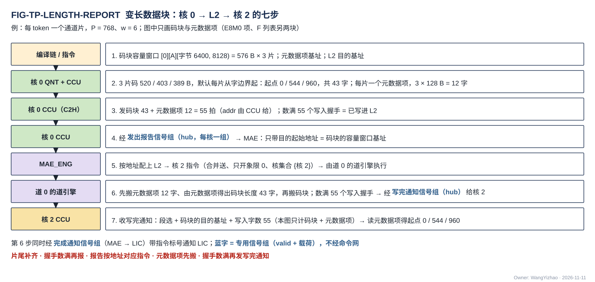

图中按时间从上到下（例：每 token 一个通道片，$P$ = 768、$w$ = 6）：位点指令给输出码块的容量窗口 [0][A][字节 6400, 字节 8128)（容量 = 码块每片上限 576 B × 3 片；$P \times 6$ bit = 576 B 是满码长，每片保留上限 $k$ 下的码长不会更大）与元数据项的地址（A 类，编译链另给），发送指令给 L2 目的基址（象限由 C2H 链路固定 = 本核号）→ QNT 写出 3 个 token（每 token 一个通道片）的码 520 / 403 / 389 B，按数据组织的默认各片从存储字边界起写：起点相对 0 / 544 / 960（字节 6400、6944、7360），码块片长 17 / 13 / 13 个存储字，码块共 43 个存储字（1,376 B）；每片一个元数据项，每项 $4 + P/8$ = 100 B、补到 128 B（4 个存储字），共 12 个存储字，落 A 类；E8M0 项与 F 列表另发、图中不画 → 核 0 的 CCU 读 L1、经 C2H 发码块与元数据项 43 + 12 = 55 拍，每拍的 addr 由 CCU 给出；L2 每写进一拍回一个握手，CCU 数满 55 个即"已写进 L2" → CCU 经 hub 的发出报告信号组向 MAE 发出报告（只带目的起始地址 = 码块的容量窗口基址） → MAE 按目的起始地址找到源起始地址相同的那条指令放行（合并送、只开象限 0、核集合 = {核 2}，由道 0 的道引擎执行） → 该指令先搬 3 个元数据项（12 字），由其中的码块片长得出码块共 1,376 B = 43 字，再搬 43 个字，都落核 2 的 A 类 → 核 2 的接收桥写进后逐拍回写入握手，道引擎数满 55 个即该指令执行完 → MAE 经 hub 的写完通知信号组给核 2 的 CCU 发写完通知（目的基址 = 码块的目的基址，写入字数 55）、经完成通知信号组带指令标号通知 LIC → 核 2 的 CCU 收到即可消费，读元数据项、按片长前缀和得各片码块起点 0 / 544 / 960。图中只计码块与元数据项（43 + 12 = 55）；四部分齐发时写入字数 = 四部分字数之和。**每片一个元数据项；CCU 先发、握手数满再报；报告按地址对应指令；MAE 先搬元数据项；握手数满再发写完通知。**

### 3.14 目的空间是否空闲归编译链与指令；L1 / L2 不接收指令

**"能不能发"拆成三层，不要混在一起**：目的空间有没有空（编译链在指令里安排）、这一拍能不能进对方（ready，§2.2.3）、一批数据是否已全部写进存储（写入拍数达到应写量，§3.8）。硬件只做后两层，第一层没有任何运行期计数。

- **"把数据发到某个地址之前，那里的旧数据有没有被读完"，由编译链在指令里安排，不由硬件在运行期计数。** 类内地址的分配、预取距离、缓冲轮转由 **LIC 的操作 15**（ISA V0.2 §5，不是 MAE 的操作 15）给出；运行期只靠两类事件推进——写完成（§3.8：核内写 L1 由 CCU 判定，落进 L1 的核间数据收到写完通知）与最后读者完成；**按 ping-pong 用法排地址时，两堆的切换条件 = 正写的那堆写完成 ∧ 正读的那堆最后读者完成**，由 CCU 收事件后在下一位点的堆选里体现；硬件上两堆都可读可写，这只是编译链的用法（V18-TP-73）。MAE 与 CCU 不维护按空间的"剩余容量"计数。
- **ready 只保护链路与接收方的缓冲，不回答"目的空间有没有空"。**
- **L1 / L2 不需要接收指令**：接收方逐拍拿到地址、无状态，所以 L1 / L2 不需要"接收"指令，接收桥也不需要使能（常开，V18-TP-70）；**接收方每写进一拍回一个写入握手，由发令方数；落进 L1 的数据，发令方数满后给目的核 CCU 发写完通知**；CCU 据此判位点完成与堆切换。

### 3.15 核内 RRAM 的时序：写当拍、读 1 拍，时序确定

**时序确定来自三条：同拍单端口——每个堆同一拍只做一次访问（一次读或一次写），读口、写口只是逻辑口（CONC-2）；CCU 排读、写让读——读侧无仲裁，写与读碰到同一个堆时写让读（写 MUX 本地判断），L1 内部不设轮流、不设 busy；读固定 1 拍返回**（V18-TP-73 / L1-32）。不从字边界起的访问允许多拍（CONC-3）。写侧几个来源同拍要写同一类时由写 MUX 自己轮流，只表现为来源一侧的 ready / wr_stall，不影响读时延。**核内 RRAM 口因此不写任何等待上界。**

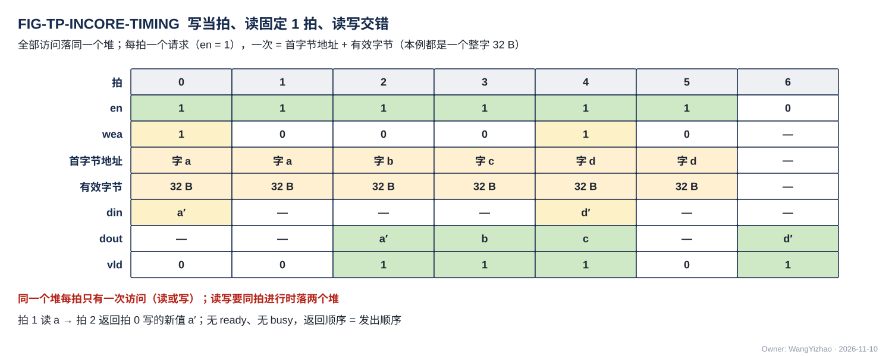

图中拍 0 写字 a，拍 1 读字 a（拍 2 返回新值），拍 2、3 连续读 b、c（拍 3、4 返回），拍 4 写 d，拍 5 读字 d（拍 6 返回新值）；每一拍一个请求，返回按发出顺序一拍一个。**同一个堆每拍只有一次访问（读或写），读与写交错在不同拍**；读写要同拍进行时落两个堆。

### 3.16 核内相邻级 stall：谁发 en 谁判断有没有地方放

**谁发 en，谁承担"有没有地方放"的判断；发 en 的不是消费者本人时，消费者给发 en 者一根 stall。** CCU 发所有 L1 读的 en，但读出来的数据进的是 MXU 供数缓冲或 VNU 读入口，所以这两类消费者给 CCU stall（每 pod 两根：权重收不下、激活收不下；VNU 一根）。写 L1 的 stall 只有一种：VNU 写口来不及收时 wr_stall 回 VNU；接收桥来不及收时拉低核间 ready（§3.6），不是核内 stall。**wr_stall 与接收桥的 ready 都来自各来源自己，L1 写口与写 MUX 本身不拉 stall。**

**每级拉 stall 时必须还能收下从拉 stall 到上游真正停发之间在途的拍（记为 $L$ 拍）；所以 stall 在还能接住 $L$ 拍时拉，不在满时拉，该级缓冲必须能装下这 $L$ 拍**（否则拉 stall 时已经放不下在途的拍）。各级 $L$ 由该级的设计者按自己的流水登记（参考登记表见 §7.9）；深度在 $L$ 之上多出的部分决定上游能连续送多少拍而不被停，是性能参数，不影响正确性。

**推送段相邻级握手**：供数 → 阵列（AEB）→ EPI（VNU 共用寄存器堆）→ VNU 写口 → L1 写口（A / W / S 类）是推送链（EPI 是 NLU 的后处理子模块，阵列的 AEB 条目直接交 EPI，V18-EPI-01 / MXU-06）：上游按节拍往下送，不等下游发请求；链的末端是 VNU 写口，只在写 MUX 轮到别的来源或让读的拍才堆积；需求超出所写那一类写口的口宽（A / W 类 128 B/拍、S 类 32 B/拍）时经 wr_stall 降速，不是错误（编译链不做带宽保证，V18-L1-21）。**每相邻两级之间一根 stall，只在相邻级之间传，不跨级，不设核级 stall 线。** 下游满了，先堆满上一级的缓冲，再由上一级拉它的上游，几拍之内传到供数缓冲、变成 stall_mxu 到 CCU。L1 写口与 CCU 自身不拉 stall。VNU 的输出（含经 EPI 透传的 MXU 输出）由 CCU 按指令选经 VNU 写口写 L1，或经 VNU 输出口直接推进集成输出端口（V18-TP-56 / 59，V18-VNU-07）；推进集成输出端口时，C2H 的停顿经 stall_tx 门控 CCU。

| 相邻级 | stall 方向 |
|---|---|
| 供数 → 阵列 | 阵列 → 供数（何时拉归 MXU 的设计） |
| 阵列（AEB）→ EPI | EPI → 阵列：EPI 来不及收时对 AEB 拉低 ready；AEB 堆满再反压 MXU 累加器 / 供数（EPI 篇 §4.3，AEB 深度属 MXU 的设计） |
| VNU 写口 → L1 写口（A / W / S 类） | VNU 写口 → VNU：来不及收时拉 wr_stall |
| 输出 → 集成输出端口 | 经 stall_tx 门控 CCU，不逐级回传 |

**AEB → EPI 一段：EPI 来不及收时对 AEB 拉低 ready**（V18-EPI-03 / 06）：4 个 pod 算完一轮统一输出，次序固定、条目不带标签；条目在 EPI 里放在哪由 EPI 设计者定（不要求先整轮存进寄存器堆再分两份轮换）；**EPI 处理一轮的拍数 ≤ MXU 产出下一轮的拍数**是唯一的速率要求（EPI 篇 §4.1，架构篇 §4.3），满足它时 EPI 不对 AEB 持续拉低 ready、MXU 累加器不被持续反压；不满足的位点经 ready 降速，不是错误。累加器粗分数直达 SEL 的旁路无握手（SEL 不反压，VNU 集成篇 §2.2），不在这条链上。

**C2H 不 ready：门控 CCU**（V18-TP-56）：**核间链路的 ready 只到计算核的集成输出端口；端口吸收 ready 的抖动，来不及上 C2H 时拉 stall_tx，CCU 被门控、停发全部 en、停算，等 ready 恢复再继续。** 核内其他单元看不到核间 ready。只写 L1 的指令不受 C2H 影响。

### 3.17 桥：集成输出端口与接收桥的对外行为

桥是核内"无握手、固定拍数"与核间"逐拍握手、拍数不定"两种规则的交界：集成输出端口把核间 ready 的抖动挡在核外，接收桥把等写口的先后挡在存储一侧，所以两边的协议都不需要为对方改动。桥都在产出数据的模块里，不设独立的转换单元。

**计算核的集成输出端口：C2H 的唯一来源**（V18-TP-56）。**每核只有一个核间发送口；核内两个来源——发送 FIFO 入口（收 A 类读 MUX 或 S 类读 MUX 的读出，每拍至多 128 B）与 VNU 输出口——由本核 CCU 按指令在切换段边界选一路，上 C2H（32 B/拍，架构篇 PORT-09）；来不及上 C2H 时拉 stall_tx 门控 CCU。** 端口内部的缓冲组织、深度与阈值属计算核集成的设计（`CORE_INTEGRATION_STAGING.md`，参考见 §7.10）。

| 核内来源 | 数据 | 触发 |
|---|---|---|
| 发送 FIFO 入口（读 L1） | L1 中任何数据块（紧凑 token 记录、残差、部分 dX、位图与列表、旋转后的 K …） | 本核 CCU 的发送指令：CCU 发读 L1 的 en / addr（A 类读出经 A 类读 MUX、S 类读出经 S 类读 MUX 整拍交发送 FIFO 入口，V18-L1-21），逐拍给出 C2H 上的 L2 addr |
| VNU 输出口 | 量化记录、标量（$\Sigma x^2$、组最大值、$(m_{\text{run}}, l)$ 等）、读集位图等；**以及经 EPI 透传的 MXU 输出**（AEB 的 K 切分部分和、位点指令选直接写 L2 的归约结果，V18-TP-59）。**来自 VNU 哪个单元、写到 L2 哪里，由 CCU 解码指令得到**（V18-VNU-07，VNU 集成篇 §2.7） | **由 CCU 按指令选写 L1 还是直接写 L2，二选一，不两边都写**；写 L2 时 CCU 推算每拍的 L2 地址 |

**CCU 在切换段边界选一路，C2H 上切换段不交错**（§3.10）；CCU 数着本切换段发了几拍，切换段发完不上链路。数据块发完、L2 回来的写入握手数满后 CCU 向 MAE 发出报告（§3.13）。C2H 每核 32 B/拍，输出速率高于它的位点由编译链选写 L1。

**跨核合并都经 L2**（V18-CRU-07、V18-TP-55）：K 切分的部分和、读集合并的位图、要跨核合并的标量，都是各核经 C2H 写进本核象限的同一段内地址（同址异象限），MAE 收齐发出报告后由 MAE_CRU 从 L2 读四个象限、合并、写回 L2；要到核 L1 时再由一条 L2 → L1 指令经 H2C 送下去，VNU 从 L1 读用。核间的小消息（K 切分判决、区块并集、改写后的节点档表）当变长数据走 C2H → L2 → H2C 多播，不另设通路。位点完成事件、发出报告走专用信号组（§2.6），不经数据网，也不经命令网；**标量不走命令网**。

**接收桥：H2C 接收桥与 NWB 是写 MUX 前的请求源，常开**（V18-L1-15 / 27、TP-70）。**L1 侧的接收桥是一种模块、两个实例——H2C 接收桥（H2C 四道）与 IDN 接收桥 NWB（一道），统一设计；内部实现归接收桥篇 `L1_LANDING_BRIDGE.md`**（参考做法见 §7.5）。本篇规定它在链路侧与写 MUX 侧可观察的行为：

| 一侧 | 规则 |
|---|---|
| 链路侧 | 每道一个核间从口（使用 HUB 提供的通用链路块）；**每道 ready 独立，只看本道能否收下**；时延无关、接住在途拍；不解析数据、不攒 token、不按工况切换、**不做任何形态变换，也不移位，不检查地址** |
| 写 MUX 侧 | **一个请求源，常开、无使能**。每次交出一个写请求 = **同一道、同 `seg`、同 `src`、地址连续的 1–4 拍（合计 ≤ 128 B）**（首字节地址 + 有效字节 + 数据），有几拍连续的就交几拍、不等凑满；**地址连续 = 后一拍的 addr = 前一拍的 addr + 前一拍的有效字节数**（默认对齐、整字时就是相差 32）；**请求在 `src` / `seg` 变化处断开**（V18-DORG-10 (7)）；`seg` 为 S 类的请求每次只交 1 拍（S 类写口一次只收一个整字）；不要求冲刷条件与超时。**写 MUX 这一拍没轮到本桥（或因让读而推迟）时数据不丢**（怎样再交是参考做法，§7.5 第 3 条），期间各道照常收字；一拍至多交一个请求；**按 `seg` 交 A / W / S 三类写口之一的写 MUX**，写 MUX 自己在三个来源之间轮流，不由 CCU 选（§2.3.3，V18-L1-32）。交给写 MUX 的请求里另带哪些字段（道号、拍数等）由计算核集成定（`CORE_INTEGRATION_STAGING.md`）；有效字节不足 32 的一拍之后能否在同一请求里接着放，取决于写 MUX 一侧接口的形式，也归计算核集成（`CORE_INTEGRATION_STAGING.md` CI-S-05），接收桥的参考做法是让这一拍结束本次请求（接收桥篇 §7.2） |
| 完成 | **写入握手在数据实际写进 L1 之后才回**：每写进一拍沿本道回一个写入握手（valid + 该拍的 `src`，§2.2.4）。**接收桥没有写计数**；写完由发令方数握手判定、经写完通知信号组通知目的核 CCU（§3.8.2） |
| 吞吐（要求值） | **H2C 接收桥四道各自目的地址连续、写 MUX 每拍都轮到本桥且目的堆不被读时合计 128 B/拍；只有一道有数据时该道 32 B/拍；NWB 32 B/拍（地址不连续时也是）**；各道目的地址都不连续时只降效率、不出错，积压时拉低本道 ready、上游降速，不丢字 |
| 公平 | **任何一条有字的道等待有上界、与其他道的流量无关，不被饿死**；回程的每个握手带对应那一拍的 `src` |

**满速以每道的目的地址连续为前提**（MAE 按 §3.11 排各道目的地址、编译链放 L2 时保证；CONC-3）。分送（§3.11）里本核 H2C 接收桥只有第 $c$ 道有字，**每核有效带宽 32 B/拍**（V18-MAE-42）。地址不在字边界时由 L1 内部移位（V18-TP-71 / 74）。写进 L1 的逐拍时序例见 §7.5 的 FIG-TP-STREAM-BEAT。

**L2 的各写口**（L2WP、NI 写口）对链路的行为与接收桥相同：写进存储之后才逐拍回写入握手，来不及收时拉低本链路的 ready，别的链路不受影响；同一个堆上几条链路同拍到达时怎样依次服务归 L2 篇（架构篇 §3.4 CONC-2 / 3 / 5）。

**位宽 1:1，链路上没有拆拍**：核内字 32 B = 核间拍 32 B = 存储字 32 B，链路与桥不拆拍、不拼字、不移位。接收桥只把同一道上地址连续的至多 4 拍合成一次 ≤ 128 B 的写请求，不改拍的内容与地址；不从字边界起的访问由目的 SRAM 内部移位，同样不改内容与地址。核内的 W 类权重读口（4 路 × 32 B = 128 B/拍）是读口，由发 en 的 CCU 按 stall 控速，不产生位宽上的握手。

### 3.18 MAE_CRU 的进出握手

MAE_CRU 是 MAE 组的合并单元（部分和归约、标量合并、读集合并），与 MAE_DSU 并列：**搬运指令的运算字段选"经 MAE_CRU 合并"时数据才过它；一组合并就是一条搬运指令：源 = L2（经 NI 读口读四个象限；合并四核同址异象限的定长份时四路给同一段内地址，这是用法、不是口的限制，V18-L2-08），运算 = 合并，目的 = L2（经 NI_INT 的 L2 写入合并器）**（V18-MAE-11 / 12、V18-CRU-07）。**启动条件 = MAE 收齐参与核写 L2 后的发出报告。** 进出都握手、地址由 MAE 的搬运引擎统一给（V18-MAE-25）：

| 方向 | 对端 | 握手 |
|---|---|---|
| 入：四个象限的四份 | NI 读口的四路读数据流（经 NI_INT 的 L2 读出分路交来；四路各自的读地址流与 ready 独立） | 各路按本路读地址的成交次序到达，可不同拍；四份怎样对齐成一次合并由 MAE_CRU 做（MAE_CRU 篇 §2.2.1）；MAE_CRU 来不及收时对读出分路拉低 ready，背压经该路的 L2 读地址流回到发读的搬运引擎（§2.2.5） |
| 出：合并结果写 L2 | NI_INT 的 L2 写入合并器（五个来源之一）→ NI 写口 → L2 | 写入合并器对该来源的 ready；L2 写进后回写入握手给搬运引擎 |

**输入是紧凑格式时，MAE_CRU 相加只用元数据项里的保留位图、尺度与码，不读 F 列表；输出要写成紧凑格式时，F 列表由 MAE 整字搬、不经 MAE_CRU 运算**（V18-MAE-44，MAE_CRU 篇）。为保持每拍一个结果，编译链把源与目的放在不同的堆；没错开只降速、不出错（CONC-1 / 2）。**MAE_CRU 不连核间链路，也不在命令网上**（V18-CRU-07、V18-TP-55）。每完成一条合并指令，由 MAE 带指令标号通知 LIC（§3.9）。MAE_CRU 合并的并行 lane 数【设计者定】：要定的是各类合并的并行度，约束是满足 MAE_CRU 篇的速率下限。

### 3.19 命令网：端点按 addr 写入，指令写全才生效

**端点都不经 L1 / L2，按每拍的 addr 写进自己的寄存器或 SRAM，不按往来的种类选目标。CCU 端点对命令网可见的是两处可写地址：**

| 写到哪 | 装填 | 用在哪 |
|---|---|---|
| CCU 的指令寄存器 | 一条普通 CCU 指令（16 个 64 bit 字）按 addr 写进指令寄存器的 16 个字地址；ready = 端点能收 | 位点级指令、块数少或块很长的 Fusion |
| CCU 的 **Fusion-CCU 段 SRAM** | LIC 把整段（段头 + 成员）经命令网按 addr 逐字写进段 SRAM；CCU 按 LIC 操作 15 的工作块数在本地循环执行；ready = 段 SRAM 有空位 | 成员短、块数多的 Fusion（attention 的 tile 循环） |

指令寄存器的组织（参考：当前 / 下一条两个 1,024 bit 寄存器，任何指令从"下一条"进入执行）与段 SRAM 成员怎样逐条进入执行属 CCU 的设计（`CCU_STAGING.md`）。

**一条指令何时生效【设计者定】**：要定的是 CCU 怎样知道指令寄存器（或段 SRAM 里的一段）已写全——例如写到末字地址即生效，或另写一个生效寄存器；约束：**CCU 不会执行写了一半的指令**；ready 只表示端点这一拍能收。MAE_ENG 的指令接收队列同一约束：MAE 不执行写了一半的指令。**Fusion-CCU 段不超段 SRAM 容量由编译链保证**；段 SRAM 的容量属 CCU 的设计（`CCU_STAGING.md`，参考见 §7.12），约束是装得下编译链允许的最长 Fusion-CCU 段（段头 + 全部成员），两者须一致；段 SRAM 没有类选、不在数据网上。

**Fusion：Fusion-L3PU 由 LIC 执行，Fusion-CCU 整段进 CCU 本地循环。** Fusion-L3PU（组合 MAE、CCU 与同步指令的段）只在 LIC 执行：LIC 按段内顺序向 MAE、各核 CCU 发各自的成员，CCU 看不到这种段。Fusion-CCU 段（同一核上的普通 CCU 指令序列）由 LIC 经命令网按 addr 一次写进该核的段 SRAM，CCU 按 LIC 操作 15 的工作块数本地循环，LIC 不逐块重发；块数与录取相关的循环终止都在 CCU，LIC 只收段完成事件（经位点完成事件信号组）。

**MAE_CRU 的合并参数随 MAE 搬运指令**（V18-MAE-12）：合并种类（归约、标量合并、读集合并）、象限掩码、L2 源与目的地址是搬运指令里的参数，**不设独立的 CRU 配置操作**；在 Fusion-L3PU 段里它就是 LIC 交给 MAE 的一条搬运指令，LIC 只排序与分发、不直接给 MAE_CRU 发令。原则：**源在核外的搬运由 MAE 发令，源在核内的由本核 CCU 发令；搬运途中按固定规则的合并（MAE_CRU）由 MAE 的搬运指令选用**（V18-TP-35 / MAE-12）。

**指令骨架：一条指令 = 若干 64 bit 字，按 addr 依次写进端点的指令寄存器、段 SRAM 或指令接收队列；字段位宽归 ISA。**

| 往来 | 写入的字 |
|---|---|
| 位点指令 / Fusion 段 | 每个成员 16 字（1,024 bit 指令字，ISA 已定）；Fusion 段另有段头 |
| 搬运指令（MAE） | **字段见 MAE_ENG 篇 §3.3**：指令标号（LIC 分配）、口对、源端与目的端各自的地址生成方式与参数（算术 / 列表驱动 / 按元数据项聚集）、几何、核集合、**运算字段（不经运算级 / 经 MAE_DSU：运算 = 直通或转置，转置时给元素位宽、行数、列数三个字段，参数见 MAE_DSU 篇 §3.2 典型用法表 / 经 MAE_CRU：合并种类、象限掩码、L2 源 / 目的地址）**（V18-MAE-41）、第二目的（可选：同一次源读出另投一份给另一核集合，即双目的、权重只读一次；**标准布局时训练那份经 MAE_DSU 直通、前向那份经 MAE_DSU 转置成行字区的字形态；列深度优先布局时训练那份经 MAE_DSU 转置、前向那份不经运算级**，V18-MAE-16、V18-L1-30，MAE_ENG 篇 §3.14）、优先级（2 bit【待标定】，V18-MAE-45）、长度（指令给定；列表驱动时取列表计数）、象限掩码与 L2 → L1 的用法（合并送 / 分送，V18-MAE-28 / 37）、**合并送的目的排法 1 bit（片交织 / 段接续，V18-MAE-45）**；没有完成计数号、等待条件与环长；由搬运引擎展开成逐拍地址；字段位宽归 ISA，各模块需要的指令字段由各模块设计者按需整理 |
| 配置写 | 一个配置寄存器字 |

专用信号组的载荷见 §2.6。

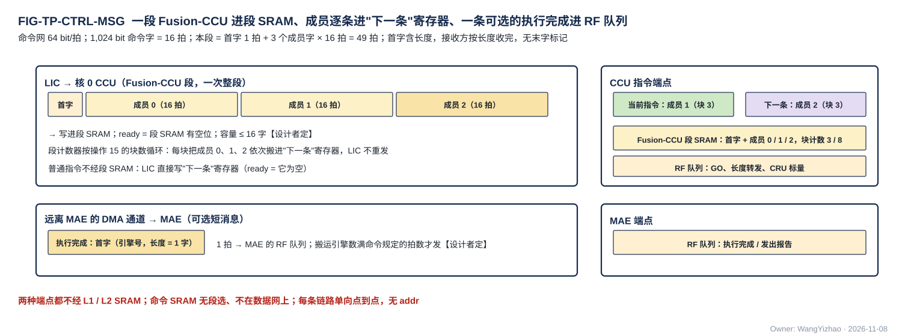

图中 LIC → CCU 链路上逐拍带 addr，先后写进段头（字数归 ISA，图中按 1 拍示意）与 3 个成员（各 16 拍），整段落进 Fusion-CCU 段 SRAM 的连续字地址；图中 CCU 内部（段计数器按块循环，把成员逐条搬进"下一条"指令寄存器，当前指令寄存器里是上一条成员）是参考组织，属 CCU 的设计（`CCU_STAGING.md`）。图中下半面板标"参考实现：搬运引擎放道旁时才有（PORT-40）"：远端搬运引擎经执行完成信号组给 MAE 一个执行完成，属参考实现的一种放法（§7.6），不经命令网。

### 3.20 命令网、专用信号组与数据网之间的顺序

- 同一链路保序。
- **指令先于数据发出**：LIC 顺序取指保证搬运指令先于依赖它的数据指令发出；执行搬运的引擎先搬元数据项、再搬码块与 F 列表，写往某个目的核的数据数满写入握手后经 hub（H2C）或 NI（IDN）的写完通知信号组给该核 CCU 发写完通知（§3.13 第 6 条）。
- **写完通知在数据全部写进之后才发**：它在最后一拍的写入握手回到发令方之后才发出，所以专用信号组与数据网虽然时延无关，目的核 CCU 收到写完通知时数据一定已经写进 L1，不需要本地比对（V18-TP-70）。
- **命令网、各专用信号组与数据网之间不保序**：依赖关系只靠"握手数满才发写完通知""收齐事件与完成通知才发 GO"这类判据表达，不靠到达先后。
- **数据可以先落地**：接收桥常开、无状态、按 addr 写，不需要长度与使能；数据先于对应的位点指令到达时照常写进 L1、照常回写入握手，CCU 只在收到写完通知后消费。

## 4 性能指标

**本章只放要求值；本篇不规定任何链路的时延数值，正确性只取决于握手。** 哪些口在一个位点里同时忙、忙到几成，由数据流篇与各模块篇按位点算。口宽与条数以架构篇 §2.7 为准，同拍能做哪些访问以架构篇 §3.4 的 CONC-n 为准。

### 4.1 链路与口的速率要求

| 项 | 要求值 | 条件 | 出处 |
|---|---|---|---|
| 每条核间链路 | 每拍成交一拍（32 B/拍），**每一级满吞吐，插级只增时延、不降吞吐** | 接收方 ready | §3.5.3 A2 |
| 写入握手回程 | 一个写入方每拍可回一个；发令方每拍能收它所有写入方的握手（H2C 一道一拍至多 4 个） | 只有 valid、没有 ready | §2.2.4 |
| L2 读口 | 每条读地址流每拍成交一个地址、读数据流每拍交出一拍（32 B/拍） | 下游 ready、所访问的堆本拍未被别的链路占用，或同链路地址连续（CONC-3） | §2.2.5 |
| H2C 接收桥 | **四道各自目的地址连续时合计 128 B/拍**；只有一道有数据时该道 32 B/拍 | 写 MUX 每拍轮到它、目的堆这一拍不被读；地址不连续只降速、不出错 | §3.17，架构篇 §4.3 |
| NWB | **32 B/拍**（地址不连续时也是） | 写 MUX 每拍轮到它、目的堆这一拍不被读 | §3.17 |
| L2 → L1 合并送 | 开 $n$ 个象限时每核 $n \times 32$ B/拍 | 各道目的地址各自连续 | §3.11 |
| L2 → L1 分送 | 每核 32 B/拍 | — | §3.11 |
| C2H | 每核 32 B/拍 | L2 能收 | §3.17 |
| 核内 RRAM 写口 | A / W 类每拍一次 ≤ 128 B，S 类每拍一个整字 | 从存储字边界起一拍；否则允许多拍（CONC-3） | §2.3.3 |
| 核内 RRAM 读口 | A 类每拍一次 ≤ 128 B；W 类权重读口每拍 4 路各一个整字；S 类读口一拍 2 个地址各一个整字 | 同上；CONC-4 / 6 | §2.3.4–§2.3.6 |
| 命令网 | 每条链路每拍一个 64 bit 字 | 端点 ready | §2.5.1 |
| M0 | MAE 发请求的方式不使 M0 有效带宽低于 DDR 控制器能提供的带宽（参考点 19.2 GB/s） | — | §3.3.2，MAE_ENG 篇 §4.1 |
| 核内推送链 | **EPI 处理一轮的拍数 ≤ MXU 产出下一轮的拍数** | 一轮至多 $4n$ 条 AEB 条目（$n$ = 每 pod 源数，配置给出；全开且 $n = 8$ 时 32 条） | §3.16，EPI 篇 §4.1 |
| 多播 | 慢核落后不超过 $M_{\text{mc}}$ 拍时不拖其他核 | $M_{\text{mc}}$ 由接收桥篇登记 | §3.7 |

### 4.2 同时使用的口与并发条件

**本篇的口与链路同拍能否同时访问同一存储，由架构篇 §3.4 定义，本篇只引用、不另定**（V18-TP-81）：

| 同时使用的情形 | 适用的约定 | 结果 |
|---|---|---|
| L1 同一类的读口与写口同拍 | CONC-1 / 2 | 落不同堆时都不降速；落同一个堆时写让读（写 MUX 本地判断，V18-L1-32） |
| L1 W 类权重读口一拍 4 路 | CONC-4 | 第 $b$ 路读存储字号除以 4 余 $b$ 的字，同一路的两列不同拍 |
| L1 S 类读口一拍 2 个地址 | CONC-6 | 每个地址一个整字，可以是同一个堆里的两个数据；同拍需要多于 2 路时由 CCU 错开 |
| L2 同一象限几条链路落同一个堆 | CONC-2 | 依次服务，只降速、不丢、不错，每条链路的等待有上界 |
| L2 同一个堆上几个写入方或几条读链路争用、各自地址连续 | CONC-3 | 各自保持 32 B/拍 |
| L2 各象限之间 | CONC-5 | 互不影响 |
| H2C 四道并行送一个核 | CONC-3 | 各道目的地址各自连续时合计 128 B/拍 |
| 数据网、命令网、专用信号组 | 物理分开 | 互不阻挡 |

### 4.3 要求值表

| 项 | 要求值 | 说明 |
|---|---|---|
| 核间数据 | din 32 B、be 32 位 | 所有核间数据链路相同 |
| 段内地址 addr | 24 bit（参考值【设计者定】） | 覆盖 L1 任一类任一堆、L2 任一象限任一堆；与 ISA 地址字段同宽 |
| 段选 `seg` | 5 bit = 堆选 1 + 段掩码 4（独热） | 所有链路与核内 RRAM 口统一；定义见架构篇 §3.3 |
| 发令号 `src` | 5 bit【待标定】 | 所有核间写链路都带；须覆盖 MAE 搬运引擎数 + 4 个 CCU + 在途 PIN 事务号（架构篇 §2.4） |
| 写入握手 | 每个写入方一组 valid + `src`；片内 29 组（H2C 16、IDN 4、C2H 4、NI 写口 4、LIC 直连口 1），片外为 AXI 写响应 | 架构篇 PORT-30 |
| 专用信号组 | GO 4、位点完成事件 4、写完通知 8（每核两组）、完成通知 1、发出报告 4 | 架构篇 PORT-35…39；载荷见 §2.6 |
| 命令网 | data 64 bit；addr 位宽【设计者定】 | 每拍带 addr |
| 一条 CCU 指令 | 1,024 bit = 16 个 64 bit 字 | ISA 已定 |
| 核内一次访问 | A / W 类 ≤ 128 B（任意字节起点）；W 类权重读口 4 路 × 32 B；S 类读口一拍 2 个地址 × 32 B 读（可同一堆，CONC-6）、32 B 整字写 | 从字边界起一拍，否则允许多拍 |
| 读出时延 | 核内 RRAM 口：从字边界起固定 1 拍；核间与 L2 读口：不规定 | 核间正确性只取决于握手 |
| 优先级字段 | 2 bit【待标定】（搬运指令里） | V18-MAE-45 |

## 5 约束与由使用者保证的事项

### 5.1 硬约束

1. **全芯片只有三种总线，每种一种格式，不按数据类型分形态；完成与同步往来走专用信号组**（§2.1）。
2. **核间链路一律握手、用同一套逻辑，不做特殊设计；无握手的核内 RRAM 协议只用于 L1 对计算核内部模块的口**（V18-TP-80）。
3. **所有核间链路与命令网使用 HUB 提供的通用链路块**，满足 §3.5.1 的行为要求与 §3.5.3 的 A1–A7（V18-HUB-05）。
4. **核间链路全部在同一时钟域**；片外 AXI 的跨时钟域在 NI_EXT。
5. **核间链路无 burst、无数据应答、无切换段标记、无核号与 dest 字段**；去哪个存储由链路决定。
6. **SRAM 只用单端口宏，每个堆同一拍只做一次访问；SRAM 总量不增**（V18-TP-73）。
7. **本篇不含容错设计**（V18-TP-75）：地址、段选与长度的正确性由编译期检查与仿真断言（§6.3）保证。

### 5.2 由使用者保证的事项

以下事项协议不检查，由对应方保证：

| 事项 | 由谁保证 |
|---|---|
| 同一个堆上的几个使用者先由调度在时间上错开或放到不同的堆（没错开时 L2 依次服务，只降速）；L1 同一类的读口与写口同一拍不落同一个堆；堆选由指令的段选字段给 | 编译链 / MAE / CCU（架构篇 §3.4） |
| 类内各数据块的地址互不重叠（变长数据块按位点容量窗口静态分配） | 编译链 |
| 每位点的每片保留上限 $k$ 与容量窗口 | 算法侧（模型表） |
| 目的空间在数据到达时已读完（预取距离、缓冲轮转） | 编译链（LIC 操作 15） |
| 指令先于数据发出；同一条搬运指令里元数据项先于码块与 F 列表搬运；写完通知在写入握手数满后发 | LIC 顺序取指；MAE 搬运引擎 |
| 每片的元数据项（首字码块片长 + F 项数，后接 keep 位图）随片写进 A 类；四部分与列表各有编译链地址，四个象限同址 | QNT（写元数据项）/ CCU（推地址）/ 编译链 |
| 同一条搬运指令先搬元数据项，再搬码块与 F 列表，码块与 F 列表的地址由元数据项算定（顺序搬也如此；聚集时读各容量窗口的元数据项）；按 $m$ 切分合并时整项照抄元数据项 | MAE 搬运引擎 |
| MAE 消费的序号列表的项数：生产核 CCU 写成一个定长计数项，与列表同在 L2；MAE 读列表前先读它 | CCU / 编译链（地址）/ MAE |
| 变长数据块不超位点容量窗口（SEL 的限个数选择模式把每片保留的通道数限制在每片保留上限 $k$ 以内） | SEL / QNT |
| L1 外三个读出一侧 MUX 每拍的选择；需求超出口宽时谁等：写侧来源在自己的 FIFO 里等、反压上游，读侧由 CCU 排拍（编译链不做读写带宽保证） | 本核 CCU；各来源 |
| 写 MUX 在三个来源之间轮流、写让读 | 写 MUX（固定规则、本地判断，V18-L1-32） |
| W 类权重读口的读序列里同一路（同一个 bank）的两个请求排在不同拍；每路 4 位"哪些 pod 收"；"到达的第 $i$ 列 ↔ 原 hidden state 列号"的映射与排回 | CCU（`CCU_STAGING.md`，MXU 集成篇 §2.2） |
| 权重字放进 pod 的哪个槽、激活码进哪个源 | MXU_CONTROLLER（MXU_CONTROLLER 篇 §3.2；CCU 不给槽号） |
| 所有尺度与 bias 放 S 类；同拍需要多于 2 路时错开（CONC-6） | 编译链（地址分配）、CCU（排 S 类读） |
| 核内写 L1 的完成判定 | 本核 CCU（`CCU_STAGING.md`） |
| AEB 统一输出的次序与条目格式（无标签） | MXU |
| EPI 处理一轮的拍数 ≤ MXU 产出下一轮的拍数 | EPI 设计者与 MXU、CCU 设计者对接（EPI 篇 §4.1） |
| MAE_CRU 归约值（输出编码由指令给，默认 BF16；V18-CRU-08）对回（token, 列块）：**归约值落在哪个存储字由搬运引擎给的地址决定，CCU 按地址推出属于哪个（token, 列块）**；超 32 B 的一组占连续几个存储字、分多拍发，**不带组序号**（V18-CRU-01 / 02 / 05） | CCU 地址推算（MAE_CRU 篇 §3.11） |
| 发出报告在依赖它的搬运指令之前到 MAE | CCU（数据块发完触发） |
| 发出报告按目的起始地址对应源起始地址相同的那条 MAE 指令：每个变长数据块有静态分配的容量窗口基址，同一时间在飞的数据块基址互不相同 | 编译链 |
| 每条 MAE 指令带指令标号；MAE 每执行完一条就带标号通知 LIC；指令间依赖由 LIC 收到通知后再下发表达 | LIC（分配标号、按通知分发）/ MAE（按 §3.9 判据通知） |
| MAE 搬运的数据不用环形缓冲，跨环尾拆成两条指令（MAE 不回绕） | 编译链 |
| 数据块与通道片四部分的起点默认在存储字边界、片尾补到 32 B（不是时由 SRAM 内部移位，§3.4）；S 类末字补 0 | 编译链（数据块起点）/ 本核 CCU（写累加按字取整）/ 生产方（QNT 等） |
| 激活（含 Q / K / V）的 MX 组长 $G$ 随位点指令给 QNT、CCU、EPI、MAE_CRU：$G$ 为位点属性（32 的倍数，上限【设计者定】且不大于片长；32 是精度基准、验收工况与效果最好的配置）；权重的 MX 组固定 32 | 编译链 / 指令 |
| 读改写的放法：放两堆是默认用法，同一个堆不同拍的原地读改写也允许 | 编译链 / CCU |
| 合并送四道并行满速：各道目的地址各自连续；要四道并行送的流在 L2 按块分四段连续放；产出方按下一位点读法分块写 L2，变长数据四个象限同址 | 编译链 / MAE 搬运引擎 / 产出核 CCU（数据组织篇 §3.6） |
| 各级 $L$（从拉 stall 到上游停发的在途拍数）与缓冲深度 > $L$ | 各模块设计者 |
| 核内累加的步长与基址正确；C2H 的核内来源选择、VNU 输出口的源单元、读 L1 的 en / addr、每拍 L2 addr；C2H 不 ready 时停算 | 本核 CCU |
| 每拍 addr 正确（H2C / IDN / NI / MAE_DSU / MAE_CRU 出口）；经 IDN 时每拍的目的地址与核集合；H2C 各道的目的地址序列与核掩码 | MAE 搬运引擎 |
| 同链路保序；多播各目的独立取走、慢核落后不超过 $M_{\text{mc}}$ 拍不拖其他核；多播时各目的核的写入握手各一组直达发令方，不汇总、不按 `src` 归并 | hub、HUB_IDN |
| 按 §2.6 连通专用信号组并计条数；只连通、不处理 | hub、NI |
| 命令网每拍的 addr 指向目的端点内可写的寄存器 / SRAM 字；一条指令写全才执行（生效规则【设计者定】） | LIC（发 addr）；CCU、MAE_ENG（生效） |
| 合并点只在切换段边界换源（边界由发令方给出，不上链路） | 集成输出端口（CCU）、NI_INT 的 L2 写入合并器与 IDN 出口 |
| C2H 在 hub 里直通 L2 的本核写链路，不扇入、不仲裁、不分路；核 $n$ 只写象限 $n$ | hub（象限由链路固定） |
| 每条核间写链路的接收方在写进最终存储之后回写入握手（带 `src`） | L1（H2C 接收桥、NWB）、L2、LIC 小 SRAM；片外为 NI_EXT 转交的 AXI 写响应 |
| 发令号分配：每个搬运引擎一个、每笔在途 PIN 事务一个、每核 CCU 一个；任何时刻一个号只对应一条未完成的指令 | MAE_ENG / NI_INT / CCU |
| PIN 每笔 AXI 写事务取一个发令号，该号的握手数满才回 B；一笔事务不跨象限、不跨堆，有效字节连续 | NI_INT、NI_EXT |
| 应写量与写入握手数的比对，达到后才报完成 / 切堆 / 发读 / 发出报告 / 发写完通知 | CCU（C2H 的握手）、MAE 搬运引擎（H2C / IDN / NI 写 / LIC 直连口 / 片外的握手；按（核, `src`）逐源计数） |
| NI 写一个切换段不跨象限；段掩码广播 $k$ 个象限时应写量按 $k$ 倍计 | MAE 搬运引擎 |
| 数据块写完（核内写由 CCU 判定，或已收到写完通知）才发出，不做流式转发 | CCU / 编译链 |
| PIN 窗口按（调用种类, 输入种类）固定，每种输入一个窗口（V18-MAE-44）；PIN 写一帧期间 L3PU 不推理，一帧传完才开始推理 | 编译链；M55 / LIC 的调度 |
| 位点屏障：收齐位点完成事件、数到所需的 MAE 完成通知、发 GO | LIC |
| MAE_CRU 的合并参数随搬运指令到位 | MAE |
| 标量是 VNU 的输出：要跨核合并的经集成输出端口写 L2（或先写 L1 再发）；合并值经 H2C 落 L1 后由 VNU 读用 | CCU |
| Fusion-CCU 段不超段 SRAM 容量 | 编译链 |
| 输出轴稀疏权重按整列发给属主核；各核轮到的字数比例与核集合随搬运指令给出 | MAE、HUB_IDN、NWB |
| 跨核搬运与消费按批流水：结合 Fusion 指令先搬一批、算一批；每批一次写完通知，按批判"可读元数据项" | LIC（Fusion 段）/ MAE / CCU |
| 分批搬运时下一批的起点 | MAE（§3.13） |

## 6 验收

### 6.1 本篇条目的验收项

| 编号 | 验收项 | 方法 | 判据 | 出处 |
|---|---|---|---|---|
| TP-A1 | 核间链路信号统一 | RTL 接口审查 | 每条核间数据链路正向 en / din 32 B / be 32 / addr 24 / `seg` 5 / `src`，反向 ready 与写入握手 valid + `src`；无核号、dest、末拍标记 | §2.2.1、§2.2.2 |
| TP-A2 | 成交规则 | 随机 ready | en ∧ ready 同拍才成交；ready 低时发送方信号保持；en 拉起后不撤销 | §2.2.3 |
| TP-A3 | 通用链路块 | 随机化全部参数（数据位宽、旁带位宽、接住在途拍的深度、流水级数）与 ready 拉低时序 | 到达目的的数据逐位一致、不丢拍、不重复；输出寄存器化、相邻块无组合路径 | §3.5.1 |
| TP-A4 | 时延无关 A1–A7 | 随机化每段级数、分叉位置、ready 时序与握手回程时延 | 数据逐位一致；写入握手计数与应写量相符；写完通知到达时数据已全部写进 | §3.5.3 |
| TP-A5 | 写入握手 | 逐拍检查 | 每拍写进最终存储之后才回、恰回一个、`src` 等于该拍的发令号；C2H / L2WP 与其他链路同形；多播与 IDN 共享时每个写入方一组直达，hub / HUB_IDN 不汇总；发令方按（写入方, `src`）计的数与应写量相符，同拍几个核同时回的握手一个不丢 | §2.2.4、§3.8.1 |
| TP-A6 | L2 读口两条握手流 | 下游 ready 随机拉低（含长时间） | 每接受一个读地址恰交出一拍、按成交次序；下游收不下时读地址流 ready 拉低、发读方保持；NI 读口四路各给不同地址时各路独立，一路被卡不影响另三路 | §2.2.5 |
| TP-A7 | H2C 道的三条流 | 三条流的 ready 各自随机拉低 | 引擎保持本拍不变；目的信息与读出按次序一一配对；四道各自停发、互不等待 | §2.2.6 |
| TP-A8 | 背压 | 各链路接收方持续不收 | ready 逐级传回发令方，只降速、不丢数；一条道堵住不影响别的道 | §3.6 |
| TP-A9 | 多播 | 一核随机长时间不收 | 各目的核独立取走；慢核落后不超过 $M_{\text{mc}}$ 拍时其他核不停；超过时只降速、不丢 | §3.7 |
| TP-A10 | 写完通知 | 随机多播、合并送 / 分送、IDN 共享、紧凑记录四部分、按批流水 | 只在写往该核的写入握手数满之后发；H2C 多播、分送、IDN 共享时各核各自数满各自收、不等其他核；合并送时该核的几条道都数满才发；全部数满后才发完成通知；载荷（段选、目的基址、写入字数）与实际写进一致；每核两路互不等待 | §2.6、§3.8.2 |
| TP-A11 | 切换段不交错 | 合并点两源同时有数据 | 合并点只在切换段边界换源；链路上无切换段标记 | §3.10 |
| TP-A12 | 紧密存储与对齐 | 随机首地址与长度（经核间链路与 RRAM 口） | 写进的字节与给出的逐字节相同、未写字节不变；读出首字节在第 0 字节；拍数不超过 CONC-3；使用者一侧不移位 | §3.4 |
| TP-A13 | 变长数据块的时序 | 按 FIG-TP-LENGTH-REPORT 的例子与随机片长 | CCU 握手数满后才发出报告；MAE 按目的起始地址配对；先搬元数据项、再搬码块与 F 列表；分批搬运时下一批起点由 MAE 接续、各象限起点正确 | §3.13 |
| TP-A14 | 核内 RRAM 时序 | 按 FIG-TP-INCORE-TIMING 与随机访问 | 写当拍写入；从字边界起的读下一拍返回；同一个堆每拍一次访问 | §2.3、§3.15 |
| TP-A15 | 核内 stall | 下游随机来不及收 | 拉 stall 后在途的 $L$ 拍全部收下；stall_tx 门控 CCU 停发全部 en、停算；wr_stall 不到 CCU | §2.4、§3.16 |
| TP-A16 | 接收桥对外行为 | 随机地址连续性、写 MUX 轮流与让读 | 请求形状符合 §3.17；写 MUX 没轮到本桥或让读时数据不丢；任一有字的道等待有上界；吞吐达 §4.1 要求值 | §3.17 |
| TP-A17 | 命令网 | 随机 ready | 端点按 addr 写；CCU、MAE_ENG 不执行写了一半的指令；网上无末拍标记 | §2.5、§3.19 |
| TP-A18 | 专用信号组 | 随机接收侧来不及收 | 每组发出的 valid 数与接收侧收下的数相等、载荷逐位一致；只降速 | §2.6 |

### 6.2 与上下游模块的对接检查项

| 编号 | 对接项 | 对端篇与节 | 判据 |
|---|---|---|---|
| TP-I1 | 口宽、条数 | 架构篇 §2.7 | 本篇引用的 PORT-nn 与架构篇一致 |
| TP-I2 | `seg`、象限、堆与并发 | 架构篇 §3.3 / §3.4 | 本篇不另定并发条件；L1 / L2 篇第 7 章说明怎样满足 CONC-n |
| TP-I3 | 通用链路块 | HUB_NOC 篇 §2.9 / §3.9、HUB_IDN 篇 | HUB 提供的块满足 §3.5.1 与 A1–A7；各端点只例化、不自写握手流水 |
| TP-I4 | L2 的口 | L2 篇 §2.1（L2WP、NI 写口、象限读口、NI 读口） | 读口两条握手流；写入握手 valid + `src`；NI 读口四路各自 |
| TP-I5 | 接收桥 | 接收桥篇 §2.1 / §3.3 / §3.8 | 请求形成规则、写入握手时点、吞吐要求值与 §3.17 一致；$M_{\text{mc}}$、$L_{\text{skid}}$ 由接收桥篇登记 |
| TP-I6 | MAE 的搬运引擎 | MAE_ENG 篇 §2.1 / §3.10 / §3.18 | 逐拍 addr 与 `src`；L2 读地址流与 H2C 道控制带握手；写完通知时点与载荷；合并送排法 1 bit；分批搬运起点接续 |
| TP-I7 | NI_INT | MAE_NI_INT 篇 §2.1 / §3.5 | L2 写入合并器按切换段换源；按 `src` 分发 4 组写入握手；PIN 发令号 |
| TP-I8 | 专用信号组载荷 | 架构篇 PORT-35…39、HUB_NOC 篇 §2.8、登记篇 §2.5 | 字段与 §2.6 一致；其他篇只引用本篇 |
| TP-I9 | VNU 的读口、写口、输出口与 stall | VNU 集成篇 §2、EPI 篇 §4.1 / §4.3 | wr_stall、stall_vnu、AEB ready 的语义与 §2.4 一致 |
| TP-I10 | CCU 的发令与完成判定 | `CCU_STAGING.md` | C2H 每拍 addr、发出报告时点（握手数满后）、核内写完成由 CCU 判定、收到写完通知才消费 |
| TP-I11 | L1 外的 MUX 与集成输出端口 | `CORE_INTEGRATION_STAGING.md` | 写 MUX 不合并来源；A 类读出整拍只给一个使用者；集成输出端口 stall_tx 门控 CCU |
| TP-I12 | 搬运指令字段 | MAE_ENG 篇 §3.3、ISA | §3.19 指令骨架中的字段都有位宽与编码 |

### 6.3 仿真断言

以下断言只在仿真里，验证交付物，不对应硬件检查逻辑；地址、段选与长度的正确性由编译期检查与这些断言保证（§5.1 第 7 条），各模块篇的验收引用本表：

| 断言 | 判据 | 放在哪 |
|---|---|---|
| 地址不越界 | 一次访问的首字节地址加有效字节数不超出所选存储范围的容量（L1 各类按本类当前的容量配置；L2 按象限一堆的容量） | L1 / L2 各口与各链路接收端的仿真模型 |
| 段选合法 | `seg` 段掩码独热（NI 写口的同址广播除外）；进 L1 的第 4 位为 0；象限由链路固定的口段掩码为本象限 | 各链路接收端 |
| 每个堆一拍一次访问 | L1、L2 的每个堆同一拍至多一次访问（一次读或一次写）；L1 同一类的读口与写口同一拍不落同一个堆 | L1 / L2 模型 |
| 不超容量窗口 | 变长数据块的码块与 F 列表不超出位点容量窗口；每片保留的通道数不超每片保留上限 $k$ | CCU 写累加器、QNT 写出 |
| 一个存储字只属于一片的一部分 | 按默认对齐写出的通道片四部分里，一个存储字只装一片的一部分（生产方补 0 的片尾字节除外） | L1 / L2 写口 |
| 接收桥的请求形状 | 一次请求 = 一道 `seg` 与 `src` 都相同、地址连续、合计 ≤ 128 B 的 1–4 拍；进 S 类恒 1 拍；一拍至多交一个请求 | 接收桥 |
| 等待有界 | 接收桥任一有字的道、L2 同一个堆上任一有请求的链路，等待拍数不超过该模块登记的上界 | 接收桥、L2 |
| 握手不早于写进 | 每个写入握手都在对应那一拍写进存储之后才回 | 接收桥、L2、LIC 小 SRAM |
| 写完通知即全部写进 | 目的核收到写完通知时，该指令（按批流水时为该批）写往该核的全部拍都已写进；写入字数与实际写进的拍数相等 | 目的核 L1 模型 |
| 发令号不复用 | 任何时刻一个 `src` 只对应一条未完成的指令 | MAE_ENG、NI_INT、CCU |
| 写入握手逐源到达 | 多播与几核共享时每个目的核的握手各自到达发令方；发令方按（核, `src`）计的数之和与应写量相符，同一拍几个核同时回的握手一个不丢 | MAE_ENG、HUB_NOC / HUB_IDN 回程 |
| L2 读按序 | 每个读口交出的读数据拍数等于已接受的读地址数，次序一致 | L2 读口 |
| 命令网写地址合法 | 每拍 addr 落在目的端点可写的寄存器 / SRAM 字范围内 | 各命令网端点 |
| 不执行写了一半的指令 | CCU（及收指令的 MAE_ENG）开始执行一条指令时，该指令的全部字都已写进 | CCU、MAE_ENG |
| 专用信号组不丢不重 | 每组发出的 valid 数与接收侧收下的数相等，载荷逐位一致 | 各组接收端 |

## 7 参考实现

**本章内容可以换；换了之后别的模块不用改。** 本章收的是协议涉及的各模块内部做法的参考说明，每节指向该模块篇第 7 章；正式的参考实现以各模块篇为准。§2.2、§2.3、§2.5 的三张总览图（FIG-TP-ARCH-INTERCORE / -INCORE / -CTRL）框内画的结构就是本章所说的参考组织，本章只引用图号、不另嵌。

### 7.1 段内地址到 bank 与深度的换算

参考组织（L1 篇、L2 篇第 7 章；架构篇 §7.1 / §7.2）：**L1 的 W 类、A 类每堆 = 4 个 32 B 宽的单端口 bank，相邻存储字依次落 4 个 bank（按字交织）；L2 每象限两堆、每堆 4 个 32 B bank 按字交织；S 类由若干个浅 bank 组成，怎样做到一拍 2 个地址见 L1 篇 §7.4**（V18-TP-73 / L1-26 / 31）。bank 一律用类内编号（W 类 bank 0–3、A 类 bank 0–3）。

| 类 | 段内地址 → bank / 深度（参考） |
|---|---|
| A 类、W 类行字区 | 段内地址 $a$ 所在的存储字 $j = \lfloor a/32 \rfloor$ 落本类 bank $j \bmod 4$、深度 $\lfloor j/4 \rfloor$ |
| W 类列字区 | 同一换算（W 类权重读口第 $b$ 路固定接所读堆的 W 类 bank $b$，即 CONC-4 的"存储字号除以 4 余 $b$"）；列字区的参考落位（不是规定）：列窗口内列 $j$ 的第 $p$ 个字落字号 $pC + j$（$C$ = 列窗口列数，取 4 的倍数），即 bank $j \bmod 4$；此时同一列相邻两个字相差 $C$ 个字、地址不连续 |
| S 类 | 一个存储字放 32 个 E8M0（权重尺度：一个（32 列块, K 组）的 32 个；激活：一个通道片里相继的 32 个 MX 组；LM Head 列副本：一列相继的 32 个 K 组）或一个 16 通道列块的 16 个 BF16 bias；地址到 bank 的换算归 L1 篇 §7.4 |
| L2 | 象限选 = 象限号，堆选 = 象限内两堆之一，堆内存储字 $j$ 落 bank $j \bmod 4$、深度 $\lfloor j/4 \rfloor$ |

按字交织时，从字边界起的 ≤ 128 B 访问覆盖至多 4 个连续存储字、落 4 个不同 bank（可跨相邻两行），一拍做完；不从字边界起的 128 B 覆盖 5 个存储字，第 5 个与第 1 个落同一 bank 的下一个深度，分两拍——参考组织下这就是 CONC-3"否则允许多拍"的具体拍数。

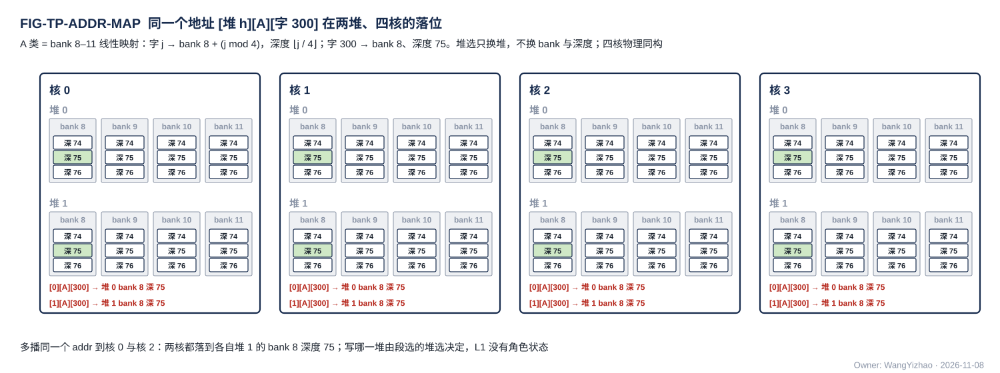

图中同一个地址 [堆 1][A][第 300 个存储字，即字节号 9,600] 在核 0 与核 2 都落到堆 1 的 A 类 bank 0 深度 75（A 类 4 个 bank 轮流，300 mod 4 = 0，⌊300 ÷ 4⌋ = 75）；把段选里的堆选改成 0，就落到堆 0 的 A 类 bank 0 同深度。四核物理同构，所以多播用同一个地址。

### 7.2 字节移位：首地址不在字边界时 SRAM 内部拆到相邻 bank

参考做法（L1 篇 §7.5、L2 篇 §7.6）：**写时 SRAM 按地址低 5 位把输入移位、拆到相邻 bank，生成各 bank 的字节写使能；读时把首字节移到输出的第 0 字节**（V18-TP-74）。例（A 类，存储字 $j$ 落 A 类 bank $j \bmod 4$）：存储字 1（bank 1、深度 0，段内字节 32–63）的前 16 B 已有数据，再写 31 B，首地址 = 字节 48；SRAM 把输入第 0–15 字节放进 bank 1 的字节 16–31、第 16–30 字节放进 bank 2 的字节 0–14（存储字 2，段内字节 64–78），bank 1 的字节写使能只开 16–31、bank 2 只开 0–14；下一批从字节 79 起。128 B 不从字边界起时，例如首地址字节 176、128 B 覆盖字 5–9（bank 1、2、3、0、1），bank 1 要访问深度 1 与深度 2，分两拍。

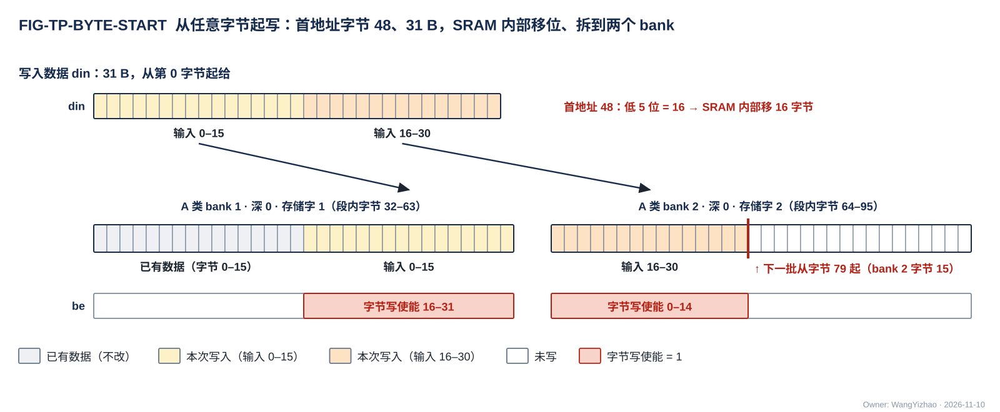

图中 A 类存储字 1（A 类 bank 1、深度 0，段内字节 32–63）的前 16 B 已有数据，再写 31 B、首地址字节 48：din 从第 0 字节起给；SRAM 取地址低 5 位（48 mod 32 = 16），把输入第 0–15 字节移到 bank 1 的字节 16–31、第 16–30 字节移到 bank 2（存储字 2，段内字节 64–95）的字节 0–14，同拍写两个 bank；bank 1 的字节写使能只开 16–31、bank 2 只开 0–14，其余字节保持原值。31 B 只覆盖 2 个存储字、落 2 个不同 bank，一拍写完；下一批从字节 79（bank 2 的字节 15）起。

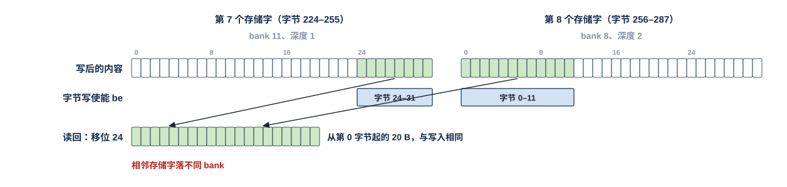

A 类的 4 个 bank（A 类 bank 0–3）。一片 100 B 的码从码块的字 5（字节 160）起，占字 5–8；一次写（首地址字节 160 + 长度 100 B）写进 A 类 bank 1、2、3、0，深度 1、1、1、2，四个 bank 互不相同；尾字 8 只有字节 0–3 有效（$100 - 3 \times 32 = 4$ B）。读回时 CCU 给首地址字节 160、长度 100 B，一拍交回。这是从字边界起的一次访问；下一片从哪个字节起由数据组织决定（默认补到字边界，紧密存储时从字节 260 起，§3.4）。

### 7.3 通用链路块的参数与 skid 拍序例

**通用链路块是 HUB 的交付物，参数表（数据位宽、旁带位宽、skid 深度、流水级数）见 HUB_NOC 篇 §2.9，行为要求见 HUB_NOC 篇 §3.9，skid 拍序例见 HUB_NOC 篇 §7.3**（V18-HUB-05）；本篇不另列。与本篇有关的两点：**将满阈值 = 深度 − 在途拍数**（与 §7.9 同一口径）；链路块的参数与与时延有关的门限都是 RTL 头文件参数，没有运行期配置（A6）。

### 7.4 多播分叉点：一级链路块 + 各核已取标记

参考做法（HUB_NOC 篇 §7.2、HUB_IDN 篇第 7 章，V18-TP-53 / HUB-05）：**多播分叉点 = 一级通用链路块 + 每个目的核（子输出）1 位各核已取标记；分叉点不另配存储**。分叉点每拍要做的事：

| 步 | 动作 |
|---|---|
| 1 | 对核掩码内、本拍尚未取走的子输出拉高 en；**en 只看各核已取标记、不看 ready** |
| 2 | 某子输出 ready = 1 的拍即取走这一拍，置位它的已取标记 |
| 3 | 核掩码内已取标记全部置位后，才接收上游的下一拍，同时清零各核已取标记 |

快慢核的差距由各分支链路块的 skid 与接收桥该道的空余部分吸收：一核堵住时，先由它的分支 skid 接住；分支也满后分叉点停收上游，同一道上的其余核随之停下；**余量 = 该核分支 skid + 接收桥该道缓冲超出平时待写部分的空位**，即 $M_{\text{mc}}$（§7.5 第 5 条）。需要更大余量时加深接收桥该道的缓冲，不在分叉点加存储。

### 7.5 接收桥与 L2 写入口：每道一条 FIFO、轮流、握手计数器

参考做法（接收桥篇第 7 章、L2 篇第 7 章，V18-L1-27 / L2-06 / 07）：

1. **每道一条道 FIFO 与一个写入握手计数器**（H2C 接收桥 4 个，NWB 1 个）；FIFO 一项 = 链路上到达的一拍（addr + 从第 0 字节起的 32 B 数据 + be + `seg` + `src`）；ready = 本道 FIFO 未满（按将满阈值，§7.9）。
2. **有字的道之间按拍轮流；轮到的道从道 FIFO 队头起取同一 `seg`、同一 `src`、地址连续的至多 4 拍（合计 ≤ 128 B）作为一次写交给写 MUX**；FIFO 里有几个连续的就交几个、不等凑满；FIFO 空的道不参加轮流。轮流的先后【设计者定】（可做成 RTL 头文件参数），约束是每条有字的道等待有上界、与其他道的流量无关。
3. **写 MUX 这一拍没轮到桥（或因让读而推迟）时，轮到的那一道保留资格，下一拍原样再交**，不并入新到的字、不另设优先；期间各道照常收字，道 FIFO 将满时拉低本道 ready。
4. **四道都有连续字、写 MUX 每拍都轮到本桥且不让读时，每道每 4 拍轮到一次、每次 4 个字，合计 128 B/拍；只有一条道有字时它每拍都轮到、到一个写一个，32 B/拍**（例：NWB 送 W 类列字区，同一列相邻两个字不连续；S 类数据每次 1 个字）；各道目的地址都不连续时一拍只交一个字，合计 32 B/拍。
5. **道 FIFO 深度 > 4，取值【设计者定】**：正确性下限 深度 > $L_{\text{skid}}$；满速下限 $D_{\text{FIFO}} \ge 4 + L_{\text{skid}} + W_{\text{wait}} + M_{\text{mc}}$（符号由接收桥篇 §7.4 定义：4 = 四道都有字时本道两次轮到之间最多到的字数，$L_{\text{skid}}$ = ready 拉低后仍会到的字数，$W_{\text{wait}}$ = 写 MUX 连续不写本桥的最长拍数（含轮到别的来源与让读），$M_{\text{mc}}$ = 多播余量）。
6. **握手计数器**：本道的请求写进 bank 时加写进的拍数，之后每拍沿本道回一个写入握手（valid + 该拍的 `src`）、减一；计数器的值即未回握手数。
7. **L2 的写入口是同一套逻辑**：象限 $n$ 的 L2WP 写与 NI 写各带一条入口 FIFO（深度 > 4，下限同第 5 条，用于 L2 时 $W_{\text{wait}}$ 读作所在的堆被别的链路连续占用的最长拍数）；同一拍落在同一个堆的几条链路（两条写、两条读）按拍轮流（保底），不分读写，轮到的写链路从入口 FIFO 队头起取同一堆、同一 `src`、地址连续的 1–4 个存储字一次写出，不同链路不合并进同一次访问；没轮到的读由 L2 对读地址流拉低 ready；读一侧同样把同一读链路地址连续的读请求合并成一次访问、分拍交出（CONC-3，V18-L2-08）；某写链路的 FIFO 将满即拉低该链路的 ready，别的链路不受影响。

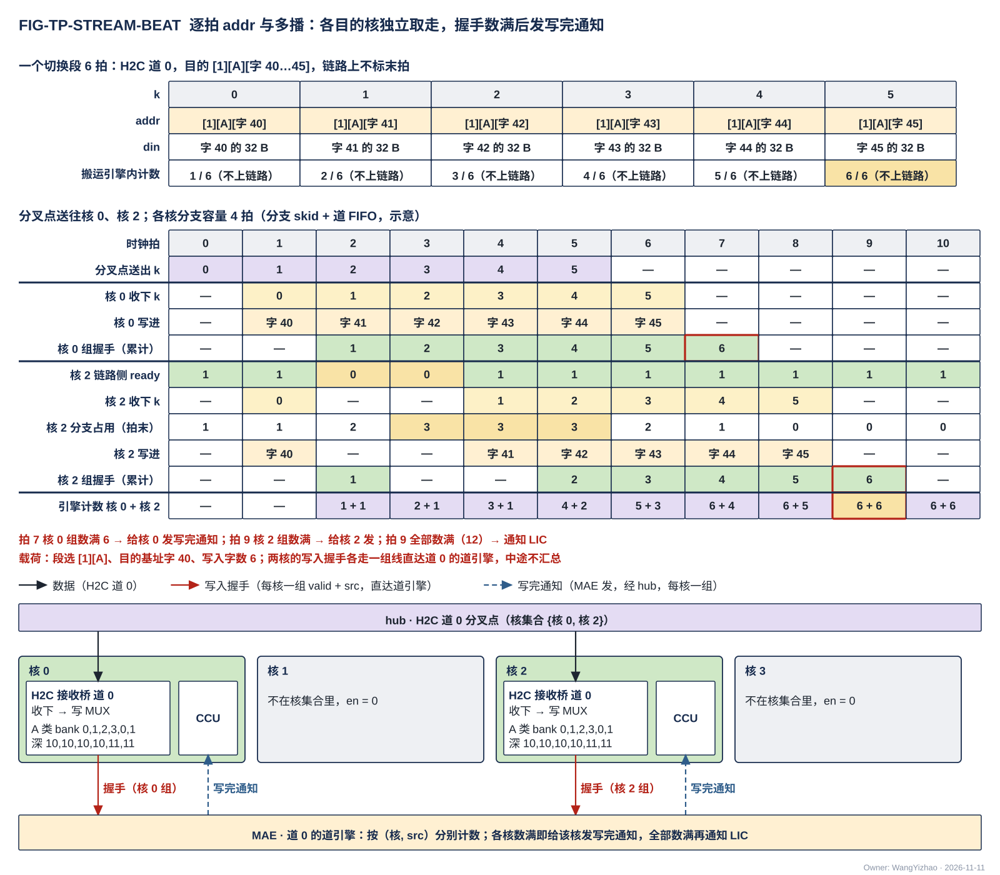

示例相位（相位本身【设计者定】）：**道上第一个字到达的拍记为拍 1，字到达当拍即可取用；只有一条道有字时每拍写一个字；轮到的道把道 FIFO 队头地址连续的至多 4 个字作为一次写交写 MUX；写 MUX 本例当拍轮到本桥、不让读；握手从写进的下一拍起每拍回一个。**

（一）多播一个切换段。H2C 道 0 从 L2 读出一个 6 个存储字的切换段，经本道的分叉点送往核 0、核 2，道 0 的道引擎逐拍给出 addr = [1][A][字 40] … [1][A][字 45]；**链路上没有标出哪一拍是切换段的最后一拍**，道引擎自己数着发了 6 拍。分叉点在拍 0–5 每拍送出一拍（两核都取走才收下一拍）；核 0 的 H2C 接收桥该道一直 ready，拍 1–6 收下 k = 0–5；核 2 的该道在拍 2、3 不 ready，拍 1、4、5、6、7、8 收下，晚两拍收完。**核 2 停的两拍由核 2 的分支（分支 skid + 接收桥该道的道 FIFO）接住，占用最多 3 拍（拍 3 末分叉点已送出 4 拍、核 2 只收下 1 拍），分叉点不停、核 0 不等核 2**；若核 2 停得比分支容量还久，分叉点就会停收上游。"写进"一行画接收桥的写：本例两核都只有道 0 有字，字到达当拍即作为一次写交写 MUX、当拍写进，每拍写一个字——核 0 在拍 1–6 依次写字 40–45，核 2 在拍 1、4、5、6、7、8 依次写字 40–45；都写进堆 1 的 A 类第 40–45 个存储字。两核的接收桥每写进一个字记入本道握手计数器、下一拍回一个写入握手：核 0 在拍 2–7、核 2 在拍 2、5、6、7、8、9 各回一个，**两核的握手各走自己的一组线直达道 0 的道引擎、中途不汇总**，道引擎按（核, `src`）分别计数，拍 2、5–7 两核同拍各到一个也照收；**写完通知各核各自收：道引擎在拍 7 数满核 0 的 6 个即经 hub 的写完通知信号组给核 0 的 CCU 发写完通知，在拍 9 数满核 2 的 6 个再给核 2 发**（段选 [1][A]、目的基址字 40、写入字数 6）；拍 9 共数满 2 × 6 = 12 个，即该指令执行完，带指令标号通知 LIC；各核的 CCU 收到即可消费。核 1、3 的线上 en 为 0。

（二）每次只写一个字的流。一个 S 类数据块的 4 个存储字经 H2C 道 0 送到核 0：S 类写口一次只收一个整字，桥对 `seg` 为 S 类的队头每次只交 1 个字，**拍 1–4 每拍到一个字、当拍写进，握手在拍 2–5 回，32 B/拍**。地址不连续的字同理：W 类列字区经 NWB 按列到达时，同一列相邻两个存储字在列字区不连续，每次写只含一个字、每拍写一个，跟得上 32 B/拍。

### 7.6 MAE 搬运引擎：H2C 每道一个道引擎、引擎总控与放到道旁时的附加接口

参考组织（MAE_ENG 篇第 7 章，V18-MAE-40；架构篇 §7.5）：

- **H2C 四道每道由一个搬运引擎（道引擎）执行，MAE 的引擎总控协调四道**：一条 L2 → L1 指令由引擎总控拆给参与的各道的道引擎执行；合并送时总控按指令与元数据项把各道的目的地址序列分给各道引擎（§7.11）；每道引擎只管本道的读地址、目的地址与写入握手；**各道引擎把本道（按核）数满交回引擎总控；一个核的数据所来自的各道都数满，总控即给该核 CCU 发写完通知（分送时就是本道），全部数满后给 LIC 发完成通知**。引擎总数、总控与各道引擎的接口【设计者定】。H2C 各道的道引擎由引擎总控分派指令，同一条道上相邻两条指令的 `src` 是否不同取决于总控怎样分派，约束同 §2.2.2 的发令号唯一性。
- **DDR、NI、IDN、MAE_CRU 等其余指令各由一个搬运引擎执行**；同一链路上的多条指令在切换段边界轮流，所以这类引擎的个数与链路数无关，按并发指令数【设计者定】（V18-MAE-10）。DDR 方向参考做法：每笔 32 B、同一 64 B 单元两笔背靠背发请求，执行 DDR 读的搬运引擎在飞请求数足以让 M0 持续读满 DDR 可用带宽（V18-MAE-45 (3)，MAE_ENG 篇 §7.5）。
- **道引擎放在 MAE 内还是 H2C 道旁是后端的事**（G6）；**选用"放道旁"时 HUB 要加线**：
  - 引擎总控 → 道引擎的分派经命令网（hub 控制道，架构篇 PORT-23）：总控把本道那部分指令按道引擎内指令队列的字地址逐拍写给道引擎；分派的内容是总控拆给本道的那部分（MAE_ENG 篇 §3.3）：口对 L2 → 核 L1、用法（合并送 / 分送）、本道的两端地址生成与几何（合并送的目的排法已由总控展开成本道的目的地址序列）、核掩码、象限掩码（MAE_ENG 篇 §3.10）、长度（变长数据块的码块 = 各片元数据项里码块片长之和、F 列表 = 各片 F 列表片长之和，引擎先搬元数据项、参考做法是边搬边累加；列表驱动时取列表计数）。道引擎的指令队列与 MAE_ENG 同一约束：来不及收时拉低 ready、队列满时总控停发，道引擎不执行写了一半的分派；哪一字写入即生效【设计者定】。
  - 道引擎 → 引擎总控的执行完成走 hub 的执行完成专用信号组（架构篇 **PORT-40**）：每个远端引擎一组，valid + **搬运引擎号**；道引擎数满本道写入握手后才发；是否带 ready 与总控一侧的队列深度【设计者定】，约束：不丢、不重，来不及收时只降速。一般搬运引擎放到远处时同样经这组线交回执行完成。
  - H2C 接收桥各道的写入握手线经 hub 回到道引擎所在处；hub 里不设汇总点。
  - 放在 MAE 内的引擎直接把执行完成交总控 / MAE_ENG，不经命令网与专用信号组。

FIG-TP-ARCH-INTERCORE、-CTRL 与 FIG-TP-CTRL-MSG 里画的引擎总控、道引擎 0–3 与"执行完成"一组都是这一参考组织。

### 7.7 分批搬运的起点：MAE 记游标、跨指令续接

**元数据项的累加**：搬紧凑 token 记录时，引擎先搬元数据项，参考做法是边搬边累加各片码块片长与 F 项数，得出码块与 F 列表的长度与各片地址；按片交替发元数据与码也满足"码块与 F 列表的地址由元数据项算定"这一需求（§3.13 第 5 条）。

参考做法（MAE_ENG 篇第 7 章，V18-MAE-38 / 45 (1)）：**MAE 为每条流、每道维护码块与 F 列表两个游标，跨指令续接**：第 $j$ 批在象限 $q$ 的起点 = 前面各批在该象限实际搬走的长度之和，由游标给出；定长的元数据项、E8M0 项起点仍按指令静态推出。清零与续接规则【设计者定】：要定的是游标何时清零（例：流的第一批）、按什么配对续接；约束是指令里没有实际起点，CCU 的发出报告带流标号，MAE 按（目的起始地址, 流标号）配对（`CCU_STAGING.md`）。

### 7.8 发令号的复用

参考做法（MAE_ENG 篇、NI_INT 篇第 7 章）：引擎换指令时，**等上一条指令的握手全部回来再换号，或每个引擎在两个号之间轮换**，二者择一【设计者定】；约束是任何时刻一个号只对应一条未完成的指令（§2.2.2）。PIN 事务的号由 NI_INT 从号池分配；号池个数【设计者定】，下限是写在飞笔数（MAE_NI_EXT 篇）。

### 7.9 各级在途拍数与将满阈值

参考做法：**每级在"深度 − $L$"处拉 stall 或拉低 ready**（$L$ = 从本级拉 stall 到上游真正停发之间的在途拍数），缓冲深度必须大于 $L$。各级的 $L$ 由该级设计者按自己的流水登记：

| 级 | 发 stall 方 | $L$ 的组成 | 值 |
|---|---|---|---|
| 供数缓冲 → CCU | pod 供数 | CCU 停发 1 拍 + L1 读返回 1 拍 | 【设计者定】 |
| VNU 读入口 → CCU | VNU | 同上 | 【设计者定】 |
| EPI → 阵列（AEB ready） | EPI | 阵列流水深度（AEB 吸收在途条目，深度属 MXU 的设计） | 【设计者定】 |
| 集成输出端口 → CCU | 发送 FIFO | CCU 停算到最后一拍输出进 FIFO 的流水深度（含 MXU / VNU 流水） | 【设计者定】 |
| VNU 写口 FIFO → VNU（wr_stall） | VNU 写口 | VNU 停写到最后一个在途存储字进 FIFO 的拍数 | 【设计者定】 |
| 接收桥每道的道 FIFO → 核间 ready | 接收桥每道 | 本道 ready 拉低到上游真正停发的在途拍数，即接收桥篇 §7.4 的 $L_{\text{skid}}$ | 【设计者定】 |
| 通用链路块 | 每级 | skid 深度（HUB_NOC 篇 §2.9） | 头文件参数 |

数值例（FIG-TP-STALL-CHAIN 下方）：深度 8、在途 2 拍，占到 6 就拉。表中【设计者定】的是各级 $L$ 的拍数，约束是该级缓冲深度大于 $L$；与时延有关的门限都是 RTL 头文件参数（A6）。

### 7.10 计算核集成输出端口的发送 FIFO

参考做法（计算核集成，`CORE_INTEGRATION_STAGING.md`；架构篇 §7.4）：**端口里一个发送 FIFO（addr、data、en 三条同步 FIFO 即可），入口每拍至多收 4 个存储字（128 B，A 类读 MUX 或 S 类读 MUX 的读出，即发送 FIFO 入口），出口每拍一个存储字上 C2H（32 B）；将满时拉 stall_tx 门控 CCU**（V18-TP-56）。FIFO 深度【设计者定】：要定的是项数，约束是深度 > CCU 停算到最后一拍进 FIFO 的在途拍数 $L$，将满阈值 = 深度 − $L$（§7.9）。MXU、VNU 的输出直接出核时同样进这个发送 FIFO，不另设发送桥、不另拉 stall。

### 7.11 合并送四道目的地址序列的展开

参考做法（MAE_ENG 篇 §3.10 / 第 7 章，V18-MAE-42 / 45）：合并送时由引擎总控按指令（含目的排法 1 bit）与元数据项把各道的目的地址序列分给四道引擎。按 $m$ 切分的紧凑 token 记录合并时，元数据项由谁读有两种参考做法（不标定）：**总控汇总各道报来的每片码块片长与 F 项数后回发各道的地址**，或**总控先读四个象限的元数据项**；之后元数据项整项照抄、码块与 F 列表按前缀和给目的地址（§3.11）。

### 7.12 参考时延与容量

| 项 | 参考 | 归属 |
|---|---|---|
| 写完通知相对最后一拍写进的额外时延 | 最后一拍的握手回程加写完通知信号组的一跳，约几十拍（随 hub 级数），由 ping-pong 盖住 | HUB_NOC、MAE |
| Fusion-CCU 段 SRAM | 每核参考 16 条 1,024 bit 指令 = 2 KB【设计者定】（这里的"条"是一条 16 个 64 bit 字的 CCU 指令）；超限的段由编译链拆分 | `CCU_STAGING.md` |
| MAE_ENG 指令接收队列 | 深度【设计者定】，> 链路在途拍数 | MAE_ENG 篇 |
| MAE_CRU 并行 lane 数 | 可配【设计者定】，瓶颈时加并行度 | MAE_CRU 篇 |

### 7.13 参考实现的自检项

| 编号 | 自检项 | 判据 |
|---|---|---|
| TP-R1 | 同一 bank 一拍一个深度 | 一次访问里同一个 bank 只访问一个深度；不从字边界起、覆盖 5 个存储字的访问分两拍 |
| TP-R2 | 通用链路块的 skid | 按 HUB_NOC 篇 §7.3 的拍序例，ready 拉低后在途拍全部接住；将满阈值 = 深度 − 在途拍数 |
| TP-R3 | 多播分叉点 | en 只看各核已取标记、不看 ready；全部取走才收下一拍；不另配存储 |
| TP-R4 | 接收桥与 L2 写入口 FIFO | 深度不低于 §7.5 第 5 条的下限；写进之后才回握手；握手计数器与写进拍数一致 |
| TP-R5 | 各级 $L$ 的登记 | 每级缓冲深度 > 登记的 $L$；stall 拉起后不溢出 |
| TP-R6 | 道引擎放道旁时的附加接口 | 命令网分派写完整才执行；PORT-40 不丢不重 |
| TP-R7 | 分批搬运游标 | 随机批大小下各象限起点与前面各批实际搬走长度之和一致 |

## 8 为什么

### 8.1 需求的理由

- **本篇是各模块对齐接口的基准**（用户 11-08："协议篇的意义是在让其他模块的设计者在涉及到数据搬运时，能够有一套基准参考，并且还便于各个设计者对齐接口"）：所以按"一条链路上怎么成交"组织，先接口、后规则，模块内部做法只作参考。
- **三种总线各一种格式**（用户 11-04）：按数据类型分流控形态会让链路种类多到读者无法掌握；统一后每种总线一页写完，所有链路是同一个通用链路块的实例。撤 VC（用户 11-04）：数据与指令分网之后，VC 没有意义。
- **核间链路一律握手、同一套逻辑；无握手的核内协议只限 L1 对核内模块**（V18-TP-80；用户 11-11："我认为这不是一个设计漏洞吗？咱们应该要补上，H2C是核间通信，因此应该有握手卡住MAE，核内协议只包括L1 SRAM暴露给MXU，VNU等CC内部模块的链路"；"我需要所有的核间协议，都用一套逻辑，不要特殊设计，除非它真的很必要"）：L2 读口因此改成读地址流 + 读数据流两条握手流，下游收不下时卡住发读的搬运引擎；C2H 写入握手与其他链路同形（valid + `src`）；搬运引擎给 H2C 道的逐拍控制也带握手。时延不再需要规定数值，搬运引擎放哪成了后端的事（用户 11-11："物理上不是咱们需要考虑的问题，这是后端任务……这里最正确的需求不是规定时延么？"）。
- **核内是 SRAM 口式的 RRAM、读固定 1 拍、命名 RRAM**（用户 11-05，附 NCU 存储总线总结）：en 即请求、写当拍、读 1 拍、无握手，面积与时延最低；前提是同拍单端口（每个堆一拍一次访问）、读口与写口由 CCU 统一排开、读侧无仲裁。wea 保留（用户 11-05："对于一个 ping-pong 的读堆和写堆来说，对于堆 0，它可能在阶段 1 是写，阶段 0 变成读"）。
- **核内地址推理恒在 CCU**（用户 11-05）：产出方只给数据与长度，地址只在一处算，变长 token 记录的位置自然得到。
- **地址以字节计、24 bit 段内地址 + 单独的段选 `seg`**（用户 11-05 夜："我就认为这里的地址直接改成以 B 为单位去读取就行了"；11-07："我不希望通过地址来约束物理分段（这对于 L3PU 的任何存储都是这样）"；"我希望地址仍然是 24bit，只是类似于堆，类，象限，单独在指令中标定"；11-11："我认为物理分堆的信号不应该归入逻辑地址"；V18-TP-57 / 61 / 81）：堆、类、象限是存储范围的选择，不是地址的一部分；所有链路同一组信号、`seg` 同宽（不称"旁带"，用户 11-07）。存储字命名（用户 11-05："以行命名是否不合适"）避开矩阵的行、token 行、bank 物理行三个"行"。
- **并发条件由架构篇定义**（V18-TP-81；用户 11-11："并发条件应该是咱们架构和需求文档的设计点，而不应该归设计者，这点非常重要"）：本篇凡涉及同拍能否访问都引用 CONC-n，不另定。
- **紧密存储与默认 32 B 对齐**（V18-TP-74 修订 TP-64；用户 11-10："紧密存储的粒度我希望128B紧密，只是128B的支持效果可以不好，咱们默认在数据组织的角度保证32B对齐"；"字节移位逻辑要放在SRAM内部"；11-09："这里唯一需要额外标定的是每个Token的起始地址需要和Bank对齐，这样避免同一Bank不同深度的写入"）：从字边界起时一次 ≤ 128 B 的访问一拍做完，读方从片起点整字读、CCU 按元数据项算字数，所以默认对齐保证满速；起点在字中间时允许慢。移位只放在 SRAM 内部一处，使用者都不设移位器；默认对齐的代价是码块每片平均多占 16 B、最多 31 B。**通道片四部分按片补齐**（V18-DORG-04；用户 11-09："第2条，我认可"）：紧密存储时同一片在源与目的里的字内字节位置不同，按片补齐后 M 切分合并、T 接 K 取第 $q$ 片、权重驻留按窗口聚集都是从字边界起的整字拷贝、满速，S 类写口也就可以整字写；代价约多 5%，只在一条 token 记录拆成多片的位点。
- **分级 stall 而非核级 stall；握手与反压的用词**（用户 11-05："反压（stall）是全局的，但是核内的叫握手会更合适"）：CCU 不感知下游余量，所以必须有 stall；单一全局 stall 会让整核为末端一拍停一拍，分级后上游能先把管道填满。相邻两方的 valid / ready 一律叫握手，反压只描述传播。
- **核间是带地址的握手写流，信号与核内 RRAM 口同名**（用户 11-04 定只写不读、不要 AXI4-MM；11-05 夜："既然如此，协议篇就不应该说它是基于 AXI Stream 改造的"；11-06："这里我叫你统一和 RRAM 的命名，你也没有统一"；V18-TP-26 / 41）：每拍带地址所以不是 Stream，无突发、无响应所以不是 AXI；它就是核内写口加一对握手线拉到核间。**每条链路同一组信号**（用户 11-06："我希望统一协议，即使它根本不需要"）。
- **逐拍地址、无 burst、链路上没有标签与末拍标记**（用户 11-05 夜："当前还是选择非 Burst 的方案吧"；"现在已经有 address 的话，ID 确实可以取消了，通过直接来编排地址就可以了"；11-06："为什么仍然有末拍的 LAST 拍？"；V18-TP-42）：burst 摊的是地址通道与应答、让 DRAM 连续，本设计源是 SRAM、接收方自带地址，三项收益都没有，还会让接收方有状态；写入完成按写入握手计数，接收方不数切换段。
- **撤 dest，去哪个存储由链路与发令方的口对决定、不编码进地址**（用户 11-06："它和直接根据写的目标存储做区分有什么区别？而这点咱们的指令里已经有规范了"；"我建议这个地方不要合并在地址中"；V18-TP-51）。
- **发令号 `src`**（用户 11-06："链路增加一个信号，它用来表明对应的是哪个 MAE 引擎呢？相当于不对数据打标签，但是区分数据的通道"；V18-TP-47）：几个发令方共用一条链路时握手靠它各回各家；位宽先按现行参考值标定为要求值（用户 11-11："我认为这里先提前标定，后续调整，不要作为设计者的灵活度"；V18-MAE-45）。
- **谁拥有源，谁发令：核内与 C2H 归本核 CCU，其余核间链路归 MAE 搬运引擎**（用户 11-05 夜："为了保证核间调度不会出现多个 Master"；11-06："要么就取消 C2H 的 MAE 主，统一改成各核的 CCU 主"；V18-TP-27 / 35）：C2H 的源地址、实际长度、何时写完只有本核 CCU 知道；每条链路的发送端只有一个主，hub、NI、HUB_IDN 与接收方都不寻址。
- **时延无关、接住在途拍、同一时钟域**（师兄提醒长距离链路的时序风险；用户 11-05 夜："我完全认可核间链路和时延无关，原有 RRAM 读写固定 1 拍、无握手的设计可以只放在核内"；"这里不应该是解除固定时延嘛"；"skid 是应该有的设计，这是必须要的，并且这个功能应该在 HUB 和 IDN 中都强制要求"；"核间协议无需考虑跨时钟域设计"；V18-TP-31 / 32）：核间链路长、要插寄存器，功能定义不能依赖拍数；每级寄存器输出 + 接住在途拍让 ready 不穿组合路径，后端可以任意插级。
- **通用链路块是 HUB 的交付物，数据网与命令网共用**（用户 11-06："我希望它的 Skid 寄存器可配，因为它不止是一个传输数据通路的任务，还需要负责传控制命令，以及例如这个说明自己的数据已经发送完毕的握手信号，因此最好的形式是建立一个 Common Block，然后多次例化"；11-11："我认为核间链路本身就是HUB的工作，HUB需要提供这一个Common模块"；V18-TP-38 / HUB-05）：寄存器输出与接住在途拍的条款只写一次、验一次。
- **可由后端调整、不定拓扑**（用户 11-06："我认为咱们在 HUB 的设计，无需过于考虑后端，但是需要对 HUB 提出需求，让其更够被后端调整（受布局调整级数等），这点对 IDN 有一样的需求"；V18-TP-54）：HUB_NOC 与 HUB_IDN 的级数、分叉位置随布局变，协议只要求 A1–A7。
- **多播各目的核独立取走，余量由接收桥提供**（师兄提醒；用户 11-05 夜："对于需要广播的数据，我可以接受他们写到目标 L1 SRAM 的同一个地址"；11-06："缓冲不是已经在存储单元里要求了吗？而 HUB 本身，就已经有 skid 寄存器的需求了"；11-11 对"分叉点不配存储是否硬约束"："我认为也无需作为硬约束"；V18-TP-29 / 53 / HUB-05）：等齐成交要求四核的 ready 汇到一处组合，长距离下时序不可收；行为与分工是需求，分叉点怎样做是参考实现。
- **完成按指令数据量计数；写入完成只分核内、核间两类**（用户 11-05 夜："指令是可以规范一个 MAE 指令发的数据量的，根据这个判断不行吗"；11-06："我希望这套判断场景可以在核内和核间协议都存在，需要更新到协议"；"我认为第四层不应该做如此大的区分，我就希望最多分出来一个核间一个核内，核内走我给你的参考设计，核间统一走一个协议，对于 PIN 的问题可以放宽，因为它是从口，但是最好也走一个协议"；"这个协议我完全认可"；V18-TP-28 / 37 / 50）：核间的接收方多数没有本地消费方（L2、LIC 小 SRAM），需要知道"写完没有"的是发令方，所以由接收方回写入握手、发令方计数；同一条链路又可能被几个发令方共用、各存储写进的先后可以与链路上的先后不同，握手带上发令号后归属在发令方一侧自然完成。计数在写进存储时加，不需要排空信号、不依赖固定时延。**写入握手来自 AXI 的写响应通道 B**（用户 11-06："你需要在协议篇说明下这个写完的握手来自于 AXI 的响应通道 B"）：与 AXI B 的差别是按链路上的每拍回、不按事务（核间链路上没有事务与 burst）；号归发令方，不归请求（类 AXI 的 BID、TileLink 的 d_source、AXI4-Stream 的 TID）；回程只有 valid、没有 ready，发令方的计数器每拍都能收（类 CHI 链路层的信用回传 LCRDV）；"写进最终存储才回"同 CHI 的 Comp 语义。
- **核内写 L1 的完成由 CCU 判定**（分层清单协议篇 D1，用户 11-11"认可"）：L1 内部不设计数逻辑。**写 MUX 改为自己轮流、写让读之后（V18-L1-32），CCU 不再知道每一拍何时写进，所以由写 MUX 告知 CCU 或由 VNU 报完成【设计者定】**（用户 11-11："认可，请你等级进V1.8"）。
- **写 MUX 不由 CCU 逐拍选来源、写与读碰到同一个堆时写让读**（V18-L1-32，用户 11-11："我认为CCU不应该控制这件事，这个控制不能让LANDING自己做吗？"；"如果说这个数据的读写请求本来就来自CCU，那我认为它的去向由CCU仲裁就很合理"）：落地写的地址与数据都来自 MAE，不是 CCU 发的请求就不由 CCU 仲裁；读由 CCU 发、口上没有握手、不能等，所以写让读，本地即可判断。
- **核内三个控制器；L1 的地址只有 CCU 一个来源；pod 不收槽号；stall_mxu 每 pod 两根**（V18-MXU-19 / 20 / 22、VNU-11 / 12、CCU-01；MXU 集成篇 §2.8）：MXU、VNU 的缓冲接收数据时不接收写入位置，位置由各自控制器算；各 pod 各自要权重，权重与激活两种读要能分别停，所以每 pod 两根 stall。
- **写入握手逐写入方回、不在中途汇总**（V18-TP-78；用户 11-11："对于同拍多src问题，我希望每个核都可以传回一个src，发给MAE，L3PU内类似问题都采取这个方案"）：多播的握手各核各一组直达发令方，同拍到几个就数几个，hub 里没有汇总逻辑。
- **落进 L1 的数据，写完由发令方判定并通知；接收桥常开、无使能、无写计数**（V18-TP-70；用户 11-09："对于接受桥使能，我认为它不需要使能信号，它应该常开……它直接写入L1 SRAM就行了，不过这里确实需要一个方案，能够判断数据是否已经写入完毕"；"对于块尺度和写完判断，我完全认可"）：搬运引擎本来就按核间协议数写入握手，数满即全部写进，在这一刻给目的核 CCU 发写完通知，CCU 收到即可消费；常开的桥允许数据先于位点指令落地。
- **写完通知每核两路，互不等待**（用户 11-11 选"每核 2 组，共 8 组"；"我认为是每核收两路的说法，我认为要留出4核各自灵活的自由度"）：H2C 与 IDN 的搬运由不同引擎同时执行，两侧分开就不必在 MAE 里给两类通知排先后。**IDN 几核共享时各核各自数满就各自通知**（用户 11-11 对第 13 条"认可"；V18-MAE-45）：消费核不必等别的核。
- **命令网与数据网同格式、每拍带 addr、只传指令与配置；完成与同步往来走专用信号组**（用户 11-11："命令网无需首字带目标地址，我希望他的协议格式和数据网完全一致，因此每拍都会带一个addr"；"命令网在我的设想里是只负责传指令和配置信号了"；"握手信号是单独的信号线，还是走控制网？如果握手信号是单独的信号线，那么它也应该体现在HUB中，HUB的需求就是根据各个上下级模块的接口握手需求，去考虑要有多少根这样的信号线"；"我倾向于（a），我认为这个涉及到的修改不大，因此可以直接改在本轮"；V18-TP-76 / 77 / 79）：每拍带 addr 后端点只按地址写、不解析消息；"做完了告诉谁"一类往来各成一组 valid + 载荷的线，hub 的需求就是连通、数清条数。
- **命令网独立、CCU 端点有可写的 Fusion-CCU 段 SRAM**（用户 11-05）：指令不经 L1 / L2；一条指令在 64 bit 命令网上是 16 拍，attention 的一个 tile 循环含 4–6 条成员（粗算、判决、精算、P×V、状态更新、量化），其中判决与状态更新一类成员的执行时间不到 16 拍，逐块重发时 CCU 会等指令，而一核每 tile 要收 64–96 拍的指令流、四核的成员又不尽相同（归约属主等字段按核不同，不能一律多播）；所以 Fusion-CCU 段放 SRAM、CCU 本地循环。块长、成员执行时间远大于 16 拍的 Fusion（线性层按列块循环）由 LIC 逐条写指令寄存器即可。Fusion-L3PU 由 LIC 执行。指令寄存器怎样组织（参考：当前 / 下一条两个）属 CCU 的设计（`CCU_STAGING.md`），对外只有"按 addr 写、写全才执行"。
- **L2 不在命令网上，指令不存 L2**（V18-TP-75；用户 11-10："我认为L2如果不负责存指令的话可以不在"）。
- **LIC ↔ MAE 握手：指令标号 + 执行完通知；屏障归 LIC**（用户 11-06 晚："这里我认为不应该是完成计数器，而是 LIC 和 MAE 的握手机制……MAE 只需要在一个指令执行完的时候，通知 LIC 即可"；11-05："屏障应该是 LIC 的任务"；V18-MAE-13）：依赖由 LIC 收到通知后再下发表达，MAE 不维护按种类的计数、指令不带等待字段。
- **切换段不交错只在发令方看得到切换段边界的合并点**（用户 11-06："如果真实存在，那么这里需要仲裁设计，先发一个，另一个阻塞"；V18-TP-36 / 45；分层清单 G11，用户 11-11"认可"）：K 切分 attention 按 tile 流水时两源确实同时有数据；切换段只有几十拍，在边界换源的等待很短；交错不影响正确性（每拍都带 addr 与 `src`），只影响接收侧能否把连续地址合并成一次写。这条只在本篇写，各模块篇引用。
- **C2H 唯一来源 = 集成输出端口，C2H 不 ready 门控 CCU**（用户 11-07："对于 C2H 口，它只有一个来源，即 CC 的集成输出端口，在 CC 内部，由 CCU 来控制数据来源"；"C2H 不 Ready 时，CCU 需要被 Gating 住，等待 C2H Ready 再继续计算数据"；"VNU 和 MXU 的输出可以由 CCU 直接推算要写在 L2 SRAM 的地址，然后走核间协议，不过也要支持输出写回到 L1 SRAM"；"不要支持两边都写"；11-08："如果需要走C2H，先过VNU透传"；V18-TP-56 / 59）：发送端只有一个主；MXU 输出经 EPI 透传，集成输出端口只在两个核内来源之间选。
- **L2 写侧每核一条 32 B 链路、象限按核绑定写入**（用户 11-06："它应该被设计成 128B"；"不然在此之前，象限的意义是什么？"；V18-L2-03 / 04）：与读侧四象限读口对称，四核同时回写互不等待。
- **跨核合并与标量都经 L2，标量不走命令网**（用户 11-07："相当于把 CRU 的 FIFO 复用 L2 SRAM"；"先写到 L2，再交到 L1，这样的设计会比较有序"；"他们不属于控制网，需要走数据通信协议"；核间的小消息当变长数据走 C2H → L2 → H2C，用户 11-05；V18-CRU-07、TP-55）：C2H 只剩一个去向、H2C 只剩一个源，hub 里没有通路选择；VNU 与 MAE_CRU 都不需要命令网端点。
- **MAE_CRU 在 MAE 组内、合并是搬运指令的运算参数**（用户 11-06 晚："CRU 归纳到 MAE 中，和 DSU 并行，这样 MAE 除了搬运指令的基础功能外，还可以叠加数据运算和数据操作"；"合并应该是放在搬运指令下的功能"；"那 MAE 不应该全是搬运指令？"；11-05："CRU 应该交给 MAE 发令"；V18-MAE-11 / 12 / 21）：合并是"搬运途中的运算"，与 MAE_DSU 的整形同构，不需要单独的配置操作；并行 lane 可配（用户 11-05："对 CRU 并行处理的 Lane 要求为可配的"）。超 32 B 的归约值分多拍、不带组序号（用户 11-06："当其是 BF16 的时候，分多个时钟传输就可以了"；"认可，无需组序号"；V18-CRU-01 / 05），位置由每拍地址给出。
- **NI 读口四路各给各的读地址**（V18-L2-08，用户 11-11）："四路同址"只是合并定长份时的用法，口不限制；一路被卡不影响另三路。
- **发出报告只带目的起始地址、按地址对应指令**（用户 11-06 晚："当前的对象标识概念到底是什么？不是说不分对象，完全通过地址和指令来配置吗"；"编译链可以离线定 A 和 B 该存在哪个具体的位置"；V18-MAE-14）：变长数据块的容量窗口由编译链静态分配，报告的目的起始地址就是唯一的窗口基址。
- **变长数据块按位点容量窗口静态分配、选择模式一律限个数**（用户 11-06："我认为 Activation 数据虽然要被压缩，但是可以在算法侧预先给出一个典型窗口，去保证每个数据都能被存储到该窗口，这样还可以极大程度简化调度逻辑"；V18-TP-40、SEL-13）：所有地址编译期确定，CCU 没有数据块间的运行期依赖。
- **变长数据块按实际长度存、每片一个定长元数据项，计数放首字**（用户 11-07："这样就可以保证 Token 长度无需统一，可以按需压缩"；11-09："我认为现在无需长度表，长度表应该和一个 Token 的表，位图信息合并存储"；"码块占位是什么东西？以及我认为对于后三者应该在于数据的最前面，这样可以让CCU最先接触到这些信息"；"我可以接收统一走数据网"；V18-TP-58 / 66 / 68）：按"基址 + 片序号 × 项宽"直接定位，CCU 读一项就能算出码字数与地址，M 切分合并时 MAE 只需整项照抄。
- **MAE 先搬元数据项，码块与 F 列表的地址由元数据项算定**（V18-TP-69 / TP-84 (4)，用户 11-11："D3：这个是必要的"；用户 11-09："我认为元数据是应该先搬运的信息，因为地址推理强需求元数据"）。
- **紧凑 token 记录一片四部分、CCU 解、pod 无解包器**（用户 11-09："CCU 始终以32B去发数据的话，它不就得等Pod根据解包内容返回的结果去停吗……我认为必须要重构Token的压缩格式"；"我认为Pod不需要解包器了，解包的任务由CCU承担了"；V18-TP-65 / 66）：元数据项、E8M0 项、F 列表各自单独存，CCU 读元数据就能算出每次读的地址与字数，发读节拍完全确定。
- **激活（含 Q / K / V）的 MX 组长 $G$ 可配，权重的 MX 组固定 32**（用户 11-09："我希望分组可以解放32为一组，他需要支持32，64，128等组的配置"；"我认为 Attention 也可以解放组"；V18-MXU-10 / ATT-04）：协议与存储口不感知 $G$。
- **L1 每类一个写口、来源按拍错开、不合并**（用户 11-09："四路H2C数据各自进入一个FIFO，然后该FIFO向L1 SRAM只暴露一个128B的单地址接口，逐个Clock地去写入不同地址的数据"；"不能把两者的数据来源合并写入，而是要错拍"；11-11："这是正确的，拒绝同拍不同来源的拼接写入"；V18-L1-14）。
- **L1 只暴露 RRAM 口，来源选择与读出去向在 L1 外；读出去向由 CCU 控制，写 MUX 自己轮流；每拍 A 类读出只给一个使用者；编译链不做读写带宽保证**（V18-L1-21 / 24 / 32；用户 11-09："在一次L1 SRAM使用中，它只能被一个使用者读取，不需要存在两个消费者同时花费读取请求，然后L1 SRAM主动拼接两个需求，这样对L1 SRAM的控制难度要求太大了"；"编译链不应该保证带宽"；"对于问题3，我认为L1无需感知这件事"）：L1 只剩单端口宏与固定接线，读侧的控制落在已经掌握全部读地址与时序的 CCU，写侧来源的先后在写 MUX 本地解决。
- **W 类权重读口一拍 4 路、各给地址，L1 不重组**（V18-L1-26；用户 11-10："对于W类，我认为单独为他准备一个这样的设计是合理的，我认为这样可以提升利用率"；"W类的读可以作为例外"；"不需要单设，计算完后统一重组，不过这样要求CCU要知道当前计算的数据在原hidden state中的映射位置"；11-11："它应该被归纳成，可以接收4个地址，访问不同Bank的不同深度"）。
- **S 类读口一拍 2 个地址、可以同一个堆**（V18-L1-31 / TP-84；用户 11-11："我认为Bias和权重尺度是可以分时的，我认为S类同拍只需要设计到2路"；"我觉得S区也可以接受两个地址，相当于能够支持同一堆中两个数据的同时读"）；尺度与 bias 何时到达、谁保持不作需求（V18-TP-83 / EPI-05，用户 11-11："我认为bias的先后这种级别的设计是EPI的负责人要考虑的"）；不对齐访问只写"从字边界起一拍，否则允许多拍"（V18-TP-83，用户 11-11："我觉得不用规定的那么细"）；所有尺度落 S 类（用户 11-09："全部的尺度都应该放在S区的Bank"；"只要允许S类的数据接向需要它的模块不就可以了，例如MXU，VNU"）。
- **同拍单端口、读写同形**（V18-TP-73；用户 11-10："对于SRAM我必须要求同拍单端口设计，写口和读口只是逻辑行为，我认为这里对L1也有相同要求"；"同一时段可行，同一Clock不行"；"我支持宽松读法，唯一约束是跨行的时候不要出现同一个SRAM Bank的不同深度被读取的情况"）。
- **数据块写完才发，撤流式转发**（用户 11-06："流式转发不要默认实现，首先流式转发本身就要求 SRAM 有 1R1W 的功能，这无法支持，咱们只通过 ping-pong 来实现等效流式转发"；V18-TP-46）。
- **MAE 不做环形回绕**（用户 11-06 晚："对于环形缓冲问题，我认为 MAE 不感知这件事"；V18-MAE-17）。
- **L2 → L1 只有两种用法、各一条指令；产出方按下一位点读法摆放**（V18-MAE-37 / DORG-06；用户 11-09："我认为咱们只会碰到模式1和模式2，模式3可以归并到模式1"；"认可，我认为两种模式对于MAE来说都只需要一个指令"）。**分送每核 32 B/拍**（用户 11-10："如果是模式2，很明显这里的有效带宽就是32B而不是128B"）。**写完通知各核各自收**：H2C 多播、分送、IDN 几核共享都是每个目的核数满本核就收，不等其他核（V18-TP-84，用户 11-11："D7：各核各自收"）；合并送时一个核的数据来自几条道，这几条道对该核都数满才通知该核（用户 11-10："我认可四道一起通知的思路"，限于同一个核的几条道）。**H2C 道上另有目的信息流，三条流各自握手、道内按次序配对**（V18-TP-82，用户 11-11："这是正确的，核间协议本来也应该带目的地址"）。**合并送的排法由指令 1 bit 给**（用户 11-11："这不应该成为一个问题，指令加一位就行，各个模块的设计者需要按需整理都需要哪些指令"；V18-MAE-45）。**四道并行满速以每道目的地址连续为前提**（用户 11-09："我希望的存储格式一个完整存在一个Token之后再存下一个"；V18-MAE-36；G9 用户 11-11"认可"）。
- **分批搬运的起点由 MAE 接续**（V18-MAE-45；用户 11-09："MAE可能还需要一个动态维护的指令，它能计算每次的起始地址，根据一个基地址，相当于这就是一个Fusion指令"；11-11："MAE记录此信息（但是可以标注作为参考实现）"）。
- **对 DDR 的需求写成 M0 有效带宽**（用户 11-11："我认为64B背靠背也不是约定，满足DDR利用率才是约定"；"PIN和DDR我支持"；V18-MAE-45）。
- **数据进 L1 前的整形几条路都支持**（用户 11-11："当前的DSU输出只能走IDN不能走H2C吗？我认为需要留出兼容性"；V18-MAE-45）。
- **IDN 不受整字限制；跨核搬运按批流水**（V18-DORG-10 (4) / (10)；用户 11-10："（4）IDN链路可以拜托整字限制，不需要感知它"；"（10）这里会结合Fusion指令，先搬运一批，然后算一批，算的同时搬下一批"）。IDN 每核一条 32 B 链路（用户 11-08："IDN 的输入应该是一个 32B 的数据，然后分发到各个 CC 的 32B 通路中，只是有的可能是 8B 有效，有的是 16B 有效"；"32B 先走道 0 到核 0，然后是下一个 32B 走道 1 到核 1，不是也可以吗？而且这样也不会降低利用率，同时控制逻辑更简单"；V18-HUB-04）。精算 K 的全码 key 记录经 IDN（用户 11-09："对于第6条：我建议走IDN"；V18-ATT-03）。
- **AEB → EPI 统一输出、条目无标签，速率只要求"EPI 一轮拍数 ≤ MXU 下一轮拍数"**（用户 11-08："这样控制逻辑会很好做，动态读的控制逻辑太难了"；V18-EPI-03）。**EPI 来不及收时对 AEB 拉低 ready，不要求先整轮存进寄存器堆、两份轮换**（V18-EPI-06，用户 11-11："我觉得残差加和Bias加本身属于一次加法计算，这里不需要折叠，而且也就只能吃到1-2拍的优化，意义不大"）。
- **NI 一侧不要求设入站缓冲**（V18-TP-84 (5)，用户 11-11："D4：确实可以取消"）：需求只留"下游收不下时只降速、不丢数"。
- **多播分叉点、接收桥的内部做法降为参考实现**（V18-TP-84 (3) / (7)，用户 11-11："D6：认可"；"对于其他的问题，我确实认可这里有过度需求"）："全部取走后才收下一拍""en 不看 ready""未选中时原样再交"都只是满足"各核独立取走、不丢、等待有上界"的一种做法。
- **PIN 窗口由编译链固定；PIN 写与推理整体分先后**（用户 11-05 夜："某些数据在编译链定死在某个地址了，然后做什么操作只能去这里取，我认为这个设计方案也是可以的，并且更简单"；11-10："当外部Slave需要写入L2 SRAM的时候，L3PU不会进入推理模式，L3PU会等待某帧数据传输完毕后，再开始推理，相当于直接做一个整体的先后隔离此问题"；"我认为只留一个窗口，咱们保证传完之后推理才开始，这个不是咱们的一个设计主打"；11-09："是的，编译链定"；11-10："这里不需要作为强限制"；V18-NIE-02 / L2-07 / MAE-44 / TP-67）。
- **读返回按请求对应关系分路**（用户 11-05 夜："需要 ID 让 MAE 知道这是它之前发的哪个数据的返回（其实只要有这个功能就可以了，无需基于 ID 实现）"；V18-TP-34）。
- **本篇不含容错设计，容错最后统一加**（V18-TP-71 / 72 / 75；用户 11-09："落地写我认为无需地址检查，这是一个容错设计，它有存在的意义吗？"；11-10："M4不保留，M5不保留，我希望当前的架构设计无需包含任何容错设计，最后统一加"）：地址由硬件地址生成器按编译期给定的指令推出，错误属于编译链或 MAE 的缺陷，由编译期检查与仿真断言发现。
- **桥在产出模块**（用户 11-05）：不设独立的转换单元。"读集合并"命名（用户 11-05："OR，我认为它不应该叫这个命名，它会严重影响名称"）：名字说功能，不说实现它的逻辑运算。
- **性能计数、停顿计数不进需求**（分层清单 G13，用户 11-11："不需要进入需求文档"）；**别的模块的内容只引用**（用户 11-11："别的模块的内容本来就不应该体现在本模块，但是可以引用，说这属于哪里的设计"）：所以 CCU 预取缓冲、pod 入口、写 MUX 与来源之间的接口都移到各自的篇或暂存文档，本篇只留引用（pod 入口见 MXU 集成篇 §2.2 / §2.3）。

### 8.2 参考实现的选型理由

- **每堆 4 个 bank 按字交织，L1 / L2 同构**（V18-TP-73；用户 11-10："我觉得应该统一L1和L2 SRAM的构造，因此Bank交织在我看来仍然是更好的设计，而且我从来没有规定过物理的分区读写，两个堆都可以一起读，即使咱们规范了pingpong"）：从字边界起的 ≤ 128 B 覆盖 4 个连续字落 4 个不同 bank、一拍做完，正是 CONC-3 的"一拍"；一套构造覆盖 L1、L2 的全部读写。
- **通用链路块单级 skid 深度 1、寄存器输出**：拉低 ready 到上游停发恰好在途一拍，最小面积满足"接住在途拍"；多级串接时逐级接住。
- **多播分叉点不另配存储，只加各核已取标记**（V18-TP-53）：缓冲已在接收桥，HUB 本身已有 skid（用户 11-06）；en 只看已取标记不看 ready，避免组合依赖。
- **接收桥 = 每道一条 FIFO、有字的道之间轮流、轮到的道交队头连续的至多 4 个字；与 L2 的入口同一套逻辑**（V18-L1-27；用户："在我看来它就是一个写入SRAM之前的FIFO，用来隔离同时有两个数据源写入时，不丢数据，分拍写入"；11-10："认可，并且这里和L2一致"；11-09："我希望一次写4个字"；"认可，一拍一来源"）：轮到时有几个连续的就交几个，块尾不需要冲刷条件与超时；只有一道有字时每拍写一个，四道都有连续字时每道每 4 拍轮到一次、每次 4 个字，合计 128 B/拍。**写进之后才回握手**（用户 11-09："我希望一个来源的数据实际写进 L1 SRAM 后，才会返回握手信号"）。
- **L2 同堆按拍轮流、不分读写，调度先错开**（V18-TP-73 / L2-07；用户 11-10："分Clock错拍，理论上需要在调度层面直接错开，这个作为保底方案，和L1一样的处理"；"我认为不需要区分读写，他们在错拍的逻辑应该是一致的"；"我认为接收错拍，但是L2的物理分堆但是要存在，并且支持紧密存储"）：单端口宏一拍只能做一次访问，不分读写的按拍轮流最简单。
- **H2C 每道一个道引擎、引擎总控协调**（V18-MAE-40；用户 11-10："MAE的设计者给了我一个设计想法，他希望对于每路H2C，分别用一个MAE引擎调控，然后MAE会有一个总的控制逻辑去控制协作，我认为这是一个合理的设计"）：每道的目的地址序列由本道引擎生成，各道独立停发；放道旁是为了缩短读地址与道之间的回路（用户 11-11："为了解决时延问题，当前想出来的解法是放道旁"），代价是 HUB 多出命令网分派与 PORT-40。
- **分批起点用 MAE 游标**（V18-MAE-45）：起点只在运行期可知，游标在 MAE 一侧续接，编译链与 CCU 都不必回读。
- **DDR 请求每笔 32 B、同一 64 B 单元两笔背靠背**：DDR 控制器以 64 B 为访问单元时，两笔背靠背能拼成一次完整访问；它只是满足 M0 有效带宽要求的一种做法。
- **集成输出端口的发送 FIFO 用 addr、data、en 三条同步 FIFO**：最简单的组织，深度只需盖住 CCU 停算的在途拍数。

**被否方案**（各一句）：自定义三层协议、首拍地址、VC、22 拍 LDB、L1 的 busy 与内置拼接 FIFO、核级 stall、按切换段的接收绑定指令、偏移表、AXI4-MM burst、核间 burst、运行期按空间计数、运行期 bump 分配、整段 RF、64 个分区的分配表；切换段标签、接收方逐切换段上报、到达切换段计数 + 集合器排空信号、末拍 + 固定时延判完成、链路上的末拍标记；多播等齐成交与发送端共享缓冲；发送方 / hub 累加地址、地址里折目的位与抢占优先级、dest 信号、把目的存储编码进地址、沿用 AXI 风格的信号名；PIN 运行期窗口配置与 PIN 由 M55 按 32 B 对齐；MAE 发 C2H（"长度待报"往返）、L2 共享 32 B 写口与 C2H 四核扇入、四核写任一象限、L2 按（入链路, 象限）维护写计数；流式转发；CRU 归 hub、CRU 的独立配置操作、C2H 去 MAE_CRU 的分支与 H2C 第二源、标量经 CCU 中转或走命令网、MAE 完成计数器与指令等待条件、发出报告里的数据块标识 / 切换段数 / 项数 / 记录数、列表到齐计数消息、MAE 搬运引擎内的环形回绕；按离线上限分槽 / 按槽读、数据块头与记录头、MAE 逐条解记录头定位、长度走命令网；数据里的 32 通道段头与 pod 侧的段解包器、激活 MX 组 32 为硬限；各客户入口的字节对齐器、搬运引擎 / hub 做字节移位；L1 写侧按 bank 的多源选择器、"一拍跨字在 L1 内拆成两个 bank 写"；L2 按存储字交织放四道并行的流、按 $m$ 切分的四片四区；单独存储的 token 长度表与 M 切分时的合并表；元数据走命令网；激活 E8M0 与码同在 A 类；接收桥按"地址不连续或若干拍无新字"冲刷；CCU 旁独立的元数据类 SRAM；L1 写口的优先级表与"选中"信号；"同一阶段总需求 ≤ 口宽由编译链保证"、A 类读出按道分给几个使用者；接收桥使能、每道写计数与 CCU 本地比对和清零、长度转发、"数据先于位点指令到达 = 致命错误"；落地写的地址检查与数据搬运的致命错误；元数据项里的 tokmax；"顺序搬不读元数据项"；一个象限服务四个核；四个象限各一套基址；两堆物理上一堆只读、一堆只写，L2 写口默认先成交与读口 busy 竞争；L2 读口"busy + 发读方保持地址""发读方按余量发读""L2 把读出拍数登记给发读方"与 H2C 道首级将满阈值（V18-TP-80）；C2H 写入握手只回 1 bit valid（V18-TP-80）；中途汇总写入握手、H2C 道汇总点按 `src` 归并（V18-TP-78）；命令网传状态消息（首字带类型与长度）、写完通知每核只设一组、保留 NI 控制道（V18-TP-76 / 77 / 79）；分批搬运"产出方一批一块"（V18-MAE-45 采用 MAE 游标）；DDR"每笔 32 B、两笔背靠背"作为约定（V18-MAE-45）；IDN 共享时"总和数满后同时通知各核"（V18-MAE-45）；NI 读口四路一律同址（V18-L2-08）；每个 S bank 一个读口、bank 个数由设计者定（V18-L1-31）；按用途分的 DSU 模式名；各单元的错误检测与致命错误上报（V18-TP-75）；写 MUX 由本核 CCU 每拍选来源（V18-L1-32）；CCU 给 pod 槽号与收的 pod（V18-MXU-19）。
