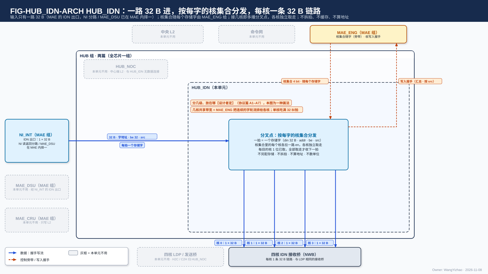
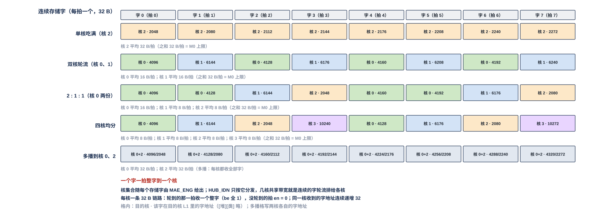
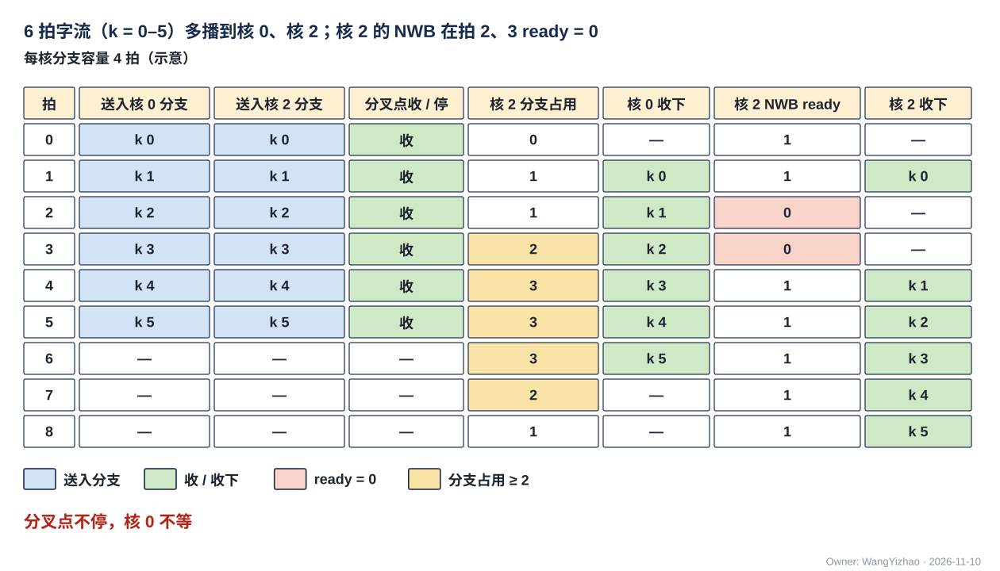

# HUB 入站分发网（HUB_IDN）需求

> Owner: WangYizhao｜2026-11-11

## 1 概述

HUB_IDN 是 HUB 组两个部分之一（另一个是 HUB_NOC），全芯片一个；HUB 取英文 hub（中心枢纽）之意，不是缩写，指片上中心端（L2、NI）与四核之间的全部核间数据链路（V18-NAME-05，HUB_NOC 篇 §1）。它的上游是 MAE 组的 IDN 出口（NI_INT 的读返回分路与 MAE_DSU 的输出在 MAE 内部择一后的一路 32 B 写流），下游是四核 L1 的 IDN 接收桥 NWB；**它与 HUB_NOC 之间没有数据连接**（HUB_NOC 的中心端是 L2，HUB_IDN 的中心端是 NI）。

**MAE 交来一路 32 B 写流（每拍至多一个存储字，带目的地址、be、`src`，随拍一个 4 bit 核集合），HUB_IDN 把这一拍送到核集合里每个核的 IDN 链路上——核集合含几个核就是多播，各目的核独立取走；每核一条 32 B 链路，信号与 H2C 到核的链路完全相同。** 有效字节由 be 标明、原样传，**链路与 HUB_IDN 不要求也不感知整字**（V18-DORG-10 (4)）。几核共享 M0 的 32 B/拍，是 MAE_ENG 把连续的存储字轮流排给各核，不是把一拍拆开。

**HUB_IDN 与一条 H2C 道是同一种部件**：都是一路 32 B 进、按核集合分给几个核、各核独立取走；差别只在源头（H2C 道的源是 L2 的一个象限读口，HUB_IDN 的源是 NI 的 IDN 出口）和核集合的来路（H2C 道的核掩码随目的信息流由道引擎逐拍给，HUB_IDN 的核集合随输入写流的每个字由 MAE_ENG 给）。所以本篇只写 HUB_IDN 特有的部分，多播的共同规则在协议篇 §3.7、HUB_NOC 篇 §3.4。

| 做 | 不做（归谁） |
|---|---|
| **分发**：每拍按随拍的核集合，把这一拍（至多一个存储字）送到集合内每个核的 IDN 链路上（§3.2） | 不推算地址：目的地址、be、核集合都由 MAE_ENG 的状态机算（V18-TP-27、V18-HUB-04）；不数切换段：核集合随字，不需要切换段边界 |
| **多播**：各目的核独立取走，慢核不拖快核（§3.5） | 不拆拍、不攒字、不落地（落地归各核 NWB）、不改字、不移位 |
| 连通 4 组写入握手回程：每核一组，原样直达发令的搬运引擎，不汇总（§2.4） | 不合并两源（NI 分路与 MAE_DSU 输出在 MAE 内择一，V18-HUB-03）；不仲裁（输入只有一路） |
| | **不改 be、不感知整字**：一拍带多少有效字节、从哪个字节起由发送方给，原样转交；地址不是 32 的倍数时由目的 SRAM 内部移位（V18-TP-74） |
| | 不判完成：发送计数、写入握手计数与写完通知都在 MAE 搬运引擎（MAE_ENG 篇 §3.18） |
| | 不经手 MAE_CRU 的输出：合并结果只写 L2，要到核 L1 时另由一条指令经 H2C 送下去（V18-CRU-07） |

本篇用到的几个词：

| 词 | 含义 |
|---|---|
| IDN 链路 | 每核一条 32 B 的带地址的握手写流（协议篇 §2.2.2），全芯片 4 条，信号与 H2C 道到核的最后一段相同：en / ready / din 32 B / be 32 / addr 24 / `seg` 5 / `src`，反向写入握手（架构篇 PORT-16） |
| 核集合 | 一个 4 bit 位图，第 $c$ 位为 1 表示这一拍要送核 $c$；**随每一拍由 MAE_ENG 给出，到核的链路上不带** |
| 目的地址 | 这一拍第一个有效字节在目的核 L1 里的 24 bit 段内字节地址，加 5 bit `seg`（定义见架构篇 §3.3）；din 从第 0 字节起放这一拍的有效数据，be 标出从第 0 字节起连续有效的字节。**数据组织默认 32 B 对齐，此时目的地址是 32 的倍数、一拍就是一个整存储字；不是 32 的倍数时由目的 L1 的 SRAM 内部移位，链路、HUB_IDN 与 NWB 都不移位、不拆**（V18-TP-74、V18-DORG-10 (4)）。四核物理同构，多播时各核用同一个地址（协议篇 §3.2） |
| 通用链路块 | 参数化的一级 en / ready 握手流水块，**由 HUB 提供、各核间链路端点使用**（V18-HUB-05）；参数与行为要求见 HUB_NOC 篇 §2.9、§3.9，可由后端调整的需求 A1–A7 见协议篇 §3.5.3 |

## 2 接口需求

### 2.1 架构图与接口汇总

图中模块框内的结构是参考实现（见第 7 章），本章以框外的各口为准。

框外的口：左侧唯一的输入是 MAE 的 IDN 出口交来的 32 B 写流（NI 读返回分路与 MAE_DSU 输出已在 MAE 内部择一），上方 MAE_ENG 随拍给 4 bit 核集合；下方是 4 条 IDN 链路，每核一条 32 B，接四核的 NWB；右侧是 4 组写入握手回程，每核一组，从各核 NWB 直达 MAE_ENG 的发令引擎，不进 HUB_IDN 的分发逻辑。**一拍至多一个存储字进来，所以单播时同一拍只有一个核的链路上有 en，多播时核集合里的几个核都有。** 引擎各核数满后由 MAE 的 NI 一侧经写完通知专用信号组（每核一组）给各核 CCU 发写完通知，不经 HUB_IDN（图左下，从 NI_INT 引出的紫色点划线）。框内的分叉点是参考画法（本篇 §7.1）。

| 口 | 对端 | 方向 | 位宽 | 握手 | 架构篇出处 |
|---|---|---|---|---|---|
| 输入写流 | MAE 的 IDN 出口（NI_INT） | 入 | din 32 B + be 32 + addr 24 + `seg` 5 + `src` | en / ready | PORT-17 |
| 核集合 | MAE_ENG 的搬运引擎 | 入（随拍旁带） | 4 bit / 拍 | 与输入写流同拍对齐 | PORT-17 |
| IDN 链路 × 4 | 各核 L1 的 NWB | 出 | 每条 din 32 B + be 32 + addr 24 + `seg` 5 + `src` | en / ready | PORT-16 |
| 写入握手 × 4（逐核） | 各核 NWB → MAE_ENG 的发令引擎 | 反向连通 | 每组 valid + `src` | 只有 valid | PORT-30 |

口宽与条数以架构篇 §2.7 的 PORT-nn 为准，本表只为阅读方便列出。`src`（发令号）位宽 **5 bit【待标定】**（架构篇 §2.4.1，V18-MAE-45）。

**各口共同的链路规则**：

- **全部口都是核间链路，一律逐拍握手（en ∧ ready 成交），与其他核间链路用同一套逻辑**（协议篇 §3.5；V18-TP-80）：时延无关、可任意插级，ready 与送出的各信号寄存器输出、ready 拉低后仍在途的拍全部收下。**每条链路与每级流水都用 HUB 提供的通用链路块**（V18-HUB-05）。
- **每拍自带目的地址与 `seg`，HUB_IDN 原样转交**；链路上没有切换段标记、请求号或核号，没有末拍标记（协议篇 §2.2.2）。
- **同一链路保序、逐位无损**；无数据应答、无 outstanding、无 burst（协议篇 §3.5.2）。
- **HUB_IDN 没有配置口、不在命令网上**：没有配置寄存器，行为只由每拍的核集合决定。

### 2.2 输入写流：MAE 的 IDN 出口交来的一路 32 B

#### 2.2.1 信号与每拍含义

**HUB_IDN 只有一个数据输入：MAE 的 IDN 出口，每拍至多一个存储字**（V18-HUB-03 / 04）。

| 信号 | 方向 | 位宽 | 每拍含义 |
|---|---|---|---|
| en | 入 | 1 | 本拍有一拍数据 |
| ready | 出 | 1 | 本拍能收；en ∧ ready 成交 |
| din | 入 | 32 B | 本拍数据，从第 0 字节起放有效数据 |
| be | 入 | 32 | 从第 0 字节起连续有效的字节 |
| addr | 入 | 24 | 目的核 L1 里的段内字节地址（本拍首字节），由执行该指令的搬运引擎算 |
| `seg` | 入 | 5 | 目的核 L1 的段选（堆选 + W / S / A 类，架构篇 §3.3） |
| `src` | 入 | 5【待标定】 | 发令号；HUB_IDN 不看，原样随数据送出 |

**ready 低时发送方保持本拍**；背压经 NI_INT、NI_EXT 逐级传回、最终停 DDR 读返回，只降速、不丢数（V18-NII-01）。

#### 2.2.2 随拍核集合

**每拍一个 4 bit 核集合，与这一拍的数据同拍给出、逐拍对齐**；HUB_IDN 按它决定这一拍送哪几个核。**核集合只在 HUB_IDN 内部使用，到核的链路上不带。** 核集合随数据走同一级流水还是单独一组线是参考实现的选择（本篇 §7.2）。

### 2.3 IDN 链路：每核一条 32 B，与 H2C 到核的链路同一种口

#### 2.3.1 信号与每拍含义

**全芯片 4 条 IDN 链路，每核一条 32 B；每条各自 en / ready / addr，任何两条链路之间没有同拍要求**（V18-HUB-04）。信号与 §2.2.1 的输入写流相同（en / ready / din 32 B / be 32 / addr 24 / `seg` 5 / `src`），与 H2C 到核的链路没有任何不同，只是源头不同。

| 项 | 规定 |
|---|---|
| 条数 | 4（每核 1） |
| 每拍 | 至多一个存储字 32 B，有效字节由 be 标明、原样传；**链路不要求整字**（V18-DORG-10 (4)），数据组织默认整字 |
| 地址 | 随数据的 addr 24 bit + `seg` 5 bit，HUB_IDN 原样转交、不推算 |
| 一核每拍 | 0 或 1–32 B（按 be）：轮到这一核就是一拍数据，没轮到 en = 0 |
| ready | 由该核 NWB 给（接收桥篇 `L1_LANDING_BRIDGE.md`）；**拉低只停拿这一拍的核** |

单播时一拍只有一个核的链路有 en；多播时核集合里各核的链路同拍都有 en，但各核独立取走、不要求同拍成交（§3.5）。没有切换段标记。

### 2.4 写入握手回程：每核一组，原样直达发令的搬运引擎

#### 2.4.1 每拍含义与连通规则

**每个目的核的 NWB 把一拍数据写进 L1 之后，沿本核的 IDN 链路反向回一个写入握手（valid + 该拍的 `src`）；4 组（每核一组）原样直达发令的搬运引擎，HUB_IDN 不汇总、不归并、不仲裁**（用户 11-11："对于同拍多src问题，我希望每个核都可以传回一个src，发给MAE，L3PU内类似问题都采取这个方案"；V18-TP-50 / 78，架构篇 PORT-30）。

- 写入握手只有 valid、没有 ready：发令方每拍都能收；**一拍至多 4 个（各核 1 个）**。
- 几核轮流共享与多播都一样：每个写进 L1 的拍恰有一个握手经该核自己那一组回到发令方；多播到 $k$ 核时回 $k$ 个。
- 写入握手只是反向的计数脉冲，**发送方不等它**；它与正向数据之间不对齐，回程的级数独立于正向。
- 按（核, `src`）计数、判写入完成、给各核 CCU 发写完通知都在 MAE（MAE_ENG 篇 §3.18，V18-MAE-43 / 45），不经 HUB_IDN。

## 3 功能描述

### 3.1 功能一览

| 功能 | 输入 | 输出 | 触发 / 生效条件 | 节 |
|---|---|---|---|---|
| 按核集合分发 | 一拍数据 + 该拍核集合 | 集合内各核的 IDN 链路上各一拍 | 每拍成交 | §3.2 |
| 几核共享 M0 带宽 | MAE 排好的字序列 | 各核按轮到的字数比例收 | MAE_ENG 排字 | §3.3 |
| 输出维稀疏权重整列发给属主核 | 逐列 gather 的字 | 属主核连续收该列的字 | MAE_ENG 排字 | §3.4 |
| 多播 | 核集合含多个核的一拍 | 各目的核独立取走 | 核集合多位为 1 | §3.5 |
| 输入只有一路 | MAE 内择一后的一路写流 | — | 恒定 | §3.6 |
| 握手、顺序与透明 | — | 保序、无损、只降速 | 恒定 | §3.7 |
| 复位 | CIF 的复位 | 清在途状态 | 复位 | §3.8 |

### 3.2 分发：每拍按随拍的核集合送到集合内各核

**每个存储字带自己的核集合；HUB_IDN 把这一拍送到集合里每个核的 IDN 链路上，不看前后的字。** 不同指令的字交替上来时各带各的核集合，所以没有"按切换段切换配置"这件事，也没有交叉开关：一条输入、四条输出，连接关系就是每拍的核集合本身（V18-HUB-04）。

**HUB_IDN 原样转交 din、be、addr、`seg`、`src`**：不拆拍、不移位、不改字，也不感知这一拍是不是整字。目的地址不是 32 的倍数时，跨字的拆分由目的核 L1 的 SRAM 内部做（V18-TP-74）。

### 3.3 几核共享 M0 带宽：MAE_ENG 把连续存储字轮流排给各核

**进入 HUB_IDN 的每个字只属于一个核集合；几核同时取数时，MAE_ENG 按编译链给的核次序把各核的存储字轮流排出：字 0 → 核 $a$、字 1 → 核 $b$……**每个核收到的是一个个存储字，平均带宽是它轮到的字数比例乘 32 B/拍；**总量不论开几核都不超过输入的 32 B/拍（= M0 每拍 32 B），HUB_IDN 不另加限制；只开单核时该核吃满 32 B/拍**（用户 11-05 晚："如果只使用单核或者双核，IDN 应该全力供给这两个核"；用户 11-08："32B 先走道 0 到核 0，然后是下一个 32B 走道 1 到核 1"）。

DDR 布局与 L1 字形态之间的差由 MAE_DSU 在送进 HUB_IDN 之前调好（V18-MAE-41、V18-L1-30）：列深度优先布局一个 DDR 拍本来就是一列 64 个连续 $k$ 的存储字（V18-L1-09）；DDR 标准布局一拍 = 同一个 $k$ 在 4 个列组上各 8 B（1 个 $k$ × 64 个连续 $m$），送前向核（按 $m$ 切给几核或全给一核）时由 MAE_DSU 转置成各核行字区的字形态，整拍送一个训练核时它正好是该核列字区的一个存储字（反传用列字区排法）、经 MAE_DSU 直通；lo 稀疏读副本也由 MAE_DSU 转置成与 hi 相同的行字区字形态。W 类行字区与列字区的字形态定义在数据组织篇；转置参数只在 MAE_DSU 篇 §3.2 典型用法表给出。整字只是数据组织的默认，不是链路要求。

| 共享方式（举例） | 连续存储字的核集合 | 每核平均 |
|---|---|---|
| 单核（含标准布局经 MAE_DSU 转置后的 4 个字都给该核） | 每个字都是 {核 $c$} | 32 B/拍 |
| 双核轮流 | {核 $a$}、{核 $b$}、{核 $a$}、{核 $b$}… | 各 16 B/拍 |
| 2 : 1 : 1 | {核 $a$}、{核 $a$}、{核 $b$}、{核 $c$}… | 16 / 8 / 8 B/拍 |
| 四核均分 | {核 0}、{核 1}、{核 2}、{核 3}… | 各 8 B/拍，每拍到达的仍是一个存储字 |

这张表只是举例：核次序与比例由编译链按各核的列块数定，HUB_IDN 不知道、也不需要知道；"8 B/拍"是四拍一个存储字的平均值，不是某一拍只有 8 B 有效。

图中每列是连续到来的一个存储字（一拍一个），每行是一种共享方式，格内是该字的核集合与它在目的核 L1 里的目的地址；示例按数据组织默认 32 B 对齐、每拍一个整存储字，所以同一核收到的地址连续递增 32——这是数据组织的默认，不是链路要求。单核吃满时 8 个字都给核 2；双核轮流时核 0、核 1 交替；2 : 1 : 1 时核 0 每 4 个字拿 2 个；四核均分时每核每 4 拍拿 1 个字；最后一行是多播（权重同发核 0、核 2），每个字的核集合是 {0, 2}，一拍只有一个目的地址、两核同址落同一位置（§3.5），两核各收全部 8 个字。脚本断言单播各行各核平均字节数之和等于 32 B/拍、多播行每核都收到全部字且同一拍各核同址。

### 3.4 输出维稀疏权重整列发给属主核

每拍 32 B 正好是该核 L1 列字区的一个存储字（一列 64 个连续 $k$）；**MAE 逐列 gather，该列的每个字核集合都只含属主核，属主核的链路上连续若干拍各到一个存储字（32 B/拍），再轮到别的核的列**；**被挑的列按列字区的列位落（目的地址由搬运引擎给），不按列号连续落**（V18-DORG-08）；HUB_IDN 不要求暂存整列，DDR 一侧不要求拼接子突发（V18-L1-09 / 10）。被选中的列才被读取，没人要的列既不读 DDR 也不占 L1。

### 3.5 多播：各目的核独立取走，慢核不拖快核

**一个字的核集合含多个核即多播：各目的核按自己链路的 ready 独立取走，不要求同拍成交；一个字在集合内各核都取走之前不丢**（协议篇 §3.7，V18-TP-53）。四核物理同构，**多播用同一个 addr、落同一位置**（用户 11-06 认可；协议篇 §3.2）。

- **慢核落后不超过 $M_{\text{mc}}$ 拍时不拖其他核；这段余量由接收桥提供，HUB_IDN 不承担**（V18-HUB-05；$M_{\text{mc}}$ 的定义见接收桥篇 §1、§3.9）。一核堵得比这还久时只降速、不丢数、不重复。
- **多播不形成跨核的组合路径**：一核的 ready 不经组合逻辑影响别的核的链路（各级寄存器输出，HUB_NOC 篇 §3.9）。
- 单播（核集合只有一个核）是多播的特例。
- **停发只作用于拿这一拍的核**：单播时别的核的链路本来就没有 en，不受影响。

分叉点怎样做、放在哪、分几级，以及一个慢核的数值例，见本篇 §7.1–§7.3。

### 3.6 输入只有一路：两源在 MAE 内部择一，DSU 输出走 IDN 是几条路之一

去核 L1 的数据经 IDN 来的有两个产生方：NI 读返回分路（DDR 原形）与 MAE_DSU（经直通或转置交出的数据：转置成行字区字形态的权重、V 与粗算 K hi，按录取次序排成整字的 K / V 尺度，经直通接续两路源的全码 key 记录等；用法与参数见 MAE_DSU 篇 §3.2 典型用法表）。**两者在 MAE 的 IDN 出口由 MAE_ENG 在切换段边界择一，HUB_IDN 只收一路 32 B 写流**（用户 11-07："MAE 只负责透传 32B 的数据给 IDN"；V18-HUB-03；MAE_NI_INT 篇 §3.8）。所以 HUB_IDN 没有两源选择、没有源顺序接口；**同一链路上切换段不交错**是发令方一侧的规则（协议篇 §3.10）。

**数据进 L1 前的整形有几条路，硬件都支持，由编译链按位点选**（V18-MAE-45，用户 11-11："当前的DSU输出只能走IDN不能走H2C吗？我认为需要留出兼容性"；架构篇 §3.8）：L2 里存原形时走 NI 读口 → MAE_DSU → IDN 出口 → HUB_IDN → NWB；先经 MAE_DSU 整形存进 L2 的走 H2C（不经 HUB_IDN）；核内产生的数据由 QNT 直接排成目的形态写 L1。HUB_IDN 对这几条路不感知。

### 3.7 握手、顺序与透明

- ready 为 0 时发送方保持；同一链路保序；逐位无损。
- **背压逐级传回**：某核链路收不下时，背压经 HUB_IDN、NI_INT、NI_EXT 逐级传回，最终停 DDR 读返回；只降速、不丢数（V18-NII-01）。HUB_IDN 内怎样接住在途拍、何时停收上游是参考实现（本篇 §7.1）。
- **完成判定在发令方**：写入握手逐核回发令的搬运引擎（§2.4）；**IDN 几个核共享时，各核各自数满就各自收写完通知（带写进该核的字数），全部数满后 MAE 再通知 LIC**（V18-MAE-45，MAE_ENG 篇 §3.18、§3.20）。写完通知覆盖经 IDN 落 L1 的全部数据（权重、K / V 与全码 key 记录、嵌入行、VNU 用的配置表、OPT 状态与梯度等），由 MAE 的 NI 一侧经写完通知专用信号组（架构篇 PORT-37）发出，不经 HUB_IDN。

### 3.8 复位

- **复位输入来自 CIF（架构篇 PORT-41），硬复位与软复位不区分**（CIF 篇 §2.4）。
- **复位后 HUB_IDN 无残留**：在途数据与在途写入握手都丢弃。HUB_IDN 没有跨调用驻留的状态，没有配置寄存器。
- 收到 CIF 的停止请求（架构篇 PORT-42）时 HUB_IDN 不另做动作：它不是发令方，发令的搬运引擎停住后它停在握手上（CIF 篇 §2.6）。

## 4 性能指标

| 项 | 要求值 | 说明 |
|---|---|---|
| 输入 | 1 × 32 B/拍（每拍至多一个存储字） | 与 MAE 的 IDN 出口、M0 每拍 32 B 相同（V18-L1-10；架构篇 PORT-17） |
| 输出链路 | 4 条，每核 1 × 32 B/拍，信号与 H2C 相同 | V18-HUB-04；架构篇 PORT-16 |
| 每核平均 | 轮到的字数比例 × 32 B/拍；**单核吃满 32 B/拍** | 由 MAE_ENG 的字次序决定，HUB_IDN 不限制 |
| 四核合计 | ≤ 32 B/拍 | 由输入每拍至多一个存储字推出；多播时各核各收一份，不占额外输入带宽 |
| 多播 | 慢核落后不超过 $M_{\text{mc}}$ 拍时不拖其他核 | 余量由接收桥提供（接收桥篇 §3.9） |
| 写入握手回程 | 4 组，每组每拍至多 1 个 valid + `src` | 架构篇 PORT-30 |
| 每拍时延 | 不定要求值 | 链路时延无关（协议篇 §3.5） |

上述速率在各目的核 NWB 能收（下游不背压）时成立；NWB 的持续接收速率 32 B/拍是接收桥篇的要求值（架构篇 §4.3）。

## 5 约束与由使用者保证的事项

### 5.1 硬约束

- **只传输**：不生成地址、不数切换段、不判完成、不改数据、不落地（V18-HUB-01）。
- **核间链路一律握手、用 HUB 提供的通用链路块**（V18-TP-80 / HUB-05）。
- **本篇不含容错设计**（V18-TP-75）。

### 5.2 由使用者保证的事项

| 事项 | 由谁保证 |
|---|---|
| 每拍的目的地址、`seg`、be 与核集合 | MAE_ENG 搬运引擎的状态机（V18-HUB-04） |
| 每拍带多少有效字节（be）、是否整字 | MAE 搬运引擎与数据组织（V18-DORG-10 (4)）；链路与 HUB_IDN 不感知 |
| 几核共享带宽时连续存储字轮流排给各核；整列发给属主核时该列的每个字核集合都只含属主核 | MAE_ENG 的地址状态机、编译链（§3.3、§3.4） |
| 目的空间已读完；紧凑激活按位点的容量窗口预留 | 编译链（LIC 操作 15、V18-TP-40） |
| NI 分路与 MAE_DSU 输出择一、同一链路上切换段不交错 | MAE 的 IDN 出口（MAE_ENG 在切换段边界决定，V18-HUB-03；协议篇 §3.10） |
| 按 `seg` 进 A / W / S 三类写口；写进 L1 之后逐拍回写入握手；满速以目的地址连续为前提，不连续只降速、不出错（架构篇 §3.4 CONC-3） | L1 接收桥 NWB（接收桥篇 `L1_LANDING_BRIDGE.md`） |
| 多播时慢核落后不超过 $M_{\text{mc}}$ 拍的余量 | 接收桥（接收桥篇 §3.9，V18-HUB-05） |
| 按（核, `src`）计数、判写入完成、各核各自发写完通知、全部数满后通知 LIC | MAE 搬运引擎（MAE_ENG 篇 §3.18、§3.20，V18-TP-70、V18-MAE-43 / 45） |

## 6 验收

### 6.1 本模块验收项

| 验收项 | 方法 | 判据 | 出处 |
|---|---|---|---|
| 分发 | 随机核集合序列（含四种共享方式）、随机数据 | 每拍的字只出现在核集合内各核的链路上；各核所得字逐位比对、目的地址与输入的一致 | §3.2 |
| 指令交替 | 几条指令的字交替上来、核集合各不相同 | 各核所得与参考一致；没有任何"配置切换"时刻 | §3.2 |
| 多播 | 到 $N$ 核、各核独立随机 ready | 各核内容、次序与 addr 相同；一个字在集合内各核取走前不丢；慢核短时堵住（不超过 $M_{\text{mc}}$ 对应的余量）不拖快核；超过时只降速、不丢、不重复 | §3.5 |
| 整列 | 列深度优先权重 | 属主核每拍一个存储字，无暂存 | §3.4 |
| 单核吃满 | 只开一核 | 该核每拍一个存储字，32 B/拍 | §3.3、§4 |
| 时延无关与可调 | 随机化各段级数、分发位置、ready 时序与回程时延（协议篇 §3.5.3 A7） | 逐位一致、不丢拍、不重复 | §2.1 |
| 停发 | 某核 ready 长时间拉低 | 只停拿这一拍的核；超过余量后背压传回上游、只降速；不丢拍 | §3.5、§3.7 |
| 复位 | 传输进行中复位（复位来自 CIF） | 在途数据与写入握手丢弃，复位后无残留 | §3.8 |
| 写入握手转交 | 四种共享方式、多播、随机 ready 与随机插级 | 每个写进 L1 的拍恰有一个握手经该核自己那一组到达发令方，`src` 不变；多播 $k$ 核时到达 $k$ 个；HUB_IDN 内无汇总 | §2.4 |
| 任意 be | 随机 be（含部分字、目的地址不是 32 的倍数的拍） | 原样转交到 NWB，HUB_IDN 不移位、不拆 | §3.2 |

### 6.2 与上下游模块的对接检查

| 对接项 | 对端 | 检查内容 |
|---|---|---|
| 输入写流与核集合 | MAE_NI_INT 篇 §3.8（IDN 出口）、MAE 集成篇 D6 / C12 | 一路 32 B；核集合与数据逐拍对齐；两源已在 MAE 内择一、切换段不交错 |
| 写入握手与写完通知 | MAE_ENG 篇 §3.18 | 引擎按（核, `src`）计数；应写量 = 各核实际收到的字数之和；各核数满即各自收写完通知（带本核字数）、全部数满后通知 LIC（此项的验收在 MAE_ENG 篇） |
| NWB | 接收桥篇 `L1_LANDING_BRIDGE.md` | NWB 的 ready、写进 L1 后逐拍回写入握手；多播余量 $M_{\text{mc}}$ 由 NWB 提供 |
| 通用链路块 | HUB_NOC 篇、协议篇 §3.5 | 每条链路与每级流水使用 HUB 提供的块，满足 A1–A7 |

## 7 参考实现

**本章内容可以换；换了之后别的模块不用改。**

### 7.1 分叉点：一级通用链路块 + 各核已取标记，不另配存储

结构图见本篇 §2.1 的 FIG-HUB_IDN-ARCH（框内部分）。参考做法里 **HUB_IDN 只有一个分叉点：一级通用链路块 + 每个目的核一位各核已取标记，不另配多播存储**（用户 11-06："缓冲不是已经在存储单元里要求了吗？而 HUB 本身，就已经有 skid 寄存器的需求了"；"这点对 IDN 有一样的需求"；V18-TP-53 / 54）。行为要求见本篇 §3.5（协议篇 §3.7），做法与 H2C 道的分叉点相同（HUB_NOC 篇 §7.2）。

| 项 | 参考做法 |
|---|---|
| 个数 | 一个分叉点（可拆成几级，§7.2） |
| 存的内容 | 本级链路块的一拍：din 32 B + addr 24 bit + `seg` 5 + be 32 bit + `src`；另加每个目的核一位各核已取标记 |
| 每拍动作 | 对核集合内、本拍尚未取走的核拉高 en（**en 只看各核已取标记、不看 ready**）；某核链路 ready = 1 即取走并置位；集合内全部置位后才收上游下一拍，各核已取标记清零 |
| 单播 | 核集合只有一个核时退化为一级流水 |
| 余量 | 快慢核的差距由该核分支的 skid 与 NWB 的空余部分吸收：**余量 = 分支 skid + NWB 入口缓冲超出 $4 + L_{\text{skid}} + W_{\text{wait}}$ 的空位**，即接收桥篇 §7.4 深度下限式 $D_{\text{FIFO}} \ge 4 + L_{\text{skid}} + W_{\text{wait}} + M_{\text{mc}}$ 里的多播余量 $M_{\text{mc}}$（$L_{\text{skid}}$ = ready 拉低后仍会到的拍数，$W_{\text{wait}}$ = L1 写口选择器连续不选 NWB 的最长拍数；符号由接收桥篇定义）；一核堵得比这还久时分叉点停收上游，其余核随之停下；需要更大余量时加深 NWB 的入口缓冲（接收桥篇 §7.4），不在 HUB_IDN 里加存储 |

换用"分叉点配多播缓冲"等做法时，只要满足 §3.5 的行为（各核独立取走、慢核落后不超过 $M_{\text{mc}}$ 拍不拖其他核），别的模块不用改（V18-HUB-05：分叉点不配存储不是硬约束）。

### 7.2 分叉点的级数与位置、核集合旁带

- **每条链路、分叉点的每一级都是通用链路块的实例，skid 深度与各段流水级数为例化参数【设计者定】**：要定的是每段的级数与 skid 深度，约束是协议篇 §3.5.3 的 A1–A7。分叉点分几级、放在哪由后端按布局定：可以在 HUB_IDN 入口处一次分四路，也可以逐级靠近各核再分；FIG-HUB_IDN-ARCH 把分叉点画成一个框只是一种画法。
- **核集合作为旁带走到最后一个分叉点为止**，到核的链路上不带。核集合随数据走同一级流水（与 din 同一个链路块）还是单独一组线【设计者定】：约束是与 din 逐拍对齐、到最后一个分叉点为止。
- 四条链路之间、正向与写入握手回程之间都不对齐；写入握手回程在 HUB_IDN 里只是连线，没有汇总逻辑。

### 7.3 多播数值例：一个慢核只让自己晚收

图中一个 6 拍的字流（核集合 {0, 2}，6 个地址连续的字 k = 0–5）多播到核 0 与核 2，每核分支容量 4 拍（分支 skid 加 NWB 入口缓冲的空余部分，示意）。核 0 的 NWB 一直收字；核 2 的 NWB 在拍 2、3 ready = 0（示意）。分叉点在拍 0–5 每拍送出一拍、从不停收；核 0 在拍 1–6 收下 k = 0–5，核 2 在拍 1、4、5、6、7、8 收下，分支占用最多 3 拍——**核 2 停两拍只让它自己晚两拍收完，核 0 不等**。收下的字由接收桥按接收桥篇写进 L1、逐拍回写入握手，不改变分叉点的行为（V18-L1-27、V18-TP-70）；写进 L1 的时序只在接收桥篇与协议篇 §3.17 里给出，本图不画。对照：核 2 停 4 拍、字流 8 拍时，核 2 分支占满，分叉点停收 2 拍，核 0 的 k = 6、7 晚 2 拍收下，余量就是该核分支容量。逐拍模型与 HUB_NOC 篇、协议篇共用（`_build/mcast_fork_sim.py`），脚本断言以上各数。

### 7.4 时延与门数参考

- **每拍时延**：一拍至多一个存储字、不拆拍，每级流水 1 拍（设计结果，不作要求值）。
- **门数**：分叉点各核已取标记 + 4 条链路的通用链路块实例（写入握手回程每核一组、只是连线，无汇总逻辑），NAND2 等效，建议值【设计者定】（参考：V1.7_3 NII-R-190 一阶推导 22–32 k 门，该估计含两层信用与交叉开关，本结构没有这两项，应明显小于此数）；本结构未重估。

### 7.5 参考实现的自检项

| 自检项 | 方法 | 用例 |
|---|---|---|
| 各核已取标记（§7.1） | 逐拍断言 | en 只看各核已取标记、不看 ready；集合内全部置位后才收上游下一拍并清零 |
| 分支余量（§7.1、§7.3） | 周期模型与 RTL 对拍 | 按 FIG-HUB_IDN-MCAST 的两种情形：核 2 停 2 拍时分叉点不停；停 4 拍、字流 8 拍时分叉点停收 2 拍 |
| 拆级与移位置（§7.2） | 随机化分叉点级数与位置 | 结果逐位一致；核集合与 din 逐拍对齐到最后一个分叉点 |

## 8 为什么

### 8.1 需求的理由

- **IDN 独立成篇**（用户 11-05 夜："我建议单独放一个 MAE IDN 模块"）。
- **归 HUB 组、改名 HUB_IDN**（用户 11-07："我认为现在咱们可以先将IDN从MAE中归类到HUB中"；V18-HUB-01）：它不生成地址、不数切换段、不判完成、不改数据，只做分发与多播，与 H2C 道同一类部件；HUB 只传输、MAE 发令并做运算级，分工随之干净。落在 §1、§5.1。
- **每核一条 32 B 链路、不拆 8 B**（用户 11-08："IDN 的输入应该是一个 32B 的数据，然后分发到各个 CC 的 32B 通路中，只是有的可能是 8B 有效，有的是 16B 有效"；"32B 拆 8B 传输的意义是什么？32B 先走道 0 到核 0，然后是下一个 32B 走道 1 到核 1，不是也可以吗？而且这样也不会降低利用率，同时控制逻辑更简单"；"按此改"；V18-HUB-04）：DDR 标准布局一拍确实交织 4 个列组（各 8 B，可分属 4 核），这是输入维度稀疏按 $k$ 行读所必需的排法、不能改（用户 11-08："我无法接收统一列字布局，因为这会使得输入维度稀疏完全无法减少 EMA"）；但把它变成各核行字区字形态的工作放在 MAE_DSU 的转置（V18-MAE-41，用户 11-08："我希望这个任务仍然是 MAE 的"；用户 11-10："DSU的需求不应该是，它应该对权重做转置，对Key怎样，对Value怎样，而是，对于一个数据形状，以什么逻辑重排"），链路与本单元就只需要"按 be 原样转发"一种方式。16 × 8 B 与 4 × 32 B 的线数相同（每核 32 B）；一核只有一条链路，没有几道同拍耦合；IDN 链路与 H2C 链路是同一种口。落在 §2.3、§3.2。
- **只开单核或双核时 IDN 全力供给它们**（用户 11-05 晚："如果只使用单核或者双核，IDN 应该全力供给这两个核"）：核集合随字、MAE 轮流排字，HUB_IDN 对每核的份额不设限制。落在 §3.3、§4。
- **核集合随字、不随切换段**（V18-HUB-04）：一拍一个字到一个核集合，"几核共享"就是连续的字轮流排给各核，交叉开关与"按切换段切换配置"没有存在的必要；几条指令的字交替上来也不会用错配置。落在 §2.2.2、§3.2。
- **两源在 MAE 内择一、MAE 只给一路 32 B**（V18-HUB-03，用户 11-07："MAE 只负责透传 32B 的数据给 IDN"）：两个产生方都在 MAE 里，择一是 MAE 内部仲裁。落在 §3.6。
- **DSU 输出走 IDN 是几条路之一**（用户 11-11："当前的DSU输出只能走IDN不能走H2C吗？我认为需要留出兼容性"；V18-MAE-45）：先经 DSU 整形存进 L2 的数据可走 H2C，编译链按位点选。落在 §3.6。
- **整列发给属主核**（V18-L1-10）：DRAM 最小访问一个突发，不能从 4 列各取 8 B 拼一拍。落在 §3.4。
- **多播独立取走**（师兄提醒"RRAM 协议跑长距离会出一堆 bug" + 用户 11-05 夜）："等齐同拍成交"是跨芯片的组合路径，随后端变化而失效。**多播余量由接收桥提供**（用户 11-11 对 G8 的理解"认可"；V18-HUB-05）。落在 §3.5。
- **多播只写行为要求，分叉点做法归参考实现**（V18-TP-84 (3)，清单 A7；用户 11-11："对于其他的问题，我确实认可这里有过度需求"）：各核独立取走、慢核落后不超过 $M_{\text{mc}}$ 拍不拖其他核、只降速不丢、余量由接收桥提供是 MAE 与接收桥要依赖的；"全部取走后才收下一拍""en 不看 ready""接不住时停收上游"是分叉点怎样做（§7.1），换做法别的模块不用改。
- **复位来自 CIF、不区分硬复位与软复位**（CIF 篇 §2.4；用户 11-11："复位与启停你直接采用最标准通用的设计就可以了"）。落在 §3.8。
- **通用链路块由 HUB 提供**（用户 11-06："建立一个 Common Block，然后多次例化"；用户 11-11："我认为核间链路本身就是HUB的工作，HUB需要提供这一个Common模块"；V18-TP-38 / HUB-05）。落在 §2.1、§5.1。
- **无寻址、无完成角色**（V18-TP-27 / 37 / 50）：地址由 MAE 搬运引擎给；写入完成由引擎数 L1 回来的写入握手判（核间统一协议，用户 11-06："核间统一走一个协议"），数满后由 MAE 给目的核 CCU 发写完通知。**几核共享时各核各自数满就各自收写完通知**（V18-MAE-43 / 45，用户 11-10："M3认可"；用户 11-11 对口径第 13 条"认可"）：各核分到的字数可以不同，各核 CCU 从通知里知道自己收了多少。落在 §3.7、§5.2。
- **写入握手逐核回、HUB_IDN 不汇总**（用户 11-11："对于同拍多src问题，我希望每个核都可以传回一个src，发给MAE，L3PU内类似问题都采取这个方案"）：几核共享或多播时各核 NWB 各一组握手线直达发令的搬运引擎，同一拍几个核回不同 `src` 也不需要归并，与 H2C 道的做法相同（HUB_NOC 篇 §2.6.1）。落在 §2.4。
- **链路不感知整字**（V18-DORG-10 (4)，用户 11-10："（4）IDN链路可以拜托整字限制，不需要感知它"）：是否整字由发送方与数据组织定，SRAM 可从任意字节起写、字节移位在 SRAM 内部（V18-TP-74），链路、HUB_IDN 与 NWB 只按 be 原样传，不为"整字 / 尾字"设任何规则。落在 §2.3、§3.2。
- **信号与核内 RRAM 口同名、没有末拍标记**（用户 11-06；V18-TP-41 / 42）：写完成按写入握手计数，链路上的末拍标记没有消费者。落在 §2.1。
- **核间链路一律握手、同一套逻辑**（用户 11-11："我需要所有的核间协议，都用一套逻辑，不要特殊设计，除非它真的很必要"；V18-TP-80）。落在 §2.1。
- **CRU 不经 IDN**（V18-CRU-07）：合并结果只写 L2，要到核 L1 时另由一条指令经 H2C 送下去。
- **不含容错设计**（用户 11-10："我希望当前的架构设计无需包含任何容错设计，最后统一加"；V18-TP-75）。落在 §5.1。
- 被否方案（需求层面）：IDN 链路只送整字、只有尾字带部分 be（或尾组由编译链补齐）；每核 4 条独立 8 B 链路 + 拆拍 / 攒字 / 4 拍同地址、道掩码按口拆、同一拍按字节切给几个核、同拍驱动四核、等齐成交；NI 内置 IDN、IDN 内合并两源（改在 MAE 内择一）；两层信用；链路上的末拍标记；交叉开关与按切换段切换配置；HUB_IDN 汇总四核写入握手按 `src` 交引擎（改为逐核回）；NWB 写计数与 CCU 本地比对。

### 8.2 参考实现的选型理由

- **分叉点只用各核已取标记、不设多播缓冲**（V18-TP-53；用户 11-06："缓冲不是已经在存储单元里要求了吗？而 HUB 本身，就已经有 skid 寄存器的需求了"；"这点对 IDN 有一样的需求"）：时序问题由每级寄存器输出 + skid 解决，独立取走只需每核一位标记，余量在分支 skid 与 NWB 里。用户 11-11 对 G8："我认为也无需作为硬约束"（V18-HUB-05），所以这是参考做法。
- **分叉点位置与级数留给后端**（V18-TP-54）：只受协议篇 §3.5.3 的 A1–A7 约束。
- **核集合旁带走到最后一个分叉点**：到核的链路与 H2C 到核的链路同形，NWB 不需要核号。
- 被否方案（实现层面）：发送方一侧的多播缓冲；NWB 按 4 拍节拍凑写、单字请求立即写。
