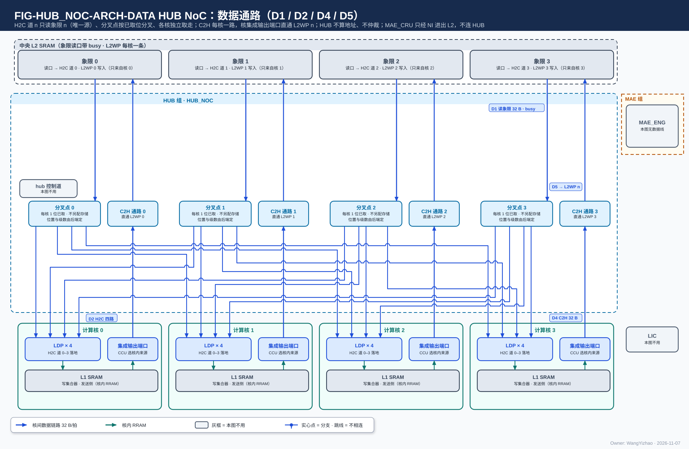
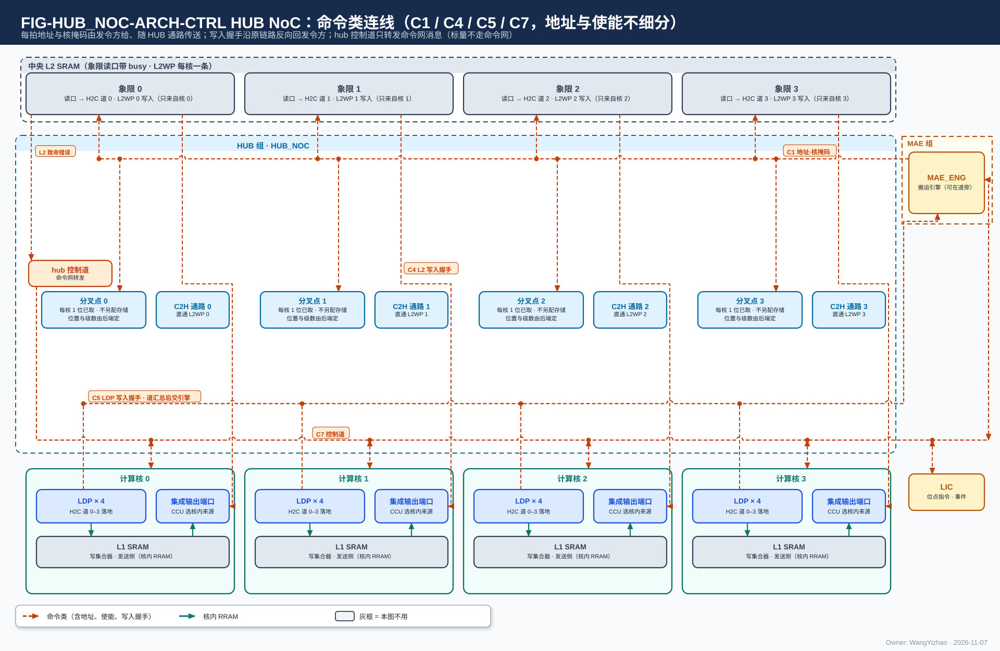
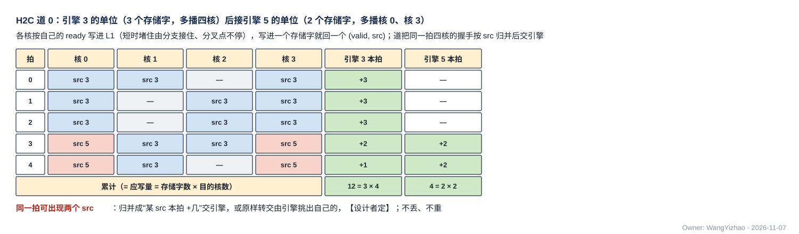
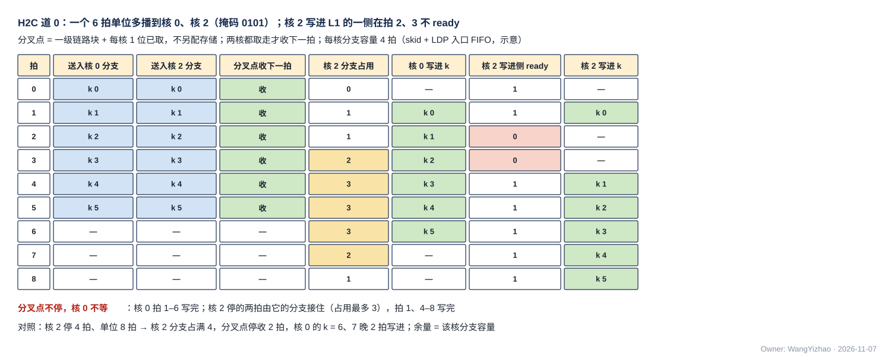

# HUB NoC（以中央 L2 为中心的两级集中式互连）需求

> Owner: WangYizhao｜2026-11-11

## 1 概述

**HUB 不是缩写，取英文 hub（中心枢纽，hub-and-spoke 拓扑的中心）之意：指片上中心端（L2、NI）与四核之间的全部核间数据链路，以及命令网的转发与专用信号组的连通**（V18-NAME-05）。HUB_NOC 的 NoC 是 Network-on-Chip（片上网络）。HUB_NOC 全芯片一个，属 HUB 组；它以中央 L2 为中心，第一级在中心（C2H 通路、hub 控制道、专用信号组），第二级是四条 H2C 道；**核与核之间没有直连，核间数据都经 L2**（跨核合并也是各核写 L2、由 MAE_CRU 从 L2 读，V18-CRU-07；名称用户 10-21 定，不写"星形"）。

**HUB 只传输数据以及随数据走的地址与控制信号：不发令、不生成或累加地址、不做环形回绕、不做归约 / 合并 / 判决 / 排序、不维护计数、不解析载荷、不报完成；每拍的地址与核掩码都由发令方给出**（H2C 每道由执行该道搬运的 MAE 搬运引擎给，C2H 由各核 CCU 给；用户 11-07："我希望 HUB 的通路是包括控制信号和地址信号的传输的"）。传什么、发给谁、写到哪，见 MAE_ENG 篇与数据组织篇。**核间链路使用的通用链路块是 HUB 的交付物**（V18-HUB-05），HUB 自己的各段与 L2、NI_INT、HUB_IDN、接收桥、计算核集成输出端口的链路一侧都例化它（本篇 §3.9）。

### 1.1 四部分

| 部分 | 做什么 | 个数 |
|---|---|---|
| **H2C 道 0–3** | 道 $n$ 把发令方给的 L2 读地址转交 L2 象限 $n$ 的读口，把读出的数据与发令方给的目的信息（目的 addr / be / `seg` / `src`、4 bit 核掩码）按次序配成一拍，经多播分叉点送四核各自的第 $n$ 条 H2C 链路；**只有 L2 一个源** | 4 |
| **C2H 通路** | 每核一路：核 $n$ 集成输出端口 → L2WP 写口第 $n$ 条，只写象限 $n$；不分路、不扇入 | 4 |
| **hub 控制道** | 命令网在 LIC 与四核 CCU 之间的转发；**命令网只传指令与配置**（本篇 §2.7） | 1 |
| **专用信号组** | GO、位点完成事件、hub 侧写完通知、发出报告这几类状态往来，**每类一组专用线，按上下级模块的接口需求连通，不经命令网**（本篇 §2.8）；另连通 CIF 到四核的停止请求与已停住应答（本篇 §2.8.2） | 见 §2.8 |

方向名只用 H2C 道 $n$ / C2H（用户 11-06，V18-NAME-02）。**C2H 只有去 L2 一个去向，不分路**（V18-CRU-07）。

### 1.2 HUB 组两篇：HUB_NOC 与 HUB_IDN

| 篇 | 中心端 | 做什么 |
|---|---|---|
| HUB_NOC（本篇） | 中央 L2 | H2C 道 0–3、C2H 通路、hub 控制道、专用信号组；通用链路块 |
| HUB_IDN（`HUB_IDN.md`） | NI（MAE 的 IDN 出口，一路 32 B） | 一路 32 B 按核集合分发到四核各一条 32 B 链路：多播分叉 |

MAE_CRU 属 MAE 组（V18-MAE-11），只经 L2 进出、不连 HUB（V18-CRU-07）；HUB_IDN 属 HUB 组（V18-HUB-01）。**两篇之间没有数据连接**，规则相同：只传输、每拍地址与核集合由发令方给、每条道只有一个源、多播时各目的核独立取走、拓扑与级数可由后端调整（本篇 §3.10）。**不设 HUB 集成篇，各篇的对外口写在各自第 2 章**（用户 11-06："HUB 不需要集成篇了"）。

### 1.3 不经 HUB 的通路

NI 与 L2 之间（NI 写口 1 × 32 B、NI 读口 4 × 32 B）、LIC → MAE_ENG 的命令网链路（架构篇 PORT-24）与 MAE → LIC 的完成通知（PORT-38）、**NI 侧的写完通知 4 组**（IDN 搬运的，由 MAE 的 NI 一侧 NI_INT 点到点送各核 CCU，架构篇 PORT-37）、MAE_CRU 的全部进出（都经 NI 读口 / NI 写口，MAE 集成篇 §2.1）、CIF 与 LIC、MAE_ENG 之间的停止请求与已停住应答（CIF 篇 §2.6；到四核 CCU 的那部分经 hub，本篇 §2.8.2）、CIF 的复位分发（CIF 篇 §2.4，复位树归后端）。

本篇用到的几个词：

| 词 | 含义 |
|---|---|
| 发令方 | 决定一条链路上每一拍写到哪、读哪里的一方：H2C 道 $n$ 上是 MAE 里执行该指令在道 $n$ 上那部分的搬运引擎（道引擎，MAE_ENG 篇 §1），C2H 上是本核 CCU（架构篇 §3.2） |
| 目的信息 | 道 $n$ 每送出一拍要带的目的 addr / be / `seg` / `src` 与 4 bit 核掩码，由发令方逐拍给 |
| 写入拍 | 写链路上成交的一拍（en ∧ ready），默认 = 一个存储字（32 B）；写入握手按写入拍回 |
| 切换段 | 发令方内部切换数据来源或目的的粒度（协议篇 §3.10），链路上没有标记 |

## 2 接口需求

### 2.1 架构图与接口汇总

图中模块框内的结构是参考实现（见第 7 章），本章以框外的各口为准。

图从上到下是中央 L2、HUB、四核：L2 的四个象限读口各接一条 H2C 道，道 $n$ 的读出进该道的多播分叉点，**由分叉点直接引出四路**，分别接四核 H2C 接收桥的第 $n$ 道（图上画在 hub 里，实际放在哪、分几级可由后端调整，本篇 §3.10）；四核的集成输出端口各接一条 C2H 通路，直通 L2WP 写口第 $n$ 条。编号：D1 L2 象限读口 ⇄ H2C 道（读地址流与读数据流两条握手流，本篇 §2.2；本图每道画读数据流与它的反向 ready（红虚线），读地址流画在 ARCH-CTRL 的 C1）；D2 H2C 4 道（道 $n$ 在分叉点分到各核 H2C 接收桥的第 $n$ 道；分叉点的做法见 §7.2）；D4 集成输出端口 → C2H（32 B）；D5 C2H → L2WP（核 $n$ → 象限 $n$）。（D3、D6 空号。）hub 控制道、LIC 与 MAE 组在本图画灰；MAE 组带里画的"引擎总控、道引擎 0–3"是 MAE 的参考组织（MAE_ENG 篇第 7 章）。

图中模块框内的结构是参考实现（见第 7 章），本章以框外的各口为准。

外框与对端位置与数据图相同，画命令类连线：各道发令方给本道的读地址与目的信息、两类写入握手回程、hub 控制道的各端点、专用信号组。**地址线、使能线都画成命令线，不细分**（用户 11-06）。编号：C1 各道的发令方（MAE 搬运引擎）→ 本道 H2C 道（向上一支是读地址流到象限读口，向下一支是目的信息流到分叉点；两支都有 ready，图中画成反向的红虚线，本篇 §2.2 / §2.3）；C4 L2 象限 $n$ → 核 $n$：L2 写入握手（valid + `src`），沿 C2H 反向；C5 各核 H2C 接收桥的写入握手 → **每核一组直达道 $n$ 的发令方，道 $n$ 共 4 组，hub 里不汇总**；C7 hub 控制道（命令网）：LIC → 四核 CCU 的指令与配置；C8 专用信号组：LIC → 四核 CCU 的 GO、四核 CCU → LIC 的位点完成事件、MAE → 四核 CCU 的 hub 侧写完通知（每核一组；IDN 搬运的 NI 侧写完通知不经 hub）、四核 CCU → MAE_ENG 的发出报告；C9 停止请求与已停住应答：CIF → 经 hub → 四核的停止请求、四核 → 经 hub → CIF 的已停住应答，每核每向 1 根电平线（红色细实线，架构篇 PORT-42、本篇 §2.8.2），CIF 与 LIC、MAE_ENG 之间的两对线直连、不经 hub。（C2、C3、C6 空号。）**L2 不在命令网上，也不连专用信号组**（本篇 §2.7.1）。核框里没有单独画 CCU：C7、C8 连到核框，C4 连到"集成输出端口"（CCU 选来源）。C5 的 16 组画成细实线、各自直达发令方，不经分叉点；C8 画成一束（紫色点划线），每核每类各一组、点到点，不汇总。图中引擎总控与道引擎之间的点线、"引擎总控 → hub 控制道"的分派与"执行完成"只在 MAE 选用"道引擎放在 H2C 道旁"这种参考放法时出现（本篇 §7.4），需求按搬运引擎在 MAE 内写。

| 口 | 对端 | 方向 | 条数 × 位宽 | 握手 | 架构篇出处 |
|---|---|---|---|---|---|
| H2C 道 $n$ · 读地址流（转交） | 入：道 $n$ 的发令方（MAE 搬运引擎）；出：L2 象限读口 $n$ | 入 / 出（直通） | 4 × (addr 24 + `seg` 5) | en / ready（ready 由 L2 给，经 hub 回发令方） | PORT-15 |
| H2C 道 $n$ · 读数据流 | L2 象限读口 $n$ | 入 | 4 × 32 B | en / ready（ready 由道 $n$ 给 L2） | PORT-15、PORT-12 |
| H2C 道 $n$ · 目的信息流 | 道 $n$ 的发令方（MAE 搬运引擎） | 入 | 每道一组：目的 addr 24 + be 32 + `seg` 5 + `src` + 核掩码 4 | en / ready（**道不能收时拉低 ready，发令方保持本拍**） | PORT-12 |
| H2C 道 → 四核 | 四核 H2C 接收桥（`L1_LANDING_BRIDGE.md`）第 $n$ 道 | 出 | 每核 4 条 × 32 B，全芯片 16 条 | en / ready；反向写入握手 | PORT-12、PORT-10 |
| C2H 入 | 四核集成输出端口 | 入 | 每核 1 × 32 B | en / ready；反向写入握手 | PORT-13、PORT-09 |
| C2H 出 → L2WP | 中央 L2 的 L2WP 写口 $n$ | 出 | 4 × 32 B（核 $n$ → 象限 $n$） | en / ready；反向写入握手 | PORT-14 |
| 写入握手回程 | 接收方 → 发令方 | 反向 | H2C 16 组、C2H 4 组 | 每组 valid + `src`，只有 valid | PORT-30 |
| hub 控制道（命令网） | LIC → 四核 CCU | 入 / 出 | 64 bit + addr，每拍带 addr | en / ready | PORT-23 |
| 专用信号组 | LIC、MAE、四核 CCU | 入 / 出 | 16 组（本篇 §2.8） | 每组 valid + 载荷；是否带 ready【设计者定】 | PORT-35 / 36 / 37 / 39 |
| 停止请求 / 已停住应答 | CIF ⇄ 四核 CCU | 入 / 出 | 停止请求 4 根、应答 4 根，各 1 bit 电平（本篇 §2.8.2） | 请求 / 应答（电平） | 架构篇 PORT-42 |
| 通用链路块（交付件） | 各链路端点（例化） | — | 参数化（本篇 §2.9） | en / ready | — |

口宽与条数以架构篇 §2.7 的 PORT-nn 为准，本表只为阅读方便列出。

**各口共同的链路规则**：

- **全部数据口与命令网口都是核间链路，一律逐拍握手（en ∧ ready 成交），同一套逻辑**（协议篇 §3.5；V18-TP-80）：时延无关、可任意插级，ready 与送出的各信号寄存器输出，ready 拉低后仍在途的拍全部收下。
- **每拍自带地址与 `seg`，HUB 不生成、不改；链路上没有切换段标记、请求号、核号与 burst**（协议篇 §2.2.2、§3.5.2）。
- **同一链路保序**（本篇 §3.11）。

### 2.2 H2C 道与 L2 象限读口之间：读地址流与读数据流

**道 $n$ 与 L2 象限读口 $n$ 之间是两条握手流**（V18-TP-80，L2 篇 §2.4）：

#### 2.2.1 读地址流：发令方给、经道 $n$ 转交 L2

| 信号 | 方向 | 位宽 | 每拍含义 |
|---|---|---|---|
| en | 发令方 → 道 → L2 | 1 | 本拍有一个读地址 |
| addr | 发令方 → 道 → L2 | 24 | 要读的 32 B 的首字节段内地址，一拍一个地址（架构篇 §3.4 CONC-3） |
| `seg` | 发令方 → 道 → L2 | 5 | 堆选 + 段掩码；段掩码恒为象限 $n$ |
| ready | L2 → 道 → 发令方 | 1 | L2 本拍能接受读地址；en ∧ ready 成交；**为 0 时发令方保持本拍不变** |

**道 $n$ 对读地址流只传输**：不生成、不累加、不改地址，ready 原样回发令方（中途各段是通用链路块，ready 逐级寄存器输出）。

#### 2.2.2 读数据流：L2 交出、道 $n$ 回 ready

| 信号 | 方向 | 位宽 | 每拍含义 |
|---|---|---|---|
| en | L2 → 道 | 1 | 本拍有一拍读出 |
| 数据 | L2 → 道 | 32 B | 一个被接受的读地址对应的 32 B，首字节在第 0 字节 |
| ready | 道 → L2 | 1 | 道 $n$ 本拍能收 |

**L2 按读地址的成交次序交出读数据**（L2 篇 §2.4.2）；读出时延不固定，道 $n$ 不依赖读出拍数。**道 $n$ 收不下时拉低读数据流的 ready，L2 随之拉低读地址流的 ready，背压经握手回到发令方**（V18-TP-80）。

### 2.3 发令方 → H2C 道：逐拍目的信息流

#### 2.3.1 信号与握手

**道 $n$ 每送出一拍，要配一拍目的信息；目的信息由道 $n$ 的发令方逐拍给，用 en / ready 握手：道不能收时拉低 ready，发令方保持本拍不变**（V18-TP-80；用户 11-11 HUB_NOC D1"认可"）。

| 信号 | 方向 | 位宽 | 每拍含义 |
|---|---|---|---|
| en | 发令方 → 道 | 1 | 本拍有一拍目的信息 |
| ready | 道 → 发令方 | 1 | 道 $n$ 本拍能收目的信息 |
| 目的 addr | 发令方 → 道 | 24 | 这一拍在目的 L1 里第一个有效字节的段内地址 |
| be | 发令方 → 道 | 32 | 从第 0 字节起连续有效的字节 |
| `seg` | 发令方 → 道 | 5 | 目的 L1 的堆选 + 类（W / S / A） |
| `src` | 发令方 → 道 | 5 bit【待标定】（架构篇 §2.4） | 发令号，原样送到各核、随写入握手带回 |
| 核掩码 | 发令方 → 道 | 4 | 这一拍送给哪几个核；单播 = 一位为 1 |

- **目的信息按读地址的成交次序与读出数据一一对应**（架构篇 §2.4.3）：发令方按读地址的次序给目的信息，道 $n$ 把第 $i$ 拍读出与第 $i$ 拍目的信息配成一拍送出。
- **道 $n$ 上读地址流、读数据流、目的信息流三条流各自握手、互不要求同拍；道内按次序配对**（V18-TP-82）：发令方可以先发读地址、后给目的信息，也可以反过来，道 $n$ 只把第 $i$ 拍读出与第 $i$ 拍目的信息配成一拍；三条流不合成一拍同时成交（否则读地址的 ready 要与道的 ready 组合，违反本篇 §3.10 A4）。
- **四道各自停发、互不等待**；四道之间怎样协调归 MAE（MAE_ENG 篇 §3.10）。发令方（搬运引擎）放在哪是后端的事，**需求按搬运引擎在 MAE 内写**（参考放法见本篇 §7.4、架构篇 §7.5）。

### 2.4 H2C 道 → 四核：每核 4 条 32 B 链路

#### 2.4.1 信号与每拍含义

**每核 4 条 H2C 链路（道 0–3 各一条），全芯片 16 条；正向 en / din 32 B / be / addr 24 / `seg` 5 / `src`，反向 ready 与写入握手；没有 dest**（V18-TP-41 / 47 / 51）。

| 信号 | 方向 | 位宽 | 每拍含义 |
|---|---|---|---|
| en | 道 → 核 | 1 | 本拍有数据给本核 |
| ready | 核 → 道 | 1 | 本核 H2C 接收桥该道本拍能收（**每道独立，只看本道**，接收桥篇 §2.2.1） |
| din | 道 → 核 | 32 B | 从第 0 字节起放本拍的有效数据 |
| be | 道 → 核 | 32 | 从第 0 字节起连续有效的字节 |
| addr | 道 → 核 | 24 | 本拍第一个有效字节的目的段内地址 |
| `seg` | 道 → 核 | 5 | 目的类与堆 |
| `src` | 道 → 核 | 5 bit【待标定】 | 发令号 |

- **addr 只是目的存储内部的位置，由该存储自己解释**（L1 侧 `seg` 的段掩码三位对应 W / S / A 三类，架构篇 §3.3）；写到哪个存储由链路决定（H2C 到 L1），地址不编码"是哪个存储"（用户 11-06："我建议这个地方不要合并在地址中"）。
- **每一拍的 addr 是本拍第一个有效字节的目的地址，din 从第 0 字节起放本拍的有效数据，be 标出从第 0 字节起连续有效的字节**（V18-TP-74）。数据组织默认 32 B 对齐，此时 addr 是 32 的倍数、一拍就是一个存储字；addr 不是 32 的倍数时由目的 SRAM 内部处理——**hub 不移位、不拆拍、不感知对齐**。
- **到核的链路上没有核号**：目的核 = 哪组 H2C 线上有 en；核掩码由发令方随目的信息给道，**分叉点之前的段带 4 bit 核掩码，到核的链路上不带**（协议篇 §2.2.1、§3.5.3 A3）。

### 2.5 C2H 通路：核 $n$ 集成输出端口 → L2WP 写口 $n$

#### 2.5.1 信号与每拍含义

**核 $n$ 的集成输出端口经 C2H 通路直通 L2WP 写口第 $n$ 条，只写象限 $n$**（V18-L2-03 / 04）。信号：正向 en / din 32 B / be 32 / addr 24 / `seg` 5 / `src`，反向 ready 与写入握手（valid + `src`）；每拍地址由核 $n$ 的 CCU 给出（V18-TP-35），`src` 是核 $n$ 的 CCU 的号（本链路只有这一个发令方，恒为常数）。

- **C2H 的来源只有一个：计算核的集成输出端口**；核内的数据来源（发送 FIFO 入口、VNU 输出口；MXU 输出经 NLU 的后处理子模块 EPI 透传后算 VNU 输出，V18-TP-59、V18-EPI-01）由本核 CCU 按指令选择、只在切换段边界切换（用户 11-07："对于 C2H 口，它只有一个来源，即 CC 的集成输出端口，在 CC 内部，由 CCU 来控制数据来源"；V18-TP-56；架构篇 §2.3.1）。**C2H 只看到一个来源**。
- **ready 透传**：L2WP 写口 $n$ 的 ready 经 C2H 各段原样回到集成输出端口；**C2H 不 ready 时停的是计算**——集成输出端口门控本核 CCU、等 ready 再继续（用户 11-07："C2H 不 Ready 时，CCU 需要被 Gating 住，等待 C2H Ready 再继续计算数据"；协议篇 §3.16）。hub 只传 ready，不缓存。
- 链路上不带"去哪"的字段：C2H 只到 L2。

### 2.6 写入握手回程：每个写入方一组，直达发令方

**hub 上有两类写入握手回程，每组都是 valid + `src`，只有 valid、没有 ready**（架构篇 PORT-30；V18-TP-80）：

| 回程 | 从哪来 | 交给谁 | 组数 | 每组每拍 |
|---|---|---|---|---|
| H2C 接收桥 → 道 $n$ 的发令方 | 核 $c$ 的 H2C 接收桥第 $n$ 道：每把一个写入拍写进 L1 之后回一个（接收桥篇 §3.8） | **道 $n$ 的发令方（MAE 搬运引擎）；每个核一组线直达，hub 里不汇总** | 4 道 × 4 核 = 16 | 至多 1 个，带该拍的 `src` |
| L2 → C2H | L2WP 写口 $n$：每把核 $n$ 的一个写入拍写进存储之后回一个（L2 篇 §2.2.2） | 核 $n$ 的 CCU，沿 C2H 反向 | 4 | 至多 1 个，带该拍的 `src`（恒为核 $n$ 的 CCU 的号） |

#### 2.6.1 每个核一组直达发令方，hub 里不汇总

**每个核的接收桥各回一组写入握手直达发令方：H2C 道 $n$ 多播给几个核时，各核各一组握手线回到道 $n$ 的发令方；hub 里不设道汇总点、不按 `src` 归并、不仲裁**（用户 11-11："对于同拍多src问题，我希望每个核都可以传回一个src，发给MAE，L3PU内类似问题都采取这个方案"）。IDN 的 4 组在 HUB_IDN 篇 §2.2。**C2H 的 4 组与其他链路同形（valid + `src`），不设特殊形式**（用户 11-11："我需要所有的核间协议，都用一套逻辑，不要特殊设计，除非它真的很必要"；V18-TP-80）。

### 2.7 hub 控制道（命令网）

#### 2.7.1 形态与端点：与数据网同一协议格式，每拍带 addr

**命令网与数据网同一协议格式：en、ready、addr、data，每拍都带 addr；data 64 bit；addr 是目的端点内的寄存器 / SRAM 地址（例：CCU"下一条"指令寄存器的第几个 64 bit 字、Fusion 段 SRAM 的字地址、某个配置寄存器），端点按 addr 写入**（用户 11-11："命令网无需首字带目标地址，我希望他的协议格式和数据网完全一致，因此每拍都会带一个addr"）。hub 控制道的每一段都是通用链路块的实例（$W$ = 64 bit，旁带 = addr）；没有消息类型字段、没有长度字段、没有末字标记。addr 位宽、是否另带 be【设计者定】：约束是能寻址一个端点内全部可写的寄存器与 SRAM 字（架构篇 §2.7.3）。一条指令何时生效由端点定（协议篇 §3.19），hub 不参与。

| 端点 | 在 hub 控制道上做什么 |
|---|---|
| LIC | 向各核 CCU 写位点指令、Fusion-CCU 段与配置（阈值装载等） |
| 四核 CCU | 收位点指令、Fusion-CCU 段与配置 |

- **命令网只传指令与配置**（用户 11-11："命令网在我的设想里是只负责传指令和配置信号了"）；GO、位点完成事件、写完通知、发出报告走专用信号组（本篇 §2.8）。**标量不走命令网**：它是 VNU 的输出，经 C2H 写 L2、由 MAE_CRU 合并（V18-TP-55）。
- LIC → MAE 的搬运指令走 LIC → MAE_ENG 的命令网链路（架构篇 PORT-24），不经 hub（本篇 §1.3）；**NI 一侧没有命令网链路**。VNU 不在本网上。
- **L2 不在命令网上**：L2 不存指令——指令序列在共享内存 / DDR，调用之间经 M1 读口 → NI_INT 的 LIC 直连口装进 LIC 专用小 SRAM，LIC 取指后把 MAE 指令交搬运引擎、把 CCU 指令经命令网交各核 CCU；L2 也没有事件要上报，写入完成靠写入握手（V18-TP-75、V18-TP-47）。

### 2.8 专用信号组

#### 2.8.1 hub 承载的组与条数

**完成类与同步类往来每类做成一组专用信号线，不经命令网；hub 的需求是按上下级模块的接口需求连通这些组，并按端点对计条数**（用户 11-11："如果握手信号是单独的信号线，那么它也应该体现在HUB中，HUB的需求就是根据各个上下级模块的接口握手需求，去考虑要有多少根这样的信号线"）。

| 组名 | 发出 → 接收 | 条数（按端点对） | 架构篇 |
|---|---|---|---|
| GO | LIC → 各核 CCU | 4（每核一组） | PORT-35 |
| 位点完成事件 | 各核 CCU → LIC | 4 | PORT-36 |
| 写完通知（hub 侧，H2C 搬运） | MAE → 各核 CCU | 4（每核一组） | PORT-37 |
| 发出报告 | 各核 CCU → MAE_ENG | 4 | PORT-39 |

- **每组 = valid + 载荷，hub 原样转交**：不看、不改载荷；**载荷各字段的语义只在协议篇 §2.6 定义，位宽在架构篇 §2.7.6 与 ISA**。
- **是否带 ready 与接收侧队列深度【设计者定】**：约束是不丢、不重；接收侧来不及收时只降速。每组的各段级数是参数（本篇 §3.10 A1）。
- **hub 里的状态类线合计 16 组**；不经 hub 的：NI 侧写完通知 4 组（MAE 的 NI 一侧点到点送各核 CCU）、完成通知 1 组（MAE_ENG → LIC 直连）。写完通知从 CCU 一侧看每核收两路（hub 侧、NI 侧）、互不等待、在核前不合并（架构篇 §2.5.2）。
- 写入握手不在本表：它是各条核间写链路的反向旁带，见本篇 §2.6。
- CIF 的停止请求与已停住应答不是 valid + 载荷的组，是电平线，见 §2.8.2。

#### 2.8.2 CIF 的停止请求与已停住应答：到四核的连通

**CIF 的停止请求与各核 CCU 的已停住应答经 hub 连通四核**（CIF 篇 §2.6；架构篇 PORT-42）：

| 线 | 发出 → 接收 | 条数（经 hub 的部分） | 形态 |
|---|---|---|---|
| 停止请求 | CIF → 各核 CCU | 4（每核 1 根；CIF 的 1 根电平在 hub 里扇出到四核） | 1 bit 电平，请求 / 应答 |
| 已停住应答 | 各核 CCU → CIF | 4（每核 1 根） | 1 bit 电平，请求 / 应答 |

- **hub 原样转交电平**：不看、不改、不合并四核的应答（6 个应答怎样汇齐是 CIF 的事，CIF 篇 §7.1）；不对停止请求做任何响应——HUB 自己不是发令方，不回应答（CIF 篇 §2.6：发令方停住后，核间链路上的其余模块停在握手上）。
- 两种线都是电平、请求 / 应答语义，**单程时延不定要求值**，各段可插寄存器级，级数是参数（同本篇 §3.10 A1）；CIF 按"收齐应答"判已停住，不依赖拍数。
- CIF 到 LIC、MAE_ENG 的停止请求与应答不经 hub（本篇 §1.3）。

### 2.9 通用链路块：HUB 交付、各端点例化的参数化构件

**通用链路块（Common Link Block）是核间所有握手链路（数据网与命令网）的唯一构件，由 HUB 提供，各端点例化**（V18-HUB-05；用户 11-11："我认为核间链路本身就是HUB的工作，HUB需要提供这一个Common模块"；V18-TP-38）。它是一级 en / ready 握手流水，对例化方暴露以下参数：

| 参数 | 含义 | 例 |
|---|---|---|
| 数据位宽 $W$ | din（命令网为 data）的位宽 | 数据网 256 bit；命令网 64 bit |
| 旁带位宽 $S$ | 随数据走的线（addr、be、`seg`、`src`、核掩码等）；可为 0 | 数据网 addr 24 + be 32 + `seg` 5 + `src`；命令网 addr |
| 反向旁带位宽 | 写入握手（valid + `src`）等反向线，同样寄存器输出 | 核间写链路 1 + `src` |
| skid 深度 | 本块拉低 ready 到上游真正停发之间的在途拍数 | 单级为 1 |
| 流水级数 | 本块内串几级 | 后端按布局定 |

例化方（L2 各口、NI_INT、HUB_IDN 的分叉点与四条 IDN 链路、各核接收桥的链路从口与集成输出端口、MAE_DSU 进出口、LIC 直连口、hub 控制道与 LIC → MAE_ENG 的命令网链路，以及本篇的各段）在块外各自加仲裁器、MUX 或多播分叉点；传数据、传指令与配置只是参数不同（协议篇 §3.5.1）。块的行为要求见本篇 §3.9。

## 3 功能描述

### 3.1 功能一览

| 功能 | 输入 | 输出 | 触发 / 生效条件 | 节 |
|---|---|---|---|---|
| 只传输 | 各口每拍的数据、地址与控制 | 原样送到链路的另一端 | 每拍 | §3.2 |
| H2C 道读象限、配目的信息 | 读地址流、读数据流、目的信息流 | 送往核掩码内各核的一拍 | 读出与目的信息都到齐时 | §3.3 |
| 多播 | 一拍 + 核掩码 | 掩码内各核各收一份 | 核掩码多位为 1 | §3.4 |
| C2H 直通 | 核 $n$ 集成输出端口的写入拍 | L2WP 写口 $n$ 的写入拍 | 每拍 | §3.5 |
| 写入握手回程 | 各接收方的写入握手 | 原样送到发令方，逐核一组 | 接收方写进存储之后 | §3.6 |
| hub 控制道转发 | LIC 的命令网写 | 四核 CCU 各自的端点 | 每拍 | §3.7 |
| 专用信号组连通 | 各组 valid + 载荷 | 原样送到接收端 | 每拍 | §3.8 |
| 通用链路块 | 一段链路的数据与旁带 | 下一段 | 每拍成交 | §3.9 |
| 可由后端调整 | 各段级数、分叉位置 | 功能不变 | 后端改参数 | §3.10 |
| 保序、透明、时延无关 | — | — | 恒定 | §3.11 |
| 停止请求与应答连通 | CIF 的停止请求；各核 CCU 的已停住应答 | 原样送到四核 CCU / CIF | 电平，任何时刻 | §3.13 |
| 复位 | CIF 的复位 | 在途拍丢弃 | 复位 | §3.12 |

### 3.2 只传输：不发令、不生成地址、不解析、不报完成

- **每拍的地址、段选（堆选）、核掩码都由发令方给**（H2C 由道 $n$ 的发令方，C2H 由各核 CCU；V18-TP-27 / 35、V18-MAE-27）；H2C 道 $n$ 与 C2H 的象限由链路固定。
- **hub 不生成、不累加地址，不回绕，不做归约、合并、判决、排序，不解析数据与命令网、专用信号组的载荷**。
- **hub 不维护计数、不报完成**：写入完成由发令方数写入握手判定（本篇 §3.6）。
- **hub 没有配置、没有跨调用状态**：任何口的行为都不由运行时配置改变。

### 3.3 H2C 道：按发令方的读地址读象限 $n$，按次序配上目的信息送出

**道 $n$ 把发令方逐拍给的读地址转交象限 $n$ 读口；L2 按读地址的成交次序交出读数据；道 $n$ 把每一拍读出与发令方按同一次序给的一拍目的信息配成一拍（数据 + 目的 addr / be / `seg` / `src` + 核掩码），送往多播分叉点**（V18-TP-27 / 80、V18-MAE-27）。

- **背压**：分叉点或目的核收不下时，道 $n$ 先停收读数据（读数据流 ready 拉低），L2 随之停收读地址，发令方停住；目的信息收不下时道 $n$ 拉低目的信息流的 ready，发令方保持。**只降速、不丢、不乱序**。
- **MAE 的两种 L2 → L1 用法在 HUB 上只是各道核掩码的不同**（架构篇 §3.8）：合并送四道同一个核集合（多播 1111 或只含一个核），一核收 128 B/拍；分送时道 $n$ 的核掩码只含核 $n$，**每核有效带宽 32 B/拍**（V18-MAE-42）。HUB 不感知用法。
- **每条道只有 L2 一个源**（V18-CRU-07）：MAE_CRU 的合并结果先经 NI 写口写进 L2，要到核 L1 时再由另一条搬运指令经 H2C 道送下去（用户 11-07："我仍然建议先写到 L2，再交到 L1，这样的设计会比较有序"）。

### 3.4 多播：各目的核独立取走，余量由接收桥提供

**道 $n$ 在分叉点把一拍复制给核掩码里的各核；各目的核独立取走，不要求同拍成交；慢核落后不超过 $M_{\text{mc}}$ 拍时不拖其他核；这段余量由接收桥提供，HUB 不承担**（V18-HUB-05、V18-TP-53；$M_{\text{mc}}$ 的定义见接收桥篇 §1、§3.9）。

- 四核收到同一个 addr，落同一物理位置（用户 11-05 夜："对于需要广播的数据，我可以接受他们写到目标 L1 SRAM 的同一个地址"）。
- **一核堵得超过余量时只降速、不丢、不重复**；各核收到的内容与次序相同。超过余量时其余核怎样随之停下是分叉点做法的事（本篇 §7.2）。
- 分叉点放在 hub 中心还是靠近各核、分一级还是逐级分，可由后端调整（本篇 §3.10 A3）。分叉点的参考做法与数值例见本篇 §7.2。

### 3.5 C2H 通路：每核一路直通 L2WP，不扇入、不分路

**核 $n$ 的 C2H 只到 L2WP 写口 $n$，只写象限 $n$**（V18-L2-03 / 04、V18-CRU-07）：

- **不扇入、不仲裁**：四核各一路，互不等待。
- **没有通路选择、没有分路**：C2H 在 hub 里只有这一个去向。
- 每拍的数据、地址、be、`seg`、`src` 原样送到 L2；ready 与写入握手原样回核 $n$。

### 3.6 写入握手逐核回发令方，hub 里不汇总

**接收方把一个写入拍写进最终存储之后，沿同一链路反向回一个写入握手（valid + `src`）；hub 把每组原样送到发令方；发令方只数自己的 `src`，数满应写量即写入完成**（协议篇 §3.8；V18-TP-47 / 50 / 80）——这个握手来自 AMBA AXI 的写响应通道 B：从机写完后回 BRESP，主机据此判写完成。

- **每个核一组线、直达发令方**（本篇 §2.6.1）：道 $n$ 的发令方按（核, `src`）分别计数，一拍至多收 4 个（各核 1 个）；多播 $k$ 个核时，应写量按 $k$ 倍计（协议篇 §3.7）。
- **`src` 是发令号，一个号任何时刻只对应一条未完成的指令**（协议篇 §2.2.2）；同一道上相邻两条指令的 `src` 是否不同由 MAE 定（MAE_ENG 篇）。号不同时，各核快慢不同会让发令方同一拍从不同核收到不同的 `src`，按（核, `src`）各自计数即可，hub 不需要归并。
- **两类回程都是通用链路块的反向旁带**：寄存器输出、可任意插级；**发送方不等握手回来才发下一拍**，吞吐不受影响。
- 落进 L1 的数据，**每个目的核各自收自己的写完通知**：发令的 MAE 对写进某核的数据数满后，经 hub 侧写完通知专用信号组（本篇 §2.8，每核一组）给该核 CCU 发通知，不等其他目的核；多播与分送都如此。合并送时一个核的数据来自几条道，要这几条道对该核都数满后才给该核发（MAE_ENG 篇 §3.20、协议篇 §3.8）。核写进 L2 的数据，CCU 数满后经发出报告信号组报告 MAE（MAE_ENG 篇 §3.19）。hub 只连通这些组。

图示道 0 的握手回程：四核 H2C 接收桥各一组 (valid, `src`) 线穿过 hub 直达道 0 的发令方里按核的计数器，hub 里不汇总、不归并；发令的 MAE 对每个目的核各自数满（合并送时数满该核参与的各道）就经 hub 侧写完通知专用信号组（每核一组）给该核 CCU 发写完通知，不等其他目的核。图中"引擎总控"是 MAE 的参考组织（MAE_ENG 篇第 7 章）。

数值例：H2C 道 0 上先是 `src` 3 那条指令的数据（3 个存储字，多播四核），后接 `src` 5 那条指令的数据（2 个存储字，多播核 0、核 3）；表中的拍号是各核握手到达道 0 发令方的拍（接收桥写进 L1 之后才回、每核这一道每拍至多一个），某核某拍没有握手（—）表示它那一拍没有待回的写入拍；末两列是发令方本拍按 `src` 合计的增量（它内部按（核, `src`）分别计数，这两列只是它们的和）。

| 拍 | 核 0 | 核 1 | 核 2 | 核 3 | src 3 的指令 | src 5 的指令 |
|---|---|---|---|---|---|---|
| 0 | src 3 | src 3 | — | src 3 | +3 | — |
| 1 | src 3 | — | src 3 | src 3 | +3 | — |
| 2 | — | src 3 | src 3 | src 3 | +3 | — |
| 3 | src 3 | src 3 | — | src 5 | +2 | +1 |
| 4 | src 5 | — | — | src 5 | — | +2 |
| 5 | src 5 | — | src 3 | — | +1 | +1 |

**第 5 拍发令方一拍收到核 0 的 `src` 5 与核 2 的 `src` 3 两组握手，按（核, `src`）各自计数**；第 3 拍同样一拍收到两个 `src`（核 0、核 1 的 `src` 3 与核 3 的 `src` 5）。逐个计数：（核 0 / 1 / 2 / 3, `src` 3）各数到 3，（核 0 / 3, `src` 5）各数到 2；按 `src` 合计 `src` 3 = 3 + 3 + 3 + 2 + 1 = 12 = 3 × 4、`src` 5 = 1 + 2 + 1 = 4 = 2 × 2，各等于自己的应写量（存储字数 × 目的核数），脚本断言。

### 3.7 hub 控制道：只转发、不解析

**hub 控制道按链路把每一拍送到该链路的目的端点；不看 addr、不解析 data**。链路单向、点到点，目的由链路决定；**addr 是端点内地址、不是全局地址，hub 不按 addr 选路**。同一链路保序。与数据网物理独立，**数据网再拥堵也不挡控制道，反之亦然**（协议篇 §2.5）。

| 写入内容 | 源 → 目的 | addr 指向 |
|---|---|---|
| 位点指令、Fusion-CCU 段 | LIC → 核 CCU | CCU 的"下一条"指令寄存器的字、Fusion 段 SRAM 的字 |
| 配置 | LIC → 核 CCU | 该 CCU 的配置寄存器 |

### 3.8 专用信号组：按端点对连通、原样转交

**hub 把本篇 §2.8.1 的 16 组按端点对点到点连通，每组每拍原样转交 valid 与载荷；不汇总、不合并、不按载荷选路**。一组只连一个端点对（GO 的四组是四个端点对，不是多播）。接收侧来不及收时只降速、不丢、不重（是否带 ready【设计者定】，本篇 §2.8.1）。

### 3.9 通用链路块：寄存器输出、skid 接住在途拍、任意插级功能不变

HUB 交付的通用链路块（本篇 §2.9）须满足（协议篇 §2.2.3 / §3.5.1）：

1. **成交规则**：en 与 ready 同一拍都为 1 才成交；ready 为 0 的拍上游原样保持；en 一旦拉起，成交前不撤销。
2. **所有输出寄存器化，相邻块之间无组合路径**：ready 不穿过多级组合逻辑。
3. **skid 接住在途拍**：下游拉低 ready 后，上游在看到停之前已发出的拍全部收下、不丢；skid 深度 = 拉低 ready 到上游真正停发之间的在途拍数（参数）。
4. **每级满吞吐**：每一级自身能每拍成交，插级只增时延、不降吞吐。
5. **反向旁带同样寄存器输出、可任意插级**，与正向级数独立。
6. **参数化**：改数据位宽、旁带位宽、skid 深度、级数只改参数、不改逻辑；数据网与命令网用同一个块。

### 3.10 拓扑、级数与分叉位置可由后端调整（A1–A7）

**本篇不定拓扑，不规定分叉点放在哪、每段插几级；只要求 HUB 能被后端这样调整而功能不变**（用户 11-06："我认为咱们在 HUB 的设计，无需过于考虑后端，但是需要对 HUB 提出需求，让其更够被后端调整（受布局调整级数等）"；V18-TP-54）。需求全文见协议篇 §3.5.3，落到 HUB 上是：

| 编号 | 在 HUB 上的落点 |
|---|---|
| A1 | 读地址流、L2 象限读口 → 分叉点、分叉点 → 各核 H2C 接收桥、目的信息流、各核集成输出端口 → C2H → L2WP、hub 控制道、每组专用信号的每一段，级数各自是参数 |
| A2 | 每级每拍成交；插级只增时延 |
| A3 | H2C 道 $n$ 的分叉点可放在 hub 中心，也可拆成几级、逐级靠近各核；核掩码作旁带走到最后一个分叉点，到核的链路上不带 |
| A4 | 同一核的 4 条 H2C 链路之间、读地址流与目的信息流之间、正向与写入握手回程之间都不对齐、不依赖同拍到达 |
| A5 | 两类写入握手回程（本篇 §2.6）的级数与正向独立 |
| A6 | 与时延有关的门限（例如链路块的将满阈值）是 RTL 头文件参数，没有运行期配置 |
| A7 | 验收随机化每段级数、分叉位置、ready 时序与回程时延（本篇 §6.1） |

### 3.11 顺序、透明与时延无关

- **保序**：同一链路先发先到；多播各目的核看到的次序相同；道 $n$ 送出的次序 = 读地址的成交次序。**同一链路上切换段不交错是发令方一侧的规则**（协议篇 §3.5.2 / §3.10），hub 不检查也不依赖。
- **逐位透明**：不改位、不过滤、不重传。
- **时延无关**：功能定义里不出现固定拍数；读出时延、控制道与专用信号组的单程时延都不定要求值，完成全部靠写入握手计数，不靠时延。
- **命令网、专用信号组与数据网之间不保证先后**：写完通知由发令方在写入握手数满之后才发，必晚于它所报的数据写进 L1；CCU 收到才消费（V18-TP-44 / 70）。

### 3.12 复位

- **复位输入来自 CIF（架构篇 PORT-41），硬复位与软复位不区分**（CIF 篇 §2.4）。
- **复位后 HUB 无残留**：在途拍与在途的写入握手、专用信号组的在途项都丢弃。
- hub 没有跨调用状态、没有配置。

### 3.13 停止请求与已停住应答：只连通，HUB 不参与停住

**hub 把 CIF 的停止请求原样送到四核 CCU，把四核 CCU 的已停住应答原样送回 CIF**（本篇 §2.8.2；CIF 篇 §2.6、§3.5）。

- HUB 不是发令方，停止期间不另做动作：发令方（LIC、MAE_ENG、各核 CCU）停住之后，hub 各段停在握手上，在途拍按握手规则收下或保持、不丢（本篇 §3.9）；继续之后接着传，不丢、不重复（CIF 篇 §3.5；不要求逐位相同，V18-CIF-10）。
- 停止请求与应答走自己的线，与数据网、命令网、专用信号组物理独立，互不背压。

## 4 性能指标

### 4.1 各口的速率要求

| 口 | 要求速率 | 说明 |
|---|---|---|
| H2C 道 $n$ | 32 B/拍；每核 4 道合计 128 B/拍 | 发令方连续给读地址与目的信息、L2 每拍交出、目的核都能收时，**道 $n$ 每拍送出一拍**（读出时延不影响稳态吞吐） |
| 合并送 / 分送 | 合并送开 $n$ 个象限时一核 $n \times 32$ B/拍；分送每核 32 B/拍 | 架构篇 §3.8、§4.3 |
| C2H | 每核 32 B/拍，四核合计 128 B/拍 | 四核互不等待 |
| hub 控制道 | 每拍 64 bit | 不受数据网背压 |
| 写入握手回程 | 每组每拍至多 1 个 | 不对正向限速 |
| 专用信号组 | 每组每拍至多 1 条 | 接收侧来不及收时只降速 |

### 4.2 同时使用的口与独立性

| 同时使用的情形 | 要求 |
|---|---|
| 四条 H2C 道 | 各自停发、互不等待；一道背压不影响其余三道 |
| 四条 C2H | 四核互不等待，一核 ready 低只停本核 |
| 同一道多播给几个核 | 各目的核独立取走；慢核落后不超过 $M_{\text{mc}}$ 拍时不拖其他核（本篇 §3.4） |
| 数据网与 hub 控制道、专用信号组 | 物理独立，互不背压 |
| 读地址流、读数据流与目的信息流 | 三条流各自握手、不要求同拍，道内按次序配对（本篇 §2.3.1） |

L2 一侧哪些访问能同拍、各要多快由架构篇 §3.4 的 CONC-n 规定，HUB 不另定；HUB 只保证自己每段每拍成交、不降吞吐。

### 4.3 要求值表

| 项 | 要求值 | 说明 |
|---|---|---|
| H2C | 每核 4 道 × 32 B/拍，四道合计 128 B/拍；全芯片 16 条到核链路 | 道 $n$ 只读象限 $n$ |
| C2H | 每核 1 × 32 B/拍，四核合计 128 B/拍 | 核 $n$ 只写象限 $n$ |
| 链路信号 | en / din 32 B / be 32 / addr 24 / `seg` 5 / `src` 5 bit【待标定】；反向 ready 与写入握手 | 与架构篇 §2.4 一致 |
| 读口 | 每道读地址流（addr 24 + `seg` 5）+ 读数据流（32 B），各 en / ready | 本篇 §2.2 |
| 目的信息流 | 每道一组 en / ready + 目的 addr / be / `seg` / `src` / 核掩码 4 | 本篇 §2.3 |
| 控制道 | data 64 bit + 每拍 addr（位宽【设计者定】） | 与数据网同一协议格式（本篇 §2.7） |
| 写入握手回程 | H2C 16 组（4 道 × 4 核）、C2H 4 组 | 每组 valid + `src`，逐核直达发令方（本篇 §2.6） |
| 专用信号组 | GO、位点完成事件、写完通知（hub 侧）、发出报告各 4 组，共 16 组 | 每组 valid + 载荷（本篇 §2.8） |
| 停止请求 / 已停住应答 | 到四核各 1 根停止请求、从四核各 1 根应答，共 8 根电平 | 单程时延不定要求值（本篇 §2.8.2） |
| 多播余量 | 各目的核独立取走；余量 $M_{\text{mc}}$ 由接收桥提供 | 本篇 §3.4 |
| 各段流水级数、skid 深度、分叉位置 | 【设计者定】：要定的是每段的级数与 skid 深度、分叉点的位置；约束是本篇 §3.9 与 A1–A7 | 随布局 |

## 5 约束与由使用者保证的事项

### 5.1 硬约束

- **只传输**（本篇 §3.2）：HUB 内不设地址生成、计数、合并与配置。
- **到核的链路上不带核号、不带 dest**；目的核由线号决定。
- **核间链路一律握手、用同一套逻辑**（V18-TP-80）；本篇各段与各端点的链路一侧都用本篇 §2.9 的通用链路块。
- **本篇不含容错设计**（V18-TP-75）：地址与长度的正确性由编译期检查保证，仿真断言放在验收（本篇 §6.3）。

### 5.2 由使用者保证的事项

| 事项 | 由谁保证 |
|---|---|
| 每拍的读地址、目的地址、段选（堆选）、核掩码正确；H2C 道 $n$ 与 C2H 的象限由链路固定 | 发令方（H2C 由道 $n$ 的 MAE 搬运引擎、C2H 由各核 CCU）按编译期给定的指令推出；编译期检查与仿真断言 |
| 目的信息按读地址的次序给出、与读出一一对应 | 道 $n$ 的发令方 |
| C2H 上的核内来源选择、切换段不交错、C2H 不 ready 时停算 | 本核 CCU 与计算核集成输出端口（V18-TP-56，协议篇 §3.16） |
| 同一链路上切换段不交错 | 发令方（协议篇 §3.10） |
| 目的空间在数据到达时已空闲 | 编译链（协议篇 §3.14） |
| 数据在 L2 里怎样放、L2 → L1 用合并送还是分送、四个象限读口同时服务几条指令 | 编译链与 MAE（数据组织篇 §3.6.6、MAE_ENG 篇 §3.10） |
| 写入完成的计数；落进 L1 的数据对每个目的核各自数满后给该核 CCU 发写完通知（不等其他目的核）；核写进 L2 的数据数满后发出报告 | 发令方（核间，V18-TP-70；协议篇 §3.8.1、§3.8.2，MAE_ENG 篇 §3.19 / §3.20） |
| 多播余量 $M_{\text{mc}}$ | 接收桥（接收桥篇 §3.9） |
| 专用信号组载荷的内容 | 各组的发出方（协议篇 §2.6） |

## 6 验收

### 6.1 本模块验收项

| 验收项 | 方法 | 判据 | 出处 |
|---|---|---|---|
| H2C 读与配对 | 周期模型与 RTL 对拍；逐位比对 | 每一拍读出与同一次序的目的信息配对送出；读出时延随机、读地址流与目的信息流随机错开时，送到各核的内容与次序不变；L2 读地址 ready 低时发令方保持、不丢地址；目的信息 ready 低时发令方保持 | §2.2、§2.3、§3.3 |
| H2C 背压 | 逐位比对 | 某核 ready 长时间拉低：道停收读数据、读地址流 ready 随之拉低、发令方停住；不丢、不重复、不乱序；其余道不受影响 | §2.2.2、§3.3、§4.2 |
| 多播 | 周期模型与 RTL 对拍 | 各目的核独立取走、不要求同拍；一核短时堵住（不超过余量）不挡其他核；超过时只降速；各核收到的内容与次序相同 | §3.4 |
| C2H 通路 | 逐位比对 | 核 $n$ 只进象限 $n$；四核互不等待；ready 拉低时上游保持、不丢拍 | §2.5、§3.5 |
| 写入握手回程 | 逐拍检查 | 不丢、不重；每个核的握手只在它自己那一组上回到发令方；C2H 的握手带 `src`；按（核, `src`）计数与本篇 §3.6 数值例一致 | §2.6、§3.6 |
| 控制道 | 周期仿真 | 不被数据网反压；每拍送到该链路的目的端点、端点按 addr 写入；同一链路保序 | §2.7、§3.7 |
| 专用信号组 | 周期仿真 | 每组连通的端点对与条数符合 §2.8.1 表；不丢、不重；接收侧来不及收时只降速；载荷原样 | §2.8、§3.8 |
| 通用链路块 | 随机化全部参数与 ready 拉低的时序 | 到达目的的数据逐位一致、不丢拍、不重复；相邻块之间无组合路径 | §2.9、§3.9 |
| 时延无关与可调 | 随机化每段级数、分叉位置、ready 时序与回程时延（A7） | 结果逐位一致、不丢拍、不重复；写入握手计数与应写量相符 | §3.10、§3.11 |
| 停止请求与应答连通 | 周期仿真 | 四核各收到停止请求、各自的应答原样回到 CIF；随机插级不改变结果；停住再继续时传输不丢、不重复 | §2.8.2、§3.13 |
| 复位 | 检查在途状态 | 复位来自 CIF；传输进行中复位，在途拍与握手丢弃，复位后无残留状态 | §3.12 |

### 6.2 与上下游模块的对接检查

| 对接项 | 对端 | 检查内容 |
|---|---|---|
| L2 象限读口 | L2 篇 §2.4、§3.5 | 读地址流与读数据流各 en / ready；读出按读地址的成交次序；道收不下时 L2 拉低读地址流 ready |
| 发令方的读地址与目的信息 | MAE_ENG 篇 §3.10、§7.2 | 搬运引擎按读地址流 ready 发读、ready 低时保持；目的信息按读地址次序给，道 ready 低时保持；按（核, `src`）数写入握手 |
| H2C 到核 | 接收桥篇 §2.2.1、§3.8 | 每道 ready 独立；写进 L1 之后才回写入握手，每核一组 |
| C2H 与 L2WP | 计算核集成（`CORE_INTEGRATION_STAGING.md`）、L2 篇 §2.2 | 集成输出端口每拍带 addr / be / `seg` / `src`；L2WP 写入握手 valid + `src` 回核 $n$ 的 CCU；C2H 不 ready 时门控 CCU |
| 命令网 | LIC（`LIC_STAGING.md`）、CCU（`CCU_STAGING.md`）、协议篇 §2.5 | 每拍带 addr、端点按 addr 写入；生效规则由端点定 |
| 专用信号组 | 协议篇 §2.6、架构篇 §2.7.6 | 组名、方向、条数一致；载荷语义按协议篇 |
| 通用链路块例化 | L2、NI_INT、HUB_IDN、接收桥、计算核集成输出端口、MAE_DSU、LIC | 各端点的链路一侧都例化 HUB 提供的块，参数符合本篇 §2.9 |
| 停止请求、应答与复位 | CIF 篇 §2.4、§2.6、§6.2（CIF-I-02 / 03 / 04） | 停止请求到四核 CCU、四核应答回 CIF 的连通；复位接到 HUB_NOC；已停止期间 hub 上没有新发出的拍 |

### 6.3 仿真断言

以下断言只在仿真里，不对应硬件检查逻辑，不进 RTL 的功能定义：

1. 道 $n$ 读地址流的段掩码恒为象限 $n$；C2H 第 $n$ 条的段掩码恒为象限 $n$。
2. 目的信息的核掩码非零。
3. 每条到核链路、每条 C2H 送出的拍数等于成交的拍数，次序一致。

## 7 参考实现

**本章内容可以换；换了之后别的模块不用改。**

### 7.1 H2C 道的参考结构：读地址直通、目的信息队列与道首级链路块

- **读地址流**：发令方 → 道 $n$ 的若干级通用链路块 → 象限读口 $n$；L2 的 ready 经同一串链路块逐级寄存器回发令方。
- **目的信息队列**：每道一条目的信息队列（一项 = 目的 addr 24 + be 32 + `seg` 5 + `src` 5 + 核掩码 4 ≈ 70 bit）；目的信息流的 ready = 队列未满。队列深度【设计者定】：约束是不低于"读地址成交到读数据到达道 $n$"的往返拍数（L2 读出时延 + 读地址、读数据两段链路块的在途拍数），这样发令方连续发读、L2 每拍交出时道 $n$ 能每拍送出。
- **道首级链路块**：读数据流进道首级链路块；队头读数据与队头目的信息都在时合成一拍，交分叉点。读数据流的 ready = 道首级链路块能收（将满阈值 = 深度 − 在途拍数，RTL 头文件参数，A6）。读数据已到、目的信息未到时，读数据留在道首级链路块里，ready 随之拉低，背压经 L2 回到发令方。
- 发令方如果先给目的信息、后发读地址，目的信息在队列里等读数据，不需要另外的逻辑。

### 7.2 多播分叉点：一级链路块 + 各核已取标记，不另配存储

**道 $n$ 的多播分叉点 = 一级通用链路块 + 每个目的核 1 位各核已取标记，不另配存储**（V18-TP-53；用户 11-06："缓冲不是已经在存储单元里要求了吗？而 HUB 本身，就已经有 skid 寄存器的需求了"；"那我认可当前取消这个缓冲的设计"）。分叉点每拍要做的事（行为要求见本篇 §3.4）：

| 步 | 动作 |
|---|---|
| 1 | 对掩码内、本拍尚未取走的核拉高 en；**en 只看各核已取标记、不看 ready**（不做"几个 ready 相与再给 en"，那样 en 组合依赖 ready） |
| 2 | 某核 ready = 1 的拍即取走这一拍，置位它的已取标记 |
| 3 | 掩码内全部置位后才收上游的下一拍，同时清零各核已取标记 |

**快慢核的差距由各核分支的 skid 与该核 H2C 接收桥该道的空余部分吸收**：一核堵住先由它的分支接住，其余核照常取走；分支也满后分叉点停收上游，道首级链路块随之停收读数据，同一道上的其余核也停下。**余量 = 该核分支 skid + 接收桥提供的 $M_{\text{mc}}$**（接收桥篇 §7.4 给出它与接收桥内部深度的关系）；需要更大余量时加深接收桥，不在 hub 里加存储。

数值例：H2C 道 0 的 6 个地址连续的字（k = 0–5）多播到核 0、核 2（核掩码 0101）；每核分支容量 4 拍（分支 skid 加接收桥该道能多收的部分，示意）。核 0 的接收桥一直收字；核 2 的接收桥该道在拍 2、3 ready = 0（示意）。分叉点在拍 0–5 每拍送出一拍、从不停收；核 0 在拍 1–6 收下 k = 0–5，核 2 在拍 1、4、5、6、7、8 收下，分支占用最多 3 拍。**核 2 停两拍只让它自己晚两拍收完，核 0 不等。** 示例相位与协议篇 FIG-TP-STREAM-BEAT、HUB_IDN 篇的多播图同一约定：**道上第一个字到达的拍记为拍 1，字到达当拍即可取用**（实际相位【设计者定】）。收下的字怎样写进 L1 归接收桥篇，不改变分叉点的行为。对照：核 2 停 4 拍（拍 2–5）、共 8 个字时，核 2 分支占满 4 拍，分叉点停收 2 拍，核 0 的 k = 6、7 随之晚 2 拍收下——**余量就是该核的分支容量**。逐拍模型见 `_build/mcast_fork_sim.py`。

### 7.3 通用链路块的参考拍序：skid 接住在途拍

下游在第 2 拍拉低 ready，本块的 ready 经寄存器晚一拍才拉低，第 3 拍上游已发出的一拍进 skid（行为要求见本篇 §3.9；协议篇只引用本例，不另列）：

| 拍 | 下游 ready | 本块对上游的 ready（晚一拍） | 上游发出 | 本块动作 |
|---|---|---|---|---|
| 0 | 1 | 1 | A | A 交给下游 |
| 1 | 1 | 1 | B | B 交给下游 |
| 2 | **0** | 1 | C | 下游不收，C 留在本块输出寄存器 |
| 3 | 0 | **0** | D（上游还没看到停） | **D 进 skid** |
| 4 | 0 | 0 | 停 | 保持 C、D |
| 5 | 1 | 0 | 停 | C 交给下游 |
| 6 | 1 | 1 | — | D 交给下游，恢复 |

skid 深度 = 拉低 ready 到上游真正停下之间的在途拍数（本例 1）；将满阈值 = 深度 − 在途拍数（协议篇 §7.9）；插几级都按同一规则逐级接住。

### 7.4 搬运引擎放在 H2C 道旁时 HUB 要加的线

MAE 的参考组织是 H2C 四道每道一个搬运引擎（道引擎）、另设引擎总控协调四道（V18-MAE-40，MAE_ENG 篇第 7 章、架构篇 §7.5）。**道引擎放在 MAE 内还是 H2C 道旁是后端的事**（用户 11-11："物理上不是咱们需要考虑的问题，这是后端任务……为了解决时延问题，当前想出来的解法是放道旁"）。**选用"放道旁"时 HUB 要加线**：

- **hub 控制道多一类端点**：引擎总控经 hub 控制道向道旁的道引擎写分派（按道引擎内寄存器的字地址逐拍写，addr 指向的寄存器地址表与生效规则【设计者定，归 MAE_ENG 篇】，约束是道引擎不执行写了一半的分派）。此时 MAE_ENG 也是 hub 控制道的端点（源）。
- **专用信号组多一类"执行完成"**（架构篇 PORT-40）：道旁的道引擎 → 引擎总控，每个道旁道引擎一组、至多 4 组，valid + 搬运引擎号；道引擎数满本道写入握手后才发；是否带 ready 与总控一侧的队列深度【设计者定】，约束：不丢、不重，来不及收时只降速。
- 写入握手 16 组直接到道旁的道引擎，不再经 hub 回 MAE。
- 放在 MAE 内的引擎与总控之间是 MAE 内部信号，不经命令网与专用信号组，HUB 不加线。

### 7.5 各段级数、skid 深度与分叉位置的参考

- 每段一级通用链路块起步；长线段按布局加级，各段独立（A1）。
- skid 深度取各段拉低 ready 到上游停发的在途拍数，单级为 1。
- 分叉点默认放在 hub 中心一级；布局需要时拆成两级（先分两组、再分到各核），每级都按本篇 §7.2 的规则分叉（A3）。

### 7.6 停顿计数与门数

- **停顿计数（项目【设计者定】）**：各 H2C 道与 C2H 的 ready 低拍数（C2H 的 ready 低拍数即该核被门控的拍数）、读地址流 ready 低拍数（L2 没接受读地址的拍数）、目的信息流 ready 低拍数、分叉点等待拍数（掩码内有核未取走而停收上游的拍数）；可经 CIF 的 Monitor 寄存器读出（V18-MAE-26）。读计数不改变 HUB 的任何行为。
- **门数**：【待标定】，未估（按本结构重估）。

### 7.7 参考实现的自检项

| 自检项 | 方法 | 判据 |
|---|---|---|
| 目的信息队列深度（§7.1） | 周期模型 | 读出时延取上限、发令方连续发读时道 $n$ 每拍送出一拍；队列满时目的信息流 ready 拉低、不丢 |
| 分叉点（§7.2） | 周期模型与 RTL 对拍 | en 不依赖 ready；掩码内全部取走后才收下一拍；各核已取标记在收下一拍时清零；按 FIG-HUB_NOC-MCAST 的两种情形，分叉点停收拍数与核 0 / 核 2 收下的拍与图一致 |
| 链路块 skid（§7.3） | 逐拍检查 | 按 §7.3 表的拍序不丢、不重复 |
| 道旁放置的附加线（§7.4） | 周期仿真 | 分派写完整才执行；执行完成不丢、不重 |

## 8 为什么

### 8.1 需求的理由

- **只传输、发令方给地址与选择**（用户 11-01、11-03 D6.1；11-05 夜 V18-TP-27："我建议统一每个数据的每一拍地址都是 MAE 算来的"；11-06 V18-MAE-27）：HUB 不必知道指令，所以没有配置、没有计数、没有状态。
- **HUB 通路同时传地址与控制**（用户 11-07："我希望 HUB 的通路是包括控制信号和地址信号的传输的"）：L2 读地址由发令方经 H2C 道送到象限读口，目的信息也由发令方交道。
- **L2 读口两条握手流、目的信息流带 ready**（V18-TP-80；用户 11-11："我认为这不是一个设计漏洞吗？咱们应该要补上，H2C是核间通信，因此应该有握手卡住MAE，核内协议只包括L1 SRAM暴露给MXU，VNU等CC内部模块的链路"；HUB_NOC D1 用户"认可"补"道不能收时引擎保持"）：读出时延不再需要固定或登记，背压经握手回到发令方；道与 L2、道与发令方之间都是同一套握手。
- **H2C 道上读地址流、读数据流、目的信息流三条各自握手、道内按次序配对**（V18-TP-82；用户 11-11："这是正确的，核间协议本来也应该带目的地址"）：目的信息随拍走、与读出按次序配对，三条流不要求同拍，读地址的 ready 不必与道的 ready 组合。
- **写完通知各目的核各自收**（V18-TP-83 (5) / TP-84 (8)；用户 11-11："D7：各核各自收"）：多播与分送时某核的数据数满即给该核通知，快核不等慢核；合并送时该核的数据来自几条道，仍要这几条道对该核都数满。HUB 只连通每核一组的通知线，不受影响。
- **多播只写行为要求，分叉点做法归参考实现**（V18-TP-84 (3)，清单 A7；用户 11-11："对于其他的问题，我确实认可这里有过度需求"）：各核独立取走、慢核落后不超过 $M_{\text{mc}}$ 拍不拖其他核、只降速不丢、余量由接收桥提供是别的模块要依赖的；"全部取走后才收下一拍""en 不看 ready""超过余量时分叉点停收上游"是分叉点怎样做，换做法别的模块不用改。
- **停止请求与已停住应答经 hub 连通四核、复位来自 CIF**（CIF 篇 §2.4 / §2.6；用户 11-11："我认为当前的L3PU缺少复位与启动信号，我希望这些是统一的"；"复位与启停你直接采用最标准通用的设计就可以了"）：停止只送给发令方，HUB 只连通线、自己不停也不应答；每个模块一个复位输入，不区分硬复位与软复位。
- **核间链路一律握手、同一套逻辑；C2H 写入握手与其他链路同形**（用户 11-11："我需要所有的核间协议，都用一套逻辑，不要特殊设计，除非它真的很必要"；V18-TP-80）。
- **通用链路块是 HUB 的交付物**（用户 11-11："我认为核间链路本身就是HUB的工作，HUB需要提供这一个Common模块"，V18-HUB-05；用户 11-05 夜："skid 是应该有的设计，这是必须要的"，V18-TP-32；用户 11-06："最好的形式是建立一个 Common Block，然后多次例化"，V18-TP-38）：跨核链路的级数由后端定，只有寄存器输出加 skid 才能让任意插级功能不变；一个块多次例化，数据网与命令网的这些条款只写一次。
- **CRU 经 L2 合并，HUB 里没有 CRU 的分支与第二源**（V18-CRU-07，用户 11-07："我觉得 C2H 直接把数据写回 L2 SRAM，可能是正确的设计，MAE 可以读取 L2 SRAM 的数据，去做整合，相当于把 CRU 的 FIFO 复用 L2 SRAM"；"先写到 L2，再交到 L1，这样的设计会比较有序"）：C2H 只有一个去向、H2C 只有一个源；代价是跨核合并多一次 L2 往返（用户 11-07："对于时延方面，我可以接收"）。
- **C2H 唯一来源 = 核的集成输出端口，不 ready 时 CCU 停算**（V18-TP-56）：核内来源由 CCU 选，HUB 只看到一路。
- **C2H 不扇入、象限一进一出**（用户 11-06："L2 为什么共享写口位宽是 32B？这明显不合理，它应该被设计成 128B"；V18-L2-03 / 04）：四核写 L2 互不等待，读写对称。
- **标量不走命令网**（V18-TP-55）：标量是数据，命令网只传指令与配置。
- **命令网与数据网同一协议格式、每拍带 addr**（用户 11-11："命令网无需首字带目标地址，我希望他的协议格式和数据网完全一致，因此每拍都会带一个addr"）：端点按 addr 写进自己的寄存器与 SRAM，hub 控制道与数据道是同一种链路块，hub 不需要按消息类型转发。
- **状态往来走专用信号组、hub 按接口需求计条数，载荷语义只在协议篇定义**（用户 11-11："命令网在我的设想里是只负责传指令和配置信号了"；"如果握手信号是单独的信号线，那么它也应该体现在HUB中，HUB的需求就是根据各个上下级模块的接口握手需求，去考虑要有多少根这样的信号线"；"我倾向于（a），我认为这个涉及到的修改不大，因此可以直接改在本轮"；HUB_NOC D2 用户："协议篇定义"）：GO、事件、写完通知、发出报告各是端点对之间的一组线，不与指令争命令网；载荷只定义一处，避免冲突定义。
- **写入握手逐核回、不在 hub 里汇总**（用户 11-11："对于同拍多src问题，我希望每个核都可以传回一个src，发给MAE，L3PU内类似问题都采取这个方案"）：每核一组线、发令方按（核, `src`）计数，同一拍几个核回不同 `src` 也不需要归并，hub 只多几组反向线、不加汇总逻辑。
- **核间统一写入握手**（V18-TP-50，来自 AXI 写响应通道 B）：hub 只多几条反向旁带，不需要知道完成的含义；写完由发令方通知目的核 CCU（V18-TP-70）。
- **多播各目的核独立取走，余量由接收桥提供**（V18-TP-29 / 53、V18-HUB-05；用户 11-11 G8："我认为也无需作为硬约束"）：等齐同拍的时序问题由每级寄存器输出 + skid 解决，独立取走是行为需求；余量放在接收侧，因为接收桥本来就有存储（用户 11-06："缓冲不是已经在存储单元里要求了吗？"）。
- **不定拓扑、留给后端调**（V18-TP-54）：级数与分叉位置随布局变，本篇只提 A1–A7。
- **需求按搬运引擎在 MAE 内写**（用户 11-11 G6："物理上不是咱们需要考虑的问题，这是后端任务，不过设计上确实是需要后端感知，因此可以提这个参考实现"）：引擎放哪不改 HUB 的需求接口；道旁放置带来的附加线只在参考实现里。
- **H2C 四道同时服务几条指令不在本篇写**（G10，用户"认可"）：HUB 不感知用法，这条只在 MAE_ENG 篇。
- **L2 不上命令网**（V18-TP-75，用户 11-10："我认为L2如果不负责存指令的话可以不在"）：指令序列在共享内存 / DDR、经 LIC 直连口进 LIC 专用小 SRAM，L2 不存指令，也没有事件可报。
- **核由物理链路标识**（V18-TP-15）：链路数 = 核数，不需要核号字段。
- **CRU 并入 MAE**（V18-MAE-11）；**IDN 归入 HUB，HUB 组两篇、不设集成篇**（V18-HUB-01；用户 11-06："HUB 不需要集成篇了"；11-07："我认为现在咱们可以先将IDN从MAE中归类到HUB中"）：IDN 与 H2C 道同是只传输的部件。
- **名称 HUB 保留、补定义**（V18-NAME-05）：全稿与图都在用，改名代价大；定义改成"中心端（L2、NI）与四核之间的全部核间数据链路"。
- **停顿计数不进需求**（用户 11-11 G13："不需要进入需求文档"）。
- **不含容错设计**（V18-TP-75）：地址由发令方按编译期给定的指令推出，地址的正确性由编译期检查与仿真断言保证。
- 被否方案（需求层面）：自定义 flit 与虚通道（分网后没有意义）、首拍地址与 TLAST（逐拍地址、计数判完成）、hub 累加地址与回绕（发令方给地址、MAE 不回绕）、四核扇入仲裁（每核一条写链路）、多播等齐成交（各自取走）、L2 接入命令网（L2 不存指令、没有事件）、定死星形或树形拓扑（后端按布局定）、hub 报完成（计数制）、端点配置"先收妥后切换"（hub 没有配置）、dest 信号与目的位并进地址、H2C 道两源 MUX 与 C2H 去 CRU 的分支（CRU 改经 L2）、引擎直接驱动 L2 读口（HUB 通路要传地址与控制）、命令网首字带消息类型与长度（与数据网同格式、每拍带 addr）、状态往来走命令网（改专用信号组）、H2C 道汇总点按 `src` 归并写入握手（逐核回）、写完通知 hub 与 NI 两侧共用每核一组（用户 11-11 选"每核 2 组，共 8 组"）、NI 控制道（用户 11-11 选"撤去 NI 控制道"）、L2 读口"busy + 道保持读地址"与"道首级将满阈值停发 L2 读"（V18-TP-80 撤）、C2H 写入握手只有 valid 不带 `src`（V18-TP-80 撤）、"分叉点不配存储"作硬约束（V18-HUB-05 降为参考实现）、本篇重复定义专用信号组的载荷语义（只在协议篇定义）。

### 8.2 参考实现的选型理由

- **分叉点只用一级链路块 + 各核已取标记**（V18-TP-53）：TP-29 要解决的"等齐同拍"有两层——四核 ready 长距离组合（时序）已由 skid 强制（V18-TP-32）解决；独立取走只需已取标记；余下只是余量，而接收侧本来就有存储，所以分叉点不另配存储。
- **en 只看已取标记、不看 ready**：避免 en 组合依赖 ready、回到等齐同拍。
- **一核堵住超过余量时分叉点停收上游、同一道上的其余核随之停下**：参考做法下余量只在各核分支与接收桥里，分叉点本身不存数，所以超过余量只能停收上游；只降速、不丢、不重复。
- **目的信息队列放在道里**：读出时延随 L2 同堆争用变化，目的信息与读数据按次序配对只需一条队列，不需要请求号；队列深度按往返拍数取，发令方可以连续发读。
- **道引擎可放在道旁**（V18-MAE-40；用户 11-10："MAE的设计者给了我一个设计想法，他希望对于每路H2C，分别用一个MAE引擎调控，然后MAE会有一个总的控制逻辑去控制协作，我认为这是一个合理的设计"）：放道旁可缩短读地址与目的信息的走线，代价是 hub 控制道多一类端点、多一组执行完成线（本篇 §7.4）。
- 被否方案（实现层面）：hub 内多播缓冲（分叉点已取标记）、按"几个 ready 相与"给 en、道首级将满阈值停发 L2 读（改由读地址流握手）。
