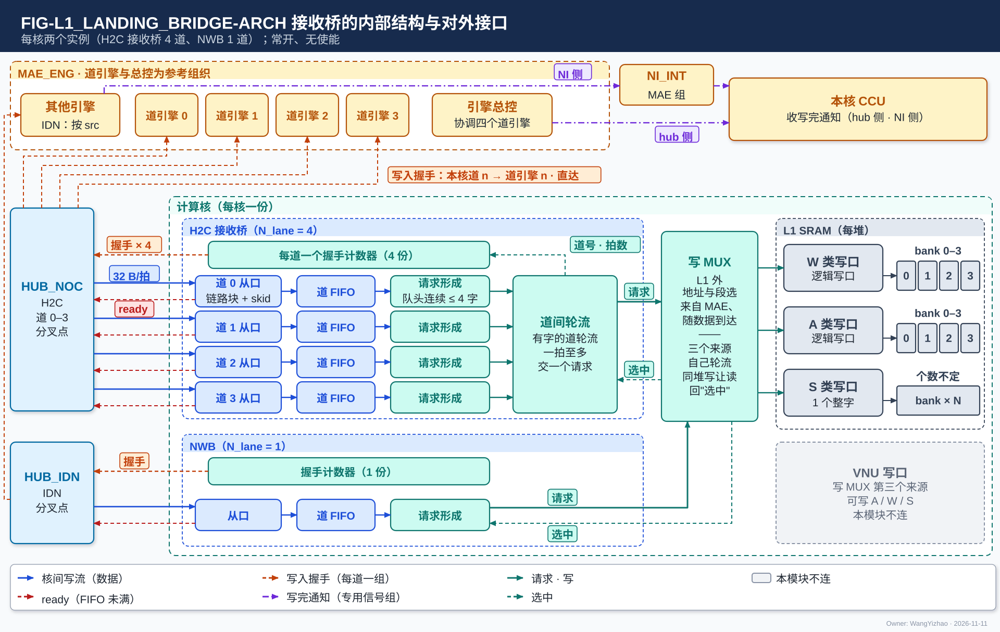
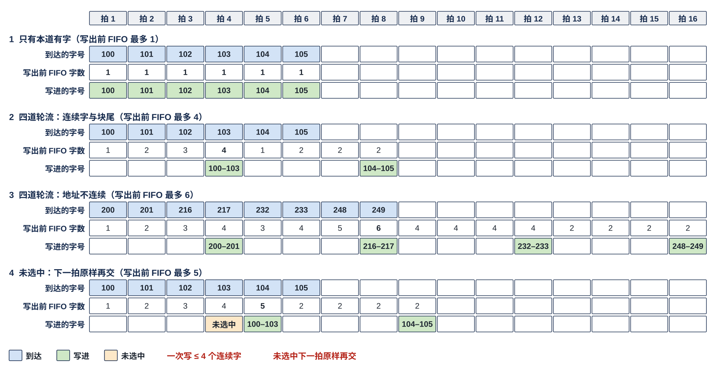
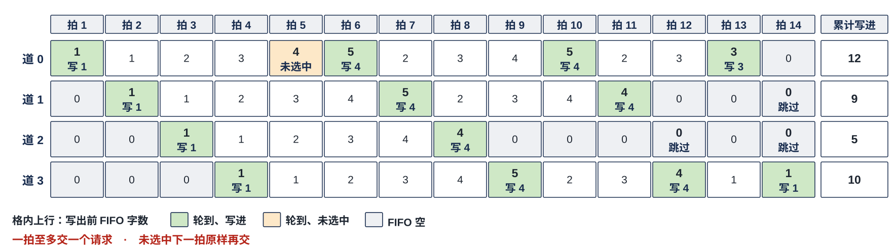
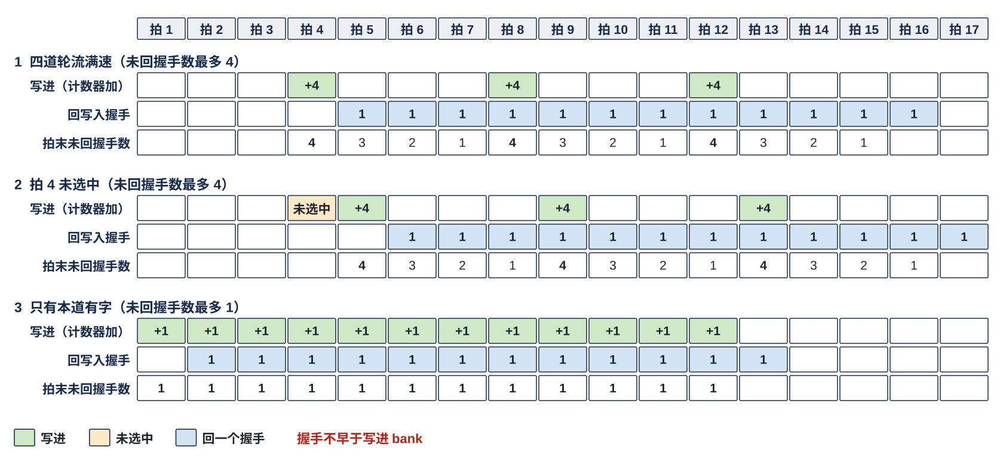

# 接收桥（L1_LANDING_BRIDGE）需求

> Owner: WangYizhao｜2026-11-11

## 1 概述

**接收桥终结一条或几条核间写流（带地址的握手写流），把到达的写入拍交给 L1 外的写 MUX、轮到本桥时写进 L1 对应类的写口；数据写进 L1 之后，才沿原链路回写入握手。它常开、没有使能，不解析数据、不攒 token、不改地址、不移位、不做形态变换、不判写完。** 它属于 L1 组（L1 组 = L1 SRAM + 本模块），同一种模块每核两个实例：**H2C 接收桥**终结本核的 H2C 第 0–3 道，**NWB** 终结本核的 IDN 链路（1 道）。

**对 L1 外的写 MUX 而言，每个实例只是一个写请求源**：L1 每类一个逻辑写口，来源只有三个——H2C 接收桥、NWB、VNU 写口；写 MUX 在 L1 外、计算核内，**每类写口每拍在三个来源之间按固定规则自己轮流、选一个写一次，不由 CCU 逐拍选；没轮到的来源在自己的 FIFO 里等**（V18-L1-14 / 24 / 32；架构篇 §3.7）。落地写的地址与段选来自 MAE、随数据到达，请求不是 CCU 发的，所以不由 CCU 仲裁。L1 同一个堆同一拍只做一次访问（架构篇 §3.4 CONC-2）：**写与读碰到同一个堆时写让读**，由写 MUX 在本地判断。所以写 MUX 某拍不选本桥，可能是轮到了别的来源，也可能是目的堆本拍在读。

本篇用到的几个词（其余术语在首次出现处定义）：

| 词 | 含义 |
|---|---|
| 存储字 | 32 B，L1 / L2 读写的基本单位；字节地址除以 32 取整是它的**字号**（协议篇 §3.2） |
| 道 | 终结在本桥的一条核间链路连同它在本桥里的那一份处理；H2C 接收桥有道 0–3，NWB 只有一道。$N_{\text{lane}}$ = 道数 |
| 写入拍 | 链路上成交的一拍（en ∧ ready），默认 = 一个存储字；写入握手按写入拍回 |
| 连续 | 同一道上相邻两个写入拍 `seg` 相同、`src` 相同，且后一拍的 addr = 前一拍的 addr + 前一拍的有效字节数（默认整字时就是相差 32） |
| 写请求 | 本桥一次交给写 MUX 的写：`seg` + 首字节地址 + 有效字节（≤ 128 B）+ 数据；一次请求的写入拍来自同一道、同一 `seg`、同一 `src`，彼此连续 |
| 选中 | 写 MUX 本拍接受了本请求，把它的全部字节经该类写口写进 L1 |
| 未回握手数 | 已写进 L1、尚未沿链路回写入握手的写入拍数 |
| $L_{\text{skid}}$ | 一道拉低 ready 到上游真正停发之间仍会到达的写入拍数（拍数），由设计者按本道到上游分支的流水登记；推导值，随后端级数 |
| $W_{\text{wait}}$ | **写 MUX 连续不选本桥的最长拍数**；推导值，随写 MUX 的轮流规则与目的堆被读占用的拍数（写让读）。用于 L2 的写入口时读作"所在的堆被别的链路占用的最长连续拍数" |
| $M_{\text{mc}}$ | **多播余量**：本核在同一多播分叉点上可以比最快的核落后多少拍而不让分叉点停收（本篇 §3.9） |

**$L_{\text{skid}}$、$W_{\text{wait}}$、$M_{\text{mc}}$ 三个符号由本篇定义**，L2、HUB_NOC、HUB_IDN 与协议篇只引用本节。文中矩阵按 AW 写法：$Y_{T \times M} = X_{T \times K}\,W_{K \times M}$，$W$ 以归约位置 $k$ 为行、输出通道 $m$ 为列。

## 2 接口需求

### 2.1 架构图与接口汇总

图中模块框内的结构是参考实现（见第 7 章），本章以框外的各口为准。

图从左到右是核间链路、接收桥、L1 外的写 MUX、L1 写口。

- **左侧是两个上游**：HUB_NOC 的 H2C 道 0–3（道 $n$ 读 L2 象限 $n$，在分叉点分给各核）与 HUB_IDN（按每字的核集合分发，接几核即分叉点）。每道三根线：数据（蓝，32 B/拍，连同 addr、be、`seg`、`src`）进本道从口；ready（红虚线）从本道回上游；写入握手（橙虚线）沿本道回上游——H2C 接收桥的四道画成一束"× 4"，实际每道各回各的。H2C 道 $n$ 的握手经 HUB_NOC 直达第 $n$ 道的发令方（图中 MAE_ENG 里的道引擎 $n$），IDN 的握手经 HUB_IDN 直达发令的搬运引擎（图中"其他引擎"）；**每个核各回一组，hub 里不汇总、不归并**。MAE_ENG 框里的"道引擎 0–3、引擎总控"是 MAE 的参考组织（MAE_ENG 篇第 7 章）。
- **中间是计算核框里的两个实例**：框内的"从口 → 道 FIFO → 请求形成 → 道间轮流"与"每道一个握手计数器"是参考结构（本篇 §7）；NWB 是同一结构的单道实例。**两个实例都常开：没有使能，也没有到 CCU 的线。**
- **右侧是写 MUX 与 L1 的写口（都不在本模块）**：写 MUX 在 L1 外、计算核内，在三个来源之间自己轮流、写碰到同一个堆的读时让读，不由 CCU 逐拍选；请求的地址与段选来自 MAE、随数据到达；写 MUX 按请求的 `seg` 类位把它接到 A / W / S 写口之一，选中的那一拍回"选中"（青色虚线）。第三个来源 VNU 写口画成灰框，本模块不连。L1 一侧画的 bank 是 L1 的参考组织（L1 篇第 7 章）。
- **上方是 MAE_ENG、NI_INT 与本核 CCU**：发令方经 HUB 收回各核本道的写入握手，数满后经写完通知专用信号组（不经命令网、不经本桥）给目的核 CCU 发写完通知；**写完通知每核两组**（紫色点划线）：hub 侧（H2C 搬运）、NI 侧（IDN 搬运，由 NI_INT 点到点送本核 CCU、不经 hub）。CCU 与写 MUX 之间没有逐拍选择的线。

| 口 | 对端 | 方向 | 每拍位宽 | 握手 | 架构篇出处 |
|---|---|---|---|---|---|
| 链路从口（H2C 接收桥每道一个，共 4；NWB 1） | H2C：HUB_NOC 的 H2C 道 $n$；NWB：HUB_IDN | 入 | din 32 B + be 32 + addr 24 + `seg` 5 + `src` 5 bit【待标定】 | en / ready（每道独立） | PORT-10、PORT-11、PORT-12、PORT-16 |
| 写入握手回程（每道一组） | 该道的发令方（MAE 搬运引擎），经 HUB_NOC / HUB_IDN 直达 | 出（反向旁带） | valid + `src` | 只有 valid | PORT-30 |
| 写请求口 | L1 外的写 MUX | 出 | `seg` 5 + 首字节地址 24 + 有效字节 + 数据 ≤ 128 B | en / 选中 | PORT-10、PORT-11、PORT-04 / 05 / 06 |
| 与本核 CCU | — | — | 无 | — | — |

口宽与条数以架构篇 §2.7 的 PORT-nn 为准，本表只为阅读方便列出。

### 2.2 核间一侧：每道一个链路从口

#### 2.2.1 信号与每拍含义

**每道的从口例化 HUB 提供的通用链路块，信号与核内 RRAM 口同名，核间只多 ready、发令号 `src` 与反向的写入握手**（协议篇 §2.2.2，V18-TP-41 / 42，V18-HUB-05）。链路上没有切换段标记，本桥不需要知道一次搬运在哪拍结束。**每一拍的数据从第 0 字节起放，addr 是本拍第一个有效字节的目的地址；默认 addr 是 32 的倍数，一拍就是一个存储字；addr 不是 32 的倍数时这一拍跨两个存储字，由 L1 内部移位、拆写，本桥不感知**（V18-TP-74）。

| 信号 | 方向 | 位宽 | 本桥做什么 |
|---|---|---|---|
| en | 链路 → 桥 | 1 | 本拍有数据；en ∧ ready 同拍即成交 |
| ready | 桥 → 链路 | 1 | **本道本拍能收；只看本道，与别的道无关**；寄存器输出 |
| din | 链路 → 桥 | 32 B | 从第 0 字节起放本拍的有效数据；原样交写 MUX |
| be | 链路 → 桥 | 32 | 从第 0 字节起连续有效的字节（默认整字时全 1）；用来算有效字节数 |
| addr | 链路 → 桥 | 24 | 本拍第一个有效字节在目的类、目的堆里的段内字节地址；只用来判"连续"与作请求的首字节地址 |
| `seg` | 链路 → 桥 | 5 | 堆选 1 + 段掩码 4（独热，L1 用其中 3 位表示 W / S / A，架构篇 §3.3）；用来判"连续"、定请求形状（本篇 §3.4）、随请求交写 MUX |
| `src` | 链路 → 桥 | 5 bit【待标定】（架构篇 §2.4） | 这一拍属于哪个发令方；请求在 `src` 变化处断开（本篇 §3.3），写进后随写入握手原样带回 |

#### 2.2.2 写入握手：写进 L1 之后逐拍回，每道一组直达发令方

| 信号 | 方向 | 位宽 | 含义 |
|---|---|---|---|
| valid | 桥 → 链路（反向旁带） | 1 | 本道的一个写入拍已写进 L1 |
| `src` | 桥 → 链路 | 同链路 | 该写入拍的 `src` |

**每写进一个写入拍回一个，不早于它写进 L1 的那一拍；每道每拍至多回一个；只有 valid、没有 ready**（发令方的计数每拍都能收）。规则见本篇 §3.8。

### 2.3 写侧：对 L1 外的写 MUX 是一个请求源

#### 2.3.1 写请求的内容

**每个实例对写 MUX 是一个请求源：每拍至多交一个请求；写 MUX 选中的那一拍接受这个请求，把它的全部字节经该类写口写进 L1**（L1 篇 §2.6.1、§2.8.1）。写 MUX 每类写口每拍在 H2C 接收桥、NWB、VNU 写口三个来源之间按固定规则自己轮流、选一个，不由 CCU 逐拍选；写与读碰到同一个堆时写让读，在本地判断；L1 不感知（V18-L1-24 / 32）。

| 信号 | 方向 | 位宽 | 含义 |
|---|---|---|---|
| en | 桥 → 写 MUX | 1 | 本拍交出一个请求 |
| `seg` | 桥 → 写 MUX | 5 | 本请求的堆选与类，原样来自链路；写 MUX 按它的类位把请求接进 A / W / S 写口之一 |
| addr | 桥 → 写 MUX | 24 | 首字节地址 = 本请求第一个写入拍的 addr，原样来自链路 |
| 有效字节 | 桥 → 写 MUX | 形式（len 或 be）与位宽【设计者定】：约束是能表达任意字节起点与 1–128 B 的长度（与 L1 写口一致，架构篇 PORT-04） | 本请求的有效字节，1–128 B；S 类恒整字 |
| din | 桥 → 写 MUX | 128 B | **从第 0 字节起首尾相接放本请求的有效字节**，对应从首地址起连续的字节 |
| 选中 | 写 MUX → 桥 | 1 | 1 = 写 MUX 本拍接受了这个请求；0 = 未选中（本篇 §2.3.2） |

请求里还要不要给道号、拍数等字段，以及"选中"的信号形式，由计算核集成定（`CORE_INTEGRATION_STAGING.md`）；约束是选中对应本拍交出的请求、请求的字节要么全部写进要么都不写。

#### 2.3.2 选中与未选中的语义

- **写 MUX 一次写一个来源的整次请求，不拆**：选中是请求级的一位。首地址不在存储字边界的请求由 L1 内部处理，占几拍按架构篇 §3.4 CONC-3（从存储字边界起一拍，否则允许多拍），本桥不感知。
- **未选中：请求不丢，之后再交，等待有上界**（本篇 §3.5、§3.6）。未选中期间各道照常收数据，收不下时拉低本道 ready，只降速、不丢。再交时怎样组请求属参考实现（本篇 §7.3）。
- **写 MUX 按请求的 `seg` 类位接进三类写口之一**：各类写口独立，同一拍 H2C 接收桥的请求进 A 类、NWB 的请求进 W 类，两者可以同拍写进；两个实例的请求进同一类时，由写 MUX 轮流选一个，另一个之后再交（V18-L1-20 / 24 / 32）。

### 2.4 CCU 一侧：没有接口

**本桥与本核 CCU 之间没有任何信号：没有写计数、没有使能、没有位点就绪**（V18-TP-70）。落进 L1 的数据是否写完，由发令的 MAE 数本桥回去的写入握手判定，数满后经写完通知专用信号组给目的核 CCU 发写完通知（本篇 §3.8）。**本桥的请求何时写进也不由 CCU 决定**：写 MUX 自己轮流（V18-L1-32）；CCU 不读本桥的任何状态。

## 3 功能描述

### 3.1 功能一览

| 功能 | 输入 | 输出 | 触发 / 生效条件 | 节 |
|---|---|---|---|---|
| 原样终结核间写流 | 链路的写入拍 | 写请求（数据、地址、`seg` 原样） | 常开 | §3.2 |
| 形成写请求 | 一道上按次序到达的写入拍 | 同 `seg`、同 `src`、连续、≤ 128 B 的一次请求 | 有数据即形成 | §3.3 |
| 按类的请求形状 | 请求的 `seg` | A / W：1–128 B；S：一个整字 | 每次请求 | §3.4 |
| 未选中再交 | 写 MUX 的选中 | 同一请求下一拍再交 | 本拍未选中 | §3.5 |
| 几道之间 | 各道的请求 | 一拍至多一个请求，道内保序、任一道不饿死 | H2C 接收桥 | §3.6 |
| 常开 | 任何时刻到达的数据 | 照常写进、照常回握手 | 恒定 | §3.7 |
| 写入握手 | 写进 L1 的写入拍 | 每道一组 valid + `src`，直达发令方 | 写进 L1 之后 | §3.8 |
| 多播余量 | 多播分叉点下游的本核分支 | 落后不超过 $M_{\text{mc}}$ 拍时不拖其他核 | 多播 | §3.9 |
| 链路从口 | 上游任意级数、任意 ready 时序 | 功能不变 | 恒定 | §3.10 |
| 复位 | 复位 | 在途状态丢弃，L1 内容不变 | 复位 | §3.11 |

### 3.2 原样终结核间写流：不解析、不改地址、不移位、不变换

| 不做 | 归谁 |
|---|---|
| 不解析数据：不看码、元数据项、keep 位图，不知道数据块是什么 | 生产方与消费核 CCU（数据组织篇 §2.5） |
| 不攒 token、不按 token 定位、不等四道齐 | 每道各管各的；一条 token 记录在 L1 里接成连续，是 MAE 按目的地址排好的（数据组织篇 §3.6） |
| 不累加地址、不回绕、不改地址：每一拍的地址就是它随链路到达的 addr | MAE 搬运引擎逐拍给出（协议篇 §3.3.2） |
| **不移位、不拆拍**：首地址不在存储字边界时，移位、拆写由 L1 内部做 | L1（L1 篇 §3.3，V18-TP-74） |
| **不做形态变换**：到达的字已经是 L1 的字形态（行字区、列字区的存储字，全码 key 记录；字形态定义见数据组织篇） | 片外来的数据由 MAE_DSU 转（直通与转置两种运算，MAE_DSU 篇 §3.2 典型用法表）；核内产生的数据由 QNT 排 |
| **不判写完**：只回写入握手，没有写计数 | 发令的 MAE 搬运引擎（本篇 §3.8，V18-TP-70） |
| 不选来源：哪个来源本拍写哪一类 | L1 外的写 MUX（三个来源之间自己轮流，V18-L1-32） |
| 没有使能，不按工况切换：没有模式、没有配置寄存器 | — |

### 3.3 写请求的形成：同 `seg`、同 `src`、地址连续、≤ 128 B

**一次写请求取自一道上按到达次序相邻的写入拍：同一 `seg`、同一 `src`、彼此连续，合计 ≤ 128 B（默认 1–4 个存储字）**（V18-L1-27）。一次取几个连续的写入拍属参考实现（本篇 §7.2）。

- **量纲**：一次请求至多 128 B，正好是 A / W 类写口一次能写的量（架构篇 §3.4 CONC-3）；一道每拍至多到达一拍（32 B）。
- **一道里的数据按到达次序写进 L1**；不同道之间不要求次序。
- **请求在 `src` 变化处、`seg` 变化处断开**（V18-DORG-10 (7)）：一次请求的写入拍共用一个 `src` 与一个 `seg`。
- **地址不连续：只写连续的一段，其余留到之后，只降速、不出错**；**满速以每道的目的地址连续为前提**（架构篇 §3.4 CONC-3；本篇 §4.1）。
- **块尾的数据在有界拍数内写出**：链路上没有块尾标记（V18-TP-42），块尾不足 4 个存储字的写入拍照常在之后的请求里写出，等待有上界（本篇 §3.6）；不要求设冲刷条件或超时（参考做法见本篇 §7.2）。

### 3.4 按类的请求形状

| 类（`seg`） | 一次请求 | 典型数据（举例，桥不感知） |
|---|---|---|
| A | 1–128 B，从首字节地址起连续；默认 1–4 个连续存储字 | 紧凑 token 记录的码块（**码块 = 紧凑 token 记录四部分之一，只装保留通道的 6 bit 码**）、元数据项、F 列表；稠密记录、残差、部分和读回 |
| W | 同 A（通常整字；MAE_DSU 转置不足 $N$ 行的尾块可只有部分有效字节） | 行字区、列字区的存储字（字形态定义见数据组织篇；"哪一列放在哪个地址"由编译链分配，架构篇 §3.4 CONC-4）、全码 key 记录、LM Head 列副本；送来的字地址连续几个就一次写几个 |
| S | **恒 1 个整字**（不带有效字节） | 权重、K、LM Head 列副本的尺度，激活、Q 的 E8M0，V 尺度字，bias |

**S 类写口一次只收一个整字（架构篇 PORT-06），所以 `seg` 为 S 类的请求每次只交 1 个写入拍**；S 类数据不因此变慢（每拍至多到一拍）。

### 3.5 未选中：请求不丢、之后再交，等待有上界

**写 MUX 本拍没选本桥时，这次请求不丢，之后再交，直到被选中；本桥内的等待有上界**（V18-L1-27、V18-TP-84 (7)）。再交时是否原样再交、是否并入新到的写入拍属参考实现（本篇 §7.3）。未选中多少拍由写 MUX 的轮流规则与目的堆被读占用的拍数（写让读）决定（V18-L1-32），本桥不感知；未选中期间各道照常收数据，收不下时本道 ready 拉低、上游停发，只降速、不丢。

### 3.6 几道之间：一拍至多一个请求、道内保序、任一道不被饿死

- **H2C 接收桥一拍至多交给写 MUX 一个请求，不论它去哪一类**（V18-L1-15 / 27，理由见本篇 §8.1）。$N_{\text{lane}} = 1$（NWB）时本道的请求直接交写 MUX。
- **任何一道有数据，都要在有界的拍数内被交给写 MUX**。从有数据到写进 L1 的等待 = 桥内的等待 + 写 MUX 未选中的拍数：**桥内的等待上界与其他道的流量无关**（不论其他道持续发什么请求，本道都在上界内被交出），上界的拍数【设计者定】（参考见本篇 §7.3）；**写 MUX 的部分取决于它在三个来源之间的轮流与目的堆上的读（写让读）**（V18-L1-32），目的堆长时间被读占用、本桥长时间未选中时，本道 ready 拉低、上游降速，不丢数。
- **四道都有连续数据、写 MUX 每次都选中时，合计 128 B/拍**；只有一道有数据时它 32 B/拍（本篇 §4.1）。

### 3.7 常开：数据可以先于位点指令落地

**本桥常开，没有使能信号：数据一到就按本篇 §3.3–§3.6 形成请求**（V18-TP-70，用户 11-09："对于接受桥使能，我认为它不需要使能信号，它应该常开……它直接写入L1 SRAM就行了"）。数据可以在消费者的位点指令装入本核 CCU 之前到达，照常写进 L1、照常回写入握手：本桥与 L1 都不看位点状态，消费者以 MAE 发来的写完通知为准（本篇 §3.8）。由此对 CCU 有一条要求，见本篇 §5.2。

### 3.8 写入握手：写进 L1 之后才回，每道一组直达发令方

**本道的一个写入拍写进 L1 之后，沿本道回一个写入握手（valid + 该拍的 `src`）；写入握手不早于写进 L1 的那一拍**（V18-L1-19 / TP-50，用户 11-09："我希望一个来源的数据实际写进 L1 SRAM 后，才会返回握手信号"）。

- **回给谁：每个核的本桥各回一组，经 hub 直达发令方，中途不汇总、不按 `src` 归并**：H2C 接收桥第 $n$ 道 → 经 HUB_NOC → H2C 第 $n$ 道的发令方（HUB_NOC 篇 §2.6）；道 $n$ 多播给 4 个核时，4 个核各一组握手线回到道 $n$ 的发令方。NWB → 经 HUB_IDN → 发令的搬运引擎，几核共享 / 多播时各核 NWB 各一组（HUB_IDN 篇 §2.3）。全片写入握手回程 H2C 4 道 × 4 核 = 16 组、IDN 4 核 × 每核 1 组（架构篇 PORT-30）。
- **计数单位是写入拍，默认 = 一个存储字**（V18-TP-37）：一拍不论有效字节有几个，写进计 1；不分类，本道写进 A、W、S 哪一类都一样回；还没写进 L1 的不回，所以不设排空信号。首地址不在存储字边界、L1 分多拍写的请求，在最后一拍写完之后才回。
- **`src` 原样带回、每个写入拍恰回一个、带对 `src`**：一次请求的写入拍共用一个 `src`，但未回握手的写入拍可能跨两次请求、两个 `src`（上一条指令的还没回完，下一条指令的已写进），本桥回的握手不丢、不错 `src`、不早于写进（参考做法按写进次序回，本篇 §7.5）。
- **发送方不等握手回来才发下一拍**，吞吐不受握手影响。
- **写完由发令方判定并通知 CCU，本桥没有写计数**（V18-TP-70，用户 11-09："这里确实需要一个方案，能够判断数据是否已经写入完毕"；"对于块尺度和写完判断，我完全认可"）：发令的搬运引擎按（核, `src`）数本桥回去的写入握手，数满本指令的应写量后经写完通知专用信号组（架构篇 PORT-37，每核两组：hub 侧、NI 侧）给目的核 CCU 发写完通知；各情形（多播 $k$ 个核、IDN 几个核共享、一条指令搬紧凑 token 记录四块、按批流水）的应写量与通知内容归 MAE（MAE_ENG 篇 §3.20、协议篇 §3.8）。**CCU 收到写完通知即可读这批数据**（L1 篇 §3.11）。
- **所以握手不早于写进 L1 是正确性要求**：写完通知以握手为据，握手早于写进就可能让消费者读到旧值。

### 3.9 多播：本桥不感知，提供多播余量 $M_{\text{mc}}$

**多播的分叉点在 HUB_NOC 的 H2C 道与 HUB_IDN，各目的核独立取走；慢核落后不超过 $M_{\text{mc}}$ 拍时不拖其他核，这段余量由接收桥提供，HUB 不承担**（V18-HUB-05、V18-TP-53，协议篇 §3.7）。本桥不知道一个字是不是多播来的，也不为多播做任何别的事：

- 本核本道收不下 → ready 拉低，别的核照常取走；慢核落后超过 $M_{\text{mc}}$ 拍时只降速、不丢（分叉点怎样停收属 HUB 的参考实现，协议篇 §3.7）。
- **$M_{\text{mc}}$ 的取值由接收桥设计者登记**【设计者定】：要定的是每道在平时的待写数据之外还能多收多少拍（参考做法下与满速所需暂存的关系见本篇 §7.4）。
- H2C 多播 $k$ 个核时，每个核的本桥各回自己的写入握手（本篇 §3.8）；**每个目的核在写进本核的数据数满后各自收写完通知，不等其他目的核**（V18-TP-84 (8)，MAE_ENG 篇 §3.20）。

### 3.10 链路从口：每道 ready 独立、寄存器输出、时延无关

**每道的 ready 只看本道，与别的道无关；从口例化 HUB 提供的通用链路块，ready 与送进本桥的各信号都寄存器输出，与上游之间没有组合路径**（V18-TP-32 / 38、V18-HUB-05，协议篇 §3.5.1，HUB_NOC 篇 §2.9）。

| 项 | 规定 |
|---|---|
| 链路块参数 | 数据位宽 256 bit；旁带 = addr 24 + be 32 + `seg` 5 + `src`；反向写入握手旁带 valid 1 + `src`，同样寄存器输出；skid 深度 = 本道拉低 ready 到上游停发的在途拍数（$L_{\text{skid}}$），例化参数【设计者定】 |
| 各道之间 | 不对齐、不等齐：同一核的 4 条 H2C 链路之间、正向与写入握手回程之间都没有同拍要求（协议篇 §3.5.3 A4）；一道停发不影响别的道 |
| 时延无关 | 上游插任意级寄存器、ready 任意时刻拉低，落进 L1 的内容与写进次序不变；**功能定义里不出现任何固定拍数** |
| 停发时 | ready = 0 的拍上游原样保持；本桥不丢拍、不重复收；ready 拉低后仍在途的 $L_{\text{skid}}$ 拍全部收下 |

### 3.11 复位

- **复位输入来自 CIF（架构篇 PORT-41），硬复位与软复位不区分**（CIF 篇 §3.3）。
- 复位清本桥的全部在途状态：已收未写的数据、未选中待再交的请求、未回的写入握手；在途的写入拍与未回的写入握手丢弃。
- **复位不改 L1 内容**：已写进 L1 的字保持。
- 本桥没有配置寄存器、没有使能、没有跨调用驻留的状态。

## 4 性能指标

### 4.1 速率要求

| 项 | 要求值 | 条件 |
|---|---|---|
| **H2C 接收桥** | **四道各自目的地址连续时合计 128 B/拍**（每道 32 B/拍）；只有一道有数据时该道 32 B/拍（含分送：象限 $c$ 只送核 $c$，本核只有第 $c$ 道有数据，每核有效带宽 32 B/拍，V18-MAE-42） | 写 MUX 每次都选中；**各道目的地址不连续时只降速、不出错**（架构篇 §3.4 CONC-3、§4.3） |
| **NWB** | **32 B/拍**（地址连不连续都一样） | 写 MUX 每次都选中 |
| 写入握手 | 每道每拍至多 1 个 | 不对正向限速 |

**写带宽不由编译链保证**（V18-L1-21，用户 11-09："编译链不应该保证带宽"）：写 MUX 轮到别的来源时本桥的请求未选中、下一拍再交，收不下时本道 ready 拉低、上游降速，只降速、不丢数。

### 4.2 同时使用的口

| 情形 | 要求 |
|---|---|
| H2C 接收桥的四道 | 各道各自收数据、各自 ready；一道停发不影响别的道 |
| 两个实例同拍 | 请求进不同类的写口时可以同拍写进；进同一类时由写 MUX 轮流选一个，另一个之后再交 |
| 正向与写入握手回程 | 互不依赖 |

L1 一侧哪些访问能同拍由架构篇 §3.4 的 CONC-n 规定，本桥不另定。

### 4.3 要求值表

| 编号 | 项 | 要求值 |
|---|---|---|
| BRG-R1 | 实例与道数 | 每核 2 个实例——H2C 接收桥 $N_{\text{lane}}$ = 4，NWB $N_{\text{lane}}$ = 1；**两个实例需求相同，只差道数与上游**（$N_{\text{lane}} \in \{1, 4\}$）；全芯片 8 个实例、20 道 |
| BRG-R2 | 每道的链路从口 | 例化 HUB 提供的通用链路块；入 en / din 32 B / be 32 / addr 24 / `seg` 5 / `src` 5 bit【待标定】，出 ready；反向写入握手 valid 1 + `src`，每拍至多一个；全部寄存器输出、带 skid；skid 深度与流水级数【设计者定】（约束是本篇 §3.10） |
| BRG-R3 | 写请求 | 同一道、同 `seg`、同 `src`、连续的写入拍，合计 ≤ 128 B；= `seg` 5 + 首字节地址 24 + 有效字节（形式与位宽【设计者定】）+ 从第 0 字节起首尾相接的 ≤ 128 B 数据；S 类恒 1 个整字；每个实例每拍至多交写 MUX 一个请求；未选中时请求不丢、之后再交，等待有上界 |
| BRG-R4 | 常开、无写计数 | 没有使能、没有写计数、与本核 CCU 之间没有信号；写完由 MAE 判定并发写完通知 |
| BRG-R5 | 写入握手 | 每道一路回程，每核 5 路，各自直达发令方、中途不汇总；每路每拍至多 1 个 valid + `src`；每个写入拍恰回一个、带对 `src`，不早于写进 L1 的那一拍 |
| BRG-R6 | 吞吐 | H2C 接收桥四道各自地址连续时 128 B/拍；只有一道有数据时 32 B/拍；NWB 32 B/拍（前提是写 MUX 每次都选中） |
| BRG-R7 | 等待上界 | 任一道有数据后在桥内的等待有上界、与其他道的流量无关；拍数【设计者定】 |
| BRG-R8 | 多播余量 | 本核落后不超过 $M_{\text{mc}}$ 拍时不拖其他核；$M_{\text{mc}}$ 由接收桥设计者登记【设计者定】 |

## 5 约束与由使用者保证的事项

### 5.1 硬约束

- **两个实例需求相同**，只差道数与上游（用户 11-09："你确实可以统一这两者的设计需求"）；用同一份 RTL 例化属参考实现（本篇 §7.4）。
- **常开、没有使能、没有配置寄存器、与 CCU 之间没有信号**。
- **写入握手不早于写进 L1**（本篇 §3.8）。
- **核间一侧使用 HUB 提供的通用链路块**（V18-HUB-05）。
- **本篇不含容错设计**（V18-TP-75）：不检查地址与 `seg`；地址与 `seg` 由发令方按编译期给定的指令推出。

### 5.2 由使用者保证的事项

以下事项本桥不检查，由对应方保证：

| 事项 | 由谁保证 |
|---|---|
| 每拍的 addr、`seg`（堆、类）正确：不越过该类该堆的容量；数据组织默认从存储字边界起（L1 保留任意字节起点的能力，移位在 L1 内部） | MAE 搬运引擎按编译期给定的指令逐拍推出（V18-TP-27 / 35 / 74）；编译期检查 |
| 一条链路上切换段不交错（交错时请求在 `src` 变化处断开，只降效率、不出错） | MAE 搬运引擎；NI_INT 的 IDN 出口（协议篇 §3.10） |
| **要满速时每道送来的数据在目的地址上连续**；各类数据在 L2 / L1 里怎样放 | MAE 与编译链（架构篇 §3.4 CONC-3；放法见数据组织篇 §2.3、§3.6、§3.6.6，MAE_ENG 篇 §3.10） |
| S 类数据整字（生产方把末字补 0） | 生产方、MAE（V18-DORG-04） |
| IDN 链路不受整字限制、按 be 原样传，是否整字由发送方与数据组织定；MAE_DSU 转置不足 $N$ 行的尾块用 be | MAE 的 IDN 出口与 MAE_DSU（V18-DORG-10 (4)、V18-MAE-41） |
| 写 MUX 每拍在三个来源之间轮流选一个；写碰到同一个堆的读时让读（同一个堆同一拍只做一次访问） | 写 MUX（L1 外，V18-L1-32，`CORE_INTEGRATION_STAGING.md`）；读的排拍归本核 CCU（架构篇 §3.4 CONC-2） |
| **写 MUX 轮流时不看消费者的位点指令是否已装入**，否则先到的数据会堵在本桥、经 ready 反压上游（本篇 §3.7） | 写 MUX（`CORE_INTEGRATION_STAGING.md`） |
| 数满写入握手、发写完通知（各情形的应写量与通知内容） | 发令的 MAE 搬运引擎（V18-TP-70，MAE_ENG 篇 §3.20） |
| 握手按 `src` 归属；一个 `src` 任何时刻只对应一条未完成的指令 | MAE 搬运引擎（V18-TP-50，协议篇 §2.2.2） |
| 目的空间在数据到达时已读完；同一时段各来源写的数据块地址不重叠 | 编译链（LIC 操作 15） |

## 6 验收

### 6.1 本模块验收项

| 编号 | 验收项 | 方法与判据 | 出处 |
|---|---|---|---|
| BRG-V1 | 请求形成 | 随机地址流——连续、不连续、块尾不足 4 个存储字、片尾地址跳变、`seg` / `src` 变化、地址不连续的流（列字区）、S 类、首地址不在存储字边界的流——逐位比对落进 L1 的内容与参考模型；断言每次请求 ≤ 128 B、地址连续、同一 `seg` 与 `src`、S 类 1 个整字，本道写进次序等于到达次序，块尾的写入拍在有界拍数内写出 | §2.3.1、§3.3、§3.4 |
| BRG-V2 | 只有一道有数据与地址不连续 | 只有一道有数据时（含 NWB）32 B/拍，地址连不连续都一样；几道同时有数据、地址不连续时只写连续段、不丢、不乱序，积压时 ready 拉低、上游降速 | §3.3、§4.1 |
| BRG-V3 | 几道之间不饿死 | 四道随机满载、空闲与地址不连续的流混合，写 MUX 随机不选中：每拍至多交一个请求；未选中的请求不丢、之后再交；每道有数据后在桥内的等待不超过设计者登记的上界 | §2.3.2、§3.5、§3.6 |
| BRG-V4 | 时延无关与 skid | 随机化各道上游流水级数、ready 拉低时序与回程时延：落进 L1 的内容与各道写进次序不变，不丢拍、不重复；各道之间无同拍依赖 | §3.10 |
| BRG-V5 | 写入握手 | 每个写进的写入拍恰回一个握手、带该拍的 `src`，不早于它写进 L1 的那一拍，还没写进的不回；两条指令的数据在同一道首尾相接时各自的握手数等于各自写进的拍数 | §2.2.2、§3.8 |
| BRG-V6 | 多播快慢核 | 同一 H2C 道或 IDN 多播到 2–4 个核，各核写 MUX 随机不选中、各道随机收不下：慢核短时落后不超过 $M_{\text{mc}}$ 时不拖快核；超过时只降速、不丢数；各核落地内容相同 | §3.9 |
| BRG-V7 | 常开与先到的数据 | 数据在消费者的位点指令装入 CCU 之前到达：照常写进 L1、照常回握手，不丢 | §3.7 |
| BRG-V8 | 吞吐 | 四道各自地址连续、写 MUX 每次都选中时合计 128 B/拍；NWB 32 B/拍 | §4.1 |
| BRG-V9 | 复位 | 收数据、写进与回握手进行中复位：本桥在途状态清空，L1 已写进的内容不变 | §3.11 |

### 6.2 与上下游模块的对接检查

| 对接项 | 对端 | 检查内容 |
|---|---|---|
| H2C 链路与握手 | HUB_NOC 篇 §2.1、§2.6 | 每道 ready 独立；每核每道一组写入握手直达道 $n$ 的发令方 |
| IDN 链路与握手 | HUB_IDN 篇 §2.3 | 单道实例；各核 NWB 一组写入握手直达发令方 |
| 写 MUX | 计算核集成（`CORE_INTEGRATION_STAGING.md`）、L1 篇 §2.6.1 / §2.8.1 | 请求字段与选中信号一致；选中时整次请求写进，未选中的请求不丢、之后再交；按 `seg` 进三类写口之一；三个来源之间自己轮流、写碰到同一个堆的读时让读，不由 CCU 逐拍选 |
| L1 写口 | L1 篇 §3.3、架构篇 PORT-04 / 05 / 06 | 首字节地址 + 有效字节 + 从第 0 字节起的数据；S 类一个整字；不对齐由 L1 内部处理 |
| 写完通知 | MAE_ENG 篇 §3.20 | 发令方按（核, `src`）数本桥的握手，数满后才发写完通知；多播 / 分送 / IDN 共享时每个目的核在写进本核的数据数满后各自收通知，不等其他核 |
| 多播余量 | HUB_NOC 篇 §3.4、HUB_IDN 篇 | $M_{\text{mc}}$ 登记值与 HUB 的分叉点行为一致 |

### 6.3 仿真断言

以下断言只在仿真里（验证交付物，不是硬件需求、不进 RTL 的功能定义），在全部用例中成立：

1. `seg` 的类位在 W / S / A 中三选一独热。
2. 地址不越过该类、该堆的容量。
3. 每次请求 ≤ 128 B、地址连续、同一 `seg` 与 `src`；S 类恒 1 个整字。
4. 本道写进次序 = 到达次序。
5. 每个写进的写入拍恰回一个握手、不早于它写进 L1 的那一拍。

## 7 参考实现

**本章内容可以换；换了之后别的模块不用改。** 本章给一套满足第 2–6 章的做法：每道一条道 FIFO、道间按拍轮流、轮到时取队头连续的 1–4 项、握手计数器；**L2 的写入口是同一套逻辑**（L2 篇 §7.4，V18-L1-27；用户 11-10："认可，并且这里和L2一致"）。结构图见本篇 §2.1 的 FIG-L1_LANDING_BRIDGE-ARCH（框内部分）。

### 7.1 每道一条道 FIFO，ready = FIFO 未满

- **每道一个链路从口（通用链路块 + skid）与一条道 FIFO**：到达的每一拍连同它的 be、addr、`seg`、`src` 原样存进去；**ready = 本道 FIFO 未满**：占用 < 深度 − $L_{\text{skid}}$（将满阈值 = 深度 − 在途拍数，协议篇 §7.9）。FIFO 只用来隔离几个来源同时写 L1：不丢数据、分拍写入（用户："在我看来它就是一个写入SRAM之前的FIFO，用来隔离同时有两个数据源写入时，不丢数据，分拍写入"）。
- **FIFO 项** = 链路上成交的一拍：din 32 B + be 32 bit + addr 24 bit + `seg` 5 bit + `src` 5 bit，约 322 bit。默认使用时一项就是一个存储字。
- FIFO 用寄存器、RF 宏还是 SRAM 宏【设计者定】：要定的是存储形式；约束是一拍收一项、一拍取至多 4 项。

### 7.2 轮到时取队头连续的 1–4 项；有效字节不足 32 的一项结束本次请求

**轮到本道时（本篇 §7.3），从 FIFO 队头起取同一 `seg`、同一 `src`、地址连续的项组成一次写请求，合计 ≤ 128 B（默认 1–4 个存储字）；FIFO 里有几个连续的就写几个，不等凑满；FIFO 空的道不参加轮流**（V18-L1-27）。

- **速率**：只有一条道有字时，它每拍都轮到，到一个写一个，32 B/拍；四道都有连续字、写 MUX 每次都选中时，每道每 4 拍轮到一次、每次 4 个字，合计 128 B/拍 = A / W 类写口的口宽。两次轮到之间一道至多到 4 个字，所以写出速率不低于到达速率。
- **有效字节不足 32 的一项结束本次请求**：请求的第 $i$ 项从请求数据的第 32$i$ 字节起放；写口只收"首字节地址 + 从第 0 字节起连续的有效字节"，本桥又不移位，只有前面各项都是满 32 B 时，后一项的有效字节才正好接在前一项之后。所以有效字节不足 32 的一项只能作请求的最后一项，其后即使地址连续也留到本道下一次轮到（只降效率）。默认使用时每项都是整字，这条不起作用；数据块末字、片尾字后面的地址本来就跳到下一个存储字边界、不连续。
- **地址不连续**：队头起的连续段在某一项后断开时，本次只写队头起连续的那一段，其余留到本道下一次轮到。只有本道有字时不受影响（例：NWB 送 W 类列字区，同一列相邻两个字地址差一个列窗口的列数 $C$ 个存储字，地址连不连续都是 32 B/拍）；几道同时有字时效率降低：按 $m$ 切分、片很短时（例 $P$ = 64、$w$ = 6，码每片 1–2 个字），一道写各 token 的同一片，每次轮到只写 1–2 个字（PACK 情形 3）；**四道都有字、但各道地址都不连续时，每次轮到只写 1 个字，合计 32 B/拍**；积压的字留在 FIFO，将满时 ready 拉低、上游降速，不丢数。
- **块尾**：块尾不足 4 个字的那一组，在本道下一次轮到时随请求写出：只有本道有字时就是到达的那一拍；四道都有字时至多等其余三道各轮一次，再加写 MUX 未选中的拍数。例：字号 100–105 在拍 1–6 逐拍到达、四道都有字、本道在拍 4、8 轮到，拍 4 写 100–103、拍 8 写 104–105（PACK 情形 2）。

一道上四种情形，每种三行：到达的字号、本拍写出前 FIFO 里的字数、本拍写进的字号。示意时序：本道第一个字在拍 1 到达，到达的字当拍可被请求取用；情形 2–4 里其余三道持续有字，本道在拍 4、8、12、16 轮到（情形 4 拍 4 未选中后为拍 5、9）。

1. **只有本道有字**：一个数据块的 6 个字，字号 100–105 在拍 1–6 逐拍到达。本道每拍都轮到，拍 1–6 依次写 100、101……105，每次 1 个字；FIFO 最多 1 个字，32 B/拍，块尾不等。
2. **四道轮流、连续字与块尾**：字号 100–105 在拍 1–6 逐拍到达。拍 4 写 100–103（4 个字），拍 8 写 104–105（块尾 2 个字，没有冲刷）。FIFO 最多 4 个字。
3. **四道轮流、地址不连续**：按 $m$ 切分、每片码 2 个字，各 token 的同一片字号 200–201、216–217、232–233、248–249 在拍 1–8 逐拍到达。拍 4 队头 200、201、216、217 中只有 200–201 连续，写 200–201；拍 8 写 216–217；拍 12 写 232–233；拍 16 写 248–249。FIFO 最多 6 个字（拍 8：到达 8 个、已写 2 个），每次轮到只写 2 个字，$\eta$ = 2/4 = 50%；持续这样时 FIFO 会到将满、ready 拉低、上游降速，不丢数。
4. **未选中、下一拍原样再交**：同情形 2，拍 4 交出的请求（100–103）因写 MUX 选了另一个来源而未选中，拍 5 原样再交、写进；期间字 104 照常进 FIFO，拍 5 写出前 FIFO 有 5 个字（= 4 + 未选中 1 拍）。其余三道在拍 6、7、8 轮到，本道下一次在拍 9 轮到，写 104–105。

轮流的先后、到达到可取用的拍数【设计者定】，规则相同。脚本断言每次写 ≤ 4 个字且地址连续、写进次序等于到达次序、各拍写进的字号与上述一致、四种情形写出前 FIFO 最多 1 / 4 / 6 / 5 个字。

### 7.3 道间按拍轮流，未选中的道保留资格

**H2C 接收桥里有字的道之间按拍轮流，轮到的道交一个请求，一拍至多交给写 MUX 一个请求，不论它去哪一类；FIFO 空的道被跳过**（V18-L1-27）。**写 MUX 本拍没选本桥时，轮到的那一道保留资格，下一拍原样再交，不另设优先。** 握手计数器按选中那一次请求的拍数加。

- **轮流的先后【设计者定】（可做成 RTL 头文件参数）**：约束是任何一条有字的道等待有上界、与其他道的流量无关（本篇 §3.6）。参考做法：有字的道按道号轮流、每道每次轮到交一个请求；写 MUX 每次都选中时，一道至多等其余三道各一拍，即**至多 3 拍**。
- $N_{\text{lane}} = 1$（NWB）时没有轮流。
- 类位的译码放在桥的出口还是写 MUX 的入口【设计者定】：约束是合法的 `seg`（类位为 W / S / A 三选一的独热）进且只进一个类的写口。

四道各送一段地址连续的字：道 $i$ 的第一个字在拍 $1 + i$ 到达，之后每拍一个；四道各 12 / 9 / 5 / 10 个字。按道号轮流（0 → 1 → 2 → 3 → 0），有字才轮，每次轮到取队头连续的至多 4 个字；写 MUX 在拍 5 未选中。图中每道一行：格内上行是本拍写出前该道 FIFO 的字数，轮到的格下行是写进的字数或"未选中"，轮到时被扫过的空道注"跳过"（拍 12 的道 2，拍 14 的道 1、2）；右列是各道累计写进的字数。

| 拍 | 1 | 2 | 3 | 4 | 5 | 6 | 7 | 8 | 9 | 10 | 11 | 12 | 13 | 14 |
|---|---|---|---|---|---|---|---|---|---|---|---|---|---|---|
| 轮到的道 | 0 | 1 | 2 | 3 | 0 | 0 | 1 | 2 | 3 | 0 | 1 | 3 | 0 | 3 |
| 写进字数 | 1 | 1 | 1 | 1 | 未选中 | 4 | 4 | 4 | 4 | 4 | 4 | 4 | 3 | 1 |

- 拍 1–4：各道刚到第一个字，各写 1 个。
- 拍 5：道 0 队头有 4 个连续字，交出，写 MUX 选了另一来源，**未选中**。拍 6：道 0 **原样再交**这 4 个字（拍 6 新到的字不并入）、写进；其余道顺次在拍 7、8、9 轮到，各晚 1 拍。道 0 在拍 6 与拍 10、道 1 在拍 7、道 3 在拍 9 写出前 FIFO 都有 5 个字（= 4 + 未选中 1 拍）。
- 拍 12：道 2 的 FIFO 空、被跳过，道 3 当拍轮到。
- 四道的累计写进字数（握手计数器在写进那一拍按字数加）最终为 12 / 9 / 5 / 10 个字，共 36 个字用 14 拍。

脚本断言：每拍至多交一个请求；拍 5 未选中的请求在拍 6 原样再交、字数不变；交出字数 = 写进字数 + 未选中的那一次；每道累计写进字数等于该道到达字数；FIFO 空的道不被轮到。

### 7.4 道 FIFO 的深度：正确性下限与满速下限

**FIFO 不会溢出：ready 在将满阈值（深度 − $L_{\text{skid}}$）拉低**（协议篇 §7.9）。深度有两条下限：

- **正确性下限：深度 > $L_{\text{skid}}$**（否则 ready 拉低后仍会到的字放不下）。
- **满速下限**：

$$D_{\text{FIFO}} \;\ge\; 4 + L_{\text{skid}} + W_{\text{wait}} + M_{\text{mc}}$$

| 项 | 是什么 |
|---|---|
| 4 | 四道都有字时，本道两次轮到之间最多到的字数（每道每 4 拍轮到一次、每拍至多到一个） |
| $L_{\text{skid}}$ | 见本篇 §1 |
| $W_{\text{wait}}$ | 见本篇 §1；期间每拍至多再到一个字 |
| $M_{\text{mc}}$ | 见本篇 §1 |

- **4 + $W_{\text{wait}}$ 决定本道能否持续以 32 B/拍收字**：四道轮流时 FIFO 平时就存着 1–4 个待写的字，未选中时还要多存 $W_{\text{wait}}$ 个（PACK 情形 4：未选中一拍，写出前 FIFO 最多 5 个字）。
- **这部分不能算多播余量**：多播时慢核能拖多久而不拖别的核，只看 FIFO 超出 4 + $L_{\text{skid}}$ + $W_{\text{wait}}$ 的空位加上该核分支的 skid，即 $M_{\text{mc}}$（本篇 §3.9）；需要更大余量时加深本桥的 FIFO，不在分叉点加存储。
- **深度 > 4，取值【设计者定】**：要定的是每道的项数；约束是上面两条下限，且四道深度相同（同一份 RTL）、NWB 可另取（例化参数）。

### 7.5 握手计数器：写进后按拍数加，之后每拍沿本道回一个

**每道一个握手计数器：请求的全部字节写进 L1 之后按它的拍数加，之后沿本道每拍回一个写入握手（valid + 该拍的 `src`）、减一**（V18-L1-19 / TP-50）。

- **`src` 怎样记**：待回的握手可能跨两次请求、两个 `src`，所以握手计数器按写进次序记（`src`, 拍数）、按同一次序逐拍回。记录的个数【设计者定】：约束是不丢、不错 `src`、按写进次序回。
- **未回握手数的上界：不超过本道 FIFO 写出前的最大占用**。推导：设拍 $t_0$ 写进 $n_0 \le 4$ 项、未回握手数由 0 变正，写出前 FIFO 里有 $Q(t_0)$ 项（$n_0$ 项写进、其余 $Q(t_0) - n_0$ 项留下）。此后只要未回握手数为正，每拍回一个；$(t_0, t]$ 内至多再到 $t - t_0$ 项，所以这段时间写进的项数 ≤ $Q(t_0) - n_0 + (t - t_0)$，同一段时间回了 $t - t_0$ 个。于是拍 $t$ 的未回握手数 ≤ $n_0 + Q(t_0) - n_0 + (t - t_0) - (t - t_0) = Q(t_0)$。
- **常见工况**：四道都有连续字时本道每 4 拍写进 4 个、每拍回 1 个，未回握手数最多 4；一次未选中只让本道及其后各道的轮到时刻顺次晚一拍，未回握手数仍最多 4（写出前 FIFO 最多 5）；只有本道有字时到一个写一个、每拍回一个，未回握手数最多为 1。
- **与 FIFO 深度的关系**：写 MUX 长时间不选本桥时 FIFO 会积压到将满，积压的字被选中后可以连续几拍写进，未回握手数随之升到积压量，所以绝对上界是 $D_{\text{FIFO}}$；**握手计数器的计数范围取 0…$D_{\text{FIFO}}$ 即够，不需要清零**——未回握手数回到 0 即为空，与位点、指令边界无关；（`src`, 拍数）记录的个数不超过未回握手数。
- **代价**：最后一个字的握手回程加一跳写完通知信号组（约几十拍），由编译链按 ping-pong 排地址（读一堆、写另一堆）盖住。

一道上三种情形，每种三行：本拍写进的字数（握手计数器加）、本拍回的写入握手、拍末未回握手数。示意时序：本道 12 个地址连续的字在拍 1–12 逐拍到达；握手从写进的下一拍起每拍回一个。

1. **四道轮流满速**：其余三道持续有字，本道在拍 4、8、12 轮到，各写进 4 个；握手拍 5–16 每拍一个，未回握手数最多 4。
2. **拍 4 未选中一拍**：拍 4 交出的请求未选中，拍 5 原样再交、写进 4 个；其余三道在拍 6、7、8 轮到，本道在拍 9、13 各写进 4 个；握手拍 6–17 每拍一个，未回握手数最多 4；写出前 FIFO 最多 5 个字（拍 5、拍 9）。
3. **只有本道有字**：本道每拍都轮到，拍 1–12 每拍写进 1 个；握手拍 2–13 每拍一个，未回握手数最多为 1。地址不连续、只有本道有字的流（例：NWB 送列字区）与此相同。

三种情形写进与回握手都是 12 个。脚本断言：任何一拍累计回的握手数不超过此前各拍累计写进的字数；最终两者相等；未回握手数最多 4 / 4 / 1，不超过写出前 FIFO 的最大占用，也不超过示意的 FIFO 深度 8。

### 7.6 每道目的地址连续时的效率

**一次请求只写队头起连续的一段，所以几道同时有字时每道能否满速写出，取决于这道送来的字在目的地址上是否连续**；这由 MAE 排各道的目的地址、编译链放 L2 时保证（架构篇 §3.4 CONC-3、数据组织篇 §3.6.6、MAE_ENG 篇 §3.10）。

- **效率**：四道都有积压、轮流时，**效率 $\eta$ = 平均每次请求的字数 / 4**。一道持续有积压时，一片在这道上占 $n$ 个字就用 $\lceil n/4 \rceil$ 次请求，$\eta = n / (4\lceil n/4 \rceil)$。例：片长 $P$ = 640 个通道、$w$ = 6 bit、全保留时码块一片 $640 \times 6 / 8$ = 480 B = 15 个字，$\eta$ = 15/16 ≈ 94%；同一片的元数据项 96 B = 3 个字（项宽 $\lceil (4 + 80)/32 \rceil \times 32$ = 96 B），$\eta$ = 3/4，但元数据只占码量的一小部分。
- 分送（象限 $c$ 只送核 $c$）时本核只有第 $c$ 道有字，它每拍都轮到，效率不受地址是否连续影响。

### 7.7 性能计数、复位细节与门数

- **性能计数**（每道各一组，只观察、不影响桥的行为）：ready 为 0 的拍数（FIFO 将满）；每次请求含几项的分布（1 / 2 / 3 / 4 项各多少次）；等待轮到的拍数（本道 FIFO 不空、未轮到的拍数）；未选中拍数（请求已交出、未被选中的拍数）。计数位宽与读出方式【设计者定】：要定的是位宽、由谁读（经本核 CCU 或调试读口）、何时清零；约束是读计数不改变桥的任何行为。
- **复位**清：各道 FIFO、从口 skid、轮流指针、未选中待再交的请求、握手计数器与待回的（`src`, 拍数）记录。
- **门数**：不含 FIFO 宏，含 5 个从口的链路块、每道请求形成（连续判断、未选中保持）、道间轮流、5 个握手计数器与（`src`, 拍数）记录，NAND2 等效【待标定】。

### 7.8 参考实现的自检项

| 自检项 | 方法 | 判据 |
|---|---|---|
| 道 FIFO 与 ready（§7.1） | 逐拍检查 | 占用到将满阈值时 ready 拉低，ready 拉低后在途的 $L_{\text{skid}}$ 拍全部收下、不溢出 |
| 请求形成（§7.2） | 与参考模型逐拍比对 | 每次 ≤ 4 项且连续；有效字节不足 32 的一项之后不再并入；按 FIG-L1_LANDING_BRIDGE-PACK 四种情形，写出前 FIFO 最多 1 / 4 / 6 / 5 个字 |
| 道间轮流（§7.3） | 周期模型与 RTL 对拍 | FIFO 空的道不被轮到；未选中的道下一拍原样再交；写 MUX 每次都选中时一道至多等 3 拍；按 FIG-L1_LANDING_BRIDGE-RR 的轮到序列与写进字数一致 |
| FIFO 深度（§7.4） | 周期模型 | 深度不低于满速下限时四道满载持续 128 B/拍 |
| 握手计数器（§7.5） | 逐拍检查 | 未回握手数不超过写出前 FIFO 的最大占用与 $D_{\text{FIFO}}$；按 FIG-L1_LANDING_BRIDGE-ACK 三种情形最多 4 / 4 / 1 |

## 8 为什么

### 8.1 需求的理由

- **接收桥独立成篇**（用户 11-09："我建议把H2C的4合一合并模块单独作为一个模块需求"，V18-L1-15）：存字、四道合并、核间握手与写入握手是核间协议一侧的事，写 MUX 只看到一个请求源，两边各自验证。
- **一种模块、两个实例统一设计**（用户 11-09："你确实可以统一这两者的设计需求"，V18-L1-19）：IDN 是每核一条 32 B 链路（V18-HUB-04），NWB 与 H2C 接收桥的一道是同一种口，差别只有道数与上游。名字"接收桥 / H2C 接收桥 / NWB"由用户 11-09 定（V18-NAME-06）。
- **对写 MUX 一拍一个请求、≤ 128 B**（用户 11-09："四路H2C数据各自进入一个FIFO，然后该FIFO向L1 SRAM只暴露一个128B的单地址接口，逐个Clock地去写入不同地址的数据"；用户 11-09："L1 SRAM本身现在只有3个来源……不能把两者的数据来源合并写入，而是要错拍"，V18-L1-14；"对于问题3，我认为L1无需感知这件事"，V18-L1-24）：**每个堆同一拍只做一次访问（一次读或一次写），一次至多 128 B**（V18-TP-73，用户 11-10："对于SRAM我必须要求同拍单端口设计，写口和读口只是逻辑行为，我认为这里对L1也有相同要求"），把几道的字拼进同一次写不增加带宽；选哪个来源由写 MUX 在本地轮流决定。
- **写 MUX 自己轮流、写让读，不由 CCU 逐拍选**（V18-L1-32，用户 11-11："我认为CCU不应该控制这件事，这个控制不能让LANDING自己做吗？"；"如果说这个数据的读写请求本来就来自CCU，那我认为它的去向由CCU仲裁就很合理"）：落地写的地址与数据都来自 MAE，请求不是 CCU 发的，就不由 CCU 仲裁；读由 CCU 发、口上没有握手、不能等，所以碰到同一个堆时写让读，写等久了经本桥的 FIFO 与 ready 反压，只降速。
- **"四道都连续时 128 B/拍""NWB 32 B/拍"是要求值，其余工况只降速**（清单 §D.3 接收桥 D2，用户"认可"；G9 用户"认可"）：四道并行送一个核要 128 B/拍，条件是各道目的地址各自连续（CONC-3），不连续只降速、不出错；这是 L1 写口"首地址 + 连续 ≤ 128 B"的端口形式推出的使用条件。
- **请求在 `src`、`seg` 变化处断开**（V18-DORG-10 (7)）：一次请求共用一个 `src`，握手按请求记号即可；`seg` 相同才进同一类、同一堆的写口。
- **常开、无使能、无写计数，写完由 MAE 判定并通知 CCU**（用户 11-09："对于接受桥使能，我认为它不需要使能信号，它应该常开……它直接写入L1 SRAM就行了，不过这里确实需要一个方案，能够判断数据是否已经写入完毕"；"对于块尺度和写完判断，我完全认可"，V18-TP-70）：MAE 本来就按核间协议数写入握手，数满后通知目的核 CCU 即可；常开的桥允许数据先于位点指令落地，CCU 不需要本地写计数、比对与清零规则，本桥与 CCU 之间也就没有任何信号。
- **写入握手逐核回发令方，hub 不汇总；写完通知走专用信号组**（用户 11-11："对于同拍多src问题，我希望每个核都可以传回一个src，发给MAE，L3PU内类似问题都采取这个方案"；"命令网在我的设想里是只负责传指令和配置信号了"）：每个核一组握手线、发令方逐（核, `src`）计数，同一拍几个核的 `src` 不必在 hub 里归并。
- **写进 L1 之后才回握手**（用户 11-09："我希望一个来源的数据实际写进 L1 SRAM 后，才会返回握手信号"；"同时 MAE 也需要 L1 接收完后返回的信号"，V18-L1-19 / TP-50）：发令方数满握手即可确认数据已在 L1，写完通知以它为据。
- **本桥不移位，字节起点的移位在 L1 内部**（V18-TP-74，用户 11-10："字节移位逻辑要放在SRAM内部"）：链路上每一拍从第 0 字节起给、带首字节地址，接收桥原样交出；默认 32 B 对齐时一拍就是一个存储字。
- **元数据回 A 类、三类写口**（V18-L1-20）：元数据项、F 列表是 A 类的普通数据块，写 MUX 按 `seg` 只分 W / S / A 三类。
- **多播余量由接收桥提供**（V18-HUB-05，用户 11-11 G8："我认为也无需作为硬约束"；用户 11-06："缓冲不是已经在存储单元里要求了吗？而 HUB 本身，就已经有 skid 寄存器的需求了"，V18-TP-53）：分叉点不承担余量，慢核的余量在它自己的接收桥里。
- **时延无关、skid 强制、通用链路块由 HUB 提供**（用户 11-05 夜："skid 是应该有的设计，这是必须要的"；用户 11-06："最好的形式是建立一个 Common Block，然后多次例化"，V18-TP-32 / 38；用户 11-11："我认为核间链路本身就是HUB的工作，HUB需要提供这一个Common模块"，V18-HUB-05）：跨核链路的级数由后端定，只有寄存器输出加 skid 才能让任意插级功能不变。
- **写带宽不由编译链保证**（V18-L1-21，用户 11-09："编译链不应该保证带宽"）：写 MUX 选别的来源时本桥只降速。
- **不含容错设计**（用户 11-10："M4不保留，M5不保留，我希望当前的架构设计无需包含任何容错设计，最后统一加"，V18-TP-75；11-09："落地写我认为无需地址检查，这是一个容错设计，它有存在的意义吗？"，V18-TP-71）：地址由硬件地址生成器按编译期给定的指令推出，编译期检查与仿真断言就能发现编译链或 MAE 的缺陷。
- **道号、拍数字段交计算核集成篇**（清单 §D.3 接收桥 D3，用户"集成篇任务"）：它们只是写 MUX 与桥之间的组内交接，需求只留"首地址 + 有效字节 + ≤ 128 B 数据 + 选中"。
- **未选中时需求只写"不丢、之后再交、等待有上界"，块尾只写"在有界拍数内写出"**（V18-TP-84 (7)，用户 11-11："D6：认可"）：怎样再交、是否并入新到的写入拍、块尾是否设冲刷，换一种做法别的模块不用改，归参考实现（本篇 §7.2、§7.3）。
- 被否方案（需求层面）：L1 内的写集合器与 6 条入口 FIFO；攒满 4 个字才写配块尾冲刷条件与超时；链路上的块尾旁带；精算 K hi 驻留时桥向 W 类双写（V18-ATT-03：驻留改为 K hi 驻 L2）；元数据类第四个写口；编译链保证写带宽；随搬运指令到达的使能；每道写计数与 CCU 本地比对和清零；L1 写口的优先级表与 L1 回选中；落地写在 L1 写口或本桥检查地址；CCU 逐拍选写 MUX 的来源（V18-L1-32）。

### 8.2 参考实现的选型理由

- **每道一条 FIFO、道间轮流、与 L2 入口同一套逻辑**（V18-L1-27，用户 11-10："认可，并且这里和L2一致"；清单 §D.3 接收桥 D1 用户"认可"归参考实现）：有字的道之间轮流、轮到时写队头连续的一段，只有一条道有字时每拍都能写，四道都有连续字时自然每道每 4 拍写 4 个、合计 128 B/拍，不需要节拍、截断判断与优先规则；L1 的接收桥与 L2 的入口用同一份逻辑，读写错拍的处理一致。
- **未选中的道保留资格、不另设优先**（V18-L1-27）：规则最简单，等待上界仍由轮流保证。
- **未选中的请求下一拍原样再交、不并入新到的写入拍、不另设优先**（V18-L1-27，作参考做法）：请求内容在交出后不变，写 MUX 与握手计数器只需看一次选中，做法最简。
- **握手计数器按写进次序记（`src`, 拍数）**：一次请求共用一个 `src`，记录数不超过未回握手数，计数范围 0…$D_{\text{FIFO}}$，不需要清零。
- **满速下限里的 4 与 $W_{\text{wait}}$ 不算多播余量**（V18-L1-27）：接收桥道间轮流、一次至多写 4 个连续字，FIFO 里总有等待轮到写进 L1 的字，那部分空间已被占用，算进余量会高估慢核能落后的拍数。
- 被否方案（实现层面）：按字交织放四道流；每道每 4 拍一个请求拍、单字请求与已截断段立即参与轮转、未选中的请求优先（V18-L1-27 撤）。
