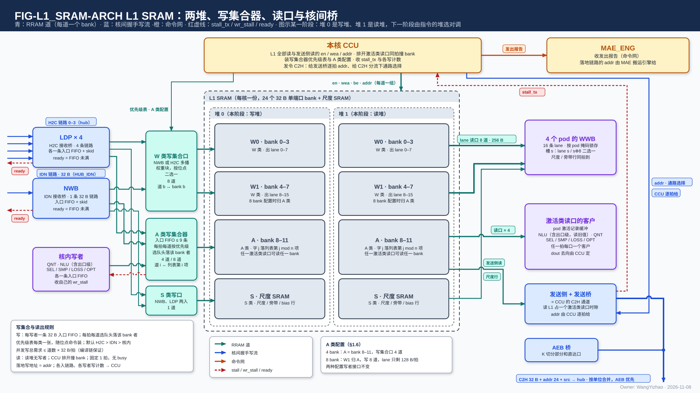
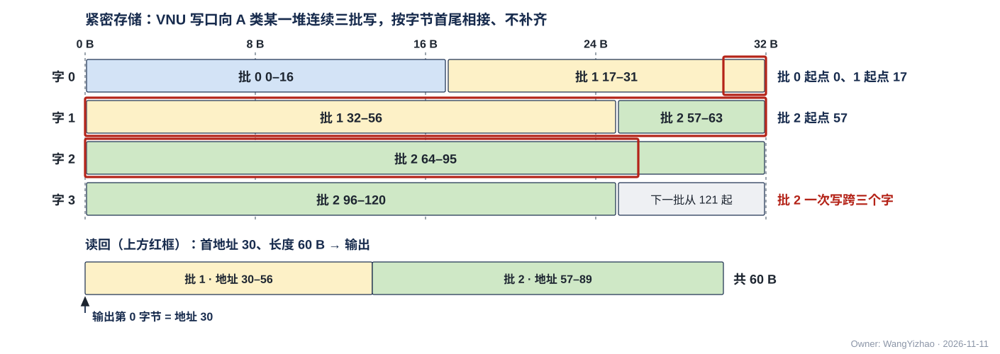
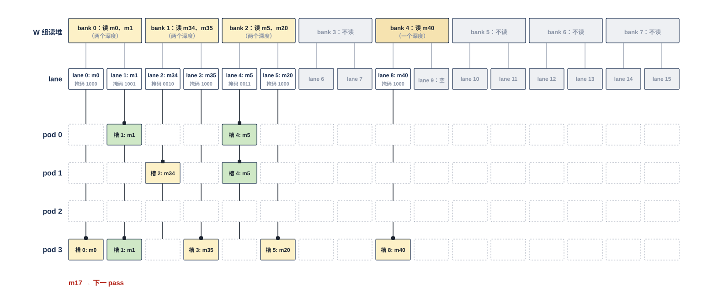
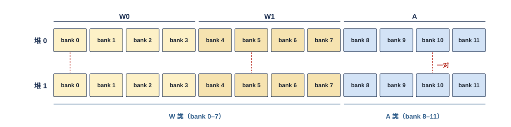
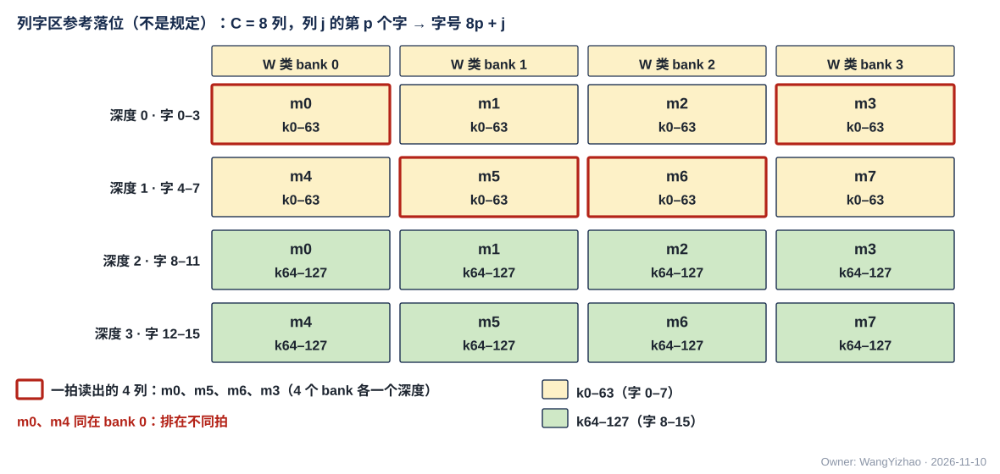
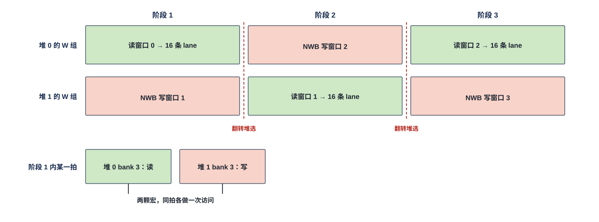
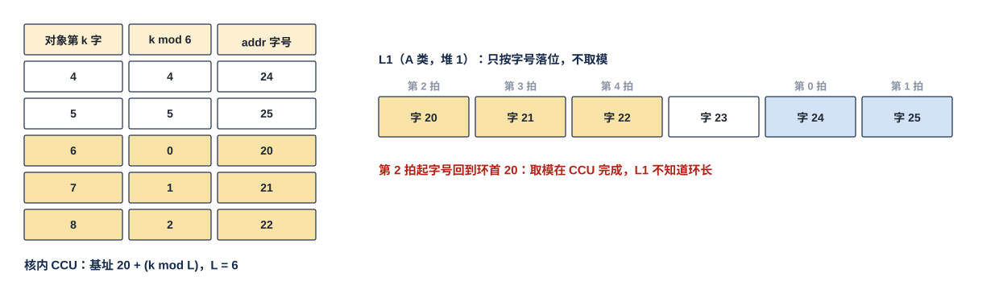
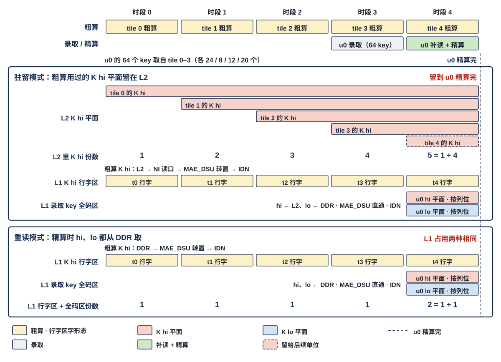

# L1 SRAM 需求

> Owner: WangYizhao｜2026-11-11

## 1 概述

L1 是每个计算核里的一块片上存储，全芯片 4 份、物理相同，属 L1 组（同组还有接收桥篇 `L1_LANDING_BRIDGE.md`）。它给本核的使用者用：**MXU 的 4 个 pod**（读权重、尺度与激活）、**VNU 组**（经 VNU 读口读、经 VNU 写口写）、**本核 CCU**（读元数据项与 F 列表，并发出全部核内读写）、**计算核集成输出端口的发送 FIFO 入口**（要出核的数据先在 L1，再由 CCU 读出上 C2H），以及两个**接收桥**（H2C 接收桥、IDN 接收桥 NWB，把核间链路送来的数据交进 L1）。

**L1 只暴露 RRAM 口（核内无握手协议：en 即请求，读固定 1 拍出数，写当拍写入，无应答）：W、S、A 三类各一个读口与一个写口；读出交给谁由 L1 外、计算核内由本核 CCU 控制的读 MUX 选；每拍写哪个来源由 L1 外的写 MUX 在三个来源之间按固定规则自己轮流，不由 CCU 逐拍选；L1 不做任何选择**（V18-L1-21 / 24 / 32，架构篇 §3.7）。**L1 不发请求、不解析数据内容、不累加地址、不维护写计数、不报完成**；每次访问落在哪里，由发地址的一方给出的段选信号 `seg` 与段内地址决定。

本篇用到的几个词（其余术语在首次出现处定义）：

| 词 | 含义 |
|---|---|
| 存储字 | 32 B，L1 / L2 读写的基本单位；段内字节地址除以 32 取整是它的序号，本篇叫**字号**（协议篇 §3.2） |
| 类、堆 | 段选信号 `seg` 的两个字段，定义见架构篇 §3.3：**类**是 W（权重类）、S（尺度类）、A（激活类）三类之一，由段掩码选；**堆** = 与另一堆可以一读一写同拍的范围，由堆选选。L1 每类两堆，共 6 个由 `seg` 选的范围，各自从 0 编址 |
| 段内地址 | 24 bit 字节地址，只表示所选类、所选堆里的字节位置；不含类与堆 |
| 行字区、列字区 | W 类的两种字形态（定义见数据组织篇 §2.12）：行字区一个存储字 = 4 个相邻归约位置 $k$ × 16 个连续输出通道 $m$；列字区一个存储字 = 一列（一个输出通道 $m$）的 64 个连续 $k$。"区"只是编译链给一段地址起的名字，不是硬件分区 |
| 码块 | 紧凑 token 记录四部分之一，只装保留通道的码（每码 $w$ bit）；四部分（元数据项、E8M0 项、F 列表、码块）的格式见数据组织篇 §2.5 |
| 通道片 | 按消费方的 $k$ 边界切出的一段连续通道，片长 $P$ 由编译链按位点定（数据组织篇 §1.2） |

矩阵写法：$Y_{T \times M} = X_{T \times K}\,W_{K \times M}$，$W$ 以归约位置 $k$ 为行、输出通道 $m$ 为列；反传 $\mathrm dX = \mathrm dY\,W^{\mathsf T}$。

## 2 接口需求

### 2.1 架构图与接口汇总

图中模块框内的结构是参考实现（见第 7 章），本章以框外的各口为准。

图按与 VNU 组各图相同的画法分三层：**最上是本核 CCU、三个写来源（左）与读出的使用者（右）；中层是 L1 外的四个部件（读一侧的三个由 CCU 调控，写 MUX 自己轮流）；下层是只暴露 RRAM 口的 L1**。

- **左边是写入**：L1 的写来源只有三个——H2C 接收桥（H2C 四道在桥内合成一个请求源）、NWB（IDN 的一条 32 B 链路）与 VNU 写口（VNU 组各单元的写在 VNU 内合成这一条，VNU 集成篇 §2.6；MXU 的结果经 EPI 后也从这里写入）。三个来源都可以写 A、W、S 三类，请求进 L1 外的写 MUX，**写 MUX 每拍为每类写口选一个来源写一次：在三个来源之间按固定规则自己轮流，不由 CCU 逐拍选，没轮到的来源在自己的 FIFO 里等；写与读碰到同一个堆时写让读，在本地判断**（V18-L1-24 / 32）。
- **右边是读出**：W 类读口的 4 路读出直达 MXU，每路带 4 位"哪些 pod 收"（MXU 集成篇 §2.2），固定接线、不经中层；W 类读出另有一路在 L1 外送 VNU 读口。A 类读口的读出交 L1 外的 A 类读 MUX，**整拍只交一个使用者**：MXU（4 个 pod 算一个使用者）、VNU 读口、CCU、发送 FIFO 入口。S 类读口的读出交 L1 外的 S 类读 MUX，去向是 pod 权重旁带、pod 激活旁带、VNU 读口、EPI、发送 FIFO 入口。
- **最上**：本核 CCU 发全部核内读写的 en / wea / addr / `seg` 与有效字节（VNU 写口的地址由 CCU 按计数推出，V18-VNU-12），给读一侧三个部件每拍的去向，并给 W 类读出的每一路配 4 位"哪些 pod 收"、随读出交 MXU、不经 L1（V18-CCU-01）。
- 框内画的各类存储组织是参考组织（本篇 §7.1）；图示是 ping-pong 用法的一个时刻（写堆 0、读堆 1），硬件上两堆都可读可写，三类的堆选各自给出（本篇 §3.8）。S 类读口画成从 S 类组框引出的 2 根线，表示一拍 2 个地址、两个地址可以落在同一个堆，不按 bank 画口（S 类的 bank 只是参考组织）。

| 口 | 对端（L1 外） | 方向 | 每次访问 | 控制 | 架构篇出处 |
|---|---|---|---|---|---|
| W 类读口 | 4 个 pod（直达）；另一路经 L1 外到 VNU 读口 | 出 | **一拍 4 路，各路各自给地址，每路一个整字（32 B），合计 128 B/拍** | 本核 CCU：每路一组 en / addr | PORT-01 |
| S 类读口 | S 类读 MUX（→ pod 权重旁带 / pod 激活旁带 / VNU 读口 / EPI / 发送 FIFO 入口） | 出 | **一拍可接收 2 个地址，可以是同一个堆里的两个数据，每个地址一个整字（32 B）（CONC-6）** | 本核 CCU：每路一组 en / addr | PORT-02 |
| A 类读口 | A 类读 MUX（→ MXU / VNU 读口 / CCU / 发送 FIFO 入口，整拍只交一个） | 出 | **首字节地址 + 长度，至多 128 B**；交回从首字节起对齐好的数据 | 本核 CCU：en / addr / 长度 | PORT-03 |
| A 类写口 | 写 MUX（来源：H2C 接收桥、NWB、VNU 写口） | 入 | **首字节地址 + 有效字节，至多 128 B**，数据从首字节起给 | 写 MUX 选好的一个来源 | PORT-04 |
| W 类写口 | 写 MUX（同上） | 入 | 与 A 类写口同形 | 同上 | PORT-05 |
| S 类写口 | 写 MUX（同上） | 入 | **一次一个存储字，整字写、不带有效字节** | 同上 | PORT-06 |

口宽与条数以架构篇 §2.7 的 PORT-nn 为准，本表只为阅读方便列出。

**各口共同的规则**：

- **全部口都是核内 RRAM 口，口上无握手、无 ready、无 busy**（协议篇 §2.3；核间链路一律握手，无握手的核内协议只限 L1 对 MXU、VNU 等计算核内部模块的口）。
- **每次访问自带 `seg`（堆选 + 类）与段内地址，L1 按它读写**；L1 没有分配表、分区号、按区的状态，也没有配置口。
- **核间链路、发送 FIFO、命令网都不是 L1 的口**：终结核间链路的是两个接收桥（接收桥篇），C2H 的唯一来源是计算核集成输出端口（架构篇 §2.3.1、PORT-09）。

### 2.2 各口共用的 RRAM 信号与时序：读固定 1 拍、写当拍写入、无握手

#### 2.2.1 信号与每拍含义

| 信号 | 方向 | 位宽 | 每拍含义 |
|---|---|---|---|
| en | 发起方 → L1 | W 类读口每路 1、S 类读口每个地址 1，其余每口 1 | 本拍这一路（或这个口）有一次访问 |
| wea | 发起方 → L1 | 每口（每路）1 | 本次访问是读（0）还是写（1）；读口、写口只是逻辑口（V18-TP-73） |
| `seg` | 发起方 → L1 | 5 bit（堆选 1 + 段掩码 4 独热，L1 用 3 位：W / S / A） | 本次访问的堆与类（架构篇 §3.3）；指令里是堆选 1 bit + 类选 2 bit，由发令方展开 |
| addr | 发起方 → L1 | 24 bit | 首字节的段内地址；**A 类读写与 W 类写可以是任意字节**（本篇 §3.3），W 类读口每路与 S 类读写是 32 的倍数 |
| 有效字节 | 发起方 → L1 | 形式与位宽【设计者定】 | A 类读口、A / W 类写口这次访问的字节数（1–128 B）；要定的是用长度还是"从第 0 字节起连续的字节有效位"表达及字段位宽，约束：能表达任意字节起点与 1–128 B 的长度。W 类读口与 S 类口没有（恒整字） |
| din | 写 MUX → L1 | 至多 128 B（S 类 32 B） | 写数据，**从首字节起放在第 0 字节**；L1 按地址放到存储里的位置，使用者不移位 |
| dout | L1 → 读 MUX / pod | A 类读口至多 128 B；W 类读口每路 32 B；S 类读口每个地址 32 B | 读数据；A 类读口把首字节放在输出第 0 字节 |
| vld | L1 → 读 MUX / pod | 每口（每路）1 | 读数据有效；从存储字边界起的读 = 读的 en 延 1 拍 |

#### 2.2.2 每拍动作：读固定 1 拍出数、写当拍写入、没有应答

- **读**：en = 1、wea = 0 的那一拍给 `seg`、addr（与长度），**从存储字边界起的读下一拍 dout 上是数据**；不从存储字边界起的 A 类读允许多拍（架构篇 §3.4 CONC-3，本篇 §3.3）。
- **写**：en = 1、wea = 1 的那一拍，有效字节被 din 覆盖（S 类整字覆盖），其余字节保持原值，**没有任何应答**；不从存储字边界起的 A / W 类写允许多拍（CONC-3）。
- **L1 不回 busy、L1 内不设轮流**：同一个堆同一拍只做一次访问——读由 CCU 排开，写碰到同一个堆的读时由 L1 外的写 MUX 让读（架构篇 §3.4 CONC-2，V18-L1-32，本篇 §4.2）。
- **L1 不做任何选择**：写口上每拍只有写 MUX 选好的一个来源，读出交给谁由读 MUX 选；L1 没有优先级表、没有"选中"信号、没有读侧仲裁（V18-L1-21 / 24 / 32）。四个 MUX 的每拍规则见架构篇 §3.7，内部实现属计算核集成的设计（`CORE_INTEGRATION_STAGING.md`）。

### 2.3 W 类读口：一拍 4 路，各路各自给地址

**W 类读口一拍接收 4 个地址，分属 4 路，各路各自给地址（架构篇 §3.4 CONC-4）；第 $b$ 路（$b$ = 0…3）读字号除以 4 余 $b$ 的字，4 路的地址相互独立、不要求同一行；每路每拍交一个整字（32 B），4 路合计 128 B/拍**（V18-L1-26，用户 11-10："对于W类，我认为单独为他准备一个这样的设计是合理的，我认为这样可以提升利用率"；"W类的读可以作为例外"）。一拍 4 路共用这次访问的 `seg`（一个堆选）。这是"一次访问 = 首地址 + 连续若干字"统一形式的唯一例外：稀疏取列要求一拍读的几列各在自己的地址上。"哪一列放在哪个地址"由编译链分配（CONC-4）。

#### 2.3.1 每拍读出的内容与交给 pod 的方式

每拍送进 pod 的量：

- **行字区**：一拍至多 4 个存储字 = 16 个归约位置 $k$ × 16 列；稀疏读时这 16 个 $k$ 是读集次序里相邻的被选行（数据组织篇 §3.5）。
- **列字区**：一拍至多 4 列，每列一个存储字 = 64 个连续 $k$；**同一路的两列由 CCU 排在不同拍**（CONC-4）。
- **反传 $\mathrm dX = \mathrm dY\,W^{\mathsf T}$ 用列字区**：它挑的是输出维 $k$，列字区里的"列"在这里是一个输出位置 $k$，一个存储字 = 一个 $k$ 在 64 个连续 $m$ 上的 64 个 4 bit 码；读法与前向列字区相同（V18-L1-30；各运算用哪种字形态见架构篇 §3.6）。**W 类只有行字区、列字区两种字形态**，没有第三种。

**每路读出的字带 4 位"哪些 pod 收"，由 CCU 给、不经 L1；各 pod 各自要：几个 pod 同拍要同一个字时只读一次、同拍送这几个 pod**（V18-CCU-01，MXU 集成篇 §2.2.1）。**字到 pod 后放在哪由 MXU 的控制器定，不随读出给**（V18-MXU-19，MXU 集成篇 §2.2.2）。所以 **L1 到 pod 之间没有选择器，L1 也不重组：读什么交什么，读请求里没有"直通 / 重组"一类的选择位**。列按到达次序进 pod 计算、结果按到达次序输出；"到达的第 $i$ 列 ↔ 原列号"只由 CCU 持有，排回归 CCU（MXU 集成篇 §3.3.2、`CCU_STAGING.md`）。选哪些列靠各路的读地址，哪个 pod 收靠每路的"哪些 pod 收"。

#### 2.3.2 送 VNU 读口的一路

**W 类只有这一个读口；送 VNU 读口的那一路是它在 L1 外的一个去向**（OPT 读前向副本，每拍至多 VNU 读口宽 128 B），CCU 给各路地址（读连续的副本码时给出连续字的地址即可）；这一路在 L1 外、由 CCU 打开，L1 不感知（V18-L1-21 / 26，架构篇 §3.7）。**L1 不限制 W 类与 A 类同拍读出**；VNU 入口一拍怎样收 W 类与 A 类的数据由 VNU 设计者定（V18-VNU-09）。

### 2.4 S 类读口：一拍可接收 2 个地址，每个地址一个整字

**S 类读口一拍可接收 2 个地址（架构篇 §3.4 CONC-6，V18-L1-31），每个地址每拍读一个整字（32 B）**；bias 与权重尺度分时读（用户 11-11："我认为Bias和权重尺度是可以分时的，我认为S类同拍只需要设计到2路"）。**2 个地址可以是同一个堆里的两个数据**（V18-TP-84 (1)，用户 11-11："我觉得S区也可以接受两个地址，相当于能够支持同一堆中两个数据的同时读"）。同拍会读 S 类的模块有：pod 权重一侧的尺度、pod 激活一侧的尺度、EPI 的 bias、VNU 读尺度、发送 FIFO 入口；**同拍需要的多于 2 路时由 CCU 错开**（CONC-6）。**所有尺度与 bias 一律落 S 类**（V18-L1-21，用户 11-09："全部的尺度都应该放在S区的Bank"）；S 类里放什么、放在哪个地址由编译链分配，正文不给默认分配（V18-L1-28）。

#### 2.4.1 S 类各种字的内容

| 数据 | 一个存储字装什么 |
|---|---|
| 权重尺度行 | 一个（32 列块, K 组）的 32 个 E8M0：32 个相邻输出通道 $m$ 各自在一个权重 MX 组（固定 32 个 $k$）上的指数尺度，列 $m$ 在字内第 $m \bmod 32$ 字节；**前向与反传 $\mathrm dX$ 用同一组尺度行**，反传的块尺度由 pod 在线算（V18-MXU-11 / L1-30） |
| K 的尺度 | 粗算 K hi 行字区与录取 key 全码区的尺度；录取 key 的尺度由 MAE_DSU 按录取次序排成整字，一个字 = 32 个录取 key 在同一尺度组上的 E8M0（DDR 与片上同一排法，MAE_DSU 篇 §3.2 典型用法表） |
| V 的尺度 | V 的各 MX 组的 E8M0；**作为权重一侧的尺度送进 pod 权重旁带，由 pod 处理**（V18-MXU-15）；录取 key 的 V 尺度由 MAE_DSU 按录取次序排成整字 |
| LM Head 列副本的尺度 | 一列的 32 个 K 组的 E8M0（每列补到 32 B 的倍数；$K$ = 2,560 时 $2560/32 = 80$ B → 96 B，一列 3 个存储字，V18-MXU-09 / DORG-05）；与常规"一字 = 一个 K 组 × 32 个输出通道"的读法不同 |
| 激活的 E8M0 | 紧凑 token 记录、稠密残差的 MX 尺度，每个 MX 组（$G$ 个通道，位点属性）一个，按通道片排（数据组织篇 §2.5） |
| Q 的 E8M0 | 一个查询行全部 q 头的 E8M0 连续存，只在行末补到 32 B（V18-DORG-08） |
| bias | 16 个相邻输出通道 $m$ 的 BF16 bias，不量化（V18-EPI-02）；一个 16 通道列块正好一个存储字 |

（32 列块, K 组）、通道片、列块 → S 类地址的对应由编译链在指令里给出，L1 不换算。

#### 2.4.2 读出的去向与到达时机

S 类读口每个地址的读出经 L1 外的 S 类读 MUX 送一个去向，去向由 CCU 给（架构篇 §3.7，V18-L1-21，用户 11-09："只要允许S类的数据接向需要它的模块不就可以了，例如MXU，VNU"）：

| 数据 | 去向 |
|---|---|
| 权重尺度行、K 的尺度、V 的尺度 | pod 权重旁带 |
| LM Head 列副本的尺度 | pod 权重旁带；一列的 3 个尺度字怎样与该列的全码列字配上见 MXU_FEED 篇 §3.6.3 |
| 激活的 E8M0、Q 的 E8M0 | pod 激活旁带（随码字）或 VNU 读口 |
| bias | EPI（VNU_EPI 篇 §3.4）；**bias 不随权重到 pod** |
| 任一种 | 发送 FIFO 入口（出核） |

L1 只按 CCU 给的地址每路读出一个存储字，不知道读出交给谁。

### 2.5 A 类读口：首字节地址 + 至多 128 B，交回对齐好的数据

**A 类读口是一个逻辑读口：CCU 给首字节地址与长度（至多 128 B），L1 交回从首字节起对齐好的数据（首字节在输出第 0 字节）；从存储字边界起的读一拍读完、固定 1 拍出数，不从存储字边界起的读允许多拍（CONC-3）**（V18-L1-21 / TP-73 / TP-74，用户 11-09："A类读出的形式我认为对于L1SRAM来说，它只需要遵守RRAM协议即可，其他控制信息由CCU给出"）。全部读 en、地址与读 MUX 的去向都由本核 CCU 发，**L1 不做读侧仲裁、不合并两个使用者的读**（协议篇 §2.3.4 / §3.3.1）。

#### 2.5.1 明细与 A 类读 MUX 的使用者

- **A 类读出交 L1 外的 A 类读 MUX，只选使用者、整拍只交一个**（架构篇 §3.7）：MXU（带 pod 号，4 个 pod 算一个使用者）、VNU 读口、CCU、发送 FIFO 入口；各使用者入口都是 128 B。pod 入口的宽度、CCU 怎样分时给各 pod 压入 token、pod 激活缓冲的深度见 MXU 集成篇 §2.3（CCU 一侧见 `CCU_STAGING.md`）；CCU 收元数据项与 F 列表一侧怎样缓冲属 CCU 的设计（`CCU_STAGING.md`）。
- **使用者入口不移位**：任意字节起点的读由 L1 内部移位后交出（本篇 §3.3）。
- **一拍只服务一个使用者，需求超出口宽时使用者自己等**：每拍读哪几个字、交给谁由 CCU 排拍；**L1 与编译链都不做读带宽保证**（V18-L1-21，用户 11-09："编译链不应该保证带宽"）。
- **紧凑 token 记录**：四部分都放 A 类（E8M0 项放 S 类），格式见数据组织篇 §2.5（V18-L1-20 / DORG-05）；**L1 只按 CCU 给的地址读出，不知道读的是哪个块**。CCU 读紧凑记录的步骤属 CCU 的设计（`CCU_STAGING.md`）。
- **出核的发送读**：要出核的数据由 CCU 按发送指令发普通的读拍，A 类（或 S 类）读出经读 MUX 整拍交发送 FIFO 入口；发送 FIFO、目的地址与 C2H 一侧都不在 L1（架构篇 §2.3.1、PORT-09；`CORE_INTEGRATION_STAGING.md`）。

**A 类读 128 B/拍是这个口的上限**：多开读入口不增加带宽，所以 L1 只出一个 A 类读口，使用者的分用在 L1 外完成（架构篇 §3.7）。

### 2.6 A 类写口与 W 类写口：首字节地址 + 至多 128 B

**A、W 两类各一个 RRAM 写口，同形：一次写 = 一个来源的首字节地址 + 有效字节（至多 128 B），数据从首字节起给；首地址可以是任意字节，同一来源的数据可以按字节首尾相接写入（紧密存储，本篇 §3.3）；从存储字边界起的写一拍完成，否则允许多拍（CONC-3）**（V18-TP-73 / 74，PORT-04 / 05）。

#### 2.6.1 明细：三个来源、请求形状与到达时的字形态

- **来源只有三个：H2C 接收桥、NWB、VNU 写口；三个来源都能写 A、W、S 三类，进哪一类由请求的 `seg` 决定**（V18-L1-14 / 24 / VNU-09）。**不同来源不合并进同一次写，按拍错开**（CONC-2；用户 11-09："我不认为它应该并发，应该分出先后写入顺序（对于A，W，S都有这样的需求）……不能把两者的数据来源合并写入，而是要错拍"）；选哪个来源由 L1 外的写 MUX 在三个来源之间按固定规则自己轮流，不由 CCU 逐拍选（V18-L1-32，用户 11-11："我认为CCU不应该控制这件事，这个控制不能让LANDING自己做吗？"）；L1 不感知。
- **没轮到的来源在自己的 FIFO 里等**：接收桥的请求不丢、之后再交，来不及时拉低核间 ready（接收桥篇）；VNU 写口的项由 VNU 一侧保持、不丢（VNU 集成篇 §2.6）。不要求 L1 内设来源的排队缓冲。
- **写与读碰到同一个堆时写让读**（V18-L1-32）：读由 CCU 发、口上没有握手，不能等；这一拍不写、下一拍再写，由写 MUX 在本地判断，CCU 不参与；写等久了经来源的 FIFO 与 ready 反压，只降速。
- **请求的形状由来源保证**（本篇 §2.8）：一次请求的数据来自同一来源、地址连续、合计至多 128 B。
- **写进 W 类的数据到达时已是 W 类的字形态**：片外来的由 MAE_DSU 转成行字区或列字区的字形态（MAE_DSU 篇 §3.2 典型用法表），核内产生的由 QNT 排好后经 VNU 写口写（本核产生、本核消费的 K / V，以及权重梯度里进权重侧的 $\mathrm dY$、$X$，V18-VNU-09 / MXU-14）。L1 不变换数据（本篇 §3.10）。
- **写带宽的上限 = 口宽（A / W 类 128 B/拍）**，同一个堆的读与写分拍、碰到时写让读；需求超出时来源在自己那里等、经握手反压上游，只降速、不丢数，编译链不做写带宽保证（V18-L1-21）。

### 2.7 S 类写口：一次一个整字、不带有效字节

#### 2.7.1 明细

**S 类写口一次写一个存储字（32 B），整字写、不带有效字节；生产方把每片、每个数据块的末字补 0 后整字写**（V18-DORG-04，PORT-06）。来源同 §2.6.1（NWB、H2C 接收桥、VNU 写口，经写 MUX）；VNU 写口写的是激活 E8M0 与 OPT 新副本的 E8M0。接收桥对 `seg` 为 S 类的请求每次只交 1 个字（接收桥篇）。S 类写的地址是 32 的倍数。

### 2.8 与接收桥、VNU 写口的衔接：写进即生效，L1 不回任何信号

终结核间链路的是两个接收桥（H2C 接收桥与 NWB，同一种模块的两个实例，接收桥篇 `L1_LANDING_BRIDGE.md`，V18-L1-15）；对 L1 而言它们只是两个写请求来源，与 VNU 写口一起经 L1 外的写 MUX 进每类写口。落地写与核内写的区别只在地址来源：**核内写的地址由本核 CCU 给，落地写的地址随数据从核外到达**（由 MAE 搬运引擎逐拍给出，不经 CCU）。

#### 2.8.1 接收桥交来的请求

| 项 | 规定 |
|---|---|
| 常开 | 接收桥常开、无使能（V18-TP-70）：数据可以先于消费它的位点指令落地 |
| 请求 | 一次请求 = `seg`（堆选 + 类）+ 首字节地址 + 有效字节 + 数据，合计至多 128 B；几拍来自同一道、同一 `src`、同一 `seg`，地址连续（后一拍 addr = 前一拍 addr + 前一拍有效字节数），除最后一拍外都是满 32 B；`seg` 为 S 类时每次 1 个整字（接收桥篇 §7.2） |
| 写进 | 写 MUX 选中该请求的那一拍，这些字节经对应类的写口写进 L1；**接收桥在写进之后才沿原链路回写入握手**（接收桥篇 §3.8），L1 不向接收桥发任何信号 |
| 地址 | 每拍的地址来自随核间链路到达的 addr；接收桥与 L1 都不累加、不记状态；地址不在存储字边界时由 L1 内部移位，桥不移位 |
| 写完 | 由发令的 MAE 搬运引擎数写入握手判定、经写完通知信号组通知目的核 CCU（本篇 §3.11，协议篇 §3.8） |

核间链路的握手、skid、时延无关、逐拍地址与多播取走规则见协议篇 §2.2、§3.17 与接收桥篇，L1 不感知。

#### 2.8.2 VNU 写口交来的请求

VNU 写口一项 = 首字节地址 + `seg` + 至多 128 B 数据 + 有效字节：**数据与有效字节由 VNU 交，地址与 `seg` 由本核 CCU 按计数推出、配在这一项上**（V18-VNU-12，VNU_CONTROLLER 篇 §3.9；VNU 集成篇 §2.6）；产出数据的 VNU 单元（QNT、EPI、SEL 等）不算地址。写 MUX 轮到 VNU 写口的那一拍数据即写进 L1；**核内写 L1 的完成由 CCU 判定，L1 不提供完成信号；CCU 怎样得知 VNU 的写已写进——由写 MUX 告知 CCU 或由 VNU 报完成——【设计者定】**（V18-L1-32，协议篇 §3.8，本篇 §3.11）。

## 3 功能描述

### 3.1 功能一览

| 功能 | 输入 | 输出 | 触发 / 生效条件 | 节 |
|---|---|---|---|---|
| 按段选与段内地址读写 | 每次访问的 `seg` + 段内地址 | 该类该堆该地址的数据 | 每次 en 即按地址读写 | §3.2 |
| 紧密存储 | 首字节地址 + 从第 0 字节起的数据与有效字节 | 写：数据首尾相接、选中字节被覆盖、其余保持；读：首字节在输出第 0 字节 | A 类读写、W 类写，任意字节起点，一次 ≤ 128 B；默认 32 B 对齐时一拍完成 | §3.3 |
| 写入 | 写 MUX 交来的一次写 | 写进 L1，写进之后的读都读到新值 | 当拍写入，无应答 | §3.4 |
| 读出 | CCU 给的读地址 | 读出数据（A 类首字节在第 0 字节） | 从存储字边界起固定 1 拍 | §3.5 |
| W 类读口取字 | CCU 给的 4 路读地址 | 4 个整字送 MXU，每路带"哪些 pod 收" | 每拍；读什么交什么 | §3.6 |
| 尺度与 bias 的存放与读出 | 尺度、bias 数据块 | S 类整字；按 CCU 给的地址每路读一个字 | 按 CCU 给的地址读出 | §3.7 |
| 三类各自的 ping-pong | 每次访问的堆选 | — | 堆选随每次访问给出，三类各自翻转 | §3.8 |
| A / W 容量调配 | 位点指令 | 两类各自能装的存储字数 | 位点边界生效，口宽不变 | §3.9 |
| 落地写 | 接收桥交来的请求 | 按随数据到达的地址落位 | 常开；L1 不解析、不变换 | §3.10 |
| 写入完成 | — | L1 不报 | 落地写由 MAE 判、核内写由 CCU 判 | §3.11 |
| 复位与内容保持 | 复位 | 在途访问丢弃，数据保持 | 复位 | §3.12 |

### 3.2 按段选与段内地址读写：L1 不发请求、不累加、不回绕、不解析内容

**L1 的每次读写由三项确定：堆选、类（都在 `seg` 里）与 24 bit 段内地址，读写相同**（架构篇 §3.3，V18-TP-57，用户 11-07："我希望地址仍然是 24bit，只是类似于堆，类，象限，单独在指令中标定"）。段内地址只是所选类、所选堆里的字节位置，各范围各自从 0 起，**没有跨类、跨堆连续的地址**。核内访问由 CCU 随 en 给出；落地写由链路上的 `seg` 与 addr 逐拍给出。

**每次访问的地址由发地址的一方给出**：

- **核内**：全部 L1 读写（含发送读）的 en / wea / addr / `seg` 都由本核 CCU 发出，读出去哪也由 CCU 定；产出数据的 VNU 单元只经 VNU 写口交数据，不算地址（协议篇 §3.3.1）。CCU 怎样累加地址、怎样做核内环形回绕属 CCU 的设计（`CCU_STAGING.md`；用法例见本篇 §7.8）。
- **落地**：H2C 接收桥、NWB 交来的写，地址来自每拍随数据到达的 addr，由 MAE 搬运引擎给出、不经 CCU（V18-TP-27 / 35："谁拥有源，谁发令"）。

L1 自己：

- **不发请求、不累加地址、不做取模、不回绕**：环形回绕只在核内、由 CCU 算好地址再给；MAE 搬运的数据不按环形使用（V18-MAE-17）。L1 只收到地址。
- **不分区**：类内哪些地址放输入 token 记录、哪些放停放项、哪些放下一位点预取的权重，都是编译链分配、CCU 推进的地址，写在指令的基址里；"K hi 行字区""录取 key 全码区""停放区"这类名字只是编译链给类内一段地址起的名字（V18-L1-12）。**L1 没有分配表、没有分区号、没有按区的状态**。变长数据块（压紧激活）按算法侧给的位点容量窗口由编译链静态分配（数据组织篇 §2.5，V18-TP-40）。
- **不解析数据内容**：L1 不区分权重、激活、列表或紧凑 token 记录的各部分，照常按地址写入、按地址读出；数据的排法归数据组织篇（数据组织篇 §2.2、§2.5、§2.8）。

### 3.3 紧密存储：数据可从任意字节起连续写入、首尾相接，不补齐

**L1 的 A 类读写与 W 类写必须支持紧密存储：同一发送方的数据按字节首尾相接存放，下一批从上一批末字节的下一个字节起写，中间不补齐；一次至多 128 B 的紧密访问都要支持；字节的移位与拆分在 L1 内部做，使用者一侧（CCU、pod、VNU、接收桥、MAE、hub）都不移位，din 从首字节起给**（V18-TP-74，用户 11-10："紧密存储的粒度我希望128B紧密，只是128B的支持效果可以不好，咱们默认在数据组织的角度保证32B对齐"；"字节移位逻辑要放在SRAM内部"；架构篇 §3.5.4）。

**数据组织默认按 32 B 对齐**：此时一次访问从存储字边界起，一拍完成（数据组织篇 §2.3）。**不从存储字边界起的紧密访问允许比对齐访问慢（架构篇 §3.4 CONC-3：从字边界起一拍，否则允许多拍）**，只降速、不出错。**W 类读口与 S 类读写一律整字**（S 类写口不带有效字节，本篇 §2.7）。

- **写**：首地址可以是任意字节，写数据从第 0 字节起给、有效字节标出这次写的字节。**只覆盖这些字节，其余字节保持原值**；超出本存储字的部分落到下一个存储字。例：某类某堆段内字节 32–47 已有数据，再写 31 B、首地址 48，数据落段内字节 48–78，段内 32–47 不变，下一批从段内字节 79 起（用户 11-10 的例子；L1 内部怎样拆到两个存储字见本篇 §7.5）。若从首地址 48 起写 128 B，覆盖段内 48–175，跨 5 个存储字，允许多拍。
- **读**：CCU 给首地址与长度，**L1 把首字节放到读出的第 0 字节后交出**；默认对齐的读不移位。
- **片外进来的数据**（Token ID 列表、图像、传感器向量等）经 NI 写口进 L2、再经 H2C 落 L1 时，片外窗口起点默认按存储字对齐，不作硬限制（V18-DORG-10）；起点不在字边界时同样由 L1 内部移位。

同一发送方（图中为 VNU 写口）向 A 类某一堆连续三批写：批 0 写 17 B、首地址 0，落段内字节 0–16；批 1 写 40 B、首地址 17，落 17–56（跨字 0、1）；批 2 一次写 64 B、首地址 57，落 57–120（跨字 1、2、3）；下一批从 121 起。三批之间没有空隙、没有补齐；批 1、批 2 都不从存储字边界起，跨字的拆分在 L1 内部做，发送方只给首字节地址与从第 0 字节起的数据。读回时从任意首地址起读，L1 把首字节放到读出的第 0 字节，读回与写入逐字节相同：图中红框是一次读回覆盖的字节（首地址 30、长度 60 B，即字 0 的字节 30–31、字 1 整字、字 2 的字节 64–89），下方是读回的输出，地址 30 的字节在输出第 0 字节，前 27 B 来自批 1、后 33 B 来自批 2。某类数据推荐怎样排（是否对齐到存储字、片尾是否补齐、一个通道片的四部分怎样放）归数据组织篇（数据组织篇 §2.3 / §2.5），L1 不感知。

### 3.4 写入：只覆盖有效字节、写进即可见，读改写是两次独立访问

- **写口只把有效字节（S 类整字）写进存储**，不量化、不打包、不改写 token 记录 / key 记录 / 查询行记录的内容，也不解析这些记录；内部的字节移位只把首字节放到它在存储里的位置，不改变数据。紧凑 token 记录（元数据项、E8M0 项、F 列表、码块）与 Q 查询行记录由 QNT 生成、经 VNU 写口按 `seg` 写进各类。
- **存取逐位无损、写入后可见**：任一数据写入后，按同一 [堆][类][字节地址] 读出，必须与写入逐位相同；**写入的那一拍之后发起的任何读都读到新值**。
- **读改写是一次读与一次写两次独立访问**：NLU 的 attention 行状态、区块摘要部分和、EPI 的部分和读改写（VNU_EPI 篇 §3.8）都是经 VNU 读口读、经 VNU 写口写，**L1 内不存在对同一地址先读后写的原子操作**。硬件只约束"同一个堆同一拍一次访问"（CONC-2）；读旧值、写新值放两堆是编译链的默认用法，**同一个堆不同拍的原地读改写也允许**（V18-TP-73，用户 11-10："同一时段可行，同一Clock不行"）。读改写可写回整字，或只写回其中几个字节（标量）。同一数据块的读改写只由一个使用者进行（本篇 §5.2）。

### 3.5 读出：从存储字边界起固定 1 拍出数，读侧不仲裁

**从存储字边界起的读固定 1 拍出数，没有 ready、没有 busy；不从存储字边界起的 A 类读允许多拍（CONC-3）**（V18-TP-73，用户 11-05，协议篇 §2.3.4）。读侧没有仲裁、没有等待：W 类读口 4 路、S 类读口一拍 2 个地址、A 类读口各自按 CCU 给的地址读出；**同一个堆的读与写不同拍：读由 CCU 发，写碰到读时由 L1 外的写 MUX 让读**（CONC-2，V18-L1-32）。读出交给谁由 L1 外的读 MUX 选（本篇 §2.4.2、§2.5.1）。

### 3.6 W 类读口取字：读集里的行或列按读集次序读出、每路带"哪些 pod 收"，读什么交什么

**每拍 W 类读口 4 路各读一个整字，各路的地址由 CCU 按读序列给出；读序列的一项 = 4 路各自的地址（某路本拍不读则该路 en = 0）**（V18-L1-26）。读序列由 CCU 按下面的规则产出（CCU 怎样产出属 CCU 的设计，`CCU_STAGING.md`）：

- **读集里的行或列按读集次序进读序列，各 pod 各自要**：读集 = 用这份数据的各源的选择位图取并（数据组织篇 §3.5）；几个 pod 同拍要同一个字时只读一次、同拍送这几个 pod，各 pod 进度不同时同一个字可以在不同拍为不同的 pod 各读一次；每路带 4 位"哪些 pod 收"，由 CCU 给（V18-CCU-01，本篇 §2.3.1）；各 pod 按该源的位图在读集次序里取（MXU_FEED 篇 §3.3）。**同一个 bank 被要两个深度时由 CCU 错到不同拍**（CONC-4）。**不在读集里的行或列不进读序列，不读。**
- **行字区**：一拍读 4 个连续存储字 = 16 个 $k$ × 16 列；连续 4 个字号除以 4 的余数各不相同，正好分属 4 路（CONC-4）；稠密是读集为全部行的情形。
- **列字区**：一拍至多 4 列，每列一个存储字（64 个连续 $k$）；**同一路的两列排在不同拍**（CONC-4）。反传 $\mathrm dX$ 的列字区（一列 = 一个输出位置 $k$）与精算的录取 key 全码（hi 字、lo 字各在自己的列位）都按这条读。
- **列字区读出不重组**：列按到达次序进 pod 计算，算完由 CCU 统一排回原列号（本篇 §2.3.1）；L1 只按地址读出整字，不知道读的是行字区还是列字区、也不知道列号；同一位点里行字区与列字区混读时，L1 没有任何状态要切换。

例子按本篇 §7.3 的列字区参考放法（列的地址由编译链分配，这里只是一种放法）：一个列窗口 $C$ = 48 列（$m_0$–$m_{47}$），列 $m_j$ 的第 0 个字（$k_0$–$k_{63}$）放在字号 $j$，由第 $j \bmod 4$ 路读。4 个 pod 各自要的输出通道：pod 0 要 {$m_1$, $m_5$, $m_{17}$}，pod 1 要 {$m_5$, $m_{17}$, $m_{34}$}，pod 2 不要，pod 3 要 {$m_0$, $m_1$, $m_{20}$, $m_{35}$, $m_{40}$}。读集 = 并集 {$m_0$, $m_1$, $m_5$, $m_{17}$, $m_{20}$, $m_{34}$, $m_{35}$, $m_{40}$}，共 8 列。

- **按路分**：第 0 路有 $m_0$、$m_{20}$、$m_{40}$（字号 0、20、40），第 1 路有 $m_1$、$m_5$、$m_{17}$，第 2 路有 $m_{34}$，第 3 路有 $m_{35}$。第 0、1 路各有 3 列，所以至少 3 拍。
- **读序列（CCU 排）**：拍 0 四路读 $m_0$、$m_1$、$m_{34}$、$m_{35}$；拍 1 第 0、1 路读 $m_{20}$、$m_5$，第 2、3 路不读；拍 2 第 0、1 路读 $m_{40}$、$m_{17}$。8 个字用 3 拍，$8/(3 \times 4) \approx 67\%$ 的路拍有读出。
- **交 pod**（例中 4 个 pod 步调一致）：每拍读出的字送 MXU，每个字带"哪些 pod 收"：拍 0 的 $m_1$ 由 pod 0、pod 3 收（读一次、同拍进两个 pod），$m_0$、$m_{35}$ 由 pod 3 收，$m_{34}$ 由 pod 1 收；拍 1 的 $m_5$ 由 pod 0、1 收，$m_{20}$ 由 pod 3 收；拍 2 的 $m_{17}$ 由 pod 0、1 收，$m_{40}$ 由 pod 3 收。pod 2 一个也不收。
- 没人要的列不读：一个存储字只装一列，读出的字里没有没人要的列。列窗口的下一个 64 个 $k$（每列第 1 个字，字号再加 $C = 48$）按同一读序列再走一遍。
- 图中各 pod 内的位置按收到的先后编、同拍按路号，只是示意；字在 pod 内放在哪由 MXU 的控制器定（MXU 集成篇 §2.2.2）。

### 3.7 尺度与 bias：一律落 S 类，按 CCU 给的地址读出

**写入时数字与尺度分两路**：权重、K、V 的数字写 W 类或 A 类；**所有 E8M0 与 bias 一律写 S 类**，放在 S 类哪里由编译链分配（V18-L1-28）。

- **权重的尺度与 bias 在 DDR 里都是独立的紧密数据块**，由普通搬运指令整字送进 S 类写口，不夹在数字单元里（V18-DORG-01，数据组织篇 §2.14 / §3.7.1）；按 K 组主序排的尺度数据块每 32 B 恰是一个尺度行，按 32 列段主序排的由搬运指令的跨距取出。bias 为 BF16、不量化，一个存储字 = 16 个相邻 $m$ 的 bias（V18-EPI-02）。
- lo 平面与 lo 稀疏读副本的尺度行怎样与 hi 共用归数据组织篇（数据组织篇 §2.14）。
- **录取 key 的 K / V 尺度**：录取后由 MAE_DSU 按录取次序排成整字再落 S 类（MAE_DSU 篇 §3.2 典型用法表）。
- **LM Head 列副本的尺度**：独立数据块，按列主序，按列 gather 整字写进 S 类（V18-MXU-09、DORG-05）。
- **激活的 E8M0**（紧凑 token 记录、稠密残差、Q / K / V，每个 MX 组一个）由 QNT 经 VNU 写口按 `seg` 整字写进 S 类，末字补 0；跨核时由 MAE 当普通数据块搬（数据组织篇 §2.5）。BF16 停放值没有尺度，不经 S 类。

**读出**：S 类读口每个地址按 CCU 给的地址读一个存储字，经 S 类读 MUX 交去向（本篇 §2.4.2）。

- 权重、K、V 的尺度进 pod 权重旁带；**V 的尺度由 pod 处理，不经 NLU 折进 $P$**（V18-MXU-15）。
- 激活与 Q 的 E8M0 作旁带随码交 pod（pod 按 CCU 给的 MX 组边界把每个 E8M0 配到通道，数据组织篇 §3.4）或交 VNU。
- **反传 $\mathrm dX$**：pod 收各列所属 K 组的前向尺度行，一次读的列来自不同 K 组时各读各的尺度行（V18-MXU-11 / L1-30）；L1 只按 CCU 给的地址整字读出尺度行。pod 怎样求块尺度见 MXU_FEED 篇 §3.6.2。
- **bias 不随权重到 pod**：bias 由 EPI 加到结果上，经 S 类读 MUX 读入，精度 BF16、不量化（VNU_EPI 篇 §3.4，V18-EPI-02 / 05）；核间按 $k$ 切分的位点各核只有部分和，bias 由 MAE_CRU 的归约指令加一次（V18-CRU-09 / 10）。

### 3.8 两堆与三类各自独立的 ping-pong：堆选随每次访问给出

**L1 每类两堆，两堆没有物理读写分工：同一个堆同一时段可以又读又写，同一拍只做一次访问**（架构篇 §3.4 CONC-1 / CONC-2；V18-TP-73，用户 11-10："对于SRAM我必须要求同拍单端口设计，写口和读口只是逻辑行为"；"同一时段可行，同一Clock不行"）。**落哪一堆由每次访问的堆选给出，L1 没有"哪堆在读、哪堆在写"的状态**；堆选由发地址的一方显式给出：核内访问由 CCU 按指令给，落地写由 MAE 搬运引擎逐拍放在 `seg` 里。

**A、W、S 三类的 ping-pong 完全独立**（V18-L1-16，用户 11-09："我希望L1 SRAM中，A区，W区，S区的ping-pong完全独立"）：**三类的堆选各自给出、各自翻转，切换条件按类各自满足，不共用翻转时机**。例：同一段时间里 W 类可以堆 0 装 K、堆 1 装 V，按 attention 的节奏各自轮转，而 A 类按 token 组、S 类随权重窗口轮转；L1 只按每次访问带来的堆选落位，不知道各类处在哪个阶段。

- **ping-pong 是编译链排地址的默认用法**（一个位点往一堆写、从另一堆读，下一个位点反过来；协议篇 §3.2），它让读与写天然落不同的堆，但不是硬件规定。用法例见本篇 §7.8。
- **切换条件 = 写完成 ∧ 最后读者完成，按类各自判**：编译链按 ping-pong 排地址时，一个数据块所在的堆从被写转为被读的条件是该堆写完成、且另一堆上该类数据的最后读者完成；由 CCU 收事件后在下一位点该类的堆选里体现（协议篇 §3.14）。写完成的判据见本篇 §3.11。读出的拍数确定（本篇 §3.5），没有在途读要等。**切换不清数据。**

### 3.9 A 类与 W 类的容量调配：在位点边界生效，口宽不变

**A 类与 W 类之间的容量按位点可调配**（V18-L1-23，用户 11-09："Bank增加不需要提升并行度，这个可调的Bank只是为了动态调整容量需求，或者可以给L1 SRAM的Designer提出这个需求，让其去调研相关论文"）。**调配只改两类各自能装多少存储字，不改任何口**：

| 约束 | 要求 |
|---|---|
| 对外口宽与并发约定不变 | 调配前后 A 类读口、A / W 类写口都是一次至多 128 B，W 类读口都是一拍 4 路 × 32 B，CONC-1…4 照样成立 |
| 不加口 | 不引入新的读口、写口或读侧仲裁 |
| 生效 | 在位点边界生效，由位点指令给出 |
| 数据一致 | 一个数据块的写入与读出在同一种调配下（由编译链保证） |

调配的范围、档数、粒度与边界怎样给出是参考实现（本篇 §7.6；参考范围 A 类占两类总量的 1/3–2/3，用户 11-11"参考值"）。

### 3.10 落地写：按随数据到达的地址落位，L1 不解析、不变换数据

**写到哪一类哪一个字节只由 `seg` 与 addr 决定，不由数据类型决定**；L1 不解析 token 记录、不按 token 定位。经 H2C 落地的有 K / V、权重（驻留侧反转时）、残差、直写数据、部分和读回、Draft 分布、读时旋转后的 K、经 L2 送回的 MAE_CRU 合并结果（归约值、标量合并值、读集并集）、核间小消息与要重放的激活 token 记录等；经 IDN（NWB）落地的有 DDR 来的权重、尺度、bias 与精算用的录取 key 全码等。

- **三个来源都能写 W、A、S 三类，数据从哪条链路进哪一类由搬运指令的目的地址决定，读的接线不变**（V18-L1-04 / VNU-09）：核与核协作时可按位点选"权重驻留、激活经 H2C 流入"或"激活驻留、权重经 IDN 流入"（驻留侧反转）。
- **到达 L1 时数据已是 L1 的字形态**：片外来的由 MAE_DSU 转（直通或转置），核内产生的由 QNT 排（V18-MAE-41 / VNU-09）。**L1（含两个接收桥）不做方向变换、不算块尺度、不旋转、不转置、不置换、不解码 KV 存储格式**；内部的字节移位只把数据放到地址给定的字节位置。
- **按列到达的权重**（输出轴稀疏）：DDR 列深度优先的一拍 32 B 是一列的 64 个连续 $k$，正好是列字区的一个存储字，经 IDN 一拍整字写入，**L1 不暂存整列、不配对、不写 0**（用户 11-05："这个暂存我不能接受"）。一列相邻两个字的地址是否连续取决于编译链的放法（参考放法下不连续，NWB 每次写一个字，本篇 §7.3），按 32 B/拍写入。
- **被挑的是输出维的数据**（全码 key 记录、LM Head 列副本、gate/up 的列）进 L1 时按列字区的列位落，hi、lo 仍是整字、平面分开（V18-DORG-08）。
- **精算 K hi 的两种来源（驻留在 L2 / 从 DDR 重读）下 L1 收到的东西相同**：都是 hi、lo 两个平面的整字（经 MAE_DSU 直通），经 IDN → NWB 按列字区的列位落 W 类，尺度落 S 类；口、地址与读写协议都不随模式变，L1 不知道当前是哪种模式（V18-ATT-01 / 03，用户 11-06："可以改成对 MXU，CCU，MAE 模块都提出这个要求，可以支持驻留，也可以支持重读"）。两种模式的用法例见本篇 §7.9。
- 一次落地写的排列（核间按 $m$ 切分的产出按 token、片序排；四道并行时各道的目的地址；T 切分时的散写）由 MAE 与编译链安排（数据组织篇 §3.6.2 / §3.6.3，MAE_ENG 篇 §3.10），L1 只按地址落位。

### 3.11 写入完成：L1 不设写计数、不报完成

**L1 不设任何写计数，也不向 MAE、LIC 或 CCU 报完成；写完由发令的一方判定**（V18-TP-70，用户 11-09："对于接受桥使能，我认为它不需要使能信号，它应该常开……它直接写入L1 SRAM就行了，不过这里确实需要一个方案，能够判断数据是否已经写入完毕"）：

| 写入 | 谁判写完 | 依据 |
|---|---|---|
| 落地写（H2C 接收桥、NWB） | 发令的 MAE 搬运引擎 | 接收桥在字写进 L1 之后才沿原链路回写入握手；引擎数满应写量后经写完通知信号组（架构篇 PORT-37）通知目的核 CCU（协议篇 §3.8；载荷语义只在协议篇定义） |
| 核内写（VNU 写口） | 本核 CCU | 写 MUX 告知 CCU 或 VNU 报完成，二选一【设计者定】（V18-L1-32，协议篇 §3.8） |

**不设排空信号**：还在来源那里排队的数据没写进 L1，接收桥不回握手，所以"写者交出最后一拍"不等于写完。**L1 不维护按空间的剩余容量计数**；空间是否可写归编译链与指令（协议篇 §3.14）。

### 3.12 复位与内容保持

- **复位输入来自 CIF（架构篇 PORT-41），硬复位与软复位不区分**（CIF 篇 §3.3）。
- **复位时，在途的访问丢弃**（含不从存储字边界起、多拍访问的中间状态）；L1 不持地址状态与计数。接收桥、写 MUX、读 MUX、集成输出端口的在途状态分别见接收桥篇与计算核集成（`CORE_INTEGRATION_STAGING.md`）。
- **复位不清数据**；上电后的数据内容不确定。A 类与 W 类的容量调配回到设计者定的默认（本篇 §7.6）。
- **L1 没有调用的概念，也不释放任何空间**：数据在被覆写前一直保持；何时覆写由编译链与 CCU 定（用户 11-04）。

## 4 性能指标

### 4.1 各口的速率要求

| 口 | 要求速率 | 说明 |
|---|---|---|
| W 类读口 | 每拍 4 路 × 32 B = 128 B | 各路各自给地址（CONC-4）；同一路一拍一个字 |
| S 类读口 | 每拍 2 个地址 × 32 B = 64 B | CONC-6；2 个地址是否够用的数值【待标定】 |
| A 类读口 | 每拍一次、至多 128 B | 从存储字边界起一拍完成；否则允许多拍（CONC-3） |
| A 类写口、W 类写口 | 每拍一次、至多 128 B | 同上 |
| S 类写口 | 每拍一个存储字（32 B） | 整字写 |
| 读出时延 | 从存储字边界起固定 1 拍 | 核内 RRAM 协议（协议篇 §2.3.4） |

**这些速率在下列条件下成立**：本拍的访问落在不同的堆（同一个堆的读与写不同拍，CONC-1 / CONC-2）；默认 32 B 对齐（不对齐的访问允许慢，本篇 §3.3）。

### 4.2 同时使用的口与并发条件

**L1 的并发条件由架构篇 §3.4 定义，本篇只引用、不另定**（V18-TP-81）：

| 同时使用的情形 | 适用的约定 | 结果 |
|---|---|---|
| 同一类一读一写分落两个堆 | CONC-1 | 两边都不降速 |
| 同一个堆同一拍又读又写，或两个来源同拍写同一个堆 | CONC-2 | 不允许：同一个堆同一拍只做一次访问；**读由本核 CCU 排开，写碰到读时由 L1 外的写 MUX 让读、本地判断（V18-L1-32），写 MUX 每拍每类只交一个来源**；L1 不回 busy；不同来源不拼成一次写 |
| A 类读写、W 类写的一次访问不从存储字边界起 | CONC-3 | 允许多拍，只降速 |
| W 类读口 4 路同拍 | CONC-4 | 4 路各自给地址、各读字号除以 4 余 $b$ 的字；同一路的两列不同拍 |
| S 类读口一拍 2 个地址 | CONC-6 | 每个地址一个整字，可以是同一个堆里的两个数据；同拍需要的多于 2 路时由 CCU 错开 |
| W 类、A 类、S 类各口同拍（不同类） | CONC-1（不同类是不同的范围） | 互不影响；**L1 不限制 W 类与 A 类同拍读出** |
| VNU 同一拍读 128 B、写 128 B | CONC-1 / CONC-2 | 读与写落不同的堆时成立（编译链按 ping-pong 排地址）；落同一个堆时写让读 |

**L1 只承诺端口位宽与上述并发约定；一拍只服务一个使用者，编译链不做读写带宽保证**（V18-L1-21），需求超出时使用者等、来源经握手反压上游。

### 4.3 要求值表

| 项 | 要求值 | 说明 |
|---|---|---|
| 存储范围 | W、S、A 三类各两堆，共 6 个由 `seg` 选的范围，各自从 0 编址；没有第四类（紧凑 token 记录的元数据项、F 列表、码块都放 A 类，V18-L1-20） | 架构篇 §3.3；物理组织见本篇 §7.1 |
| 容量 | W、A、S 三类合计不超过 SRAM 总账；W、A 两类合计的参考值 432 KB 或 480 KB | SRAM 总量不增（本篇 §5.1）；参考值的推导见本篇 §7.1 |
| 段选与地址 | `seg` 5 bit（堆选 1 + 段掩码 4 独热，L1 用 3 位：W / S / A）+ 24 bit 段内字节地址 | 架构篇 §3.3；指令里堆选 1 bit + 类选 2 bit |
| W 类读口 | 一拍 4 路 × 32 B = 128 B，各路各自给地址，每路一个整字 | 每路带 4 位"哪些 pod 收"（CCU 给，不经 L1）；L1 不重组 |
| S 类读口 | 一拍可接收 2 个地址，每个地址一个整字 32 B，可以是同一个堆里的两个数据（CONC-6） | 数值【待标定】；读出交 S 类读 MUX |
| A 类读口 | 一次：首字节地址 + 长度，至多 128 B；交回首字节在第 0 字节 | 读出交 A 类读 MUX，整拍只交一个使用者 |
| A 类写口、W 类写口 | 一次：首字节地址 + 有效字节，至多 128 B，数据从首字节起给 | 有效字节的表达【设计者定】（本篇 §2.2.1）；来源经写 MUX，写 MUX 自己轮流、写让读 |
| S 类写口 | 一次一个存储字（32 B），整字写、不带有效字节 | 生产方末字补 0 |
| 紧密存储 | A 类读写、W 类写：粒度为字节，一次 ≤ 128 B；同一发送方的数据首尾相接、不补齐；移位在 L1 内部 | 本篇 §3.3；默认 32 B 对齐，不对齐允许多拍、允许慢 |
| 写粒度 | A / W 类：只覆盖有效字节，其余保持原值；S 类：整字 | 本篇 §3.4 |
| 读出时延 | 从存储字边界起固定 1 拍；不从字边界起的 A 类读允许多拍 | 无 ready / busy |
| 字形态 | W 类只有行字区、列字区两种（数据组织篇 §2.12）；S 类各种字的内容见本篇 §2.4.1 | — |
| 写来源 | H2C 接收桥、NWB、VNU 写口三个，经 L1 外的写 MUX（三个来源之间自己轮流）；三个都可写 A / W / S | 本篇 §2.6.1 |
| A / W 容量调配 | 按位点可调，位点边界生效，口宽与并发约定不变 | 范围参考 1/3–2/3（本篇 §7.6） |
| 三类 ping-pong | A、W、S 三类的堆选各自给出、各自翻转 | 本篇 §3.8 |

## 5 约束与由使用者保证的事项

### 5.1 硬约束

- **只用单端口 SRAM 宏，不用双端口或多端口宏；同一个堆同一拍只做一次访问**（同拍单端口，读口与写口只是逻辑口，V18-TP-73）。
- **SRAM 总量不超过整体集成的 SRAM 总账**。
- **每类分两个堆，物理分堆必须存在**：两个堆之间一读一写同拍互不影响（架构篇 §3.4 CONC-1）；每个堆里怎样组织归参考实现（本篇 §7.1）。
- **不另设物理宏实现 ping-pong**：两个堆都可读可写，读一个堆、写另一个堆只是编译链排地址的用法。
- **字节移位只在 L1 内部**：使用者一侧（pod、VNU、CCU、接收桥、MAE、hub、IDN）都不设移位器（V18-TP-74）。
- **权重尺度粒度保持每 32 个 $k$ 一个 E8M0**，不为省尺度行放大到块级（用户 11-01）；激活的 MX 组长 $G$ 是位点属性（32 的倍数，上限【设计者定】且不大于通道片长；32 是精度基准与验收工况，V18-MXU-10 / ATT-04）。
- **L1 不访问 DDR，不直接访问 L2**。
- **本篇不含容错设计**（V18-TP-75）。

### 5.2 由使用者保证的事项

L1 只按收到的段选、地址与长度动作，以下事项由对应方保证：

| 事项 | 由谁保证 |
|---|---|
| 同一个堆同一拍只有一次访问：同一类的读与写同一拍不落同一个堆（同一个堆同一时段可以又读又写）；堆选由指令给 | CCU（读的排拍，架构篇 §3.4 CONC-2）、写 MUX（写碰到读时写让读，V18-L1-32）、编译链（默认按 ping-pong 排地址） |
| 不从存储字边界起的访问允许多拍（CONC-3），后续访问按实际拍数排开【待确认】：RRAM 口无握手，建议 L1 设计者把拍数登记为首地址低 5 位与长度的函数，供 CCU 与写 MUX 排拍 | CCU（核内读写）、写 MUX、MAE 搬运引擎 |
| 每次访问不越出该类该堆的容量、段选合法；类内各数据块的地址互不重叠 | 编译链（编译期检查；压紧激活数据块按位点容量窗口静态分配）、发地址的一方（CCU、MAE 搬运引擎） |
| 数据组织默认：数据块起点与通道片各部分的起点在存储字边界、片尾补到 32 B | 数据组织篇 §2.3 / §2.5；生产方（QNT 等）、CCU、编译链、MAE |
| 目的空间在数据到达时已读完（预取距离、缓冲轮转） | 编译链（LIC 操作 15） |
| 两堆切换：写完成 ∧ 最后读者完成之后，才在下一位点该类的地址里翻转堆选；三类各自判 | CCU（落地写以收到 MAE 的写完通知为准；核内写由 CCU 自己判，本篇 §3.11） |
| A 类读 MUX、S 类读 MUX、W 类读出到 VNU 的一路每拍把读出交给哪个使用者；需求超出口宽时使用者等待 | CCU（读一侧的部件在 L1 外，架构篇 §3.7，`CORE_INTEGRATION_STAGING.md`） |
| 写 MUX 每拍为每类写口在三个来源之间按固定规则轮流、写碰到读时写让读；没轮到的来源在自己的 FIFO 里等、经握手反压上游 | 写 MUX（L1 外，V18-L1-32，`CORE_INTEGRATION_STAGING.md`） |
| A 类与 W 类的容量调配随位点生效，一个数据块的写入与读出在同一种调配下 | 编译链、CCU（本篇 §3.9） |
| 尺度与 bias 放进 S 类的哪里；同拍需要的 S 类读多于 2 路时错开 | 编译链（S 类地址分配）、CCU（CONC-6） |
| W 类读序列：同一路的两列排在不同拍；"哪一列放在哪个地址"；列字区的 $K$ 补到 64 的倍数 | CCU（读序列）、编译链与 MAE（列的地址分配，CONC-4） |
| W 类读出每路的"哪些 pod 收"；同一个 bank 两个深度的请求错到不同拍；到达的第 $i$ 列与原列号的对应与排回 | CCU（V18-CCU-01，MXU 集成篇 §2.2、§3.3.2，`CCU_STAGING.md`） |
| 字在 pod 内放在哪 | MXU 的控制器（V18-MXU-19，MXU 集成篇 §2.2.2） |
| 落地链路（H2C、IDN）每拍 `seg` 与 addr 正确；同一链路上切换段不交错 | MAE 搬运引擎；规则见协议篇 §2.2 |
| 四道并行落地时各道的目的地址各自连续（满速条件；不连续只降速、不出错） | 编译链、MAE（架构篇 §3.4 CONC-3，数据组织篇 §3.6） |
| 接收桥一次请求的形状（同一道、同 `src`、同 `seg`、地址连续、≤ 128 B，S 类每次 1 个字） | 接收桥（接收桥篇 §3.3） |
| 数据到达 L1 时已是 L1 的字形态（片外来的由 MAE_DSU 转，核内产生的由 QNT 排） | MAE、QNT |
| 落地写写完的判定与写完通知 | MAE 搬运引擎（协议篇 §3.8） |
| 精算 K hi 的来源（驻留 / 重读）按位点选，长上下文默认重读；补读时从 DDR 读的字节数 | 位点指令（编译链选）、MAE |
| 何时覆写；L1 不释放任何空间 | 编译链与 CCU |
| 环形回绕只在核内、由 CCU 算好地址；MAE 搬运的数据不按环形使用 | CCU；编译链（V18-MAE-17） |
| 变长数据块不超位点容量窗口 | 编译链；SEL（限个数选择模式）、QNT |
| 同一数据块的读改写只由一个使用者进行 | 编译链与位点指令 |
| S 类写的数据末字补 0、整字写 | 生产方（V18-DORG-04） |

## 6 验收

### 6.1 本模块验收项

| 验收项 | 方法 | 用例 | 出处 |
|---|---|---|---|
| RRAM 时序 | 周期仿真 + 断言 | 从存储字边界起的读固定 1 拍出数、读写交错；W 类读口 4 路、A 类读口、S 类读口一拍 2 个地址满载时读出时延恒定；写当拍写入、无应答 | §2.2、§3.5 |
| 按段选与地址读写 | 逐位比对 | 三类、两堆、随机段内地址的写入与读出逐位相同；不同类、不同堆的同一段内地址互不影响 | §3.2、§3.4 |
| 紧密存储写读回 | 逐位比对 | A 类与 W 类：同一发送方连续几批不对齐的写首尾相接、中间无空隙；只写 1 B、只写 31 B，未写字节保持原值；段内 32–47 已有数据、再写 31 B（首地址 48），落段内 48–78，下一批从 79 起；首地址 48 起写 128 B 允许多拍；A 类任意字节起读，首字节在输出第 0 字节 | §3.3 |
| 紧密存储例 | 逐位比对 | 按 FIG-L1_SRAM-TIGHT：同一发送方三批 17 / 40 / 64 B 首尾相接写（首地址 0 / 17 / 57），段内字节 0–120 与写入逐字节相同、121 起未被改动；从任意首地址读回，首字节在输出第 0 字节 | §3.3 |
| 不对齐访问的拍数 | 周期仿真 | 任意首地址、1–128 B 的 A 类读写与 W 类写：从存储字边界起的一拍完成；不从字边界起的允许多拍、结果逐位正确 | §3.3、§4.2 |
| 写入后可见 | 逐位比对 | 写入那一拍之后发起的读都读到新值；同一个堆不同拍的原地读改写结果正确 | §3.4 |
| W 类读口取字 | 逐位比对 + 断言 | 随机读集下 4 路各自给地址、各读字号除以 4 余 $b$ 的字，读出的字与写入逐位相同；读集外的行、列不读；各 pod 按每路的"哪些 pod 收"收到的字按读集次序不缺不重；排回后的列号正确，数值按 MXU 集成篇 §6.1 的精度口径（排回在 CCU，与计算核一起验） | §2.3、§3.6 |
| S 类读口 | 逐位比对 + 周期仿真 | 尺度与 bias 数据块经 S 类写口写入后，一拍 2 个地址按 CCU 给的地址读出与写入逐位相同、时延恒定；整字写不带有效字节 | §2.4、§2.7、§3.7 |
| A 类读口 | 逐位比对 + 周期仿真 | 一次读交回的数据按首地址对齐；从字边界起的任意连续 4 个存储字一拍读出（读 MUX 在 L1 外，与计算核一起验） | §2.5 |
| 写口 | 周期仿真 + 断言 | 每类写口每拍只收一个请求（至多 128 B，S 类一个字）并写进；三类写口各自独立（写 MUX 在 L1 外，与计算核一起验） | §2.6、§2.7 |
| 三类独立 ping-pong | 逐位比对 | A、W、S 三类在不同位点各自翻转堆选：任一类翻转不影响另两类的读写；切换不清数据 | §3.8 |
| 容量调配 | 逐位比对 + 断言 | 调配的各档：调配前后 A 类读口、A / W 类写口仍一次至多 128 B，W 类读口仍一拍 4 路，CONC-1…4 照样成立；同一种调配下写入与读出逐位相同 | §3.9 |
| 落地写 | 逐位比对 + 周期仿真 | 接收桥交来的至多 128 B 请求按首地址落位（含不从字边界起的首地址）；VNU 写口写 W 类（QNT 排好的字形态）按地址落位；按列到达的权重每拍一个整字写入、不暂存整列（接收桥本身的验收在接收桥篇） | §2.8、§3.10 |
| 写完与切堆 | 逐位比对 + 断言 | L1 无写计数、无完成信号；落地写只在 CCU 收到写完通知后才被读、才切堆，接收桥的写入握手不早于字写进 L1 | §3.8、§3.11 |
| 复位 | 检查在途状态 | 读写进行中复位（含不从字边界起的两拍访问中途）：在途访问丢弃，数据不清 | §3.12 |

### 6.2 与上下游模块的对接检查

| 对接项 | 对端 | 检查内容 |
|---|---|---|
| 核内访问的发出 | 本核 CCU（`CCU_STAGING.md`） | 每次访问的 en / wea / addr / `seg` / 有效字节合法；同一个堆同一拍只有一次访问；不对齐访问按 CONC-3 排拍；W 类读序列同一路的两列不同拍 |
| 读 MUX 与写 MUX | 计算核集成（`CORE_INTEGRATION_STAGING.md`）、架构篇 §3.7 | A 类读出整拍只送一个使用者；S 类每路一个去向；写 MUX 每拍为每类写口只交一个来源的一次请求，三个来源轮流、写碰到同一个堆的读时让读 |
| pod 收权重与尺度 | MXU 集成篇 §2.2、§2.4 | W 类读出 4 路送 MXU，每路带 4 位"哪些 pod 收"（CCU 给）；字在 pod 内的位置由 MXU 控制器定；尺度行与 V 尺度经 S 类读 MUX 进 pod 权重旁带 |
| 接收桥 | 接收桥篇 §3.3 / §3.8 | 请求形状（同一道、同 `src`、同 `seg`、地址连续、≤ 128 B，S 类 1 个字）；写入握手在字写进 L1 之后才回 |
| VNU 读口与写口 | VNU 集成篇 §2.4 / §2.6 | VNU 写口一项 = 首字节地址 + `seg` + ≤ 128 B + 有效字节，可写 A / W / S；VNU 同拍读写落不同的堆 |
| EPI 读 bias | VNU_EPI 篇 §3.4 | bias 在 S 类、经 S 类读 MUX 进 EPI，BF16；不随权重到 pod |
| 字形态 | MAE_DSU 篇 §3.2、VNU_QNT 篇 | 写进 W 类的数据已是行字区或列字区的字形态；S 类写的末字已补 0 |
| 写完通知 | MAE_ENG 篇、协议篇 §3.8 | 落地写由 MAE 数满写入握手后通知 CCU；L1 不参与 |

### 6.3 仿真断言

以下断言只在仿真里，不对应硬件检查逻辑，不进 RTL 的功能定义：

1. 每个堆每拍至多一次访问（同类读写同一拍不落同一个堆；W 类读口 4 路与 S 类读口一拍 2 个地址按 CONC-4 / CONC-6 计）。
2. 每次访问不越出该类该堆的容量；段选合法（段掩码只一位为 1，第 4 位恒 0）。
3. 一次访问至多 128 B（S 类恒 1 个整字）；W 类读口每路、S 类读写的地址是 32 的倍数。
4. 压紧数据块不超位点容量窗口。

## 7 参考实现

**本章内容可以换；换了之后别的模块不用改。** 本章给一套满足第 2–6 章的做法：存储组织、地址换算、W 类读口的接法、S 类的组织、字节移位、容量调配，并逐条说明它怎样满足架构篇 §3.4 的 CONC-1 / 2 / 3 / 4 / 6；另给两个用法例与计数、门数参考。

### 7.1 存储组织：每堆 W 类 4 个 bank + A 类 4 个 bank，按字交织

结构图见本篇 §2.1 的 FIG-L1_SRAM-ARCH（框内部分）。

**参考组织：W 类与 A 类由 16 个单端口 bank 组成，每个 bank 宽 32 B（一个存储字）；分成两堆（堆 0、堆 1，即堆选），每堆 = W 类 bank 0–3 + A 类 bank 0–3（类内编号），每类每堆的 4 个 bank 按字交织（相邻存储字轮流落 4 个 bank）；S 类另由若干个浅 bank 组成**（V18-TP-73 / L1-26）。哪些 bank 接哪个口、每类地址落哪些 bank，都在硬件里定死；两堆构造相同，没有物理的读写分工。

| 类 | 每堆 bank | 读出 | 写入 |
|---|---|---|---|
| W | W 类 bank 0–3 | W 类读口第 $b$ 路固定接所访问那一堆的 W 类 bank $b$，各路各给深度（本篇 §7.3） | W 类写口：一次 1–4 个连续存储字 |
| A | A 类 bank 0–3 | A 类读口：一次 1–4 个连续存储字，内部移位后交出 | A 类写口：同形 |
| S | 若干个浅 bank（本篇 §7.4） | 2 路，各一个整字 | S 类写口：一次一个字 |

**16 个 W / A 类 bank 用同一种带字节写使能的宏**：一次写可只改写选中的字节（A 类码块每片末字、数据块末字、单个标量、从任意字节起的写的首字与末字）；容量调配可能让一类的宏装另一类的数据（本篇 §7.6），所以 16 个 bank 一律带字节写使能。**S 类写口整字写，S 类各 bank 的宏不需要字节写使能。**

**容量参考值是推导值**：W、A 两类两堆共 16 个 bank，总容量参考 432 KB 或 480 KB（以 SRAM 总账为准），平均每 bank $432/16 = 27$ KB 或 $480/16 = 30$ KB，即深 $27 \times 1024 / 32 = 864$ 或 $30 \times 1024 / 32 = 960$ 个存储字；S 类容量另计。**两类的深度可以不同，bank 深度与宏几何【设计者定】**：要定的是 W 类、A 类各自每 bank 的存储字数与宏的拼法；约束是两类合计不超 SRAM 总账、满足本篇 §7.6 的调配范围、只用单端口宏。

上排是堆 0、下排是堆 1，每堆左 4 格是 W 类 bank 0–3、右 4 格是 A 类 bank 0–3，格内标该 bank 装的字号（字 $r$ 落 bank $r \bmod 4$）。S 类的 bank 画在一旁，个数不画死。两堆的构造相同，都可读可写。图下三列标各类的口：W 类读口 4 路各给地址，A 类读写口首地址 + 至多 128 B，S 类读口一拍 2 个地址（可同一堆）、写口一次一个整字；S 类 2 个地址落同一 bank 时怎样处理图上不画（§7.4）。

### 7.2 字号到 bank 与深度的换算

| 类 | 字号 $r$（段内地址除以 32 取整）→ 物理位置 | 保证 |
|---|---|---|
| W | W 类 bank $r \bmod 4$、深度 $\lfloor r/4 \rfloor$（行字区与列字区同一换算；列放在哪个字号由编译链分配，参考放法见本篇 §7.3） | 第 $b$ 路读的正是字号除以 4 余 $b$ 的字（CONC-4）；任意连续 4 个存储字落 4 个不同的 bank |
| S | 按字号分段落 S 类某个 bank 的一个深度（本篇 §7.4） | 每个 bank 一个存储字装一个尺度字或一个 16 通道列块的 bias |
| A | A 类 bank $r \bmod 4$、深度 $\lfloor r/4 \rfloor$ | 任意连续 4 个存储字落 4 个不同的 bank |

**堆由堆选选，两堆的换算相同；换算是固定的组合逻辑，只取位、不查表。** 本篇 §7.6 的容量调配若改变 A 类或 W 类的"字号 → bank、深度"换算，新换算由 L1 设计者给出，仍须满足上表"保证"一列与 CONC-4；CCU 与编译链只依赖 CONC-3 / CONC-4，不依赖换算本身，验收参考模型用同一套换算。

**一次访问的落位**：逻辑口一次访问的字号 $r, r+1, \ldots, r+n-1$（$n \le 4$）落 bank $(r+j) \bmod 4$、深度 $\lfloor (r+j)/4 \rfloor$，这 $n$ 个 bank 互不相同，所以一次访问在每个 bank 上至多访问一个深度；可以不从行首（4 个 bank 的同一深度）开始、跨相邻两行（V18-TP-73 / L1-14，用户 11-10："我支持宽松读法，唯一约束是跨行的时候不要出现同一个SRAM Bank的不同深度被读取的情况"）。例：A 类一次访问字 3–6，落 bank 3、0、1、2，深度 0、1、1、1，一拍完成；读 token 记录的一段码时首地址字 3（字节 96）、长度 40 B，覆盖字 3、4——字 3 在 bank 3 深度 0、字 4 在 bank 0 深度 1，跨相邻两行、各 bank 一个深度，一拍读出。W 类写列字区时，同一列相邻两个字的字号按参考放法相差 $C$、不连续，一次写 1 个字（本篇 §7.3）。S 类一次一个字。

### 7.3 W 类读口第 $b$ 路接第 $b$ 个 bank；列字区的参考落位

**W 类读口第 $b$ 路固定接所访问那一堆的 W 类 bank $b$，各路的 addr 各给深度，bank 读出时延固定 1 拍**（V18-L1-26）。因为字 $r$ 落 bank $r \bmod 4$，第 $b$ 路读到的就是字号除以 4 余 $b$ 的字，满足 CONC-4。L1 与 MXU 都不设列字区的读口重组器，读出的字原样交 pod。

- **行字区**：字号 $r$ 落 W 类 bank $r \bmod 4$、深度 $\lfloor r/4 \rfloor$，与 A 类同一换算；一拍读连续 4 个字 = 16 个 $k$ × 16 列。行字区的字形态与 DDR 标准布局（一拍 = 1 个 $k$ × 4 个 16 列组 × 8 B）不同，由 MAE_DSU 转置成行字区的字形态后再进 L1（MAE_DSU 篇 §3.2 典型用法表）。
- **列字区**：一个存储字 = 同一个输出通道 $m$ 的 64 个连续 $k$（$k_{64p}$–$k_{64p+63}$）（用户 11-05："改成 64 个连续 k"）。来自 DDR 列深度优先平面的权重、精算用的 K 列字、LM Head 补算列的全码列字（$W_{\text{head}}$ 按列连续的全码副本，一列 hi 段接 lo 段，V18-MXU-09）、gate/up 补算的列都落列字区；DDR 列深度优先每拍 32 B 正好是一个字，经 IDN 一拍整字写入。反传用列字区排法时一个存储字 = 1 个 $k$ × 64 个连续 $m$，恰是 DDR 标准布局的一拍，标准布局权重送训练核时经 MAE_DSU 直通、不转置；列深度优先布局送训练核要经 MAE_DSU 转置（V18-L1-30，MAE_DSU 篇）。

**列字区的参考落位（编译链分配地址时的一种放法，不是规定）**：一个列窗口有 $C$ 列（$C$ 取 4 的倍数），列窗口内列 $j$ 的第 $p$ 个字放在字号 $pC + j$，即 W 类 bank $j \bmod 4$、深度 $pC/4 + \lfloor j/4 \rfloor$；相邻 4 列落 4 个不同 bank，可同拍读。按这种放法，同一列相邻两个字的字号差 $C$、落同一个 bank、深度差 $C/4$，地址不连续，所以 NWB 每次写一个字、每拍写一个，跟得上链路的 32 B/拍。"哪一列放在哪个地址"属编译链（CONC-4），推荐放法归数据组织篇。

每格是一个 32 B 存储字：上行是输出通道 $m$，下行是它覆盖的 64 个归约位置 $k$。例：列窗口 $C$ = 8 列（$m_0$–$m_7$），按参考落位，列 $j$ 的第 $p$ 个字落字号 $8p + j$：字 0–7 是 8 列的 $k_0$–$k_{63}$，$m_0$、$m_4$ 落 bank 0，$m_1$、$m_5$ 落 bank 1，$m_2$、$m_6$ 落 bank 2，$m_3$、$m_7$ 落 bank 3，深度 0 装 $m_0$–$m_3$、深度 1 装 $m_4$–$m_7$；字 8–15 是同一批列的 $k_{64}$–$k_{127}$，在深度 2、3。一拍可读不同 bank 上的至多 4 列，例如 $m_0$、$m_5$、$m_6$、$m_3$（bank 0、1、2、3，深度 0、1、1、0）；$m_0$ 与 $m_4$ 同在 bank 0，排在不同拍。

### 7.4 S 类的参考组织：若干个浅 bank，各占一段字号

**S 类由若干个浅 bank 组成，每个 bank 宽 32 B、分两堆（由堆选选），深度尽量浅（只装当前驻留的权重用到的尺度行）；S 类地址里每个 bank 各占一段固定的字号范围，S 类写口按字号落其中一个**。参考接法：依次排——第 $i$ 个 S bank 占字号 $[\sum_{j<i} D_j,\ \sum_{j \le i} D_j)$，$D_i$ 为第 $i$ 个 bank 每堆的存储字数。

**S 类怎样做到一拍接收 2 个地址【设计者定】**：要定的是 bank 个数、每个 bank 的读口、各 bank 在 S 类字号里的位置与每堆的深度；约束是满足 CONC-6（一拍接收 2 个地址、可以是同一个堆里的两个数据，每路一个整字），一个位点用到的行（权重尺度行；hi 尺度行保留到同（32 列块, K 组）的 lo 用完，数据组织篇 §2.14；当前容量窗口的激活尺度；本核那部分 bias，$M \times 2$ B 中本核的列块、可按权重窗口轮换）都放得下，硬件固定、两堆相同，验收参考模型用同一分段，并计入 SRAM 总账。一种做法是每堆若干单端口 bank、每个 bank 一个读口：同一个堆里的 2 个地址落在两个不同 bank 时各读一次（用户 11-11 对 CONC-6 的说法"两个不同 bank 各读一次"）。**2 个地址落在同一个 bank 的情形怎样处理【待确认】**：CONC-6 只列同拍读 S 类的模块、不给 2 路的落位规则（V18-TP-83 (2)）；建议二选一——在架构篇 CONC-6 里像 CONC-4 一样给一条落位规则（例如按存储字号除以 2 的余数分两路，编译链把同拍要读的两种尺度放在余数不同的字上），或由参考实现对任意两个地址同拍读出（例如每个尺度字存两份、写口同时写两份，代价是 S 类容量翻倍）。

### 7.5 字节移位与不从字边界起的访问分两拍

**字节移位逻辑放在 L1 内部，A 类读口与 A / W 类写口各有一处**（V18-TP-74）；使用者、接收桥、链路都不移位。

- **写**：首地址 $a$，$a_0 = a \bmod 32$。L1 把 din 的第 0 字节放到存储字 $\lfloor a/32 \rfloor$ 的第 $a_0$ 字节，超出本字的部分拆到下一个存储字（本类本堆的下一个 bank），并为各 bank 生成字节写使能；未选字节保持原值，没有读改写。**例**（用户 11-10 的例子，按 A 类写）：字 1（A 类 bank 1、深度 0，段内字节 32–63）的字节 0–15 已有数据，再写 31 B、首地址 48：落 bank 1 字内字节 16–31（段内 48–63）与 bank 2 字内字节 0–14（段内 64–78），两个 bank 同拍各写一个深度；下一批从段内字节 79 起（用户的例子把两个 bank 连续编号，写作"bank 1 的 16–31 与 bank 2 的 32–46，下一批从 47 起"）。
- **读**：读出覆盖到的存储字，把首字节移到输出的第 0 字节后交出。
- **一次访问占几拍**：一次访问 ≤ 128 B，覆盖的存储字数 = $\lceil (a_0 + L)/32 \rceil$（$L$ = 有效字节数）。覆盖 ≤ 4 个字时落不同 bank、一拍完成；**覆盖 5 个存储字时（例如 128 B 不从字边界起：首地址 48 起写 128 B，覆盖段内 48–175，即字 1–5，字 1 与字 5 同在 bank 1、深度 0、1），首尾两字落同一个 bank 的相邻两个深度，分两拍做**；两拍各访问哪几个字、出数拍怎样排【设计者定】，约束是同一 bank 一拍一个深度。
- **W 类读口与 S 类不走这条**：各路一个整字、各给深度。

### 7.6 A 类与 W 类容量调配的参考范围与做法

**参考范围：A 类容量可在 W、A 两类总量的 1/3 到 2/3 之间调配**（V18-L1-23，用户 11-11"参考值"）；默认比例、档数、粒度、边界怎样给出与实现【设计者定】，可调研的方向举例：按深度而不是按整组 bank 切分两类的边界。约束：本篇 §3.9 的四条；只用单端口宏、SRAM 总量不增；调配后任一类的一次访问仍不在同一 bank 上访问两个深度，A 类与 W 类行字区的任意连续 4 个存储字都落 4 个不同的 bank；CCU 与编译链只依赖 CONC-3 / CONC-4，验收参考模型用同一套"字号 → bank、深度"换算。**读写上限由每堆 4 个 bank 定死，给一类多分 bank 不增加它的读写并行度**，调配只改容量。

### 7.7 这套参考实现怎样满足 CONC-1 / 2 / 3 / 4 / 6

| 约定（架构篇 §3.4） | 参考实现怎样满足 |
|---|---|
| CONC-1 堆由段选信号选；不同堆互不影响，一读一写分落两堆都不降速 | 每类两堆是两组不相交的 bank；`seg` 的堆选直接选 bank 组，段内地址只在堆内换算（§7.2）。例：同拍读 A 类堆 0 的字 0–3（bank 0–3，深度 0）、写 A 类堆 1 的字 0–3 |
| CONC-2 同一个堆同一拍只做一次访问，不拼不同来源；L1 由 CCU 错开，不回 busy、不设轮流 | 每类每堆的 4 个 bank 一拍只做一次访问；写口上每拍只有写 MUX 选好的一个来源；L1 内没有轮流与 busy 逻辑，同堆读写同拍时 L1 外的写 MUX 让读 |
| CONC-3 核内 A / W 类读写一次首地址 + 至多 128 B，从字边界起一拍、否则允许多拍 | 字 $r$ 落 bank $r \bmod 4$：从字边界起的 ≤ 128 B 覆盖至多 4 个连续字、落 4 个不同 bank，一拍；不从字边界起的 128 B 覆盖 5 个字、首尾同 bank 不同深度，分两拍（§7.5） |
| CONC-4 W 类读口一拍 4 路、各路各自给地址，第 $b$ 路读字号除以 4 余 $b$ 的字 | 第 $b$ 路固定接 W 类 bank $b$，各路各给深度；字 $r$ 落 bank $r \bmod 4$（§7.3） |
| CONC-6 S 类读口一拍 2 个地址，可以是同一个堆里的两个数据，每个地址一个整字 | S 类每堆若干个浅 bank，各有读口，2 个地址落不同 bank 时各读一次、都不等待（§7.4，做法【设计者定】）；2 个地址落同一个 bank 的情形【待确认】（§7.4） |

### 7.8 用法例：两堆 ping-pong 与核内环形回绕

本节是编译链与 CCU 在 L1 上的用法例；放法本身归数据组织篇，L1 不感知。

**两堆 ping-pong**：

以 W 类为例，按编译链默认的 ping-pong 用法画。阶段 1：堆 0 的 W 类被读、经 W 类读口 4 路（128 B/拍）送第 0 批权重列，同时 NWB 把第 1 批写进堆 1。阶段之间由编译链翻转堆选，阶段 2 读堆 1 的第 1 批、写堆 0 的第 2 批，依此交替。下方放大阶段 1 里的某一拍：堆 0 的 W 类 bank 3 被读、堆 1 的 W 类 bank 3 被写，分属两个堆，同拍各做一次访问。**同一个堆同一拍只做一次访问；读与写要同拍进行，就落在两个堆。** 硬件上两堆都可读可写，对调只是地址里堆选的翻转；不同数据块可以按各自的节奏在两堆间轮转（权重按批、激活按 token 组、行状态按 tile）。

**核内环形回绕**：CCU 从指令取一个基址（字节），每交出一个存储字加 32，隔字取用时步长可配（字节，32 的倍数）；环形回绕的地址 = 基址 + (数据块内偏移 mod $L$)，$L$ 是数据块所在环的长度（字节），只在核内、由 CCU 做（用户 11-06："对于环形缓冲问题，我认为 MAE 不感知这件事"；"环形缓冲交给（a）"，V18-MAE-17）；MAE 搬运的数据（H2C / IDN 落地、C2H 发出）不按环形使用，编译链用静态容量窗口与 ping-pong 分配，越过容量窗口末尾拆成两条指令。

按存储字的序号写。一个核内环占 A 类第 20–25 个存储字（$L$ = 6 个存储字），本次写的是数据块的第 4–8 个存储字。左边是算地址的一方（本核 CCU）逐字算 $k \bmod 6$ 与字号：第 4、5 个给 24、25，第 6 个起回到环首给 20、21、22。右边是 L1：按收到的字号落位（参考换算：A 类字 $r$ 落 bank $r \bmod 4$、深度 $\lfloor r/4 \rfloor$，字 20–23 在深度 5，字 24、25 在深度 6），第 0、1 拍落字 24、25，第 2–4 拍落字 20–22；L1 不知道环长，也不知道发生了回绕。

### 7.9 用法例：精算 K hi 的两种来源

**attention 精确分数（FCR，全码重算）要用录取 key 的 K hi、K lo 两平面全码；K hi 有两种来源，由位点指令选：驻留模式 = 粗算用过的 K hi 平面留在 L2，精算时 MAE 经 L2 的 NI 读口取 hi、从 DDR 取 lo；重读模式 = hi、lo 都从 DDR 取。两种模式下 MAE 都按录取列表取 hi、lo 两个平面的整字，经 MAE_DSU 直通（只给地址）、经 IDN 出口 → HUB_IDN → NWB 按列字区的列位落 L1 W 类的录取 key 全码区**（V18-ATT-03 及再修订、DORG-08、MAE-41，用户 11-09："MAE DSU 来输出，精算 K hi 驻留模式实现是 K 驻留在 L2 上，而不是 L1"；"对于第6条：我建议走IDN"；V18-ATT-01）。**长上下文默认重读模式。** 两种 K 处理选项（直接处理 / 先 RoPE 再处理，V18-KV-01）下同样适用：先 RoPE 再处理时取来的是未旋转的 hi、lo 原码，NLU 精算段旋转、QNT 重量化后写全码区。

下表以 head_dim 128、一个 kv 头为例；$N_{\text{ct}}$ 为一个粗算 tile 的 key 数，$N_{\text{u}}$ 为一个录取单位的 key 数（参考值都是 64）。

| 项 | 驻留模式 | 重读模式 |
|---|---|---|
| 粗算读到达 L1 的 K hi | 从 L2 经 NI 读口 → MAE_DSU（转置成行字区的字形态）→ IDN 出口进 L1 K hi 行字区，粗算完即按 tile 释放；**同一份 hi 平面在 L2 留着（DDR 原形，每 key 64 B）** | 从 DDR 经 MAE_DSU 转置成行字区的字形态进 L1 K hi 行字区，粗算完即按 tile 释放 |
| 录取后的补读 | MAE 按录取列表经 NI 读口从 L2 取 hi、从 DDR 取 lo，经 MAE_DSU 直通：hi 64 B（2 个存储字）、lo 64 B（2 个存储字），共 128 B/key，各为整字、平面分开，经 IDN → NWB 按列字区的列位落 L1 | MAE 按录取列表从 DDR 同次取 hi 与 lo，同样经 MAE_DSU 直通、经 IDN → NWB 按列位落 L1 |
| L1 里精算用的区 | 录取 key 全码区（W 类列字区里的一段，按列位落），一份 = 一个录取单位（$N_{\text{u}} \times 128$ B $= 64 \times 128$ B = 8 KB，参考），份数 $n_{\text{fc}}$ 随流水深度（参考 3） | 同左 |
| 占用随上下文长度增长的地方 | **L2**：一个 tile 的 K hi 要留到覆盖它的全部录取单位精算完，份数 $\ge 1 + \max_t \lvert\bigcup_{u \in \mathcal U_{\text{fly}}(t)} \mathcal T(u)\rvert$（$\mathcal U_{\text{fly}}(t)$ 为 $t$ 时刻在飞的录取单位，$\mathcal T(u)$ 为单位 $u$ 覆盖的粗算 tile 集合），一份 = $N_{\text{ct}} \times 64$ B | 无 |
| DDR 读量 | hi 平面只读一次 | hi 平面多读一次 |

粗算 tile 0…4 依次在时段 0…4 到达并粗算；录取单位 u0 的 64 个 key 取自 tile 0–3（各 24、8、12、20 个，示例），时段 3 末录取，时段 4 补读并精算，时段 4 末精算完（竖虚线）。上半是驻留模式：每个 tile 的 K hi 在 L2 里要留到覆盖它的 u0 精算完——tile 0 从时段 0 留到时段 4 末，时段 4 时 L2 里同时有 5 份（为 u0 留住的 4 个 tile + 正在粗算的 tile 4，即份数下限 $1 + 4$）；L1 里只有本 tile 的行字区字与 u0 的全码（hi 取自 L2、lo 取自 DDR，按列位落、平面分开）。下半是重读模式：L2 不留 K hi，u0 的全码 hi、lo 都取自 DDR。**两种模式的 L1 占用相同**（时段 4 都是 1 份行字区 + 1 份全码）；录取单位跨的 tile 越多，驻留模式在 L2 留得越多。

**全码在 L1 里的落位**：精算 $QK^{\mathsf T}$ 挑的是输出维（key），每个录取 key 是列字区的一列（架构篇 §3.6）；head_dim 128 时 hi 2 个存储字、lo 2 个存储字，每个存储字只装一个平面的 64 个 4 bit 码，各落各的列位、平面分开（V18-DORG-08）；E8M0 另成尺度数据块落 S 类，录取 key 的尺度由 MAE_DSU 按录取次序排成整字（一个字 = 32 个录取 key 在同一尺度组上的 E8M0；源端对同一个尺度字只读一次，V18-MAE-41）。精算按本篇 §3.6 的 W 类读口读法读 hi 字与 lo 字。

**K 的其他落地**（数据组织篇与 MAE 的用法，L1 只按地址落位）：直接处理（K 量化在 RoPE 之后存储）时，粗算用的 K hi 经 MAE_DSU 转置成行字区的字形态后落 W 类 K hi 行字区；先 RoPE 再处理（K 量化在 RoPE 之前存储）时，入站的未旋转原码按字节原样落 A 类的 K 存储码数据块，NLU 经 VNU 读口读取、旋转，QNT 重量化后分两块写出：码（每 key 64 B）与 E8M0（S 类）（V18-L1-05 / DORG-05 (1)）。本核产生、本核消费的 K / V 可由 VNU 写口直接写 W 类，不必绕 L2（V18-VNU-09）；给别的核用的经 C2H 写 L2，再由 MAE 多播进需要的核（码落 W 类、E8M0 落 S 类）；L2 里存 L1 字形态（由 QNT 先排好）经 H2C 多播，或存按 key 的形态经 NI 读口 → MAE_DSU 转置后经 IDN 多播，两条路硬件都支持、由编译链按位点选（V18-MAE-45 (5)、V18-QNT-14 (2)，数据组织篇 §2.13），约束：到达 L1 时已是 L1 的字形态，落地一侧不重排。key 可按核切分，各核旋转一部分后互相多播。

### 7.10 性能计数、复位细节与门数参考

- **性能计数（建议，项目【设计者定】）**：每类写口（A / W / S）有写入的拍数、每次写的字数分布（1 / 2 / 3 / 4 个存储字）、不从字边界起分两拍做的访问次数；W 类读口各路有读出的拍数（列字区某路本拍不读的拍数反映同一路的列分拍造成的空路）；A 类读口、S 类读口两个地址各自的读拍数，A 类读口不从字边界起分两拍做的读次数。来源未被写 MUX 选中而等待的拍数与各使用者占用读拍的统计在读写 MUX（计算核集成），接收桥拉低 ready 的拍数归接收桥篇。
- **复位**：清不从字边界起、分两拍做的访问的中间状态（若实现有）。
- **门数参考**：按类固定换算、W 类读口 4 路的地址接线、三个写口的字号到 bank 换算、A / W 类口的字节移位与两拍访问逻辑，合计【待标定】（NAND2 等效，不含 SRAM / RF 宏）；接收桥、写 MUX、A 类读 MUX、S 类读 MUX、集成输出端口不计入。

### 7.11 参考实现的自检项

| 自检项 | 方法 | 用例 |
|---|---|---|
| 按类换算（§7.2） | 与换算式参考模型逐位比对 | W 类、A 类（bank、深度）、S 类全部字号落各 S bank 的位置；两堆各一遍；容量调配的各档各一遍 |
| 一次访问的落位（§7.2、§7.5） | 逐位比对 + 断言 | 从字边界起的一次访问各字落不同 bank、一拍完成（含跨 A 类 bank 3 与 bank 0 的相邻两行）；不从字边界起、覆盖 5 个存储字的分两拍、每拍每个 bank 只访问一个深度；跨 bank 写的字节写使能正确 |
| W 类读口接线（§7.3） | 逐位比对 | 第 $b$ 路只读 W 类 bank $b$、各路各给深度；参考落位下相邻 4 列同拍读出 |
| S 类一拍 2 个地址（§7.4） | 周期仿真 | 两个地址落不同 bank 时同拍读出都不延迟 |
| 复位（§7.10） | 检查在途状态 | 两拍访问中途复位，中间状态清空、数据不清 |

## 8 为什么

### 8.1 需求的理由

- **同拍单端口、两堆无物理读写分工、物理分堆存在**（V18-TP-73，用户 11-10："对于SRAM我必须要求同拍单端口设计，写口和读口只是逻辑行为，我认为这里对L1也有相同要求"；"我从来没有规定过物理的分区读写，两个堆都可以一起读，即使咱们规范了pingpong"；"同一时段可行，同一Clock不行"）：L1 的地址只有本核 CCU 一个来源（V18-MXU-19 / 20：MXU、VNU 的控制器只管模块内部缓冲的位置，不发 L1 地址），读由 CCU 排拍，写碰到同一个堆的读时由 L1 外的写 MUX 让读（V18-L1-32），所以 L1 内不设轮流与 busy（用户 11-11："认可，保持现状，并发条件由架构篇定义"）。用户要求一律 ping-pong（11-04："我不允许不 ping-pong 的设计"），ping-pong 由编译链排地址实现，读改写默认读一堆旧值、写另一堆新值，同堆不同拍也允许。
- **并发条件由架构篇定义，本篇只引用**（V18-TP-81；用户 11-11："并发条件应该是咱们架构和需求文档的设计点，而不应该归设计者，这点非常重要"）：CCU、编译链、MAE 要依赖"哪些访问能同拍、一次访问占几拍、W 类哪些地址能同拍读"来排拍与分配地址，这些不能随 SRAM 设计者的选择变化。W 类读口的特殊需求按用户的归纳写成"一拍接收 4 个地址"（用户 11-11："这是给L1的W区的特殊需求，它应该被归纳成，可以接收4个地址，访问不同Bank的不同深度"），落位规则在 CONC-4 一处给出。
- **三类 ping-pong 完全独立**（用户 11-09："我希望L1 SRAM中，A区，W区，S区的ping-pong完全独立"）：三类数据的轮转节奏不同（权重按批、激活按 token 组、尺度随权重的批），共用翻转时机会让快的一类等慢的一类；堆选本来就随每次访问的 `seg` 给出，各自翻转不需要额外硬件。
- **每类一个写口、三个来源按拍错开、选择在 L1 外**（用户 11-09："四路H2C数据各自进入一个FIFO，然后该FIFO向L1 SRAM只暴露一个128B的单地址接口，逐个Clock地去写入不同地址的数据"；"我不认为它应该并发，应该分出先后写入顺序（对于A，W，S都有这样的需求）……不能把两者的数据来源合并写入，而是要错拍"；"对于问题3，我认为L1无需感知这件事"；11-11："这是正确的，拒绝同拍不同来源的拼接写入"）：一个堆一拍最多访问 128 B 就是上限，把几个来源的字拼进同一次写不增加带宽，却要按 bank 的多源选择器与每来源一条入口 FIFO；一拍只写一个来源后，写口就是一个"首地址 + 至多 128 B"的逻辑口。
- **L1 只暴露 RRAM 口，读出整拍只给一个使用者，选择全在 L1 外**（V18-L1-21 / L1-24；用户 11-09："在一次L1 SRAM使用中，它只能被一个使用者读取，不需要存在两个消费者同时花费读取请求，然后L1 SRAM主动拼接两个需求，这样对L1 SRAM的控制难度要求太大了"；"编译链不应该保证带宽"；"A类读出的形式我认为对于L1SRAM来说，它只需要遵守RRAM协议即可，其他控制信息由CCU给出"；"对于W类到VNU的读口，我认为这种外部MUX是CC集成篇需要说明的内容，也是CCU需要调控的内容，但是L1 SRAM无需感知这件事"）：多开读入口不增加带宽；L1 交回按地址对齐好的数据、不合并两个使用者的读，需求超出时使用者等。
- **核内口统一为 RRAM、读固定 1 拍、无握手**（用户 11-05）：en 即请求、从字边界起读 1 拍，面积与时延最低；可行的前提是读写都由 CCU 排、每个堆同拍只一次访问，读侧无仲裁。**核间链路一律握手，无握手的核内协议只限 L1 对 MXU、VNU 等计算核内部模块的口**（用户 11-11："核内协议只包括L1 SRAM暴露给MXU，VNU等CC内部模块的链路"）。握手一词只指相邻两方的 valid / ready（用户 11-05："核内的叫握手会更合适"）。
- **紧密存储是功能需求，数据组织默认 32 B 对齐**（V18-TP-74，用户 11-10："紧密存储的粒度我希望128B紧密，只是128B的支持效果可以不好，咱们默认在数据组织的角度保证32B对齐"；"以两个Bank举例……本轮需要把数据写到Bank 1的16-31与Bank2的32-46，而对于下个17个数据进来的时候，就是从47开始"；"字节移位逻辑要放在SRAM内部"；用户 11-11 要求 L1 与 L2 一样单列紧密存储的需求）：默认对齐时一次访问一拍完成，核间合并、按片抽取、按权重窗口聚集都是整字拷贝；需要紧密存储时 SRAM 内部移位，不对齐允许慢。移位只放在 SRAM 一处，使用者、接收桥、链路、MAE 都不移位。**推荐的放法（对齐、片尾补齐、通道片四部分）归数据组织篇**（用户 11-11："如果你要说明对于某类数据的推荐存储方案，应该是在架构篇的数据组织篇整理"），本篇只写能力本身，紧密存储的示意图画不对齐、首尾相接、跨字的写，避免把默认用法读成能力上限。
- **W 类读口一拍 4 路、各路各自给地址（唯一例外）**（V18-L1-26，用户 11-10："对于W类，我认为单独为他准备一个这样的设计是合理的，我认为这样可以提升利用率"；"W类的读可以作为例外"；"你的描述我认可，但是一段分两拍读这个描述没有任何意义"）：稀疏取列要求一拍读的几列各在自己的地址上，"首地址 + 连续若干字"的统一形式取不散列；4 路各给地址后，同一路的两列只需排到不同拍，没人要的列不读。
- **写 MUX 自己轮流、写让读，不由 CCU 逐拍选来源**（V18-L1-32，用户 11-11："我认为CCU不应该控制这件事，这个控制不能让LANDING自己做吗？"；"如果说这个数据的读写请求本来就来自CCU，那我认为它的去向由CCU仲裁就很合理"）：落地写的地址与数据都来自 MAE，请求不是 CCU 发的，就不由 CCU 仲裁；读由 CCU 发、口上没有握手，不能等，所以碰到同一个堆时写让读，写等久了经 FIFO 与 ready 反压，只降速。A 类读出、S 类读出、W 类读出到 VNU 的一路、计算核输出口四处的请求都由 CCU 发，仍由 CCU 定去向。
- **列字区一字一列 64 个 $k$，L1 与 MXU 都不重组、算完统一排回**（用户 11-05："改成 64 个连续 k"；11-10："我认为重组器是CCU的事情……我希望是Token归约完后再重组"；"不需要单设，计算完后统一重组，不过这样要求CCU要知道当前计算的数据在原hidden state中的映射位置"）：DDR 列深度优先每拍 32 B 是一列的 64 个 $k$，一字一列后写侧整字直写；读侧读什么交什么，列按读出次序进 pod 计算，算完由 CCU 按"到达的第 $i$ 列 ↔ 原列号"排回。L1 因此没有"哪段地址是列字区"的状态。**每路带"哪些 pod 收"、各 pod 各自要，字在 pod 内的位置归 MXU 的控制器**（V18-CCU-01 / MXU-19，用户 11-11："我认为各pod各自要，是基本的设计需求"）：选列靠各路地址，L1 到 pod 之间没有选择器。
- **W 类只有两种字形态，反传用列字区**（V18-L1-30，用户 11-10："对于训练块，它在反传的时候不是也只有归约维稀疏和输出维稀疏两个模式吗？这里需要有第三个模式吗"；"我认可判断1：对于单个CC，无需在核内分出梯度反传模式和前向模式，只需要分出行稀疏模式和列稀疏模式即可"）：$\mathrm dX = \mathrm dY\,W^{\mathsf T}$ 挑的是输出维 $k$，列字区的一个存储字 = 1 个 $k$ × 64 个连续 $m$，正是 DDR 标准布局的一拍；读口与读序列规则都不必加第三套。
- **所有尺度落 S 类、S 类读口一拍可接收 2 个地址**（V18-L1-21 / 28 / 31；用户 11-09："全部的尺度都应该放在S区的Bank"；"只要允许S类的数据接向需要它的模块不就可以了，例如MXU，VNU"；11-10："暂时认可，不过这里可以不写默认，只说需要存这些数据"；11-11："我认为Bias和权重尺度是可以分时的，我认为S类同拍只需要设计到2路"）：几种尺度同拍要用，2 路足够时 bias 与权重尺度分时；去向由 L1 外的 S 类读 MUX 选；尺度都很小、各种字的数据量平均不到每拍 1 个字（未做逐位点仿真，数值【待标定】）。S 类整字写、不带有效字节：生产方末字补 0（V18-DORG-04）。
- **V 的尺度由 pod 处理**（V18-MXU-15，用户 11-11："对于梯度反传的矩阵转置来说，它的MX组是否由pod直接折叠？那我认为V和K的折叠也不应该放在VNU"）：右操作数的尺度一律由 pod 处理，V 的尺度作为权重一侧的尺度进 pod 权重旁带。
- **bias 不随权重到 pod、由 EPI 加一次、BF16 不量化**（用户 11-08："我认为可以把Bias和E8M0的存储在L1 SRAM中单开bank"；V18-EPI-02）：bias 在 $K$ 全部累加完之后由 EPI 加一次，MXU 累加器不预装。
- **VNU 写口可写 W 类、L1 不设写计数**（V18-VNU-09，用户 11-10："我觉得VNU确实可以输出数据到W口，因为对于K/V，也可能存在原地产生K/V直接消费的情况"；"SRAM内部不需要计数逻辑"）：本核产生、本核消费的 K / V 与权重梯度里进权重侧的操作数不必绕 L2；写进的数据由 QNT 排成 W 类字形态，L1 不变形；核内写 L1 的完成由 CCU 判定，L1 不提供完成信号，CCU 怎样得知写进由写 MUX 告知或由 VNU 报完成【设计者定】（V18-L1-32）。
- **落地写写完由发令方判定、接收桥常开**（V18-TP-70，用户 11-09："对于接受桥使能，我认为它不需要使能信号，它应该常开……它直接写入L1 SRAM就行了，不过这里确实需要一个方案，能够判断数据是否已经写入完毕"；"我希望一个来源的数据实际写进 L1 SRAM 后，才会返回握手信号"；"对于块尺度和写完判断，我完全认可"）：MAE 搬运引擎本来就数写入握手（参照 AXI 写响应通道 B），数满后通知 CCU，L1 与接收桥都不必设写计数；代价是最后一个字的握手回程加一跳写完通知（约几十拍），由 ping-pong 盖住。
- **地址 = 段选 + 段内字节地址，类与堆单独给出**（用户 11-05："权重一个区，激活值应该是另一个区……停放，部分和，行状态……都属于激活区"；11-07："我希望地址仍然是 24bit，只是类似于堆，类，象限，单独在指令中标定"；11-11："我认为物理分堆的信号不应该归入逻辑地址"）：分区只要 W / S / A 三类，ping-pong 用 1 bit 显式选；多播同一地址四核落同一位置；L1 没有分配表、分区号与按区状态。**L1 的 W / S / A 三类只是硬件存储集合与口的接线，类里放什么由编译链地址决定**（V18-L1-12，用户 11-06："按需写到权重区或者激活区不就可以了……MAE 不应该感知这件事"）。
- **核内地址恒在 CCU，落地写地址逐拍随数据到达**（用户 11-04 / 11-05；11-05 夜："我建议统一每个数据的每一拍地址都是 MAE 算来的"）：产出方只给数据，核内地址只在 CCU 一处算；核外搬运的地址只在 MAE 算，接收方无状态，L1 不需要接收指令。环形回绕只在核内、由 CCU 做（用户 11-06："对于环形缓冲问题，我认为 MAE 不感知这件事"）。
- **A 类与 W 类的容量可调配、口宽不变**（用户 11-09："8Bank配置和4Bank配置能有什么区别？Bank增加不需要提升并行度，这个可调的Bank只是为了动态调整容量需求，或者可以给L1 SRAM的Designer提出这个需求，让其去调研相关论文"；11-04："只能增加容量，读取的上限不能动"；11-11 调配范围"参考值"）：读写上限由接线定死，只写容量需求与"口宽、并发约定不变"的约束，范围与做法归参考实现。
- **数据到达 L1 时已是 L1 的字形态，L1 不变换**（用户 11-04："DDR 里怎样预排、数据到 L1 之前怎样转成 L1 的字形态，由 MAE 决定"；用户 11-11："当前的DSU输出只能走IDN不能走H2C吗？我认为需要留出兼容性"，V18-MAE-45）：整形只在 MAE_DSU 与 QNT 两处，L1 与接收桥都不必知道数据类型。
- **按列到达的权重整字直写、不暂存**（用户 11-05："这个暂存我不能接受"；11-08："32B 拆 8B 传输的意义是什么？……控制逻辑更简单"；11-10："（4）IDN链路可以拜托整字限制，不需要感知它"）：一列 64 个 $k$ 正好一个存储字，IDN 链路按字节有效位原样传、不感知数据。
- **精算 K hi 驻留在 L2 而不在 L1、两种都支持、长上下文默认重读**（用户 11-06："如果不重读，默认 K 的 hi 4bit 驻留的话，L1 SRAM 在长上下文情况存不下"；"可以改成对 MXU，CCU，MAE 模块都提出这个要求，可以支持驻留，也可以支持重读"；11-09："MAE DSU 来输出，精算 K hi 驻留模式实现是 K 驻留在 L2 上，而不是 L1"）：驻留要留的份数随录取单位跨的 tile 数增长、没有上限，放在 L1 存不下；放 L2 后 L1 两种模式都只收 hi、lo 两个平面的整字，占用与上下文无关，接收桥也不必双写。
- **驻留侧反转、旋转后的 K 给别的核时经 L2 多播**（用户 11-04）：核间协作支持 token 驻留与权重驻留互换，两类的写入方都要能接 H2C 与 IDN；key 可分给不同核旋转后多播，不必每核重复旋转全部 key。
- **元数据项、F 列表、码块都放 A 类**（V18-L1-20，用户 11-09："那我认为还是取消元数据SRAM区，复用Activation区吧"；"我支持元数据放回A类，CCU增加ping-pong预取缓冲"）：按片补齐后元数据从字边界开始，单独成类没有对齐上的理由；A 类写口一次至多 128 B，四道 H2C 并行送元数据不被写口卡住；硬件更少，容量与码在 A 类里互相调剂。CCU 一侧的预取缓冲属 CCU 的设计（`CCU_STAGING.md`）。
- **压紧激活按位点容量窗口静态分配**（用户 11-06："可以在算法侧预先给出一个典型窗口……这个窗口需要以每个计算为单位去调整"）：所有基址编译期确定，CCU 没有数据块间的运行期依赖，L1 也就不需要分配表。
- **"存储字"不叫"行"**（用户 11-05，V18-TP-17）：避免与矩阵的行、token 行混淆。
- **单端口宏、SRAM 总量不增**：项目硬约束。
- **不含容错设计**（V18-TP-75，用户 11-10："M4不保留，M5不保留，我希望当前的架构设计无需包含任何容错设计，最后统一加"）：地址由硬件地址生成器按编译期给定的指令推出，正确性由编译期检查与仿真断言保证。
- **需求只写端口、并发与功能，bank 组织、交织、字节移位做法归参考实现**（用户 11-11："我认为咱们在需求稿中只需要说明他都有哪些端口，哪些端口间可能存在并发读写需求，像象限，分区这种东西，理论上不是咱们需要确定的……后续的一些设计都应该作为参考实现，而不是要求实现"）。别的模块的内容（pod 入口与激活缓冲、CCU 的预取缓冲、发送 FIFO 入口与集成输出端口、写完通知信号组的载荷）不写在本篇，只引用（用户 11-11："别的模块的内容本来就不应该体现在本模块，但是可以引用，说这属于哪里的设计，我认为这是一个必要的调整，因为它可以保证文章不会存在冲突定义"）。
- **S 类读口一拍可接收 2 个地址，可以是同一个堆里的两个数据；只列出哪些模块会同时读 S 类**（V18-TP-84 (1) / TP-83 (2)，用户 11-11："我觉得S区也可以接受两个地址，相当于能够支持同一堆中两个数据的同时读"；"我觉得只需要说明S类需要同时被哪些模块有读取数据的需求即可"）：与 W 类读口一拍 4 个地址同理；同拍需要的多于 2 路时由 CCU 错开。
- **尺度与 bias 何时到、谁保持不作需求**（V18-EPI-05 / TP-83 (4)，用户 11-11："我认为bias的先后这种级别的设计是EPI的负责人要考虑的，EPI的需求就是，它要能够累加Bias值，Bias值存在哪，有哪些精度"）：L1 篇只写尺度与 bias 落 S 类、经 S 类读 MUX 交谁。
- **不对齐访问只写"从字边界起一拍，否则允许多拍"**（V18-TP-83 (3)，用户 11-11："我觉得不用规定的那么细"）。
- **"到达的第 $i$ 列 ↔ 原 hidden state 中的列号"映射由 CCU 持有、排回归 CCU，是 CCU 的需求，写在 `CCU_STAGING.md`**（V18-L1-26、V18-MXU-20，V18-TP-84 (3) A4 / A14，MXU 集成篇 §3.3.2）：L1 只读什么交什么；别的模块的需求不写在本篇。lo 复用 hi 尺度行的放法移到数据组织篇 §2.14，CCU 读紧凑记录的步骤移到 `CCU_STAGING.md`。
- 被否方案（需求层面）：两堆物理上一堆只读、一堆只写；L1 内的读写仲裁与 busy；每类写口的优先级表与"选中"信号；同一阶段读写总需求由编译链保证；64 项分配表与分区号；元数据类（CCU 旁独立元数据 SRAM、元数据读口与元数据类写口）；核间单位首拍带地址、链路上的单位标签与末拍标记；运行期 bump 分配变长数据块；L1 按区计数与带请求号的完成消息；接收桥写计数与 CCU 本地比对；token 长度表（长度与位图分开存）；W 类的训练块（512 B 的 $W^{\mathsf T}$ 块）字形态与它的旁带尺度行；S 类固定三个 bank 并写默认分配；"每个 S bank 一个读口、bank 个数由设计者定"（V18-L1-31 / TP-84 改为一拍 2 个地址）；"同一拍要读的尺度与数据同拍读"及"尺度在用到之前到达、由使用者保持、CCU 提前安排读"（先后归使用者设计，不作需求，V18-EPI-05 / TP-83）；列字区落位与列号 → 地址换算交 L1 设计者（V18-TP-81 改为 CONC-4 + 编译链分配）；两来源（W0 / W1 分供两组 pod）；pod 入口每 pod 2 道 64 B；L1 的 lo 稀疏读副本单独字形态；"条件 / 规则由 L1 设计者给出"的并发说法；CCU 逐拍选写 MUX 的来源（V18-L1-32）；CCU 随读出给 pod 槽号（V18-MXU-19）。

### 8.2 参考实现的选型理由

- **堆 = 4 个按字交织的单端口 bank，L1、L2 同一构造**（用户 11-10："我觉得应该统一L1和L2 SRAM的构造，因此Bank交织在我看来仍然是更好的设计"）：一次访问 = 首地址 + 连续 1–4 个字、可跨相邻两行，连续 4 个字必落 4 个不同 bank，一拍内同一 bank 只访问一个深度（用户 11-10："我支持宽松读法，唯一约束是跨行的时候不要出现同一个SRAM Bank的不同深度被读取的情况"），直接满足 CONC-3。
- **32 B bank**（用户 11-04；11-05："矩阵计算数据基本都是以32B为单位"）：一个 MX 组的 32 个 8 bit 码、一行 32 个 E8M0、一列 64 个 4 bit 码都正好 32 B；32 B 比 16 B 宏少、面积省约 10–15%；4 个 32 B bank 一拍给 128 B，与 L2 的一个堆相同。
- **W 类每堆 4 个 bank、第 $b$ 路接 bank $b$**（V18-L1-26）：字 $r$ 落 bank $r \bmod 4$ 后，"第 $b$ 路读余 $b$ 的字"就是固定接线，W 类与 A 类同一换算、同一种宏。
- **16 个 W / A 类 bank 用同一种带字节写使能的宏**：容量调配可能让一类的宏装另一类的数据；S 类整字写，宏不需要字节写使能。
- **字节移位放在 L1 的口内**（V18-TP-74）：使用者、接收桥、MAE 都不设移位器；不从字边界起的 128 B 覆盖 5 个字、首尾同 bank，分两拍，允许慢。
- **S 类用若干个浅 bank**（V18-L1-18 / 29）：只装当前驻留的权重用到的尺度行，bank 做浅；一拍接收 2 个地址的做法交 L1 设计者。
- **容量调配按深度而不按整组 bank**（用户 11-09 "让其去调研相关论文"）：只改容量，不动读写并行度。
- **两堆之间的 ping-pong 与环形回绕作为用法例**：两者都是编译链与 CCU 排地址的方式，L1 不感知，所以放在参考实现的用法例里。
- 被否方案（实现层面）：统一阵列逐 bank 读写仲裁；MOD4-SKEW；NWB 整列暂存、DDR 列对布局、半字分 bank + 按段旋转、DDR 控制器拼接 4 列各 8 B；写集合器（每来源一条入口 FIFO、按 bank 选队头、一拍跨字在 L1 内拆写）；使用者入口的字节对齐器；W 类 W0 / W1 两组共 8 个 bank 与 256 B/拍的段读口；列字区的读口重组器与读请求的直通 / 重组位；权重 lane 固定接 pod 槽与每 bank 每 pass 至多两列；A 类读 MUX 按 $r \bmod 4$ 排字序；客户读口固定接一个 bank；64 B 与混合宽度 bank；A 类 4 bank / 8 bank 两种配置与两套地址换算；接收桥的块尾冲刷条件、超时、4 拍请求节拍与"单字、已截断段立即交出"的判断；精算 K hi 驻留时 NWB 在 L1 双写段形态与列字形态；bias 读口直通 EPI、激活尺度读口只到 pod 的固定接法。
