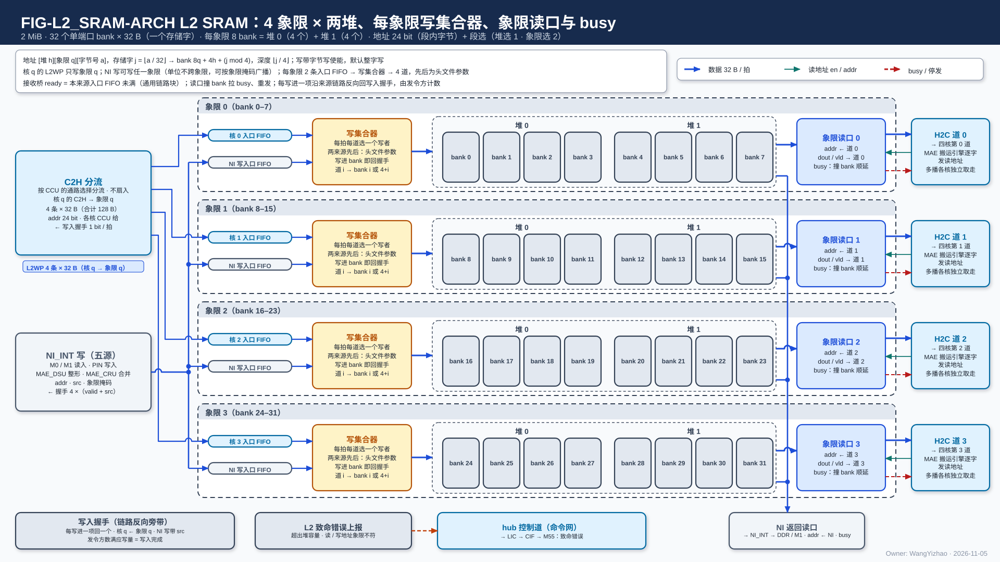
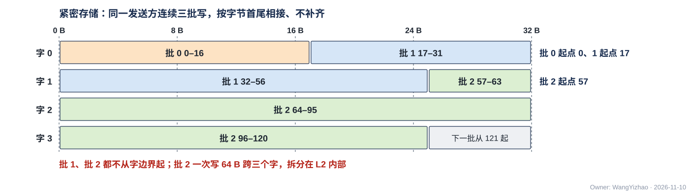
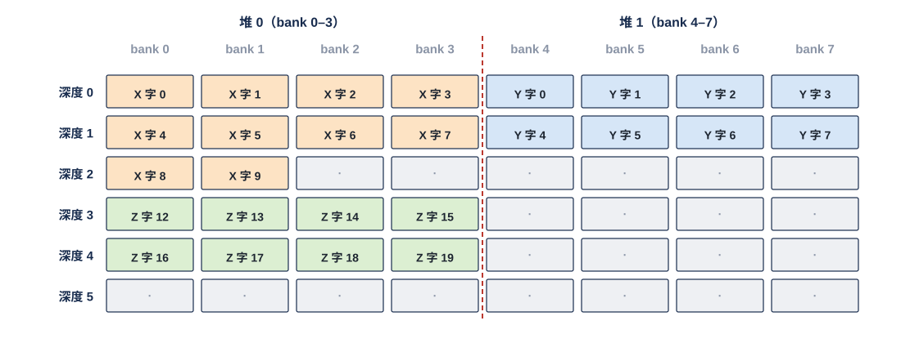

# L2 SRAM 需求

> Owner: WangYizhao｜2026-11-11

## 1 概述

L2 是全芯片一块 2 MiB 的片上中央存储，全芯片一份，不属于 HUB 组或 MAE 组，单独成篇。它给三类使用者用：**四个计算核**（核 $n$ 经 C2H 写入、经 H2C 第 $n$ 道读出）、**MAE**（经 NI_INT 的 NI 写口写入、NI 读口读出，用于 DDR / 共享内存与 L2 之间的搬运、MAE_DSU 整形、MAE_CRU 跨核合并），以及**片外主方**（经 PIN 口由 MAE_NI_EXT 换算后走 NI 写口写入）。

**L2 只按每拍收到的段选与地址读写：它不发请求、不解析数据内容、不维护写计数、不报完成，也没有配置口。** 每一拍写到哪、读哪里，由该链路的发令方给出（C2H 归各核 CCU，其余归 MAE 的搬运引擎）；写入是否完成，由发令方数 L2 回的写入握手判定。

本篇用到的几个词（其余术语在首次出现处定义）：

| 词 | 含义 |
|---|---|
| 存储字 | 32 B，L1 / L2 读写的基本单位；段内字节地址除以 32 取整是它的序号（协议篇 §3.2） |
| 象限、堆 | 段选信号 `seg` 的两个字段，定义见架构篇 §3.3：**象限 $n$** = 核 $n$ 的 C2H 写入、H2C 第 $n$ 道与 NI 读口第 $n$ 路读出的那部分存储；**堆** = 与另一堆可以一读一写同拍的范围。L2 有 4 个象限，每个象限 2 个堆，共 8 个堆 |
| 段内地址 | 24 bit 字节地址，只表示所选堆里的字节位置、从 0 起；不含象限与堆 |
| 写入拍 | 写链路上成交的一拍（en ∧ ready），默认 = 一个存储字；写入握手与应写量都按写入拍计 |
| 发令方 | 决定这一拍写到哪、读哪里的一方：C2H 上是本核 CCU，其余链路上是 MAE 的搬运引擎（PIN 写为外部主方，由 NI_INT 分发令号） |

## 2 接口需求

### 2.1 架构图与接口汇总

图中模块框内的结构是参考实现（见第 7 章），本章以框外的各口为准。

框外的口：左侧是两种写口——核 0–3 各一条 L2WP 写口（接本核的 C2H，核 $q$ 的只进象限 $q$）与一条 NI 写口（接 NI_INT，经竖总线可进任一象限），每条写口有反向的写入握手（橙色细线）。右侧是两种读口——象限读口 0–3（读地址来自 H2C 第 $q$ 道的搬运引擎，读出交 H2C 第 $q$ 道）与 NI 读口（四路，每象限一路，各有自己的读地址流与读数据流，各自直达 NI_INT）；**每个读口都是两条握手流：读地址流进、读数据流出**。图中象限读口与 H2C 道之间画两条握手流：读数据流（蓝实线）与读地址流 en / addr / `seg`（青细线），各带一条反向 ready（红虚线）；NI 读口四路各画一条读地址流与一条读数据流，ready 未逐根画。L2 没有配置口，也不接命令网。

| 口 | 对端 | 方向 | 位宽 | 握手 | 架构篇出处 |
|---|---|---|---|---|---|
| L2WP 写口 $n$（$n$ = 0…3） | HUB_NOC：核 $n$ 的 C2H 直通 | 入 | 每条 din 32 B + be 32 + addr 24 + `seg` 5 + `src` | en / ready | PORT-13、PORT-14 |
| L2WP 写入握手 $n$ | 核 $n$ 的 CCU（经 HUB_NOC 回程） | 出 | 每条 valid + `src` | 只有 valid | PORT-30 |
| NI 写口 | NI_INT 的 L2 写入合并器（汇合 M0 / M1 读入、PIN 写入、MAE_DSU 输出、MAE_CRU 结果五个来源） | 入 | din 32 B + be 32 + addr 24 + `seg` 5（段掩码可多位）+ `src` | en / ready | PORT-18 |
| NI 写入握手 | NI_INT | 出 | 4 组（每象限一组），每组 valid + `src` | 只有 valid | PORT-30 |
| 象限读口 $n$ · 读地址 | MAE 的 H2C 第 $n$ 道搬运引擎（经 H2C 第 $n$ 道送达） | 入 | addr 24 + `seg` 5 | en / ready | PORT-15 |
| 象限读口 $n$ · 读数据 | HUB_NOC 的 H2C 第 $n$ 道 | 出 | 32 B | en / ready | PORT-15、PORT-12 |
| NI 读口第 $q$ 路 · 读地址（$q$ = 0…3） | NI_INT（地址由发读这一路的 MAE 搬运引擎给出） | 入 | 每路 addr 24 + `seg` 5（段掩码恒为象限 $q$） | 每路 en / ready，各自独立 | PORT-19 |
| NI 读口第 $q$ 路 · 读数据 | NI_INT 的 L2 读出分路 | 出 | 每路 32 B，四路合计 4 × 32 B/拍 | 每路 en / ready，各自独立 | PORT-19 |

口宽与条数以架构篇 §2.7 的 PORT-nn 为准，本表只为阅读方便列出。

**各口共同的链路规则**：

- **全部口都是核间链路，一律逐拍握手（en ∧ ready 成交），与其他核间链路用同一套逻辑**（协议篇 §3.5；V18-TP-80）：时延无关、可任意插级，ready 与送出的各信号寄存器输出、ready 拉低后仍在途的拍全部收下。**各口的链路一侧例化 HUB 提供的通用链路块**（V18-HUB-05，HUB_NOC 篇 §2.9、协议篇 §3.5.1）。
- **每拍自带 `seg` 与段内地址，L2 按它读写**；链路上没有切换段标记、请求号或核号，L2 也不需要知道一次搬运在哪拍结束（协议篇 §3.2、§3.10）。
- **写到哪个存储不编码在地址里**：L2WP 写口与 NI 写口只到 L2，没有目的选择信号（协议篇 §2.2.2）。
- **L2 没有配置口、不在命令网上**（V18-TP-75）：任何口的行为都不由运行时配置改变。

### 2.2 L2WP 写口：核 $n$ 经 C2H 写象限 $n$

#### 2.2.1 信号与每拍含义

**四条 L2WP 写口各接一个核的 C2H，核 $n$ 的那条只写象限 $n$**（V18-L2-03 / 04，本篇 §3.6）。C2H 在 HUB_NOC 里直通，不扇入、不分路，四核互不等待（HUB_NOC 篇 §3.5）。

| 信号 | 方向 | 位宽 | 每拍含义 |
|---|---|---|---|
| en | 入 | 1 | 本拍有一次写 |
| ready | 出 | 1 | 本拍能收；en ∧ ready 成交 |
| din | 入 | 32 B | 本拍数据，**从第 0 字节起放本拍的有效数据**（V18-TP-74） |
| be | 入 | 32 | 从第 0 字节起连续有效的字节 |
| addr | 入 | 24 | 本拍第一个有效字节的段内地址，由核 $n$ 的 CCU 逐拍给出 |
| `seg` | 入 | 5 | 堆选 1 bit + 段掩码 4 bit（独热）；**段掩码恒为象限 $n$，L2 只用其中的堆选** |
| `src` | 入 | 5 bit【待标定】（架构篇 §2.4） | 发令号；本链路只有核 $n$ 的 CCU 一个发令方，恒为常数，L2 不看、只随写入握手原样带回 |

**默认使用时 addr 是 32 的倍数、一拍就是一个存储字**；addr 不是 32 的倍数时这一拍跨两个存储字，由 L2 内部处理（本篇 §3.3），链路与 hub 都不移位。ready 何时拉低由 L2 决定，**拉低只使核 $n$ 的 C2H 停发，不影响别的核与别的象限**；C2H 不 ready 时由本核的集成输出端口门控 CCU（协议篇 §3.16）。

#### 2.2.2 写入握手：写进存储后逐拍回核 $n$ 的 CCU

**L2 把核 $n$ 的一个写入拍写进存储之后，沿这条链路的反向旁带回一个写入握手（valid + 该拍的 `src`），一个写入拍恰回一个**（V18-TP-47 / 80）。握手只有 valid、没有 ready：核 $n$ 的 CCU 每拍都能收。写入握手与其他核间写链路同形（valid + `src`），C2H 不设特殊形式（V18-TP-80）。

### 2.3 NI 写口：MAE 经 NI_INT 写任一象限，可同址写多个象限

#### 2.3.1 信号与每拍含义

**NI 写口是 MAE 一侧唯一的写口：可写任一象限；`seg` 的段掩码多位为 1 时，同一拍写进掩码内各象限的同一段内地址**（同址广播，V18-L2-04 / TP-61）。信号与 L2WP 写口相同（en / ready / din / be / addr / `seg` / `src`），差别：

- addr 与 `seg` 由 MAE 的搬运引擎逐拍生成；PIN 写入时由 MAE_NI_EXT 按 AXI 地址换算（MAE_NI_EXT 篇 §3.4）。
- `src` = 发令号：每个搬运引擎一个号、每笔在途 PIN 事务一个号（号由 NI_INT 分配，MAE_NI_INT 篇 §3.6）；几个发令方共用这条口，靠 `src` 让写入握手各回各家。
- **段掩码多位时，这一拍要等掩码内各象限都能收下才成交**（ready = 各目标象限都能收）。
- **一个切换段（发令方内部的切换粒度，协议篇 §3.10）只落在一个象限里**；需要写几个象限时用段掩码，由 MAE 保证（本篇 §5.2）。

#### 2.3.2 写入握手：每象限一组回 NI_INT

**象限 $q$ 把 NI 写口的一个写入拍写进存储之后，在第 $q$ 组回一个写入握手（valid + 该拍的 `src`）**；同址广播到 $k$ 个象限时，每个象限各回一个，共 $k$ 个。4 组各只有 valid、没有 ready。各象限写进的先后可以与链路上的先后不同，归属由发令方按 `src` 完成（本篇 §3.4）。

### 2.4 象限读口：MAE 发读地址，象限 $n$ 的读出交 H2C 第 $n$ 道

**象限读口 $n$ 由两条握手流组成：读地址流（发读方给 en / addr / `seg`，L2 回 ready）与读数据流（L2 给 en / 数据，H2C 第 $n$ 道回 ready）**（V18-TP-80）。象限读口 $n$ 只读象限 $n$。

#### 2.4.1 读地址流

| 信号 | 方向 | 位宽 | 每拍含义 |
|---|---|---|---|
| en | 入 | 1 | 本拍有一个读地址 |
| ready | 出 | 1 | 本拍能接受读地址；en ∧ ready 成交 |
| addr | 入 | 24 | 要读的 32 B 的首字节段内地址，**一拍一个地址**（架构篇 §3.4 CONC-3） |
| `seg` | 入 | 5 | 堆选 + 段掩码；**段掩码恒为象限 $n$，L2 只用其中的堆选** |

读地址由执行这一道搬运的 MAE 搬运引擎逐拍给出（H2C 第 $n$ 道的道引擎；引擎放在哪里归 MAE 与后端，本篇只按"引擎在 MAE 内"写）。读地址里没有请求号、没有长度：一次搬运有多长、何时读完，由发读的引擎按指令给的数据量自己数。

#### 2.4.2 读数据流与背压

| 信号 | 方向 | 位宽 | 每拍含义 |
|---|---|---|---|
| en | 出 | 1 | 本拍有一拍读出 |
| ready | 入 | 1 | H2C 第 $n$ 道本拍能收 |
| 数据 | 出 | 32 B | 一个被接受的读地址对应的 32 B：**从该地址的首字节起放在第 0 字节**；有效字节由发读的引擎在 H2C 道上用 be 标出 |

规则：

- **每接受一个读地址，读数据流上恰交出一拍，按读地址被接受的次序交出，不丢、不乱序、不重复。**
- **读出时延不固定，正确性只取决于两条流的握手**；L2 不向任何一方登记读出拍数。
- **下游收不下时 L2 拉低读地址流的 ready，卡住发读的搬运引擎**（V18-TP-80）：H2C 第 $n$ 道的 ready 为低时，L2 不丢已接受的读，并在保持不住之前停收新的读地址。ready 也可以因别的原因为低（例如同一个堆本拍在服务别的链路），都只降速。
- 读数据流只带数据。目的地址、be 与核掩码由发读的引擎交给 H2C 道（HUB_NOC 篇 §3.3）；多播时 L2 只读一次，各目的核独立取走由 H2C 道的分叉点负责（协议篇 §3.7），不影响 L2 的读口。

### 2.5 NI 读口：四路各给读地址，四路读出交 NI_INT

**NI 读口是 MAE 与 L2 之间唯一的读口，分四路，第 $q$ 路只读象限 $q$；每路是一条读地址流加一条读数据流，四路各给各的读地址、可以不同址，ready 各自独立**（V18-MAE-32 / TP-80 / L2-08）。四路合计 4 × 32 B/拍。

#### 2.5.1 每路的读地址流

每路信号同象限读口的读地址流（en / ready / addr 24 / `seg` 5），**段掩码恒为该路的象限，L2 只用其中的堆选**。**四路的地址相互独立**：四个象限各存一份完整 token 记录时，因长度不同，同一条记录在各象限的地址不同（用户 11-11），所以口上不要求同址。**每路的 ready 只看本路**，与发读这一路的搬运引擎一一对应，一路被卡不影响另三路（V18-L2-08）。

用途（编译链与 MAE 的用法，L2 不区分）：MAE_CRU 合并跨核定长份时四路给同一段内地址、一拍读四份（"同址异象限"是这种用法，不是口的限制，MAE_CRU 篇 §2.2.1）；带 bias 的归约另一拍读 bias；残差加的两路加数、L2 → DDR / 共享内存、L2 → MAE_DSU 按各自地址读一个或几个象限。

#### 2.5.2 每路的读数据流

每路信号同象限读口的读数据流（en / ready / 32 B 数据）。**第 $q$ 路交象限 $q$ 的读出，按本路读地址被接受的次序交出，不丢、不乱序；各路可以在不同拍交出**，几份对齐由使用方做（MAE_CRU 篇 §2.2.1）。**每路的 ready 各自独立；某一路下游收不下时，L2 只拉低这一路读地址流的 ready，卡住发读这一路的搬运引擎**，规则同本篇 §2.4.2，其余三路照常。

## 3 功能描述

### 3.1 功能一览

| 功能 | 输入 | 输出 | 触发 / 生效条件 | 节 |
|---|---|---|---|---|
| 按段选与段内地址读写 | 每拍的 `seg` + 段内地址 | 该堆该地址的数据 | 每拍成交即按地址落字 / 读出 | §3.2 |
| 紧密存储 | 首字节地址 + 从第 0 字节起的数据与 be | 写：数据首尾相接、选中字节被覆盖、其余保持；读：首字节在输出第 0 字节 | 任意字节起点，一次 ≤ 128 B；默认 32 B 对齐时不额外占拍 | §3.3 |
| 写入与写入握手 | 写口的写入拍 | 写进存储；沿来源链路逐拍回写入握手 | 写进存储之后才回 | §3.4 |
| 读出 | 读地址流的读地址 | 读数据流按序交出 | 地址成交即读；下游背压时停收地址 | §3.5 |
| 象限与链路对应 | 链路编号、段掩码 | 核 $n$ 只经象限 $n$；NI 任一象限、同址多象限写、四路各自读 | 由物理连接与段掩码决定 | §3.6 |
| PIN 写入 | 经 NI 写口的 PIN 写入拍 | 写进 PIN 窗口 | PIN 写一帧期间不推理 | §3.7 |
| 复位与内容保持 | 复位 | 在途读写与握手丢弃，数据保持 | 复位 | §3.8 |

### 3.2 按段选与段内地址读写：L2 不发请求、不回绕、不解析内容

**L2 的每次读写由三项确定：象限、堆（都在 `seg` 里）与 24 bit 段内地址**（架构篇 §3.3，V18-TP-57）。段内地址只是所选堆里的字节位置，各堆各自从 0 起，**没有跨堆连续的地址，地址累加不会进到象限或堆**。指令里堆选是 1 bit、象限是 2 bit 选择字段，发令方把它们展开成 `seg`（堆选 1 + 段掩码 4，独热；只有 NI 写口的段掩码可多位）逐拍携带。

**每拍的地址由发令方逐拍给出**（V18-TP-27 / 35）：线性段、gather、散写都在 CCU 或 MAE 的搬运引擎内展开（协议篇 §3.3.1、§3.3.2）。L2 自己：

- **不发请求、不累加地址、不做取模、不回绕**：L2 里的数据块不按环形使用；一次搬运若会越过编译链给的容量窗口末尾，由编译链拆成两条指令（V18-MAE-17）。经 C2H 写入的地址同样不回绕（CCU 按容量窗口顺序给出）。
- **不分区**：任何地址都能写、都能读。别的篇里的"固定区""列表区（LRB）""调用输入区""PIN 输入地址段"等，都只是编译链给某段地址起的名字，L2 里没有对应的硬件分区；哪些内容跨调用保留也由编译链按地址决定。
- **不解析数据内容**：L2 不区分权重、激活、列表、紧凑 token 记录的各部分或跨核合并的输入，照常按地址落字、按地址读出；数据的排法归数据组织篇（数据组织篇 §2.2、§2.5、§2.15、§3.6）。

### 3.3 紧密存储：数据可从任意字节起连续写入、首尾相接，不补齐

**L2 必须支持紧密存储：同一发送方的数据按字节首尾相接存放，下一批从上一批末字节的下一个字节起写，中间不补齐；一次至多 128 B 的紧密访问 L2 都要支持；字节的移位与拆分在 L2 内部做，使用者一侧（CCU、MAE 搬运引擎、hub、NI_INT）都不移位，链路上的每一拍从首字节起给**（V18-TP-74、V18-L2-07）。

**数据组织默认按 32 B 对齐**：此时每拍正好一个存储字、不触发移位，也不额外占拍（数据组织篇 §2.3）。不从存储字边界起的紧密访问允许比对齐访问慢，只降速、不出错。

- **写**：首地址可以是任意字节，写数据从第 0 字节起给、be 标出从第 0 字节起连续有效的字节。**只覆盖选中的字节，其余字节保持原值**；超出本存储字的部分落到下一个存储字。例：某堆段内字节 32–47 已有数据，再写 31 B、首地址 48，数据落段内字节 48–78，段内 32–47 不变，下一批从段内字节 79 起（L2 内部怎样拆到两个存储字见本篇 §7.6）。
- **读**：首地址可以是任意字节；**L2 把首字节放到读出的第 0 字节后交出**。默认对齐的读不移位。
- **片外进来的数据**（经 PIN 写进 PIN 输入地址段的外设数据、经 M1 读入调用输入区的 Token ID 列表、图像、音频与传感器向量、另一颗芯片经 FMC 写来的数据）：**每种片外数据的片外窗口起点由编译链固定，默认按存储字对齐，但不作硬限制**；外部主方从起点顺序写，长度任意，最后一拍只写有效字节，不补字。起点不在字边界时，MAE_NI_EXT 按 AXI 地址与字节选通把有效字节按次序交出（首字节在前），由 L2 内部移位（MAE_NI_EXT 篇 §2.4）。

同一发送方连续三批写：批 0 写 17 B、首地址 0，落段内字节 0–16；批 1 写 40 B、首地址 17，落 17–56（跨字 0、1）；批 2 一次写 64 B、首地址 57，落 57–120（跨字 1、2、3）；下一批从 121 起。三批之间没有空隙、没有补齐；批 1、批 2 都不从存储字边界起，跨字的拆分在 L2 内部做，发送方每拍只给首字节地址与从第 0 字节起的数据。读回时从任意首地址起读，L2 把首字节放到读出的第 0 字节，读回与写入逐字节相同。某类数据推荐怎样排（是否对齐到存储字、片尾是否补齐）归数据组织篇，L2 不感知。

### 3.4 写入：写进存储后逐拍回写入握手，完成由发令方判定

**L2 每成交一个写入拍，就按该拍的 `seg` 与地址把有效字节写进存储；写进之后才沿来源链路回一个写入握手（valid + `src`），一个写入拍恰回一个**（V18-TP-47 / 80）。

- **L2 内部不计数、不报完成**：不保存写计数，不知道一拍属于哪条指令，也不发写确认或读出完成。**归属与完成由发令方按 `src` 与自己的应写量判定**（协议篇 §3.8）：

  | 写入 | 发令方 | 写入完成的判据 |
  |---|---|---|
  | L2WP 写口 $n$（核 $n$ 的 L1 → L2 象限 $n$） | 核 $n$ 的 CCU | 数 L2WP 写入握手 $n$，达到本次发送的写入拍数；之后经发出报告专用信号组（架构篇 PORT-39）向 MAE 报告（MAE_ENG 篇 §3.19） |
  | NI 写口（M0 / M1 读入、MAE_DSU、MAE_CRU → L2，含 MAE 拷贝） | 执行该指令的 MAE 搬运引擎 | 数 NI 写入握手里 `src` = 本引擎号的个数，达到应写量（广播 $k$ 个象限按 $k$ 倍计） |
  | NI 写口（PIN 写入） | NI_INT 为每笔在途 PIN 事务分的发令号 | 该事务号的握手数达到该事务的写入拍数后，MAE_NI_EXT 回 AXI B 响应（MAE_NI_EXT 篇 §2.4.2） |

  L2 → L1（经 H2C）与 L2 → 片外的写入完成不经 L2 的写口，见协议篇 §3.8 与 MAE_ENG 篇 §3.20。
- **写进之后的任何读都读到新值**；握手又在写进之后才回，所以**发令方数满握手之后发出的读一定读到新值**。依赖这次写入的读，由发令方（或收到 CCU 发出报告的 MAE）判完成后才发出。判据里没有任何固定时延。
- **还没写进存储的写入拍不回握手**，所以不需要排空信号；写入等待多少拍随同堆其他链路的占用变化，**L2 的功能定义里不使用任何固定写入时延**。

### 3.5 读出：读地址被接受后按序交出，下游收不下时拉低读地址的 ready

**发读方在读地址流上给读地址，L2 接受后读出、在读数据流上按接受次序逐拍交出；下游收不下时，L2 拉低读地址流的 ready，背压经握手回到发读的 MAE 搬运引擎**（V18-TP-80）。

- 每个读地址读 32 B（从首字节起），默认对齐时就是一个存储字；不从字边界起时 L2 读出覆盖到的存储字、移位后交出（本篇 §3.3）。
- **读出时延不固定**：同一个堆在服务别的链路、不对齐、下游背压都会使读出变晚；正确性只取决于握手。发读方不按余量发读，也不需要知道 L2 的读出拍数。
- 读出的内容 = 读地址被接受时该地址已写进存储的值；**发令方要读的数据，须在它数满写入握手之后才发读**（本篇 §3.4）。
- 多播、目的地址与 be 不在 L2：L2 只读一次、交出一拍，H2C 道在分叉点按各核已取标记分给各目的核（协议篇 §3.7、HUB_NOC 篇 §3.4）。

### 3.6 象限与链路的对应：核 $n$ 只经象限 $n$，NI 可进出任一象限

**链路与象限的对应是需求（用户 11-11："我认为算需求"），按架构篇 §3.3 的"象限 $n$"定义：**

| 口 | 能到达的象限 | 象限怎样确定 |
|---|---|---|
| L2WP 写口 $n$（写） | **只有象限 $n$** | 物理连接固定；`seg` 照样 5 bit，段掩码恒为象限 $n$，L2 只用堆选 |
| NI 写口（写） | **任一象限**；段掩码多位时**同址写多个象限** | 段掩码 |
| 象限读口 $n$（读，接 H2C 第 $n$ 道） | **只有象限 $n$** | 物理连接固定；段掩码恒为象限 $n$，L2 只用堆选 |
| NI 读口（读，四路） | **第 $q$ 路读象限 $q$；四路各给读地址、可以不同址，一拍至多读四个象限** | 物理连接固定（每路一个象限）；段掩码恒为该路的象限 |

所以**每个象限的写入只有两个来源（核 $n$ 的 L2WP 写口、NI 写口），读出只有两个去向（H2C 第 $n$ 道、NI 读口第 $n$ 路）**；核 $n$ 写进 L2 的数据都在象限 $n$，**NI 是唯一能进出任意象限的通路**。四核都在产出时数据天然分在四个象限，下一位点四道并行读回，读写各 4 × 32 B/拍。

这些端口能力的用法（编译链与 MAE 的放法，L2 不感知）：跨核合并的定长份写在各核象限的同一段内地址（同址异象限），MAE 经 NI 读口四路给同一地址、一拍读四份交 MAE_CRU；变长数据在各象限的地址可以不同，NI 读口四路各给各的读地址（本篇 §2.5.1）；要四道并行送出的流按块分四段连续放（数据组织篇 §2.15、§3.6）。

### 3.7 PIN 写入：一个固定窗口，与推理整体分先后

SoC 经 PIN 口写 L2 时，**MAE_NI_EXT 把 AXI 地址线性换算成 L2 的段选与段内地址（L2 逻辑地址 = AXI 地址 − $A_{\text{PIN}}$），经 NI 写口写入；L2 不区分 PIN 与其他 NI 写入**（MAE_NI_EXT 篇 §2.4、§3.4，V18-NIE-03）。

- **PIN 只有一个固定的 PIN 窗口（起始逻辑地址 + 长度）**，按（调用种类, 输入种类）由编译链固定（V18-NIE-02、V18-MAE-44）；窗口所在的 PIN 输入地址段由编译链放在一个象限的一个堆之内。
- **PIN 写 L2 与推理整体分先后**：外部主方经 PIN 写一帧期间 L3PU 不推理，一帧传完才开始推理（V18-L2-07 / MAE-44）。**所以不要求 L2 为 PIN 设保留的堆或 PIN 专门的等待上界**；PIN 写与同一个堆上的其他链路照常按架构篇 §3.4 CONC-2 共用（推理不进行时其他链路通常空闲）。
- 窗口起点默认按存储字对齐、不作硬限制；外部主方从起点顺序写、最后一拍只写有效字节，起点不在字边界时由 L2 内部移位（本篇 §3.3）。一笔 PIN 事务不跨象限、不跨堆、有效字节连续，由编译链的放法与外部主方的写法成立、MAE_NI_EXT 按事务交给 L2（本篇 §5.2）。

### 3.8 复位与内容保持

- **复位输入来自 CIF（架构篇 PORT-41），硬复位与软复位不区分**（CIF 篇 §3.3）。
- **复位时，在途的读写与写入握手丢弃**；L2 不持地址状态与计数，没有别的在途状态要保留。
- **复位不清数据**；上电后的数据内容不确定。
- **L2 没有"调用"的概念**：数据在被覆写前一直保持；哪些内容跨调用保留，由编译链与 LIC 按地址分配决定。

## 4 性能指标

### 4.1 各口的速率要求

| 口 | 要求速率 | 说明 |
|---|---|---|
| L2WP 写口 $n$ | 每条 32 B/拍，四条同时 合计 128 B/拍 | 与四个象限读口合计相同 |
| NI 写口 | 32 B/拍；**持续带宽不低于 DDR 灌入 L2 的流量（参考 19.2 B/核拍）** | 条件见架构篇 §3.4 CONC-5（与同象限其他链路落在不同的堆） |
| 象限读口 $n$ | 每条 32 B/拍，四条同时 合计 128 B/拍 | |
| NI 读口 | 4 × 32 B/拍（每象限一路，各 32 B/拍） | 四路地址独立、ready 独立 |

**这些速率在下列条件下成立**：所访问的堆本拍没有被别的链路占用（CONC-1、CONC-2），或同一个堆上几个写入方各自地址连续（CONC-3）；默认 32 B 对齐（不对齐的访问允许慢，本篇 §3.3）；下游不背压。

### 4.2 同时使用的口与并发条件

**L2 的并发条件由架构篇 §3.4 定义，本篇只引用、不另定**（V18-TP-81）：

| 同时使用的情形 | 适用的约定 | 结果 |
|---|---|---|
| 四个象限各自的四条链路 | CONC-5（各象限之间互不影响） | 象限之间互不影响 |
| 同一象限里的一读一写分落两个堆（例：读上一位点的输出、写本位点的输出） | CONC-1 | 两边都不降速 |
| 同一象限里几条链路落同一个堆 | CONC-2 | 同一拍只做其中一次访问，依次服务，只降速、不丢、不错，每条链路的等待有上界 |
| 同一个堆上几个写入方争用、各自地址连续 | CONC-3 | 各写入方保持 32 B/拍 |
| 同一个堆上读链路与其他链路争用、各自地址连续 | CONC-3 的读一侧（V18-L2-08） | 各读链路保持 32 B/拍；地址不连续时按 CONC-2 只降速 |
| NI 写口承接 DDR 入流 | CONC-5 | 与同象限其他链路落在不同的堆时不低于 DDR 入流 |
| PIN 写入与推理 | 不同时（本篇 §3.7） | 无并发要求 |

**L2 只承诺端口位宽与上述并发约定，不标定特定负载下的吞吐与等待百分位**；DDR 带宽归 MAE 与系统带宽预算。

### 4.3 要求值表

| 项 | 要求值 | 说明 |
|---|---|---|
| 容量 | 2 MiB = 4 象限 × 2 堆 × 256 KiB | SRAM 总量不增；每个堆的段内地址 0 … 262,143（8,192 个存储字） |
| 写口 | L2WP 写口 4 条 + NI 写口 1 条，各 32 B/拍 | 信号见本篇 §2.2、§2.3 |
| 读口 | 象限读口 4 条（各 32 B/拍）+ NI 读口 4 路（4 × 32 B/拍） | 每个读口 = 读地址流 + 读数据流，见本篇 §2.4、§2.5 |
| 段选与地址 | `seg` 5 bit（堆选 1 + 段掩码 4）+ 24 bit 段内字节地址 | 定义见架构篇 §3.3 |
| `src` 位宽 | 5 bit【待标定】（架构篇 §2.4） | 所有写口都带，L2 不看、随写入握手带回 |
| 写入握手 | 每个写入拍写进存储后恰回一个 valid + `src`：L2WP 每条一组；NI 写口每象限一组 | 写入完成的唯一依据，由发令方计 |
| 紧密存储 | 粒度为字节，一次 ≤ 128 B；数据首尾相接、不补齐 | 本篇 §3.3；默认 32 B 对齐，不对齐允许慢 |
| 写粒度 | 字节：只覆盖 be 选中的字节，其余保持原值 | 可从任意字节起读写，默认 32 B 对齐 |
| 读出时延 | 不规定 | 正确性只取决于握手 |
| 等待上界 | 同一个堆上任何有请求的链路，等待有上界 | 架构篇 §3.4 CONC-2；上界的拍数随实现而定，参考见本篇 §7.3 |

## 5 约束与由使用者保证的事项

### 5.1 硬约束

- **只用单端口 SRAM 宏，不用多端口宏；每个宏同一拍只做一次读或写**（同拍单端口，读口与写口只是逻辑口，V18-TP-73）。
- **SRAM 总量不增加**。
- **每个象限分两个堆，物理分堆必须存在**（V18-L2-07）：两个堆之间一读一写同拍互不影响（架构篇 §3.4 CONC-1）；每个堆里怎样组织归参考实现（本篇 §7.1）。
- **不另设物理宏实现 ping-pong**：两个堆都可读可写，读一个堆、写另一个堆只是编译链排地址的用法（V18-TP-73）。
- **本篇不含容错设计**（V18-TP-75）。

### 5.2 由使用者保证的事项

L2 只按每拍收到的段选与地址读写，以下事项由对应方保证（协议篇 §5.2）：

| 事项 | 由谁保证 |
|---|---|
| 目的空间在数据到达时已读完（预取距离、缓冲轮转） | 编译链（LIC 操作 15） |
| 同一个堆内各数据块的地址互不重叠 | 编译链 |
| 堆选由指令给出；读一个堆、写另一个堆的 ping-pong 是编译链排地址的用法 | 编译链 / MAE |
| 不跨容量窗口末尾：L2 里的数据块不按环形使用，越过容量窗口的搬运拆成两条指令 | 编译链（V18-MAE-17） |
| 每拍地址不越过该堆容量，段选正确 | 发令方（各核 CCU、MAE 搬运引擎）按编译期给定的指令推出；编译期检查 |
| 同一个堆上的几条链路先在调度上错开或放到不同的堆，硬件依次服务只是保底 | 编译链与 MAE（架构篇 §3.4 CONC-2） |
| 要满速的链路，每条的目的地址连续 | MAE 与编译链（架构篇 §3.4 CONC-3） |
| DDR 灌入 L2 时，NI 写口与同象限其他链路落在不同的堆 | 编译链与 MAE（架构篇 §3.4 CONC-5） |
| 默认数据块起点与通道片每部分的起点在存储字边界、片尾补到 32 B | 数据组织篇 §2.3、§2.5；生产方 / CCU / 编译链 |
| 写入何时可读：发令方数写入握手达应写量后才放行依赖它的读 | L2WP 写归该核 CCU，NI 写归 MAE 搬运引擎；最后读者事件归 CCU / LIC |
| L2WP 写口每拍 addr 与堆选正确；握手数满后发出报告 | 各核 CCU |
| NI 写口一个切换段不跨象限；段掩码与应写量一致（广播 $k$ 个象限，应写量按 $k$ 倍计） | MAE 搬运引擎 |
| 跨核合并的定长份同址异象限存放；变长数据按下一位点的读法分块写（各象限地址可以不同）；要四道并行送出的流按块分四段连续放 | 编译链、生产核 CCU、MAE（数据组织篇 §2.15、§3.6） |
| **PIN 一笔写事务不跨象限、不跨堆；有效字节连续**（首拍可从中间起、末拍可不满，中间不留空洞） | 编译链（把 PIN 输入地址段放在一个象限的一个堆之内）与外部主方（只在 PIN 窗口内写、有效字节连续）；MAE_NI_EXT 按事务换算后交给 L2、不检查（V18-NIE-04，MAE_NI_EXT 篇 §2.4.1 / §3.5） |
| PIN 写完一帧之后推理才开始 | LIC / CIF 与 SoC 侧（V18-L2-07 / MAE-44） |

## 6 验收

### 6.1 本模块验收项

| 验收项 | 方法 | 用例 | 出处 |
|---|---|---|---|
| 按地址写入 | 逐位比对 | 四核同拍各经自己的 L2WP 写口写本核象限、各拍地址不连续，各拍按 addr 落字；NI 写口按段掩码广播到 1–4 个象限，各象限同一段内地址的内容相同 | §2.2、§2.3、§3.2 |
| 写入握手 | 逐拍检查 | 每个写入拍写进存储之后才回、恰回一个、`src` 等于该拍的发令号（L2WP 写口为核 $n$ 的常数）；还没写进的拍不回；几个搬运引擎与两笔 PIN 事务在 NI 写口上交替、各象限写进先后与链路顺序相反时，各发令方按 `src` 数到的个数等于自己发出的写入拍数；随机化反向旁带的插级数，结果不变 | §2.2.2、§2.3.2、§3.4 |
| 写口握手与插级 | 逐位比对；检查不丢、不重、不乱序 | ready 随机拉低；随机化上游流水级数，结果逐位一致；一条写口 ready 低时别的写口、别的象限照常 | §2.1、§2.2.1 |
| 读口两条握手流 | 逐位比对；检查不丢、不重、不乱序 | 每接受一个读地址恰交出一拍、按接受次序；下游 ready 随机拉低（含长时间拉低）时不丢数据、读地址流 ready 随之拉低、发读方停住；随机化读出时延与插级，结果不变 | §2.4、§2.5、§3.5 |
| NI 读口四路独立 | 逐位比对 | 四路给不同地址、同址两种情形读出都与参考一致；各路晚到、各路 ready 不同步时各自按序；一路下游长时间不收时只有该路读地址 ready 拉低，另三路照常 | §2.5 |
| 紧密存储写读回 | 逐位比对 | 同一发送方连续几批不对齐的写首尾相接、中间无空隙；只写 1 B、只写 31 B，未选字节保持原值；段内 32–47 已有数据、再写 31 B（首地址 48），落段内 48–78，下一批从 79 起；任意字节起读，首字节出现在输出第 0 字节；PIN 从任意字节起顺序写、长度任意 | §3.3 |
| 紧密存储例 | 逐位比对 | 按 FIG-L2_SRAM-TIGHT：同一发送方三批 17 / 40 / 64 B 首尾相接写（首地址 0 / 17 / 57），段内字节 0–120 与写入逐字节相同、121 起未被改动；从任意首地址读回，首字节在输出第 0 字节 | §3.3 |
| 写入后的可见性 | 逐位比对 | 发令方握手数满后发读，读到新值；随机化写入等待拍数，结果不变 | §3.4 |
| 象限对应 | 逐位比对 | L2WP 写口 $n$ 只写象限 $n$、象限读口 $n$ 只读象限 $n$；NI 写 / 读可达任一象限 | §3.6 |
| 并发约定 | 周期模型与 RTL 对拍 | 一读一写分落同一象限两个堆时两边都 32 B/拍；四象限同时满负载互不影响；同一个堆上四条链路同时请求时每条等待不超过上界、只降速不出错；两个写入方同用一个堆、地址连续时各 32 B/拍 | §4.2（CONC-1 / 2 / 3 / 5） |
| 复位 | 检查在途状态 | 读写进行中复位，在途读写与握手丢弃、数据不清 | §3.8 |

### 6.2 与上下游模块的对接检查

| 对接项 | 对端 | 检查内容 |
|---|---|---|
| C2H 写入与发出报告 | 计算核 CCU（`CCU_STAGING.md`）、HUB_NOC 篇 §3.5 / §3.6 | CCU 数 L2WP 写入握手 $n$ 达本次发送的写入拍数后才发出报告；握手按 valid + `src` 收 |
| NI 写口与发令号 | MAE_NI_INT 篇 §3.5 / §3.6 | 写入合并器每拍带 addr / be / `seg` / `src`；按 `src` 把 4 组写入握手分给各搬运引擎与 PIN 事务；广播应写量按 $k$ 倍 |
| H2C 读 | HUB_NOC 篇 §3.3、MAE_ENG 篇 §3.10 | 道引擎按读地址流 ready 发读、ready 低时保持；H2C 第 $n$ 道按读数据流 ready 背压；目的地址与 be 由引擎交 H2C 道 |
| NI 读 | MAE_NI_INT 篇 §3.7、MAE_CRU 篇 §2.2.1 | 四路各由自己的搬运引擎给读地址、按各自 ready 发读；四路各自按序到达，MAE_CRU 合并的几份属于同一输出位置、不丢不错拍；某一路去向背压时只有该路读地址流停住 |
| PIN | MAE_NI_EXT 篇 §2.4 | 一笔事务不跨象限、不跨堆、有效字节连续；B 响应在该事务号的握手数满后回 |

### 6.3 仿真断言

以下断言只在仿真里，不对应硬件检查逻辑，不进 RTL 的功能定义：

1. 每个写口、每个读地址流收到的地址都不越过该堆的容量。
2. L2WP 写口 $q$ 与象限读口 $q$ 的段掩码恒为象限 $q$；NI 读口第 $q$ 路的段掩码恒为象限 $q$；NI 写口的段掩码非零（多位 = 同址广播）。
3. 每个写入拍写进存储之后恰回一个写入握手，不早于它写进存储的那一拍。
4. 每个读口交出的读数据拍数等于已接受的读地址数，次序一致。

## 7 参考实现

**本章内容可以换；换了之后别的模块不用改。** 本章给一套满足第 2–6 章的做法：存储组织、地址换算、每个堆一个口、入口与读出的缓冲、轮流、字节移位，并逐条说明它怎样满足架构篇 §3.4 的 CONC-1 / 2 / 3 / 5。

### 7.1 存储组织：4 象限 × 2 堆 × 4 个 32 B bank，按字交织

结构图见本篇 §2.1 的 FIG-L2_SRAM-ARCH（框内部分）。

**参考组织：L2 由 32 个单端口 bank 组成，每个 bank 宽一个存储字（32 B）、带字节写使能，一拍只做一次读或一次写；每 8 个 bank 是一个象限，每个象限的 8 个 bank 分成两堆：堆 0 = 象限内 bank 0–3，堆 1 = bank 4–7（4 + 4 固定）。每个堆的 4 个 bank 按字交织，段内地址各自从 0 起。** 八个堆之间没有共用的 bank；一次访问只落在一个堆里。参考宏几何为每个 bank 32 B × 2048 深，每堆 4 × 2048 = 8,192 个存储字 = 256 KiB。

FIG-L2_SRAM-ARCH 框内从左到右是写入、存储、读出三段。左侧是写来源：四条 L2WP 写口（每核一条，核 $q$ 的只进象限 $q$）与 NI 写口（经一条竖总线可进任一象限）。每个象限一行，有四条链路：两个写入口（核 $q$ 的 L2WP 写入口、NI 写入口，各带一条入口 FIFO）与两个读口（象限读口 $q$、NI 读口第 $q$ 路），四条链路都接到本象限的两个**堆口**；每个堆口一拍只做一次访问（一条链路的 1–4 个连续存储字，读写同形），同拍落同一个堆的链路按拍轮流、不分读写；字节移位在堆口内。写入握手在数据写进 bank 之后沿来源链路反向逐拍回（橙色细线）。两个读口框内各画一条读地址 FIFO 与一个读出缓冲（§7.5）。右侧是象限读口 $q$ 与 H2C 第 $q$ 道之间的读地址流与读数据流（各带反向 ready），以及 NI 读第 $q$ 路各自的读地址流与读数据流，四路各自直达 NI_INT、互不汇合。

### 7.2 段内地址到 bank 与深度的换算

**地址 [堆 $h$][象限 $q$][字节 $a$] 所在的存储字 $j = \lfloor a/32 \rfloor$ 落在全芯片 bank $8q + 4h + (j \bmod 4)$，深度 $\lfloor j/4 \rfloor$。** 相邻存储字轮流落到本堆的 4 个 bank 上，换算只是取位，不查表。例：[堆 0][象限 2][字 5] → bank $16 + 0 + 1 = 17$，深度 1。

**一次访问 = 首字 $j_0$ 起连续 1–4 个存储字，第 $i$ 个字落本堆 bank $(j_0 + i) \bmod 4$、深度 $\lfloor (j_0 + i)/4 \rfloor$**：可以不从深度的行首开始、跨相邻两个深度；连续 4 个字必落 4 个不同 bank，所以**一拍内同一个 bank 只访问一个深度**（L1、L2 共用的判据，V18-TP-73）。例：象限 0 堆 0 从字 6 起读 4 个字 → 字 6、7、8、9 落 bank 2、3、0、1，深度 1、1、2、2，一拍完成。不从字边界起、覆盖 5 个字的访问首尾两字同 bank 不同深度，分两拍（本篇 §7.6）。

缩小例只画象限 0 的 8 个 bank、6 个深度，实际每个 bank 深 2048，机制相同：

- 堆 0（bank 0–3）里编译链放了两个数据块：数据块 X 占字 0–9（深度 0–2），数据块 Z 占字 12–19（深度 3–4）；字 10、11 未用。
- 堆 1（bank 4–7）里放了数据块 Y，占字 0–7（深度 0–1）。
- 红框是一次访问：堆 0 从字 6 起连续 4 个字，落 bank 2、3、0、1，深度 1、1、2、2。

同一堆内的数据块互不重叠由编译链保证；两堆的 bank 不相交由这套组织保证。

### 7.3 每堆一个堆口：同堆链路按拍轮流，等待上界

**每个堆一个堆口，一拍只做一次访问（读或写），只服务一条链路；同拍落在同一个堆的链路按拍轮流、不分读写**（V18-TP-73、V18-L2-07）。一个堆同拍至多被四条链路请求：核 $q$ 的 L2WP 写、NI 写、象限读口 $q$、NI 读口第 $q$ 路。只有一条成交，其余顺延：

- **读与写一视同仁**，没有哪一类固定先成交。
- 写的顺延：字留在自己的入口 FIFO 里，下一次轮到时一起写出；一条 FIFO 将满只拉低它自己那条链路的 ready（核 $q$ 的链路 → 核 $q$ 的 C2H 停发；NI 写 → 写入合并器停发），别的链路照常。
- 读的顺延：读地址留在该读链路的读地址 FIFO 里，下一次轮到时读出（本篇 §7.5）。

**轮流先后做成 RTL 头文件参数、流片定死、运行中不变**（用户 11-06），所以 L2 没有配置口；约束：任何一条有请求的链路等待有上界，读写一视同仁。推导例（不是要求值）：按固定次序轮转、覆盖 5 个存储字的不对齐访问连续占用堆口两拍时，一条有请求的链路至多等另外三条链路各做一次访问、每次至多 2 拍，等待 ≤ 3 × 2 = 6 拍；默认对齐时每次访问 1 拍，≤ 3 拍。

**轮流例**：象限 0 读口要读堆 0 的字 1、2，NI 写同时写堆 0 的字 5、6、7（本篇 §7.2 换算），两条链路同用堆 0。读口的两个读地址已在读地址 FIFO 里，NI 写每拍到达一个字、到达当拍可参加轮流，拍 0 轮到读口：

| 拍 | 堆 0 上有请求的链路 | 轮到 | 堆口这一拍做的访问 | 没轮到的 |
|---|---|---|---|---|
| 0 | 象限读口 0（字 1–2）、NI 写（FIFO 队头字 5） | 象限读口 0 | 读字 1、2：bank 1、2，深度 0 | NI 写的字 5 留在 FIFO |
| 1 | NI 写（FIFO 里字 5、6） | NI 写 | 写字 5、6：bank 1、2，深度 1 | — |
| 2 | NI 写（字 7） | NI 写 | 写字 7：bank 3，深度 1 | — |

读出的字 1、2 进读出缓冲，按 H2C 第 0 道的 ready 逐拍送出；NI 写 3 个字用 3 拍写完，两条链路都没有降速。字 1 与字 5 同在 bank 1，但分在两拍做，不冲突。若 NI 写的字地址不连续（例如字 5、9、13），每次只能写 1 个字，两条链路持续同用堆 0 时各得一半（各 16 B/拍），多出的到达由 FIFO 将满拉低 ready 降速、不丢数。

### 7.4 写入侧：入口 FIFO，轮到时取队头连续的 1–4 个字

**每条写链路在每个可达的象限有一条入口 FIFO：象限 $q$ 有核 $q$ 的 L2WP 写入口与 NI 写入口两条，各收 32 B/拍。写口的 ready = 目标象限的入口 FIFO 未满（NI 写广播时 = 掩码内各目标象限都未满）。轮到写链路时，从它的 FIFO 队头起取同一堆、同一 `src`、地址连续、合计 ≤ 128 B 的若干拍，一次写进所在的堆**（V18-L2-06；**L2 写入口与 L1 的接收桥是同一套逻辑**，V18-L1-27，接收桥篇 §7.2）。

- **FIFO 项** = 链路上的一拍：堆选 + 24 bit 段内地址（本拍首字节）+ 32 B 数据（从第 0 字节起）+ 有效字节；NI 写的项另带 `src`。
- **深度 > 4，取值【设计者定】**：正确性下限是深度 > $L_{\text{skid}}$（ready 拉低后仍会到的拍数）；满速下限 $D_{\text{FIFO}} \ge 4 + L_{\text{skid}} + W_{\text{wait}} + M_{\text{mc}}$，各项的定义见接收桥篇 §7.4；用于 L2 写入口时，$W_{\text{wait}}$ = 所在的堆被别的链路连续占用的最长拍数。"未满"按将满阈值判（阈值 = 深度 − 在途拍数，协议篇 §7.9）。
- **一次写几拍：合计至多 128 B**。从队头起取堆选相同、`src` 相同、地址连续的拍；**地址连续 = 后一拍的 addr = 前一拍的 addr + 前一拍的有效字节数**（默认对齐、整字时就是相差 32）。覆盖 ≤ 4 个存储字时一拍写完，4 个连续字号落本堆 4 个不同 bank；不从字边界起、覆盖 5 个存储字时分两拍（本篇 §7.6）。队头只有一拍或下一拍不连续时只写这一拍。一次至多 4 个字与 L1 的 A / W 类写口一次 128 B 对称。
- **有效字节不足 32 的一拍结束本次写**（与接收桥篇 §7.2 / §3.3 同一条）：一次写的数据首尾相接、入口 FIFO 不移位，只有前面各拍都是满 32 B 时，后一拍的有效字节才正好接在前一拍之后；不足 32 B 的一拍只能作这次写的最后一拍，其后即使地址连续也留到下一次轮到（只降效率）。默认每拍都是整字，这条不起作用。
- **吞吐**：只有一条链路用某个堆时，它每拍都轮到，没有损失；两条写链路同用一个堆、各自地址连续时，每条平均每两拍轮到一次、一次做攒下的 2 个连续字，仍各 32 B/拍；四条链路同用一个堆、地址都连续时，每条每四拍轮到一次、一次 4 个字，仍各 32 B/拍；**地址不连续时每次只做 1 个字，几条链路平分这个堆**（两条时各 16 B/拍）。
- **写入握手的未回握手数**：每个写入口一个，一次写进几拍就加几，之后沿来源链路每拍回一个、回一个减一。NI 写入口按写进的先后记（`src`, 拍数），按同一先后逐拍回（记录深度【设计者定】，约束是不丢、不错 `src`）。L2WP 写入口回的 `src` 是常数。
- 每条写入口的链路一侧是 HUB 提供的通用链路块实例：ready 与送进入口 FIFO 的各信号都是寄存器输出，拉低 ready 后仍在途的拍全部收下；写入握手是同一链路块的反向旁带，同样寄存器输出、可任意插级。

一个堆口在写入一侧的接口与每拍动作：

| 接口 | 方向 | 内容 |
|---|---|---|
| 两条入口 FIFO（核 $q$ 的 L2WP、NI 写） | 写入口 → 堆口 | FIFO 项（见上） |
| 两个读请求（象限读口 $q$、NI 读第 $q$ 路） | 读地址 FIFO → 堆口 | 队头读地址（本篇 §7.5），与写一起参加轮流 |
| 写 bank $8q + 4h + i$（$i$ = 0…3） | 堆口 → bank | en、be、addr（深度）、din；一次写的第 $k$ 个字（字号 $j_0 + k$）写 bank $8q + 4h + ((j_0 + k) \bmod 4)$；首地址不在字边界时各 bank 的 din 与 be 由堆口内的移位生成（本篇 §7.6） |
| 轮流先后 | RTL 头文件 | 本篇 §7.3 |
| 写入握手 | 写入口 → 链路反向旁带 | 核 $q$ 的拍写进 bank 后回核 $q$，每拍一个 valid + `src`；NI 写的拍写进 bank 后回 NI_INT 第 $q$ 组，每拍一个 valid + `src` |

每拍：**每个堆口在本拍有请求的链路（入口 FIFO 队头落本堆的写、读地址 FIFO 队头落本堆的读）中按轮流选一条**；选中写则从队头取 1–4 个连续字写进 bank，选中读则读出；没选中的留在各自的 FIFO。

### 7.5 读出侧：读地址 FIFO 与读出缓冲，下游背压经 ready 回到发读方

参考做法与写入侧对称：

- **每条读链路在所读的象限有一条读地址 FIFO**：象限 $q$ 有象限读口 $q$ 与 NI 读口第 $q$ 路两条。读地址流成交一拍，把（堆选, 段内地址）放进本路的读地址 FIFO；NI 读口四路各进各的读地址 FIFO，地址互不相关。
- **每条读链路一个读出缓冲**：轮到读链路时，从读地址 FIFO 队头起取同一堆、地址相差 32 的至多 4 个读地址作一次读访问（1–4 个连续存储字，同一 bank 只一个深度），读出进读出缓冲，按读数据流的 ready 每拍交出一拍。
- **读地址流的 ready = 读地址 FIFO 未满，且读出缓冲给已接受未交出的读留有位置**（NI 读口每路各算各的）。下游 ready 为低时读出缓冲不再腾空，该链路不再参加轮流，读地址 FIFO 随之满、ready 拉低，背压经读地址流回到发读的搬运引擎；已接受的读一个不丢。这正是本篇 §2.4.2 的"下游收不下时拉低读地址的 ready"。
- **怎样满足 CONC-3 的读一侧（V18-L2-08）**：同一个堆上四条链路争用、本链路的读地址连续时，读地址 FIFO 里攒下的至多 4 个连续地址在下一次轮到时合成一次访问读出，读出缓冲再逐拍交出，所以每条读链路每四拍轮到一次仍得 4 个字、保持 32 B/拍；地址不连续时每次只读 1 个字，按 CONC-2 降速。
- 深度：读地址 FIFO 深度 > 4，读出缓冲深度 ≥ 4 + bank 读出与堆口内移位的流水拍数 + 链路块在途拍数，取值【设计者定】，约束是下游不背压、地址连续时每条读链路在四条链路同用一个堆时仍可 32 B/拍。
- 不对齐的读：一个读地址读 32 B，覆盖两个存储字；连续几个不对齐的读地址合并成一次访问时，覆盖 5 个存储字则分两拍（本篇 §7.6）。
- 读出时延 = 读地址 FIFO 等待 + 轮流等待 + bank 读出 + 移位流水 + 读出缓冲等待，随负载变化；功能上不使用它。

### 7.6 字节移位：跨 bank 的写与不对齐访问分两拍

**字节移位逻辑放在每个堆口内部**（V18-TP-74）；入口 FIFO、读地址 FIFO、链路与 hub 都不移位。

- **写**：首地址 $a$，$a_0 = a \bmod 32$。第 0 字节落存储字 $\lfloor a/32 \rfloor$ 的第 $a_0$ 字节，超出本字的部分拆到下一个存储字（本堆的下一个 bank），并为各 bank 生成字节写使能；未选字节保持原值，没有读改写。**例**：某堆字 1（bank 1，段内字节 32–63）的字内字节 0–15 已有数据，再写 31 B、首地址 48：数据落 bank 1 的字内字节 16–31（段内 48–63，16 B）与 bank 2 的字内字节 0–14（段内 64–78，15 B），下一批从段内字节 79 起（用户的例子把两个 bank 连续编号，写作"bank 1 的 16–31 与 bank 2 的 32–46，下一批从 47 起"）。
- **读**：读出覆盖到的存储字，把首字节移到输出的第 0 字节。
- **一次访问占几拍**：一次访问 ≤ 128 B，覆盖的存储字数 = $\lceil (a_0 + L)/32 \rceil$（$L$ = 有效字节数）。覆盖 ≤ 4 个字时落不同 bank、一拍完成；**覆盖 5 个存储字时（例如 128 B 不从字边界起，或 $a_0 = 30$、$L = 100$：$\lceil 130/32 \rceil = 5$），首尾两字落同一个 bank 的相邻两个深度，分两拍做**；两拍怎样分【设计者定】，约束是同一 bank 一拍一个深度。
- 堆口内的有效字节用长度还是"从第 0 字节起连续的字节有效位"表达、各字段位宽【设计者定】，约束：能表达任意字节起点与 1–128 B 的长度。

### 7.7 这套参考实现怎样满足 CONC-1 / 2 / 3 / 5

| 约定（架构篇 §3.4） | 参考实现怎样满足 |
|---|---|
| CONC-1 堆由段选信号选；不同堆互不影响，一读一写分落两堆都不降速 | 两堆是两组不相交的 bank、各有一个堆口；`seg` 的堆选直接选堆口，段内地址只在堆内换算（§7.2）。同拍读堆 0、写堆 1 是两个堆口各做一次访问。例：一拍写堆 1 的字 0–3（bank 4–7，深度 0）、同拍读堆 0 的字 0–3（bank 0–3，深度 0） |
| CONC-2 同一个堆同一拍只做一次访问，不拼不同来源；L2 依次服务，只降速、不丢、不错，等待有上界 | 每个堆口一拍只服务一条链路，一次访问只取一条链路的字（§7.4 同 `src` 判定）；没轮到的写留在入口 FIFO、读留在读地址 FIFO，FIFO 将满拉低 ready；轮流先后为头文件参数，等待 ≤ 6 拍（默认对齐 ≤ 3 拍，§7.3） |
| CONC-3 核间链路口每拍一个地址、至多 32 B；同一个堆上几条链路争用且各自地址连续时，写入方与读链路都保持 32 B/拍 | 链路每拍进入口 FIFO 一项；轮到时取队头同堆、同 `src`、地址连续的至多 4 拍一次写，四条链路同用一个堆、地址都连续时每条每四拍轮到一次、一次 4 个字，各 32 B/拍（§7.4）；读侧同样：读地址 FIFO 攒下同一读链路的连续地址，一次至多读 4 个连续字、读出缓冲逐拍交出，满足 CONC-3 的读一侧（V18-L2-08，§7.5） |
| CONC-5 各象限之间互不影响；NI 写口与同象限其他链路落不同的堆时不低于 DDR 入流 | 四个象限的 bank、堆口、入口 FIFO 互不共用；NI 写口按段掩码进各象限各自的 NI 写入口 FIFO（只有广播时 ready 取各目标象限的与）。NI 写所在的堆没有别的链路时每拍都轮到，32 B/拍 ≥ 19.2 B/核拍 |

### 7.8 用法例：两个堆的 ping-pong

本节是编译链与 MAE 在 L2 上的用法例；放法本身归数据组织篇 §3.6，L2 不感知。

**ping-pong**：编译链通常把读、写放在两个堆：第 $l$ 位点从四个象限的堆 $1-h$ 读上一位点的输出，同时把自己的输出写进四个象限的堆 $h$（核 $n$ 写象限 $n$）。两个堆是两个堆口，同拍各做一次访问、互不等待；下一个阶段两堆读写方向互换，体现在指令给出的堆选里，L2 没有"哪堆在写、哪堆在读"的状态。两块放在同一个堆时（读旧值、写新值放在同一个堆，同一时段又读又写也允许），同一拍只做其中一次访问，按 §7.3 轮流，只降速、不出错。

| 拍 | 写堆 1（一次写 4 个字） | 落点（bank, 深度） | 读堆 0（一次读 4 个字） | 落点（bank, 深度） |
|---|---|---|---|---|
| 0 | 字 0–3 | (4, 0)、(5, 0)、(6, 0)、(7, 0) | 字 0–3 | (0, 0)、(1, 0)、(2, 0)、(3, 0) |

**四象限并存与各类数据在 L2 里的推荐放法**（跨核合并的份同址异象限、变长数据按下一位点的读法分块写、块分四段连续、分批搬运的起点）归数据组织篇 §2.15、§3.6，本篇不另写；L2 对这些放法只提供端口能力（本篇 §3.6）。

### 7.9 性能计数、复位细节、门数与面积参考

- **性能计数（建议，供 LIC / MAE 读取，项目【设计者定】）**：每个堆口统计各链路因没轮到而等待的拍数（入口 FIFO 与读地址 FIFO 队头的等待拍数）与覆盖 5 个存储字、分两拍做的访问次数；每条入口 FIFO（每象限 2 条、共 8 条）统计因 FIFO 满而 ready 为低的拍数；每条读链路统计因读出缓冲满（下游背压）而读地址 ready 为低的拍数。
- **复位**：清空各入口 FIFO、读地址 FIFO、读出缓冲与未回握手数。
- **门数参考**：约 15–25 k 门（NAND2 等效）【待标定】，不含 SRAM 宏；含 8 个堆口的轮流、入口 FIFO（RF，每象限 2 条）、读地址 FIFO 与读出缓冲（每象限 2 条读链路）、各堆口的字节移位与字节写使能生成、写入握手的未回握手数；地址换算只是取位。读侧改成握手流后多出的读地址 FIFO 与读出缓冲未计入原估计。

### 7.10 参考实现的自检项

| 自检项 | 方法 | 用例 |
|---|---|---|
| 地址换算（§7.2） | 与换算式参考模型逐字比对 | 两堆、四象限、随机地址的落点；一次访问首字 $j_0$ 起 1–4 个字的落点（例：字 6 起 4 个字 → bank 2、3、0、1，深度 1、1、2、2） |
| 堆口一拍一次访问（§7.3） | 周期模型与 RTL 对拍；断言 | 同象限四条链路同拍落同一个堆：每拍只成交一条链路的一次访问、读写不分；**一拍内同一个 bank 只访问一个深度**；任何链路等待不超过所选先后对应的上界 |
| 入口 FIFO 与一次写几拍（§7.4） | 逐位比对；断言 | 堆口一次写合计 ≤ 128 B、这几拍同堆、同 `src`、地址连续；有效字节不足 32 的一拍之后不再并入；FIFO 到将满阈值时 ready 拉低、腾出后恢复；一条 FIFO 满时别的链路照常 |
| 读地址 FIFO 与读出缓冲（§7.5） | 逐位比对 | 下游背压时读出缓冲满、读地址 FIFO 满、ready 拉低，背压解除后按序交出、不丢 |
| 字节移位与分两拍（§7.6） | 逐位比对 | 不从字边界起的 128 B 访问覆盖 5 个存储字、分两拍，拍数与 $\lceil (a_0 + L)/32 \rceil$ 的算式一致；跨 bank 写的字节写使能正确 |
| 复位（§7.9） | 检查在途状态 | 读写进行中复位，各 FIFO 与读出缓冲清空 |

## 8 为什么

### 8.1 需求的理由

- **段选与段内地址分开，象限、堆是 `seg` 的两个字段**（V18-TP-57 / 81；用户 11-11："我认为物理分堆的信号不应该归入逻辑地址"）：每个象限要分的只有"一边写、一边读"的两块，用 1 bit 显式选堆就够（用户 11-05，V18-TP-14）；地址累加不会进位到堆或象限，换一种存储组织也不改地址形式。
- **"存储字"不叫"行"**（用户 11-05，V18-TP-17）：避免与矩阵的行、token 行混淆。
- **并发条件由架构篇定义，本篇只引用**（V18-TP-81；用户 11-11："并发条件应该是咱们架构和需求文档的设计点，而不应该归设计者，这点非常重要"；"认可，保持现状，并发条件由架构篇定义"）：编译链、MAE、CCU 要依赖"哪些访问能同拍、各要多快"来排地址与排拍，这些不能随 SRAM 设计者的选择变化。用户对 L2 的原意是"只需要说明两个端口的读写可以并发支持即可"（用户 11-11），具体的条件收进 CONC-1 / 2 / 3 / 5。同一个堆同一拍只做一次访问、不拼不同来源（用户 11-11："这是正确的，拒绝同拍不同来源的拼接写入"）；同一个堆几个写入方争用、地址连续时须合并写入（用户 11-11："各个数据的发送方，本身还是仍然是32为单位去发送，但是如果地址是连续，同时当前有多个抢占方的话，SRAM需要能把数据合并，并分时钟写入"）。
- **象限与链路的对应是需求：核 $n$ 只写象限 $n$，NI 写任一象限、可同址广播，NI 读口四路各给读地址**（用户 11-11："我认为算需求"；用户 11-06："C2H 的写入不是分象限的吗？这里 L2 SRAM 提出一个各个象限各自负责对应的……逻辑地址转物理地址的需求不就可以了……如果 NI 需要广播的话，你可以让 NI 根据 MAE 的指令去配置"；"不然在此之前，象限的意义是什么？"；V18-L2-04）：与读侧"H2C 第 $n$ 道只读象限 $n$"对称，每个象限一进一出；四核均衡产出时数据天然分在四个象限，读写总带宽不变；代价是单核产出的数据块只在本核象限，"单核产出、多次重读"在现行数据流里不出现。**NI 读口 4 × 32 B（四象限拼接），写口 1 × 32 B**（用户 11-07："这个 128B 可以是 4 个象限的读拼接"；"我认为无需加宽写口"，V18-MAE-32）。**NI 读口四路各给读地址、ready 各自独立**（V18-L2-08；用户 11-11："我认为4路可以不同址，以为4象限各自存完整Token的时候，因为长短不同，就会导致不同址的问题"；"ready问题我也认为各自独立会好一点，刚好和各自的ENG匹配"）：同址只是跨核合并定长份的一种用法；每路与发读它的搬运引擎一一对应，一路被卡不拖另三路。**读一侧同样有争用时合并保速的要求**（用户 11-11："我认为可以，读取和写入都可以有这个逻辑"，V18-L2-08）。
- **L2WP 每核一条 32 B 写链路（4 条，128 B/拍）**（用户 11-06："L2 为什么共享写口位宽是 32B？这明显不合理，它应该被设计成 128B"；V18-L2-03）：写读对称，四核互不等待，hub 不扇入、不仲裁。
- **读口改成两条握手流，背压经读地址的 ready 卡住发读方**（V18-TP-80；用户 11-11："我认为这不是一个设计漏洞吗？咱们应该要补上，H2C是核间通信，因此应该有握手卡住MAE，核内协议只包括L1 SRAM暴露给MXU，VNU等CC内部模块的链路"；"我认为发读放方应该等ready了再发，这里应该和咱们的协议统一"）：读出时延不再需要固定或登记，发读方不按余量发读；读侧与写侧、与其他核间链路同一套握手逻辑。
- **写入握手 + 发令方计数，L2 不计数**（用户 11-06："这里为什么不能用我给你的参考项目的握手思路（发送方内部计数），以及如果用不了，能否从成熟协议中找个正确设计"；"我认可方案 1"；"链路增加一个信号，它用来表明对应的是哪个 MAE 引擎……不对数据打标签，但是区分数据的通道"；V18-TP-47）：同 AXI 的 B 通道与 AXI4-Stream 的 TID 思路；NI 写口被几个搬运引擎与 PIN 事务共用、各象限写进先后又可与链路先后不同，归属只能在发令方完成，L2 只回 valid 与 `src`。**C2H 的写入握手与其他链路同形（valid + `src`）**（用户 11-11："我需要所有的核间协议，都用一套逻辑，不要特殊设计，除非它真的很必要"；V18-TP-80）。
- **完成按数据量计数、与时延无关**（用户 11-05 夜，V18-TP-28："指令是可以规范一个 MAE 指令发的数据量的，根据这个判断不行吗"；"这里不应该是解除固定时延嘛"；用户 11-06，V18-TP-37："我希望这套判断场景可以在核内和核间协议都存在"）：跨核链路的流水级数由后端定，按固定时延判完成会随后端变化而失效。
- **紧密存储是功能需求，数据组织默认 32 B 对齐**（用户 11-10："我认为接收错拍，但是L2的物理分堆但是要存在，并且支持紧密存储"，V18-L2-07；"紧密存储的粒度我希望128B紧密，只是128B的支持效果可以不好，咱们默认在数据组织的角度保证32B对齐"；"字节移位逻辑要放在SRAM内部"，V18-TP-74；用户 11-09："这里唯一需要额外标定的是每个Token的起始地址需要和Bank对齐，这样避免同一Bank不同深度的写入"，V18-TP-64）：默认对齐时不多占拍，紧凑数据与片外不对齐的数据也能直接写；移位只在存储内部一处，使用者一侧都不设移位器。**地址以字节计、只覆盖选中的字节**（用户 11-05 夜："地址直接改成以 B 为单位"；V18-TP-25 / V18-L2-02）：数据块末字、通道片各部分的片尾字与片外数据的尾字只写有效字节，不用读改写，也不要求外部主方按 32 B 补齐。主流设计同样按存储最小访问宽度对齐：NVDLA 的特征数据起始地址与行、面跨度必须 32 B 对齐；AMD / Xilinx 的 DMA 不启用数据重对齐引擎时，起始地址必须对齐到数据宽度。
- **每拍地址由发令方给出，L2 里的数据块不按环形使用**（用户 11-05 夜，V18-TP-27："我建议统一每个数据的每一拍地址都是 MAE 算来的，取消步长，长度，环长"；用户 11-06："对于环形缓冲问题，我认为 MAE 不感知这件事"，V18-MAE-17）：L2 收到的就是最终地址、不持"当前写到哪"的状态；经 C2H 写 L2 的地址由各核 CCU 给（V18-TP-35，"谁拥有源，谁发令"），每条链路的发送端只有一个主。
- **写口信号与核内 RRAM 口同名、链路上没有末拍标记**（用户 11-06："这里我叫你统一和 RRAM 的命名……并且为什么仍然有末拍的 LAST 拍？"；V18-TP-41 / 42）：L2 只按 addr 与 be 逐拍写、每拍回一个握手，从不需要知道切换段在哪拍结束。**写到哪个存储不编码在地址里**（用户 11-05 夜，V18-TP-33："不要归纳进地址"；V18-TP-51）。
- **PIN 只有一个固定窗口，PIN 写与推理整体分先后**（用户 11-05 夜，V18-NIE-02："某些数据在编译链定死在某个地址了……我认为这个设计方案也是可以的，并且更简单"；V18-NIE-03；用户 11-10："我认为只留一个窗口，咱们保证传完之后推理才开始，这个不是咱们的一个设计主打"，V18-MAE-44；"当外部Slave需要写入L2 SRAM的时候，L3PU不会进入推理模式，L3PU会等待某帧数据传输完毕后，再开始推理，相当于直接做一个整体的先后隔离此问题"，V18-L2-07）：PIN 写期间没有推理流量，L2 不必为 PIN 设保留堆或等待上界。窗口起点按字对齐只是默认、不作硬限制（用户 11-09："是的，编译链定"，V18-TP-67；用户 11-10："这里不需要作为强限制"）。**PIN 一笔事务不跨象限、不跨堆、有效字节连续**（用户 11-11："我认为可以跨存储字，只是不要跨物理Bank分区"；"需要支持00001111有效的形式，咱们对SRAM提出支持11001111形式的意义不大"，V18-NIE-04）。
- **目的空间是否空闲归编译链**（用户 11-05，V18-TP-08）：由 LIC 操作 15 的预取距离与缓冲轮转安排，L2 不计空间。
- **单端口宏、SRAM 总量不增**：项目硬约束；同拍单端口，读口、写口只是逻辑口（用户 11-10："对于SRAM我必须要求同拍单端口设计，写口和读口只是逻辑行为，我认为这里对L1也有相同要求"，V18-TP-73）。两堆没有物理读写分工（用户 11-10："我从来没有规定过物理的分区读写，两个堆都可以一起读，即使咱们规范了pingpong"；"同一时段可行，同一Clock不行"）。
- **不含容错设计，容错最后统一加**（用户 11-10："M4不保留，M5不保留，我希望当前的架构设计无需包含任何容错设计，最后统一加"，V18-TP-75；用户 11-09："落地写我认为无需地址检查，这是一个容错设计，它有存在的意义吗？"，V18-TP-71）：每拍地址由发令方按编译期给定的指令推出，编译期检查与仿真断言就能发现地址错误。
- **需求只写端口、并发与功能，象限内的分堆、bank 组织、FIFO、轮流归参考实现**（用户 11-11："我认为咱们在需求稿中只需要说明他都有哪些端口，哪些端口间可能存在并发读写需求，像象限，分区这种东西，理论上不是咱们需要确定的……后续的一些设计都应该作为参考实现，而不是要求实现"）。
- **不标定吞吐与等待百分位**（用户 11-03）：SRAM 只承诺端口位宽与并发约定；DDR 带宽归 MAE 与系统带宽预算，特定负载的等待统计归设计记录篇。
- 被否方案（需求层面）：区表与区号、L2 内回绕与搬运引擎取模、首拍地址、PIN 由 M55 按 32 B 对齐、为 PIN 设保留堆或等待上界、PIN 两个窗口按调用奇偶轮换、运行期配置 PIN 窗口、写确认与读出完成通知、末拍 + 固定时延 $t_{\text{w}}$ 报完成、到达单位计数 + 排空信号、L2 侧写计数比对（含按入链路或按（核, 象限）计数）、随数据的 2 bit 抢占优先级与 MAE 装的静态优先级表、四核写任一象限、L2WP 一条 32 B 共享口 + C2H 分流四核扇入、目的位折进地址、链路上的末拍标记、地址检查与错误上报（容错最后统一加）、读口"busy + 发读方保持地址"与"读出固定 $t_{\text{r}}$ 拍、发读方按余量发读、读出拍数登记给发读方"（V18-TP-80 撤）、C2H 写入握手只有 valid 不带 `src`（V18-TP-80 撤）、读写口"由 SRAM 设计者给出哪些地址可以同时一读一写"（V18-TP-81 撤，改由架构篇定义）。

### 8.2 参考实现的选型理由

- **两堆按 bank 固定分开、4 + 4，每个堆一个堆口**（用户 11-05 晚；用户 11-10："我认为接收错拍，但是L2的物理分堆但是要存在，并且支持紧密存储"，V18-L2-07）：同拍落在不同堆的两次访问互不影响由结构保证，直接满足 CONC-1；代价是两堆不等分不可配。
- **8 个堆各自从 0 编址、按字交织、换算只取位**（V18-TP-57；用户 11-10："我觉得应该统一L1和L2 SRAM的构造，因此Bank交织在我看来仍然是更好的设计"）：没有跨堆的地址拼接，任何一次访问只落在一个堆的 4 个 bank 上；L1、L2 构造统一（V18-TP-73）。
- **每个堆一个口、一拍一次访问、读写不分；并发先由调度错开，硬件轮流只是保底**（V18-TP-73、V18-L2-07；用户 11-10："分Clock错拍，理论上需要在调度层面直接错开，这个作为保底方案，和L1一样的处理"；"我认为不需要区分读写，他们在错拍的逻辑应该是一致的"；"我希望统一读写的大致逻辑"）：单端口 bank 一拍只能做一次访问，按堆轮流后读写用同一套判定。
- **一次至多访问 4 个地址连续的字**（用户 11-09："我希望一次写4个字"，V18-L2-06；用户 11-10："我支持宽松读法，唯一约束是跨行的时候不要出现同一个SRAM Bank的不同深度被读取的情况"）：4 个连续字号落本堆 4 个不同 bank，与 L1 写口一次 128 B 对称；一次只做 1 个字时两条链路同用一个堆就只剩合计 32 B/拍，满足不了 CONC-3。
- **入口 FIFO 与 L1 接收桥同一套逻辑**（V18-L1-27）：没轮到的写留在 FIFO，写口 ready 由此不恒高，下游拥堵经握手传回核间链路。**写入握手在数据写进 bank 之后才回**（与 L1 接收桥同一规则，V18-L1-19）。
- **读侧用读地址 FIFO + 读出缓冲**（V18-TP-80 之后的自然做法）：与写侧对称，读地址的 ready 同时反映"堆没轮到"与"下游背压"，一次至多读 4 个连续字使读链路在争用时也能保持 32 B/拍。
- **同一个堆上链路的轮流先后为 RTL 头文件参数、流片定死**（用户 11-06："对于 NI 和 L2WP 的先后，可以做成可配的仲裁设计，但是流片定死"）：先后只取决于链路种类、不随调用变化，L2 因此没有配置口。
- **各口链路一侧用 HUB 提供的通用链路块，skid 强制**（用户 11-05 夜，V18-TP-32："skid 是应该有的设计，这是必须要的"；用户 11-06，V18-TP-38："最好的形式是建立一个 Common Block，然后多次例化"；用户 11-11："我认为核间链路本身就是HUB的工作，HUB需要提供这一个Common模块"，V18-HUB-05）：跨核链路的流水级数由后端定，只有寄存器输出加 skid 才能让任意插级功能不变。
- **字节移位只在堆口内一处**（V18-TP-74）：MAE、hub、接收桥、入口 FIFO 一侧都不设移位器。
- **用法例里的放法**：合并的份同址异象限（用户 11-06："重点在于需要标定好 L2 SRAM 的各个象限的数据并存关系，并且 MAE 需要支持在读取的时候将他们合并，在写回的时候将他们拆分"，V18-TP-48）；四道并行的流按块分四段连续（V18-MAE-36），使每道的字在目的地连续；变长数据由产出方按下一位点的读法分块写，各象限地址可以不同（V18-L2-08；用户 11-09："认可"，V18-DORG-06；用户 11-09："我认为咱们只会碰到模式1和模式2，模式3可以归并到模式1"，V18-MAE-37）。
- 被否方案（实现层面）：8 B 字补齐、每象限写集合器按 bank 为两个来源各选一个写者（两源同拍写不同 bank）、每象限一个写口与两个写来源的先后参数、写口默认先成交而读口按 bank 与写口三方竞争、两堆物理上一堆只读一堆只写、写口一次只写 1 个字、接收桥 ready 恒高、一个象限读口服务四个核、按字交织的四道放置。
