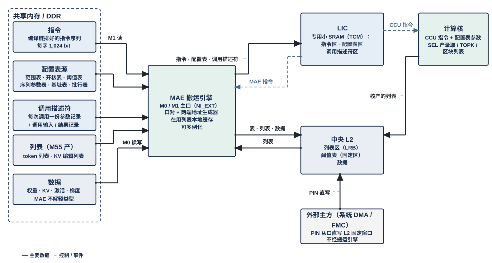

# L3PU 的外部输入信息：指令、配置表、调用描述符、列表、数据

> Owner: WangYizhao｜2026-11-11

## 1 概述

**L3PU 从外部接收的信息只有五类：指令、配置表、调用描述符、列表、数据。** 本篇定义这五类各是什么、由谁产生、何时变、放在哪、怎样进入 L3PU、由谁消费，供编译链、M55 Runtime、CIF、LIC、MAE 的设计者与各篇统一用名。五类的区别在于谁产生、什么时候变、谁消费：指令随模型与调用种类固定、由编译链产生；配置表随模型或工况固定、调用之间装载；调用描述符每次调用变一次、由 M55 写；列表在运行中产生、由核或 M55 写、驱动 MAE 的地址生成；数据随调用流动。前三类由 LIC 消费，从 LIC 的专用小 SRAM 取用；列表由 MAE 消费；数据（权重、KV、激活、梯度）由 MAE 按指令搬运，MAE 不解释其类型（V18-MAE-01）。

**"共享内存 / DDR"指 M55 与 L3PU 共用的片上系统 SRAM（HSRAM）与 DDR 共享区**：小而时延敏感的（调用描述符、配置表源、M55 产的列表）放 HSRAM，大的（指令序列、模型数据、KV、训练数据）放 DDR；L3PU 经 M1 读 HSRAM 与 DDR 共享区的信息、经 M0 读写 DDR 的数据。不是这五类的：CIF 的寄存器（三类）与中断——它们在 CIF 里、经 APB 读写，不存在存储里（§2.5）。

## 2 接口需求

### 2.1 架构图与接口汇总：五类信息的进入口

图中模块框内的结构是参考实现（见第 7 章），本章以框外的各口为准。

**共享内存 / DDR 里的五样全部由 MAE 搬运引擎搬进芯片**（M1 读指令、配置表源、调用描述符、M55 产的列表，M0 读写数据），搬运引擎按指令的目的口把它们送到 LIC 专用小 SRAM（经 NI_INT 的 LIC 直连口）、L2（经 NI 写口）或核 L1（经 HUB_IDN）；**唯一不经搬运引擎的是外部主方经 PIN 从口直写 L2 的 PIN 窗口**，因为那是从口、由外部主方发地址（V18-MAE-09 两条路并存）。核产的列表经 C2H 写 L2。LIC 向 MAE 发 MAE 指令、经命令网向各核 CCU 发 CCU 指令。

五类信息进入 L3PU 用到的口（口宽与条数以架构篇 §2.7 为准，本表只为阅读方便列出）：

| 口 | 对端 | 方向 | 位宽 | 握手 | 承载 |
|---|---|---|---|---|---|
| M1（PORT-27） | NI_EXT ⇄ SoC 片上互联（HSRAM、DDR 共享区） | AXI4 主 | 64 bit | AXI4 | 指令、配置表源、调用描述符、M55 产的列表、调用输入、结果记录 |
| M0（PORT-26） | NI_EXT ⇄ DDR P0 | AXI4 主 | 256 bit | AXI4 | 数据（权重、KV、激活、梯度）、VNU 配置表 |
| PIN（PORT-28） | 系统 DMA / FMC 从端 → NI_EXT | AXI4 从 | 64 bit | AXI4 | 调用输入直写 L2 的 PIN 窗口 |
| LIC 直连口（PORT-22） | NI_INT → LIC 专用小 SRAM | 入 LIC | 32 B | en / ready，写入握手 | 指令、配置表（含阈值表）、调用描述符 |
| NI 写口（PORT-18） | NI_INT → L2 | 入 L2 | 32 B | en / ready，写入握手 | 列表、VNU 配置表、数据 |
| IDN 出口 / 链路（PORT-17 / 16） | NI_INT → HUB_IDN → 各核 NWB | 入核 | 32 B | en / ready，写入握手 | VNU 配置表、数据 |
| C2H（PORT-13） | 核 → L2 本核象限 | 入 L2 | 32 B | en / ready，写入握手 | 核产的列表 |
| 命令网（PORT-23 / 24） | LIC → 各核 CCU / MAE_ENG | 出 LIC | 64 bit + addr | en / ready | CCU 指令、MAE 指令 |
| APB（PORT-29） | M55 ⇄ CIF | 从 | 32 bit | APB | CIF 的寄存器（三类）；中断是 CIF 另出的一根线（不属五类） |

### 2.2 M1 与 M0：搬运引擎读入共享内存 / DDR 里的信息

**经 M1 读入的是指令、配置表源、调用描述符、M55 产的列表与调用输入；经 M0 读写的是数据**；两口都由 MAE 的搬运引擎发请求（PORT-26 / 27，NI_EXT 篇）。一次读入就是一条搬运指令（源 = 共享内存 / DDR 的地址，目的 = LIC 直连口、NI 写口或 IDN 出口），**MAE 不核对内容、不解析表头**；表与指令的版本由调用描述符引用、LIC 在下一调用入口切换。

### 2.3 LIC 直连口：指令、配置表、调用描述符装进 LIC 专用小 SRAM

**指令、配置表（含阈值表）与调用描述符经 NI_INT 的 LIC 直连口（PORT-22，32 B）直接装进 LIC 专用小 SRAM，不经 L2**（V18-NII-08 / LIC-01）；**指令不存 L2，L2 也不在命令网上**（V18-TP-75）。LIC 专用小 SRAM 类似 CPU 的 TCM：LIC 只从这块本地存储取指令、查配置表、读本调用的调用描述符，不直接访问共享内存 / DDR。装载完成由搬运引擎数 LIC 直连口回的写入握手判定，满后经完成通知信号组带指令标号通知 LIC（登记篇 REG-08）。

#### 2.3.1 装入下一调用的内容

**当前调用执行期间可以装入下一调用的指令与配置表，不影响当前调用，在下一调用入口生效**；装载是当前调用里的一条搬运指令（目的口 = LIC 直连口）。容量与组织见 §7.1。

### 2.4 PIN 从口：外部主方直写 L2 的 PIN 窗口

**PIN 的每种输入只有一个 PIN 窗口**（窗口位置由编译链按输入种类定；起点按 32 B 对齐只是数据组织的默认，不作硬限制，L2 支持紧密存储）；**PIN 写与推理整体分先后：一帧传完之后推理才开始**，L2 不为 PIN 设保留堆（V18-L2-07、V18-MAE-44）。一笔 PIN 写事务不跨象限、不跨堆，有效字节必须连续（V18-NIE-04，NI_EXT 篇 §2.4）。**PIN 写入的位置与长度多数由编译链标定、写在指令里，也可能由 M55 在运行期经 CIF 的 PIN 相关寄存器给出；LIC 要能知道这一次取哪一份**（V18-CIF-06，CIF 篇 §3.9）；有哪些 PIN 寄存器、"取哪一份"放在指令里还是寄存器里，以及与调用描述符里"PIN 输入的实际长度"一项的关系，由 LIC 设计者提出后登记【设计者定】。**PIN 写入期间 L3PU 处于空闲或已停止**：这是为简化设计的当前做法，将来是否允许 PIN 写入与推理并行是后续要考虑的设计点（V18-CIF-06）。

### 2.5 APB：CIF 的寄存器（三类）与中断

**CIF 的寄存器（三类）经 APB（PORT-29）读写，不属于五类信息**（V18-CIF-02，CIF 篇 §1 / §2.2）：

| 类 | 谁写 → 谁读 | 例 |
|---|---|---|
| (a) 启动与打断类 | M55 写，L3PU 持续监听 | 运行控制（启动位、停止请求位、复位位） |
| (b) 配置与控制类 | M55 写，LIC 读 | 调用描述符指针、中断屏蔽、PIN 相关寄存器 |
| (c) 状态与信息类 | L3PU 写，M55 经 APB 查询 | 运行状态、中断事件位、调用完成时 L3PU 留给 M55 的信息 |

**调用完成状态不写进共享内存，由调用完成事件位与 LIC 登记的 (c) 类寄存器承载**：LIC 先写好调用完成时留给 M55 的信息（(c) 类），再经 CIF 的事件置位口置调用完成事件位（V18-MAE-26 / CIF-02 / 05，§3.4，CIF 篇 §2.2.2 / §3.4）；调试与看日志用的信息同样登记为 (c) 类寄存器（原 Monitor 并入这一类）。**LIC 是 CIF 在 L3PU 一侧唯一的寄存器读写方**，别的模块要给 M55 看的信息经 LIC（V18-CIF-05）。L3PU 需要 M55 介入时经 CIF 的 1 根中断线通知 M55（CIF 篇 §2.3）。具体有哪些寄存器由 CIF 设计者向相关模块采集需求后登记在 CIF 篇 §2.2.2。

## 3 功能描述

### 3.1 功能一览：五类信息总表

| 名称 | 是什么 | 谁产生、何时变 | 放在哪 | 怎样进入 L3PU | 谁消费 |
|---|---|---|---|---|---|
| **指令**（§3.2） | LIC 顺序消费的 1,024 bit 字，按执行模块分 LIC 指令、MAE 指令、CCU 指令、Fusion 指令（段头） | 编译链，随（模型, 调用种类）固定；运行期不改 | 共享内存 / DDR 中的指令序列；片上 LIC 专用小 SRAM | 经 M1 读口 → NI_INT LIC 直连口 → LIC 专用小 SRAM（装载是一条搬运指令） | LIC 取指；MAE 指令交 MAE 的搬运引擎执行，CCU 指令经命令网交目的核 CCU（每拍带目的端点内的地址，按地址写进 CCU 的指令寄存器或 Fusion 段 SRAM） |
| **配置表**（§3.3） | 调用之间装进 LIC 或核 L1 的表，按内容命名：范围表、开核表、阈值表、VNU 配置表、基址表、批行表、KV 段表、训练表 | 编译链或 M55，随模型 / 工况固定；可在当前调用执行期间装入下一调用用的表，下一调用入口生效 | 共享内存 / DDR 中的配置表源；片上 LIC 专用小 SRAM（含阈值表）、核 L1 A 类（VNU 配置表） | 同上；VNU 配置表由搬运引擎经 HUB_IDN 或 L2 → H2C 送进核 L1 A 类（V18-NLU-07） | LIC 按调用描述符的表键查表、把参数填进指令——**阈值表也由 LIC 消费：查出一对阈值填进 SEL 的比较指令，SEL 不读表**（V18-SEL-18）；VNU 经读口读 VNU 配置表 |
| **调用描述符**（§3.4） | M55 每次调用写的一份参数记录（调用种类、各记录地址、表键、开关、驻留版本号）；调用输入记录与结果记录随它 | M55，每次调用一份；本调用开始后，共享内存里下一份的改写不影响本调用 | 共享内存（HSRAM） | M55 写 CIF 的启动位后（CIF 交 LIC 启动脉冲与描述符指针）经 M1 读口 → LIC 直连口 → LIC 专用小 SRAM | LIC（查表、填指令、判断调用边界） |
| **列表**（§3.5） | 运行时产生、给搬运引擎的地址生成器用的索引序列（稀疏信息）；载荷只有位图或行号两种；**CCU 自己消费的元数据（元数据项、F 列表、列掩码来源）不算这里的列表，它们是核 L1 A 类里的普通数据块**（V18-L1-20） | 核（SEL 录取、TOPK、区块选择）在调用内产生；M55 产的 token 列表、KV 编辑列表随调用给 | 大批存 L2 列表区；M55 产的在共享内存 | 核产的经 C2H 写 L2，跨核的由 MAE_CRU 从 L2 读各核的选择位图、取并得读集后写回 L2 列表区；M55 产的经 M1 读口进 L2 或由搬运引擎直接读 | **MAE 搬运引擎**（列表驱动地址生成器；LIC 不读列表内容） |
| **数据**（§3.6） | 权重、KV、激活、梯度、特征、掩码、teacher 分布等张量字节 | 编译链（权重）、M55（调用输入）、L3PU 自己（KV、激活、梯度） | DDR（模型数据、KV、训练区）；调用输入在 HSRAM | 经 M0（大流量）或 M1（调用输入）由搬运引擎按指令搬运，目的口可为 L2、L1 或 LIC 直连口；SoC 侧数据（Token ID、图像）进 L2 两条路都支持：NPU 经 M1 读回落 L2，或外部主方经 PIN 从口直写 L2 的 PIN 窗口（V18-MAE-09、V18-MAE-44） | 核的 MXU / VNU；MAE 不解释类型 |

### 3.2 指令：编译链排好的序列，LIC 顺序取用

- **一条指令就是一个 1,024 bit 字**，按公共头的执行模块码分四类；编译链按真实层结构顺序展开，调用描述符给入口与有效字数。指令可以在同一调用里反复执行（层体复用），这是编译链的安排，不另起"模板"一名。
- **指令里只有当前调用不变的字段**；随工况变的参数（基址、有效范围、份号、参与核）由 LIC 查配置表填进下发的指令，MAE 与 CCU 执行端只在该基址上加本条指令内的偏移。
- **MAE 指令的内容**（V18-MAE-01 / 02）：来源口、目的口；源端与目的端各自的地址生成方式（算术：基址 + 行字节数 + 行数 + 跨距；列表驱动：基址 + 列表地址 + 项数 + 项字节数；源端另有一种按元数据项聚集——按各通道片的元数据项累加出片起点再取片，参数见 MAE_ENG 篇 §3.10.4，不算另一种搬运模式）；目的核集合；运算字段（经 MUX 三选一：**不经运算级 / 经 MAE_DSU / 经 MAE_CRU**；经 MAE_DSU 时再分**直通**与**转置**两种运算，转置由指令给元素位宽、行数、列数三个字段、MAE_DSU 用同一套逻辑，各用法的参数见 MAE_DSU 篇 §3.2 典型用法表；经 MAE_CRU 时给合并种类、象限掩码、L2 源与目的地址，V18-MAE-12 / 41、CRU-07）；可带第二目的（V18-MAE-16）；优先级；LIC 分配的指令标号（MAE 执行完带标号通知 LIC；MAE 不设完成计数器，指令不带等待条件，V18-MAE-13）。没有数据类型字段。**指令不指定由哪个搬运引擎执行**；L2 → L1 经 H2C 四道的指令在各道上怎样执行归 MAE（MAE_ENG 篇 §3.10）；**四个象限合并送一个核集合（合并送）时，目的排法（片交织 / 段接续）由指令的 1 bit 给出**（V18-MAE-45）。各模块需要的指令字段由各模块设计者按需整理，需要就加。
- **CCU 指令的内容**归 CCU 的设计（`CCU_STAGING.md`）；核侧要知道的类型信息（K 直接处理还是先 RoPE 再处理（V18-KV-01）、V 位宽、平面数、落 L1 W 类的排法是行字区还是列字区）写在 CCU 指令里，不经 MAE。
- **存放：LIC 的专用小 SRAM**，分指令、配置表、调用描述符三部分（§2.3）；**当前调用执行期间可以装入下一调用的指令与配置表，不影响当前调用，在下一调用入口生效**（§2.3.1，V18-LIC-01）；容量与组织见 §7.1。

### 3.3 配置表：调用之间装载的小表

| 表 | 内容 | 表键 | 存放 | 消费者 |
|---|---|---|---|---|
| 范围表 | 按真实长度分档的核级权重窗口、token 组大小、tile 数等 | 真实长度 | LIC | LIC 填指令 |
| 开核表 | attention 借核数、kv 头到核的分配 | 占槽数 / 有效节点数 | LIC | LIC 填指令 |
| 基址表 | 层基址、各地址名基址与步进规则（基址绑定表行） | （模型, 层, 位点） | LIC | LIC 填指令 |
| 阈值表 | 各位点的录取 / keep / FFN 门限，每个门限是一对阈值 $(\tau_{\text{hi}}, \tau_{\text{lo}})$，每调用按套号选一套 | 套号（调用描述符给）、位点 | LIC | **LIC 填指令**：把一对阈值填进 SEL 的比较指令字段（V18-SEL-18）；SEL 不读表 |
| VNU 配置表 | VNU 各单元的逐通道向量（$\gamma$、均值向量等）、RoPE cos / sin 表、置换、近似系数与查找表（若可装载）；**标量参数（$\epsilon_{\text{norm}}$、温度、门限、个数）不在表里，走 CCU 指令字段**（V18-NLU-07） | （模型, 层, kv 头） | DDR / HSRAM → 搬运引擎 → 核 L1 A 类（经 HUB_IDN 或 L2 → H2C） | NLU / QNT（经 L1 的 A 类读口与 L1 外的 A 类读 MUX 读入 VNU） |
| 批行表 | Batch 各行的段基址、长度、活动位（可片上驻留，带驻留版本号） | 行号 | LIC | LIC、CCU |
| KV 段表 | 各段的位置字段（上下文长度、下一位置号、段上界）与 M55 写的其余字段 | 段号 | DDR 共享区，经 M1 翻页 | LIC（调用末回写位置字段） |
| 训练表 | 训练位点的驻留侧（权重驻留或激活驻留，决定入口梯度 dY 落 L2 还是训练核 L1，登记篇 REG-11 / REG-15）；dX 的核间切分轴（编译链建议，硬件不设限制；LoRA 位点建议按输出通道 $k$ 切分、与同位点的权重梯度同核，架构篇 §3.6，V18-DORG-11） | （模型, 位点） | LIC | LIC 填指令 |

规则：**当前调用执行期间可以装入下一调用用的表，不影响当前调用，在下一调用入口生效**；装载是一条 MAE 指令（源 = 共享内存 / DDR 的配置表源，目的 = LIC 直连口或核 L1 A 类），MAE 不核对表头，表的版本号由调用描述符引用、LIC 在下一调用入口切换。旧称与现名的对照见 §3.7，都指这里的配置表源。

### 3.4 调用描述符：每次调用一份

- **只有它叫描述符。** 内容：调用种类（Prefill / Decode / Proposal / Verify / 独立训练 / 生成循环）、指令入口与有效字数、各记录地址（调用输入记录、结果记录、Draft 分布、随机数、批行表、KV 编辑列表）、配置表的表键（真实长度、占槽数、训练行数 $D$）与版本号、调用级开关（训练、区块搜索、阈值套号、置信度输出）、驻留选择位与驻留版本号、PIN 输入的实际长度（PIN 一帧传完后才提交调用，长度此时已定；与 CIF 的 PIN 相关寄存器的关系见 §2.4）。
- **调用输入记录与结果记录随它**：输入记录（token、anchor、树记录组、接受列表）由 M55 写在描述符指向的地址；结果记录（首 token、接受结果、TOPK 项）由 LIC 经一条 MAE 指令写回；**调用完成状态不作为状态字写进共享内存，由调用完成事件位与 LIC 登记的 (c) 类寄存器承载**：写结果记录那条指令执行完（AXI 写响应收齐、MAE 通知 LIC）后，LIC 写好 (c) 类里留给 M55 的信息、置调用完成事件位，CIF 发中断，M55 经 APB 读（V18-MAE-26 / CIF-02，CIF 篇 §3.7）。
- **本调用开始后，共享内存中下一份的改写不影响本调用**（怎样做到——参考：读入后一次锁存——归 LIC）。字段的字节格式由 LIC 等相关模块的设计者定后登记在 CIF 篇 §2.8（与 M55 共用的格式唯一一份登记处，V18-CIF-02）。

### 3.5 列表：运行时产生的索引序列

- **两种载荷**：位图（每行 / 每 key / 每区块 1 bit）或行号（**每项固定 3 B，任意词表都放得下的冗余设计，所有行号类列表同此**）。**两种载荷是同一条选择结果（"从 $N$ 个候选里选中了哪些"）的两种编码，可互相换算、不对应不同的稀疏种类；选哪种只看选中数 $k$ 相对候选数 $N$ 的大小与要不要跨核按位取并，三点差别与数值例见数据组织篇 §2.6。紧凑 token 记录的 keep 位图（在每片的元数据项里，每通道 1 bit）与 F 列表（F = 1 的通道序号，每项 2 B）是该记录自己的组成部分，分别就是 SEL 的判决位图与序号列表输出，不另当搬运用的列表**（数据组织篇 §2.5，V18-TP-65）。
- **列表没有头**：位图定长、项数由指令给；**序号列表（项数另存）、TOPK 重算词号列表、参与词号列表这类给 MAE 用、项数运行时才知道的列表，项数由生产核 CCU 写成一个定长计数项（地址由编译链给，与列表同在 L2），MAE 读列表前先读它**（V18-DORG-05）；不带"模板号"（V18-MAE-06）——哪条指令用哪张列表由指令引用列表地址表达。
- **紧凑 token 记录每个通道片的元数据项不是列表**：元数据项 = 项首码块片长 16 bit（码块在 A 类占的字节数，按 32 B 取整）+ F 项数 16 bit，后接 keep 位图，项宽补齐到 32 B 的倍数，由生产核 QNT（keep 位图来自 SEL；或产出压缩数据块的 MAE_CRU）写出、地址由编译链分配，与 F 列表一样落消费核 L1 A 类、由 CCU 经 A 类读 MUX 读取（V18-TP-68、V18-L1-20）。
- **种类**：读集（用同一份数据的所有源的选择位图取并的结果；MAE 只按读集从 DDR / L2 搬、按读集次序落 L1，**按被挑的是归约维还是输出维分两类，hi 与 lo 同一套**，数据组织篇 §3.5，V18-DORG-08；SEL 的录取列表跨源取并后就是录取 key 的读集）、录取列表（SEL 录取 key，驱动 K lo 或 K hi + lo、V 的 gather）、TOPK 重算词号列表（LM Head TOPK 列补算要用 hi + lo 全码重算 logits 的词号，SEL 按词号升序写出，数据组织篇 §2.11）、区块列表（区块搜索后的 K hi 读）、token 列表（嵌入 gather）、KV 编辑列表（M55 给的拷贝 / 压实 / 散写 / 作废动作，由 LIC 展开成带列表的搬运指令）、监督行列表。
- **存放与进入**：核产的列表经本核 C2H 进 L2，跨核的由 MAE_CRU 从 L2 读四个象限里各核的选择位图、取并得**读集**后经 NI 写口写回 L2 列表区（V18-TP-24、V18-CRU-07）；核内几个源的位图在本核取并；M55 产的列表在共享内存，经 M1 由搬运引擎直接读或先进 L2。大批列表存 L2 列表区（编译链地址名），**容量由编译链按该位点可能出现的最多项数静态分配**。
- **消费：列表由 MAE 读，不由 LIC 读**（V18-MAE-08）。搬运引擎的地址生成器按列表展开地址（源端或目的端）；LIC 只在指令里给列表的地址与项数，不看内容；KV 编辑列表同样由搬运引擎按项展开，LIC 只发指令。**搬运引擎逐拍出地址时不因取列表而停拍**（MAE 一侧怎样做见 §7.2）。CCU_RTR 出 pass 用的列掩码来源是本核产出或经 L2 → H2C 送来的数据，在核 L1 A 类（V18-L1-20，登记篇 REG-22）；pod 的逐源压紧器按该源的位图在读集次序里取数。
- **不设"稀疏读取"专门模式**：列表驱动就是通用的地址生成方式，稠密读取只是位图全 1 或算术地址的特例，搬运引擎不区分。
- **列表驱动的 gather 到核 L1 时，写入字数 = 列表计数 × 每项写入拍数（写入拍 = 链路上的一拍；默认对齐、整字项时每项写入拍数 = 每项存储字数，嵌入标量表这类 8 B 项每项 1 拍），由 MAE 自己数发出的拍数；各核的写入握手各自回到发令的搬运引擎，MAE 逐核数满后给目的核 CCU 发写完通知（段选 + 目的基址 + 写入字数），目的核 CCU 收到即可消费**（V18-TP-70）；从 CCU 一侧看，每核收经 H2C 落地与经 IDN 落地两路写完通知，两路互不等待、四核各自独立（架构篇 §2.5.2）。一项数据到齐与否不由 MAE 按数据格式判断，接收方也不解析数据。写完通知的三种情形：
  - **经 HUB_IDN 几个核共享（按字分核或多播）**：搬运引擎的应写量 = 各核实际收到的字数之和；**各核各自数满写入握手就各自收写完通知，各带写进该核的字数；全部数满后 MAE 再通知 LIC**（V18-MAE-43 / 45）。
  - **一条指令搬一份紧凑 token 记录的四块**（元数据项、E8M0 项、F 列表、码块）：**通知带码块的目的基址，字数 = 四块之和**，其余三块的位置由 CCU 按元数据项推出（V18-MAE-42）。
  - **按批流水**：结合 Fusion 指令先搬一批、算一批，算的同时搬下一批；每一批是一条搬运指令的一次执行、各发一次写完通知，"收到即可消费"按批判，不要求整份搬完（V18-DORG-10）；分批搬运时下一批的起点由 MAE 接续（V18-MAE-45）。

### 3.6 数据：随调用流动的张量字节

- **数据由 MAE 按指令搬运，MAE 不解释类型**（V18-MAE-01）：权重、KV、激活、梯度、特征、掩码、teacher 分布等都按口对 + 地址生成器 + 几何搬；类型、格式、布局由编译链折成指令的几何字段与 CCU 指令的类型字段。每类数据的路径、落点与完成方式见登记篇。
- **经 M0 进出的是大流量数据**（权重、KV、激活与残差往返、训练数据）；调用输入经 M1 读回或 PIN 直写进 L2。
- **SoC 侧数据（Token ID、图像）进 L2 两条路都支持：NPU 经 M1 读回落 L2，或外部主方经 PIN 从口直写 L2 的 PIN 窗口**（V18-MAE-09、V18-MAE-44）；PIN 的约束见 §2.4。
- **数据进 L1 前的整形有几条路，硬件都支持，由编译链按位点选**：L2 里存原形时走 NI 读口 → MAE_DSU → IDN；先经 MAE_DSU 整形存进 L2 的走 H2C；核内产生的由 QNT 直接排（V18-MAE-45，架构篇 §3.8）。

### 3.7 名称替换表

各篇统一用右列的名字（术语对照，不是修订历史）；V1.8 的其余改名见架构篇 §1.2。

| 现行稿里的叫法 | 统一后 |
|---|---|
| 指令镜像、指令表、命令、MAE 命令、SD.MAE 字段、位点命令、访存模板、模板与序列镜像、Fusion 描述符、位点描述符 | 指令（LIC / MAE / CCU / Fusion 指令） |
| 表镜像、模型配置表与模板镜像、表镜像头、连续镜像、VNU 序列镜像、序列参数表、NLU 参数表、阈值套库、分区表（已撤） | 配置表（范围表 / 开核表 / 基址表 / 阈值表 / VNU 配置表 / 批行表 / KV 段表 / 训练表）；共享内存里的叫配置表源 |
| 调用输入输出描述符、批描述、tile 级描述 | 调用描述符；批行表（配置表）；指令字段 |
| KV 计划、KV 编辑描述符、LRB 记录 | KV 编辑列表；列表；L2 列表区 |
| 模型镜像 | DDR 中的模型数据 |
| 掩码镜像、累加面镜像 | 掩码数据、累加面 |
| KV 元数据 | KV 段表（"元数据"一词现指紧凑 token 记录每个通道片的元数据项，它是 L1 A 类里的普通数据块，V18-L1-20） |
| token 长度表、合并长度表、长度表项 | 每个通道片的元数据项（V18-TP-66） |
| 布局码（每平面 4 bit）、K 存储精度码 | 退出（MAE 指令只给几何；核侧类型信息在 CCU 指令） |
| 共享内存、系统 SRAM、HSRAM、DDR 共享区（分别指） | 共享内存 / DDR（需要区分时写 HSRAM 或 DDR 共享区） |
| LIC 指令存储、表存储、模板缓存 | LIC 专用小 SRAM |
| 张量、载荷、数据平面 | 数据 |
| CRU、HUB_CRU、hub 中心的 CRU | MAE_CRU（合并单元，MAE 组成员，V18-MAE-11） |
| MAE 指令的整形模式字段（作为唯一选项） | 运算字段：不经运算级 / 经 MAE_DSU（直通或转置；转置给元素位宽、行数、列数）/ 经 MAE_CRU（合并参数）（V18-MAE-12 / 41） |
| 按字重排、半字合并、两平面合并、块尺度与旁带（MAE_DSU 的整形模式名） | MAE_DSU 的直通 / 转置两种运算的用法，见 MAE_DSU 篇 §3.2 典型用法表（V18-MAE-41） |
| 权重尺度 bank、激活尺度 bank、bias bank | L1 S 类（读口一拍 2 个地址，地址由编译链分配，架构篇 §3.4 CONC-6，V18-L1-31） |
| 完成计数号、消费门限、MAE 完成计数器 | 指令标号；MAE 执行完带标号通知 LIC（V18-MAE-13） |
| 对象标识（发出报告里） | 退出；报告按目的起始地址对应指令（V18-MAE-14 修订） |
| 状态字（结果记录里） | 退出；调用完成状态在 CIF 的 (c) 类寄存器（V18-MAE-26 / CIF-02） |
| 门铃 | CIF 运行控制寄存器的启动位（V18-CIF-02） |
| CIF Monitor 寄存器、调用完成状态寄存器、APB 状态寄存器 | CIF 的 (c) 类寄存器（V18-CIF-02） |
| 列表到齐计数 | 退出；MAE 数满写入握手后发写完通知（V18-TP-70） |
| 长度转发 | 写完通知（并入，握手数满后发，V18-TP-70） |
| 元数据类、元数据 SRAM、元数据读口 / 写口 | L1 A 类里的元数据项数据块（V18-L1-20） |
| qmax、kmax、tokmax、tokmax 块 | 撤（MXU 累加器按标准 FP32，不需要最大指数，V18-MXU-12） |
| 定基累加器、FBA | MXU 累加器（V18-MXU-12） |
| 补算列表 | TOPK 重算词号列表（V18-NAME-07） |
| 在用列表缓存 | 列表本地副本（V18-NAME-07） |

## 4 性能指标

| 项 | 要求 | 出处 |
|---|---|---|
| LIC 直连口 | 32 B/拍 | 架构篇 PORT-22 |
| 装入下一调用的指令与配置表 | 在当前调用执行期间完成、不影响当前调用 | §2.3.1 |
| 列表驱动的地址生成 | 搬运引擎逐拍出地址时不因取列表而停拍 | §3.5 |
| M0 有效带宽 | MAE 发请求的方式不使 M0 上的有效带宽低于 DDR 控制器能提供的带宽（参考点 19.2 GB/s） | 架构篇 §2.6，MAE_ENG 篇 §4.1 |

其余口的速率以架构篇 §2.7 / §4.3 为准。

## 5 约束与由使用者保证的事项

### 5.1 约束

1. **外部输入信息只有五类**；CIF 的寄存器（三类）与中断不属五类（§2.5）。
2. **指令、配置表、调用描述符只经 LIC 直连口进 LIC 专用小 SRAM；指令不存 L2**（V18-TP-75）。
3. **MAE 不感知数据类型、不核对表头**；指令里没有数据类型字段（V18-MAE-01）。
4. **列表不带模板号，由指令引用列表地址**（V18-MAE-06）。
5. 本篇不含容错设计（V18-TP-75）。

### 5.2 由使用者保证的事项

| 事项 | 由谁保证 |
|---|---|
| 指令与配置表的版本配套、下一调用的内容在下一调用入口生效 | 编译链 + LIC |
| 调用描述符的字节格式、提交顺序（写记录 → 缓存清洗 → 写描述符指针 → 写启动位） | CIF 篇 §2.8 / §3.4、M55 Runtime |
| 列表的载荷格式（位图 / 行号）与 L2 列表区按最多项数静态分配 | SEL / CCU_RTR 产出侧与指令、编译链；MAE 只按项字节数展开 |
| 张量数据的类型、格式、布局 | 编译链折成指令的几何字段（含 MAE_DSU 转置的元素位宽、行数、列数）与 CCU 指令的类型字段；MAE 不感知 |
| PIN 写入与推理的先后 | M55 Runtime 与外部主方：一帧经 PIN 传完后才提交调用；PIN 写入期间 L3PU 处于空闲或已停止（CIF 篇 §3.9） |
| PIN 一笔写事务不跨象限、不跨堆、有效字节连续 | 外部主方与 NI_EXT（V18-NIE-04） |

## 6 验收

### 6.1 本篇条目的验收项

| 编号 | 验收项 | 出处 |
|---|---|---|
| INFO-A1 | 各篇对外部输入信息只用五类名字与 §3.7 右列的名字 | §3.1、§3.7 |
| INFO-A2 | 指令、配置表、调用描述符经 LIC 直连口进 LIC 专用小 SRAM，不经 L2 | §2.3 |
| INFO-A3 | 当前调用执行期间装入下一调用的指令与配置表后，当前调用的执行结果与不装入时逐位相同；新内容在下一调用入口生效 | §2.3.1、§3.3 |
| INFO-A4 | 本调用开始后，共享内存中下一份调用描述符的改写不影响本调用 | §3.4 |
| INFO-A5 | 调用完成状态只经 CIF 的调用完成事件位与 LIC 登记的 (c) 类寄存器给出，不写进共享内存；事件位在 (c) 类信息写好之后才置 | §2.5、§3.4 |
| INFO-A6 | 列表只由 MAE 读；搬运引擎按列表出地址时不因取列表而停拍 | §3.5、§4 |
| INFO-A7 | PIN 每种输入一个 PIN 窗口，一帧传完后才提交调用 | §2.4 |

### 6.2 与上下游模块的对接检查项

| 编号 | 检查项 | 对端 |
|---|---|---|
| INFO-I1 | LIC 直连口的口宽与写入握手 | 架构篇 PORT-22，MAE_NI_INT 篇 |
| INFO-I2 | 调用描述符字段与字节格式 | CIF 篇 §2.8 |
| INFO-I3 | LIC 专用小 SRAM 的装入与生效时机、配置表查表与填指令 | LIC（`LIC_STAGING.md`） |
| INFO-I4 | 列表计数项、读集并集、TOPK 重算词号列表的格式 | 数据组织篇 §2.6、登记篇 REG-20 / 21 / 28 |
| INFO-I5 | MAE 指令字段（运算字段、合并送排法 1 bit、指令标号） | MAE_ENG 篇、ISA |
| INFO-I6 | CIF 的寄存器（三类）、启动与 PIN 相关寄存器 | CIF 篇 §2.2 / §2.5 / §3.9 |

## 7 参考实现

本章内容可以换；换了之后别的模块不用改。

### 7.1 LIC 专用小 SRAM：三区、各两份

参考组织：分指令区、配置表区（含阈值表）、调用描述符区；**指令区与配置表区各容纳当前与下一调用两份，运行期装载只写非活动份，当前被引用的份不覆写，下一调用入口切换**（V18-LIC-01）。参考容量：指令每调用几十 KB、配置表若干 KB、描述符约 256 B。容量与组织由 LIC 设计者定，约束是满足 §2.3.1（当前调用执行期间装入下一调用的内容、不影响当前调用、下一调用入口生效）。

### 7.2 列表本地副本：正在用的列表在 MAE 本地

参考做法：**正在被某个搬运引擎使用的列表在 MAE 本地留一份列表本地副本**，大批列表仍在 L2 列表区。副本容量、预取深度与替换由 MAE 设计者定，约束是搬运引擎逐拍出地址时不因取列表而停拍（参考：每个搬运引擎一段 ≥ 1 KB 的列表窗口）。

### 7.3 L2 → L1 指令在 H2C 四道上的执行

参考做法：H2C 四道每道一个搬运引擎（道引擎），一条 L2 → L1 指令由 MAE 的引擎总控拆给四道各自的引擎执行（V18-MAE-40，MAE_ENG 篇 §3.10，架构篇 §7.5）；指令本身不指定执行引擎。

## 8 为什么

### 8.1 需求的理由

- **五类而不是更多**（用户 11-06："这看起来太乱了……直接就说指令就行了，为什么要说指令镜像？"；"你漏掉了权重和激活值，这些也属于外部接收的信息"）：按"谁产生、何时变、谁消费"划分，每类一个名字，各篇不再各自起名。
- **LIC 只从专用小 SRAM 取用、列表由 MAE 消费**（用户 11-06："类似于 CPU 的 TCM 和 Cache 概念……大批数据的存储可以交给 L2 SRAM，但是正在被使用的列表需要在 MAE 处有存储的配置"）：LIC 不碰共享内存，MAE 不碰 LIC 的表，各自只装自己要消费的信息。
- **可在当前调用执行期间装入下一调用的内容**（用户 11-11 对分层清单外部信息篇 D1："认可"）：需求是"装入不影响当前调用、下一调用入口生效"这一行为，分两份只是一种做法。
- **MAE 只认几何**（V18-MAE-01）：数据类型差异在编译链消化，MAE 的指令与硬件都不随新数据类型变。
- **列表不带模板号**（V18-MAE-06）：指令引用列表，而不是列表指向指令，避免两边各存一份对应关系。
- **只有调用描述符叫描述符**：它是唯一每次调用都变、又不是列表的东西。
- **CIF 的寄存器分三类、不属五类信息**（V18-CIF-02，用户 11-11："我认为CIF本身就是一堆寄存器，有的是M55对其进行配置，L3PU时刻轮询监听……L3PU也可以对另一部分寄存器写入，去把一些关键信息存进去，供M55通过APB总线查询"）：门铃、调用完成状态、Monitor 都并进这三类，不单列。
- **PIN 保留寄存器、写入期间 L3PU 暂停**（V18-CIF-06，用户 11-11："我认为PIN还是应该保留寄存器……LIC最好还是知道当前要采取哪个信息，是从指令来的还是从M55配置来的，只是确实外部数据的写入阶段，L3PU可以被暂停"）。
- **调用完成状态归 CIF 寄存器**（V18-MAE-26，用户 11-06："我认为状态字应该是 CIF 的事情，L3PU 完成某个字的输出，给到 CIF 的某个寄存器"）：M55 经 APB 读寄存器，不必轮询共享内存里的状态字。
- **行号每项固定 3 B**（用户 11-06）：任意词表都放得下，所有行号类列表同一项宽，MAE 展开时不必按列表种类换项宽。
- **不设稀疏读取专门模式**（用户 11-06："稀疏读取必然兼容稠密读取"）：稠密是位图全 1 的特例，地址生成器只有一种做法。
- **指令不存 L2，L2 不在命令网上**（V18-TP-75，用户 11-10："我认为L2如果不负责存指令的话可以不在"）：指令只走 LIC 直连口进 LIC 专用小 SRAM，L2 只装数据与列表。
- **PIN 的每种输入只留一个 PIN 窗口、与推理分先后**（V18-MAE-44 / L2-07、V18-NIE-02，用户 11-10："我认为只留一个窗口，咱们保证传完之后推理才开始，这个不是咱们的一个设计主打"）：被否的做法是每种输入两个窗口按调用奇偶轮换，让下一帧与本次推理并行到达。
- **合并送的目的排法由指令的 1 bit 给出**（V18-MAE-45，用户 11-11："这不应该成为一个问题，指令加一位就行，各个模块的设计者需要按需整理都需要哪些指令"）。

### 8.2 参考实现的选型理由

- **LIC 小 SRAM 指令区与配置表区各两份**：运行期只写非活动份，当前调用引用的那份不被覆写，下一调用入口一次切换，LIC 不必等装载完成才开始下一调用。
- **列表本地副本**：大批列表放 L2、正在用的放 MAE 本地，搬运引擎逐拍出地址时不必每拍去 L2 取列表（用户 11-06 原话同 §8.1 第二条）。
