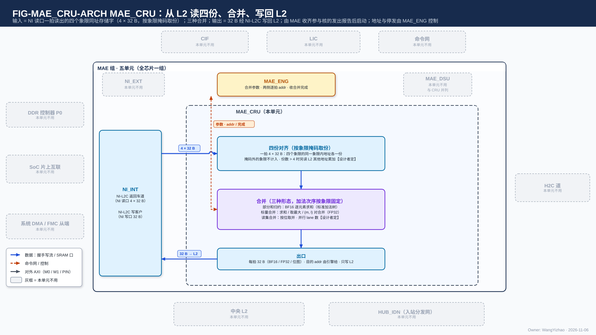
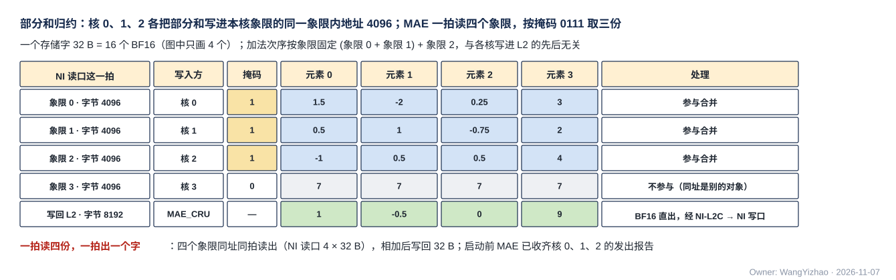
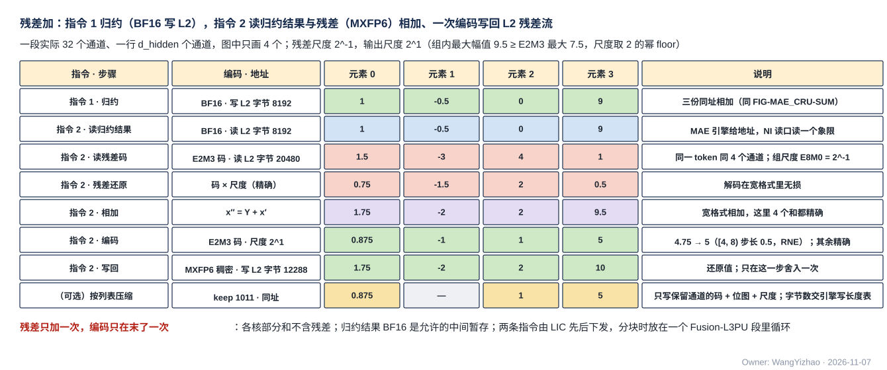
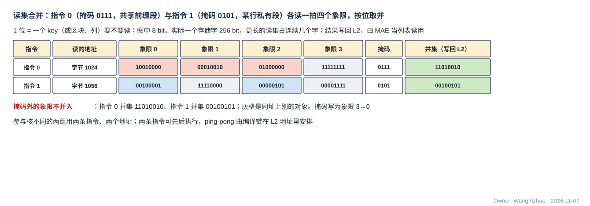

# MAE 合并单元（MAE_CRU）需求

> Owner: WangYizhao｜2026-11-11

## 1 概述

MAE_CRU 是 MAE 组五个交付单元之一（MAE_ENG、NI_EXT、NI_INT、MAE_DSU、MAE_CRU，V18-MAE-11；入站分发网 HUB_IDN 属 HUB 组，V18-HUB-01），全芯片一个，做**搬运途中按固定规则的合并**：把几路同一输出位置的向量逐元素相加（各核部分和的归约；归约结果与残差流相加；K 切分位点的 bias 加）、把各核的标量按类合并、把各核的读集按位取并。

**各核先经 C2H 把要合并的数据写进 L2（核 $n$ 写象限 $n$，各核写在同一段内地址）；MAE 收齐参与核的发出报告后，经 NI 读口一拍从四个象限各读一个存储字（合并时编译链把四份放在同一段内地址，四路给同一地址），MAE_CRU 按象限掩码取份、按指令给的编码解码、合并、按指令给的编码写出，结果经 NI 写口写回 L2；要到核 L1 时，另由一条搬运指令经 H2C 送下去。** 它是搬运指令的运算级之一（运算级三选一：不经运算级 / 经 MAE_DSU / 经 MAE_CRU）：**一组合并 = 一条搬运指令**，合并种类、参与象限、各路加数的编码、输出编码、源与目的地址都是这条指令的参数；两侧每拍地址由执行该指令的搬运引擎给出，写入完成由该引擎判定并通知 LIC。MAE_CRU 只与 MAE 组内的 NI_INT、MAE_ENG 相连，不直接连 MAE 组外的任何模块；物理位置归后端。

| 做 | 不做（归谁） |
|---|---|
| 三种合并：逐元素相加（归约、残差加、K 切分位点的 bias 加）、标量合并、读集合并（§3） | 不生成地址：读 L2 的源地址与写 L2 的目的地址都由执行该指令的搬运引擎逐拍给出（V18-MAE-25） |
| 从一拍读入的四个象限的存储字里按象限掩码取份 | 不决定何时开始：参与核的数据写完与否由 MAE 按发出报告判定；归约与残差加两条指令的先后由 LIC 排（§3.10） |
| 按指令给的编码解码每路加数、按指令给的编码写出（§3.8） | 不写核 L1、不经 H2C 或 HUB_IDN 送数（结果先落 L2）；不回标量给 CCU |
| 按列表压缩输出时产出紧凑 token 记录的元数据项、E8M0 项与码（§3.9） | 不处理 F 列表：相加与压缩都不用 F 列表的内容（§3.3、§3.9） |
| | 不做核内位点（单核、T / M 切分）的残差加与 bias 加（NLU 的后处理子模块 EPI）；不做 attention 的 $O$ 累加（NLU） |
| | 不做判决、并集的排序 / 压紧 / 切分（SEL、CCU）；不做屏障与 GO（LIC） |

**MAE_CRU 只提供合并形态与编码能力；用哪一种、哪些象限参与、各路加数是什么编码、输出什么编码、读哪里写哪里，都由搬运指令给出**（V18-MAE-12 / 21、V18-CRU-08）。本篇不写指令字段表（字段由 MAE 设计者按本篇的需求整理，见 MAE_ENG 篇与 ISA）。运算级选"不经运算级"或"经 MAE_DSU"时，数据不过 MAE_CRU。

本篇用到的几个词（其余术语在首次出现处定义）：

| 词 | 含义 |
|---|---|
| 核间切分归约维与部分和 | 矩阵乘 $Y = XW$（$X$ 为 $T \times K$，$W$ 为 $K \times M$）的归约维 $k$ 切成几段分给各核，核 $c$ 只持 $W$ 的行子集 $\mathcal K_c$，算出同一输出块的一份**部分和** $Y^{(c)} = X_{:,\mathcal K_c} W_{\mathcal K_c,:}$，完整输出 $Y = \sum_c Y^{(c)}$。反传 $\mathrm dX = \mathrm dY\,W^{\mathsf T}$ 的归约维是 $m$；attention 反传 $\mathrm dK = \mathrm dS^{\mathsf T} Q$ 按查询行分核时归约维是查询行，同理 |
| 象限、段内地址 | 象限是段选信号 `seg` 的字段，定义见架构篇 §3.3：**象限 $n$** = 核 $n$ 的 C2H 写入、H2C 第 $n$ 道与 NI 读口第 $n$ 路读出的那部分 L2 存储；段内地址 = 24 bit 字节地址，只表示所选象限、所选堆里的字节位置 |
| 同址异象限的份 | 各参与核把同一输出位置的数据写在各自象限的**同一段内地址**（V18-TP-48），这四个存储字就是该位置的至多四份；MAE 经 NI 读口四路各给这个地址、一拍各读一个存储字，即同拍拿到四份。**同址异象限是编译链对跨核合并定长份的放法，不是 NI 读口的限制**：NI 读口四路各给各的读地址、可以不同址（V18-L2-08） |
| 象限掩码 | 4 bit，第 $q$ 位为 1 表示象限 $q$ 那一份参与合并；由指令给出。掩码外象限的同址字属于别的数据块，不计入 |
| 读集 | 一份被几个源（token、查询行）共用的数据里要读哪些行或哪些列的位图，1 位对应一行或一列（一个 key、一个区块或一个输出通道 $m$）。稀疏取数统一走读集一条路（V18-DORG-08，数据组织篇 §3.5）：各源的选择位图取并得读集——核内由 SEL / CCU 取并，**跨核由本单元的读集合并取并**，$R = \bigcup_c R_c$；MAE 按读集只搬一次。读集按被挑的维分两类：**归约维读集**（线性位点 hi / lo 的行、粗算与 P×V 的 key 或区块）与**输出维读集**（gate/up 的列、精算 $QK^{\mathsf T}$ 的 key、LM Head 列补算的列、dX）；**每个源仍只用自己的选择位，并集只决定"一次读哪些"** |
| （最大值, 缩放和）对 | 查询行 $i$ 的 softmax 分母分在几个核上时（K 按核切分），核 $c$ 持 $m_c = \max_{j \in \mathcal J_c} s_{ij}$ 与 $l_c = \sum_{j \in \mathcal J_c} e^{s_{ij} - m_c}$，$s_{ij}$ 为 $S = QK^{\mathsf T}$ 的元素 |
| 残差加 | 残差位点（o、down）的输出 $x'' = x' + Y$，$x'$ 是进本层前的残差流（一个 token 一行 $d_{\text{hidden}}$ 个元素，MXFP6，MX 组长 $G$），$Y$ 是投影结果 |
| bias 加 | 有 bias 的线性位点输出 $Y + \mathbf b$，$\mathbf b$ 是该位点 $M$ 个 BF16 偏置（登记篇 REG-03）；**bias 只加一次，在 $K$ 全部累加完之后**（V18-EPI-02） |
| 编码 | 一路加数或输出的元素格式：BF16、FP16（逐元素 16 bit）、MXFP6（每元素 6 bit E2M3 码，每 $G$ 个元素共用一个 8 bit E8M0 尺度；**MX 组长 $G$ 是位点属性、由指令给：32 的倍数，上限【设计者定】且不大于片长；32 是精度基准、验收工况与效果最好的配置**，V18-MXU-10）、FP8（E4M3 / E5M2，逐元素 8 bit） |
| 码块、E8M0 项 | MXFP6 数据分两块存：**码块**装 6 bit 码，**E8M0 项**装每 $G$ 个元素一个的尺度（V18-TP-65）。在紧凑 token 记录里，码块是四部分（元数据项、E8M0 项、F 列表、码块）之一，只装保留通道的 6 bit 码；格式定义在数据组织篇 §2.5 |

## 2 接口需求

### 2.1 架构图与接口汇总

图中模块框内的结构是参考实现（见第 7 章），本章以框外的各口为准。

外框与 MAE 组其余四篇相同；**MAE_CRU 不与 MAE 组外直接相连，外圈全部画灰**。框外的口：左侧接 NI_INT——上方是读入（L2 的 NI 读口四路各读一个象限的存储字，4 × 32 B），读入线下的反向虚线是 ready（每路 en / ready、四路各自独立、可不同拍到），下方是结果出口（每拍 32 B 交 L2 写入合并器，经 NI 写口写回 L2）；右侧接 MAE_ENG——合并参数与编码、象限掩码、压缩输出用的 keep 位图与 F 项数从 MAE_ENG 进，合并完成从本单元出；各段的 ready 背压使执行该指令的引擎停发。框内三段（四份对齐、合并、出口）是参考的功能分段（本篇 §7.1）。

| 口 | 对端 | 方向 | 位宽 | 握手 | 出处 |
|---|---|---|---|---|---|
| 读入 | NI_INT 的 L2 读出分路（L2 的 NI 读口） | 入 | 4 × 32 B（每象限一路，四路各自给读地址） | 每路 en / ready，四路各自独立 | 架构篇 PORT-19、PORT-21 |
| 结果出口 | NI_INT 的 L2 写入合并器（L2 的 NI 写口） | 出 | 32 B 数据 + be 32；目的 addr / `seg` / `src` 由引擎给 | en / ready | 架构篇 PORT-18、PORT-21 |
| 合并参数 | MAE_ENG 的搬运引擎 | 入 | 格式为组内约定（MAE 集成篇 §2.10.1） | 随切换段给出 | — |
| keep 位图与 F 项数 | MAE_ENG 的搬运引擎 | 入 | keep 每通道 1 bit；F 项数每片 16 bit | 随输出 token 记录给出 | — |
| 合并完成 | MAE_ENG | 出 | 1 个事件 / 指令 | 无 | — |

口宽与条数以架构篇 §2.7 的 PORT-nn 为准，本表只为阅读方便列出。**单元之间每条线交什么、位宽、握手怎样做，是 MAE 组内的约定，写在 MAE 集成篇 §2.10.1（组内连接表；对外的 D4 / D5 见该篇 §2.3 / §2.4）**；本篇只写 MAE_CRU 要收什么、交什么、按什么语义算。

**各口共同的规则**：

- **进出每段都是 ready 握手**（en ∧ ready 成交）；**任一段 ready 拉低时，执行该指令的搬运引擎统一停发**，只降速、不丢数（用户 11-06："DSU 和 CRU 的地址都交给 MAE-ENG 来确定……可以由 ENG 统一控制"；V18-MAE-25）。
- **本单元不产生地址**：读 L2 的段内地址与象限掩码、写回 L2 的目的 addr / be / `seg` 都由执行该指令的搬运引擎逐拍给出（地址随哪条线走是组内约定）。
- **MAE_CRU 不连核间链路、不在命令网上**（V18-CRU-07 / TP-55）。

### 2.2 读入：经 NI 读口四路收四个象限的四份

#### 2.2.1 每拍内容与对应关系

**NI 读口四路各读一个象限，读出分四路交本单元：第 $q$ 路是象限 $q$ 的存储字；四路各给各的读地址、可以不同址，ready 各自独立**（V18-MAE-32、V18-L2-08；L2 篇 §2.5 的 NI 读口）。**跨核合并时编译链把各份放在四个象限的同一段内地址（同址异象限），所以归约、标量合并、读集合并的指令让四路给同一个段内地址**；残差加的两路加数、bias 那一路则按各自地址读。

- **四路可以不同拍到达**：L2 的读口是读地址流加读数据流两条握手流，同一个堆被别的链路占用时某象限的读出会晚到（架构篇 §2.4.2，V18-TP-80）。**要求是不丢、不错拍、参与合并的各份属于这条指令同一个输出位置；掩码外的象限不参与**；怎样把晚到的份对齐归参考实现（本篇 §7.4）。
- **不参与的核**：参与与否由象限掩码给出；不在掩码里的象限不读入合并，求和时不计入（不是按 0 计）。
- **两路加数分拍读入**：残差加指令的两路加数（归约结果、残差流）在 L2 的两个地址，由引擎按各自地址发读，**相加的两个元素属于同一 token 的同一个通道**；带 bias 的归约另读一路 bias（每个结果允许 2 拍，§3.4）。
- **紧凑 token 记录的读入**：残差输入为紧凑 token 记录时，本单元要拿到的是该片的元数据项、E8M0 项与码块；**相加不用 F 列表**（§3.3，V18-DORG-05 (9)、V18-MAE-44）。

### 2.3 结果出口：每拍 32 B 交 L2 写入合并器写回 L2

#### 2.3.1 每拍内容与写入完成

**本单元每拍交出一个 32 B 结果（压缩输出时尾拍 be 只开有效字节），经 NI_INT 的 L2 写入合并器、NI 写口写回 L2**；这一拍的目的 addr / `seg` / `src` 由执行该指令的搬运引擎给出（V18-MAE-25）。L2 写进存储后沿 NI 写口回写入握手（valid + `src`），**由执行该指令的引擎数满应写量判写入完成**（V18-TP-47），本单元不数写入握手。

**结果只写 L2，可写任一象限，也可按段掩码同址写多个象限**（L2 篇 §2.3 的 NI 写口能力，V18-L2-04）。按列表压缩时依次交出三条流（元数据项、E8M0 项、码），每一拍属于哪条流、写到哪个基址由引擎决定（§3.9）。

### 2.4 合并参数：随切换段由搬运引擎给出

#### 2.4.1 参数项

本单元从执行该指令的搬运引擎收以下参数（随切换段给出——切换段是发令方内部的切换粒度，协议篇 §3.10；格式为组内约定）：

| 参数 | 内容 |
|---|---|
| 合并种类 | 逐元素相加 / 标量合并（求和、取最大、（最大值, 缩放和）对）/ 读集合并 |
| 象限掩码 | 4 bit，哪几个象限的份参与（§1 术语） |
| 每份多长 | 本切换段的数据量 |
| 每路加数的编码、输出编码 | §3.8 的编码表 |
| MX 组长 $G$ | 输入或输出含 MXFP6 时 |
| 归约是否带 bias | §3.4 |
| 压缩输出的通道数与片长 $P$ | 输出编码为"MXFP6 按列表压缩"时（§3.9） |

### 2.5 keep 位图与 F 项数：压缩输出时由搬运引擎交来

**输出编码为"MXFP6 按列表压缩"时，本单元按输出 token 记录收一份 keep 位图（每通道 1 bit，SEL 的判决位图，V18-SEL-18），并按通道片收一个 F 项数（16 bit，该片 F 列表的项数）**（V18-DORG-11 (4)）。keep 位图决定保留哪些通道；F 项数只被原样填进元数据项首字，本单元不数、不看 F 列表。两者从 L2 读出、按记录与按片交给本单元，是 MAE 组内的分工（参考见本篇 §7.3）。

### 2.6 合并完成

**本单元把"本条指令的全部结果已交出"告诉执行该指令的搬运引擎**；写入完成仍由引擎数写入握手判定，完成通知由引擎经 MAE → LIC 的完成通知专用信号组带指令标号发出（架构篇 PORT-38，V18-TP-47 / MAE-13）。**MAE_CRU 本身不发完成通知。**

### 2.7 经 MAE 组对外的接口

无。MAE_CRU 的进出都经 NI_INT 与 L2 之间的 NI 读口、NI 写口（MAE 集成篇 §2.3 / §2.4 的 D4 / D5）。

## 3 功能描述

### 3.1 功能一览

**三种合并形态，按"运算的本质"归类，不按用途分节**；用哪一种由指令的合并种类给出。归约、残差加、bias 加是逐元素相加的三种用法，前两者是两条指令，bias 加并入归约指令。

| 功能 | 输入 | 输出 | 触发 / 生效条件 | 节 |
|---|---|---|---|---|
| 逐元素相加（归约） | 掩码内各份部分和（同址异象限） | 按输出编码写回 L2 | 收齐参与核的发出报告后执行 | §3.2 |
| 逐元素相加（残差加） | 归约结果 + 同一 token 的残差流（稠密或紧凑） | 稠密残差格式写回 L2 残差流 | 归约指令完成后由 LIC 下发 | §3.3 |
| 逐元素相加（bias 加） | 归约的各份 + 该位点的 bias 数据块 | 各份相加之后加一次 bias | 归约指令带 bias | §3.4 |
| 标量合并 | 各份同一位置的 FP32 标量 | FP32 合并值 | 合并种类为标量合并 | §3.5 |
| 读集合并 | 各份读集位图 | 并集位图 | 合并种类为读集合并 | §3.6 |
| 份数与输入长度 | 指令给的源地址与数据量 | — | 每条指令 | §3.7 |
| 输入与输出编码 | 指令给的编码字段 | 按字段解码、相加、编码 | 每条指令 | §3.8 |
| 按列表压缩输出 | 相加结果 + keep 位图 + F 项数 | 紧凑 token 记录的三部分 | 输出编码为"MXFP6 按列表压缩" | §3.9 |
| 启动与指令先后 | 发出报告；LIC 下发 | — | 收齐报告 / 前一条指令完成 | §3.10 |
| 输出去向与完成 | 结果 | 只写 L2；完成告知引擎 | 每条指令 | §3.11 |
| 确定性 | — | 结果与到达时序无关 | 恒定 | §3.12 |
| 精度 | — | 与参照逐位一致 | 恒定 | §3.13 |
| 复位 | CIF 的复位 | 复位后无在途读入与合并 | 复位 | §3.14 |

| 形态 | 按矩阵维度说做什么 | 每份 | 输出 | 典型用途 |
|---|---|---|---|---|
| 逐元素相加 | 掩码内各份（或指令指定的两路数据块）的向量逐元素相加：归约 $Y = \sum_c Y^{(c)}$，带 bias 时各份相加之后再加成 $Y + \mathbf b$；残差加 $x'' = x' + Y$ | 一个存储字按编码装 16 个（BF16 / FP16）、32 个（FP8）或 42⅔ 个（MXFP6 稠密：码块里码连排，尺度在 E8M0 项）元素 | 按指令编码：BF16 / FP16 / MXFP6 稠密 / MXFP6 按列表压缩 | 核间切分 $k$ 的线性位点（归约 + 残差位点的残差加）；dX 沿 $m$ 跨核切分；dK / dV 按查询行分核 |
| 标量合并 | 各参与份里同一位置的 FP32 标量按类合并：求和、取最大、（最大值, 缩放和）对合并 | 一个存储字放 8 个 FP32（对合并为 4 对） | FP32 | 归一化的 $\Sigma x^2$、量化的组最大值、lse、梯度范数平方 |
| 读集合并 | 各参与份的读集按位取并，$R = \bigcup_c R_c$ | 一个存储字 = 256 bit | 并集位图 | 一份数据被几个核的源共用时的读集：归约维与输出维两类 |

### 3.2 逐元素相加（归约）：解码后逐元素求和，加法次序按象限固定

**把掩码内各份按各自编码解码、逐元素相加，按指令给的输出编码写出；加法树按标准设计，加法次序按象限号固定**（用户 11-06："BF16 的加法树可以直接走标准设计"；V18-CRU-03）。核 $n$ 只写象限 $n$，所以"按象限固定"就是"按参与核固定"；结果与各核写 L2 的先后、NI 读口各路何时到达都无关（§3.12）。部分和归约的默认用法：四份 BF16 输入、BF16 输出，与下图相同。

图中核 0、1、2 各把同一输出位置（例如 token 5、输出通道 0–15）的部分和写进本核象限的段内字节 4096；象限 3 的同址字属于别的数据块（核 3 不参与）。MAE 收齐核 0、1、2 的发出报告后，NI 读口一拍读出四个象限的字节 4096；象限掩码 0111 取前三份，按 (象限 0 + 象限 1) + 象限 2 相加，得 1、−0.5、0、9，写回 L2 字节 8192。一个存储字实际 16 个元素，图中只画 4 个。脚本断言：若把掩码外的象限 3 计入，结果会不同。

### 3.3 逐元素相加（残差加）：归约结果与 L2 里的残差相加，一次编码写回残差流

**核间 K 切分的残差位点（o、down）由两条指令完成：第一条做归约（§3.2，输出 BF16 写 L2）；第二条读归约结果数据块（BF16）与同一 token 的残差流数据块（驻 L2），解码后逐元素相加 $x'' = x' + Y$，按稠密残差格式一次编码成 MXFP6 写回 L2 残差流**（用户 11-08："先一条指令做归约，再一条指令做残差"；V18-CRU-08）。**K 切分位点的残差流驻 L2，残差加在本单元**；核内位点（单核、T / M 切分）的残差加由 NLU 的后处理子模块 EPI 做（V18-EPI-01，EPI 篇 §3.3）。

- **残差输入两种格式都要支持**（V18-DORG-02）：稠密残差格式（"码块 + E8M0 项"），或紧凑 token 记录。紧凑时**本单元只用元数据项里的 keep 位图、E8M0 项与码块，按 keep 展开、被判 Z 的位置补 0，再值 = 码 × 尺度**；第 $i$ 个码对应 keep 里第 $i$ 个 1，展开规则与 EPI 还原残差同一规则（V18-TP-66）。**F 列表不参与相加，结果与 F 列表的内容无关**（V18-DORG-05 (9)、V18-MAE-44）。输入编码由指令给。
- 两路加数在 L2 的两个地址、各自读入；相加的两个元素属于同一 token 的同一个通道（§2.2.1）。
- **残差只加一次、加完只编码一次**（用户 11-03）：各核的部分和不含残差，归约结果以 BF16 中间暂存（允许的中间格式），残差加在解码后的宽格式里做，MXFP6 编码只在最后一次。
- **残差加的输出一律稠密**（BF16 / FP16 / MXFP6 稠密残差格式）：$x''$ 的 keep 要等核里 SEL 判完 $\mathrm{RMSNorm}(x'')$ 才有，本单元加完时没有掩码；残差流配置为紧凑格式的位点由核侧 QNT 在 SEL 之后把 $x''$ 压缩写回 L2（数据组织篇 §2.8，V18-DORG-02）。**残差加指令不按列表压缩。**
- 分块流式（一个位点的输出按 token 块或列块分批产出）时，两条指令放在一个 Fusion-L3PU 段里由 LIC 按块循环下发（协议篇 §3.19）：每块先归约、再残差加；**每条指令独立完成**，循环与块号由 LIC 的 Fusion 段管，不要求本单元记块号。

图中指令 1 是 §3.2 的归约（三份相加得 1、−0.5、0、9，BF16 写 L2 字节 8192）；指令 2 读回这 4 个 BF16，再读同一 token 同 4 个通道的残差码（E2M3 码 1.5、−3、4、1，组尺度 $2^{-1}$，还原 0.75、−1.5、2、0.5），相加得 1.75、−2、2、9.5，按组编码：组内最大幅值 9.5，E2M3 最大 7.5，尺度取 $2^{1}$，码 0.875、−1、1、4.75 → 4.75 按 RNE 舍到 5（E2M3 在 4–8 区间步长 0.5），写回 L2 残差流字节 12288。实际一个 MX 组 $G$ 个通道（例 32）、一行 $d_{\text{hidden}}$ 个通道，图中只画 4 个。

### 3.4 逐元素相加（bias 加）：并入归约指令，各份相加之后加一次

**核间 K 切分位点各核手里只有部分和，bias 不在各核的 EPI 加；有 bias 的位点由归约指令在各份相加之后加一次 bias，再按输出编码写出**（V18-CRU-09，用户 11-09："我认为需要归入归约指令"；V18-EPI-02）。非残差位点同样由这条归约指令覆盖；残差加指令仍是两路加数（§3.3）。核内位点的 bias 由 EPI 在 $K$ 全部累加完之后加（EPI 篇 §3.4）。

- 输入：掩码内各份部分和（同址异象限）与该位点的 bias 数据块（$M$ 个 BF16，按 $m$ 连续，登记篇 REG-03）。**bias 数据块先由另一条搬运指令从 DDR 搬进 L2**（本单元只读 L2），地址在归约指令里；**bias 的每个元素对应同一输出通道 $m$**。
- 运算：先按象限固定次序把各份相加得 $Y$，**再加 $\mathbf b$**：同一输出通道 $m$ 的每个 token 加同一个 $b_m$；**bias 只加一次**。
- 残差位点（o、down）有 bias 时，归约指令输出 $Y + \mathbf b$（BF16）写 L2，残差加指令再算 $x'' = x' + (Y + \mathbf b)$，最后一次编码。
- 参照为"FP32 里先按象限次序累加各份、再加 $b_m$、末了一次舍入或量化"（§3.13）。
- **速率：带 bias 的归约每个结果允许 2 拍**（V18-CRU-10，用户 11-09："允许两拍计算"）。不带 bias 的归约仍每拍一个结果（§4.2）。按参考做法得出这个允许值的推导见本篇 §7.2。

例（接 §3.2 的图，3 份相加得 1、−0.5、0、9）：该位点通道 0–3 的 bias 为 0.25、0.25、−1、0.5，归约指令输出 1.25、−0.25、−1、9.5（BF16 精确），写回 L2 字节 8192。

### 3.5 标量合并：求和、取最大、（最大值, 缩放和）对合并

**标量是 VNU 的输出，与其他输出一样由 CCU 选写 L1 或经核的集成输出端口写 L2（V18-TP-56）；要跨核合并的，各核写进本核象限的同一段内地址，一个存储字放 8 个 FP32**（对合并时 $m_c$、$l_c$ 相邻，4 对），**不走命令网**（用户 11-07："他们不属于控制网，需要走数据通信协议"；V18-TP-55）。MAE_CRU 对掩码内各份的同一位置逐个合并，结果写回 L2；核要用合并值时，由另一条指令经 H2C 落 L1，VNU 从 L1 读。**（最大值, 缩放和）对合并在 MAE_CRU 做**（用户 11-06："这个操作看起来硬件通路需求比较低"）：

$$m' = \max_c m_c,\qquad l' = \sum_c l_c\, e^{\,m_c - m'}$$

只有 MAE_CRU 同时看到各核的值；若不在这里做，就要把各核的对送回一个核再由 NLU 合并，多一轮往返。

例（3 个核，FP32，同一位置）：

| 类 | 核 0 | 核 1 | 核 2 | 合并值 |
|---|---|---|---|---|
| 求和（如 $\Sigma x^2$ 的部分值） | 2.0 | 3.5 | 0.5 | 6.0 |
| 取最大（如组最大值） | 1.25 | 3.0 | 2.5 | 3.0 |
| 对合并 $(m_c, l_c)$ | (5, 2.0) | (3, 4.0) | (4, 1.0) | $m' = 5$，$l' = 2.0 + 4.0\,e^{-2} + 1.0\,e^{-1} \approx 2.9092$ |

对合并中核 1 的 $l_c$ 被 $e^{-2}$ 缩放、核 2 的被 $e^{-1}$ 缩放；求和与对合并的加法同样按象限固定次序。一个存储字里放几个标量、哪些位置有效由编译链按地址安排；不满 8 个时，结果字的无效位置照样合并、由消费方忽略（be 只决定写回哪些字节）。

### 3.6 读集合并：按位取并

**掩码内各份的读集按位取并；一个存储字 256 bit，更长的读集占连续几个存储字，按拍依次读、依次写回**（粒度 256 bit，V18-CRU-04）。结果写回 L2，由 MAE 当列表（位图形式）读用（V18-MAE-12）：**MAE 按这份读集从 DDR / L2 只搬一次、按读集次序落各核 L1**（V18-DORG-08）。并集之后不再按每片保留上限截断、不另加强制入选、不按分档过滤（分档只在 CCU 选门限时用，V18-SEL-16）；结果与各核用哪种选择模式无关（V18-SEL-02）。只有一个核执行时，读集由该核自己形成，不经 MAE_CRU。

图中指令 0 合并共享前缀段的读集（参与核 {0, 1, 2}，掩码 0111，读段内字节 1024），指令 1 合并某一行私有段（参与核 {0, 2}，掩码 0101，读字节 1056）：参与核不同的两组用两条指令、两个地址。各读一拍四个象限，掩码外的灰格不并入；并集分别为 11010010、00100101，写回 L2。图中 8 bit，实际一个存储字 256 bit。

### 3.7 份数与输入长度

- **一拍至多四份**（每个象限一份）。份数超过四份时（例如 dK / dV 分段计算，上一段的部分和存在 L2 的另一地址），由指令再给源地址、多读几拍累加；**是否支持、最多几份【设计者定】**：要定的是超过 4 份的累加能力，约束是加法次序固定、结果逐位确定。DDR 里的份先由另一条指令搬进 L2 再参与，**MAE_CRU 只读 L2**。残差加指令固定两路（§3.3）；带 bias 的归约指令在各份之外多读一路 bias（§3.4）。
- **输入全部定长**：每路加数按其编码定长（BF16 / FP16 / FP8 逐元素；MXFP6 稠密按每个 MX 组 $3G/4$ B 码 + 1 B 尺度，码与尺度分在码块与 E8M0 项），标量为 FP32，读集每位一个 key / 区块 / 列；**应读多少只来自指令，MAE_CRU 的输入方向没有变长信息**（用户 11-06："我认为 CRU 里应该是没变长信息吧"；V18-MAE-21）。**唯一的例外是残差加指令的残差输入可以是紧凑 token 记录**（V18-DORG-02）：该片的定位按元数据项（数据组织篇 §2.5），本单元按 keep 展开成稠密再相加（§3.3），本单元不自己解析长度。
- **输出可变长**：只有"MXFP6 按列表压缩"一种输出是变长的（§3.9）；本单元按片产出元数据项（首字是码块片长与 F 项数，后接 keep 位图）随结果交出，不自己记地址。

### 3.8 输入与输出编码：由指令给出，本单元只做解码、相加、编码

**每路加数的编码与输出编码都由搬运指令给出；本单元按指令解码输入、在内部宽格式里相加、按指令编码输出**（用户 11-08："只需要MAE的指令里标定他的待加法来源是什么编码，需要输出什么编码即可"；V18-CRU-08）。

| 方向 | 编码 | 一个元素 | 尺度 | 解码 / 编码规则 |
|---|---|---|---|---|
| 输入 | BF16 | 16 bit（1 + 8 + 7） | 无 | 直接取值 |
| 输入 | FP16 | 16 bit（1 + 5 + 10） | 无 | 直接取值 |
| 输入 | MXFP6（MX 组长 $G$） | 6 bit E2M3 码 | 每 $G$ 个元素一个 E8M0（8 bit，2 的幂） | 值 = 码 × 尺度，在 BF16 / FP32 里精确 |
| 输入 | FP8 | 8 bit，E4M3 或 E5M2（指令给出哪一种） | 无 | 直接取值 |
| 输入 | MXFP6 紧凑 token 记录（只用于残差加的残差输入，V18-DORG-02） | 一个通道片 = 元数据项（首字 = 码块片长（按 32 B 取整）16 bit + F 项数 16 bit，后接 keep 位图 $P$ bit）+ E8M0 项（每 $G$ 通道一个）+ F 列表 + 码块（保留通道的 6 bit 码按通道序紧密排列），格式见数据组织篇 §2.5 | E8M0 项，每 $G$ 通道换一个 | 只用 keep 位图、尺度与码：第 $i$ 个码对应 keep 里第 $i$ 个 1，按 keep 展开、被判 Z 的位置补 0，再值 = 码 × 尺度；F 列表不参与相加 |
| 输出 | BF16 / FP16 | 16 bit | 无 | 相加结果按 RNE 舍入 |
| 输出 | MXFP6 稠密 | 6 bit E2M3 码 | 每 $G$ 个元素一个 E8M0 | 与 QNT 同一套量化规则（VNU_QNT §3.2：每 $G$ 个元素按组内最大幅值定尺度、floor 取 2 的幂、码按 RNE）；**写成"码块 + E8M0 项"两块**（V18-TP-65） |
| 输出 | MXFP6 按列表压缩 | 同上，只写 keep 的通道 | 同上 | §3.9 |

- 几路加数的编码可以不同（残差加：BF16 + MXFP6 稠密或紧凑）。同一路加数在一条指令内编码不变。
- **同一编码只有一种结果：本单元的 MXFP6 输出与 QNT 对同一输入的量化结果逐位相同**（§6.1 验收；V18-CRU-08）。
- 内部宽格式与加法精度的要求见 §3.13；解码、编码不得降低 §4.2 的速率。
- FP16 / FP8 输入当前没有产出方（现行部分和 BF16、残差 MXFP6、流动梯度 MXFP6），只作格式能力写入，不配应用。

### 3.9 按列表压缩输出：用 keep 位图丢通道，产出紧凑 token 记录的三部分

**输出编码为"MXFP6 按列表压缩"时，本单元对每条输出 token 记录（一个 token 一行，按指令给的片长 $P$ 切成通道片）按交来的 keep 位图（每通道 1 bit）只保留被选中的通道，按片产出紧凑 token 记录四部分中的三部分：元数据项（每片一项：首字放码块片长 16 bit 与 F 项数 16 bit，后接 keep 位图）、E8M0 项（每 $G$ 个保留通道一个尺度）、码（保留通道的码按通道序紧密排列）**（用户 11-08："MAE能拿到稀疏列表，因此理论上也可以做压缩"；V18-TP-64 / 66 / 68、V18-MAE-44）。第四部分 F 列表不经本单元运算（MAE 组内的做法见本篇 §7.3）。输出四部分的格式（各部分的排法、对齐与补齐）以数据组织篇 §2.5 为准。要点：

- **只用 keep 位图**：keep 位图与 F 列表都是 SEL 的产出（一个门限的一对阈值一遍出的判决位图与 F 序号列表，V18-SEL-18）；**本单元不读、不处理 F 列表**（V18-MAE-44）。
- **尺度按保留通道的最大幅值定**（与 QNT 对紧凑 token 记录的做法相同，VNU_QNT §3.2 / §3.4）；**码块片长由本单元按 keep 位图算出**，填进元数据项首字。
- **F 项数由搬运引擎按片交来，本单元原样填进元数据项首字**（V18-DORG-11 (4)）：SEL 写进 L2 的 F 列表按通道片补齐，每片 F 项数另成定长计数项，MAE 读计数后按片把 F 项数交本单元（参考分工见本篇 §7.3）；**每片 F 项数由 SEL 按片写进本核 L1 A 类，CCU 随 F 列表经 C2H 送 L2，MAE_ENG 先读它**（V18-TP-83 (5)，数据组织篇 §2.5.1）。
- **只用于归约指令**：残差加的输出一律稠密（§3.3）。按列表压缩用于判决在合并之前已由别的位点产出、指令能给出 keep 位图与 F 列表的合并；当前数据流没有固定应用，作为编码能力保留（V18-CRU-08）。没有列表时按 MXFP6 稠密输出。
- **本单元不记地址**：三部分各写到哪个基址、每片从哪里接续由搬运引擎按指令给的基址决定；压缩输出不另写 token 长度表，每片的码块片长与 F 项数就在元数据项首字里。

### 3.10 启动与指令先后：收齐参与核的发出报告；残差加在归约之后

**写进 L2 的过程由各核 CCU 控制：CCU 数满 L2 回来的写入握手后向 MAE 发出报告；MAE 收齐参与核的发出报告，才执行这条合并指令**（用户 11-07："CC 完成后会发握手信号，MAE 识别握手信号决定下一级操作"；V18-TP-47 / 49）。报告按目的起始地址配给指令（报告的目的起始地址 = 合并指令的源起始地址），没有发送次序约束。**MAE_CRU 自己不计数、不等待到达**：它收到的读入就是可以合并的数据。

**残差加指令的加数之一是归约指令的结果，所以它在归约指令完成之后由 LIC 下发**；两条指令之间的依赖在 LIC 表达（V18-MAE-13）。分块流式时两条指令组成一个 Fusion-L3PU 段，LIC 按块循环下发（用户 11-08："可以有Fusion指令来监督循环执行（如果涉及到分块流式）"；协议篇 §3.19）；残差流数据块已在 L2，不需要发出报告。**每个 tile 是一条合并指令，各自完成**；tile 之间的 ping-pong 写在 L2 地址里、由编译链安排，硬件不知道分区（用法例见本篇 §7.6）。

### 3.11 输出去向与完成：只写 L2；要到核 L1 时另由一条指令经 H2C

**逐元素相加的输出编码由指令给出：BF16、FP16、MXFP6 稠密、MXFP6 按列表压缩**（§3.8）；标量合并输出 FP32，读集合并输出位图。一组结果超过 32 B 时占连续几个存储字、分多拍写（V18-CRU-01）。**不带组序号，位置由每拍地址给出**（V18-CRU-05）。

| 去向 | 经由 | 地址 |
|---|---|---|
| L2 | 结果出口 → NI_INT 的 L2 写入合并器 → NI 写口（可写任一象限；可按段掩码同址写多个象限，V18-L2-04） | 搬运引擎逐拍给 |

**结果不直接写核 L1**（用户 11-07："我仍然建议先写到 L2，再交到 L1，这样的设计会比较有序，如果这个数据，需要直接写到 L1 的话，那直接算完然后做一个如此长距离的数据传输，会有风险"）。归约值回归约属主核、标量合并值回各核、并集送核，都由后续一条 L2 → L1 搬运指令经 H2C 道送下去（合并送或分送，MAE_ENG 篇 §3.10）；结果在 L2 里怎样放以便下一位点读，由指令的目的地址与段选给出，推荐放法归数据组织篇 §3.6。要交片外时由 L2 → DDR / 共享内存的指令送出。

**写入完成由执行该指令的搬运引擎数 NI 写口回的写入握手判定，数满后经 MAE → LIC 的完成通知带指令标号通知 LIC**（V18-TP-47、V18-MAE-13）；压缩输出的数据要到消费核时，由另一条 L2 → L1 指令把四部分送下去，该指令的写完通知由 MAE 给目的核 CCU（MAE_ENG 篇 §3.20）。MAE_CRU 本身只把"本指令结果已全部交出"告诉引擎（§2.6）。

### 3.12 确定性：结果与写入先后、到达时序无关

**每种形态的结果只依赖掩码内各份的输入与指令，与各核写 L2 的先后、NI 读口各路何时到达、各段 ready 时序无关。** 这是功能要求、不是精度目标：核间切 $k$ 时，归约值决定归约属主核的判决（gate 先筛，以及下一位点各通道读 hi + lo、只读 hi 或跳过），判决送同组各核，各核按同一判决锁步推进；训练前向重算也须复现同一判决与掩码。读集合并本身逐位确定。

### 3.13 精度：加法树按标准设计，结果与 FP32 参照逐位一致

**不写"任务精度下降"类要求；加法树按标准设计**（用户 11-06；V18-CRU-03）。逐元素相加的内部宽格式【设计者定】，要定的是内部加法的格式与位宽，约束：(1) 任一输入编码解码后无损（MXFP6 的码 × 2 的幂尺度、FP8、FP16、BF16 都能在 FP32 里精确表示）；(2) 输出 BF16 / FP16 时结果与"FP32 相加、按象限固定次序（带 bias 时最后加 $b_m$）、末了一次 RNE"的参照逐位一致；(3) 输出 MXFP6 时与"FP32 相加后按 QNT 规则量化一次"的参照逐位一致。标量合并按 FP32 语义；对合并的指数元件按标准 FP32 实现【设计者定】，要定的是 $e^x$ 的实现方式，约束是满足 FP32 语义、结果确定。算法侧的软仿硬参考链按这三条同步。

### 3.14 复位

**复位输入来自 CIF（架构篇 PORT-41），硬复位与软复位不区分**（CIF 篇 §2.4 / §3.3）。**复位后没有在途读入与在途合并，也没有跨调用驻留的状态**；本单元的参数都随指令给出（§2.4），不要求配置寄存器。本单元不接 CIF 的停止请求（架构篇 PORT-42）：搬运引擎停发后它停在握手上，继续后照常（MAE 集成篇 §3.12）。

## 4 性能指标

### 4.1 各口的速率要求

| 口 | 要求速率 | 说明 |
|---|---|---|
| 读入 | 4 × 32 B/拍（四路各读一个象限） | 与 NI 读口相同（V18-MAE-32、V18-L2-08） |
| 结果出口 | 32 B/拍 | 与 NI 写口相同；NI 写口与 M0 / M1 读入、MAE_DSU 输出共用（PIN 写与推理分时）；不加宽写口（用户 11-07："我认为无需加宽写口"） |

### 4.2 合并速率与并发条件

**合并速率要求：每拍出一个 32 B 结果；带 bias 的归约每个结果 ≤ 2 拍；残差加按输入侧每拍读入一路加数的一个存储字**（§3.3、§3.4，V18-CRU-10）。解码、编码与按列表压缩都不得降低这一速率（MXFP6 输入一字 42⅔ 个元素、输出压缩后不足一字时，按输入侧每拍一字计）；残差加的两路加数在两个地址、分拍读入，归约结果的 BF16 字、稠密残差的码块字与 E8M0 项字都按读入的字计。**残差输入为紧凑 token 记录时另读元数据项，多占的拍数【设计者定】**：要定的是元数据项与码块怎样交替读；约束是不丢、不错，结果与稠密输入的同一 $x'$ 逐位相同。

这些速率在下列并发条件下成立（**并发条件由架构篇 §3.4 定义，本篇只引用**，V18-TP-81）：

| 情形 | 适用的约定 | 结果 |
|---|---|---|
| NI 读口所读的堆与写回的目的堆不同（同一象限的两个堆，或不同象限） | CONC-1、CONC-5 | 满足上述速率 |
| 所读、所写的堆本拍被同一象限的别的链路（核 $q$ 的 C2H 写、H2C 第 $q$ 道读）占用 | CONC-2 | 只降速、不丢、不错 |
| 同一个堆上几条链路争用，NI 读口该路的读地址连续 | CONC-3（读侧合并保速，V18-L2-08） | 该路保持 32 B/拍 |
| 本单元自己的读与写回落在同一象限的同一个堆 | CONC-2 | 同一拍只做其中一次访问，只降速、不出错，结果与放在不同堆时逐位一致 |

### 4.3 要求值表

| 项 | 要求值 | 说明 |
|---|---|---|
| 读入 | 4 × 32 B/拍（四路各读一个象限，各自给地址） | 与 NI 读口相同（V18-MAE-32、V18-L2-08） |
| 写出 | 1 × 32 B/拍 | 与 NI 写口相同 |
| 份数 | 一拍至多 4；超过 4 份的累加【设计者定】；残差加固定两路；带 bias 的归约另读一路 bias | §3.7、§3.4 |
| 合并速率 | 每拍一个 32 B 结果；带 bias 的归约每个结果 ≤ 2 拍；残差加按输入侧每拍读入一路加数的一个存储字（紧凑残差输入多读元数据项的拍数【设计者定】） | §4.2；条件见 CONC-1 / 2 / 5 |
| 输入编码 | FP16、BF16、MXFP6（MX 组长 $G$ 为位点属性，32 的倍数，上限【设计者定】且不大于片长）、FP8（E4M3 / E5M2），逐路由指令给 | §3.8（V18-CRU-08） |
| 输出编码 | BF16、FP16、MXFP6 稠密、MXFP6 按列表压缩，由指令给 | §3.8 / §3.9 |
| 精度 | 与 §3.13 的 FP32 参照逐位一致；MXFP6 输出与 QNT 对同一输入逐位相同 | §3.8 / §3.13 |
| 时延 | 不定要求值 | V18-TP-23 |

## 5 约束与由使用者保证的事项

### 5.1 硬约束

- **输入只来自 L2、输出只写 L2**：经 NI 读口读、经 NI 写口写；不收 C2H、不写核 L1、不经 H2C 或 HUB_IDN（V18-CRU-07）。
- **不在命令网上、不连核间链路**；标量的进出与部分和、读集走同一条数据路径（V18-TP-55）。
- **本篇不含容错设计**（V18-TP-75）：不做运行时检查，容错在架构定稿后统一加。

### 5.2 由使用者保证的事项

| 事项 | 由谁保证 |
|---|---|
| 各参与核把同一输出位置的数据写在各自象限的同一段内地址 | CCU 的发送指令、编译链（V18-TP-48；CCU 一侧的做法见 `CCU_STAGING.md`） |
| 参与核的数据已写进 L2 才开始读：收齐参与核的发出报告再执行合并指令 | 各核 CCU（数满 L2 写入握手后发出报告）、MAE_ENG（按地址把报告配给指令，V18-TP-49） |
| 结果的目的空间在写入时已空闲；tile 之间的 ping-pong 轮换写在 L2 地址里 | 编译链（协议篇 §3.14） |
| 要得到 §4.2 的满速，读的堆与写回的堆不同（CONC-1）；放在同一个堆只降速 | 编译链、MAE_ENG |
| 核间 K 切分位点的部分和不含残差与 bias（各核不在核内加）；残差流与 bias 数据块已在 L2、地址在指令里 | 各核 CCU 与后处理子模块 EPI；编译链；bias 数据块由 MAE 另一条搬运指令搬进 L2（V18-CRU-08 / 09、V18-EPI-02） |
| 各路加数的编码、输出编码与指令一致；MXFP6 加数稠密时为"码块 + E8M0 项"，紧凑 token 记录按数据组织篇 §2.5 的格式 | 编译链；写入该数据块的 QNT / MAE_CRU |
| 压缩输出用的 keep 位图与 F 列表已由 SEL 产出、经 C2H 写进 L2，F 列表按通道片补齐、每片项数另成定长计数项（SEL 按片写进本核 L1 A 类，CCU 随 F 列表经 C2H 送 L2，数据组织篇 §2.5.1），地址都在指令里 | SEL、各核 CCU（V18-DORG-10 (5) / 11 (4)；CCU 一侧见 `CCU_STAGING.md`） |
| 读入 keep 位图、读计数并按片交出 F 项数、把 F 列表搬到输出的 F 列表数据块、压缩输出四部分按基址写 | MAE_ENG（V18-MAE-08 / 44、V18-DORG-11 (4)；MAE_ENG 篇） |
| 归约指令写完、再下发残差加指令；分块流式时两条指令按块循环 | LIC（Fusion-L3PU 段，协议篇 §3.19；见 `LIC_STAGING.md`） |
| 读集已含强制入选与录取上限 | SEL、CCU |
| 并集之后的排序与切分 | CCU |
| 两侧每拍地址、停发、写入握手计数与完成通知 | MAE_ENG |
| 合并结果送回核 L1（经 H2C）、VNU 从 L1 读用 | 另一条搬运指令；CCU、VNU（V18-TP-55） |

## 6 验收

### 6.1 本模块验收项

| 验收项 | 方法 | 判据 | 出处 |
|---|---|---|---|
| 三种形态 | 对参考模型（§3.13 三条：FP32 相加按象限固定次序、末了一次 RNE / 一次 MXFP6 量化；FP32 标量合并；按位取并） | 逐位一致 | §3.2、§3.5、§3.6、§3.13 |
| 输入 / 输出编码 | 四种输入编码两两混合（含残差加的 BF16 + MXFP6）、四种输出编码；MXFP6 输出与 QNT 对同一向量的量化结果比对 | 逐位一致 | §3.8 |
| 按列表压缩 | 随机 keep 位图与 F 项数，含全保留、全不保留；$G$ 取 32、64、128 各跑一遍 | 元数据项（首字的码块片长与 F 项数、keep 位图）、E8M0 项、码三部分与参照一致；F 项数等于交来的值 | §3.9 |
| 残差加两条指令 | 归约 → 残差加顺序执行；Fusion-L3PU 段按块循环；残差输入稠密与紧凑两种 | 每块 $x''$ 与"单核算完整 $Y$ 再加残差、一次编码"的参照逐位一致；输出一律稠密；紧凑输入时结果与 F 列表的内容无关 | §3.3 |
| bias 加 | K 切分位点有 bias 的归约指令、有无后续残差加两种 | 与"FP32 按象限次序累加各份、再加 $b_m$、末了一次舍入（再由残差加指令加残差）"的参照逐位一致；bias 只加一次；每个结果不超过 2 拍 | §3.4 |
| 确定性 | 随机置换各核写 L2 的先后、NI 读口各路到达时序与各段 ready 时序 | 结果逐位相同 | §3.12 |
| 象限掩码 | 掩码外象限放随机数据 | 不计入；结果与参考一致 | §2.2.1 |
| 各份对应 | 各路读数据随机晚到、各路 ready 不同步 | 参与合并的各份属于同一输出位置；不丢、不错拍；结果与参照逐位一致 | §2.2.1 |
| 握手与停发 | 结果出口 ready 低注入；读入各路随机晚到 | 不丢拍；引擎停发后结果不变 | §2.1 |
| 速率 | 所读、所写的堆无别的链路占用 | 每拍一个结果；带 bias 的归约每结果 ≤ 2 拍；残差加按输入侧每拍一字 | §4.2 |
| 源与目的同堆 | 把合并的源与写回的目的放在同一象限的同一个堆 | 结果与放在不同堆时逐位一致，只降速 | §4.2（CONC-2） |
| 可调性 | 随机化各段级数与 ready 时序（协议篇 §3.5 A7） | 结果逐位一致 | §2.1 |

### 6.2 与上下游模块的对接检查

| 对接项 | 对端 | 检查内容 |
|---|---|---|
| NI 读口读入 | MAE_NI_INT 篇 §2.5 / §3.7、L2 篇 §2.5（NI 读口） | 四路各自给读地址、ready 各自独立，合并指令四路给同一段内地址；四路各自按序到达，参与合并的各份属于同一输出位置；本单元 ready 低时背压经 L2 读出分路回到读地址流、引擎停住 |
| 结果写回 | MAE_NI_INT 篇 §3.5、L2 篇 §2.3（NI 写口） | 每拍 32 B 经 L2 写入合并器写 L2；写入握手按 `src` 回执行该指令的引擎，写入握手数 = 写回 L2 的写入拍数 |
| 合并参数、keep 位图与 F 项数 | MAE_ENG 篇 §3.15（CRU 运算级）、MAE 集成篇 §2.10.1 | 参数随切换段到达；keep 位图按记录、F 项数按片到达；F 列表由 MAE 整字搬出、与 SEL 的输入逐位相同 |
| 启动条件 | MAE_ENG 篇 §3.19、各核 CCU（`CCU_STAGING.md`） | 收齐参与核的发出报告前不读；报告按地址配对正确；发出报告晚到、乱序到达时结果不变 |
| 两条指令的先后 | LIC（`LIC_STAGING.md`）、协议篇 §3.19 | 归约指令完成后才下发残差加指令；分块流式按块循环 |
| MXFP6 量化规则 | VNU_QNT §3.2 / §3.4 | 同一输入两处的 MXFP6 输出逐位相同 |

## 7 参考实现

**本章内容可以换；换了之后别的模块不用改。**

### 7.1 内部分段：四份对齐、合并、出口

结构图见本篇 §2.1 的 FIG-MAE_CRU-ARCH（框内部分）。参考把本单元分三段：**四份对齐**按象限掩码取出参与的份（归约带 bias 时多收一拍 bias，残差加的两路加数分拍收）；**合并**按指令给的形态做（逐元素相加：各路按指令给的编码解码后相加；标量合并；读集合并），加法次序按象限固定；**出口**按指令给的输出编码每拍交 32 B，按列表压缩时交元数据项、E8M0 项、码三条流。三段只是功能分段，内部怎样流水【设计者定】。

### 7.2 不设入口 FIFO、合并存储与 bias 缓存：L2 承担输入缓冲

参考做法里 **MAE_CRU 不收 C2H、不设入口 FIFO、不设合并存储、不按地址计到达份数、不缓存 bias**（V18-CRU-07 / 10）：

- 各核写进 L2 的份就是合并的输入缓冲；"什么时候能合并"沿用写入握手 + 发出报告，本单元收到的读入就是可以合并的数据。
- 带 bias 的归约每个结果读两拍：四份部分和在一拍占满 NI 读口的四路（每个象限一路），bias 数据块在某个象限的另一地址，该象限那一路要另占一拍读，所以每出一个 32 B 结果（16 个输出通道）读两拍；不在本单元里缓存一个列块的 bias，归约的各份相加完后在同一拍加 bias。§4.2 的"每个结果 ≤ 2 拍"就是按这一做法定的允许值。
- 残差加的两路加数分拍读入、按输入侧每拍一字计，不为凑每拍一个结果加合并存储。
- 复位时只有在途读入与在途合并要清，没有跨调用驻留的状态。

换用别的做法（例如加 bias 缓存使带 bias 的归约每拍一个结果）时，只要满足 §4.2 的速率下限与 §3 的语义，别的模块不用改。

### 7.3 MAE 组内的参考分工：keep 位图、F 列表与压缩输出四部分

参考分工（V18-MAE-08 / 44、V18-DORG-10 (5) / 11 (4)；组内接口的约定在 MAE 集成篇 §2.1）：

- **keep 位图**：执行该指令的搬运引擎按指令里的地址把 keep 位图读进列表本地副本，按输出 token 记录交给本单元。
- **F 项数**：SEL 写进 L2 的 F 列表本身就是按通道片补齐、每项 2 B 的紧凑 token 记录 F 列表格式（不用 MAE 行号列表的 3 B 项）；每片 F 项数另成定长计数项（SEL 按片写进本核 L1 A 类，CCU 随 F 列表经 C2H 送 L2，数据组织篇 §2.5.1）；引擎先读计数项、再整字搬 F 列表，并按片把 F 项数交本单元，本单元只把这个数填进元数据项首字。
- **F 列表**：由引擎从 SEL 写进 L2 的 F 列表整字搬到输出的 F 列表数据块，不经本单元运算。
- **压缩输出四部分**：引擎按指令给的四个基址各自顺序写；按数据组织篇 §2.5 的默认排法，元数据项与 E8M0 项定长（项宽、$\lceil (P/G)/32 \rceil \times 32$ B），按片序号接续；F 列表与码块按各片的片长接续。一条 L2 → L1 指令把四部分送到消费核时，写完通知带码块的目的基址、字数 = 四部分之和（MAE_ENG 篇 §3.20）。
- **紧凑残差输入**：引擎按片先读元数据项与 E8M0 项、再按码块片长读码块，**不读 F 列表**（V18-DORG-05 (9)、V18-MAE-44）。设计者为控制简单把一片的几部分当一块数据一起读进来时可以读，但本单元不处理 F 列表【设计者定】：要定的是紧凑输入一次读入哪几部分；约束是 F 列表不参与相加、结果与不读时逐位相同。

### 7.4 四份与两路加数的对齐、并行 lane 数

- **四份对齐**：四路读数据可不同拍到达，参考做法是每象限一个小缓冲、四份都到（掩码外的不等）才放行；做法【设计者定】，约束是不丢、不错拍、四份属于同一个输出位置。
- **两路加数与 bias 的对齐**：残差加的两路、归约与 bias 分拍到达，参考做法是先到的一路在本单元暂存一字、等另一路到达；做法【设计者定】，约束是两路对应同一 token 的同一个 MX 组、bias 的每个元素对应同一输出通道 $m$。
- **并行 lane 数**：各类合并的并行 lane 数可配【设计者定】（V18-TP-23），要定的是每拍能合并几个元素；约束是满足 §4.2 的速率。

### 7.5 MXFP6 编码器：本单元与 QNT 各一套

参考实现里本单元有自己的 MXFP6 编码器（含按列表压缩的压紧），与 QNT 的编码器按同一量化规则（VNU_QNT §3.2）各一套硬件（用户 11-08："咱们可以先做这个功能，如果没必要后续再简化"；V18-CRU-08 (5)）。需求只要求两处对同一输入逐位相同（§3.8）；若改成共用一套编码器，别的模块不用改。

### 7.6 用法例：tile 之间的 ping-pong 写在 L2 地址里

本节是编译链在 L2 上的用法例；放法本身归数据组织篇，本单元不感知。tile $t$ 的各份写在 L2 的区 0 地址，tile $t+1$ 写在区 1；MAE 合并区 0 时各核可以写区 1。**分区与轮换都写在 L2 地址里，由编译链安排；硬件不知道哪里是区 0、哪里是区 1**。L2 两堆都可读可写，ping-pong 只是编译链排地址的用法（V18-TP-73）：两区放在不同的堆时，合并的读与各核的写互不影响（CONC-1）；放在同一个堆时，同一时段可以又读又写，同一拍只做其中一次访问、只降速（CONC-2）。每个 tile 仍是一条合并指令，各自完成。

### 7.7 停顿计数与门数

- **停顿计数（建议，项目【设计者定】）**：读入等待四份到齐的拍数、结果出口 ready 低的拍数等，经 CIF 的 Monitor 寄存器读出（V18-MAE-26）。
- **门数**【待标定】：参考结构含加法 lane、输入解码器、MXFP6 编码器与压紧，未估。

### 7.8 参考实现的自检项

| 自检项 | 方法 | 用例 |
|---|---|---|
| 四份对齐（§7.4） | 逐位比对；断言 | 四路随机晚到、掩码只开部分象限：只等掩码内各份，不丢、不错拍 |
| 两路加数对齐（§7.4） | 逐位比对 | 两路加数与 bias 随机先后到达，结果不变 |
| 无合并存储时的速率（§7.2） | 周期模型 | 带 bias 的归约每结果 2 拍；不带 bias 每拍一个结果 |
| F 列表不参与（§7.3） | 逐位比对 | 紧凑残差输入时连 F 列表一起读进来与不读两种，结果逐位相同 |

## 8 为什么

### 8.1 需求的理由

- **合并归 MAE，是搬运指令的运算级**（用户 11-06："CRU 归纳到 MAE 中，和 DSU 并行"；"合并应该是放在搬运指令下的功能，它本质上仍然属于，数据从哪里到哪里，中间做了个中间操作"；V18-MAE-11 / 12）：原则"核外的数据搬运，包括搬运途中按固定规则的合并，都由 MAE 发令"（V18-TP-23）；一组合并 = 一条指令。落在 §1、§2.4。
- **经 L2 合并、输入只来自 L2**（用户 11-07："我觉得 C2H 直接把数据写回 L2 SRAM，可能是正确的设计，MAE 可以读取 L2 SRAM 的数据，去做整合，相当于把 CRU 的 FIFO 复用 L2 SRAM"；"现在这个数据写到 L2 SRAM 的过程由 CC 调控，CC 完成后会发握手信号，MAE 识别握手信号决定下一级操作"；"对于时延方面，我可以接收"；V18-CRU-07）：L2 本来就要接收各核的 C2H 写入，"什么时候能合并"沿用写入握手 + 发出报告；C2H 只有一个去向、H2C 只有一个源；代价是多一次 L2 往返。落在 §5.1、§3.10。
- **并发条件引用架构篇**（用户 11-11："并发条件应该归咱们定"；V18-TP-81）：本单元读与写回能否同拍，取决于是否落同一个堆，这由架构篇 CONC-1 / 2 / 5 定义，编译链据此放源与目的；同一个堆冲突只降速（用户 11-10："分Clock错拍，理论上需要在调度层面直接错开，这个作为保底方案"）。落在 §4.2。
- **NI 读口为四象限拼接、写口不加宽**（用户 11-07："这个 128B 可以是 4 个象限的读拼接"；"我认为无需加宽写口"；V18-MAE-32）：同址异象限的四份同拍读出；每拍只出一个结果。**NI 读口四路各给各的地址、ready 各自独立**（用户 11-11："我认为4路可以不同址，以为4象限各自存完整Token的时候，因为长短不同，就会导致不同址的问题"；"ready问题我也认为各自独立会好一点，刚好和各自的ENG匹配"；V18-L2-08）：四路同址只是跨核合并定长份的用法。落在 §2.2、§4.1。
- **结果先写 L2 再交 L1**（用户 11-07）：避免合并后直接长距离写各核，所有跨核数据都经 L2 有序流转。落在 §3.11、§5.1。
- **标量走数据协议**（用户 11-07："他们不属于控制网，需要走数据通信协议"；V18-TP-55）：标量是数据，不属于命令网；与部分和、读集同一条路，本单元不需要命令网端点。落在 §3.5、§5.1。
- **输入 / 输出编码由指令给、可按列表压缩**（用户 11-08："需要增加它的兼容性，它可以和FP16，BF16，MXFP6，FP8格式的数据做加法，并且可以让输出以BF16，FP16，MXFP6（稠密/紧密压缩）的形式产出数据，这个功能应该不难实现，只需要MAE的指令里标定他的待加法来源是什么编码，需要输出什么编码即可，并且MAE能拿到稀疏列表，因此理论上也可以做压缩，咱们可以先做这个功能，如果没必要后续再简化"；V18-CRU-08）：K 切分位点的残差流驻 L2，归约结果加残差、编码成残差格式都在 L2 一侧完成，不必把归约结果送回核、再由 QNT 编码、再写回 L2。落在 §3.8、§3.9、§4.3。
- **MXFP6 输出与 QNT 逐位相同**（用户 11-11 对 MAE_CRU D3"认可"）：同一编码只有一种结果，下游无法区分数据来自 QNT 还是本单元；"各一套硬件"是实现选择（§7.5）。落在 §3.8。
- **不带组序号**（用户 11-06："C6：认可，无需组序号"；V18-CRU-05）：位置由每拍地址给出。落在 §3.11。
- **归约与残差加是两条指令、Fusion 循环**（用户 11-08："先一条指令做归约，再一条指令做残差，不过可以有Fusion指令来监督循环执行（如果涉及到分块流式）"）：两条指令形态相同、加数来源不同，依赖在 LIC 表达；循环归 Fusion-L3PU 段，本单元不记块号。落在 §3.3、§3.10。
- **K 切分位点的 bias 并入归约指令**（用户 11-08："结果级的Bias只在Pod和Array计算完成之后再累加"，V18-EPI-02；用户 11-09："我认为需要归入归约指令"，V18-CRU-09）：bias 只能在 $K$ 全部累加完之后加一次，K 切分时就在各份相加之后；并入归约后非残差位点也覆盖，残差加仍固定两路，FP32 参照的相加次序固定为"各份 → bias → 残差"。落在 §3.4。
- **带 bias 的归约允许每个结果 2 拍**（用户 11-09："允许两拍计算"，V18-CRU-10）：四份部分和一拍占满 NI 读口的四路，bias 在某象限的另一地址、该路要另占一拍（这一理由用户 11-11 认可，V18-QNT-14 (4)）；K 切分位点不多，降速换掉缓存更划算。落在 §3.4、§4.2。
- **对合并留在 CRU**（用户 11-06："我认为最大值和缩放核也可以放在 CRU，这个操作看起来硬件通路需求比较低"）：只有 CRU 同时看到各核的值。落在 §3.5。
- **参与核组不设上限、读路径送来的一项算一份**（用户 11-06："C3：不设上限"；"C5，我认为算一份"；V18-CRU-05）：份数由指令给；超过 4 份的累加能力留给设计者。落在 §3.7。
- **加法树按标准设计、不写任务精度要求**（用户 11-06："这里不需要有任务精度下降的要求，BF16 的加法树可以直接走标准设计"；V18-CRU-03）：为确定性，加法次序按参与方固定、不随到达先后。落在 §3.2、§3.13。
- **CRU 里没有变长信息**（用户 11-06："我认为 CRU 里应该是没变长信息吧"；V18-MAE-21）：应读多少只来自指令；紧凑残差输入是唯一例外，按元数据项定位。落在 §3.7。
- **屏障归 LIC**（V18-TP-22 / MAE-13）：LIC 已持全部位点完成与 MAE 完成通知。
- **残差只加一次、加完只编码一次**（用户 11-03）：部分和不含残差；K 切分位点由本单元的残差加指令加一次，核内位点由 EPI 加一次。落在 §3.3。
- **紧凑输入只用 keep、尺度与码；压缩输出 F 项数由 MAE 按片交**（用户 11-09："直接单独存该Token的位图或者列表，后续紧密存储各个有值数据"；"E8M0，它是单独存储的"；"我认为现在无需长度表，长度表应该和一个 Token 的表，位图信息合并存储"；用户 11-10："既然如此，那就不需要读F列表，不过如果你为了控制逻辑的简洁性，将元数据视作一块数据，那确实可以读，最多就是不处理"；V18-TP-65 / 66、V18-MAE-44；用户 11-11 第六轮 1"认可"，V18-DORG-11 (4)）：与 QNT 写出、EPI 还原同一格式；F 列表只决定下一位点读不读该通道的 lo 平面，对相加的数值没有作用。**残差加输出一律稠密**：$x''$ 的 keep 在本单元加完时还没有。落在 §3.3、§3.9、§2.5。
- **确定性**：K 切分时各核按归约值锁步推进，重算要复现（§3.12）。
- **不含容错设计**（用户 11-10："我希望当前的架构设计无需包含任何容错设计，最后统一加"；用户 11-06："C7：我认为不需要，最后如果需要 debug 可以最后架构确定了统一加"；V18-TP-75）：运行时检查与 debug 检查在架构定稿后统一加。落在 §5.1。
- 被否方案（需求层面）：CRU 归 hub、MAE 操作 18 端点配置；残差加输出按列表压缩；按列表压缩输出时 F 列表经 CRU 作为一条输出流写出；元数据项里的 tokmax 字段；压缩输出另写 token 长度表；只 BF16 直出；一条指令同时带归约与残差加数；bias 单列一条指令或作残差加的第三路；C2H 直送 CRU、按 CRU 内地址计到达份数；结果直接经 H2C 第二源写核 L1；标量经命令网进出 CRU；组序号；K 切分位点归约值回属主核后在 EPI 读改写加残差；L2 两堆物理上一堆只读、一堆只写；"编译链把源与目的放在不同的堆"作为本单元的需求（改为引用 CONC-1 / 2）。

### 8.2 参考实现的选型理由

- **不设入口 FIFO、合并存储与 bias 缓存**（用户 11-07，V18-CRU-07；用户 11-09："允许两拍计算"，V18-CRU-10；用户 11-11 对 MAE_CRU D1："不需要作为硬约束"）：L2 当输入缓冲，本单元最简；带 bias 的归约因此每结果 2 拍。用户已明确这不是硬约束，换成带缓存的做法只需满足 §4.2 的速率下限。
- **MXFP6 编码器与 QNT 各一套**（用户 11-08："先做这个功能，如果没必要后续再简化"）：先保证功能，两处是否共用留待后续简化。
- **组内分工：MAE_ENG 读 keep、搬 F 列表、按四基址写**（V18-MAE-08 / 44）：引擎本来就持地址与列表本地副本，本单元只做运算、不记地址。
- **tile ping-pong 写在地址里**（用户 11-06："我认为这里应该不是两条指令在飞，而是一个基础的 ping-pong 设计"，V18-CRU-06；V18-TP-73）：经 L2 合并后 ping-pong 就是编译链排 L2 地址。
- 被否方案（实现层面）：CRU 存储 SRAM 与入口 FIFO、CRU 内地址 ping-pong；CRU 内缓存 bias 以保持带 bias 归约每拍一个结果；紧凑残差输入连 F 列表一起读并参与运算。
