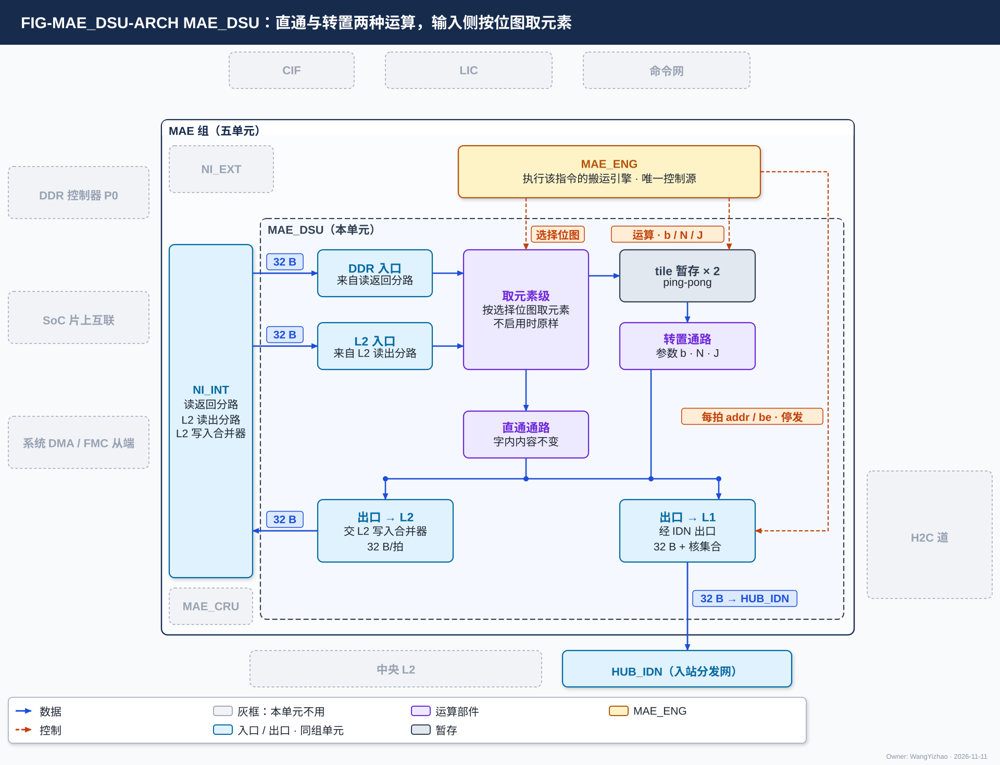
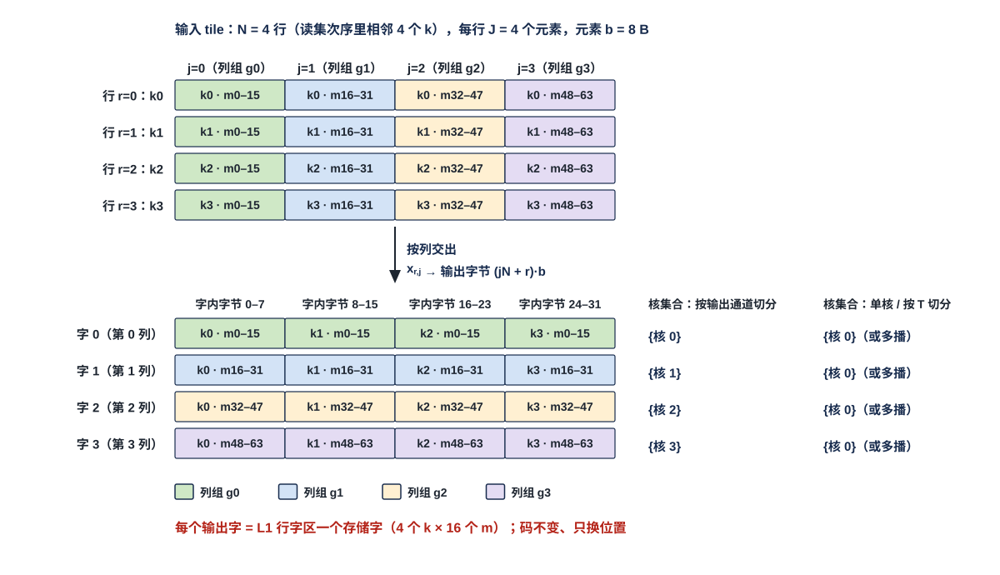
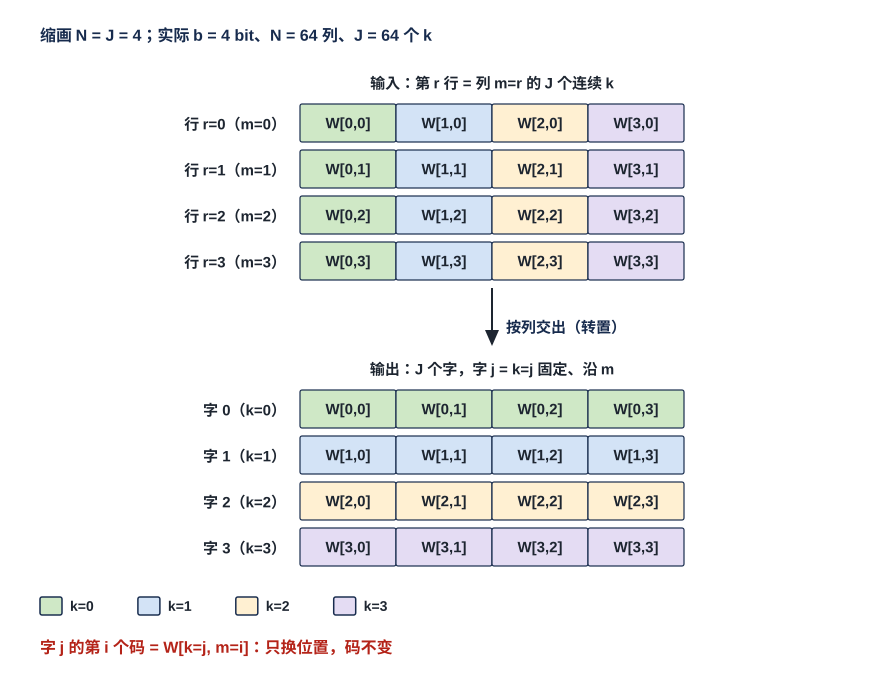
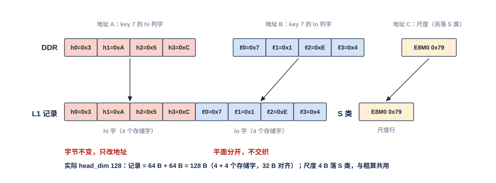

# MAE 数据整形单元（MAE_DSU）需求

> Owner: WangYizhao｜2026-11-11

## 1 概述

MAE_DSU 是 MAE 组五个交付单元之一（MAE_ENG、NI_EXT、NI_INT、MAE_DSU、MAE_CRU，V18-NII-03 / 04、V18-MAE-11；入站分发网 HUB_IDN 属 HUB 组，V18-HUB-01），全芯片一个，也是 MAE 运算级的两个单元之一（另一个是合并单元 MAE_CRU，二者并列、互不依赖，V18-MAE-12）。**它只有两种运算：直通与转置**（V18-MAE-41）。**直通**：数据进 DSU、字内内容不变，按搬运引擎给的次序与地址交出。**转置**：把按行到达的一个小矩阵按列交出——连续 $N$ 行、每行 $J$ 个元素、元素宽 $b$，先交第 0 列的 $N$ 个元素、再交第 1 列的 $N$ 个元素……依次装成 32 B 的存储字；**转置的尺寸（元素位宽 $b$、行数 $N$、列数 $J$）由指令给，各种数据形状用同一套逻辑**。另有一项与两种运算正交的能力：**输入侧按搬运引擎给的选择位图只取被选中的元素**（元素宽 = $b$），用来把录取 key 的尺度按录取次序排成整字。

**原则：DDR 布局只为省片外访存而定，L1 的 W 类只有行字区、列字区两种字形态，两者之间的差由 MAE_DSU 调，L1、接收桥、pod 都不调。** 各种数据形状怎样落到这两种运算上，只在本篇 §3.2 的典型用法表里列一次（全篇唯一的参数出处）。**DSU 的全部控制——运算、转置尺寸、选择位图、两侧每拍地址与字节有效位、停发——只来自执行该指令的 MAE_ENG 搬运引擎**（V18-MAE-03 / 25 / 41，用户 11-08："MAE DSU 的控制命令，一定要来自 MAE ENG"）。输入从 DDR（经 NI_INT 的读返回分路）或 L2（经 NI_INT 的 L2 读出分路）来，输出去 L1（经 NI_INT 的 IDN 出口 → HUB_IDN）或 L2（经 NI_INT 的 L2 写入合并器）。**只改位置，不改字节值、不量化、不算尺度**；权重的尺度数据块与 bias 不经 DSU。DDR 里只存前向形式的权重，反传要的排法在片上由 DSU 得到（用户 11-06），所以没有片外出口。

**经 DSU 是 MAE 搬运指令运算级的一个选项**：MAE 只有搬运指令，指令的运算级字段三选一——**不经运算级 / 经 MAE_DSU / 经 MAE_CRU**，一条指令只选其一（V18-MAE-12）；选经 MAE_DSU 时，指令再给运算（直通 / 转置）与转置尺寸，执行该指令的 MAE 搬运引擎把数据经 DSU 送出，输入输出每拍的地址仍由这个搬运引擎给出（ISA 影响见 PENDING §9）。**数据进 L1 前的整形有几条路，硬件都支持，由编译链按位点选**（V18-MAE-45，架构篇 §3.8）：L2 里存原形时走 NI 读口 → MAE_DSU → IDN；先经 MAE_DSU 整形存进 L2 的走 H2C；从 DDR 来的走 M0 → NI_INT → MAE_DSU → IDN；核内产生的数据可由 QNT 直接排成目的形态写 L1。

本篇用到的几个词（其余在首次出现处定义）：

| 词 | 含义 |
|---|---|
| 存储字 | 32 B，L1 / L2 读写的基本单位；数据组织默认按存储字对齐（V18-TP-74） |
| 行字区的存储字 | 4 个相邻归约位置 $k$ × 16 个输出列的 4 bit 码 = 32 B，由 4 个行字（一个 $k$ 在 16 个连续列上的 16 个码，8 B）按 $k$ 序拼成；输入稀疏（挑归约维）用。读集稀疏时"相邻 $k$"是读集次序里相邻的 4 个被选行（读集见数据组织篇 §3.5）。定义见数据组织篇 §2.12 |
| 列字区的存储字 | 一列（右操作数的一个输出位置）在 64 个连续归约位置上的 64 个 4 bit 码 = 32 B；输出稀疏（挑输出维）用。前向 $W$（$K \times M$）的一列是一个输出通道 $m$，存储字 = 64 个连续 $k$；反传 $\mathrm dX = \mathrm dY\,W^{\mathsf T}$ 的右操作数是 $W^{\mathsf T}$，一列是一个 $k$，存储字 = 该 $k$ 在 64 个 $m$ 上的码（V18-L1-30）。定义见数据组织篇 §2.12 |
| DDR 一拍 | 标准布局一拍 32 B = 1 个 $k$ × 4 个列组各 8 B（一个列组 = 16 个输出通道）；列深度优先布局一拍 32 B = 一列 $m$ 的 64 个连续 $k$（数据组织篇 §3.7.1 / §3.7.2） |
| 元素、行、列、tile（转置用） | 元素 = 宽 $b$ 的一段码（典型为 4 bit、1 B、8 B）；行 = 连续到达的 $J$ 个元素；**tile = 连续到达的 $N$ 行，共 $N \cdot J \cdot b$ 字节**；输出的第 $j$ 列 = 这 $N$ 行各自的第 $j$ 个元素 |
| 读集 | 用这份数据的所有源的选择位图取并得到的、要搬的行（或列）的集合；MAE 只按读集搬，按读集次序落 L1；稠密时读集为全部行（列）（数据组织篇 §3.5） |
| 全码 key 记录 | 一个录取 key 的 hi 与 lo 全部码（MXINT8 码 $c = 16h + \ell$ 拆成的两个 4 bit 平面）；head_dim $d_h = 128$ 时 hi 2 个存储字、lo 2 个存储字，共 128 B；E8M0 不在其中，在 K 的尺度数据块里、落 S 类 |
| lo 稀疏读副本 | lo 平面按 F 行读的副本：一行 64 B = 4 核各 16 B（32 个 $m$）（数据组织篇 §3.7.1） |
| $d_h$、$g_K$、$g_V$ | head_dim；K / V 的尺度分组长度（沿 head_dim，一组一个 E8M0） |

## 2 接口需求

### 2.1 架构图与接口汇总

图中模块框内的结构是参考实现（见第 7 章），本章以框外的各口为准。

框外的口：左侧来自 NI_INT 的两个 32 B 输入（DDR 入口接读返回分路，L2 入口接 L2 读出分路）与一个 32 B 输出（去 L2，交 L2 写入合并器）；下方一个 32 B 输出（去 L1，经 NI_INT 的 IDN 出口交 HUB_IDN）；上方是 MAE_ENG（执行该指令的搬运引擎，唯一控制源）的三条控制线：选择位图、运算与转置尺寸、两侧每拍 addr / be 与停发。外圈只有 HUB_IDN 点亮，NI_EXT、MAE_CRU 画灰：DSU 没有片外出口，与 MAE_CRU 并列、没有往来。框内画的取元素级、两份 tile 暂存、转置通路与直通通路是参考结构（本篇 §7.1）：**各种用法不是模块，而是这条数据通路的参数**（用户 11-06 晚：架构图不要画成"每个功能例化一个模块"）。

| 口 | 对端 | 方向 | 位宽 | 握手 | 出处 |
|---|---|---|---|---|---|
| 控制输入 | MAE_ENG（执行该指令的搬运引擎） | 入 | 运算、转置尺寸、选择位图、两侧每拍 addr / be | 组内约定（MAE 集成篇 §2.10.1） | 本篇 §2.2 |
| DDR 入口 | NI_INT 的读返回分路 | 入 | 32 B + addr 24 + be 32 + `seg` 5 + `src` | en / ready | 架构篇 PORT-20；本篇 §2.3 |
| L2 入口 | NI_INT 的 L2 读出分路 | 入 | 同上 | en / ready | 架构篇 PORT-20；本篇 §2.3 |
| 出口 → L1 | NI_INT 的 IDN 出口（→ HUB_IDN） | 出 | 32 B + addr 24 + be 32 + `seg` 5 + `src`，随字 4 bit 核集合由搬运引擎给 | en / ready | 架构篇 PORT-20 / 17；本篇 §2.4 |
| 出口 → L2 | NI_INT 的 L2 写入合并器 | 出 | 32 B + addr 24 + be 32 + `seg` 5 + `src` | en / ready | 架构篇 PORT-20；本篇 §2.4 |

口宽以架构篇 PORT-20 为准；组内各口交什么以 MAE 集成篇 §2.10.1 的组内约定为准，本表只为阅读方便列出。**DSU 没有经 MAE 组对外的口**：所有进出都经同组单元；不收 LIC 指令、不在命令网上。

### 2.2 控制输入：运算、转置尺寸与选择位图只来自搬运引擎

**DSU 的全部控制只来自执行该指令的搬运引擎，随指令给出**；DSU 不收 LIC 指令（V18-MAE-12；不要求设指令队列），不从数据内容推运算与形状。

#### 2.2.1 字段与要求位宽

| 字段 | 含义 | 要求值 |
|---|---|---|
| 运算 | 直通 / 转置 | 1 bit |
| 元素位宽 $b$ | 转置与按位图取元素的元素宽 | 2 bit【待标定】：编码 4 bit / 1 B / 8 B（余一值保留） |
| 行数 $N$ | 一个 tile 的行数 | 7 bit【待标定】：1…64 |
| 列数 $J$ | 一行的元素数 | 9 bit【待标定】：1…256 |
| 是否按位图取元素 + 选择位图 | 位图一位管一个元素（本篇 §3.5） | 每个输入字一份位图，位数随元素宽（$b$ = 1 B 时 32 位）；位图由搬运引擎按录取列表给出 |
| 尾块的行数或结束标记 | 使 DSU 能定出最后一个 tile 有几行 | 形式【设计者定】：约束是 DSU 能定出最后一个 tile 的有效行数 |
| 目的为 S 类 | 尾字补 0 整字交出（本篇 §3.5） | 随目的 `seg` 给出 |
| 是否双目的及两份各取哪种运算 | 本篇 §3.8 | — |

**三个尺寸字段的位宽按覆盖本篇 §3.2 典型用法表全部参数（$b \in$ {4 bit, 1 B, 8 B}，$N \le 64$，$J \le 256$）定为要求值，标【待标定】，后续可调**（V18-MAE-45，用户 11-11："我认为这里先提前标定，后续调整，不要作为设计者的灵活度"）。$N = 1$ 或 $J = 1$ 的转置输出与直通相同。源（DDR 读返回 / L2 读出）与目的（L1 经 IDN 出口 / L2 经 L2 写入合并器）由指令的口对给出。

### 2.3 两个输入口：DDR 入口与 L2 入口

#### 2.3.1 每拍内容与两源接续

| 入口 | 经 | 数据 |
|---|---|---|
| DDR 入口 | NI_INT 的读返回分路 | 任一 DDR 布局的数据，32 B/拍 |
| L2 入口 | NI_INT 的 L2 读出分路 | 同上；权重驻 L2 的位点不必再读 DDR（V18-NII-03）；L2 的 K hi 驻留区里是 DDR 原形；数据来自 NI 读口的一路或几路（四路各给各的读地址、各自握手，V18-L2-08），按到达次序交 DSU |

- **每拍 32 B，带 addr 与 be（从第 0 字节起的有效字节）；tile 的形状只由指令给的尺寸（$b$、$N$、$J$）决定，与入口地址无关。**
- **两源一般不同时用（一条指令一个源口）；例外是精算驻留模式的全码 key 记录：同一条指令的 hi 段来自 L2 入口、lo 段来自 DDR 入口，两段按指令给的次序先后进 DSU 直通**（V18-ATT-03）；DSU 只按到达次序与搬运引擎给的地址交出。

### 2.4 两个输出口：去 L1 与去 L2

#### 2.4.1 每拍内容、尾字与各宿

| 宿 | 经 | 数据 | 之后 |
|---|---|---|---|
| 前向核 / 粗算核 L1 W 类 | IDN 出口 → HUB_IDN（32 B/拍） | 转置输出的行字区存储字，随字核集合 | pod 经 W 类权重读口读（架构篇 PORT-01） |
| 训练核 L1 W 类 | IDN 出口 → HUB_IDN（32 B/拍） | 列字区存储字（标准布局直通、列深度优先转置）；尺度行由另一条普通搬运落 S 类 | 训练核按列字区排法消费 |
| 核 L1 W 类全码区 | IDN 出口 → HUB_IDN → NWB（32 B/拍） | 全码 key 记录（hi 2 个字、lo 2 个字，按列字区的列位） | 精算读 hi、lo 两条列道 |
| 核 L1 S 类 | IDN 出口 → HUB_IDN → NWB（32 B/拍） | 录取 key 的 K / V 尺度整字（尾字补 0） | K、V 尺度都作为权重一侧的尺度经 S 类读 MUX 进 pod 权重旁带（V18-MXU-15） |
| L2 | NI_INT 的 L2 写入合并器（32 B/拍） | 直通与转置的输出，落 L2 地址，存的已是 L1 字形态（V18-MAE-19） | MAE 之后经 H2C 多播给需要的核 |

- **输出每拍一个 32 B 字，目的 addr（24 bit 段内字节地址）、`seg`、be 与去 L1 时随字的 4 bit 核集合都由执行该指令的搬运引擎逐拍给出；DSU 按固定次序出字（转置：列 $0 \ldots J-1$、每列 $N$ 个元素；直通：到达次序）、不算地址**（V18-TP-27、V18-MAE-03）。去 L1 还是 L2 由指令的口对决定（V18-TP-51）。
- **尾块的字只开有效字节**（本篇 §3.3）；**IDN 链路按字节有效位原样传、不感知整字**（V18-DORG-10 (4)）。
- **目的为 S 类时尾字补 0、整字交出**（本篇 §3.5）：S 类写口一次一个整字、不带字节有效位（架构篇 PORT-06）。
- **没有片外出口**：DDR 只存前向形式的权重（用户 11-06）。

### 2.5 握手与停发

- **DSU 的两个入口、两个出口都是核间协议的握手链路（en / ready / addr / be / din / `seg` / `src`），链路一侧例化 HUB 提供的通用链路块**（V18-HUB-05，协议篇 §3.5.1）。
- **DSU 收不下时对上游拉低 ready**，NI_INT 分路随之停住、经 NI_EXT 拉低 M0 的 RREADY（或 L2 读出分路停住、NI 读口对应那一路读地址流的 ready 随之拉低，别的路不受影响，V18-L2-08）；只降速、不丢数。
- **下游（IDN 出口、L2 写入合并器）拉低 ready 时 DSU 保持当前拍。**
- **进出 DSU 的任一段 ready 拉低时，由执行该指令的搬运引擎统一停发**（用户 11-06："DSU 和 CRU 的地址都交给 MAE-ENG 来确定……都需要反压设计，可以由 ENG 统一控制"，V18-MAE-25）。
- **同一链路上切换段不交错**：DSU 输出与 NI 读返回分路在 IDN 出口择一，由 MAE_ENG 在切换段边界决定（协议篇 §3.10，V18-TP-36、V18-HUB-03）。

## 3 功能描述

### 3.1 功能一览

| 功能 | 按矩阵维度说做什么 | 参数 | 输入 | 输出 | 触发 / 生效条件 | 节 |
|---|---|---|---|---|---|---|
| 转置 | 把连续到达的 $N$ 行 × $J$ 个元素（元素宽 $b$）的小矩阵按列交出：输出第 $j$ 列 = $N$ 行各自的第 $j$ 个元素；**只换位置** | $b$、$N$、$J$ | 按行到达的 tile | 列 $0, 1, \ldots, J-1$，每列 $N$ 个元素按行序，依次装成 32 B 的字 | 指令运算 = 转置 | §3.3、§3.4 |
| 按位图取元素（与转置、直通正交） | 输入侧按选择位图只留被选中的元素，按到达次序紧排后再交给直通或转置 | 元素宽 $b$、选择位图 | 输入字 + 位图 | 被选元素的到达次序 | 指令启用取元素 | §3.5 |
| 直通 | 字内内容不变，按到达次序交出；每拍的去向（核集合、地址）由搬运引擎给 | 无 | 任意 | 与输入相同 | 指令运算 = 直通 | §3.6 |
| 双目的 | 一次 DDR 读同时给前向核与训练核各一份，各按自己的排法 | 两份各自的运算 | 一份输入 | 两份输出 | 指令带第二目的 | §3.8 |

两种运算都只改位置、不改码与尺度的定义，所以**输出必须与软件参照逐位一致，格式合同不放开**（本篇 §3.10）。

### 3.2 典型用法表（本篇唯一的参数出处）

别的篇引用 DSU 的用法与参数一律写"MAE_DSU 篇 §3.2 典型用法表"（即本节）。表中 tile = $N \cdot J \cdot b$；**每个用法的一列 $N \cdot b$ 是 8 B 或 32 B，一个输出字装 $32 / (N \cdot b)$ 个整列**。

| 用法 | 输入的一行是什么 | 运算 | $b$ | $J$ | $N$ | tile | 输出的一个 32 B 字是什么 | 来源 | 去向 |
|---|---|---|---|---|---|---|---|---|---|
| 标准布局权重 → 行字区（前向线性位点 hi，lo 稠密读） | DDR 一拍：1 个 $k$ × 4 个列组各 8 B | 转置 | 8 B | 4 | 4（读集次序里相邻 4 个 $k$） | 128 B | 列组 $g$ 的 4 个 $k$ × 16 个 $m$ = 行字区一个存储字；一个 tile 出 4 个字 | DDR 或 L2（按读集读） | 前向核 L1 W 类（按输出通道切分时字 $g$ → 核 $g$；单核 / 按 $T$ 切分时全给该核或多播），或 L2 |
| lo 稀疏读副本 → 行字区 | 一行 64 B = 4 核各 16 B（32 个 $m$），分两拍到达 | 转置 | 8 B | 8 | 4（读集次序里相邻 4 个 $k$） | 256 B | 16 个 $m$ × 4 个 $k$，与 hi 的行字区存储字同形；一个 tile 出 8 个字，按输出通道切分时字 $2c$、$2c+1$ → 核 $c$ | 同上 | 同上 |
| V → 行字区（$O = PV$，key 是归约维） | 一个 key 的一个平面：$d_h/2$ B（$d_h = 128$ 时 64 B） | 转置 | 8 B | $d_h/16$（8） | 4 个 key（读集次序） | $2d_h$ B（256 B） | 4 个 key × 16 个连续 head_dim 维；8 bit V 的 hi、lo 两平面各做一次 | DDR 的 V 平面 | 核 L1 W 类 |
| 粗算 K hi → 行字区（$S = QK^{\mathsf T}$，head_dim 是归约维） | 一个 key 的 hi 平面：$d_h/2$ B | 转置 | 4 bit | $d_h$（128） | 16 个 key | $8d_h$ B（1 KB） | 第 $j$ 列 = 16 个 key 在第 $j$ 维的码（8 B，一个行字）；4 列装一个字 = 4 个相邻维 × 16 个 key；一个 tile 出 $d_h/4$ = 32 个字 | DDR 的 K hi 平面或 L2 的 K hi 驻留区（按 key 连续的 DDR 原形） | 粗算核 L1 W 类 |
| 列深度优先权重 → 训练核列字区（反传 $\mathrm dX = \mathrm dY\,W^{\mathsf T}$；up hi、gate / up lo、dH 的 S 列） | 一列 $m$ 的 64 个连续 $k$（就是 DDR 一拍） | 转置 | 4 bit | 64（$n = 1$；$J = 64n$、$n > 1$ 为可选扩展，本篇 §4.2） | 64 个列 $m$（dH：读集次序里的 64 个 S 列） | $32J$ B（2 KB） | 第 $j$ 列 = $k_j$ 固定、64 个 $m$ 的码 = $W^{\mathsf T}$ 列字区一个存储字；一个 tile 出 $J$ 个字 | DDR 或 L2 的列深度优先列（含 dH 的 S 列） | 训练核 L1 W 类，或 L2（尺度行由另一条普通搬运落 S 类） |
| 标准布局权重 → 训练核列字区（反传 $\mathrm dX$） | DDR 一拍：1 个 $k$ × 64 列 | 直通 | — | — | — | — | 一拍原样 = $W^{\mathsf T}$ 列字区一个存储字（V18-L1-30） | DDR 或 L2 的标准布局 | 训练核 L1 W 类，或 L2 |
| 录取 key 的 K 尺度 | 一个尺度字 = 32 个 key 在同一尺度组上的 E8M0（DDR 与片上同一排法） | 直通 + 按位图取元素 | 1 B | — | — | — | 32 个录取 key 在同一尺度组上的 E8M0（按录取次序）；每个尺度字只读一次（本篇 §3.5） | DDR 或 L2 的 K 尺度数据块 | 核 L1 S 类（之后进 pod 权重旁带） |
| 录取 key 的 V 尺度 | 一个录取 key 的 $d_h/g_V$ 个 E8M0（DDR 按 key 连续） | 按位图取元素 + 转置 | 1 B | $d_h/g_V$ | 32 个录取 key | $32\,d_h/g_V$ B | 第 $j$ 列 = 32 个录取 key 在第 $j$ 个尺度组上的 E8M0；$d_h/g_V = 1$ 时转置与直通相同（本篇 §3.5） | DDR 或 L2 的 V 尺度数据块 | 核 L1 S 类（之后作为权重一侧的尺度进 pod 权重旁带，V18-MXU-15） |
| 精算全码 key 记录（两种 K hi 来源） | hi 平面 2 个存储字、lo 平面 2 个存储字（$d_h = 128$） | 直通 | — | — | — | — | 原样；每个字落列字区里该 key 的列位，平面分开（本篇 §3.6） | 重读：DDR 两处；驻留：hi 在 L2 驻留区、lo 在 DDR | 核 L1 W 类全码区（经 IDN 出口 → HUB_IDN → NWB），或 L2 |
| 权重先存 L2、再经 H2C 多播 | 同上面对应布局的行 | 按目的排法取上面对应行的转置或直通 | — | — | — | — | L2 里存的已是 L1 字形态 | DDR | L2（经 L2 写入合并器） |

- **按输出通道切分的位点，标准布局单元里列组 $g$ 装哪 16 列由编译链排：让列组 $g$ 装核 $g$ 那 $M/4$ 列里的 16 列，使每核拿到连续的 $M/4$ 列**（V18-DORG-11 (1)，数据组织篇 §3.7.1）；DSU 照样把字 $g$ 交给核 $g$，不感知列号。
- **本核产生的 K / V 需要行字区字形态时**，由 QNT 攒 key 转置后直接写 L1，或按 key 写进 L2、再由 MAE 经 NI 读口 → MAE_DSU（按上表 V / 粗算 K hi 两行的参数转置）→ IDN 送回：**两条路硬件都支持，由编译链按位点选**（V18-MAE-45；QNT 一侧见 VNU_QNT 篇）。
- **不进 DSU 的数据**（指令运算级字段取"不经运算级"）：列深度优先权重送前向核（DDR 一拍就是列字区一个存储字）、LM Head 按列全码副本（每列 hi 段接 lo 段，按列字区的列位落）、权重与激活的尺度数据块、bias、LoRA 副本、紧凑 token 记录等，按原样经 NI 读返回分路或 NI 写口落位。

### 3.3 转置的定义：输入、输出次序与尾块（以标准布局 → 行字区为例）

**运算与尺寸只由执行指令的搬运引擎给出，不按数据类型、份额或切分轴派生**（V18-MAE-41，用户 11-10："不如MAE指令留出对转置的单位矩阵的Size描述项，MAE用一个统一逻辑去解决问题"）。**本节只规定输入与输出；DSU 内部怎样暂存、怎样换位是参考实现**（本篇 §7.1；用户 11-08："无需规定中间该怎么实现，只需要说明……输入是怎样的，输出是怎样的"）。

**输入**：一个 tile = 连续到达的 $N$ 行，第 $r$ 行（$r = 0 \ldots N-1$）是 $J$ 个元素 $x_{r,0} \ldots x_{r,J-1}$，每个宽 $b$；行按到达字节切分，一行可以跨几拍（lo 稀疏读副本一行 64 B 分两拍），一拍也可以装几行。

**输出**：按列交出——先第 0 列的 $x_{0,0}, x_{1,0}, \ldots, x_{N-1,0}$，再第 1 列……，依次装成 32 B 的存储字。**元素 $x_{r,j}$ 在输出流里的字节位置 = $(jN + r)\,b$**，一个 tile 出 $NJb/32$ 个字；每个字的核集合与目的 addr 由搬运引擎逐字给出。

**尾块**：读集的行数不是 $N$ 的倍数时，最后一个 tile 只有 $n_{\text{tail}} < N$ 行；**每列仍占 $N \cdot b$ 的固定位置，缺行的位置不写，字节有效位只开含有效元素的字节**（元素宽 4 bit、$n_{\text{tail}}$ 为奇数时，末个有效字节的另一半无效，使用方按有效行数不读它）；目的为 S 类时按本篇 §3.5 补 0 整字交出。

**以标准布局 → 行字区为例**（$b = 8$ B、$J = 4$、$N = 4$）：DDR 标准布局一拍是同一个 $k$ 下 4 个列组各 8 B，而 L1 行字区一个存储字是一个列组的 4 个相邻 $k$ × 16 个 $m$；**这种 DDR 排法是输入维度稀疏按 $k$ 行读、减少片外访存所必需的，不能改成按列组排字**（用户 11-08："我无法接收统一列字布局，因为这会使得输入维度稀疏完全无法减少 EMA"）。DSU 收下读集次序里相邻 4 个 $k$ 行后，输出字 $g$ = 列组 $g$ 在这 4 行上的 8 B 按行序连排，正是行字区的一个存储字；**核间按输出通道切分时字 $g$ 只给核 $g$，单核或核间按 $T$ 切分时 4 个字都给该核或多播**；链路上只有"整字直接发"一种分发方式（V18-HUB-04）。这项任务属于 MAE，不属于 HUB_IDN 或 L1（用户 11-08："我希望这个任务仍然是 MAE 的"）。

图中输入是 4 个 $k$ 行（$k_0 \ldots k_3$），每行 4 个元素（列组 $g_0 \ldots g_3$），每个元素是该 $k$ 在 16 个输出通道上的 8 B 码（格内写 $k$ 与 $m$ 的范围）；按列交出后元素 $x_{r,j}$ 落在输出流的第 $(jN + r)\,b$ 字节，字 $g$ 装列组 $g$ 的 4 行，正好是 L1 行字区的一个存储字。右侧给出两种去向：按输出通道切分时字 $g$ 的核集合 = {核 $g$}，单核或按 $T$ 切分时 4 个字都给该核（图中以核 0 为例）或多播。脚本断言每个元素的输出字节位置 = $(jN + r)\,b$、每个元素只出现一次、字 $g$ 内按 $k$ 行序。

### 3.4 列深度优先权重送训练核：转置（4 bit、$J = 64$、$N = 64$）

**反传 $\mathrm dX = \mathrm dY\,W^{\mathsf T}$ 用列字区排法，右操作数是 $W^{\mathsf T}$：列字区一个存储字 = 一个 $k$ 在 64 个 $m$ 上的码**（V18-L1-30）。**两种 DDR 布局都必须支持**（用户 11-08："转置需要支持两个 DDR 布局的转置"；11-06："转置必须保留"）：标准布局的一拍恰好就是这样一个存储字，经 DSU 直通（本篇 §3.6）；列深度优先布局的一拍是一个 $m$ 的 64 个连续 $k$，方向相反，要转置。

**输入**：64 个列 $m_0 \ldots m_0 + 63$ 各 $J$ 个连续 $k$（$k_0 \ldots k_0 + J - 1$）的 4 bit 码，一列是一行；必须支持的是 $J = 64$（一列的一次连续读就是 DDR 一拍），$J = 64n$、$n > 1$ 为可选扩展（本篇 §4.2）。

**输出**：$J$ 个存储字，字 $j$ = $k_0 + j$ 固定、64 个 $m$ 的码（叶序为输出通道序）：

$$\text{字 } j \text{ 的第 } i \text{ 个码} = W^{\mathsf T}_{m_0 + i,\ k_0 + j} = W_{k_0 + j,\ m_0 + i},\qquad 0 \le i < 64,\ 0 \le j < J .$$

各字的落地地址（训练核 L1 W 类列字区，或 L2）由搬运引擎逐字给出；列字区里哪一列放在哪个地址由编译链分配（架构篇 §3.4 CONC-4）。**只有数字进 DSU**：权重的 E8M0 在独立的尺度数据块里（V18-DORG-01），由另一条普通搬运直送训练核 S 类、与前向同一格式（本篇 §3.9）。

**到达次序**由编译链排定、搬运引擎按指令地址发读：一个 tile = 64 列的同一段 $k$；核级驻留侧取 A 时按 $m$ 组 → $K_t$ 分块 → 组内各 64 列块的该段，$K_t$ 是 $J$ 的整数倍由编译链保证。

**首个 tile 的等待**：$J = 64$ 时一个 tile 2 KB，要收满 64 拍才出第一个字；这段时延只在接收的训练核一侧暴露，不作要求值。

图中输入是 4 列（$m = 0 \ldots 3$，每列装 $k = 0 \ldots 3$ 的码 $W_{k,m}$；图中每列画成 tile 的一行 $r = m$），输出是 4 个字（$k = 0 \ldots 3$，每个装 $m = 0 \ldots 3$ 的码）；实际 $b = 4$ bit、$N = 64$ 列、$J = 64$ 个 $k$，一个 tile 出 $J$ 个 32 B 字。脚本断言输出字 $j$ 的第 $m$ 个码等于输入列 $m$ 的第 $j$ 个码。

**dH 的 S 列**：LM Head 权重 $W$ 为 hidden × vocab、词表项是列；dH 要的是它的 $W^{\mathsf T}$ 方向。MAE 搬运引擎以列表驱动的源地址按读集次序 gather S 列，每 64 个 S 列为一个 tile 的 64 行，DSU 按本节参数转置，送指令目的核集合给出的 dH 执行核、落其 W 类列字区；该列块的尺度由另一条普通搬运送进 S 类；S 列只有这一份，不投前向核。

### 3.5 按位图取元素：录取 key 的 K / V 尺度按录取次序成整字

**一个 key 的 K 尺度或 V 尺度只有 $d_h/g$ 字节（例 $d_h = 128$、$g_K = 32$ 时 K 4 B），不足一个存储字，而 L2 读口、MAE 搬运引擎、接收桥都不挑字节；所以由 DSU 在输入侧按选择位图只取录取 key 的元素、按录取次序排成整字：一个 32 B 字 = 32 个录取 key 在同一尺度组上的 E8M0**（V18-MAE-41）。录取次序 = 位图里 key 的升序。使用方（pod）读整字、不挑字节；**K、V 尺度都作为权重一侧的尺度进 pod 权重旁带**（V18-MXU-15）。

**K 尺度：直通 + 按位图取元素（$b$ = 1 B）。** K 尺度数据块在 DDR 与片上同一排法：key 每 32 个一组，组内第 $j$ 个字装这 32 个 key 在第 $j$ 个尺度组上的 E8M0（$j = 0 \ldots d_h/g_K - 1$）；例 $d_h = 128$、$g_K = 32$：每 32 个 key 占 4 个字 = 128 B。**源端对同一个尺度字只读一次**，每个输入字带 32 位选择位图（一位管一个 key），DSU 只留被选中的字节；**一个输出字只装同一尺度组的 E8M0，按录取次序排**，一个尺度组的最后一个字未满时作尾字交出。**搬运引擎的读序与 DSU 内把同一尺度组的被选字节攒成整字的方式要相配**：约束是每个尺度字只读一次、输出字只装同一尺度组且按 key 升序、输入 32 B/拍不停收；尺度组边界怎样告诉 DSU 是 MAE 组内的约定（MAE 集成篇 §2.10.1）；两种参考做法见本篇 §7.2。各输出字的目的地址由搬运引擎给（S 类里的排法见数据组织篇 §2.13）。

**V 尺度：按位图取元素 + 转置（1 B、$J = d_h/g_V$、$N = 32$）。** V 尺度数据块在 DDR 按 key 连续，每 key $d_h/g_V$ 个 E8M0（数据组织篇 §3.7.3，$g_V$ 由指令给）；搬运引擎按录取列表读含录取 key 的字，位图一位管一个元素，同一 key 的 $d_h/g_V$ 个元素取同一位；取出的元素按 key 成行，每 32 个录取 key 为一个 tile 转置，输出第 $j$ 列 = 32 个录取 key 在第 $j$ 个尺度组上的 E8M0，正好一个字。**$d_h/g_V = 1$ 时转置与直通相同**。

**尾字**：录取 key 数不是 32 的倍数时，最后一个字的空余字节**补 0、整字交出**——S 类写口一次一个整字、不带字节有效位（V18-DORG-04、架构篇 PORT-06）。这是 DSU 唯一产生新字节的地方，补 0 的位置由有效元素数确定。

**数值不变**：尺度字节只换位置，不改值；权重的尺度数据块不经 DSU。

### 3.6 直通：只给地址

**直通时数据进 DSU、字内内容不变，按搬运引擎给的次序与地址交出**（不要求缓冲整列）。直通用于三类情形：数据必须经 DSU 才能到 IDN 出口（例如从 L2 读出、本来就是 L1 字形态、要经 IDN 去核 L1 的数据）；两路源按指令次序接续（精算全码 key 记录）；标准布局权重送训练核（V18-L1-30，本节末）。

**精算全码 key 记录（两种 K hi 来源）**：SEL 录取后由列表驱动的 gather 读出每个录取 key 的 hi + lo 两段码，经 DSU 直通落核 L1 W 类全码区（V18-ATT-01 / 03）。**重读模式**（长上下文默认）hi、lo 都从 DDR 读；**驻留模式**粗算时用过的 K hi 平面以 DDR 原形（每 key 64 B、按 key 连续）留在 L2 的 K hi 驻留区，精算时 hi 从 L2 经 L2 读出分路读、lo 从 DDR 经读返回分路读，两段按指令给的次序先后进 DSU（用户 11-09："MAE DSU 来输出，精算 K hi 驻留模式实现是 K 驻留在 L2 上，而不是 L1"）。**两种模式核 L1 收到的是同一种全码 key 记录**：$d_h = 128$ 时 hi 2 个存储字（维 0–63、64–127）、lo 2 个存储字，**每个字落列字区里该 key 的列位（列号 = key 在本次录取里的序号），平面分开，不按 key 连续落**（V18-DORG-08）；各字的地址由搬运引擎逐字给（列的地址由编译链分配，架构篇 §3.4 CONC-4）；起点与各字默认 32 B 对齐（V18-TP-74）。全码 key 记录经 IDN 出口 → HUB_IDN → NWB 落 L1（V18-ATT-03，用户 11-09："对于第6条：我建议走IDN"；MAE_ENG 篇 §3.12）。**不做半字节交织，也不按 8 bit 逐元素打包：字节值不变，只给地址**（V18-MAE-04）。

**数值含义**：精算把同一 key 的 hi 字与 lo 字当作两条列道、用同一尺度，按 $c = 16h + \ell$ 合成，数值等价 MXINT8：

$$q \cdot x = (16h + \ell) \cdot 2^{e} \cdot q = 16\,(q\,h)\,2^{e} + (q\,\ell)\,2^{e},$$

$e$ 为该元素所在 32 元素组的 E8M0 指数；hi、lo 两条列道如何合成属于 MXU 的设计（MXU_FEED 篇 §3.7、MXU_ARR 篇 §3.6）。该 key 的尺度按本篇 §3.5 另成整字落 S 类。

图中是重读模式：DDR 里 key 7 的 hi 平面在地址 A 起的 2 个存储字（维 0–63、64–127）、lo 平面在地址 B 起的 2 个存储字，每个字按 4 个码缩画；经 DSU 直通后这 4 个字各落列字区里 key 7 的列位（本次录取 key 7、12、31、40，key 7 的录取序号为 0，即列 0），hi、lo 平面分开；格内的码前后相同，只改地址。实际 $d_h = 128$：hi、lo 各 64 B；尺度按本篇 §3.5 另成整字落 S 类。脚本断言列号 = 录取序号、每个码的字节值前后不变、每个存储字只有一个平面的码。

**标准布局权重送训练核**：DDR 一拍 = 1 个 $k$ × 64 列 = $W^{\mathsf T}$ 列字区一个存储字，经 DSU 直通，各字地址由搬运引擎按训练核 L1 的列字区给出（V18-L1-30）。

### 3.7 时序关系

1. **转置的一个 tile 的 $N$ 行连续到达、按列序送出，输入、输出各持续 32 B/拍**（本篇 §4.1；收发怎样交叠见本篇 §7.1）；输出字的先后与各字去哪个核都由搬运引擎给出，接收核不要求字按核集合交替到达。
2. **按位图取元素时每个尺度字只读一次**；读序由编译链折进源地址（本篇 §3.5）。
3. **直通不要求两段源的到达先后**（全码 key 记录的 hi、lo）：落地地址由搬运引擎逐拍给出；搬运引擎数接收方回来的写入握手判本指令写完，数满后给目的核 CCU 发写完通知（V18-TP-50 / 70）。DSU 不计数、不判完成。
4. **双目的时不转置的那一份不等转置**（标准布局的训练份经 DSU 直通、列深度优先的前向份不经运算级）：转置那一份首个 tile 要等 $N$ 行到齐（标准布局 4 行、列深度优先 64 列），这段时延只在收转置那一份的核一侧暴露。
5. **运算、转置尺寸与选择位图在指令边界切换。**

### 3.8 双目的：一次 DDR 读同时给前向核与训练核

**一条搬运指令可带第二目的：一次 DDR 读同时给前向核一份、给训练核一份，权重只读一次；这是必须支持的需求**（用户 11-06："必须保留，这要直接写成需求"，V18-MAE-16）。**两份各按自己要的排法走**（V18-L1-30）：

- 标准布局时训练那一份经 DSU 直通（一拍就是 $W^{\mathsf T}$ 列字区的存储字）、前向那一份经 DSU 转置成行字区字形态，**权重只读一次、两份逐位不丢**；
- 列深度优先布局时前向那一份不经运算级（DDR 一拍已是列字区的一个存储字，读返回分路直达 IDN 出口）、训练那一份经 DSU 转置。

参数见本篇 §3.2 标准布局 → 行字区、标准布局 → 训练核列字区、列深度优先 → 训练核列字区三行。**两份共用 IDN 出口一路 32 B/拍，两份字节之和超过 32 B/拍时只降速**；去 L2 的一份经 L2 写入合并器。**双目的时每一份收到的数据与单独搬这一份时完全相同。** 没有前向核同读时（独立训练、只为训练读的平面、dH 的 S 列）只有训练那一份。两份怎样共用出口与暂存见本篇 §7.3。

### 3.9 块尺度不在 DSU：反传权重的尺度由 pod 处理

**反传 $\mathrm dX = \mathrm dY\,W^{\mathsf T}$ 所用权重（列字区排法）的块尺度由 pod 读权重时在线算，DSU 只动数字**（V18-MXU-11 / L1-30）；这属于 MXU 的设计（MXU_FEED 篇 §3.6.2）。对 DSU 的含义只有两条：

- **DSU 没有块尺度计算、旁带行、旁带表与尺度缓存**；权重的尺度数据块由另一条普通搬运直送训练核 S 类，与前向共用一种格式，不经 DSU。
- **DSU 经手的尺度只有录取 key 的 K / V 尺度，只换位置、不改值**（本篇 §3.5）。

### 3.10 不得破坏的合同：输出与软件参照逐位一致

- **输出与软件参照逐位一致**：转置只改位置、不产生新字节（尾块缺行处不写）；直通不改数据；按位图取元素只丢未选元素；唯一新增的字节是目的为 S 类时尾字的补 0（本篇 §3.5）。不做半字节交织。
- **权重的尺度数据块与 bias 不经 DSU**；录取 key 的 K / V 尺度经 DSU 只改位置。
- **输出字节只由运算、转置尺寸、选择位图与指令决定，与接收核内 pod 分工无关**；每个权重元素在每个目的只送一份。
- **双目的时每一份收到的数据与单独搬这一份时完全相同。**
- **控制只来自 MAE_ENG 的搬运引擎**：DSU 没有自己的指令入口，不从数据内容推运算与形状。
- 不改任何数据位以外的内容；不改激活与其他不经 DSU 的数据。
- **输出只由本条指令及其输入决定**，没有跨指令保留的状态；不上报计数。
- **复位输入来自 CIF（架构篇 PORT-41），硬复位与软复位不区分**（CIF 篇 §2.4 / §3.3）；复位后没有在途状态。DSU 不接 CIF 的停止请求（架构篇 PORT-42）：搬运引擎停发后它停在握手上，继续后照常（MAE 集成篇 §3.12）。

## 4 性能指标

### 4.1 吞吐要求

| 运算 | 要求 |
|---|---|
| 转置 | **在必须支持的最大 tile（本篇 §4.2）下，输入、输出各持续 32 B/拍不停**，对本篇 §3.2 全部参数成立：前向读标准布局权重、粗算读 K hi、训练读权重都不因转置降速（V18-MAE-35 / 41） |
| 直通 | 随输入流 32 B/拍；DSU 不成为录取 key 读取的瓶颈（全码 key 记录 $d_h = 128$ 时一个 key 4 拍） |
| 按位图取元素 | 输入 32 B/拍不停收；输出随被选比例 |
| 双目的 | 两份共用 IDN 出口 32 B/拍，字节之和超过时只降速 |

DSU 不含 L1 / L2 的存储，不涉及架构篇 §3.4 的存储并发约定；它的输入速率受 NI_INT 一侧来源（M0 读返回、L2 NI 读口）的速率限制，输出去 L1 受 IDN 出口一路 32 B/拍限制（架构篇 PORT-17）。

### 4.2 必须支持的最大小矩阵

**必须支持的最大 tile 按 $n = 1$ 定：2 KB**（用户 11-11 对 D2"认可"：只要求 $n = 1$）= 列深度优先送训练核 $64 \times 64 \times 4$ bit $= 2{,}048$ B，也等于粗算 K hi 在 $d_h = 256$ 时的 $16 \times 256 \times 4$ bit。其余用法：$d_h = 128$ 时粗算 1 KB、V 与 lo 稀疏读副本 256 B、标准布局 128 B、V 尺度 $32\,d_h/g_V$ B。**列深度优先转置的 $J = 64n$、$n > 1$（tile $32 \cdot 64n$ B）是可选扩展**，编译链只在 DSU 声明支持时选用。

### 4.3 要求值表

| 项 | 要求值 | 说明 |
|---|---|---|
| 转置吞吐 | 输入、输出各持续 32 B/拍，最大 tile 下也不停 | §4.1 |
| 直通吞吐 | 随输入流 32 B/拍 | §4.1 |
| 按位图取元素 | 输入 32 B/拍不停收 | §4.1 |
| 必须支持的最大 tile | 2 KB（$n = 1$） | §4.2；$n > 1$ 为可选扩展 |
| 转置尺寸字段 | $b$ 2 bit、$N$ 7 bit、$J$ 9 bit【待标定】 | §2.2.1 |
| 各口 | 2 个入口、2 个出口，各 32 B/拍，en / ready | 架构篇 PORT-20 |

## 5 约束与由使用者保证的事项

### 5.1 硬约束

- **只改位置，不改字节值、不量化、不舍入、不算尺度**；不做半字节交织。
- **没有片外出口**；不收 LIC 指令、不在命令网上。
- **本篇不含容错设计**（V18-TP-75）。

### 5.2 由使用者保证的事项

| 事项 | 由谁保证 |
|---|---|
| **输入读序**：转置的一个 tile 的 $N$ 行连续到达；按位图取元素时录取 key 的尺度字按与 DSU 攒字方式相配的次序到达 | 编译链把读序折成指令的源地址与几何（V18-MAE-01）；MAE 搬运引擎按地址顺序发读，需保序的读用同一 AXI ID |
| 运算、转置尺寸、选择位图、是否双目的 | MAE 搬运指令（运算级字段选经 MAE_DSU、运算与尺寸字段、第二目的，V18-MAE-03 / 12 / 16 / 41）；选择位图由搬运引擎按录取列表给出 |
| 稀疏读时只搬读集：MAE 按读集从 DDR / L2 搬，按读集次序到达 DSU、落 L1 | MAE 搬运引擎（数据组织篇 §3.5，V18-DORG-08） |
| 输出各字的核集合与目的地址（按输出通道切分：列组 $g$ 的字 → 核 $g$；单核 / 按 $T$ 切分：全部字给该核或多播） | MAE 搬运引擎按指令几何逐字给出 |
| 按输出通道切分的位点，标准布局单元里列组 $g$ 装核 $g$ 那 $M/4$ 列里的 16 列 | 编译链（数据组织篇 §3.7.1，V18-DORG-11） |
| 输出每拍 addr：行字区、列字区（训练核）、W 类全码区按列字区的列位、S 类，或 L2 地址；列字区里哪一列放在哪个地址 | 执行该指令的 MAE 搬运引擎给地址；列的地址由编译链分配（架构篇 §3.4 CONC-4，V18-TP-27、V18-MAE-03、V18-DORG-08） |
| 全码 key 记录的两段源（hi、lo 的地址：重读模式都在 DDR；精算驻留模式 hi 在 L2 的 K hi 驻留区、lo 在 DDR）与两段的先后 | 编译链折成指令的两端地址；MAE 搬运引擎逐拍给出（MAE_ENG 篇 §3.12） |
| 目的空间已读完、按份轮转 | 编译链（LIC 操作 15） |
| 位点权重在 DDR 的布局（标准 / 列深度优先），即指令取直通还是转置、填哪组尺寸字段；列深度优先转置是否用 $n > 1$ | 编译链 / 数据组织篇 §3.7 |
| 精算 K hi 用驻留还是重读（两种都经 DSU 直通，只差 hi 从 L2 还是 DDR 读，V18-ATT-03） | 位点配置（V18-ATT-01）；CCU 指令 |
| 数据进 L1 前走哪条整形路径（NI 读口 → DSU → IDN、DSU 整形存 L2 再经 H2C、QNT 直接转） | 编译链按位点选（V18-MAE-45） |
| 切换段不交错（DSU 输出与 NI 读返回分路在 IDN 出口择一） | MAE_ENG 在切换段边界决定（V18-TP-36、V18-HUB-03） |
| 反传所用权重在训练核 L1 的落位与读法 | L1 篇、数据组织篇 |
| 反传所用权重的尺度数据块（与前向同一格式）由另一条普通搬运送进训练核 S 类；块尺度由 pod 在线算 | MAE 搬运指令、编译链；MXU（MXU_FEED 篇 §3.6.2，V18-MXU-11） |

## 6 验收

### 6.1 本模块验收项

| 验收项 | 方法 | 判据 | 出处 |
|---|---|---|---|
| 典型用法逐行 | 逐位比对 | §3.2 每一行一组用例（各自的 $b$、$J$、$N$，含读集稀疏读与不足 $N$ 行的尾块）：输出字节与软件参照逐位相同，元素 $x_{r,j}$ 在输出流的位置 = $(jN + r)\,b$，尾块只开含有效元素的字节，各字的核集合与地址符合指令 | §3.2、§3.3、§3.4 |
| 尺寸字段 | 逐位比对 | $b$ 取三种编码、$N$ 取 1 / 4 / 16 / 32 / 64、$J$ 取 1 / 4 / 8 / 64 / 128 / 256 的组合，输出与参照一致；$N = 1$ 或 $J = 1$ 时与直通相同 | §2.2.1 |
| 按位图取元素 | 逐位比对 | K 尺度：每个尺度字只读一次，输出字 = 32 个录取 key 在同一尺度组上的 E8M0、按 key 升序；V 尺度：$d_h/g_V$ = 1、2、4 各一组；目的 S 类时尾字空余字节为 0 | §3.5 |
| 直通 | 逐位比对 | 全码 key 记录每个字节与源相同、各字落搬运引擎给的列位地址（重读与驻留两种来源）；标准布局送训练核的每拍与 DDR 一拍相同 | §3.6 |
| 转置不降速 | 周期仿真 | 输入持续 32 B/拍时输出持续 32 B/拍，最大 tile（2 KB）下也不因收行停收 | §4.1、§4.2 |
| 双目的 | 周期仿真 | 两份字节各自与单独搬运时相同、DDR 只读一次；超 32 B/拍只降速 | §3.8 |
| 两源两宿 | 周期仿真 | DDR / L2 进、L1 / L2 出四种组合结果相同；精算驻留模式两源接续 | §2.3、§2.4 |
| 时延无关 | 随机化流水级数与 ready | 逐位一致、不丢拍、不重复（协议篇 §3.5.1） | §2.5 |
| 背压 | 随机停发 | 上下游随机拉低 ready，对上游拉低 ready、对下游保持当前拍，不丢数 | §2.5 |

### 6.2 与上下游模块的对接检查

| 对接项 | 对端 | 检查内容 |
|---|---|---|
| 控制与地址 | MAE_ENG 篇 §3.12 / §3.13.2、MAE 集成篇 §2.10.1 | 运算、转置尺寸、选择位图、两侧每拍 addr / be 只来自执行该指令的搬运引擎；尺寸字段位宽一致 |
| 输入 | MAE_NI_INT 篇 §3.3 / §3.7 | 读返回分路与 L2 读出分路每拍 32 B 带 addr / be；DSU 拉低 ready 时分路停住 |
| 输出去 L1 | MAE_NI_INT 篇（IDN 出口）、HUB_IDN 篇 §2.3 | 每字带核集合；IDN 出口在切换段边界择一；尾块字按 be 原样传 |
| 输出去 L2 | MAE_NI_INT 篇 §3.5 | L2 写入合并器收 DSU 输出，写入握手按 `src` 回执行该指令的搬运引擎 |
| 落 L1 的字形态 | 数据组织篇 §2.12、L1 篇 | 行字区 / 列字区 / 全码区 / S 类的落位与 CONC-4 的地址分配一致 |
| 尺度进 pod | MXU 集成篇 §2.4、MXU_FEED 篇 §3.6.2 | 录取 key 的 K / V 尺度整字经 S 类读 MUX 进 pod 权重旁带；反传权重块尺度由 pod 在线算 |

## 7 参考实现

**本章内容可以换；换了之后别的模块不用改。** 本章给一套满足第 2–6 章的做法：tile 暂存与换位、K 尺度的攒字、双目的共用出口与暂存、链路块参数与门数。

### 7.1 两份 tile 暂存 ping-pong：满足转置吞吐的做法

结构图见本篇 §2.1 的 FIG-MAE_DSU-ARCH（框内部分）：DDR 入口、L2 入口 → 取元素级（按选择位图取元素，不启用时原样）→ 两条路：tile 暂存 × 2（ping-pong）→ 转置通路（参数 $b$ · $N$ · $J$），或直通通路（字内内容不变）；两条路的输出经一条总线都可到两个出口。

- **两份 tile 暂存 ping-pong：一份在收下 $N$ 行时，另一份按列往外送**（用户 11-08："这个攒 4 行 + ping-pong 是最合理的设计"）。这是满足"最大 tile 下输入、输出各持续 32 B/拍"（本篇 §4.1）的做法。
- **暂存 ≥ 2 × 最大 tile = 2 × 2 KB = 4 KB**（$n = 1$ 时的下限）；若支持 $n > 1$，一个 tile $32 \cdot 64n$ B、暂存相应 ≥ $2 \times 2n$ KB。暂存的组织方式与换位实现【设计者定】：约束是覆盖本篇 §3.2 全部用法、满足本篇 §4.1 的吞吐，只用 SRAM / RF 宏。
- 直通时暂存至多覆盖链路块的 skid，不缓冲整列。
- 转置时第 $N$ 行到齐后按列序送出，同时收下一个 tile；暂存按 tile 用完即无效，复位清暂存。

### 7.2 K 尺度攒字的两种参考做法

本篇 §3.5 要求读序与 DSU 内的攒字方式相配，两种参考做法（不是规定）：

- **按尺度组主序读**：搬运引擎先读含录取 key 的各 key 组的第 0 组尺度字，再第 1 组……，DSU 按到达次序装字。
- **按 key 组自然次序读**：DSU 为每个尺度组设一个 32 B 缓冲字，凑满一字交出（与 QNT 用流写出缓冲字写 E8M0 块的做法相同，数据组织篇 §2.13）。

### 7.3 双目的共用 IDN 出口与暂存

两份在 IDN 出口一路 32 B/拍上、在切换段边界择一（列深度优先时两路是读返回分路与 DSU 输出）；第二份比例 $\rho \le 2/3$ 为参考值（归数据流篇）。两份怎样共用出口与暂存【设计者定】：约束是双目的时每一份收到的数据与单独搬这一份时完全相同（本篇 §3.8）、DDR 只读一次。

### 7.4 链路块参数与门数

- 四个口的通用链路块（HUB 提供）skid 深度与流水级数为例化参数【设计者定】：约束是协议篇 §3.5 的时延无关与 skid 规则。
- 门数【设计者定】（NAND2 等效）；中间实现不规定（用户 11-08）。

### 7.5 参考实现的自检项

| 自检项 | 方法 | 用例 |
|---|---|---|
| ping-pong 暂存（§7.1） | 周期仿真 | 最大 tile 下一份收、一份送同时进行；暂存满时对上游拉低 ready |
| 攒字（§7.2） | 逐位比对 | 两种读序下输出字只装同一尺度组、按 key 升序 |
| 双目的共用（§7.3） | 周期仿真 | 两份在 IDN 出口按切换段择一，不交错 |

## 8 为什么

### 8.1 需求的理由

- **一次 DDR 读同时服务前向核与训练核；双目的是需求**（D50 复用哲学；用户 11-06："必须保留，这要直接写成需求"，V18-MAE-16）：权重只读一次，前向与训练要的排法差异在 DSU 一处解决。
- **独立成功能单元、两源两宿**（用户 11-06："权重整形必然需要，但是我认为可以调整下它的位置……可以接受 DDR 来的数据，也可以接收从 L2 SRAM 来的数据"）：L2 进避免再读 DDR，L2 出把首个 tile 的等待移出关键路径；从 L2 读出、要经 IDN 去核 L1 的数据也只能经 DSU 到 IDN 出口。把整形放在 MAE 组而不是各核，同一份 DDR 读可以同时服务前向核与训练核。**DDR 布局与 L1 字形态之间的差都在这一处调**，MAE 搬运引擎本身不感知数据类型（V18-MAE-01）。
- **两种运算、按数据形状写**（V18-MAE-41，用户 11-10："DSU的需求不应该是，它应该对权重做转置，对Key怎样，对Value怎样，而是，对于一个数据形状，以什么逻辑重排"；"如果它做得真的只是矩阵转置，只是矩阵转置的维度不一样，我认为不如MAE指令留出对转置的单位矩阵的Size描述项，MAE用一个统一逻辑去解决问题"）：标准布局到行字、lo 稀疏读副本到行字、V 与粗算 K hi 到行字、列深度优先到训练核的列字都是同一个转置换三个尺寸；用途只进典型用法表。
- **转置尺寸由指令给，字段位宽先标定为要求值**（用户 11-11："我认为需要是可配的，指令提供"；"我认为这里先提前标定，后续调整，不要作为设计者的灵活度"，V18-MAE-45）：尺寸字段会落成指令字段，编译链与 ISA 要按它排，不能随 DSU 设计者变化。
- **必须支持的最大小矩阵按 $n = 1$**（用户 11-11 对 MAE_DSU D2"认可"；"我认可"）：编译链按它取 $J$，所以上限要写定；$n > 1$ 只作可选扩展。
- **需求只写吞吐**（用户 11-11 对 D1"认可"）：两份 tile 暂存 ping-pong 与 4 KB 是满足吞吐的做法，归参考实现。
- **整形是指令选项，参数是三个尺寸字段**（V18-MAE-03，用户 11-06："MAE 不需要感知它发的是什么数据，它只需要支持一些数据传输模式，然后从不同的来源传输到不同的目的即可，有的情况下需要经过 WSU 的处理，处理完后再发往目标地址"）：没有来源布局码，DSU 不从数据类型推运算。
- **DDR 布局只为省访存定、L1 只留两种排法、差在 DSU 调**（V18-MAE-41）：各核 L1、接收桥只按地址落位，pod 按固定导线取字，形态转换只在片外数据进片时于 DSU 做一次（核内产生的数据由 QNT 排）。
- **数据进 L1 前的整形几条路都支持，由编译链按位点选**（用户 11-11："当前的DSU输出只能走IDN不能走H2C吗？我认为需要留出兼容性"；第 6 条"认可"，V18-MAE-45）：DSU 输出可直接走 IDN，也可先存 L2 再经 H2C。
- **反传用列字区排法、标准布局送训练核直通**（V18-L1-30，用户 11-10："对于训练块，它在反传的时候不是也只有归约维稀疏和输出维稀疏两个模式吗？这里需要有第三个模式吗"；"对于单个CC，无需在核内分出梯度反传模式和前向模式，只需要分出行稀疏模式和列稀疏模式即可"）：$W^{\mathsf T}$ 的列字区存储字 = 1 个 $k$ × 64 个 $m$，恰是 DDR 标准布局的一拍；列深度优先布局仍要转置。
- **标准布局转行字区的攒行重排归 MAE、控制只来自 MAE_ENG**（V18-MAE-35，用户 11-08："让 MAE 支持两种数据分发模式……我希望这个任务仍然是 MAE 的"；"我建议放 MAE DSU，作为一个整形模式，并且复用 DSU 所需的寄存器，MAE DSU 的控制命令，一定要来自 MAE ENG"）：这项攒行重排就是转置（8 B、4、4）；在 MAE 攒行后链路上只剩"整字直接发"一种方式，HUB_IDN 保持直连、L1 写口不加东西。
- **按输出通道切分时列组 $g$ 装核 $g$ 的 16 列**（用户 11-11："对于DDR，我认可这个判断，但是我认为这个需要写在组织信息中"，V18-DORG-11 (1)）：布局格式不变，每核拿到连续的 $M/4$ 列，DSU 只按字号分核。
- **全码 key 记录只给地址（直通）、不做半字节交织**（V18-MAE-04，用户 11-06："我建议改成记录级整合"）：MXU 阵列只吃 4 bit 数字字，半字节交织还要在供数口拆回；按列字区的列位落（V18-DORG-08），与其他输出维稀疏的数据同一种读法。
- **精算 K hi 支持重读与驻留**（V18-ATT-01 / 03，用户 11-06："如果不重读，默认 K 的 hi 4bit 驻留的话，L1 SRAM 在长上下文情况存不下"；11-09："对于第6条：我建议走IDN"）：驻留 = K hi 以 DDR 原形驻 L2，粗算时经 DSU 转置下发、精算时经 DSU 直通下发；DSU 每拍出 32 B、IDN 每核一条 32 B 链路正好匹配。
- **录取 key 的尺度在 DSU 按录取次序成整字，K、V 尺度都进 pod**（V18-MAE-41；V18-MXU-15，用户 11-11："对于梯度反传的矩阵转置来说，它的MX组是否由pod直接折叠？那我认为V和K的折叠也不应该放在VNU"）：使用方不挑字节，源端每个尺度字只读一次；右操作数的尺度一律由 pod 处理。
- **没有片外出口**（用户 11-06："DDR 中理论上只有为前向准备的局部，反向不会再额外存一份权重"）。
- **只规定输入输出，不规定实现**（用户 11-08："无需规定中间该怎么实现，只需要说明他在转置的时候，输入是怎样的，输出是怎样的，以及转置需要支持两个 DDR 布局的转置"）。
- **块尺度由 pod 读权重时在线算、DSU 只动数字**（用户 11-09："对于块尺度和写完判断，我完全认可"，V18-MXU-11）：DSU 少了尺度缓存、旁带行与旁带表，训练核收的尺度与前向同一格式。
- **地址归 MAE 搬运引擎、完成归搬运引擎数写入握手、进出口用 HUB 提供的通用链路块**（V18-TP-27 / 37 / 38 / 50、V18-MAE-03、V18-HUB-05）：DSU 只是途中一级，不是发令方，也不是接收方。
- **DSU 与 MAE_CRU 并列、由运算级字段选择**（V18-MAE-11 / 12，用户 11-06："我认为可以选择一个 MUX，决定数据要不要过 CRU 还是直接传，我认为 DSU 也是一样的，DSU 和 CRU 可以是并行的，因为他们没有依赖关系"）：MAE 只有搬运指令，整形是运算级的一路，DSU 因此不需要自己的指令队列。
- 本篇各项细节按"非 MXU 模块只要求符合协议篇且能实现"交设计者（V1.8 §3）。
- 被否方案（需求层面）各一句：按用途分模式（按字重排 / 半字合并 / 两平面合并 / 块尺度与旁带各成一种模式；现为两种运算加参数）；L1 设 lo 稀疏读副本的块字形态（由 DSU 转成与 hi 相同的行字）；L1 / MXU 设列字区读口重组器（L1 读什么交什么）；训练核另设 512 B 的 $W^{\mathsf T}$ 块作 W 类第三种排法（反传用列字区排法即可）；DSU 算块尺度、出旁带行与旁带表（改由 pod 在线算）；全码 key 记录先写 L2 再经 H2C 落 L1；KRU、NI-FORK、NI 内置整形、预整形存片外；全码 key 记录做半字节交织；DDR 标准布局改按列组排字（输入稀疏失效）；链路级拆字 / 逐 clock 分发、L1 写口一拍多地址；录取 key 的尺度整块取存储 tile 的尺度数组由使用方挑字节；"K 切分轮转平面"用法（V18-DORG-11 (2) 删）；tile 上限交设计者（用户 11-02 第 12 项，现改为必须支持 $n = 1$）。

### 8.2 参考实现的选型理由

- **两份 tile 暂存 ping-pong**（用户 11-08："这个攒 4 行 + ping-pong 是最合理的设计"）：一份收、一份送，最大 tile 下输入输出都不停。
- **攒行寄存器放 DSU，不放 MAE_ENG 或 NWB**（V18-MAE-35，用户 11-08："我建议放 MAE DSU，作为一个整形模式，并且复用 DSU 所需的寄存器"）。
- **K 尺度两种攒字做法都可**：读序与攒字相配即可，二者都只读每个尺度字一次。
