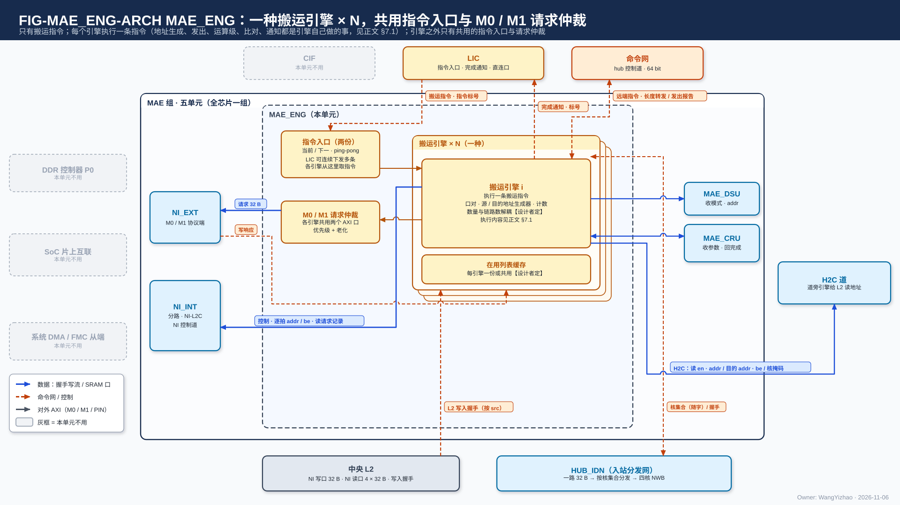
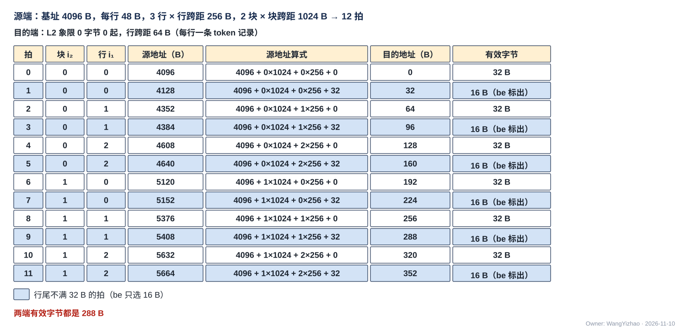
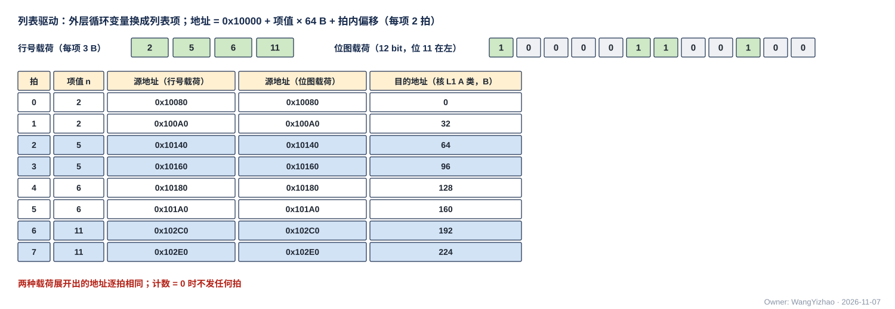
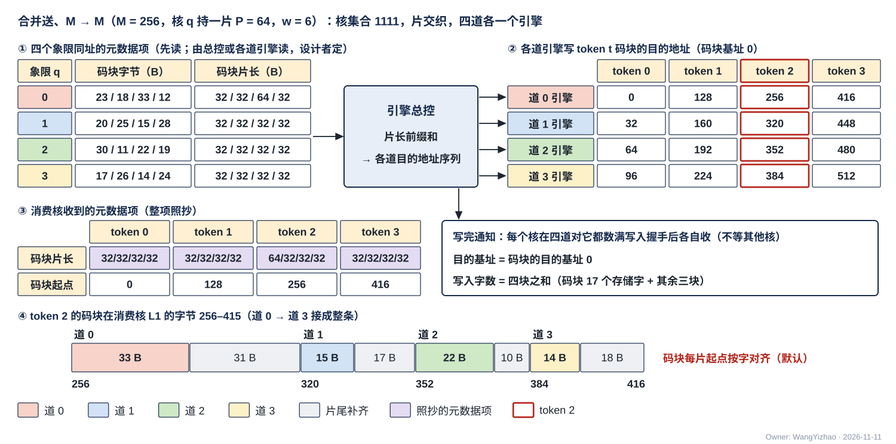
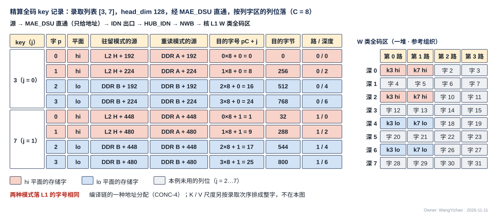
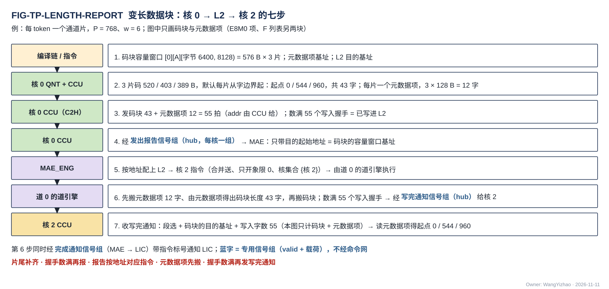

# MAE 搬运引擎与指令执行（MAE_ENG）需求

> Owner: WangYizhao｜2026-11-11

## 1 概述

MAE_ENG 是 MAE 组五个交付单元之一（MAE 组 = MAE_ENG、MAE_NI_EXT、MAE_NI_INT、MAE_DSU、MAE_CRU，V18-NII-03 / 04、V18-MAE-11；入站分发网 HUB_IDN 属 HUB 组，V18-HUB-01），全芯片一个。**它接收 LIC 下发的搬运指令（可同时多条），逐拍给出每条指令的源地址与目的地址，经 NI_EXT、NI_INT、HUB_IDN、H2C 道把数据从一个存储的某个区域搬到另一个存储的某个区域；途中按指令选不经运算级、经 MAE_DSU（直通或转置）或经 MAE_CRU（合并，从 L2 读、写回 L2）；按目的地回来的写入握手（片外为 AXI 写响应）判断数据已写进目的地后，带指令标号通知 LIC；目的为核 L1 时，同时给各目的核 CCU 发写完通知。** 它是全部 DDR / 共享内存请求的唯一生成者，也是 H2C、IDN、NI 写口、NI 读口、MAE_DSU 与 MAE_CRU 两侧每拍地址的唯一给出者（V18-TP-27、V18-MAE-25）。

**MAE 不感知数据类型**：指令里只有口对、两端地址生成器、几何、核集合与运算字段，没有布局码、精度码或按类型命名的操作（用户 11-06："MAE 无需感知数据类型，它要做的只是把数据从某个指令规范的存储的某个区域，写到某个指令规范的存储的某个区域"，V18-MAE-01）。本篇给 MAE 设计者、LIC 与 CCU 设计者、编译链与 ISA 用；组内五个单元之间交什么、位宽与握手是 MAE 集成篇的组内约定，本篇在第 2 章只列 MAE_ENG 用到的那些并注明出处。

本篇用到的几个词（其余术语在首次出现处定义）：

| 词 | 含义 |
|---|---|
| 搬运指令 | LIC 下发给 MAE 的一条指令，说明把数据从哪个存储的哪个区域搬到哪个存储的哪个区域、途中做不做中间操作（§3.3）；MAE 只有这一类指令（V18-MAE-12） |
| 指令标号 | LIC 为每条搬运指令分配的号，MAE 执行完时带回，用来区分并发指令中是哪一条完成了（V18-MAE-13）；位宽归 ISA |
| 搬运引擎 | 执行一条搬运指令的上下文：口对、两端地址生成器、发出计数、写入握手计数；MAE_ENG 按并发需要例化多个（V18-MAE-10）。"通道 / 道"只指物理链路及其子道（H2C 每核 4 道、IDN 每核 1 条），不指搬运引擎 |
| H2C 道 $n$ 的发令方 | 执行一条 L2 → 核 L1 指令在 H2C 第 $n$ 道上那部分搬运的搬运引擎（架构篇 §2.4.3）；参考实现里每道一个，称道引擎（§7.3） |
| 口 / 口对 | 口是数据进出某个存储或单元的位置（M0 读、L2 的 NI 写口等，§3.5）；口对 = (源口, 目的口) |
| 地址生成器 | 源端、目的端各一个，选"算术"（按几级规律跳变的地址）或"列表驱动"（按列表项给出地址）（§3.6） |
| 几何 | 行字节数、行数、各级计数与跨距（字节）、列表项字节数；数据类型的差异全部折进这几个量 |
| 核集合 | 目的为核 L1 时的接收核，4 bit 核掩码；H2C 随指令给出，IDN 随每个存储字给出（V18-HUB-04） |
| 运算级 | 源与目的之间的中间操作，由运算字段三选一：不经运算级 / 经 MAE_DSU / 经 MAE_CRU（§3.13） |
| 切换段 | 发令方内部的一段连续拍；几条指令共用一个合并点时只在切换段之间换源；链路上没有切换段标记（协议篇 §3.10） |
| 写入拍 | 链路上成交的一拍（en ∧ ready），默认 = 一个存储字（32 B）；接收方每把一个写入拍的全部有效字节写进最终存储回一个写入握手，应写量与写入字数都以它计（协议篇 §3.8） |
| 发令号 `src` | 核间链路上标明"这一拍属于哪个发令方"的信号；每个搬运引擎有自己的号，接收方的写入握手带回这个号（协议篇 §2.2.2，V18-TP-47） |
| 发出报告 | 各核 CCU 经 C2H 把一份数据写进 L2、数满 L2 回的写入握手之后，经发出报告专用信号组给 MAE 的报告，只带一个目的起始地址（§3.19） |
| 写完通知 | 目的为核 L1 的指令数满写入握手后，经写完通知专用信号组给各目的核 CCU 的通知，载荷 = (段选, 目的基址, 写入字数)（§3.20，V18-TP-70） |
| 元数据项 | 紧凑 token 记录每个通道片一个的定长项：首字放码块片长（16 bit，本片码块在 A 类占的字节数，按 32 B 取整）与 F 项数（16 bit），后接 keep 位图（$P$ bit，$P$ = 一个通道片的通道数），项宽 $\lceil (4 + P/8)/32 \rceil \times 32$ B（数据组织篇 §2.5，V18-TP-68）。**码块** = 紧凑 token 记录一个通道片四部分之一，只装保留通道的 6 bit 码 |
| 逻辑地址 | 24 bit 段内字节地址；落在哪个存储范围由与地址并行的 5 bit 段选信号 `seg` 选（架构篇 §3.3）；指令里是堆选 1 bit + 类选 / 象限选 2 bit，引擎展开成 `seg` |

## 2 接口需求

### 2.1 架构图与接口汇总

图中模块框内的结构是参考实现（见第 7 章），本章以框外的各口为准。

框外的口：上方是 CIF（停止请求入、已停住应答出，各 1 根电平；复位 1 根入；图中画到指令入口左沿）与 LIC（搬运指令经命令网进入指令入口；完成通知经 1 组专用信号出）；右侧是 hub 承载的专用信号组（写完通知 hub 侧 4 组出、各核发出报告 4 组入）与 H2C 道 0–3（给 L2 象限读口的读地址流、给 H2C 道的目的信息流（addr / be / seg / src / 核掩码），两条流都是 en / ready 握手，图中旁边的反向短箭头是 ready；各目的核接收桥的写入握手每核每道一组直回）；下方是中央 L2（NI 写口的写入握手经 NI_INT 转交）与 HUB_IDN（随每个存储字的核集合出、各核 NWB 的写入握手每核一组直回）；同组的 NI_EXT（读写请求、写响应）、NI_INT（每拍地址与读请求记录，含 NI 读口四路的读地址流、各自 ready；NI 侧写完通知、读返回的列表与元数据项）、MAE_DSU（运算、尺寸字段与两侧地址）、MAE_CRU（合并参数与地址、合并完成）在框旁。框内的"搬运引擎 × N""道引擎 × 4""引擎总控""指令入口（两份）""M0 / M1 请求仲裁""列表本地副本"都是参考组织（§7.1）；其中"道引擎 × 4"是 H2C 道 $n$ 的发令方在参考实现里的形态，"引擎总控"按核汇总各道进度，各核各自收写完通知。图中三种线分开画：命令网（橙实线）、专用信号组（紫点划线）、控制与写入握手（橙虚线）。图中"分派""执行完成"两条线只在道引擎放在道旁时才有，属参考实现（MAE 集成篇 §7.2）。

| 口 | 对端 | 方向 | 位宽 | 握手 | 出处 |
|---|---|---|---|---|---|
| 搬运指令入口 | LIC，经命令网 | 入 | 64 bit data + addr | en / ready | 架构篇 PORT-24；MAE 集成篇 C1 |
| 完成通知 | LIC | 出 | 1 组：valid + 指令标号 | 专用信号组 | PORT-38；C2 |
| 写完通知（hub 侧） | 各核 CCU，经 hub | 出 | 4 组（每核一组）：valid + 段选 + 目的基址 + 写入字数 | 专用信号组 | PORT-37；C13 |
| 写完通知（NI 侧） | 各核 CCU，经 NI_INT 的 NI 侧发出 | 出 | 4 组，载荷同上 | 专用信号组 | PORT-37；C13 |
| 发出报告 | 各核 CCU，经 hub | 入 | 4 组：valid + 目的起始地址（分批搬运时另带流标号） | 专用信号组 | PORT-39；C14 |
| H2C 道 $n$ · L2 读地址流（$n$ = 0…3） | L2 象限读口 $n$ | 出 | addr 24 + `seg` 5 | en / ready | PORT-15 |
| H2C 道 $n$ · 目的信息流 | HUB_NOC 的 H2C 道 $n$ | 出 | 目的 addr 24 + be 32 + `seg` 5 + `src` + 核掩码 4 | en / ready | PORT-12；C5 |
| H2C 落地写入握手 | 各核 H2C 接收桥，经 H2C 道 | 入 | 16 组（4 道 × 4 核）：valid + `src` | 只有 valid | PORT-30；C9 |
| IDN 核集合 | HUB_IDN（随 NI_INT 的 IDN 出口数据） | 出 | 每个存储字 4 bit | 随 IDN 出口的 en / ready | PORT-17；C12 |
| IDN 落地写入握手 | 各核 NWB，经 HUB_IDN | 入 | 4 组（每核一组）：valid + `src` | 只有 valid | PORT-30；C10 |
| 读写请求 / 写响应 | NI_EXT（组内） | 出 / 入 | 请求带选口位（M0 / M1）；写响应每笔一个 | en / ready | MAE 集成篇 §2.10.1 |
| 每拍地址与通路控制 | NI_INT（组内） | 出 | 读请求记录 (去向, 目的逻辑地址)；NI 写口、IDN 出口、LIC 直连口的每拍 addr / be / `seg` / `src`；IDN 出口的来源选择 | 随数据 en / ready | MAE 集成篇 §2.10.1；PORT-17 / 18 / 22 |
| NI 读口 · 读地址流（4 路，每象限一路） | L2 的 NI 读口（经 NI_INT） | 出 | 每路 addr 24 + `seg` 5，各路各给地址、可以不同址 | 每路 en / ready 各自独立 | PORT-19 |
| 读返回的列表、计数项与元数据项 | NI_INT 的读返回分路 / L2 读出分路（组内） | 入 | 32 B/拍 | en / ready | MAE 集成篇 §2.10.1 |
| L2 写入握手 / LIC 直连口写入握手 | 中央 L2 / LIC 小 SRAM，经 NI_INT 按 `src` 转交 | 入 | 4 组 / 1 组：valid + `src` | 只有 valid | PORT-30；C6 / C7 |
| 运算控制与两侧地址 | MAE_DSU（组内） | 出 | 运算、三个尺寸字段、选择位图、双目的、两侧 addr / be | 随数据 en / ready | MAE 集成篇 §2.10.1 |
| 合并控制与两侧地址 / 合并完成 | MAE_CRU（组内） | 出 / 入 | 合并种类、象限掩码、编码、地址、keep 位图、F 项数 / 1 个事件 | 随数据 en / ready | MAE 集成篇 §2.10.1 |
| 停止请求 / 已停住应答 | CIF | 入 / 出 | 各 1 根电平 | 请求 / 应答 | 架构篇 PORT-42；CIF 篇 §2.6；MAE 集成篇 C16 |
| 复位 | CIF | 入 | 1 根 | 无 | 架构篇 PORT-41；CIF 篇 §2.4；MAE 集成篇 C17 |

口宽与条数以架构篇 §2.7 的 PORT-nn 为准，组内各口的字段与握手以 MAE 集成篇 §2.10.1 为准，本表只为阅读方便列出。

**各口共同的规则**：

- **核间链路与组内数据链路一律握手（en ∧ ready 成交），与其他核间链路用同一套逻辑，链路一侧例化 HUB 提供的通用链路块**（V18-TP-80、V18-HUB-05；MAE 集成篇 §2.10.2、协议篇 §3.5）：时延无关、可任意插级。**沿途任一段的 ready 拉低时，执行该指令的搬运引擎停止产生下一拍，ready 恢复后继续；停发只降速、不丢数**（V18-MAE-25）。
- **MAE 在命令网上只有 MAE_ENG 一个端点**（V18-TP-79，MAE 集成篇 §2.1）；完成通知、写完通知、发出报告都是专用信号组，不经命令网（V18-TP-77）。专用信号组每组 valid + 载荷，**是否带 ready 与接收侧的队列深度【设计者定】，约束：不丢、不重，接收侧来不及收时只降速**；载荷各字段的语义只在协议篇 §2.6 定义，位宽归 ISA。
- **写入握手逐个写入方回发令方**：每个写入方一组 valid + `src` 线直达发令的搬运引擎，中途不汇总、不按 `src` 归并（V18-TP-78，架构篇 PORT-30）；**发令方按（写入方, `src`）分别计数**。

### 2.2 搬运指令入口：LIC 经命令网写入（PORT-24）

#### 2.2.1 信号与生效

**LIC 经命令网的 LIC → MAE_ENG 直连链路下发搬运指令；命令网与数据网同一协议格式：en、ready、addr、data（64 bit），每拍都带 addr，addr = 指令入口里的字地址，MAE 按 addr 写入**（V18-TP-76，协议篇 §2.5）。

| 信号 | 方向 | 位宽 | 每拍含义 |
|---|---|---|---|
| en | 入 | 1 | 本拍有一个 64 bit 字 |
| ready | 出 | 1 | 指令入口本拍能收；入口满时拉低，LIC 停发 |
| addr | 入 | 【设计者定】 | 指令入口内的字地址；约束：能寻址指令入口的全部字 |
| data | 入 | 64 bit | 搬运指令的一个字（每条指令带指令标号） |

- **一条指令占几个 64 bit 字、写到哪一字生效，由 MAE 设计者给出，并与 LIC 和 ISA 对接**（MAE 集成篇 §2.8；用户 11-11 对 MAE 集成篇 D1"认可"）；约束：**搬运引擎不会取到写了一半的指令**，ready 只表示入口能收。是否另带 be【设计者定】，约束同上。
- **LIC 可连续下发多条；指令入口能在执行当前指令时预存下一条**（V18-MAE-13，§3.4）。

### 2.3 完成通知：每条指令执行完通知 LIC 一次（PORT-38）

#### 2.3.1 信号与时机

**完成通知专用信号组 1 组：valid + 指令标号**；每条指令执行完（判据见 §3.18）发一次，不经命令网（V18-MAE-13 / TP-77）。L2 → 核 L1 经 H2C 的指令在参与的各道都完成之后通知一次；一条 MAE_CRU 合并指令同样只通知一次。

### 2.4 写完通知：目的为核 L1 的指令数满后发给目的核 CCU（PORT-37）

#### 2.4.1 信号与两组的分工

**写完通知专用信号组每核两组（hub 侧、NI 侧），全芯片 8 组；每组 valid + (段选, 目的基址, 写入字数)**（V18-TP-77）。

- **经 H2C 落进 L1 的搬运走 hub 侧那一组；经 IDN 落进 L1 的搬运走 NI 侧那一组**（由 MAE_ENG 把载荷交 NI_INT、经 NI 一侧点到点送各核 CCU，不经 hub，MAE 集成篇 C13）。
- **从 CCU 一侧看每核收两路，两路互不等待、在核前不合并，四核各自独立**（用户 11-11："我认为是每核收两路的说法，我认为要留出4核各自灵活的自由度"）。
- 何时发、写入字数怎样定见 §3.20；载荷语义见协议篇 §2.6。

### 2.5 发出报告：各核 CCU 写进 L2 之后报给 MAE（PORT-39）

#### 2.5.1 信号与含义

**发出报告专用信号组每核一组，共 4 组：valid + 目的起始地址（码块的容量窗口基址）；分批搬运时另带流标号**（V18-DORG-10 (8)、V18-MAE-45，协议篇 §3.13）。含义 = 发报告的核这一份数据的全部数据块都已写进 L2（该核 CCU 已数满 L2 回的写入握手）。MAE 按地址把报告配给指令（§3.19）；合并指令收齐参与核的报告才开始（§3.15）。

### 2.6 H2C 道：L2 象限读口的读地址流与目的信息流（PORT-15、PORT-12）

**H2C 道 $n$ 的发令方是 MAE 里执行该指令在道 $n$ 上那部分的搬运引擎：它给 L2 象限读口 $n$ 的读地址流，并给 H2C 道 $n$ 的逐拍目的信息；两条都带 en / ready 握手**（V18-TP-80，架构篇 §2.4.2 / §2.4.3）。

#### 2.6.1 L2 读地址流

| 信号 | 方向 | 位宽 | 每拍含义 |
|---|---|---|---|
| en | 出 | 1 | 本拍有一个读地址 |
| ready | 入 | 1 | L2 本拍能接受；en ∧ ready 成交 |
| addr | 出 | 24 | 要读的 32 B 的首字节段内地址，一拍一个地址（架构篇 §3.4 CONC-3） |
| `seg` | 出 | 5 | 堆选 + 段掩码；段掩码恒为象限 $n$ |

- **ready = 0 时道 $n$ 的发令方保持本拍不变、不产生下一拍**；读地址里没有请求号与长度，一次搬运读多少由发令方按指令给的数据量自己数。
- **L2 的下游（H2C 道 $n$）收不下时，L2 拉低读地址流的 ready，卡住道 $n$ 的发令方**；同一个堆上几条链路争用时同样表现为 ready 拉低（L2 篇 §2.4.2、架构篇 §2.4.2）。**读出时延不规定，不要求 MAE 按余量发读或知道 L2 的读出拍数**；正确性只取决于两条流的握手。

#### 2.6.2 目的信息流：给道的逐拍目的信息

| 信号 | 方向 | 位宽 | 每拍含义 |
|---|---|---|---|
| en | 出 | 1 | 本拍有一组目的信息 |
| ready | 入 | 1 | H2C 道本拍能收 |
| 目的 addr | 出 | 24 | 本拍第一个有效字节在目的 L1 的段内地址 |
| be | 出 | 32 | 从第 0 字节起连续有效的字节 |
| `seg` | 出 | 5 | 目的 L1 的堆选与类选（W / S / A） |
| `src` | 出 | 5 bit【待标定】（架构篇 §2.4） | 道 $n$ 发令方的发令号 |
| 核掩码 | 出 | 4 | 本拍送哪几个核（多播时多位） |

- **道不能收时拉低 ready，道 $n$ 的发令方保持本拍不变**（V18-TP-80，用户 11-11 对 HUB_NOC D1"认可"）。
- **目的信息的次序与读地址的成交次序相同**（架构篇 §2.4.3）。**H2C 道上读地址流、读数据流、目的信息流三条各自握手、不要求同拍，道内按次序配对**（V18-TP-82，与 HUB_NOC 篇 §2.3.1 同一条）：发令方可以先发读地址、后给目的信息，也可以反过来。读出数据本身由 L2 的读数据流交 H2C 道，不经 MAE（L2 篇 §2.4.2）。
- **四道各自停发、互不等待**；一条指令在几道上怎样分见 §3.10。
- 多播：道在分叉点把一拍复制给核掩码里的各核，各目的核独立取走，由 HUB 负责（协议篇 §3.7）；L2 只读一次。

#### 2.6.3 H2C 落地写入握手

**各核 H2C 接收桥把一个写入拍写进 L1 之后，沿本道反向回一个写入握手（valid + `src`）；每核每道一组，H2C 4 道 × 4 核 = 16 组，各自直达本道的发令方**（V18-TP-50 / 78，架构篇 PORT-30）。道 $n$ 多播给几个核时，各目的核的那一组各回各的，hub 里不汇总、不按 `src` 归并；**发令方按（核, `src`）分别计数，一拍至多收 4 个（各核 1 个），只数 `src` 等于自己的**；每个目的核在写进本核的数据数满后各自收写完通知，不等其他核（§3.20）。握手只有 valid、没有 ready。接收桥怎样形成写请求、何时回握手归接收桥篇。

### 2.7 IDN：经 NI_INT 的 IDN 出口去 HUB_IDN，与 IDN 落地写入握手（PORT-17、PORT-16）

#### 2.7.1 每个存储字的目的地址与核集合

**目的为 IDN 时，执行该指令的搬运引擎按字给出目的地址、be、`seg`、`src` 与 4 bit 核集合**（V18-HUB-04，HUB_IDN 篇 §2.2）；目的地址等经 NI_INT 的 IDN 出口随数据交出，核集合作为 IDN 出口的旁带交 HUB_IDN（MAE 集成篇 C12）。

- **几个核共享 IDN 时，引擎把各核的存储字排进同一路，每个字随带它的核集合**；各核的字按什么次序排由 MAE 设计者定（参考：字 0 → 核 0、字 1 → 核 1 …，或按编译链给的核次序）；HUB_IDN 只按核集合分发，不推算地址、不拆拍（用户 11-07："MAE 的 ENG 的状态机构造中，设计一个能计算这类地址的状态机即可"）。
- **IDN 链路不受整字限制、也不感知是否整字，只按 be 原样传**（V18-DORG-10 (4)）。
- **IDN 出口的两个来源（NI_INT 的读返回分路、MAE_DSU 的输出）由本单元在切换段边界按两条指令的优先级字段择一**（V18-HUB-03，§3.16）；交 HUB_IDN 的只有一路 32 B。

#### 2.7.2 IDN 落地写入握手

**各核 NWB 把一个写入拍写进 L1 之后回一个写入握手；每核一组 valid + `src`，共 4 组，经 HUB_IDN 原样回到发令的搬运引擎，不汇总、不归并**（V18-TP-50 / 78）；**引擎按（核, `src`）分别计数，一拍至多 4 个**；几核共享或多播时各核数满写进本核的数据就各自收写完通知（§3.20）。

### 2.8 NI_EXT：读写请求与写响应（组内）

#### 2.8.1 请求与响应

- **读写请求**：MAE_ENG → NI_EXT，**每笔带选口位（M0 / M1），NI_EXT 只看这一位分流**（§3.5、NI_EXT 篇 §3.2）；请求的字段归 NI_EXT 篇 §2.5。请求的粒度与发法是参考实现（§7.5），**需求是 §4.1 的 M0 有效带宽**。
- **写响应**：NI_EXT → MAE_ENG，每笔 AXI 写响应；**MAE 按指令分别数满**；响应怎样对回指令【设计者定】，约束：每笔响应恰对回发出它的那条指令（NI_EXT 篇 §2.5）。
- 读返回不直接交 MAE_ENG：经 NI_INT 的读返回分路按读请求记录分路（§2.9）。

### 2.9 NI_INT：NI 写口与 NI 读口的每拍地址、读请求记录与读返回（组内）

#### 2.9.1 MAE_ENG 交给 NI_INT 的内容

**NI_INT 不收指令**（V18-MAE-27），不要求它设指令队列；MAE_ENG 交给它的是解码后的逐拍控制：

| 内容 | 用途 |
|---|---|
| 每笔片外读请求的记录 (去向, 目的逻辑地址) | 读返回按此分路（V18-TP-34）；记录放在哪一侧见 §7.5 |
| NI 写口每拍的 addr / be / `seg` / `src` | 随数据进 L2 的 NI 写口（PORT-18）；`seg` 段掩码多位 = 同址广播（§3.17） |
| IDN 出口每拍的 addr / be / `seg` / `src` 与核集合 | §2.7 |
| LIC 直连口每拍的 addr / `src` | 随数据进 LIC 小 SRAM（PORT-22） |
| 切换段边界与来源选择 | NI_INT 内各合并点（L2 写入合并器、IDN 出口）只在切换段边界换源（§3.16） |
| NI 侧写完通知的载荷 | 由 NI_INT 经 NI 侧专用信号组送各目的核 CCU（§2.4） |

#### 2.9.2 NI 读口的读地址流

**NI 读口是 MAE 与 L2 之间唯一的读口，分四路（每象限一路）；每路一条读地址流（en / addr 24 / `seg` 5，L2 回 ready）与一条读数据流，读地址由发读的搬运引擎给出（经 NI_INT 到 L2）；四路各给各的读地址，可以不同址**（V18-MAE-32 / TP-80 / L2-08，架构篇 §2.4.2、PORT-19；用户 11-11："我认为4路可以不同址，以为4象限各自存完整Token的时候，因为长短不同，就会导致不同址的问题"）。"四路同址"只是跨核合并定长份时的一种用法（MAE_CRU 一拍取四份，§3.15），不是口的限制。**四路的读地址流、读数据流的 ready 各自独立，与各自发读的搬运引擎一一对应，一路被卡不影响另三路**（V18-L2-08，用户 11-11："ready问题我也认为各自独立会好一点，刚好和各自的ENG匹配"）。**ready = 0 时发读的引擎保持本拍不变**；某一路读出的去向收不下时，L2 拉低该路读地址流的 ready、卡住该路发读的引擎。

#### 2.9.3 读返回的列表、计数项与元数据项

**L2 一侧的列表、列表的定长计数项与紧凑 token 记录的元数据项经 NI 读口读出，由 NI_INT 的 L2 读出分路交 MAE_ENG；共享内存 / DDR 一侧的列表（以及 DDR 一侧的计数项、元数据项）经 M0 / M1 读回，由 NI_INT 的读返回分路交 MAE_ENG**（MAE_NI_INT 篇 §3.7）。约束：取列表不使引擎停拍（§4.1），去别处的数据不改字、不丢拍。

#### 2.9.4 L2 与 LIC 直连口的写入握手

**L2 的 NI 写口每象限一组写入握手（valid + `src`），LIC 直连口一组，回到 NI_INT 后按 `src` 交对应的搬运引擎**（PIN 事务号的留给 NI_INT 自己数，MAE 集成篇 C6 / C7）；引擎只数 `src` 等于自己的。

### 2.10 MAE_DSU：运算、尺寸字段与两侧地址（组内）

#### 2.10.1 MAE_ENG 交给 MAE_DSU 的内容

**MAE_DSU 的全部控制只由执行该指令的搬运引擎给出**（V18-MAE-25 / 41；用户 11-08："MAE DSU 的控制命令，一定要来自 MAE ENG"）：

| 内容 | 说明 |
|---|---|
| 运算 | 直通 / 转置（§3.13） |
| 转置的三个尺寸字段 | 元素位宽 $b$、行数 $N$、列数 $J$；位宽见 §4.3；各用法的取值只在 MAE_DSU 篇 §3.2 典型用法表 |
| 选择位图 | 输入侧按位图只取被选中的元素时给出（录取 key 的尺度，§3.12） |
| 每个输出字的去向 | 核集合与目的地址（去 L1 经 IDN 出口、去 L2 经 L2 写入合并器） |
| 双目的 | 是否双目的，进 DSU 的那一份或两份各走直通还是转置（§3.14） |
| 两侧每拍 addr / be 与停发 | 输入、输出两侧都握手，任一侧 ready 低时引擎停发（§2.1） |

### 2.11 MAE_CRU：合并参数、两侧地址与合并完成（组内）

#### 2.11.1 MAE_ENG 交给 MAE_CRU 的内容与收回的事件

| 方向 | 内容 |
|---|---|
| 出 | 合并种类（逐元素相加 / 标量合并 / 读集合并）、象限掩码、各路加数的编码、输出编码（V18-CRU-08 / MAE-34） |
| 出 | NI 读口各路每拍的段内地址（归约：四路读四个象限的同一段内地址，带 bias 时另给 bias 数据块的地址；残差加：两路各自的地址）与写回 L2 的 addr / be（MAE_CRU 篇 §2.1） |
| 出 | 压缩输出时按 token 记录交 keep 位图（SEL 的判决位图）与每片的 F 项数（§3.15） |
| 入 | 合并完成：本指令的结果已全部交 L2 写入合并器（1 个事件）；写入完成仍由本引擎数 L2 写入握手判（§3.18） |

**压缩输出时 MAE_CRU 交出三条流：元数据项、E8M0 项、码；F 列表不经 MAE_CRU**（V18-MAE-44，§3.15）。

### 2.12 CIF：停止请求、已停住应答与复位

#### 2.12.1 信号与语义

| 信号 | 方向 | 位宽 | 含义 |
|---|---|---|---|
| 停止请求 | 入 | 1，电平 | 为高时要求 MAE 停住（§3.23）；CIF 同时送给 LIC、MAE_ENG、四核 CCU |
| 已停住应答 | 出 | 1，电平 | **拉高表示 MAE 不再发起新的访问，并且已发起的访问都已结束、或已停在握手上不再前进**；停止请求撤销后撤销应答，撤销的拍数不作要求（CIF 篇 §2.6） |
| 复位 | 入 | 1 | **复位输入来自 CIF（架构篇 PORT-41），硬复位与软复位不区分**（CIF 篇 §2.4）；复位后的状态见 §3.22 |

MAE 组里只有 MAE_ENG 接停止请求与应答（MAE 集成篇 §3.12）；复位五个单元各接一根。

## 3 功能描述

### 3.1 功能一览

| 功能 | 输入 | 输出 | 触发 / 生效条件 | 节 |
|---|---|---|---|---|
| 只执行搬运指令、不感知数据类型 | 搬运指令 | 逐拍的源 / 目的地址与数据流 | 指令进入指令入口 | §3.2、§3.3 |
| 多条指令并发、预存下一条 | 连续下发的指令 | 各自执行、各自通知 | LIC 下发；依赖由 LIC 表达 | §3.4 |
| 口对合法表 | 口对 | 经过的单元与完成判据 | 指令给出 | §3.5 |
| 两端地址生成器 | 地址生成器参数、几何、列表 | 每拍地址与 be | 每拍一个地址 | §3.6、§3.7 |
| 读列表与计数项 | 列表地址与项数 / 计数项地址 | 列表驱动的地址；应写量 | 列表驱动时；不等列表到齐 | §3.8 |
| 紧凑 token 记录按元数据项定位 | 元数据项 | 码块与 F 列表的长度与各片地址；元数据项整项照抄 | 搬紧凑 token 记录时先读元数据项 | §3.9 |
| L2 → 核 L1 经 H2C：合并送与分送 | 一条 L2 → L1 指令 | 参与各道并行送出 | 收齐参与象限的发出报告 | §3.10 |
| 分批搬运与按批流水 | 一份数据分几批搬 | 下一批从上一批的终点接续 | 每批一条指令的一次执行 | §3.11 |
| 精算 K hi 驻留 / 重读 | 录取列表、两段源地址 | 全码 key 记录落 W 类 | 按位点选 | §3.12 |
| 运算级三选一 | 运算字段 | 不经运算级 / DSU 直通或转置 / CRU 合并 | 指令给出 | §3.13 |
| 双目的 | 第二目的 | 一次读出给两个核集合 | 指令给出 | §3.14 |
| 跨核合并 | 合并参数、参与象限 | 合并结果写回 L2 | 收齐参与核的发出报告 | §3.15 |
| 并发指令的先后 | 优先级字段 | M0 / M1 请求次序、合并点选源 | 几条指令共用资源时 | §3.16 |
| 访问 L2 | 段选与地址 | NI 写 / NI 读 / H2C 读 | 按架构篇 §3.4 的并发约定 | §3.17 |
| 完成与通知 LIC | 写入握手 / AXI 写响应 | 完成通知 | 数满应写量 | §3.18 |
| 发出报告配给指令 | 发出报告 | 放行等报告的指令 | 报告地址与源基址相等 | §3.19 |
| 写完通知 | 写入握手 | 写完通知 | 目的为核 L1、数满之后 | §3.20 |
| 典型用法 | — | 各用途的口对、生成器、核集合与运算 | — | §3.21 |
| 复位 | CIF 的复位 | 清空在途状态 | 复位 | §3.22 |
| 停止与继续 | CIF 的停止请求 | 不再发地址、保持上下文、回已停住应答；继续后结果不变 | 停止请求置位 / 撤销 | §3.23 |

### 3.2 只有搬运指令，指令只给几何

**MAE 只有一类指令——搬运指令**（用户 11-06："ME1：为什么是两类指令？……那 MAE 不应该全是搬运指令？"，V18-MAE-12）。看起来像"配置"的动作也都是搬运：

| 动作 | 作为哪种搬运 |
|---|---|
| 装指令、配置表、调用描述符、KV 段表进 LIC 专用小 SRAM | 源 = 共享内存 / DDR，目的 = LIC 直连口（V18-LIC-01） |
| 装阈值表 | 源 = 共享内存 / DDR，目的 = LIC 直连口（阈值表由 LIC 查出、把一对阈值填进 SEL 的比较指令，V18-SEL-18）；MAE 不核对表头 |
| MAE_CRU 的归约 / 标量合并 / 读集合并 | 源 = L2（经 NI 读口，四个象限同址，各核先经 C2H 写进），运算 = 合并，目的 = L2（经 NI 写口）；合并参数是指令的运算参数（V18-MAE-12 / 21、V18-CRU-07） |

**MAE 不感知数据类型**（V18-MAE-01）：**指令里没有布局码、K 存储精度码、平面、载荷格式描述、目的标签、请求号、按数据类型命名的操作码、完成计数号、等待条件、环长**（V18-MAE-01 / 13 / 17）。数据类型、布局与读序由编译链折成指令的几何与地址；核侧要知道的类型（K 直接处理还是先 RoPE 再处理、V 位宽）在 CCU 指令里，不经 MAE（V18-KV-01）。**KV 编辑由 LIC 展开成带列表的搬运指令，MAE 不认编辑类型**（V18-MAE-07）。

MAE 也不做以下事情（归属见右栏）：

| 不做 | 归谁 |
|---|---|
| 不改数据内容 | 转置在 MAE_DSU，合并在 MAE_CRU |
| 不发 C2H | 源在核内的搬运由各核 CCU 发令（V18-TP-35），MAE 只收发出报告 |
| **不做环形回绕**：搬运的数据不按环形使用，地址只按地址生成器单调展开（V18-MAE-17） | 越过容量窗口末尾时由编译链拆成两条指令 |
| 不判"目的空间有没有空"、不按存储空间计剩余容量 | 编译链（LIC 操作 15） |
| 不校验列表与 KV 编辑列表的内容 | 产出方保证；LIC 只发指令 |
| 不设完成计数器、指令不带等待条件、不知道调用、不核对配置表表头 | LIC（§3.18） |

### 3.3 搬运指令的各项：含义、量纲与取值

本表只写每项的含义、量纲与取值范围；字段位段归 ISA。**指令字段按需要设置，MAE 设计者整理本模块需要的全部字段并与 ISA 对接**（用户 11-11："指令加一位就行，各个模块的设计者需要按需整理都需要哪些指令"）。

| 项 | 含义 | 量纲 / 取值 |
|---|---|---|
| 指令标号 | LIC 分配，执行完带回 | 位宽归 ISA |
| 口对 | (源口, 目的口)，取值见 §3.5 的合法表 | 枚举 |
| 源端地址生成器 | 方式（算术 / 列表驱动）+ 参数（§3.6） | 地址以字节计 |
| 目的端地址生成器 | 同上 | 同上 |
| 几何 | 行字节数、行数、各级计数与跨距、列表项字节数 | 字节 / 个；**算术生成器的级数、各级计数与跨距的位宽【设计者定】，跨距参考 36 bit**（V18-MAE-45）；约束：级数至少覆盖"段内 → 象限 → token"三层（§3.10），级数不够表达的搬运由编译链拆指令 |
| 核集合 | 目的为核 L1 时：H2C 4 bit 核掩码；IDN 4 bit 核掩码，引擎按各核轮到的字随每个存储字给出（§2.7） | 位图 |
| L2 → L1 的用法 | 源为 L2、经 H2C 去核时：**合并送**（参与象限的读出合并成一路送一个核集合）或**分送**（象限 $c$ 只送核 $c$）；参与的象限掩码（4 bit）；**源端一套基址与目的端一套基址**（紧凑 token 记录为元数据项、E8M0 项、F 列表、码块四个基址）；块分四段时的段长；**合并送的目的排法 1 bit：片交织 / 段接续**（V18-MAE-45，§3.10） | 枚举 + 位图 + 字节 + 1 bit |
| 象限掩码（写 L2） | 目的为 L2、经 NI 写口时：只开一位 = 写一个象限；多位 = 同一拍写进掩码内各象限的同一段内地址（同址广播，V18-L2-04） | 4 bit |
| 运算字段 | 不经运算级 / 经 MAE_DSU（直通或转置；转置给元素位宽、行数、列数三个字段；按位图取元素时给选择位图的来源）/ 经 MAE_CRU（合并种类 + 象限掩码 + 各路加数编码 + 输出编码 + 源 / 目的 L2 地址；归约带 bias 时 bias 数据块地址，V18-CRU-09；残差加时第二路源地址；压缩输出时 keep 位图、F 列表与 F 项数计数项的地址 + 四块基址，V18-CRU-08 / TP-66） | 枚举 + 参数（§3.13–§3.15）；DSU 三个尺寸字段的位宽见 §4.3 |
| 第二目的（可选） | 同一次源读出另投一份给另一核集合，两份各选不经运算级、经 MAE_DSU 直通或经 MAE_DSU 转置之一（§3.14） | 有 / 无 + 核集合 |
| 优先级 | M0 / M1 请求发射与共用链路选源的先后（§3.16） | **2 bit 四级【待标定】**（V18-MAE-45） |
| 长度 | 定长数据块由指令给定；紧凑 token 记录按片数（片数由指令给，各部分长度由元数据项得出，§3.9）；列表驱动时由列表计数得出（§3.8）；源为 C2H 写进 L2 的数据块时，等对应的发出报告到达才执行（§3.19）；**分批流水时长度按批给：每一批是一条搬运指令的一次执行**（§3.11） | 字节 / 项 |

### 3.4 指令的执行：多条并发、可预存下一条、依赖由 LIC 表达

**必须允许多条指令同时执行，LIC 可连续下发多条；指令入口能在执行当前指令时预存下一条**（用户 11-06："我认为 MAE 也要有 ping-pong 指令概念，有预存下一项的功能"，V18-MAE-13）。

- **指令不指名执行引擎**：哪条指令由哪个（或哪几个）搬运引擎执行是 MAE 内部的分配（参考见 §7.3、§7.4）；约束是 (1) 多条指令可同时执行；(2) 同一条链路上不同指令的切换段不交错（协议篇 §3.10）；(3) **每条指令恰好通知 LIC 一次**。
- **指令不带等待条件**：指令之间的先后（例：先把数据写进 L2，再从 L2 搬给核）由 LIC 收到前一条的完成通知后再下发后一条来表达（V18-MAE-13）。唯一的例外是**源为 C2H 写进 L2 的数据块的指令**：它等按地址配到本指令的全部发出报告到达才开始（§3.19）。
- **入口满时对 LIC 拉低 ready，LIC 停发**；入口深度不影响正确性。
- **一条指令的生命周期**：进入指令入口 → 逐拍发出（读请求、地址、数据）→ 发送完成（数满指令给的数据量）→ 写入完成（数满目的地回来的写入握手；片外为 AXI 写响应，§3.18）→ 目的为核 L1 时给各目的核 CCU 发写完通知（§3.20）→ 带指令标号通知 LIC。**每一步只由计数与握手推进，不依赖任何固定拍数；在任意位置插入流水级，结果不变**（V18-TP-32，协议篇 §3.5.1）。

例：三条指令的下发、执行与通知次序。

| 时刻 | LIC | MAE |
|---|---|---|
| t0 | 下发 #3（M0 → L2：读权重 tile 进 L2 象限 1）、#5（L2 → 共享内存：写回上一位点的结果记录） | #3、#5 并行执行 |
| t1 | — | #5 的 AXI 写响应收齐 → 通知 LIC "#5 完成" |
| t2 | — | #3 的 NI 写口写入握手（`src` = 执行 #3 的引擎号）达到应写量 → 通知 LIC "#3 完成" |
| t3 | 收到 #3 才下发 #4（L2 → 核 0–3 经 H2C 多播该 tile） | #4 在 H2C 参与的各道上并行执行 |

指令 #4 依赖 #3，所以 LIC 等 #3 的通知；#5 与 #3 无关，可以与 #3 同时执行、先完成。

### 3.5 口与口对：哪些搬运合法

#### 3.5.1 口的清单

两列各自列出全部源口与目的口，同一行的两项不表示一个口对；哪些组合合法见 §3.5.2。

| 源口 | 目的口 |
|---|---|
| M0 读（DDR） | 核 L1，经 IDN 出口 → HUB_IDN |
| M1 读（HSRAM、DDR P2、FMC 主端的片外窗口） | 核 L1，经 H2C 道（源只能是 L2 象限读口） |
| L2 象限读口（经 H2C 道，去核） | L2，经 NI 写口 |
| L2 的 NI 读口 | DDR，经 M0 写 |
| — | 共享内存 / DDR，经 M1 写 |
| — | LIC 直连口（32 B，LIC 专用小 SRAM） |

#### 3.5.2 口对合法表

| 口对 | 经过的单元 | 每拍地址谁给 | 执行完的判据（§3.18） | 可选运算 | 多播 |
|---|---|---|---|---|---|
| M0 → 核 L1 | NI_EXT → NI_INT（→ MAE_DSU）→ IDN 出口 → HUB_IDN → 各核 NWB | 搬运引擎 | IDN 落地写入握手数满（引擎按（核, `src`）计数；应写量 = 各核实际收到的字数之和，每个字按它的核集合计核数）；各核数满后经 NI 侧写完通知给该核 CCU 发写完通知，带写进该核的字数（§3.20） | 不经运算级 / DSU（直通、转置）/ 双目的 | 可（核集合） |
| M0 → L2 | NI_EXT → NI_INT（→ MAE_DSU）→ NI 写口 | 搬运引擎 | L2 写入握手数满 | 不经运算级 / DSU（直通、转置） | — |
| M1 → L2 | NI_EXT → NI_INT → NI 写口 | 搬运引擎 | L2 写入握手数满 | 不经运算级 | — |
| M1 → LIC 直连口 | NI_EXT → NI_INT → LIC | 搬运引擎 | LIC 小 SRAM 每写进一项回写入握手，引擎数满应写量（MAE 集成篇 §2.1 C7、§5.1） | 不经运算级 | — |
| L2 → 核 L1（经 H2C） | L2 象限读口 → H2C 道 → 各核 H2C 接收桥；合并送与分送（§3.10） | **参与各道的发令方** | H2C 落地写入握手数满（各目的核各一组经 H2C 道直回，多播按目的核数倍计；参与的各道都数满）；每个目的核在给它送数据的各道对该核都数满后经 hub 侧写完通知收自己的通知（§3.10.1） | 不经运算级 | 可（核掩码） |
| L2 → 核 L1（经 IDN） | NI 读口 → NI_INT → MAE_DSU → IDN 出口 → HUB_IDN → 各核 NWB | 搬运引擎 | IDN 落地写入握手数满；之后经 NI 侧写完通知发 | **只经 DSU**（直通或转置），例：K hi 驻留区里的 hi 码送粗算核时转置（§3.12） | 可（核集合） |
| L2 → DDR / 共享内存 | NI 读口 → NI_INT → NI_EXT | 搬运引擎 | AXI 写响应收齐 | 不经运算级 | — |
| L2 → L2 | NI 读口 → NI_INT → NI 写口 | 搬运引擎 | L2 写入握手数满 | 不经运算级 / DSU / CRU（合并：四个象限同址读、写回 L2） | — |
| DDR → DDR（区域复制） | NI_EXT 读返回 → NI_INT → NI_EXT 写 | 搬运引擎 | AXI 写响应收齐 | **只走不经运算级**（V18-NII-07） | — |
| L2 + M0 → 核 L1（精算驻留模式，V18-ATT-03） | NI 读口（K hi，L2）与 NI_EXT 读返回（K lo，DDR）→ NI_INT → MAE_DSU 直通（两路按指令次序接续）→ IDN 出口 → HUB_IDN → 各核 NWB | 搬运引擎 | IDN 落地写入握手数满；之后经 NI 侧写完通知发 | **只经 DSU 直通**（精算全码 key 记录，§3.12） | 可（核集合） |
| L2 → CRU → L2 | NI 读口（归约：四象限同址；残差加：两路数据块分拍）→ MAE_CRU → L2 写入合并器 → NI 写口 | 搬运引擎 | 归约：收齐参与核的发出报告才开始；残差加：LIC 在归约指令执行完后下发；L2 写入握手数满 | 本身即合并；输入 / 输出编码按指令（V18-CRU-08） | — |

**不开 M1 → 核 L1**（用户 11-06 ME13）：M1 只有 8 B × $f_{\mathrm{IO}}$（$f_{\mathrm{IO}}$ = M1 / PIN 的接口频率【待确认】，架构篇 §2.6），进核的数据先落 L2，再经 H2C 进核。DDR 两条路都能到：大流量走 M0，M55 放在 DDR 共享区的小数据可走 M1。

#### 3.5.3 不在本表、并列说明的两条

- **PIN 直写 L2 的 PIN 窗口**：外部主方经 PIN 从口发地址，不经搬运引擎；与 M1 → L2 并列，两条都必须支持（用户 11-06："M1 读回和 L2 直写，都要支持，这是必要的兼容性"，V18-MAE-09）。**PIN 的每种输入只有一个固定的 PIN 窗口；PIN 写 L2 与推理整体分先后**：PIN 写一帧期间没有调用在执行，MAE 不为推理做搬运，一帧传完之后推理才开始（V18-L2-07、V18-MAE-44）。
- **核 → L2（C2H）**：由本核 CCU 发令、逐拍给地址（数据来自本核的集成输出端口，即发送 FIFO 入口或 VNU 输出，V18-TP-56 / 59）；MAE 只收发出报告（§3.19，V18-TP-35）。

#### 3.5.4 选口位与口对合法性

- **M0 / M1 由口对与地址所在空间决定**：HSRAM 与 FMC 主端的片外窗口只经 M1；DDR 两条路都能到。**选口位随每笔请求交 NI_EXT**（§2.8）。
- **口对在 §3.5.2 表内、两端总字节数相等，由编译链生成指令时保证、编译期检查**；验收用仿真断言（§6.3）。

### 3.6 地址生成器：两端各一个，算术或列表驱动

#### 3.6.1 两端各自选方式；顺序、gather、scatter 是两端方式的组合

**源端、目的端各一个地址生成器，各自独立选"算术"或"列表驱动"**（用户 11-06："顺序，按列表取，按列表散写，不是可以合并吗？本身都是在做地址推算"，V18-MAE-02）。

| 源端 | 目的端 | 效果 | 典型例子 |
|---|---|---|---|
| 算术 | 算术 | 顺序搬运、区域复制 | 权重流、DDR → DDR 拷贝 |
| 列表驱动 | 算术 | gather（按列表取、连续放） | 录取 key 的 K lo / V 补读 |
| 算术 | 列表驱动 | scatter（连续取、按列表散放） | KV 散写 |
| 列表驱动 | 列表驱动 | 按两张列表对应搬 | 按槽号对应的 KV 拷贝 |
| 任一 | 任一，核集合多位 | 多播（复制在 H2C 道 / HUB_IDN 的分叉点） | 权重同时投四核 |

**不设稀疏读取模式**：稠密是位图全 1 或算术地址的特例，引擎不区分（用户 11-06："稀疏读取必然兼容稠密读取"，V18-MAE-08）。

#### 3.6.2 算术生成器：几级规律跳变

**问题**：一条指令搬的数据，在源或目的里往往不是一段连续地址，而是"一行连续、行与行之间按固定跨距跳、几块之间再按更大的跨距跳"。例：从行跨距 4,096 B 的矩阵里取 64 行 × 128 B 的一块，每行 128 B 连续、行间跳 4,096 B；再取同一方向的 3 块，块间再跳一个更大的跨距。所以**地址要能按几级规律跳变**：地址 = 基址 + 行内偏移 + $\sum_l i_l \cdot s_l$，$i_l$ 是第 $l$ 级的计数变量、$s_l$ 是该级跨距（字节）。

要求：

1. **每拍产生一个地址，不因算地址停拍**；
2. **级数、各级计数与跨距的位宽【设计者定】，跨距参考 36 bit**（用户 11-11："我认为这个设计交给MAE的Designer去定即可，而且我认为应该是36bit"，V18-MAE-45）；约束：级数至少覆盖"段内 → 象限 → token"三层（§3.10），**级数不够表达的搬运由编译链拆成多条指令**，硬件不必为极端几何加级；
3. **不做环形回绕**（V18-MAE-17）：地址只按上式单调展开；
4. 行尾不满 32 B 的拍用 be 标出有效字节。

图中源端：基址 4,096 B，行字节数 48 B，3 行、行跨距 256 B，2 块、块跨距 1,024 B；每行 48 B 拆成 2 拍（32 B + 16 B），共 12 拍。源地址依次是 4096、4128、4352、4384、4608、4640、5120、5152、5376、5408、5632、5664；每行第 2 拍 be 只选 16 B。目的端是 L2 象限 0 里从字节 0 起、行跨距 64 B 的 6 行，目的地址 0、32、64、96 … 352。引擎只给每拍的地址与 be（§3.7）。脚本断言两端有效字节数都是 288 B。实际行字节数、行数与跨距由指令给出。

#### 3.6.3 列表驱动生成器：外层循环换成列表项

**列表驱动 = 把最外层循环变量换成列表项**：位图载荷取置位位置的序号，行号载荷取每项 3 B 的值（V18-MAE-06 修订）；地址 = 基址 + 项值 × 项字节跨距 + 内层偏移。

图中行号列表 [2, 5, 6, 11]，项字节跨距 64 B，源基址 DDR 0x10000：每项 2 拍，源地址 0x10080 / 0x100A0、0x10140 / 0x10160、0x10180 / 0x101A0、0x102C0 / 0x102E0，共 8 拍；同一组项写成 12 bit 位图 `1000 0110 0100`（位 2、5、6、11 为 1），展开出的地址逐拍相同；目的端算术、从核 L1 A 类字节 0 起连续放，8 拍落 0 … 224。边界：**列表计数 = 0 时不发任何拍，指令立即执行完**。实际项数由指令或计数项给出（§3.8）。

**一个列表项要取两处不连续的数据**——例：重读模式下同一 key 的 hi 段在 $A + 64n$、lo 段在 $B + 64n$，$A$、$B$ 相差一个平面的大小（§3.12）——**怎样展开、在指令里怎样表达【设计者定】**（用户 11-06："ME3：给出这个问题，即列表项取不连续数据，由 Designer 想方案"）。约束：一项展开出的几段在目的端按指令给的次序相邻落位；不因展开停拍；表达方式由 MAE 设计者与 ISA 对接。

#### 3.6.4 地址单位与边界

DDR / 共享内存一侧为字节地址；片上一侧为 24 bit 逻辑地址（段内字节地址）加段选（架构篇 §3.3）。**段内地址不超出该段容量，由编译链给的指令与本引擎的地址生成保证，编译期检查、验收用仿真断言（§6.3）。**

### 3.7 每拍地址与有效字节：使用者一侧不移位，SRAM 支持紧密存储

**源端每交出一个写入拍，目的端给出它的目的地址与 be：addr = 本拍第一个有效字节的地址，数据从第 0 字节起放，be 标出从第 0 字节起连续有效的字节**（协议篇 §3.4）。

- **引擎只给逻辑字节地址与 be，不移位、不拆拍**；链路、hub、接收桥、L2 入口同样只原样传。**L1 的 A / W 类与 L2 支持紧密存储：同一发送方的数据按字节首尾相接、不补齐，一次至多 128 B，字节移位在 SRAM 内部**（V18-TP-74，架构篇 §3.3 / §3.5.4、L2 篇 §3.3）；一拍的 addr 不是 32 的倍数时这一拍跨两个存储字，由目的 SRAM 处理；读侧由源 SRAM 把首字节移到输出的第 0 字节后交出。不从存储字边界起的访问允许慢（拍数见架构篇 §3.4 CONC-3）。
- **数据组织默认按 32 B 对齐**（数据组织篇 §2.3、§2.5）：此时一个写入拍恰是源端的一个存储字，原样落到目的端的一个存储字，be 全 1；换排列的搬运（核间按 $m$ 切分的合并、T 接 K 取第 $q$ 片、权重驻留按窗口聚集）都是整字拷贝。行字节数不是 32 的倍数时（算术生成器的行尾、MAE_DSU 转置不足一块行数的尾块），尾拍用 be 标出有效字节。**S 类写口一次写一个整字、不带 be**（架构篇 PORT-06），去 S 类的数据由生产方把末字补 0。
- **片外一侧**：片外起点按数据组织默认由编译链按 32 B 对齐给出，不作硬限制；**经 PIN / M1 进来的片外数据，片外窗口由编译链固定，外部主方从窗口起点顺序写、长度任意、尾字 be**（V18-TP-67、V18-DORG-10 (11)）；片外起点不在字边界时，NI_EXT 按 AXI 地址与字节选通把有效字节按次序交出（首字节在前），之后由 SRAM 内部移位（MAE_NI_EXT 篇）。**一个写入拍按 SoC 地址跨两个片外 32 B 对齐单元时由谁、怎样拆成 AXI 请求【设计者定】**：约束是 NI_EXT 不拆请求（MAE_NI_EXT 篇 §3.3），拆后有效字节的次序不变；默认片外与片上都按 32 B 对齐，此时一个写入拍恰是一笔请求、不需要拆。

### 3.8 列表与计数项：由 MAE 读取，不等到齐

#### 3.8.1 列表放在哪、谁读

大批列表在 L2（"列表区"只是编译链给一段地址起的名，L2 无逻辑分区）；M55 产的列表在共享内存 / DDR。**列表由执行指令的搬运引擎自己经同一套口读取；LIC 只在指令里给列表地址与项数，不看内容**（用户 11-06："这个稀疏读取还是交给 MAE 更好"，V18-MAE-08）。读回的路径见 §2.9.3。**引擎逐拍出地址时不因取列表而停拍**（§4.1）；列表在 MAE 本地怎样保存是参考实现（§7.6）。

**稀疏取数统一成读集一条路，按列表取数时列表就是读集**（V18-DORG-08，数据组织篇 §3.5）：用这份数据的所有源各出一份选择位图，取并得读集（核内由 SEL / CCU 做，跨核由 MAE_CRU 做读集合并）；**本引擎只按读集从 DDR / L2 搬、按读集次序落 L1**，不区分 hi / lo（hi 是读集为全部行的情形），也不区分被挑的是归约维还是输出维——这两类只差目的端的地址规律（被挑的是输出维的数据按列字区的列位落，§3.12）。

#### 3.8.2 两种载荷与项数

| 载荷 | 每项 | 用途举例 |
|---|---|---|
| 位图 | 1 bit（每行 / 每 key / 每区块） | 录取位图、区块位图 |
| 行号 | **固定 3 B**（任意词表都放得下，用户 11-06："这是一个合理的冗余设计"） | TOPK 列号、token 列表、KV 编辑槽号 |

**列表没有头**：位图定长、项数由指令给；**序号列表（项数另存）——项数在运行中才定的列表，例如保留通道的序号列表、TOPK 重算词号列表、参与词号列表——的项数由生产核 CCU 写成一个定长计数项**（地址由编译链给，与列表同在 L2），**本引擎读列表前先读它**（V18-DORG-10 (5)）；SEL 每个通道片最多保留几项（每片保留上限 $k$，决定列表容量窗口的静态大小）按通道片给（V18-DORG-10 (6)）；哪条指令用哪张列表由指令引用列表地址表达（V18-MAE-06）。

#### 3.8.3 列表不等到齐：ping-pong 分段消费

**列表不需要整份到齐才用**（用户 11-06："列表无需等到到齐，这里也可以结合 ping-pong，到一部分，先消费，然后同时存另一部分"）：编译链把一张长列表分成两半放在不同地址；写前一半的那条指令完成（写入握手数满、LIC 收到通知后下发消费它的指令），引擎就开始消费它，同时后一半继续写入。段长由编译链给。这与"数据块写完才能发"（V18-TP-46）不冲突：两半是不同地址。L2 的同一个堆同一时段可以又读又写、同一拍不行（架构篇 §3.4 CONC-2）：写后一半与读前一半由编译链与本引擎先错开到不同的堆或不同的拍，没错开只降速（§3.17）。

### 3.9 紧凑 token 记录：先读元数据项、按片定位、整项照抄

**紧凑 token 记录的一个通道片 = 元数据项 + E8M0 项 + F 列表 + 码块四部分，各在一个数据块里，四个基址都在指令里**（V18-TP-66、数据组织篇 §2.5）；元数据项不是列表（V18-TP-66 / 68）。**搬紧凑 token 记录的指令先读元数据项，由它得出码块与 F 列表各片的长度与地址，再搬码块与 F 列表**（V18-TP-69，用户 11-09："我认为元数据是应该先搬运的信息，因为地址推理强需求元数据"）：**每一片的码块与 F 列表，在算出它的地址所需的元数据项读到之后才搬**。整份元数据项先读完再搬，还是读一片、搬一片按片交替，由 MAE 设计者定（参考做法：边读边累加片长，§7.2），两种都满足本条。

- **本引擎只读元数据项首字里的码块片长与 F 项数（字段偏移恒定，与 $P$ 无关），keep 位图不解读；元数据项整项照抄、不改任何字段**；片起点只来自元数据项，数据里没有记录头。
- **定长两部分**：元数据项与 E8M0 项按"基址 + 片序号 × 定长"定位（项宽、$\lceil (P/G)/32 \rceil \times 32$ B，$G$ = MX 组长）。
- **变长两部分**：第 $s$ 片码块的源地址 = 码块基址 + 前 $s$ 片码块片长之和、长度 = 本片码块片长 $c_s$；第 $s$ 片 F 列表的源地址 = F 列表基址 + 前 $s$ 片 F 列表片长之和，F 列表片长 $\varphi_s = \lceil 2 f_s/32 \rceil \times 32$ B（$f_s$ = 该片 F 项数，每项 2 B）。顺序搬整个数据块时码块搬的字数 = 各片码块片长之和 ÷ 32，F 列表同理。
- 四部分按片补齐、各从存储字边界起是数据组织的默认（数据组织篇 §2.5、V18-DORG-04）；在消费核依次落 A 类、S 类、A 类、A 类，按 `seg`。
- 消费核 CCU 按照抄过来的元数据项顺序累加码块片长与 F 项数定位每一片，再按 keep 位图 popcount 算读码字数（数据组织篇 §3.4）；这是 CCU 的做法（`CCU_STAGING.md`）。

### 3.10 L2 → 核 L1 经 H2C：合并送与分送，各一条指令

#### 3.10.1 两种用法

**核 $n$ 写进 L2 的数据只在象限 $n$（V18-L2-04）；L2 → 核 L1 经 H2C 四道（道 $q$ 读象限 $q$）只有两种用法，每种只需一条搬运指令**（V18-MAE-37，用户 11-09："我认为咱们只会碰到模式1和模式2，模式3可以归并到模式1"；"认可，我认为两种模式对于MAE来说都只需要一个指令"）：

| 用法 | 参与象限的读出去哪 | 每核每拍 | 指令给什么 |
|---|---|---|---|
| **合并送** | 参与象限的读出合并成一路，送一个核集合：核掩码 1111 多播，或只含一个核；象限掩码可只开一部分象限 | 开 $n$ 个象限时 $n \times 32$ B（四个都开时 128 B） | 用法、象限掩码、核集合；源一套基址（四个象限同址）、目的一套基址；**目的排法 1 bit：片交织 / 段接续** |
| **分送** | 象限 $c$ 只送核 $c$ | **32 B**（每核只有一道，V18-MAE-42） | 用法、一个象限内读起始地址、一个 L1 写起始地址（四个象限同址、四核同址） |

**对外的执行要求**（两种用法相同）：

1. **一条 L2 → L1 指令在参与的各道上同时执行；每道有独立的地址来源（读地址与目的地址），各道各按自己的 ready 停发、互不等待、进度可以不同**；L1 按地址落位，不要求各道等齐。
2. **每道的写入握手回本道的发令方**（§2.6.3）。**写完通知各核各自收：每个目的核在写进本核的数据数满后收自己的写完通知，不等其他核**——分送时道 $c$ 对核 $c$ 数满就给核 $c$ 发；合并送（含多播）时一个核的数据来自参与的几条道，这几条道对该核都数满才给该核发（V18-TP-83 (5)、V18-TP-84 (8)）。**参与的各道全部数满之后，才算本指令写入完成，通知 LIC 一次**（V18-MAE-40）。
3. **指令不指定执行引擎**；各道怎样分到执行上下文是参考实现（§7.3）。
4. **L2 的四个象限读口同一时刻只服务一条 L2 → L1 指令；一条发送完成后，按优先级字段选下一条**（V18-MAE-37，§3.16）——这是 MAE 对编译链的约定，只在本篇规定。**编译链靠它得到两点保证**：（1）两条 L2 → L1 指令的数据不在 H2C 道上交错，一条指令发送完成之后下一条才开始发，编译链可以按 L2 → L1 指令被选中的先后推算各目的核 L1 里数据的到达先后，并据此复用目的地址；（2）一条合并送占用参与的各道时不被另一条 L2 → L1 指令分走带宽，合并送的每核 $n \times 32$ B/拍（§4.1）可以按一条指令单独估算。
5. **源来自几个核的指令要收齐参与象限的发出报告才执行**（§3.19）；分批流水时按批判（§3.11）。

**不设"一个象限服务四个核"的用法**：大块数据由产出方按下一位点的读法摆放消掉（数据组织篇 §3.6.6，V18-DORG-06）；MAE_CRU 的结果经 NI 写口按下一位点的读法放进 L2（§3.15）；单核产出的小消息用只开一个象限的合并送多播。读时把参与象限的片拼成一路、写时按象限拆开，都只是地址几何与读元数据项，MAE 仍不感知数据类型（用户 11-06："MAE 需要支持在读取的时候将他们合并，在写回的时候将他们拆分"；"E1 是一个 MAE 的实际需求"；V18-MAE-28）。

#### 3.10.2 合并送的目的排法：指令里 1 bit

**合并送时参与各道在目的 L1 的排法由指令的 1 bit 给出**（V18-MAE-45，用户 11-11："而对于模式1的排法，这不应该成为一个问题，指令加一位就行"）。各道从同一套源基址起在本象限里顺序读；目的端按"消费核里的片序"落位：

| 排法位 | 排法 | 消费核里的落位 | 用于（相邻位点的衔接，数据组织篇 §3.6.6） |
|---|---|---|---|
| 0 | **片交织** | 每个 token 的第 $q$ 片来自道 $q$；消费核里 token $t$ 的片 $q$ 是第 $4t + q$ 片 | M → M（核集合 1111，一条）；M → T（每个目的核一条，四条依次执行） |
| 1 | **段接续** | 道 $q$ 送来的全部片接在道 $q - 1$ 的之后；块分四段的定长流同理，道 $q$ 的目的 = 目的基址 + $q$ × 段长（V18-MAE-36） | T → M（核集合 1111，一条）；T → K（每个目的核一条，四条依次执行） |

（排法位的取值编码由 ISA 定；表中 0 / 1 只为说明。）分送用于 T → T、M → K，各一条。K → T / M / K 的衔接由 MAE_CRU 的结果按下一位点的读法放进 L2，之后按读法选合并送或分送。**每道的字在目的地址上连续**（满速的条件，架构篇 §3.4 CONC-3），目的 L1 里的排列符合数据组织篇 §3.6.6 的衔接表。M → T、T → K 的每条指令里道 $q$ 只顺序读象限 $q$ 的子块，子块的基址由编译链给、四个象限同址。

#### 3.10.3 紧凑 token 记录的四部分在合并送中怎样落位

**同一条指令里先读参与象限的元数据项，由每片的码块片长 $c_s$ 与 F 列表片长 $\varphi_s$ 得出各道码块与 F 列表的长度与各片地址，再搬码块与 F 列表**（§3.9，V18-TP-69）。记消费核里的第 $s$ 片（片交织时 $s = 4t + q$）：

- **元数据项**——整项照抄，目的 = 元数据项基址 + $s$ × 项宽；
- **E8M0 项**——目的 = E8M0 基址 + $s \times \lceil (P/G)/32 \rceil \times 32$；
- **码块**——目的 = 码块基址 + 消费核里排在第 $s$ 片之前各片的 $c$ 之和（片交织时 token $t$ 的起点 $A_t = A_0 + \sum_{t'<t} \sum_{q} c_{t',q}$，道 $q$ 写 token $t$ 那一片 = $A_t + \sum_{i<q} c_{t,i}$，$A_0$ = 指令给的码块基址）；
- **F 列表**——同理按 $\varphi$ 的前缀和。

各道的源地址在本象限按同样的规则推进。元数据项由谁读、怎样得到各道的目的地址序列是参考实现（§7.3）；**约束：每道的字在目的地址上连续，目的 L1 里的排列符合数据组织篇 §3.6.6 的衔接表**。整份元数据项先读完再搬码，还是按片交替，按 §3.9 由 MAE 设计者定，约束同上。分送时各道同样先读本象限的元数据项、由它得出本道的码块与 F 列表长度，再顺序搬，各核的写地址从同一起点各自推进。

图中是 M → M 的合并送（核集合 1111、片交织）：4 个 token、核间按 $m$ 切分，$M = 256$、核 $q$ 持一片（$P = 64$ 个通道，$w = 6$），四个象限的数据块同址、指令只带一套基址。四个象限各片码块的字节数：象限 0 为 23 / 18 / 33 / 12 B，象限 1 为 20 / 25 / 15 / 28 B，象限 2 为 30 / 11 / 22 / 19 B，象限 3 为 17 / 26 / 14 / 24 B（脚本断言每个都对应 ≤ 64 个 6 bit 码）；片尾补齐到 32 B 后元数据项里的码块片长每片 32 B，只有 token 2 的象限 0 片 33 B 占 64 B。**先读四个象限的元数据项，消费核收到 16 个元数据项（每 token 4 项，各片一项整项照抄）**，其中码块片长：token 0、1、3 为 32 / 32 / 32 / 32，token 2 为 64 / 32 / 32 / 32（图中只列片长，F 项数与 keep 位图略）。码块基址字节 0，按片长前缀和得 token 码块起点 0 / 128 / 256 / 416；右表是每个 token 码块的目的地址，token 2 四道分别写 256、320、352、384，四片码块接成字节 256–415，各片尾部是补齐字节。E8M0 项按片序号乘定长、F 列表按 F 列表片长的前缀和各自落位，图中不画。脚本断言：码数可行、元数据项 16 项与起点如上、每个码块目的地址是 32 的倍数、四片恰好铺满 $[A_t, A_t + \sum_q c_{t,q})$ 且互不重叠。本例是核集合 1111 的多播，每个核的数据都来自四道：某个核在四道对它都数满写入握手后就收到自己的写完通知，不等其他核；目的基址 = 码块的目的基址 0，写入字数 = 四块之和（其中码块 544 B = 17 个存储字，其余三块图中不画）。图中各道的执行上下文画成"每道一个引擎 + 引擎总控"，是参考组织（§7.3）。本例按数据组织的默认对齐；实际片长、token 数由产出决定，四块基址由编译链给（数据组织篇 §3.6.3）。

#### 3.10.4 L2 的其他读写：卸载、按下一位点读法写 L2、按元数据项聚集

| 编号 | 搬运 | 要求 |
|---|---|---|
| M-2 卸载时四象限依次或同拍读 | L2 → DDR，经 NI 读口 | NI 读口 4 × 32 B（V18-MAE-32），四路各给地址（可以不同址，V18-L2-08），依次或同拍读四个象限；下游 M0 每拍 32 B，DDR 侧写成编译链要的布局 |
| M-3 写 L2 时写进几个象限 | DDR → L2、L2 → L2、MAE_CRU → L2，经 NI 写口 | 目的地址按编译链给的放法写进四个象限（放法归数据组织篇 §3.6），**一个切换段不跨象限**；或用象限掩码把同一份写进几个象限（同址广播，应写量按象限数倍计） |
| M-4 嵌套级数 | 以上各项 | 定长数据：算术生成器至少覆盖"段内 → 象限 → token"三层；象限一级就是象限选上的一级跨距，不需要专门的象限字段以外的硬件。变长数据块：通道片一级由元数据项里的码块片长与 F 项数驱动（§3.9，V18-TP-66） |
| M-5 按元数据项聚集 | L2 → 核 L1，经 H2C | 权重驻留位点的产出按窗口成数据块（每个窗口一套四块）；下一位点要按 token 整条读时，**引擎先读各窗口的元数据项，再从每个窗口取 token $t$ 的那一片、按窗口次序接续写进消费核 L1**（四部分按 §3.10.3 的规则落位）；**元数据项同样整项照抄到消费核，消费核 CCU 按它顺序累加定位**，不用各窗口自己的定位（各窗口的片在消费核里已接续，窗口内的前缀和给不出消费核里的偏移）。**按元数据项聚集是源端的一种地址生成方式，所在的搬运仍是合并送或分送之一**（V18-MAE-33 / 41，数据组织篇 §3.6.8） |

### 3.11 分批搬运与按批流水：下一批的起点由 MAE 接续

**问题**：一份产出在 L2 是一个大数据块、分几批搬进 L1 时，第 $j$ 批在象限 $q$ 的起点 = 前面各批在该象限实际搬走的长度之和，四个象限各不相同、编译期未知；元数据项与 E8M0 项定长，各批起点仍是静态的，变的只有码块与 F 列表（V18-MAE-38）。

**要求：分批搬运时，下一批的起点由 MAE 接续**（V18-MAE-45，用户 11-11："MAE记录此信息（但是可以标注作为参考实现）"）：下一批的指令不写实际起点，MAE 从上一批在每个象限实际搬到的位置接着读。做法（游标的保存、清零与续接规则）是参考实现（§7.8）。**发出报告按地址配对时，分批搬运的报告另带流标号**（架构篇 PORT-39），使 MAE 能把报告配到对应的流（§3.19）；CCU 一侧怎样给流标号属 CCU 的设计（`CCU_STAGING.md`）。

**跨核搬运与消费按批流水**（V18-DORG-10 (10)，用户 11-10："这里会结合Fusion指令，先搬运一批，然后算一批，算的同时搬下一批"）：**每一批是一条搬运指令的一次执行，每次执行各发一次写完通知、通知 LIC 一次**；收齐发出报告、"应写量满足后消费核 CCU 才读元数据项"都按批判，不要求整份搬完。批的循环由 LIC 的 Fusion 段下发（`LIC_STAGING.md`）。

### 3.12 精算 K hi 驻留 / 重读：只差 hi 段从 L2 还是从 DDR 取

精算 K hi 的来源有驻留与重读两种，按位点选、长上下文默认重读（V18-ATT-01）；两种 MAE 都必须支持。

- **驻留 = K hi 驻 L2**：K hi 平面由 M0 → L2 进 L2，**驻留区里存 DDR 原形（每 key 64 B 码、按 key 连续）**；粗算时由 NI 读口 → MAE_DSU 转置成行字区的字形态 → IDN 出口送粗算核（§3.5.2 "L2 → 核 L1（经 IDN）"），粗算用过的 hi 平面留在 L2，精算时不重复读 DDR 的 hi 平面。
- **重读 = hi、lo 都从 DDR 取**；粗算时 K hi 由 M0 读出、经 MAE_DSU 转置成行字区的字形态进粗算核。
- **从 L2 下发 K hi 一律走 NI 读口 → MAE_DSU → IDN 出口，不经 H2C**：L1 收到的数据必须已是 L1 的字形态，而 H2C 不经 MAE_DSU（V18-MAE-41）。转置的参数见 MAE_DSU 篇 §3.2 典型用法表。

**两种模式下核 L1 收到的都是同一种全码 key 记录**：一个录取 key 的 hi 与 lo 全部码，head_dim 128 时 hi 2 个存储字（64 B）、lo 2 个存储字（64 B），平面分开，共 4 个存储字 128 B（V18-MAE-04）；L1 不知道是哪种模式（V18-ATT-03）。**精算 $QK^{\mathsf T}$ 挑的是输出维（一个录取 key = 分数矩阵 $S$ 的一列），所以全码 key 记录进 L1 时按列字区的列位落，不按 key 连续落**（V18-DORG-08）：列字区的一个存储字 = 一列的 64 个连续 $k$，一个 key 的 4 个存储字各落该 key 列位上的一个字号。**列放在哪个地址由编译链分配（架构篇 §3.4 CONC-4）**；对 MAE 来说目的端是两级算术，例如编译链把录取次序第 $j$ 个 key 的第 $p$ 个存储字（$p$ = 0、1 为 hi，2、3 为 lo）放在字号 $pC + j$ 时（$C$ = 列窗口列数），目的地址 = 全码区基址 + $32j$ + $32C \cdot p$。

**对 MAE 来说两种模式只差每个录取 key 的 hi 段从哪里读**：

| 模式 | 每个录取 key 取什么（head_dim 128） | 运算 | 目的 |
|---|---|---|---|
| 驻留 | hi 段 64 B 从 L2 的 K hi 驻留区（经 NI 读口）+ lo 段 64 B 从 DDR（经 M0） | 经 MAE_DSU 直通：两路按指令次序接续，只给地址 | 核 L1 W 类全码区，每 key 4 个存储字按列字区的列位落 |
| 重读 | hi 段 64 B + lo 段 64 B 都从 DDR（经 M0，两处） | 同上 | 同上 |

图中录取列表 [3, 7]：两种模式每个 key 都读 hi、lo 两段，经 MAE_DSU 直通、按指令给的目的地址落位。目的地址取编译链的一种分配（列窗口列数 $C = 8$、字号 $pC + j$）：key 3（录取次序 $j = 0$）的 hi 两个字落全码区字号 0、8，lo 两个字落 16、24（字节 0、256、512、768）；key 7（$j = 1$）落字号 1、9、17、25（字节 32、288、544、800）；按 CONC-4，第 $b$ 路读存储字号除以 4 余 $b$ 的字，$C$ 取 4 的倍数时 key 3 的 4 个字都由第 0 路读、key 7 的都由第 1 路读（图右画一堆 W 类的 4 路（列头"第 0–3 路"，按参考组织即 bank 0–3））。驻留模式 hi 段读 L2 K hi 驻留区 $H + 64n$（$H$ + 192、$H$ + 448），重读模式读 DDR hi 平面 $A + 64n$（$A$ + 192、$A$ + 448）；lo 段两种模式都读 DDR lo 平面 $B + 64n$（$B$ + 192、$B$ + 448）。每个平面每 key 64 B、步长 64 B，都是整字；图中不画尺度。MAE 不知道是哪一种模式，只看指令里各段的源口与地址、项字节数、展开段数与运算字段。实际 head_dim、段长与列窗口列数由指令给出。

- **驻留模式一个列表项展开的两段分属两个源口**（L2 的 NI 读口与 M0 读）：在指令里怎样表达（第二源口，或 hi 段另一套列表驱动生成器）【设计者定】；约束是同一 key 的 hi 段、lo 段都送进 MAE_DSU 直通，按指令给的次序与目的地址落该 key 的 4 个存储字，不因换源口停拍；表达方式由 MAE 设计者与 ISA 对接。
- **全码 key 记录经 IDN 出口 → HUB_IDN → NWB 落 L1 W 类全码区（按列字区的列位），两种模式同一出口**（V18-ATT-03，用户 11-09："对于第6条：我建议走IDN"）：本用法每拍恰是一个整字、be 全 1。
- **K hi 驻留区在 L2 里的大小随上下文长度增长**（每 key 64 B × kv 头数），能否选驻留由编译链按 L2 容量定；驻留区在覆盖它的全部录取单位精算完之前不可覆写，释放由 LIC 按完成通知安排（`LIC_STAGING.md`）。

**K 的尺度**：K hi 平面在 DDR 与片上都是每 key 64 B 码、不带其他字段；**K 的 E8M0 另成 K 的尺度数据块**（每 key $d_h/g_K$ 个，$g_K$ = K 的 MX 组长，由指令给，V18-DORG-05 (1)、ATT-04）。**K 尺度数据块在 DDR 与片上同一排法：一个存储字 = 32 个 key 在同一尺度组上的 E8M0**（V18-MAE-41）；例 $d_h = 128$、$g_K = 32$ 时每 key 4 个尺度组，32 个 key 的尺度占 4 个存储字。粗算时它随 K hi 整字顺序搬进粗算核的 S 类，不变形。**精算录取 key 的 K / V 尺度按录取次序排成整字**：源端对含录取 key 的每个尺度字只读一次；MAE_DSU 的输入侧按本引擎给的选择位图（录取位图）只取被选中的元素（元素宽 = 指令给的元素位宽），按录取次序装成整字——一个字 = 32 个录取 key 在同一尺度组上的 E8M0——落 S 类，使用方不挑字节（V18-MAE-41）。按位图取元素与直通、转置两种运算正交；K 尺度、V 尺度各用哪种运算与参数，见 MAE_DSU 篇 §3.2 典型用法表。

### 3.13 运算级：不经运算级、经 MAE_DSU、经 MAE_CRU 三选一

#### 3.13.1 运算字段三选一

**源与目的之间有一级运算级，由指令的运算字段三选一：不经运算级 / 经 MAE_DSU（直通或转置）/ 经 MAE_CRU 合并；DSU 与 CRU 并列、互不依赖；两侧地址仍由同一搬运引擎给出**（用户 11-06："我认为可以选择一个 MUX，决定数据要不要过 CRU 还是直接传，我认为 DSU 也是一样的，DSU 和 CRU 可以是并行的，因为他们没有依赖关系"，V18-MAE-12）。

**"不经运算级"与 DSU 的"直通"是两件事**：不经运算级的数据走 NI_INT 的读返回分路直接到 IDN 出口、NI 写口或 NI_EXT；DSU 直通是数据进了 DSU、字内内容不变，按本引擎给的次序与地址交出，**只用于必须经 DSU 才能到 IDN 出口或 NI 写口的数据（例：从 L2 的 NI 读口读出、要经 IDN 去核 L1 的数据），以及两路源按指令次序接续的情形（精算全码 key 记录，§3.12）**；标准布局权重送训练核同样经 DSU 直通（V18-L1-30，§3.13.2）。DDR 一拍已是目的 L1 的字形态、又不与别的源接续的数据不经运算级。

**运算级的进出每段都是 en / ready 握手；两侧每拍地址都由执行该指令的搬运引擎给出；任一段 ready 拉低时，该引擎统一停发**（用户 11-06："DSU 和 CRU 的地址都交给 MAE-ENG 来确定，这里数据->DSU/CRU, DSU/CRU->存储单元都需要反压设计，可以由 ENG 统一控制"，V18-MAE-25）。读路径上的停发最终经 NI_EXT 拉低 M0 / M1 的 RREADY（NI_INT 篇 §3.4）。

#### 3.13.2 经 MAE_DSU：直通与转置

- **MAE_DSU 只有两种运算**（V18-MAE-41，用户 11-10："DSU的需求不应该是，它应该对权重做转置，对Key怎样，对Value怎样，而是，对于一个数据形状，以什么逻辑重排"）：**直通**——字内内容不变，按本引擎给的次序与地址交出；**转置**——把连续到达的 $N$ 行、每行 $J$ 个元素（元素宽 $b$）的小矩阵按列交出：先交第 0 列的 $N$ 个元素、再交第 1 列……依次装成 32 B 的字，每个字的去向（核集合、目的地址）由本引擎给，不足 $N$ 行的尾块用 be。**指令给元素位宽 $b$、行数 $N$、列数 $J$ 三个字段，MAE 用同一套逻辑**（字段位宽见 §4.3）。另有一项与两种运算正交的能力：**输入侧按本引擎给的选择位图只取被选中的元素**（元素宽 = $b$），用于录取 key 的尺度（§3.12）。**各用法选哪种运算、参数是多少，只在 MAE_DSU 篇 §3.2 典型用法表里给出**，本篇不重复数值。
- **DDR 布局只为省访存定，L1 的 W 类只有行字区、列字区两种排法，两者之间的差全部由 MAE_DSU 调；接收桥、L1、pod 都不调**（V18-MAE-41、V18-L1-30；两种字形态的定义见数据组织篇 §2.12）。所以 DDR 一拍的排法与目的 L1 要的排法不同时必须经 DSU 转置：**标准布局权重与 lo 稀疏读副本送前向核**——一拍的 8 B 粒子分属几个列组、按 $m$ 切分时还分属几个核，转置成行字区的存储字（4 个相邻 $k$ × 16 列）后本引擎才能按字给出核集合与一个地址（标准布局按 $m$ 切分：列组 $g$ 的字 → 核 $g$；单核 / 按 $T$ 切分：都给该核或多播）；**V 与粗算 K hi**（§3.12）；**列深度优先权重送训练核**。DDR 一拍已是目的 L1 的一个存储字时不需要转置：**标准布局权重送训练核**（一拍 = 1 个 $k$ × 64 个连续 $m$ = 列字区一个存储字，经 DSU 直通，V18-L1-30）、列深度优先权重送前向核（不经运算级）、精算全码 key 记录（经 DSU 直通，§3.12）。
- **转置只换数字的位置**：权重的尺度数据块由另一条普通搬运直送 S 类、与前向同一格式（一个 K 组 × 32 个 $m$ 的尺度行），块尺度由 pod 读权重时在线算（V18-MXU-11）。
- 源 DDR / L2；目的 L1 / L2，直通与转置都可去 L2（V18-MAE-19）；目的 DDR 不可（DSU 无片外出口）。转置的实现与暂存大小归 MAE_DSU 篇。

#### 3.13.3 数据进 L1 前的整形：几条路硬件都支持，由编译链按位点选

**数据进 L1 前的整形有几条路，硬件都必须支持，由编译链按位点选**（V18-MAE-45，用户 11-11："当前的DSU输出只能走IDN不能走H2C吗？我认为需要留出兼容性"）：

| 路 | 走法 |
|---|---|
| DDR 来的数据直接进 L1 | M0 → NI_INT →（MAE_DSU 直通或转置，或不经运算级）→ IDN → 各核 NWB |
| L2 里存原形 | NI 读口 → MAE_DSU（直通或转置）→ IDN → 各核 NWB |
| 先经 MAE_DSU 整形存进 L2 | M0 → MAE_DSU → NI 写口（L2 里存的已是 L1 的字形态），之后 L2 → 核 L1 经 H2C（H2C、接收桥、L1 都不变形） |
| 核内产生的数据 | 由 QNT 直接排成目的形态写 L1（不经 MAE；H2C 道只有 L2 象限读口一个源） |

片外来的数据只在 MAE_DSU 变形。

### 3.14 双目的：一次读出给前向核与训练核各一份

**一条搬运指令可带第二目的：一次 DDR 读同时给前向核一份、给训练核一份，权重只读一次**（用户 11-06："必须保留，这要直接写成需求"，V18-MAE-16）。**两份各按自己要的排法走**（V18-L1-30）：

| DDR 布局 | 训练核那一份 | 前向核那一份 |
|---|---|---|
| 标准布局 | 经 MAE_DSU 直通（一拍就是列字区的存储字） | 经 MAE_DSU 转置成行字区的字形态 |
| 列深度优先布局 | 经 MAE_DSU 转置 | 不经运算级（DDR 一拍已是列字区的一个存储字，读返回分路直达 IDN 出口） |

转置参数见 MAE_DSU 篇 §3.2 典型用法表。两份的地址与核集合都由同一引擎给出；两份共用 IDN 出口，读返回怎样分出两份、怎样共用出口与暂存【设计者定】（MAE_DSU 篇 §3.8），约束是**权重只读一次、两份逐位不丢**；去 L2 的一份经 L2 写入合并器。**任一份的下游停发都使这次读停住**（§3.13.1）。

### 3.15 经 MAE_CRU 的合并：一组合并 = 一条搬运指令

- **一组合并 = 一条搬运指令**：源 = L2（各核先经 C2H 写进本核象限的同一段内地址，本引擎经 NI 读口一拍读四个象限同址），运算 = 合并（逐元素相加 / 标量合并 / 读集合并），目的 = L2（经 L2 写入合并器 → NI 写口）；要到核 L1 时另由一条 L2 → L1 指令经 H2C（V18-CRU-07，用户 11-07："MAE 可以读取 L2 SRAM 的数据，去做整合"；"先写到 L2，再交到 L1"；用户 11-06："合并应该是放在搬运指令下的功能，它本质上仍然属于，数据从哪里到哪里，中间做了个中间操作"，V18-MAE-21 / 22 / 23）。
- **CRU 的输入全部定长**（K 切分部分和、读集位图、标量、残差流），参与象限（象限掩码）写在指令里；**启动条件 = 收齐参与核写 L2 后的发出报告**（用户 11-07："CC 完成后会发握手信号，MAE 识别握手信号决定下一级操作"）；CRU 自己不计数。
- **各路加数的编码（FP16 / BF16 / MXFP6 / FP8）与输出编码（BF16 / FP16 / MXFP6 稠密 / MXFP6 按列表压缩）是指令的运算参数**（用户 11-08；V18-CRU-08 / MAE-34）；MXFP6 的 MX 组长 $G$ 为位点属性（MAE_CRU 篇）。
- **核间 K 切分位点的 bias 并入归约指令**（V18-CRU-09，用户 11-09："我认为需要归入归约指令"）：有 bias 的位点，归约指令另给 bias 数据块（$M$ 个 BF16，先由另一条指令从 DDR 搬进 L2）的地址，本引擎读入 bias 交 CRU，**bias 在四份部分和相加之后加一次**（加法次序见 MAE_CRU 篇）；非残差位点也这样覆盖。**带 bias 的归约每个结果允许 2 拍**（V18-CRU-10，用户 11-09："允许两拍计算"）。
- **归约与残差加是两条指令**：核间 K 切分的残差位点先一条指令做归约（四象限同址 → 带 bias 时加 bias → BF16 写 L2），再一条指令做残差加（两路源 = 归约结果数据块 + 残差流数据块，各自地址；输出 MXFP6 写回 L2 残差流）；第二条指令由 LIC 在第一条执行完后下发，分块流式时两条放在一个 Fusion 段里按块循环（用户 11-08："先一条指令做归约，再一条指令做残差，不过可以有Fusion指令来监督循环执行（如果涉及到分块流式）"；`LIC_STAGING.md`）。残差加指令的两路源地址由本引擎给出（NI 读口按需读一个象限），CRU 把两路同一位置的元素相加。**残差输入为紧凑 token 记录时**，本引擎按片先读元数据项（取码块片长定位，keep 交 CRU）与 E8M0 项，再读码块，一并交 CRU；**不读 F 列表**——相加只用 keep 位图、尺度与码（V18-DORG-05 (9)、V18-MAE-44；把一片的几部分当一块数据一起读进来也允许，CRU 不处理 F 列表）。
- **输出为按列表压缩时**，指令另给 keep 位图、F 列表与 F 项数计数项的地址与四块基址：**keep 位图**（SEL 的判决位图，每通道 1 bit）由本引擎读入、按 token 记录交 CRU；**F 列表**（同一判决里 F = 1 的通道序号，每项 2 B）**由本引擎从 SEL 写进 L2 的 F 列表整字搬到输出的 F 列表数据块，不经 CRU 运算**（V18-MAE-44）。**元数据项首字里的 F 项数：SEL 按通道片补齐 F 列表，每片的 F 项数另成定长计数项写进 L2；本引擎先读计数项、再整字搬 F 列表，并按片把 F 项数交 MAE_CRU 填进首字**（V18-DORG-11 (4)，用户 11-11"认可"）。**每片 F 项数由 SEL 按片写进本核 L1 A 类，CCU 随 F 列表经 C2H 送 L2，本引擎先读它**（V18-TP-83 (5)，数据组织篇 §2.5.1）。
- **压缩输出的四块由本引擎写**：CRU 交出三条流（元数据项、E8M0 项、码），F 列表由本引擎整字搬；本引擎按指令给的四个基址各自顺序写（四部分按片补齐、各从存储字边界起是数据组织的默认，V18-DORG-04）；**本引擎不另写任何表**（V18-TP-64 / 66）。写入握手数满后通知 LIC；要到消费核时，四块由另一条 L2 → L1 指令送下去，该指令数满写入握手后发写完通知（§3.20）。
- **合并结果按下一位点的读法放进 L2**：经 NI 写口按编译链给的目的地址与象限选写（下一条 L2 → L1 用合并送时分四段，用分送时按核放象限；放法归数据组织篇 §3.6.6）；不设"一个象限服务四个核"的读法（V18-MAE-37）。
- 合并算法、解码 / 编码规则、四份对齐与份数超过 4 的累加归 MAE_CRU 篇。

### 3.16 并发指令的先后：优先级字段、切换段与合并点

**问题**：多条指令同时执行时，各自的读请求在 M0 / M1 上交替发出；回来的数据分属不同指令、内容不同（激活、权重、Token ID……）、去向也不同（用户 11-06："AXI 每个 Burst 传过来的数据是不同的数据，有的是激活值，有的是权重，有的是 Token ID"）。要求：

1. **几条指令的请求按优先级字段定先后**；
2. **每笔返回交回所属指令的目的地**（按读请求记录 (去向, 目的逻辑地址) 分路，V18-TP-34）；返回不按指令次序到达时，结果与串行执行逐位相同。按什么标识区分返回（AXI ID 的用法）是参考实现（§7.5）。

**优先级是指令字段（2 bit 四级【待标定】），作用于三处**：M0 / M1 请求发射的先后；多条指令共用一个合并点时在切换段边界选哪一条；L2 → L1 指令之间的先后（L2 的四个象限读口同一时刻只服务一条 L2 → L1 指令，一条发送完成后按优先级选下一条，§3.10.1）。**低优先级的指令不会一直发不出去：任何一条在等的指令，等待有上界**；怎样保证（老化提级等）是参考实现（§7.7）。

**合并点只在切换段边界换源**；切换段是发令方内部的划分，不上链路（V18-TP-42 / 45）。**同一链路上切换段不交错**是协议篇的规则（协议篇 §3.10，V18-TP-36），本篇只引用。MAE 组内的合并点：

| 合并点 | 几个源 | 谁定先后 |
|---|---|---|
| NI_INT 的 L2 写入合并器 | M0 / M1 / PIN / MAE_DSU / MAE_CRU 五个来源（PIN 写与推理整体分先后，PIN 写一帧期间只有 PIN 一个来源，§3.5.3） | 切换段边界换源；PIN 事务以 AXI WLAST 为界（NI_INT 篇 §3.5） |
| NI_INT 的 IDN 出口 | 读返回分路 / MAE_DSU 输出 | **本单元在切换段边界按两条指令的优先级字段择一**（V18-HUB-03） |
| L2 四个象限读口（H2C 四道） | 各 L2 → L1 指令 | 同一时刻只服务一条，一条发送完成后按优先级选下一条（V18-MAE-37） |
| 同一链路上的多条指令（H2C 四道见上一行） | 各指令 | 切换段边界按优先级 |

L2 一个堆上几条链路同拍到达时的服务先后归 L2（不由此字段决定；规则见架构篇 §3.4 CONC-2，参考做法见 L2 篇 §7.3）；H2C 道只有 L2 一个源（V18-CRU-07）。

### 3.17 访问 L2：象限按核绑定，并发按架构篇约定

**核 $n$ 的 C2H 只写 L2 象限 $n$；NI 写口（MAE 唯一的 L2 写入路径）可写任一象限，但一个切换段不跨象限，需要时按象限掩码同址广播**（V18-L2-04）。**NI 读口四路一拍可各读一个象限，四路各给地址、可以不同址，ready 各自独立**（V18-MAE-32 / L2-08）；跨核合并时四路读同一段内地址只是一种用法。

MAE 是 L2 的 NI 写口、NI 读口与四个象限读口（H2C 读）的发令方。**几条链路同时访问 L2 时能否同拍、各有多快，以架构篇 §3.4 的并发约定为准，MAE 与编译链按它排地址与指令**（V18-TP-81）：

- **先在调度上错开**：同时在用的链路放到不同的堆（CONC-1：一读一写分落两堆都不降速），或在时间上错开（CONC-2）；ping-pong（读一堆、写另一堆）只是排地址的用法。没错开时 L2 依次服务，**只降速、不出错**。
- **要满速时让每条链路的地址连续**（CONC-3）：同一个堆上几条链路争用时，写链路与读链路各自地址连续的访问由 SRAM 合并后分拍完成，各保持 32 B/拍（V18-L2-08）；地址不连续只降速。
- **DDR 灌入 L2 时，NI 写口与同象限其他链路落在不同的堆**（CONC-5），使 NI 写口持续不低于 DDR 入流。
- **MAE 不装 L2 的表，L2 没有配置口**（V18-L2-04）。

### 3.18 完成：发送完成、写入完成与通知 LIC

**发送完成**：执行指令的引擎数自己发出的拍（经 NI 去片外的路径数未回的请求），数到指令给的数据量即该指令发送完成（协议篇 §3.8.5 / §3.8.5）。

**写入完成按目的分四种（核间统一：发令方数写入握手）**：

| 目的 | 写入完成的判据 | 应写量来源 |
|---|---|---|
| 核 L1（H2C / IDN） | **数满 L1 回来的写入握手**（`src` = 本引擎号；各目的核各一组握手直回，按（核, `src`）分别计数；H2C 多播 $k$ 核按 $k$ 倍计，参与的各道都数满；IDN 按各核实际收到的字数之和，每个字按它的核集合计核数）；之后发写完通知（§3.20） | 指令；gather 时由列表计数得出（§3.20） |
| L2（NI 写口） | 写入握手（`src` = 本引擎号）达到应写量 | 指令（象限掩码广播 $k$ 个象限按 $k$ 倍计） |
| MAE_CRU（合并指令） | 收齐参与核的发出报告后开始；写回 L2 的写入握手数满 | 指令（应写量）与发出报告 |
| DDR / 共享内存 | AXI 写响应收齐 | 指令 |

**引擎只数发令号等于自己的握手**，数满指令的应写量即本指令写入完成；同一条链路上别的发令方的握手带着别的号，不会算进来，也不需要"累计目标值"或指令号（V18-TP-47）。**一个发令号任何时刻只对应一条未完成的指令**（协议篇 §2.2.2）；号的分配与复用是参考实现（§7.9）。

**执行完就带指令标号通知 LIC；MAE 不设完成计数器**（用户 11-06："这里我认为不应该是完成计数器，而是 LIC 和 MAE 的握手机制……MAE 只需要在一个指令执行完的时候，通知 LIC 即可"，V18-MAE-13）：

- **每条指令恰好通知一次**；目的为核 L1 时，先（或同时）给各目的核 CCU 发写完通知（§3.20）。**IDN 几个核共享、多播、H2C 分送与多播时，各核各自数满就各自收写完通知，全部数满后再通知 LIC**（V18-MAE-45、V18-TP-84 (8)）。CRU 的每次合并就是一条指令，同样这样通知。
- LIC 怎样使用完成通知（分发依赖它的后续指令、做位点屏障、判调用完成、写 CIF 的调用完成状态寄存器）属 LIC 的设计（`LIC_STAGING.md`；协议篇 §3.9，V18-MAE-26）。

**时序关系**：

1. **写完通知在本指令的写入握手数满之后才发，必晚于它所报的数据写进 L1**；接收桥常开，数据可以先于位点指令落地（V18-TP-70，协议篇 §3.20）。
2. 同址先写后读、"结果记录先落地、完成状态后给"：都由 LIC 收到前一条的完成通知后再做下一步表达（V18-MAE-13 / 26）。
3. **MAE 不知道调用**：调用完成由 LIC 判定；低优先级的指令可以在 LIC 宣布调用完成后继续执行，其目标空间由编译链登记为在用。
4. **时延无关**：任意位置插流水级，MAE 的行为不变（V18-TP-32）；流量性停顿（ready 低、入口满、L2 同一个堆上几条链路依次服务）只降速。

### 3.19 发出报告：按地址配给指令

C2H 由各核 CCU 发令，MAE 只收报告（V18-TP-35）。**CCU 数满 L2 回来的写入握手后才发报告，报告只带一个目的起始地址 = 这份数据码块的容量窗口基址（象限由 C2H 链路固定），含义 = 这份数据的全部数据块（紧凑 token 记录为元数据项、E8M0 项、F 列表、码块四块）都已写进 L2**（V18-DORG-05 (8)）；不带对象标识、长度、项数、记录数（V18-TP-49 / 58）。

**MAE 按地址配对**：变长数据的容量窗口由编译链静态分配，报告带的码块窗口基址唯一；**MAE 把报告配给"源端码块基址 = 该地址、源象限 = 发报告的核"的那条搬运指令，不要求核的发送次序与 LIC 的下发次序一致**（用户 11-06："编译链可以离线定 A 和 B 该存在哪个具体的位置……这里应该不需要做单独考虑吧"；"我完全认可"，V18-MAE-14 修订）。

- **一条指令的源来自几个核时（合并送的参与象限、MAE_CRU 合并的参与核），要收齐各源象限的报告才执行**：报告按（发报告的核 = 象限, 该象限的源码块基址）逐一配上，全部配齐才放行。
- **按批流水时报告与放行按批判**：收齐这一批的各源报告即放行这一批，不等整份写完；分批搬运时报告另带流标号（§3.11）。
- **配上之后先读元数据项、再读其余三块**（§3.9）：码块读多少个字 = 各片码块片长之和 ÷ 32、F 列表 = 各片 F 列表片长之和 ÷ 32、元数据项与 E8M0 项按片数；元数据项随数据一起搬到消费核，数满写入握手后发写完通知（§3.20），不需要报告给长度。
- **需要报告的只有核间搬运的紧凑激活与反传梯度**（C2H → L2 → H2C）与合并指令的输入，因为只有产出核的 CCU 知道数据何时写进了 L2。按列表 gather（精算的 K lo / V、区块 K hi、嵌入行）的写入字数由 MAE 数列表即得；位图、读集、TOPK 项定长。

数值走查见协议篇的图：

核 0 把 3 个 token（各一个通道片，$P = 768$、$w = 6$）的码块写进 L2：码 520 / 403 / 389 B，按数据组织默认每片从字边界起（相对起点 0 / 544 / 960），码块片长 17 / 13 / 13 个存储字，共 43 个；再写这 3 片的元数据项（每项首字 4 B + keep 位图 96 B = 100 B，补到 128 B，3 项共 12 个存储字，到消费核落 A 类；E8M0 项与 F 列表是另两块，图中不画，四块齐发时握手数与写入字数 = 四块字数之和）→ CCU 经 C2H 发 43 + 12 = 55 拍，数满 55 个写入握手 → 发出报告（只带码块的容量窗口基址）→ MAE 按地址找到 L2 → 核 2 的指令并放行 → 该指令先读元数据项得 43 个码块字，再搬元数据项与码块 → 数满 55 个写入握手后给核 2 CCU 发写完通知（目的基址 = 码块的目的基址，写入字数 55，本例只计码块与元数据项、四块齐发时为四块之和）→ 核 2 CCU 收到即可消费，按元数据项累加得各片码块起点 0 / 544 / 960。

### 3.20 写完通知：数满写入握手后发给目的核 CCU

**目的为核 L1 的每条搬运指令（经 H2C 或 IDN，定长或变长，算术或列表 gather），数满写入握手后，经写完通知专用信号组给各目的核 CCU 发写完通知，载荷 = (段选, 目的基址, 写入字数)，同时与其他指令一样带指令标号通知 LIC（§3.18）；目的核 CCU 收到写完通知即可消费**（V18-TP-70，用户 11-09："对于接受桥使能，我认为它不需要使能信号，它应该常开……它直接写入L1 SRAM就行了，不过这里确实需要一个方案，能够判断数据是否已经写入完毕"；"对于块尺度和写完判断，我完全认可"）。

| 项 | 规定 |
|---|---|
| 覆盖什么 | **一切由 MAE 落进核 L1 的数据**：激活与反传梯度、权重与权重尺度、K / V 与它们的尺度、嵌入行、VNU 用的配置表（γ、RoPE 表、查找表，经 H2C 或 IDN 落 L1）、MAE 送进 L1 的 OPT 状态与梯度、跨核合并结果（经 H2C 回 L1）——定长、变长、gather 一律发；**接收桥没有写计数，写完通知是目的核 CCU 唯一的写完依据** |
| 写入字数 | 本指令写进该核 L1 的写入拍数（默认对齐时 = 存储字数），由执行它的引擎数出；**gather 时应写量 = 列表计数 × 每项写入拍数**（V18-MAE-15）；**IDN 几核共享（按字分核、多播）时是该核实际收到的字数，应写量 = 各核实际收到的字数之和**（V18-MAE-43）；变长数据的实际长度也由它带给 CCU（V18-TP-58） |
| 什么时候发 | **只在写入握手数满之后**，所以必晚于它所报的数据写进 L1。**一律各核各自收：每个目的核在写进本核的数据数满后收自己的写完通知，不等其他核**（V18-MAE-45、V18-TP-83 (5)、V18-TP-84 (8)）。**H2C**：分送时道 $c$ 对核 $c$ 数满就给核 $c$ 发；合并送（含多播）时一个核的数据来自参与的几条道，这几条道对该核都数满才给该核发（§3.10.1）。**IDN**：几个核共享或多播时各核数满写进本核的字数就各自收。**按批流水时每一批是一条指令的一次执行，每次执行各发一次**（§3.11） |
| 一条指令搬几个数据块时 | 紧凑 token 记录的四部分在一条指令里搬：每个目的核一条通知，**目的基址 = 码块的目的基址，写入字数 = 四块之和，其余三块的位置由 CCU 按元数据项推出**（V18-MAE-42；与发出报告带码块窗口基址同一约定，V18-DORG-10 (8)，协议篇 §3.13） |
| 从哪里发 | **H2C 搬运经 hub 侧那一组、IDN 搬运经 NI 侧那一组；两组互不等、在核前不合并，不经命令网**（§2.4，协议篇 §2.6） |

**变长数据的实际长度就是写完通知里的写入字数**（V18-TP-70）：接收桥常开、无使能、无写计数，目的核 CCU 不做本地比对；数据先于位点指令落地不是错误。

gather 的数值例：

| 步 | 内容 |
|---|---|
| 1 | 录取列表 4 项，每项 64 B = 2 个存储字 |
| 2 | 应写量 = 4 × 2 = 8 个写入拍 |
| 3 | 8 个存储字写进目的核 L1、执行它的引擎数满 8 个 L1 写入握手后，给目的核 CCU 发写完通知（A 类, 目的基址, 写入字数 8），同时带指令标号通知 LIC |
| 4 | 目的核 CCU 收到写完通知，即可读这 8 个存储字 |

### 3.21 典型用法：各用途的口对、生成器、核集合与运算

本表列出搬运指令必须能表达的典型用途；每个实例 = 口对 + 两端生成器 + 核集合 + 运算。各调用里怎样排、次数与字节账归数据流篇；数据在存储里怎样放归数据组织篇。运算列里"不经运算级"= 运算字段不选 DSU / CRU；"经 MAE_DSU 直通 / 转置"的参数一律见 MAE_DSU 篇 §3.2 典型用法表，本表不重复数值。

| 典型用途 | 口对 | 源 / 目的生成器 | 核集合 | 运算 |
|---|---|---|---|---|
| 权重流（前向） | M0 → L1 | 算术 / 算术 | 按 $m$ 切分时按字分核，或多播 | 标准布局：经 MAE_DSU 转置成行字区的字形态；列深度优先布局：不经运算级；同时给训练核时用双目的（§3.14） |
| lo 稀疏读副本读 | M0 → L1 | 列表（读集）/ 算术 | 按 $m$ 切分时按字分核，或多播 | 经 MAE_DSU 转置成与 hi 相同的行字区字形态（V18-MAE-41） |
| 权重送训练核（反传 $\mathrm dX = \mathrm dY\,W^{\mathsf T}$） | M0 → L1 | 算术 / 算术（按训练核 L1 的列字区） | 训练核 | 标准布局：经 MAE_DSU 直通；列深度优先布局：经 MAE_DSU 转置（V18-L1-30）；前向核同读时用双目的 |
| 权重 tile 进 L2 | M0 → L2 | 算术 / 算术 | — | 经 MAE_DSU 按 DDR 布局选转置或直通，L2 里存的已是 L1 的字形态，之后经 H2C 多播（§3.13.3） |
| K hi 粗算读（精算重读模式） | M0 → L1 | 算术 / 算术 | 多播（该 kv 头所在核） | 经 MAE_DSU 转置成行字区的字形态（§3.12） |
| K 尺度数据块（随粗算读） | M0 → L1（驻留与重读两种模式相同） | 算术 / 算术 | 同 K hi | 不经运算级；整字顺序落 S 类（§3.12） |
| K hi 粗算读（精算驻留模式） | M0 → L2，再 L2 → L1（经 IDN） | 算术 / 算术 | 多播（该 kv 头所在核） | 进 L2 不经运算级，驻留区存 DDR 原形；下发经 NI 读口 → MAE_DSU 转置 → IDN 出口（§3.12） |
| V 补读 | M0 → L1 | 列表（录取列表）/ 算术 | 该 kv 头所在核 | 经 MAE_DSU 转置成行字区的字形态（P×V 里 key 是归约维，V18-MAE-41） |
| 录取 key 的 K / V 尺度（精算、V 补读） | M0 → L1 | 列表（录取列表；K 尺度按含录取 key 的尺度字展开，每个尺度字只读一次）/ 算术 | 该 kv 头所在核 | K 尺度：经 MAE_DSU 直通 + 按位图取元素；V 尺度：经 MAE_DSU 按位图取元素 + 转置；都按录取次序排成整字，落 S 类（§3.12）；**V 尺度作为权重一侧的尺度由 pod 经 S 类读 MUX 读进权重旁带**（V18-MXU-15，MXU 集成篇 §2.4、MXU_FEED 篇 §3.6.2） |
| 精算全码（重读模式） | M0 → L1 | 列表（每项两段，都在 DDR）/ 算术（按列字区的列位） | 同上 | 经 MAE_DSU 直通 |
| 精算全码（驻留模式） | L2 + M0 → L1 | 列表（每项两段：hi 在 L2 驻留区、lo 在 DDR）/ 算术（按列字区的列位） | 同上 | 经 MAE_DSU 直通（两路按指令次序接续） |
| VNU 用的配置表（γ、RoPE 表、查找表） | M0 → L1，或 L2 → L1 | 算术 / 算术 | 用到它的核（多播） | 不经运算级；写完通知交目的核 CCU |
| OPT 状态与梯度进 L1 | M0 → L1，或 L2 → L1 | 算术 / 算术 | OPT 执行核 | 不经运算级；写完通知交目的核 CCU |
| LM Head TOPK 列重算读列 | M0 → L1 | 列表（TOPK 重算词号列表，每项 = $W_{\text{head}}$ 按列连续全码副本的一列：hi 段 1,280 B 接 lo 段 1,280 B 共 2,560 B）/ 算术（按 W 类列字区的列位落：$K$ = 2,560 时 hi、lo 各 40 个存储字，平面分开，V18-DORG-08） | 负责 LM Head 的核 | 不经运算级（副本在 DDR 里已是平面分开的全码，V18-MXU-09） |
| LM Head TOPK 列重算读列尺度 | M0 → L1 | 列表（同一 TOPK 重算词号列表，每项 = 列副本尺度数据块的一列 $K/32$ 个 E8M0，按列补到 32 B 的倍数：$K$ = 2,560 时 80 → 96 B，V18-DORG-10 (2)）/ 算术 | 负责 LM Head 的核 | 不经运算级；按列整字 gather，落 S 类（地址由编译链分配） |
| L2 → 核重放、dY / 激活回读 | L2 → L1 | 算术 / 算术 | 多播 | 不经运算级 |
| 层间数据读回，合并送（T → M、M → M；M → T、T → K） | L2 → L1 | 元数据项驱动（先读参与象限同址的元数据项，§3.10.3）/ 算术（码块与 F 列表按片长前缀和，片交织或段接续，token 在消费核物理连续） | T → M、M → M 多播 1111（每核 128 B/拍）；M → T、T → K 每个目的核一条、核集合只含该核、依次执行 | 不经运算级；元数据项整项照抄 |
| 层间数据读回，分送（T → T、M → K） | L2 → L1 | 各道读本象限的元数据项得长度后顺序搬 / 算术（各核写地址从同一起点各自推进） | 道 $c$ → 核 $c$（**每核 32 B/拍**） | 不经运算级 |
| 四道并行搬一条定长流（块分四段） | L2 → L1 | 合并送：算术（道 $q$ 读象限 $q$ 的第 $q$ 段）/ 算术（段接续） | 多播或单核 | 不经运算级 |
| 层间数据卸载 / 重装（L2 放不下时） | L2 → DDR / DDR → L2 | 算术（象限跨距依次遍历）/ 算术 | — | 不经运算级；重装可按象限掩码广播 |
| 结果记录写出 | L2 → 共享内存 | 算术 / 算术 | — | 不经运算级 |
| 指令 / 配置表 / 调用描述符 / KV 段表装载 | M1 → LIC 直连口 | 算术 / 算术 | — | 不经运算级 |
| Token ID / 图像进 L2 | M1 → L2 | 算术 / 算术 | — | 不经运算级 |
| 嵌入 gather（三张表各一条指令：码表 → A 类、E8M0 表 → S 类、第 0 层两个标量表 → A 类，V18-DORG-03） | M0 → L1 | 列表（同一 token 列表）/ 算术；列表项字节数按各表的项宽（标量表每项 8 B，目的不从字边界起时由 SRAM 内部移位，V18-TP-74） | 多播 | 不经运算级 |
| KV 拷贝 / 监督行拷贝 | DDR → DDR | 算术 / 算术 | — | 只走不经运算级 |
| KV 压实 | DDR → DDR | 列表（保留槽）/ 算术 | — | 只走不经运算级 |
| KV 散写 | L2 → DDR | 算术 / 列表（目标槽） | — | 不经运算级 |
| KV 作废 | — | — | — | 无数据动作，LIC 只改 KV 段表 |
| K 切分部分和归约 | L2 → CRU → L2（再 L2 → L1） | 算术（四象限同址；有 bias 时另一路 bias 地址）/ 算术（按下一位点的读法） | 归约属主核（第二条指令） | CRU 归约（带 bias 时每个结果 2 拍） |
| 读集合并 | L2 → CRU → L2 | 算术（四象限同址）/ 算术 | — | CRU 读集合并（跨核取并得读集，§3.8.1） |
| L2 内拷贝 | L2 → L2 | 算术 / 算术 | — | 不经运算级，或经 MAE_DSU（直通或转置） |

### 3.22 复位

**复位输入来自 CIF（架构篇 PORT-41），硬复位与软复位不区分**（CIF 篇 §2.4 / §3.3）。**复位后没有在途状态，也没有跨调用驻留的状态；复位释放之后、LIC 下发指令之前，MAE_ENG 不发起任何访问**（CIF 篇 §3.3）。参考结构里复位要清的内部状态清单见 §7.11。

### 3.23 停止与继续：收到停止请求后不再发地址、保持上下文、回已停住

**收到 CIF 的停止请求后，各搬运引擎不再发出新的地址与请求（M0 / M1 读写请求、NI 读口与 L2 象限读口的读地址、H2C 道的目的信息、NI 写口 / IDN 出口 / LIC 直连口的每拍地址），保持全部上下文（指令入口里的指令、各引擎的指令进度与地址生成器状态、写入握手计数、分批搬运的续接状态、列表本地副本），在登记的拍数上界内把已停住应答拉高；停止请求撤销后撤销应答、从停住的地方接着做，继续后不丢数据、不重复，任务精度与没有停过时相同（不要求逐位相同，V18-CIF-10）**（CIF 篇 §2.6 / §3.5，V18-CIF-02…06）。

- "已停住"的含义按 CIF 篇 §2.6：MAE 不再发起新的访问，已发起的访问都已结束、或停在握手上不再前进。已发出的拍按链路握手走完或停在握手上；M0 / M1 上已发出的读请求，返回数据照常接收或经 AXI 握手停住；回来的写入握手照常计数、不丢。停住期间是否照常发写完通知与完成通知【待确认】（建议：照常发，二者不是对存储的访问，CIF 篇 §2.6 只约束访问；LIC 同样停住，收到完成通知也不下发新指令）。
- **停在哪一步由 MAE 设计者定**，约束是有上界、状态不丢；拍数上界【待标定】，由 MAE 设计者登记到 CIF 篇 §4.3。
- 停止请求与已停住应答各 1 根电平（§2.12）；参考做法见 CIF 篇 §7.3"MAE_ENG"一条。

## 4 性能指标

### 4.1 各口与各功能的速率要求

| 项 | 要求 | 条件 / 说明 |
|---|---|---|
| **M0 有效带宽** | **MAE 发请求的方式不使 M0 上的有效带宽低于 DDR 控制器能提供的带宽（参考点 19.2 GB/s）**（V18-MAE-45，用户 11-11："我认为64B背靠背也不是约定，满足DDR利用率才是约定"） | DDR → L2 / L1 阶段持续读满可用带宽由 MAE 的读序与编译链的指令保证（V18-NII-01）；请求的粒度与发法是参考实现（§7.5） |
| 每个引擎的地址产生 | **每拍至多一个地址，且不因算地址或取列表停拍** | 链路位宽即其上限（§3.6.2、§3.8.1） |
| L2 → 核 L1 合并送 | 开 $n$ 个象限时每核 $n \times 32$ B/拍（四个都开时 128 B/拍） | 各道的目的地址各自连续（架构篇 §3.4 CONC-3、§4.3）；不连续只降速 |
| L2 → 核 L1 分送 | 每核 32 B/拍（四核合计 128 B/拍） | V18-MAE-42 |
| IDN | 32 B/拍（单核 32 B/拍；几核共享时按各核轮到的字分摊） | 架构篇 PORT-16 / 17 |
| NI 写口 | 持续不低于 DDR 灌入 L2 的流量（参考 19.2 B/核拍） | 与同象限其他链路落在不同的堆（CONC-5） |
| NI 读口 | 4 路 × 32 B/拍（每象限一路，各路各给地址、ready 各自独立） | 架构篇 PORT-19，V18-L2-08 |

### 4.2 同时使用的口与并发条件

**MAE 同时驱动的几条链路落在 L2 上时，能否同拍、各有多快由架构篇 §3.4 定义，本篇只引用、不另定**（V18-TP-81）：

| 同时使用的情形 | 适用的约定 | 结果 |
|---|---|---|
| 不同象限上的链路 | CONC-5 | 互不影响 |
| 同一象限里一读一写分落两个堆 | CONC-1 | 两边都不降速 |
| 同一象限里几条链路落同一个堆 | CONC-2 | 依次服务，只降速、不丢、不错，等待有上界 |
| 同一个堆上几条链路争用、各自地址连续（写与读都适用） | CONC-3 | 各链路保持 32 B/拍（V18-L2-08） |
| NI 写口承接 DDR 入流 | CONC-5 | 与同象限其他链路落不同的堆时不低于 DDR 入流 |
| 合并送四道并行 | CONC-3（接收桥一侧） | 各道目的地址各自连续时每核 128 B/拍 |
| 多条指令共用 M0 / M1 与合并点 | §3.16 | 按优先级；每条在等的指令等待有上界 |
| PIN 写入与推理 | 不同时（§3.5.3） | 无并发要求 |

### 4.3 要求值表

| 项 | 要求值 | 说明 |
|---|---|---|
| 指令类别 | 只有搬运指令 | §3.2 |
| 并发执行 | 多条指令同时执行；**同时在用的每条链路都能有指令在发** | §3.4；引擎个数是参考实现（§7.4） |
| 指令入口 | 能在执行当前指令时预存下一条；满时拉低 ready | §2.2、§3.4 |
| 优先级字段 | **2 bit 四级【待标定】** | V18-MAE-45；先按现行参考值标定，后续再调 |
| 发令号 `src` | **5 bit【待标定】**（架构篇 §2.4） | 须覆盖发令方总数（MAE 搬运引擎号、4 个 CCU、在途 PIN 事务号，V18-TP-47 / 50）；一个号任何时刻只对应一条未完成的指令 |
| DSU 转置的三个尺寸字段 | **元素位宽 2 bit（编码 4 bit / 1 B / 8 B）、行数 7 bit（$N$ = 1…64）、列数 9 bit（$J$ = 1…256）【待标定】** | V18-MAE-45 要求先标定为要求值；取值范围覆盖 MAE_DSU 篇 §3.2 典型用法表的全部参数（$N \le 64$，$J \le \max(d_h, 64n)$，$d_h \le 256$、参考 $n = 1$）；与 MAE_DSU 篇的要求值一致 |
| 算术生成器的级数、各级计数与跨距位宽 | 【设计者定】，跨距参考 36 bit | 约束：至少覆盖"段内 → 象限 → token"三层；级数不够由编译链拆指令（§3.6.2） |
| 合并送的目的排法 | 指令里 1 bit（片交织 / 段接续） | §3.10.2，V18-MAE-45 |
| L2 四个象限读口 | 同一时刻只服务一条 L2 → L1 指令 | §3.10.1，V18-MAE-37 |
| 写完通知 | 每核两组（hub 侧、NI 侧），全芯片 8 组；数满写入握手之后才发 | §2.4、§3.20 |
| 完成通知 | 每条指令恰好一次 | §3.18 |
| 停止请求 → 已停住应答的拍数上界 | 【待标定】，由 MAE 设计者给出并登记到 CIF 篇 §4.3 | §3.23 |

## 5 约束与由使用者保证的事项

### 5.1 硬约束

1. **MAE 不感知数据类型，只有搬运指令**；指令里没有布局码、精度码、按类型命名的操作、完成计数号、等待条件、环长（V18-MAE-01 / 12 / 13 / 17）。
2. **不做环形回绕**；不按存储空间计剩余容量（V18-MAE-17）。
3. **核间链路与组内数据链路一律握手、用 HUB 提供的通用链路块，时延无关**（V18-TP-80、V18-HUB-05）；**判定任何事件都不依赖固定拍数**。
4. **MAE 在命令网上只有 MAE_ENG 一个端点；状态类往来走专用信号组**（V18-TP-77 / 79）。
5. **写入握手逐个写入方直达发令方，中途不汇总**（V18-TP-78）。
6. **本篇不含容错设计**（V18-TP-75）：口对合法、两端总字节数相等、段内地址不越界、写 L2 的一个切换段不跨象限由编译链保证，验收用仿真断言（§6.3）。

### 5.2 由使用者保证的事项

| 事项 | 由谁保证 |
|---|---|
| 数据类型、布局、读序折成指令的几何与地址 | 编译链（V18-MAE-01） |
| MAE 搬运的数据不按环形使用；越过容量窗口末尾时拆成两条指令 | 编译链（V18-MAE-17） |
| 变长数据块的容量窗口按每片保留上限 $k$ 静态分配，同时在飞的数据块窗口基址互不相同（发出报告按地址配对的前提） | 编译链（V18-TP-40、V18-MAE-14） |
| 地址与长度正确：段内地址不超出该段容量、口对在 §3.5.2 表内、两端总字节数相等、写 L2 的一个切换段不跨象限 | 编译链（编译期检查）；验收用仿真断言（§6.3） |
| 目的空间在数据到达时已读完；预取距离与 ping-pong 轮转 | 编译链（LIC 操作 15） |
| 同时在用的链路在 L2 上先错开到不同的堆或不同的拍；要满速的链路地址连续；DDR 灌入时 NI 写口与同象限其他链路落不同的堆 | 编译链（MAE 按指令给的地址执行）；架构篇 §3.4 CONC-2 / 3 / 5 |
| 指令之间的依赖与下发次序（同址先写后读、结果记录先落地再写完成状态） | LIC（收到完成通知后再下发，V18-MAE-13） |
| KV 编辑列表展开为带列表的搬运指令 | LIC（V18-MAE-07） |
| 列表的内容、排序、去重、项数；序号列表的定长计数项 | 列表产出方（SEL、CCU、MAE_CRU 的读集合并结果、M55）；计数项由生产核 CCU 写（V18-DORG-10 (5)） |
| 压缩输出的 F 列表按通道片补齐 | SEL（V18-DORG-11 (4)、V18-QNT-14 (3)） |
| 每片 F 项数的定长计数项 | SEL 按片写进本核 L1 A 类，CCU 随 F 列表经 C2H 送 L2（V18-TP-83 (5)，数据组织篇 §2.5.1；本篇 §3.15） |
| "继续后结果不变"只对停止期间 M55 没有改写任何寄存器的情形成立；停止期间经 PIN 写入的数据不落在 MAE 在途搬运所涉及的地址【待确认】（建议：由编译链与 M55 Runtime 保证） | M55 Runtime（CIF 篇 §3.6 / §3.9） |
| 收到写完通知后何时消费、通知与位点指令怎样对上；按元数据项定位每一片 | 目的核 CCU（协议篇 §3.8，V18-TP-70；`CCU_STAGING.md`） |
| 发出报告：数满 L2 写入握手之后才发，带码块的容量窗口基址；分批搬运时带流标号 | 各核 CCU（`CCU_STAGING.md`，V18-MAE-45） |
| 多播复制、各目的核独立取走 | HUB_NOC 的 H2C 道、HUB_IDN（协议篇 §3.7） |
| 落进最终存储之后才回写入握手，每写入拍一个 | 各接收方（L1 接收桥与 NWB、L2、LIC 小 SRAM） |
| 数据块起点与紧凑 token 记录四部分的放法（默认按 32 B 对齐、按片补齐）；合并送的参与象限按指令给的源基址放、按下一位点的读法分块写 L2；要四道并行送的流按块分四段连续放；S 类末字补 0 | 编译链、生产方（数据组织篇 §2.3、§2.5、§3.6） |
| 片外数据（PIN 直写、M1 读回的调用输入与结果区）的片外窗口由编译链固定；外部主方从窗口起点顺序写、长度任意、尾字 be | 编译链（V18-TP-67、V18-DORG-10 (11)） |
| PIN 写完一帧之后推理才开始 | LIC / CIF 与 SoC 侧（V18-L2-07 / MAE-44） |
| AXI 协议、跨时钟域、PIN 地址的线性换算 | NI_EXT |
| 转置的实现 / 合并算法 | MAE_DSU / MAE_CRU |

## 6 验收

### 6.1 本模块验收项

| 验收项 | 方法 | 判据 | 出处 |
|---|---|---|---|
| 口对 | §3.5.2 每行各跑随机几何 | 源 / 目的地址序列与软件参照逐笔一致 | §3.5 |
| 算术生成器 | 随机级数、计数、跨距、不满 32 B 的行 | 地址与 be 与参照一致；两端字节数相等；每拍至多一个地址、不因算地址停拍 | §3.6.2、§4.1 |
| 列表驱动 | 位图与行号两种载荷；计数 = 0；稠密（全 1）；序号列表先读计数项 | 与等价的算术地址逐笔一致；计数 = 0 不发拍；不因取列表停拍 | §3.6.3、§3.8 |
| 列表 ping-pong 分段消费 | 长列表分两半、前一半写完即消费 | 消费结果与整份到齐后消费相同 | §3.8.3 |
| 不从字边界起的读写 | 随机字节起点与 1–128 B 长度 | 目的内容与按字节拷贝的参照一致；引擎给出的 addr / be 与参照一致，引擎不移位 | §3.7 |
| 紧凑 token 记录 | 随机片长、F 项数 | 先读元数据项；码块与 F 列表各片地址与参照一致；元数据项整项照抄 | §3.9 |
| 合并送与分送、六种衔接 | 数据组织篇 §3.6.6 的例子与随机几何（含 33 B 的片；T → T、M → K 分送；T → M、M → M 多播；M → T、T → K 每个目的核一条依次执行）；排法位两种取值；四道 ready 随机拉低 | 参与各道各自停发、互不等待；每道目的地址与参照一致；目的 L1 里每条 token 记录物理连续、与参照逐字节一致；收齐参与象限的发出报告前不执行；四个象限读口同一时刻只服务一条指令；参与各道都完成才算完成；各目的核的写完通知各自发（分送：本道对该核数满即发；合并送：参与各道对该核都数满即发），随机让某一道或某一核落后时其余核的通知不受影响 | §3.10 |
| 分批搬运与按批流水 | 一份产出分几批搬；搬运与计算成对循环 | 每批在每个象限的起点与参照一致（下一批从上一批终点接续）；各批落位与一次搬完相同；每批各发一次写完通知 | §3.11 |
| 驻留 / 重读 | 同一列表两种模式 | 落位与指令给的目的地址一致；两种模式在全码区各列位上的内容逐字节相同，驻留模式 hi 段来自 L2、重读模式来自 DDR；粗算 K hi 两种来源经 DSU 转置后的行字区字与参照一致 | §3.12 |
| 录取 key 的尺度 | 随机录取位图（录取数含非 32 的倍数） | K / V 尺度按录取次序排成的整字与参照逐字节一致；每个含录取 key 的 K 尺度字只读一次 | §3.12 |
| LM Head 列与列尺度 | 随机 TOPK 重算词号列表 | 每列 2,560 B 按列位落 W 类列字区、每列尺度块整字落 S 类，与 DDR 源逐字节相同 | §3.21 |
| DSU 控制 | 随机元素位宽、行数、列数与尾块；随机选择位图 | 每个输出字落本引擎给的地址与核集合；尾块 be 正确 | §3.13.2、§2.10 |
| 双目的 | 训练位点权重读，标准布局与列深度优先两种 | 两份各按 §3.14 的走法与参照逐位一致；DDR 只读一次；任一份停发时不丢不重 | §3.14 |
| 整形路径 | §3.13.3 的四条路各跑一例 | 目的 L1 里的字形态与参照一致 | §3.13.3 |
| CRU | 各核写 L2 先后、发出报告到达先后随机；带 bias 归约；残差加（紧凑输入）；压缩输出 | 收齐报告前不读；四象限同址读出、结果与参照一致；F 列表由引擎整字搬、F 项数按片交 CRU；一条指令恰好通知一次 | §3.15 |
| 并发指令 | 随机多条并发、DDR 乱序返回 | 各返回落到所属指令的目的地，与串行执行逐位相同；低优先级指令等待有上界 | §3.16 |
| 写入握手计数 | 几个引擎同时写 L2、各象限写进先后随机、广播到 1–4 个象限；L2 读地址流 ready 随机拉低 | 每条指令恰在其数据全部写进时执行完；引擎只数自己发令号的握手；ready 低时引擎保持；结果与串行执行逐位相同 | §2.6.1、§2.9、§3.18 |
| L1 写入握手与写完通知 | H2C / IDN 单播与多播、合并送与分送、随机 ready 与插级；多播时 4 个核同一拍各回一个握手 | 按（核, `src`）分别计数，同拍 4 个握手不丢、不重；写完通知恰在写进该核的数据全部写进后发，**H2C 多播、分送与 IDN 几核共享时各核各自数满各自收、带本核字数、不等其他核**，全部数满后才通知 LIC；写入字数 = 写进该核的写入拍数；搬紧凑 token 记录四块时目的基址 = 码块的目的基址、字数 = 四块之和；hub 侧与 NI 侧两组互不等待 | §2.4、§3.20 |
| IDN 几核共享的计数与写完通知（接收自 HUB_IDN 篇） | 按字分核与多播两种，各核收到的字数不同、各核 NWB 握手先后随机 | 引擎按（核, `src`）计数；应写量 = 各核实际收到的字数之和（每个字按它的核集合计核数）；各核数满即各自收写完通知、所带字数 = 该核实际收到的字数；全部数满后才通知 LIC | §2.7、§3.18、§3.20 |
| 发出报告 | 两核交错发；报告在消费指令下发之前 / 之后到达；分批带流标号 | 按地址（与流标号）配对正确，结果相同 | §3.19 |
| 完成通知 | 全部用例 | 每条指令恰好通知 LIC 一次，标号正确 | §2.3、§3.18 |
| 时延无关 | 随机化流水级数与 ready 时序 | 逐位一致、不丢拍、不重复 | §3.18 |
| 停止与继续 | 在随机拍送停止请求（含 L2 → L1 指令执行中、DDR 读在飞、列表读到一半） | 已停住应答在登记的上界内拉高；应答为高期间不发出新的地址与请求；撤销后继续，不丢、不重复，任务精度与不停时相同（不要求逐位相同） | §3.23 |
| 复位 | 硬复位、软复位两种来源 | 行为相同；复位后无在途状态；复位释放后、LIC 下发指令之前无任何访问 | §3.22 |

### 6.2 与上下游模块的对接检查

| 对接项 | 对端篇与节 | 检查内容 |
|---|---|---|
| 指令入口 | LIC（`LIC_STAGING.md`）、MAE 集成篇 C1 | 一条指令的字数、生效字地址与 LIC / ISA 一致；写了一半的指令不被执行 |
| 完成通知与屏障 | LIC（`LIC_STAGING.md`）、协议篇 §3.9 | 标号正确；每条恰一次 |
| 写完通知 | CCU（`CCU_STAGING.md`）、协议篇 §2.6 | 两组互不等待；载荷字段与协议篇一致；CCU 收到即可消费 |
| 发出报告 | CCU（`CCU_STAGING.md`）、协议篇 §3.13 | 地址为码块的容量窗口基址；分批时带流标号 |
| L2 读口 | L2 篇 §2.1、架构篇 §2.4.2 | 读地址流 ready 低时引擎保持；读出按成交次序返回；下游背压经 ready 回到引擎 |
| H2C 道 | HUB_NOC 篇 §3.3、架构篇 §2.4.3 | 道不能收时引擎保持；目的信息与读出数据按成交次序一一对应；各目的核的写入握手各一组直达 |
| IDN | HUB_IDN 篇 §2.3 / §3.2 | 核集合随字；写入握手每核一组直达；链路不感知整字 |
| L2 的 NI 写口与写入握手 | L2 篇 §2.1、MAE_NI_INT 篇 §3.5 / §3.6 | 一个切换段不跨象限；广播应写量按 $k$ 倍；握手按 `src` 交引擎 |
| NI 读口 | MAE_NI_INT 篇 §3.7、MAE_CRU 篇 §2.2.1、架构篇 PORT-19 | 四路各给读地址（可以不同址）、ready 各自独立；某一路读出的去向背压时只停该路的读地址流 |
| NI_EXT | MAE_NI_EXT 篇 §2.5 / §7.1 / §3.2 | 选口位分流；写响应对回指令；M0 有效带宽达到 §4.1 |
| MAE_DSU | MAE_DSU 篇 §2.1 / §3.1 | 三个尺寸字段的位宽与编码；选择位图；双目的两份的走法 |
| MAE_CRU | MAE_CRU 篇 §2.1 / §3.1 | 合并参数、keep 位图与 F 项数按片交出；完成事件 |
| 接收桥 | 接收桥篇 §3.3 / §3.8 | 写入握手在写进 L1 之后回；写完通知是 CCU 唯一的写完依据 |
| 数据组织 | 数据组织篇 §2.5 / §3.6.6 | 元数据项字段偏移；排法位与衔接表一致；每片 F 项数计数项的写入方（SEL）与送 L2 的路径（CCU 经 C2H）与该篇一致 |
| 停止请求与复位 | CIF 篇 §2.4 / §2.6 / §3.5 / §4.3、架构篇 PORT-41 / 42 | 停止请求与已停住应答各 1 根电平；拍数上界已登记；复位一根、不区分来源 |

### 6.3 仿真断言

以下断言只在仿真里，不对应硬件检查逻辑，不进 RTL 的功能定义（V18-TP-75）：

1. 每条指令的口对在 §3.5.2 表内，两端总字节数相等。
2. 每拍的段内地址不越过所选存储范围的容量。
3. 写 L2 的一个切换段不跨象限。
4. 每个发令号任何时刻只对应一条未完成的指令。
5. 写完通知不早于它所报数据的最后一个写入握手。

## 7 参考实现

**本章内容可以换；换了之后别的模块不用改。** 本章给一套满足第 2–6 章的做法：引擎的组成与分配、H2C 每道一个道引擎加引擎总控、道引擎的放置、DDR 请求的形成、列表本地副本、优先级老化、分批搬运的游标、发令号的复用、性能计数与门数。结构图见 §2.1 的 FIG-MAE_ENG-ARCH（框内部分）。

### 7.1 组成：同一种搬运引擎多例化，加几样共用资源

**参考组织：MAE_ENG 的主体是 N 个同一种的搬运引擎；执行一条指令要做的全部事情——地址生成、发请求与给每拍地址、选运算级与停发、计数与比对、通知 LIC——都是这个引擎自己做的（§7.2），不是另外的模块**（V18-MAE-02 / 10）。引擎之外只有几样几个引擎共用的资源：

| 部件 | 为什么存在 |
|---|---|
| 搬运引擎 × N | 每个引擎执行一条指令，或一条 L2 → L1 指令在一条 H2C 道上的那部分（§7.3）；总数【设计者定】（§7.4） |
| 引擎总控 | 协调 H2C 四道的道引擎：拆分 L2 → L1 指令、按指令与元数据项给各道目的地址序列、按核汇总各道的进度——某个目的核在给它送数据的各道对该核都数满后给该核发写完通知，参与各道全部完成后发完成通知（§7.3，V18-MAE-40） |
| 指令入口（两份，ping-pong） | 所有引擎从这里取指令；一份在执行时另一份可写入下一条，满足 §3.4 的"预存下一条"；深度【设计者定】，约束：至少能预存下一条 |
| M0 / M1 请求仲裁 | 多个引擎共用两个 AXI 口，按优先级 + 老化选（§7.5、§7.7） |
| 列表本地副本 | 引擎按列表出地址时的本地副本（§7.6） |

**只有一种搬运引擎，每个引擎都支持全部口对、两种地址生成器与运算级的三种选择，不按数据类别分引擎与发射队列；道引擎也是这一种**（用户 11-06："统一每个 ENG 的功能，他们天然支持不同类型的读取，然后可以实例化多个 ENG"，V18-MAE-02）。物理怎样划分【设计者定】，约束是对外接口（第 2 章）与第 3 章的行为不变。

### 7.2 一个搬运引擎执行一条指令的步骤

以下全部是同一个搬运引擎在执行一条指令时做的事；各步之间只靠计数与握手推进。L2 → 核 L1 经 H2C 的指令由引擎总控从指令入口取出、拆给参与各道的道引擎，每道引擎对本道的那部分做第 3–7 步，第 8 步由引擎总控做：某个目的核的各道对它都数满时给该核发写完通知，参与各道都完成后通知 LIC 一次（§7.3）。

1. **取指令**：从指令入口取一条搬运指令（道引擎由引擎总控分来本道的那部分），锁存口对、两端地址生成器参数、几何、核集合、运算字段、优先级与指令标号。
2. **取列表**（列表驱动时）：先读计数项（序号列表），再经同一套口把列表读进列表本地副本，或按 ping-pong 分段消费（§3.8、§7.6）。
3. **生成地址**：源端、目的端各按算术或列表驱动逐拍产生地址与 be（§3.6）；搬紧凑 token 记录时先读元数据项、边读边累加码块片长与 F 项数，再搬其余部分（§3.9；这里取按片交替的做法，读到一片的元数据项就可以搬这一片）。
4. **发出**：源在片外时把读写请求交请求仲裁、去 M0 / M1，并为每笔读记下 (去向, 目的逻辑地址)（§7.5）；源在 L2 时在读地址流上给读地址，**ready 为低时保持本拍**；目的为 H2C 道时在目的信息流上给逐拍目的信息，道 ready 为低时保持本拍，两条流各自握手（§2.6）；目的为 IDN 时按字给目的地址与核集合（§2.7）；给各合并点切换段边界（§7.7）。
5. **选运算级**：按运算字段选不经运算级、经 MAE_DSU 或经 MAE_CRU，给出运算参数与两侧每拍地址（§3.13–§3.15）。
6. **停发**：沿途任一段 ready 拉低时停止产生下一拍，ready 恢复后继续（§2.1）。
7. **计数与比对**：数自己发出的拍（或"还有几笔没回"）判发送完成；按目的判写入完成——写 L2、核 L1、LIC 直连口时数 `src` = 本引擎号的写入握手（核 L1 按（核, `src`）分别计数、一拍至多 4 个），写片外时数 AXI 写响应；源为 C2H 写进 L2 的数据块时，等按地址配到本指令的全部发出报告再开始（§3.18、§3.19）。
8. **通知**：目的为核 L1 时，各目的核数满写进本核的写入握手就各自收写完通知（§3.20）；执行完带指令标号通知 LIC 一次，然后释放，等下一条指令。道引擎按核把本道的计数进度交引擎总控，数满本道后报"执行完成"；由总控按核发写完通知、收齐参与各道后通知 LIC。

### 7.3 H2C 每道一个道引擎，引擎总控协调

**参考做法：H2C 四道每道由一个搬运引擎（道引擎，与其他引擎同一种）控制，MAE 另设一层引擎总控协调这几个引擎；一条 L2 → L1 指令由引擎总控拆给参与各道的道引擎同时执行**（V18-MAE-40，用户 11-10："MAE的设计者给了我一个设计想法，他希望对于每路H2C，分别用一个MAE引擎调控，然后MAE会有一个总的控制逻辑去控制协作，我认为这是一个合理的设计"；"我认可四道一起通知的思路"）。它怎样满足 §3.10.1 的对外要求：

| 对外要求 | 这套做法 |
|---|---|
| 每道独立的地址来源、各道各自停发 | 每道一个引擎，各给本道的读地址与目的地址、各按本道的 ready 停发 |
| 写入握手回本道的发令方 | 每道引擎用自己的发令号，H2C 道 $q$ 只有道 $q$ 一个源，握手只回本道引擎 |
| 各核各自收写完通知；参与各道都数满后通知 LIC 一次 | 各道引擎按（核, `src`）计数并把各核是否数满交引擎总控；总控对每个目的核，在给它送数据的各道对该核都数满后给该核发写完通知（分送：道 $c$ 对核 $c$ 数满即发）；参与各道都报"执行完成"后给 LIC 发完成通知 |
| 四个象限读口同一时刻只服务一条指令 | 引擎总控一次只拆一条 L2 → L1 指令，参与各道都发送完成后按优先级取下一条 |
| 合并送的排法位 | 引擎总控按排法位与元数据项展开各道引擎的目的地址序列 |

- **合并送时参与象限的元数据项由谁读、怎样得到各道的目的地址序列【设计者定】**；约束：每道的字在目的地址上连续，目的 L1 里的排列符合数据组织篇 §3.6.6 的衔接表。两种参考做法（不标定）：引擎总控先经 NI 读口读四个象限的元数据项（NI 读口四路一拍可各读一个象限的同一段内地址）、算出前缀和后把各道的目的地址序列交各道引擎；或各道引擎读本象限的元数据项、向总控报每片的码块片长与 F 项数，由总控汇总后回发各道的目的地址。
- **引擎总控与各道引擎之间的接口、引擎总数【设计者定】**；约束是四道各自停发、互不等待，每道的握手只回本道引擎。
- 其余口对的一条指令对应一个还是多个搬运引擎【设计者定】：约束同 §3.4（多条指令可同时执行、同一链路上切换段不交错、每条指令恰好通知 LIC 一次）。

### 7.4 引擎数量与分配

- **数量按并发指令数【设计者定】，与链路数解耦**（用户 11-06："搬运引擎数的要求可以和链路数解耦，搬运引擎数要根据并发需求确认"，V18-MAE-10）：要定的是同时执行的指令数上限；约束：同时在用的链路都能有指令在发（§4.3）；可多配，用于预装下一条。参考数量（不是要求）：IDN 1、H2C 4（每道一个）、NI 写 1、M0 读 1、M0 写 1、M1 1，约 9 个，外加引擎总控。
- **分配**：L2 → 核 L1 经 H2C 的指令由引擎总控分给参与各道的道引擎；其余指令动态分给空闲引擎，指令不指名引擎，一条指令能否分到多个引擎【设计者定】。
- **引擎内的并行度**：执行 DDR 读的引擎的在飞请求数，要让 M0 在 DDR → L2 / L1 阶段持续读满可用带宽（满足 §4.1 的 M0 有效带宽，V18-NII-01）；不靠 NI_INT 的入站缓冲替它吸收不足（是否设入站缓冲不作要求）。其余引擎每拍至多一个地址，链路位宽即其上限。

### 7.5 DDR 请求的形成、读请求记录与 AXI ID

参考做法（满足 §4.1 的 M0 有效带宽，NI_EXT 篇 §7.1）：

- **每笔请求 32 B；同一 64 B 单元的两笔背靠背发出；成批按地址升序、读写成批换向**。M0 请求每拍可发 1 笔 32 B 读或写，等于 M0 接口能力 $32\ \mathrm{B} \times f_{\mathrm{core}}$（NI_EXT 篇 §4.1）。
- **要按指令次序到达的读用同一 AXI ID 发出**：MAE_DSU 的输入（转置的一块 $N$ 行的各行、直通时须按指令次序接续的各段）。
- **AXI ID 的分配【设计者定】**：思路是发请求时按指令或引擎打 AXI ID，收返回时按 RID 认（用户 11-06）。约束：AXI4 同一 ID 内按序返回、不同 ID 可乱序；SoC 侧 DDR 控制器支持的 ID 个数有限，ID 不够时几条指令共用一个 ID，ID 内仍按读请求记录 (去向, 目的逻辑地址) 分路（V18-TP-34）；M0 要能同时维持读 32 笔、写 32 笔未完成事务（NI_EXT 篇 §4.1）。
- **读请求记录放 MAE_ENG 还是 NI_INT【设计者定】**（V18-TP-34）；在途记录数约束：≥ M0 读 32 笔 + M1 读在飞数（NI_INT 篇 §3.3）。
- **写响应对回指令的方式【设计者定】**（NI_EXT 篇 §2.5）。

### 7.6 列表本地副本

**正在被某个搬运引擎使用的列表在 MAE 本地留一份副本；容量、预取深度、替换、每引擎一份还是共用【设计者定】**（用户 11-06："正在被使用的列表需要在 MAE 处有存储的配置（这里交给设计者订）"，V18-MAE-08）。约束：**搬运引擎逐拍出地址时不因取列表而停拍**（§4.1）；参考每个搬运引擎一段 ≥ 1 KB 的列表窗口。压缩输出时 keep 位图也经它交 MAE_CRU。

### 7.7 优先级老化、切换段粒度与合并点

- **老化**：一条指令等待超过一定拍数就临时提一级，防止低优先级指令一直发不出去，满足 §3.16 的"等待有上界"（用户 11-06："字段可以保留……至于优先级和老化可以暂定"）；门限【设计者定】。NI_INT 的 IDN 出口两个来源的先后暂不老化（V18-HUB-03）。
- **切换段粒度【设计者定】**（用户 11-06："ME4……可以由设计者后续标定"）：要定的是合并点在多长一段之后才能换源；约束是切换段越长，同链路上别的指令等得越久。切换段边界是引擎交给合并点的内部信号，不上链路（V18-TP-42 / 45）。
- 合并点的选源规则见 §3.16 的表；L2 写入合并器的切换做法归 NI_INT 篇 §3.5。

### 7.8 分批搬运的游标：MAE 记游标、跨指令续接

**参考做法：MAE 为每条流的每一道维护码块与 F 列表两个游标（下一批在该象限的起点），一批搬完按实际搬走的长度推进，下一批的指令从游标接着读、起点不写在指令里**（V18-MAE-38 / 45，用户 11-09："MAE可能还需要一个动态维护的指令，它能计算每次的起始地址，根据一个基地址，相当于这就是一个Fusion指令"；用户 11-11："MAE记录此信息（但是可以标注作为参考实现）"）。

- 要另定的事【设计者定】：游标的清零与续接规则（哪条指令开新流、哪条续接）；约束：各批落位与一次搬完相同。
- 代价：引擎多一组按流保存的游标；指令里没有实际起点，所以发出报告按地址配对时要另加流标号（§3.11、§3.19）。

### 7.9 发令号的分配与复用

- **每个搬运引擎一个发令号（或两个轮换）**；道引擎各用自己的号、各数本道的写入握手。
- **引擎换指令时发令号的复用【设计者定】**：等上一条的握手全部回来再给新指令，或每个引擎在两个号之间轮换；约束是任何时刻一个号只对应一条未完成的指令（协议篇 §2.2.2）。同一道上相邻两条指令的号是否不同由引擎总控分派。
- 号的个数决定 `src` 的位宽：5 bit【待标定】须能编下全部引擎的号（两个轮换时为两倍）、4 个 CCU 与在途 PIN 事务号（§4.3）。

### 7.10 道引擎的放置：放在 MAE 内或 H2C 道旁

**道引擎放在 MAE 内还是 H2C 道旁是后端的事**（用户 11-11："物理上不是咱们需要考虑的问题，这是后端任务，不过设计上确实是需要后端感知，因此可以提这个参考实现……为了解决时延问题，当前想出来的解法是放道旁"）。第 2 章按"引擎在 MAE 内"写；**选用"放道旁"时 HUB 要加线**（架构篇 §7.5）：

- **引擎总控 → 道引擎的分派经命令网（hub 控制道，PORT-23）**：命令网与数据网同一协议格式，每拍带 addr，addr = 道引擎内寄存器的字地址，引擎总控把本道那部分指令（源与目的基址、几何、核集合、发令号等）逐字写进去；道引擎内的寄存器地址表、写到哪一字即生效【设计者定】，约束：道引擎不会执行写了一半的分派（协议篇 §3.19）。
- **道引擎 → 引擎总控的执行完成经 hub 的执行完成专用信号组（PORT-40）**：每个道旁引擎一组，valid + 搬运引擎号（V18-NAME-04）；道引擎数满本道写入握手后才发；是否带 ready 与总控一侧的队列深度【设计者定】，约束：不丢、不重，来不及收时只降速。
- 放道旁时 H2C 落地的 16 组写入握手就地回道引擎；放 MAE 内时这些组经 hub 回到 MAE（§2.6.3）。放在 MAE 内的引擎直接把执行完成交总控，不经命令网与专用信号组（协议篇 §3.8.5，V18-TP-50）。

### 7.11 性能计数、复位细节与门数

- **性能计数（建议，项目【设计者定】）**：每个搬运引擎可计"链路 ready 低的拍数"，经 CIF 的 Monitor 寄存器读出（用户 11-06 ME14："无所谓"，V18-MAE-26）。
- **复位清的内部状态**（对外只要求 §3.22"复位后无在途状态"）：指令入口（两份）、各搬运引擎的上下文（含写入握手计数、发令号占用、分批搬运各流的游标）、引擎总控的状态（在执行的 L2 → L1 指令与参与各道的完成情况）、列表本地副本。
- **门数**：【待标定】（未估）。

### 7.12 参考实现的自检项

| 自检项 | 方法 | 判据 |
|---|---|---|
| 道引擎与引擎总控（§7.3） | 随机 L2 → L1 指令、四道 ready 随机 | 总控一次只拆一条指令；各道引擎只数本道握手；每个目的核的写完通知在给它送数据的各道对它都数满后才发；收齐参与各道后才发完成通知 |
| 道引擎放道旁（§7.10） | 命令网分派与 PORT-40 随机 ready | 写了一半的分派不被执行；执行完成不丢、不重 |
| DDR 请求（§7.5） | 随机多条并发、DDR 乱序返回 | 背靠背与升序成批；按 ID 与读请求记录分路正确；M0 有效带宽达到 §4.1 |
| 列表本地副本（§7.6） | 长列表、随机 ready | 引擎出地址不因取列表停拍 |
| 老化（§7.7） | 持续高优先级负载下的低优先级指令 | 等待不超过所选门限对应的上界 |
| 游标（§7.8） | 一份产出分几批、两条流交替 | 各流各道的游标推进与参照一致；新流清零 |
| 发令号复用（§7.9） | 引擎连续执行多条指令 | 任何时刻一个号只对应一条未完成的指令 |
| 复位（§7.11） | 执行中复位 | 上述状态全部清空 |

## 8 为什么

### 8.1 需求的理由

- **MAE 不感知数据类型**（用户 11-06："MAE 不需要感知它发的是什么数据，它只需要支持一些数据传输模式，然后从不同的来源传输到不同的目的即可"，V18-MAE-01）：类型差异在编译链折成几何，MAE 的指令与硬件不随新数据类型变。
- **只有搬运指令，运算级三选一，CRU 并入 MAE**（"MAE 不应该全是搬运指令？"；"CRU 归纳到 MAE 中，和 DSU 并行"，V18-MAE-11 / 12）；**一组合并 = 一条指令**（V18-MAE-21）；**CRU 从 L2 读、写回 L2**（V18-CRU-07）：输入缓冲由 L2 承担；**K 切分位点的 bias 并入归约指令**（用户 11-09："我认为需要归入归约指令"，V18-CRU-09）：bias 只能在 $K$ 全部累加完之后加一次，非残差位点也覆盖。
- **两端地址生成器取代读写模式**（"顺序，按列表取，按列表散写，不是可以合并吗？本身都是在做地址推算"，V18-MAE-02）；**地址生成器的级数与位宽交 MAE 设计者，跨距参考 36 bit**（用户 11-11："我认为这个设计交给MAE的Designer去定即可，而且我认为应该是36bit"）。
- **列表由 MAE 读、不设稀疏模式**（"稀疏读取必然兼容稠密读取"，V18-MAE-08）；**不等到齐、ping-pong 分段消费**（"列表无需等到到齐"）。
- **指令入口能预存下一条、多条并发，依赖由 LIC 表达**（用户 11-06："我认为 MAE 也要有 ping-pong 指令概念，有预存下一项的功能"）；**LIC ↔ MAE 握手**（"MAE 只需要在一个指令执行完的时候，通知 LIC 即可"，V18-MAE-13）：依赖关系由 LIC 表达，MAE 不需要计数器与等待条件。
- **会落成指令字段的几个数先标定为要求值**（用户 11-11："我认为这里先提前标定，后续调整，不要作为设计者的灵活度"，V18-MAE-45）：优先级 2 bit、发令号 5 bit、DSU 三个尺寸字段，编译链、ISA 与接收方都依赖它们。**指令字段需要就加**（用户 11-11："指令加一位就行，各个模块的设计者需要按需整理都需要哪些指令"）：合并送的目的排法因此是 1 bit。
- **对 DDR 请求的需求是有效带宽**（用户 11-11："我认为64B背靠背也不是约定，满足DDR利用率才是约定"，V18-MAE-45）：怎样发请求是 MAE 内部的做法，别的模块只依赖 M0 的有效带宽。
- **IDN 每核一条 32 B 链路，地址与核集合由本单元按字给出**（V18-HUB-04；用户 11-08："32B 拆 8B 传输的意义是什么？32B 先走道 0 到核 0，然后是下一个 32B 走道 1 到核 1，不是也可以吗？而且这样也不会降低利用率，同时控制逻辑更简单"）：分属几个核或几个存储字的粒子先在 MAE_DSU 转置成各核 L1 要的字（用户 11-08："我希望这个任务仍然是 MAE 的"；"MAE DSU 的控制命令，一定要来自 MAE ENG"）；之后几核共享 M0 带宽只需把各核的字依次排出；HUB_IDN 只按核集合分叉。**IDN 链路不受整字限制、也不需要感知**（用户 11-10："IDN链路可以拜托整字限制，不需要感知它"，V18-DORG-10 (4)）。
- **发出报告按地址配对**（"编译链可以离线定 A 和 B 该存在哪个具体的位置"，V18-MAE-14 修订）：容量窗口基址唯一，不需要次序约束与对象标识。
- **写完由发令方判定并通知目的核 CCU**（用户 11-09："对于接受桥使能，我认为它不需要使能信号，它应该常开……不过这里确实需要一个方案，能够判断数据是否已经写入完毕"；"对于块尺度和写完判断，我完全认可"，V18-TP-70）：引擎本来就数写入握手，数满即知写完，通知 CCU 只多一跳专用信号组；接收桥因此常开、无使能、无写计数，CCU 不做本地比对；长度以实际写入字数随通知给出（"总长能否在 MAE 搬运的时候计数得到？"，V18-TP-58；"我认为应该选 A"，V18-MAE-15）。代价是比接收方本地计数多最后一个字的握手回程加一跳专用信号组（约几十拍），由 ping-pong 盖住。
- **IDN 几个核共享时各核各自数满各自收写完通知**（用户 11-11 对口径第 13 条"认可"，V18-MAE-45）：各核不必等最慢的核。**H2C 参与各道都数满后通知 LIC 一次**（用户 11-10："我认可四道一起通知的思路"，V18-MAE-40）；**给各目的核的写完通知一律各核各自收**（用户 11-11 对重整报告第 7 条与排查清单 D7："各核各自收"，V18-TP-83 (5)、V18-TP-84 (8)）：四核各自独立消费，一个核等别的核没有收益；合并送时一个核的数据来自几条道，仍要这几条道对它都数满，否则通知会早于数据。
- **H2C 道上三条流各自握手、道内按次序配对**（用户 11-11："这是正确的，核间协议本来也应该带目的地址"，V18-TP-82）。
- **先读元数据项是需求，怎样读是做法**（用户 11-11 对排查清单 D3："这个是必要的"，V18-TP-84 (4)）：码块与 F 列表的地址只能由元数据项算出，所以"用到的元数据项先于码块读到"写成需求；整份先读完还是按片交替、边读边累加，归 MAE 设计者。
- **停止与继续、复位来自 CIF**（CIF 篇 §8.1；用户 11-11："停止，继续指的就是调用中途"；"我认为当前的L3PU缺少复位与启动信号，我希望这些是统一的"）：片上访问只由 LIC、MAE_ENG、CCU 发起，搬运引擎停发地址、保持上下文，其余单元自然停在握手上。
- **命令网只传指令与配置、与数据网同一格式；状态往来走专用信号组；写入握手逐核回**（用户 11-11："命令网无需首字带目标地址，我希望他的协议格式和数据网完全一致，因此每拍都会带一个addr"；"命令网在我的设想里是只负责传指令和配置信号了"；"对于同拍多src问题，我希望每个核都可以传回一个src，发给MAE，L3PU内类似问题都采取这个方案"）：多播各核的写入握手各回各的，引擎按（核, `src`）计数，hub 与 HUB_IDN 里不需要汇总点。
- **MAE 在命令网上只有 MAE_ENG 一个端点；写完通知每核两组（hub 侧、NI 侧）**（用户 11-11 选"撤去 NI 控制道"、"每核 2 组，共 8 组"；"我认为是每核收两路的说法，我认为要留出4核各自灵活的自由度"）。
- **L2 读口两条握手流，读地址被 ready 卡住**（V18-TP-80，用户 11-11："我认为这不是一个设计漏洞吗？咱们应该要补上，H2C是核间通信，因此应该有握手卡住MAE，核内协议只包括L1 SRAM暴露给MXU，VNU等CC内部模块的链路"）：不要求 MAE 按余量发读或知道 L2 的读出拍数；**NI 读口四路各给地址、ready 各自独立**（V18-L2-08，用户 11-11："我认为4路可以不同址……"；"ready问题我也认为各自独立会好一点，刚好和各自的ENG匹配"）。
- **并发条件由架构篇定义，MAE 按它排地址**（V18-TP-81，用户 11-11："并发条件应该是咱们架构和需求文档的设计点，而不应该归设计者，这点非常重要"）：MAE 与编译链要依赖"哪些访问能同拍、各要多快"来排地址，这些不能随 SRAM 设计者的选择变化；调度先错开、硬件依次服务只是保底（用户 11-10："分Clock错拍，理论上需要在调度层面直接错开，这个作为保底方案"）。
- **变长数据：每片一个定长元数据项，MAE 先搬它、读它算地址、整项照抄**（用户 11-07："纯靠 MAE 来计数字节长度不够，因为 MAE 本身也需要"，V18-MAE-33；用户 11-09："我认为现在无需长度表，长度表应该和一个 Token 的表，位图信息合并存储"，V18-TP-66；"我认为元数据是应该先搬运的信息，因为地址推理强需求元数据"，V18-TP-69）：聚集权重驻留产出、核间按 $m$ 切分合并、顺序搬整块时引擎都要逐片的码块片长与 F 项数；两个计数放在元数据项首字，字段偏移与 $P$ 无关（V18-TP-68）。**一个通道片 = 元数据项 + E8M0 项 + F 列表 + 码块**（用户 11-09："直接单独存该Token的位图或者列表，后续紧密存储各个有值数据，CCU只需要根据位图或者列表去计算每次跳转的地址即可"；"码区可以由指令给出，F位图以列表形式构成更好"；V18-TP-65 / 66）。
- **引擎只给字节地址与 be，SRAM 支持紧密存储、移位在 SRAM 内部**（V18-TP-74，用户 11-10："紧密存储的粒度我希望128B紧密，只是128B的支持效果可以不好，咱们默认在数据组织的角度保证32B对齐"；"字节移位逻辑要放在SRAM内部"）：引擎、链路、接收桥都不移位。**片外窗口起点按字对齐只是默认**（用户 11-09："是的，编译链定"，V18-TP-67；用户 11-10："这里不需要作为强限制"，V18-DORG-10 (11)）。
- **L2 → L1 只有合并送与分送两种、各一条指令**（用户 11-09："我认为这里可以做一个简单的模式归并，一共存在4种模式……我认为咱们只会碰到模式1和模式2，模式3可以归并到模式1"；"认可，我认为两种模式对于MAE来说都只需要一个指令"，V18-MAE-37）："一个象限服务四个核"的读法由产出方按下一位点的读法摆放消掉（V18-DORG-06），四个象限读口一次只服务一条指令，一条合并送指令只带一套源基址。**分送每核 32 B/拍**（用户 11-10："如果是模式2，很明显这里的有效带宽就是32B而不是128B"，V18-MAE-42）。**读时合并、写时拆分只靠地址几何**（用户 11-06："重点在于需要标定好 L2 SRAM 的各个象限的数据并存关系，并且 MAE 需要支持在读取的时候将他们合并，在写回的时候将他们拆分，是不是这点支持了，MAE 就没有问题了？"；"E1 是一个 MAE 的实际需求"；V18-MAE-28）。**"H2C 四道同一时刻只服务一条 L2 → L1 指令"只在本篇写**（用户 11-11 对 G10"认可"；排查清单 §B MAE_ENG O5 保留）：它是 MAE 对编译链的约定，HUB 与 L2 不感知用法；编译链靠它推算 L2 → L1 数据到达各核的先后、单独估算合并送的带宽（§3.10.1 第 4 条）。**需求只写对外行为，"每道一个引擎 + 引擎总控"归参考实现**（用户 11-11："物理上不是咱们需要考虑的问题，这是后端任务……"）：编译链与别的模块只依赖"各道独立停发、握手回发令方、各核各自收写完通知、都数满后通知 LIC 一次"；所以需求各章称"H2C 道 $n$ 的发令方"，"道引擎"只出现在第 7 章（排查清单 §B MAE_ENG O1）。
- **分批搬运的起点由 MAE 接续**（用户 11-11："MAE记录此信息（但是可以标注作为参考实现）"，V18-MAE-45）：产出方不必每批换基址，编译链只分配一个大窗口。**跨核搬运与消费按批流水**（用户 11-10："这里会结合Fusion指令，先搬运一批，然后算一批，算的同时搬下一批"，V18-DORG-10 (10)）：写完通知按批发，消费不等整份搬完。
- **数据进 L1 前的整形几条路都支持**（用户 11-11："当前的DSU输出只能走IDN不能走H2C吗？我认为需要留出兼容性"，V18-MAE-45）：先经 DSU 整形存 L2 再走 H2C 留出兼容；H2C 道不恢复第二个来源。
- **精算 K hi 驻留 = 驻 L2，经 NI 读口 → MAE_DSU → IDN 落 L1**（用户 11-09："MAE DSU 来输出，精算 K hi 驻留模式实现是 K 驻留在 L2 上，而不是 L1"，V18-ATT-03；"对于第6条：我建议走IDN"）：两种模式 L1 收到同一种全码 key 记录；hi 段从 L2 还是 DDR 取只是源地址不同；驻留区存 DDR 原形，粗算要的行字区字形态由同一路的 DSU 转置给出，所以 L2 下发 K hi 不走 H2C。**被挑的是输出维的数据按列字区的列位落**（V18-DORG-08）：精算 $QK^{\mathsf T}$ 一个录取 key 是 $S$ 的一列，列字区的一个存储字正是一列的 64 个连续 $k$。**驻留 / 重读都支持**（V18-ATT-01）。
- **MAE_DSU 只有直通与转置，转置由三个尺寸字段描述**（V18-MAE-41，用户 11-10："如果它做得真的只是矩阵转置，只是矩阵转置的维度不一样，我认为不如MAE指令留出对转置的单位矩阵的Size描述项，MAE用一个统一逻辑去解决问题"）。
- **双目的是需求**（"必须保留，这要直接写成需求"，V18-MAE-16）：训练时权重只读一次。**两份各按自己要的排法走**（V18-L1-30，用户 11-10："我认可判断1：对于单个CC，无需在核内分出梯度反传模式和前向模式，只需要分出行稀疏模式和列稀疏模式即可"）：反传 $\mathrm dX = \mathrm dY\,W^{\mathsf T}$ 用列字区排法，标准布局一拍就是一个列字区存储字。
- **MAE_CRU 不读 F 列表，压缩输出的 F 列表由本引擎整字搬，F 项数按片交 CRU**（V18-MAE-44，用户 11-10："既然如此，那就不需要读F列表，不过如果你为了控制逻辑的简洁性，将元数据视作一块数据，那确实可以读，最多就是不处理"；V18-DORG-11 (4)，用户 11-11"认可"）：F 只标记下一位点该通道要读权重的 hi + lo，不改变被加的数值；CRU 不看 F 列表，所以 F 项数由 SEL 一侧按片给出、MAE 转交。
- **运算级进出握手、由 ENG 统一控制**（V18-MAE-25）；**不做环形回绕**（"对于环形缓冲问题，我认为 MAE 不感知这件事"，V18-MAE-17）。
- **写 L2 的完成按写入握手 + 发令号**（用户 11-06："我认可方案 1"；"链路增加一个信号，它用来表明对应的是哪个 MAE 引擎"，V18-TP-47）：同 AXI 的 B 通道与 AXI4-Stream 的 TID；引擎自己数自己的，不需要 L2 维护计数。
- **谁拥有源谁发令**（V18-TP-35）；**完成按写入数量计数**（V18-TP-37）；**区域复制不经写聚合**（"区域复制 DDR->DDR 无需过 WKE"，V18-NII-07）；**外部数据进 L2 两条路**（V18-MAE-09）。
- **本篇不含容错设计**（用户 11-10："我希望当前的架构设计无需包含任何容错设计，最后统一加"，V18-TP-75）：地址由硬件地址生成器按编译期给定的指令推出，正确性由编译链保证、验收用仿真断言发现。
- 被否方案（需求层面）：布局码驱动的地址生成；按数据类型命名的操作与按类别四级队列；模板 × 列表；按 L2 区计数与读放行水位；首拍带地址；完成由执行方按末拍 + 固定时延报；"长度待报"往返；KV 编辑类型在 MAE；完成计数器与指令等待条件；对象标识与按核按序配对；配置指令单列；搬运引擎内的环形回绕；L2 写计数的累计目标值比对；MAE 装 L2 的优先级表；发出报告带长度；按槽读与"槽长 × 个数"；长度走命令网；token 长度表与 M 切分合并时写的合并长度表；长度转发（并入写完通知）与接收桥写计数 + CCU 本地比对；每个目的核一条紧凑记录合并送指令、在同一道上按切换段切换；四个象限各一套四块基址；一个象限服务四个核的用法；地址检查与致命错误上报；元数据里的 tokmax / kmax 字段；合并送的排法不设字段、由引擎总控推出（V18-MAE-45 改为 1 bit）；按用途分的 DSU 模式与转置子段长；L2 下发 K hi 经 H2C；L2 读口"busy + 发读方保持地址"、"读出固定拍数、发读方按余量发读、读出拍数登记给发读方"（V18-TP-80 撤）；NI 读口四路必须同址（V18-L2-08 撤）；PIN 写的等待上界与两个 PIN 窗口按调用奇偶轮换；MAE_CRU 读并处理 F 列表；录取 key 的尺度整块取、由使用方挑字节；写完通知、发出报告、执行完成作为命令网上首字带类型与长度的消息；H2C 道与 HUB_IDN 把多播各核的写入握手汇总或按 `src` 归并后再交引擎；NI 控制道；"每笔 32 B、两笔背靠背"作为与 DDR 控制器的约定（V18-MAE-45 改为有效带宽要求）；分批搬运每批换一个数据块基址（产出方每写满一批就换基址、LIC 按窗口长循环下发；V18-MAE-45 选 MAE 接续）。

### 8.2 参考实现的选型理由

- **一种引擎多例化、与链路数解耦**（"统一每个 ENG 的功能"；"搬运引擎数的要求可以和链路数解耦"，V18-MAE-02 / 10）：引擎都一样，验证只做一种；数量按并发指令数定。
- **H2C 四道每道一个搬运引擎，引擎总控协调**（V18-MAE-40，用户 11-10："MAE的设计者给了我一个设计想法，他希望对于每路H2C，分别用一个MAE引擎调控，然后MAE会有一个总的控制逻辑去控制协作，我认为这是一个合理的设计"）：四道各自停发、互不等待自然成立；排法落在各道引擎的目的地址序列上。
- **道引擎可放 H2C 道旁**（用户 11-11："为了解决时延问题，当前想出来的解法是放道旁"）：读地址与写入握手就地往返，代价是 HUB 多一路命令网分派与执行完成信号组（PORT-40）。
- **指令入口两份 ping-pong**：一份执行时另一份写入下一条，是满足"预存下一条"最简单的做法。
- **DDR 请求每笔 32 B、64 B 单元两笔背靠背、成批升序**（NI_EXT 篇 §7.1）：与 DDR 控制器的突发与行命中配合，是达到 §4.1 有效带宽的一种做法。**按 AXI ID 认返回**（用户 11-06："AXI 每个 Burst 传过来的数据是不同的数据……"）：ID 不够时共用 ID、按读请求记录分路。
- **列表本地副本**（用户 11-06："正在被使用的列表需要在 MAE 处有存储的配置（这里交给设计者订）"）：满足"不因取列表停拍"。
- **优先级老化**（用户 11-06："字段可以保留……至于优先级和老化可以暂定"）：防止低优先级一直发不出去。
- **MAE 记游标、跨指令续接**（用户 11-09："MAE可能还需要一个动态维护的指令，它能计算每次的起始地址，根据一个基地址，相当于这就是一个Fusion指令"）：代价是每条流一组游标、发出报告多带流标号。
- 被否方案（实现层面）：SRE / IGE / WKE / KCE 四类引擎；H2C 四道由一个引擎带四个道地址寄存器执行；MAE 读列表时的位图提出 + popcount；KCE 固定规则压实。
