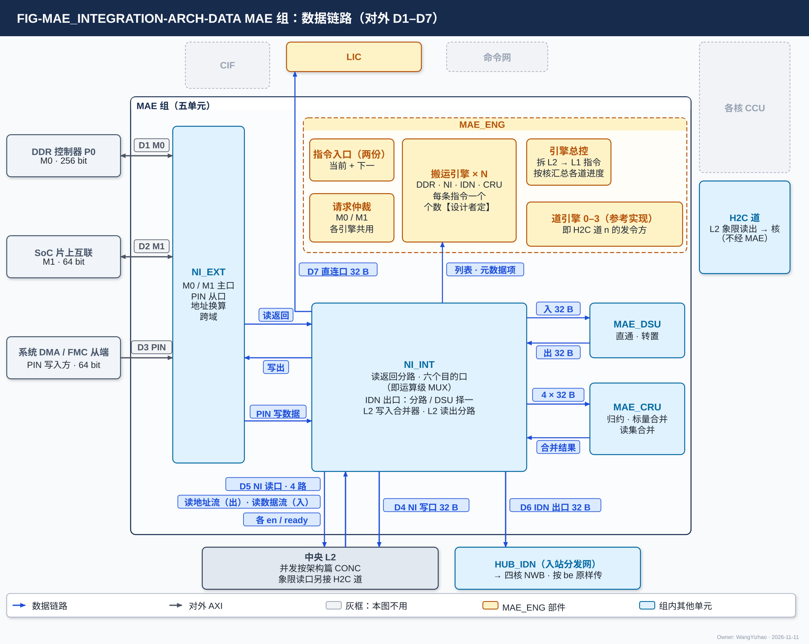
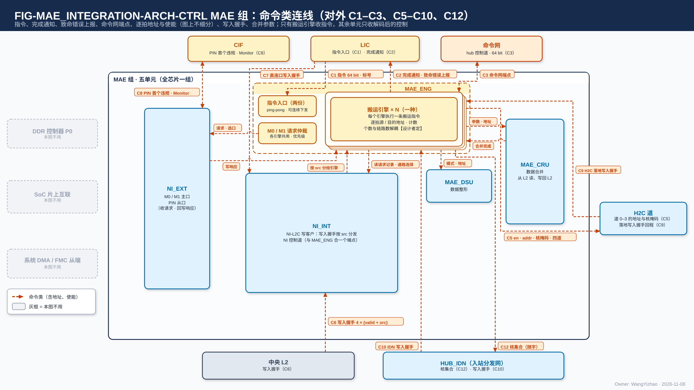
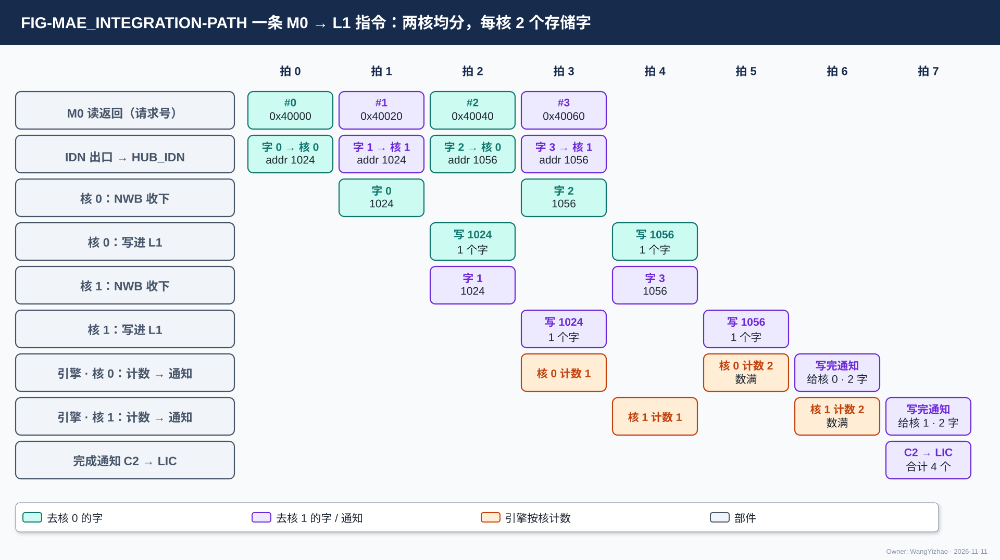

# MAE 组集成（MAE_INTEGRATION）需求

> Owner: WangYizhao｜2026-11-11

## 1 概述

**本篇只写 MAE 组这一层：组对外有几个口、每个口由哪个单元驱动、几个单元共用的口怎样在组内合并；五个单元之间交什么、位宽、握手（组内约定）；整组的数据路径、写入完成、通知与时序；整组的要求值与验收。** 单元内部的规则留在各单元篇，本篇只引用（V18-NAME-07：单元之间的约定归本篇，谁读、谁数、放哪这类分工归第 7 章）。

MAE 组全芯片一组，五个交付单元各一个（用户 11-05 夜 / 11-06，V18-NII-03 / 04、V18-MAE-05 / 11；用户 11-11 G7："算五个"）：

| 单元 | 做什么（输入、输出与语义） | 单元篇 |
|---|---|---|
| MAE_ENG | **组内唯一收指令的单元**：收 LIC 的搬运指令，给出源在核外的一切搬运的每拍地址（含 H2C 四道的读地址与目的地址）；数写入握手、发写完通知与完成通知 | `MAE_ENG.md` |
| NI_EXT | M0 / M1 / PIN 三个 AXI 口的协议端；M0 / M1 / PIN 的地址换算（RTL 头文件参数）；PIN 支持 INCR / FIXED / WRAP 三种突发（V18-NIE-04） | `MAE_NI_EXT.md` |
| NI_INT | 读返回按读请求记录分到六个目的口（含 IDN 出口与交回 MAE_ENG 的一路）；IDN 出口（读返回与 MAE_DSU 输出择一，1 × 32 B 交 HUB_IDN）；L2 写入合并器（五个来源合到 NI 写口 1 × 32 B）与 L2 读出分路（NI 读口 4 × 32 B）；NI 侧写完通知专用信号组（每核一组）；**不在命令网上** | `MAE_NI_INT.md` |
| MAE_DSU | 数据整形，**只有直通与转置两种运算**（V18-MAE-41）：直通 = 字内内容不变、按搬运引擎给的次序与地址交出；转置 = 把按行到达的一个小矩阵（连续 $N$ 行、每行 $J$ 个元素、元素宽 $b$）按列交出，**元素位宽、行数、列数由指令给**，各用法的参数只在 MAE_DSU 篇 §3.2 典型用法表里给；只换码的位置、不算尺度 | `MAE_DSU.md` |
| MAE_CRU | 数据合并：部分和归约、标量合并、读集合并；**从 L2 经 NI 读口读入各象限的份（一拍至多四路各一份；合并跨核定长份时四路同址）、合并、写回 L2**；输入为紧凑格式时相加只用元数据项里的保留位图、尺度与码，不读 F 列表（V18-MAE-44） | `MAE_CRU.md` |

**到四核的入站分发网 HUB_IDN 属 HUB 组**（V18-HUB-01，`HUB_IDN.md`）：它只按核集合分发（接几核就是多播分叉点），不发令、不算地址，与 H2C 道同属"只传输"；MAE 给它一路 32 B 数据（D6）与随每拍的核集合（C12），收四核 NWB 各自回的写入握手（C10：每核一组，经 HUB_IDN 原样回，不汇总）。MAE 组整体与 MAE_CRU 放在 hub 中心还是芯片物理中心，归后端（用户 11-06："这是后端的事情，咱们不感知"）。

## 2 接口需求

### 2.1 架构图与接口汇总

图中模块框内的结构是参考实现（见第 7 章），本章以框外的各口为准。

数据口与命令口各画一张图，编号与下表一一对应（用户 11-06："一个画数据的，一个画命令的，命令需要包括地址，使能信号，但是在架构图上无需区分"）。**数据图**：MAE 组框外是全部对端——左侧 DDR 控制器 P0（D1 M0）、SoC 片上互联（D2 M1）、系统 DMA / FMC 从端（D3 PIN）；下方中央 L2（D4 NI 写口、D5 NI 读口）、HUB_IDN（D6 IDN 出口，按 be 原样传）；上方 LIC（D7 直连口）；H2C 道对端注明"L2 象限读出 → 核（不经 MAE）"；本图不用的对端（CIF、命令网、各核 CCU）画灰。**命令图**：橙实线是命令网（C1 LIC → 指令入口）；橙虚线是控制与写入握手（C5 H2C 道的控制、C6 L2 写入握手、C7 直连口写入握手、C9 H2C 落地写入握手、C10 IDN 落地写入握手、C12 核集合）；紫色点划线是专用信号组（C2 完成通知、C13 写完通知每核两组、C14 发出报告）；CIF 来的 C16 停止请求 / 已停住应答（只接 MAE_ENG）与 C17 复位（接五个单元）画在左上（CIF 框内注 C16 / C17 / C8；C17 图上合画一根、标"→ 五单元"）。MAE_ENG 框内的"道引擎 0–3"是 H2C 道 $n$ 的发令方在参考实现里的形态，"引擎总控"按核汇总各道进度。**图中 C3（命令网端点出线"道引擎分派"）、C15（执行完成）、C8（Monitor）只在第 7 章的参考实现里出现**（本篇 §7.2、§7.8），画成灰色细点线并标"（参考实现）"。数据图 D5 画两根线（读地址流出、读数据流入，四路各一套、各 en / ready）；命令图 C5 写在 H2C 道对端框里（读地址流 → L2 象限读口、目的信息流 → H2C 道）。

| 编号 | 口 | 对端 | 方向 | 个数 × 位宽 | 握手 | 驱动单元 | 架构篇出处 |
|---|---|---|---|---|---|---|---|
| D1 | M0 | DDR 控制器 P0 | 出 / 入 | 1 × AXI4 主 256 bit | AXI4 | NI_EXT | PORT-26 |
| D2 | M1 | SoC 片上互联（HSRAM、DDR 共享区、FMC 主端的片外窗口） | 出 / 入 | 1 × AXI4 主 64 bit | AXI4 | NI_EXT | PORT-27 |
| D3 | PIN | 系统 DMA、FMC 从端 | 入（写）/ 出（读、B） | 1 × AXI4 从 64 bit | AXI4 | NI_EXT | PORT-28 |
| D4 | L2 的 NI 写口 | 中央 L2 | 出 | 1 × (32 B + be 32 + addr 24 + `seg` 5 + `src`) | en / ready | NI_INT（L2 写入合并器） | PORT-18 |
| D5 | L2 的 NI 读口（四路） | 中央 L2 | 读地址出 / 读数据入 | 每路读地址 addr 24 + `seg` 5，每路读数据 32 B；合计 4 × 32 B/拍 | 每路读地址流、读数据流各 en / ready，四路各自独立 | NI_INT（L2 读出分路） | PORT-19 |
| D6 | IDN 出口 | HUB_IDN | 出 | 1 × (32 B + addr 24 + be 32 + `seg` 5 + `src`) | en / ready | NI_INT（IDN 出口） | PORT-17 |
| D7 | LIC 直连口 | LIC 专用小 SRAM | 出 | 1 × (32 B + addr) | en / ready | NI_INT（读返回分路） | PORT-22 |
| C1 | 指令入口 | LIC | 入 | 命令网 64 bit + addr | en / ready | MAE_ENG | PORT-24 |
| C2 | 完成通知 | LIC | 出 | 专用信号组 1 组：valid + 指令标号 | 是否带 ready【设计者定】 | MAE_ENG | PORT-38 |
| C5 | H2C 道 $n$ 的控制（$n$ = 0…3） | L2 象限读口 $n$（读地址流）、H2C 道 $n$（目的信息流） | 出 | 读地址 addr 24 + `seg` 5；目的 addr 24 / be 32 / `seg` 5 / `src` / 核掩码 4 | 各 en / ready | MAE_ENG | PORT-15、PORT-12 |
| C6 | L2 写入握手 | 中央 L2（经 NI_INT） | 入 | 4 象限 × (valid + `src`) | 只有 valid | — | PORT-30 |
| C7 | LIC 直连口写入握手 | LIC 专用小 SRAM（经 NI_INT） | 入 | valid + `src` | 只有 valid | — | PORT-30 |
| C9 | H2C 落地写入握手 | 四核 H2C 接收桥（经 H2C 道） | 入 | 4 道 × 4 核 = 16 组，每组 valid + `src` | 只有 valid | — | PORT-30 |
| C10 | IDN 落地写入握手 | 四核 NWB（经 HUB_IDN 原样转交） | 入 | 每核一组（4 组），每组 valid + `src` | 只有 valid | — | PORT-30 |
| C12 | HUB_IDN 的核集合 | HUB_IDN | 出 | 4 bit，随 D6 的每拍 | 随 D6 | MAE_ENG（经 NI_INT 的 IDN 出口） | PORT-17 |
| C13 | 写完通知 | 四核 CCU | 出 | 专用信号组，每核两组（hub 侧、NI 侧），全芯片 8 组；每组 valid + 段选 + 目的基址 + 写入字数 | 是否带 ready【设计者定】 | MAE_ENG（hub 侧）、NI_INT（NI 侧） | PORT-37 |
| C14 | 发出报告 | 四核 CCU | 入 | 专用信号组，每核一组（4 组）；valid + 目的起始地址（分批搬运时另带流标号） | 是否带 ready【设计者定】 | MAE_ENG 收 | PORT-39 |
| C16 | 停止请求 / 已停住应答 | CIF | 停止请求入、应答出 | 停止请求 1 根电平；已停住应答 1 根电平 | 请求 / 应答（CIF 篇 §2.6） | MAE_ENG | 架构篇 PORT-42 |
| C17 | 复位 | CIF | 入 | 1 根 | 无 | 五个单元各接一根 | 架构篇 PORT-41 |

C4、C11 是空号；C3、C8、C15 只在参考实现里出现（本篇 §7.2、§7.8）。口宽与条数以架构篇 §2.7 的 PORT-nn 为准，本表只为阅读方便列出；`src` 位宽 5 bit【待标定】（架构篇 §2.4）。

**组对外的共同规则**：

- **组对外只有上表列出的口；每个口只有一个组内单元直接驱动，几个单元共用的口在组内先合并、只在切换段边界换源**（协议篇 §3.10；V18-TP-36 / 45）。
- **全部核间数据链路（D4–D7）与控制线（C5）一律逐拍握手、用同一套逻辑**（协议篇 §3.5，V18-TP-80）；**各口链路一侧例化 HUB 提供的通用链路块**（V18-HUB-05）：时延无关、可任意插级，ready 与送出的各信号寄存器输出。
- **MAE 在命令网上只有 MAE_ENG 一个端点，只收不发**：命令网只传指令与配置，与数据网同一协议格式、每拍带 addr（V18-TP-76）；NI 一侧不设命令网端点（V18-TP-79）；MAE_CRU 不在命令网上，标量走数据协议（V18-TP-55）。**完成类与同步类往来（C2、C13、C14）每类一组专用信号线（valid + 载荷），不经命令网；载荷各字段的语义只在协议篇 §2.6 定义**（V18-TP-77）。
- **MAE 组没有经 CIF 的配置口**：M0 / M1 / PIN 的地址换算是 RTL 头文件常量，CIF 不装 PIN 窗口表（V18-NIE-03）。**L2 没有给 MAE 的计数出口与配置口**（V18-L2-04、V18-TP-47）。

### 2.2 片外口 D1–D3：M0、M1、PIN，由 NI_EXT 驱动

| 口 | 承载 | 组内谁用 |
|---|---|---|
| D1 M0 | DDR P0 专线：权重、K / V、激活与残差往返、训练数据 | 全部搬运引擎的 DDR 请求经 NI_EXT 合成一路；**MAE 发请求的方式不使 M0 上的有效带宽低于 DDR 控制器能提供的带宽（参考点 19.2 GB/s）**（V18-MAE-45 (3)）；请求的合成做法见本篇 §7.5 |
| D2 M1 | SoC 片上互联：指令、配置表、调用描述符、M55 产的列表、调用输入、结果记录 | 同上；调用描述符与配置表的读不得被同口写占满在飞（MAE_NI_EXT 篇 §2.3.1） |
| D3 PIN | 外部主方直写 L2 的 PIN 窗口；调试读 | 写进 L2 经 NI_INT 的 L2 写入合并器，与 M0 / M1 / DSU / CRU 共用 NI 写口；**PIN 写与推理整体分先后：一帧传完之前没有调用在执行，这期间 NI 写口只有 PIN 一个来源**（V18-L2-07）；一笔写事务不跨象限、不跨堆、有效字节连续（FIXED、WRAP 突发只要求每拍内连续），INCR / FIXED / WRAP 都支持，FIXED、WRAP 只保功能不保速度（V18-NIE-04、V18-TP-83 (5)）；PIN 地址减去 PIN 窗口起点后，低 24 bit 是段内地址、其上 2 bit 是象限、再上 1 bit 是堆选（MAE_NI_EXT 篇 §3.4）；B 响应在该事务的写入握手数满之后才回 |

**三个口都支持与核时钟异步，跨时钟域不降低该口的持续带宽**（V18-NIE-01，MAE_NI_EXT 篇 §2.7）；$f_{\mathrm{IO}}$ 及其与核时钟的关系【待确认】（架构篇 §2.6）。三个口的协议、在飞数与地址换算归 MAE_NI_EXT 篇。

### 2.3 L2 的 NI 写口 D4 与 L2 写入握手 C6

**D4 是 MAE 一侧写 L2 的唯一口，1 × 32 B**：NI_INT 的 L2 写入合并器把五个来源（M0 读入、M1 读入、PIN 写入、MAE_DSU 输出、MAE_CRU 输出）按切换段合并后送出（NI_INT 篇 §3.5）。**可写任一象限，一个切换段不跨象限；`seg` 段掩码多位时同一拍写进掩码内各象限的同一段内地址（同址广播）**（V18-L2-04 / TP-61）。每拍带 addr / be / `seg` / `src`，按架构篇 PORT-18；首地址不在存储字边界时由 L2 内部移位（紧密存储，V18-TP-74），MAE 与链路不移位。

**C6**：L2 每把 D4 的一个写入拍写进象限 $q$ 的存储，就在第 $q$ 组回一个写入握手（valid + 该拍的 `src`），一个写入拍恰回一个；广播到 $k$ 个象限回 $k$ 个（V18-TP-47 / L1-19）。NI_INT 按 `src` 原样交 MAE_ENG 对应的引擎；`src` 是 PIN 事务号的那些握手由 NI_INT 自己数（PIN 事务的发令方在 NI_INT 内，本篇 §3.8、§3.9；NI_INT 篇 §3.6）。

### 2.4 L2 的 NI 读口 D5：四路各给读地址，四路读出

**D5 是 MAE 与 L2 之间唯一的读口，分四路，第 $q$ 路只读象限 $q$，四路合计 4 × 32 B/拍**（V18-MAE-32 / TP-80 / L2-08）：

- **每路一条读地址流**（NI_INT → L2）：en / addr 24 / `seg` 5（段掩码恒为本路象限），L2 回 ready；**四路各给各的读地址、可以不同址**；**ready 为低时发读方原样保持该路本拍**。地址由发读这一路的搬运引擎给出。
- **每路一条读数据流**（L2 → NI_INT）：en / 32 B 数据，NI_INT 回 ready；第 $q$ 路按本路读地址被接受的次序交出象限 $q$ 的读出，各路可以在不同拍交出。
- **四路的 ready 各自独立，与各自的搬运引擎一一对应，一路被卡不影响另三路**（V18-L2-08）；某一路下游收不下时，L2 只拉低该路读地址流的 ready，卡住发读这一路的搬运引擎（V18-TP-80）。读出时延不固定，正确性只取决于两条流的握手；不要求发读方按余量发读。

用途：MAE_CRU 合并跨核定长份时四路给同一段内地址、一拍读四份（"同址异象限"是这种用法，不是口的限制，MAE_CRU 篇 §2.2.1）；其余用途（四个象限各存完整 token 记录时按各自地址读、L2 → DDR / 共享内存、L2 → MAE_DSU、L2 → L2、搬运引擎读 L2 里的列表与元数据项）按需读一路或几路。

### 2.5 H2C 道的控制 C5 与 H2C 落地写入握手 C9

**H2C 道 $n$ 的发令方是 MAE 里执行该指令在道 $n$ 上那部分的搬运引擎**（V18-MAE-40；参考实现里每道一个，称道引擎，本篇 §7.1）；L2 象限读出经 H2C 到核的数据不经 MAE 的数据通路。C5 每道两部分：

| 部分 | 对端 | 信号 | 规则 |
|---|---|---|---|
| 读地址流 | L2 象限读口 $n$ | en / addr 24 / `seg` 5，L2 回 ready | 一拍一个读地址；**ready 低时引擎保持本拍**；下游（H2C 道 $n$）收不下时 L2 拉低本流的 ready（V18-TP-80，L2 篇 §3.5） |
| 目的信息流 | H2C 道 $n$ | en / 目的 addr 24 / be 32 / `seg` 5 / `src` / 4 bit 核掩码，道回 ready | **道不能收时拉低 ready，引擎保持本拍不变**（V18-TP-80，用户 11-11 HUB_NOC D1"认可"）；目的信息按读地址的成交次序与读出数据一一对应（架构篇 §2.4.3）；**H2C 道上读地址流、读数据流、目的信息流三条各自握手、不要求同拍，道内按次序配对**（V18-TP-82，与 HUB_NOC 篇 §2.3.1 同一条） |

**每道有独立的地址来源，四道各自停发、互不等待**；四道之间怎样协调归 MAE（MAE_ENG 篇 §3.10）。**搬运引擎放在哪里是后端的事，需求按搬运引擎在 MAE 内写**；参考放法与"放道旁"时附加的口见本篇 §7.1 / §7.2。

**C9**：四核 H2C 接收桥把数据写进 L1 之后，每写进一拍沿本道回一个写入握手（valid + `src`）；**H2C 4 道 × 4 核 = 16 组，道 $n$ 多播给几个核时各目的核的那一组各自直达道 $n$ 的发令方，hub 里不汇总、不按 `src` 归并**（V18-TP-78，用户 11-11："我希望每个核都可以传回一个src，发给MAE"）；发令方按（核, `src`）分别计数，一拍至多收 4 个（各核 1 个）；**每个目的核在写进本核的数据数满后各自收写完通知，不等其他核**（本篇 §3.7）。接收桥怎样形成写请求、何时回握手的内部做法归接收桥篇。

### 2.6 IDN 出口 D6、核集合 C12 与 IDN 落地写入握手 C10

**D6 是 HUB_IDN 的唯一数据源：NI_INT 的 IDN 出口一路 32 B，每拍一个地址，链路按 be 原样传，不受整字限制、也不感知是否整字**（addr = 本拍第一个有效字节的地址，din 从第 0 字节起放；默认数据组织下 addr 是 32 的倍数、一拍就是一个存储字；V18-HUB-04、V18-DORG-10 (4)）。**C12**：每拍随带 4 bit 核集合，HUB_IDN 按它送到集合内各核的 32 B IDN 链路；到核的链路上不带核集合（V18-HUB-04）。几核共享 M0 带宽 = 搬运引擎把各核的字依次排出（单核 32 B/拍，四核按 $m$ 切分时平均每核 8 B/拍；HUB_IDN 篇 §3.3）。

DDR 布局与 L1 字形态之间的差（标准布局权重与 lo 稀疏读副本进前向核、V 与粗算 K hi 进核等）**进 D6 之前由 MAE_DSU 的直通或转置调**，各用法的参数见 MAE_DSU 篇 §3.2 典型用法表（V18-MAE-41）；精算驻留模式的全码 key 记录（hi 从 L2 的 NI 读口、lo 从 DDR 读返回）经 MAE_DSU 直通后也走 D6，进 L1 时按列字区的列位落（V18-ATT-03 / DORG-08）。

**C10**：各核 NWB 把数据写进 L1 之后，每写进一拍沿 IDN 链路回一个写入握手（valid + `src`）；**每核一组（4 组），经 HUB_IDN 原样回到发令的搬运引擎、不汇总**；引擎按（核, `src`）分别计数，一拍至多收 4 个（V18-TP-78）；几核共享或多播时各核数满写进本核的数据就各自收写完通知（本篇 §3.7）。

### 2.7 LIC 直连口 D7 与写入握手 C7

**D7 只收 M1 读回的指令、配置表、调用描述符、KV 段表，由 NI_INT 的读返回分路直接交 LIC 专用小 SRAM；口宽 32 B，不经 HUB_IDN、不走命令网**（V18-NII-06 / 08、V18-LIC-01）。**C7**：LIC 小 SRAM 每写进一拍回一个写入握手（valid + `src`），经 NI_INT 按 `src` 交搬运引擎，引擎数满后通知 LIC（用户 11-06 MI8）。

### 2.8 指令入口 C1 与完成通知 C2

**C1 是命令网链路（64 bit 数据 + 每拍 addr），信号与时序与数据网一致：en / ready / addr / data；addr = MAE 指令入口内的寄存器字地址，MAE 按 addr 写入、不按消息类型选目标**（用户 11-06 MI2："64bit"；用户 11-11："我希望他的协议格式和数据网完全一致，因此每拍都会带一个addr"；V18-TP-76）。每条搬运指令带 LIC 分配的指令标号（V18-MAE-13）。

- **一条指令占几个 64 bit 字、写到哪一字生效，由 MAE 设计者给出，并与 LIC、ISA 对接**（用户 11-11 MAE_INTEGRATION D1"认可"）；约束：MAE 不执行写了一半的指令，ready 只表示入口能收。addr 位宽、是否另带 be 一并由 MAE 设计者给出，约束是能寻址入口内全部可写的寄存器。
- **MAE 能在执行当前指令时预存下一条，LIC 可连续下发多条**；入口怎样存（参考：当前 + 下一两份）见本篇 §7.3。

**C2 完成通知专用信号组，1 组：valid + 指令标号**，不经命令网；**每条指令执行完带标号通知 LIC 一次（含一条 CRU 合并指令）；一条 L2 → L1 指令在参与的各道都数满写入握手后通知一次**（V18-MAE-13 / 21 / 40）。是否带 ready 与 LIC 侧队列深度【设计者定】：约束是不丢、不重，LIC 来不及收时只降速。**组对 LIC 的唯一完成接口是 C2**。

### 2.9 写完通知 C13 与发出报告 C14

**C13 写完通知专用信号组，每核两组（hub 侧、NI 侧），全芯片 8 组；每组 valid + 段选 + 目的基址 + 写入字数**（各字段位宽归 ISA，语义见协议篇 §2.6）；**经 H2C 落地的通知走 hub 侧那一组，经 IDN 落地的走 NI 侧那一组（由 NI_INT 点到点送各核 CCU、不经 hub）；从 CCU 一侧看每核收两路，两路互不等待、在核前不合并，四核各自独立**（用户 11-11："我认为是每核收两路的说法，我认为要留出4核各自灵活的自由度"；V18-TP-70 / 77）。是否带 ready 与 CCU 侧队列深度【设计者定】，约束：不丢、不重，CCU 来不及收时只降速。发通知的时机与内容见本篇 §3.7。

**C14 发出报告专用信号组，每核一组（4 组）：valid + 目的起始地址（紧凑 token 记录为码块的容量窗口基址）；分批搬运时另带流标号**（V18-DORG-10 (8)、V18-MAE-45 (1)）；不经命令网，经 hub 连通。各核 CCU 经 C2H 写进 L2、数满 L2 回的写入握手之后发出；**MAE 按地址把报告配给对应的那条 MAE 指令后放行**（协议篇 §3.13），由执行该指令的搬运引擎收。是否带 ready 与 MAE 侧队列深度【设计者定】，约束同 C13。

### 2.10 组内互连：五个单元之间的约定

#### 2.10.1 五个单元之间的连接

**下表是 MAE 组内的约定：哪两个单元之间交什么、每拍多宽、怎样握手**（用户 11-11 G7：单元之间的接口留在集成篇作组内约定）。各单元篇只写本单元一侧的输入、输出与语义。

| 源 → 目的 | 内容 | 每拍位宽与旁带 | 握手 |
|---|---|---|---|
| MAE_ENG → NI_EXT | 读写请求（每笔 32 B）+ 选口位（M0 / M1） | 请求字段归 NI_EXT 篇 | en / ready |
| NI_EXT → MAE_ENG | 写响应（AXI B），每笔原样转交 | — | 只有 valid |
| MAE_ENG → NI_INT | 解码后的控制：每笔读请求的读请求记录（去向, 目的逻辑地址）、每个切换段的通路选择与边界、要发的写完通知内容；随数据的每拍 addr / be / `seg` / `src` 与核集合；**NI_INT 不收指令**（V18-MAE-27） | 各控制字段的位宽【设计者定】，约束：控制随请求或切换段到达，不要求 NI_INT 缓冲未来的指令（NI_INT 篇 §3.2）；读请求记录的容量不使 M0 / M1 的在飞读请求数受限，存在 MAE_ENG 还是 NI_INT 归参考实现（MAE_NI_INT 篇第 7 章） | 随请求或随切换段 |
| NI_INT → MAE_ENG | 搬运引擎为本指令读的列表、定长计数项与元数据项（片外经读返回分路，L2 经 L2 读出分路）；L2 写入握手与 LIC 直连口写入握手，**按 `src` 原样分给对应引擎**（PIN 事务号的留给 NI_INT 自己数） | 列表 32 B；握手 4 象限 × (valid + `src`) + 1 × (valid + `src`) | 列表 en / ready；握手只有 valid |
| MAE_ENG → MAE_DSU | **运算（直通 / 转置）与转置的三个尺寸字段（元素位宽、行数、列数）**；输入侧按位图取元素时的选择位图（录取 key 的 K / V 尺度）；双目的（一次 DDR 读同时给训练核与前向核）；输入输出两侧每拍地址（V18-MAE-41 / 44） | 三个尺寸字段的位宽为要求值：元素位宽 2 bit、行数 7 bit、列数 9 bit【待标定】（V18-MAE-45 (4)，MAE_DSU 篇 §2.2.1） | 随指令 |
| MAE_ENG → MAE_CRU | 合并种类、象限掩码、各路编码；读 L2 的段内地址与写回 L2 的地址；**紧凑输出时 MAE_ENG 先读每片 F 项数的定长计数项，按通道片把 F 项数交 MAE_CRU 填进元数据项首字**（F 列表由 SEL 按通道片补齐，V18-DORG-11 (4)；**每片 F 项数由 SEL 按片写进本核 L1 A 类，CCU 随 F 列表经 C2H 送 L2**，V18-TP-83 (5)，数据组织篇 §2.5.1） | 控制旁带 | 随指令 |
| MAE_CRU → MAE_ENG | 本指令结果已全部交出 | 1 个事件 | — |
| NI_EXT → NI_INT | M0 / M1 读返回；PIN 写数据（每拍 addr = 本拍首字节的 L2 段内地址、`seg`、din 从第 0 字节起放、be、`src` = PIN 事务号） | 32 B + 旁带 | en / ready（NI_INT 不能收时 NI_EXT 拉低 RREADY / WREADY） |
| NI_INT → NI_EXT | 写出数据（L2 → DDR / M1、区域复制）+ be + 片外地址；PIN 落地依据（该事务号的写入握手数满 → 回 B） | 32 B + be | en / ready |
| NI_INT ↔ MAE_DSU | 整形输入 32 B；整形输出去 L2 时回 L2 写入合并器，去 L1 时交 IDN 出口 | 32 B + addr 24 + be 32 + `seg` 5 + `src`（架构篇 PORT-20） | en / ready |
| NI_INT ↔ MAE_CRU | L2 读出分路把 NI 读口一拍至多四路各一个存储字交 MAE_CRU（合并跨核定长份时四路同址）；MAE_CRU 的结果进 L2 写入合并器 | 入 4 × 32 B；出 32 B + 旁带（架构篇 PORT-21） | en / ready |

#### 2.10.2 组内数据链路统一用核间协议

**MAE 组内的数据链路一律用核间协议——带地址的握手写流，每级是 HUB 提供的通用链路块（skid 与级数可配，可取 0 级）；D6 去 HUB_IDN 同样是**（用户 11-06 MI7："数据链路可以评估下使用核内协议还是核间协议，至少 IDN 要核间协议"；"支持统一核间协议"）。纯控制的信号（切换段边界、核集合）随数据作旁带。

#### 2.10.3 组内合并点：只在切换段边界换源

**组内所有合并点都在发令方一侧、拿得到切换段边界，所以全部只在切换段边界换源，切换段不交错**（协议篇 §3.10，V18-TP-36 / 45）；组外 HUB 里每条道只有一个源，没有合并点，链路上不需要切换段标记。组内的合并点：NI 写口（五个来源）、读返回分路（M0 / M1 同去一处）、IDN 出口（读返回分路与 MAE_DSU 输出）、同一条链路上的多条指令；各合并点按什么先后换源见本篇 §7.4。

## 3 功能描述

### 3.1 功能一览

| 功能 | 输入 | 输出 | 触发 / 生效条件 | 节 |
|---|---|---|---|---|
| 发令归属 | 搬运指令 | 每拍地址由 MAE 给出 | 源在核外 | §3.2 |
| 运算级三选一与进 L1 前的整形路径 | 指令的运算字段 | 不经运算级 / 经 MAE_DSU / 经 MAE_CRU | 每条指令 | §3.3 |
| 按口对的整组路径 | 口对 | 经过的单元与对外口 | 每条指令 | §3.4 |
| L2 → L1 经 H2C | 合并送 / 分送指令 | 四道并行读、送核 | 每条 L2 → L1 指令 | §3.5 |
| 写入完成 | 写入握手 | 发令方数满即写完 | 每个写入拍写进最终存储 | §3.6 |
| 写完通知与完成通知 | 写入完成 | C13 给目的核 CCU、C2 给 LIC | 数满之后 | §3.7 |
| 发令号 | 发令方 | 每拍 `src` | 恒定 | §3.8 |
| 组内单元不报完成 | — | — | 恒定 | §3.9 |
| 整组时序 | — | — | 恒定 | §3.10 |
| 复位 | CIF 的复位（C17） | 在途状态清空 | 复位 | §3.11 |
| 停止与继续 | CIF 的停止请求（C16） | 搬运引擎不再发地址、保持上下文，回已停住应答；继续后结果不变 | 停止请求置位 / 撤销 | §3.12 |

### 3.2 发令归属：源在核外由 MAE 发令，组内只有 MAE_ENG 收指令

**源在核外（DDR、共享内存、L2）的搬运全部由 MAE 发令；源在核内（L1、MXU / VNU 输出）的搬运由该核 CCU 发令（C2H），MAE 只收它的发出报告（C14）**（用户 11-06："要么就取消 C2H 的 MAE 主，统一改成各核的 CCU 主"；V18-TP-35）。HUB 只传输，不发令、不算地址；HUB 组 = HUB_NOC、HUB_IDN（V18-HUB-01）。C2H 不受 MAE 控制（V18-TP-51）。

**只有 MAE_ENG 收指令；其余四个单元与组外的 HUB_IDN、H2C 道只收搬运引擎解码后的控制**（V18-MAE-27）。**去哪个存储由指令的口对决定，链路上没有目的字段**（V18-TP-51）。

### 3.3 运算级三选一与数据进 L1 前的整形路径

**每条搬运指令的运算级字段三选一：不经运算级、经 MAE_DSU 整形、经 MAE_CRU 合并；DSU 与 CRU 并列、互不依赖，一条指令只选其一**（用户 11-06："DSU 和 CRU 可以是并行的"；V18-MAE-12）。经 MAE_DSU 时再分直通、转置两种运算。

| 运算级 | 输入从哪来 | 输出到哪去 |
|---|---|---|
| 不经运算级 | M0 / M1 读返回、L2 读（NI 读口） | L1（经 D6 → HUB_IDN）、L2（经 D4）、片外（经 NI_EXT）、LIC 直连口（D7） |
| MAE_DSU（直通或转置） | DDR 读返回、L2 读（NI 读口） | L1（经 D6 → HUB_IDN）、L2（经 D4）；无片外出口（V18-NII-03） |
| MAE_CRU | L2（经 NI 读口，一拍至多四路各一份；合并跨核定长份时四路同址；各核先经 C2H 把数据写进 L2） | L2（经 D4）；不直接写 L1、不回标量（V18-CRU-07） |

**数据到达 L1 时已经是 L1 的字形态：片外来的数据由 MAE_DSU 转，核内产生的数据由 QNT 排；H2C、IDN、接收桥、L1 都不变形。** **数据进 L1 前的整形有几条路，硬件都支持，由编译链按位点选**（V18-MAE-45 (5)，用户 11-11："当前的DSU输出只能走IDN不能走H2C吗？我认为需要留出兼容性"；架构篇 §3.8）：

| 路 | 走法 |
|---|---|
| L2 里存原形 | NI 读口（D5）→ MAE_DSU → IDN 出口（D6）→ HUB_IDN → NWB |
| 先经 MAE_DSU 整形存进 L2 | M0 → MAE_DSU → NI 写口（D4）→ L2；之后由 L2 → L1 指令经 H2C（C5）进核 |
| 从 DDR 直接来 | M0 → NI_INT → MAE_DSU（直通或转置）→ D6 → HUB_IDN → NWB |
| 核内产生 | QNT 直接排成目的形态写 L1（不经 MAE；H2C 道只有 L2 象限读口一个源）；给别的核用的 K 也可由 QNT 先排成 L1 的字形态写 L2、再由 L2 → L1 指令经 H2C 多播（可选用法，V18-QNT-14 (2)） |

例：精算驻留模式的 K hi 在 L2 里存 DDR 原形（每 key 64 B、按 key 连续），从 L2 下发走第一条路——粗算时转置成行字区的字形态，精算时直通、按列字区的列位落（V18-DORG-08）。

### 3.4 按口对看整组的数据路径

| 口对（MAE_ENG 篇 §3.5.2） | 经过的组内单元 | 用到的对外口 | 每拍地址谁给 | 写入完成谁数 |
|---|---|---|---|---|
| M0 → 核 L1 | ENG → NI_EXT → NI_INT 读返回分路 →（可经 MAE_DSU：直通或转置）→ IDN 出口 → HUB_IDN | D1、D6、C12 | 搬运引擎（DDR 请求、每拍的目的地址与核集合） | 搬运引擎按核数 IDN 写入握手（C10；应写量 = 各核实际收到的字数之和）；**每个目的核数满写进本核的字数就经 NI 侧写完通知（C13）收自己的写完通知**，带写进该核的字数，不等其他核 |
| L2 → 核 L1，经 IDN（精算驻留模式的 K hi 从 L2 驻留区下发） | NI 读口读 L2 的 K hi（L2 读出分路）→ MAE_DSU（粗算转置、精算直通）→ IDN 出口 → HUB_IDN | D5、D6、C12 | 搬运引擎 | 同上 |
| L2 + M0 → 核 L1（精算驻留模式的全码 key 记录） | NI 读口读 L2 的 K hi + M0 读 DDR 的 K lo → **MAE_DSU 直通（两路源按指令次序接续，只给地址）** → IDN 出口 → HUB_IDN；hi、lo 各存储字按列字区的列位落（V18-DORG-08） | D5、D1、D6、C12 | 搬运引擎（两个源口交替） | 同上 |
| M0 / M1 → L2 | NI_EXT → NI_INT →（M0 可经 MAE_DSU）→ L2 写入合并器 | D1 / D2、D4 | 搬运引擎 | 搬运引擎数写入握手（C6） |
| M1 → LIC 直连口 | NI_EXT → NI_INT 读返回分路 | D2、D7 | 搬运引擎 | 搬运引擎数写入握手（C7），通知 LIC |
| PIN → L2（与推理整体分先后） | NI_EXT → L2 写入合并器 | D3、D4 | NI_EXT（$A - A_{\text{PIN}}$） | NI_INT 数该事务号的握手 → 回 B |
| L2 → 核 L1，经 H2C | 搬运引擎给参与各道的读地址与目的信息（C5），数据走 H2C | C5、C9 | 各道的搬运引擎（合并送 / 分送，本篇 §3.5） | 各道按核数本道的 H2C 写入握手（C9）；**每个目的核在给它送数据的各道对该核都数满后，经 hub 侧写完通知（C13）收自己的写完通知，不等其他核**；参与的各道全部数满后经 C2 通知 LIC 一次 |
| L2 → DDR / 共享内存 | L2 读出分路 → NI_EXT | D5、D1 / D2 | 搬运引擎（按象限依次读） | AXI 写响应 |
| L2 → L2 | L2 读出分路 → L2 写入合并器（可经 DSU） | D5、D4 | 搬运引擎（可按象限掩码广播） | 搬运引擎数写入握手（C6） |
| DDR → DDR | NI_EXT 读 → NI_INT → NI_EXT 写（区域复制） | D1 | 搬运引擎 | AXI 写响应 |
| 跨核合并：核 → L2 → CRU → L2 | 各核 C2H 写 L2 → MAE 收齐发出报告 → NI 读口四路读同址的四份 → MAE_CRU → L2 写入合并器 → L2；要回核 L1 时另一条 L2 → L1 指令经 H2C | C14、D5、D4 | CCU（写 L2）、搬运引擎（读与写回） | CCU 数 L2 写入握手（写入）；搬运引擎数 L2 写入握手（写回） |

数值走查：一条 M0 → L1 指令、两核均分（搬运引擎把连续存储字轮流排给核 0、核 1），源为 DDR 字节地址 0x40000 起连续 128 B，目的为两核 L1 A 类 [堆 1][A][字节 1024] 起各 2 个存储字。图按拍横排，每行是一处部件、每格是该拍发生的事（到达、写进、握手各按 1 拍示意）；绿色是去核 0 的字，紫色是去核 1 的字。

- ① 搬运引擎发 4 笔 32 B 读请求（0x40000、0x40020、0x40040、0x40060），每笔记下（去向, 目的逻辑地址）：#0 → 核 0 字节 1024，#1 → 核 1 字节 1024，#2 → 核 0 字节 1056，#3 → 核 1 字节 1056。
- ② NI_INT 的 IDN 出口把每个返回的 32 B 连同目的地址与核集合交 HUB_IDN（字 0、2 的核集合 = {核 0}，字 1、3 的核集合 = {核 1}）；**HUB_IDN 把每一拍原样送到核集合内的核的 32 B IDN 链路**，本例 be 为 32 位全 1，不拆拍。
- ③ 各核 NWB 把收到的字写进 L1（本例每核 2 个字隔一拍到达，按两次单字写进；NWB 怎样形成写请求归接收桥篇）。数据写进 L1 之后，NWB 沿 IDN 链路每拍回一个写入握手，核 0、核 1 各用自己那一组线，经 HUB_IDN 原样回到 MAE、按 `src` 交搬运引擎，不汇总；引擎按核分别数，核 0 数到 2 就经 NI 侧写完通知给核 0 的 CCU 发写完通知（写进该核的字数 2），核 1 数到 2 就给核 1 发，两核互不等待，各自收到即可消费；两核合计数满 4 个后经 C2 通知 LIC。字节守恒 4 × 32 B = 128 B，脚本断言。

两核各自平均 16 B/拍；本例的数据组织下目的地址都是 32 的倍数，每拍到达一个整字，链路本身按 be 原样传、不受整字限制（V18-DORG-10 (4)）。拍号只示意先后，功能与时延无关。

### 3.5 L2 → L1 经 H2C：合并送与分送

**L2 → 核 L1 经 H2C 只有两种用法，各一条 MAE 指令**（V18-MAE-37 / 42，架构篇 §3.8）：

| 用法 | 怎样读 | 送给谁 | 每核有效带宽 |
|---|---|---|---|
| **合并送** | 一条指令同时读参与的象限，四道并行读（道 $q$ 读象限 $q$）合并成一路 | 一个核集合（多播，或只含一个核） | 开 $n$ 个象限时 $n \times 32$ B/拍，四个都开时 128 B/拍 |
| **分送** | 象限 $c$ 只读本象限 | 只送核 $c$ | 32 B/拍（四核合计 128 B/拍） |

- **合并送的目的排法（片交织 / 段接续）由指令的 1 bit 给出**（V18-MAE-45 (6)，MAE_ENG 篇 §3.10）；目的 L1 里的排列符合数据组织篇 §3.6.6 的衔接表。合并送达到 128 B/拍的条件是各道的目的地址各自连续（架构篇 §3.4 CONC-3）；不连续只降速、不出错。
- **写完通知各核各自收**（V18-TP-83 (5)、V18-TP-84 (8)）：**每个目的核在写进本核的数据数满后收自己的写完通知（经 hub 侧 C13，带写进该核的字数），不等其他核**。分送时核 $c$ 只收道 $c$ 的数据，道 $c$ 对核 $c$ 数满就给核 $c$ 发；合并送（含多播）时一个核的数据来自参与的几条道，**这几条道对该核都数满**才给该核发。
- **一条 L2 → L1 指令在参与的各道都数满写入握手后才算执行完，经 C2 通知 LIC 一次**（V18-MAE-40）。
- 同一时刻 L2 的四个象限读口服务几条 L2 → L1 指令是 MAE 对编译链的约定，见 MAE_ENG 篇 §3.10。

### 3.6 整组的写入完成：核内、核间两类

**写入完成只分核内、核间两类**（用户 11-06："我就希望最多分出来一个核间一个核内，核内走我给你的参考设计，核间统一走一个协议，对于 PIN 的问题可以放宽，因为它是从口，但是最好也走一个协议"；"这个协议我完全认可"；V18-TP-50；协议篇 §3.8 / §3.8.1）：

| 类别 | 规则 | 谁比对 |
|---|---|---|
| **核内**（只用于核内来源写 L1，例：VNU 写口） | L1 写口前的选择器在各写入来源之间按固定规则本地轮流（V18-L1-32），没轮到的在自己的 FIFO 里等；选中那一拍数据即写进 L1，CCU 不逐拍选来源；VNU 的写何时写完由选择器告知 CCU 或由 VNU 报完成【设计者定】；L1 与 VNU 不提供逐拍完成信号（协议篇 §3.8） | 本核 CCU |
| **核间**（统一协议） | 接收方把数据写进它的最终存储之后，沿同一链路反向逐拍回写入握手（valid + `src`），**每写进链路上的一拍回一个，默认一拍 = 一个存储字**（V18-L1-19）；发令方只数 `src` 是自己的，数满应写量即写完。这个握手来自 AMBA AXI 的写响应通道 B：从机写完后回 BRESP，主机据此判写完成 | 发令方 |

MAE 组涉及的核间写链路（"最终存储"是数据真正写进、之后的读一定读到新值的地方）：

| 链路 | 最终存储 | 握手回给谁（发令方） | 应写量来源 | 发令方数满之后 |
|---|---|---|---|---|
| H2C → 核 L1 | L1（H2C 接收桥写进） | 该道的发令方（C9：各目的核一组直达，不汇总；按（核, `src`）计数）；多播 $k$ 核按 $k$ 倍计 | 指令 | 每个目的核在给它送数据的各道对该核都数满后，经 hub 侧 C13 收自己的写完通知；参与的各道全部数满后 C2 通知 LIC |
| IDN → 核 L1 | L1（NWB 写进） | 执行该指令的搬运引擎（C10：各核一组，经 HUB_IDN 原样回，不汇总）；几核共享时按各核实际收到的字数之和、多播按目的核数倍计 | 指令 | 每个目的核数满后经 NI 侧 C13 收自己的写完通知（带写进该核的字数）；全部数满后 C2 通知 LIC |
| NI 写口 → L2 | L2 | 执行该指令的搬运引擎（C6，经 NI_INT 按 `src` 回）；广播 $k$ 个象限按 $k$ 倍计 | 指令 | C2 通知 LIC |
| NI → LIC 直连口 | LIC 专用小 SRAM | 搬运引擎（C7，经 NI_INT 回） | 指令 | C2 通知 LIC（MI8） |
| NI_EXT → DDR / 共享内存 | 片外 | 搬运引擎（**AXI 写响应即写入握手的片外形式**） | 指令 | C2 通知 LIC |
| PIN → L2 | L2 | NI_INT 按 PIN 事务号数（PIN 事务就是一个带 `src` 的发令方，它的握手由 NI_INT 数，本篇 §3.9） | 该 AXI 事务的写入拍数 | NI_EXT 回 AXI B 给外部主方 |
| C2H → L2 | L2 | 核 $n$ 的 CCU（经 C2H 回，valid + `src`，V18-TP-80） | 本次发送的写入拍数 | CCU 经 C14 向 MAE 发出报告，MAE 按地址配给对应指令后放行（协议篇 §3.13） |

### 3.7 写完通知与完成通知：下一级消费者怎样知道

- **目的为核 L1**：发令的 MAE 数满写入握手后经写完通知专用信号组（C13，不经命令网）给各目的核 CCU 发写完通知（段选、目的基址、写入字数；H2C 搬运经 hub 侧、IDN 搬运经 NI 侧），**CCU 收到即可消费**（V18-TP-70）。**IDN 几个核共享、IDN 多播、H2C 分送与 H2C 多播一律各核各自收：每个目的核在写进本核的数据数满后收自己的写完通知（带写进该核的字数），不等其他核；全部数满后 MAE 再经 C2 通知 LIC 指令完成**（V18-MAE-45 (2)、V18-TP-83 (5)、V18-TP-84 (8)）；合并送时一个核的数据来自几条道，仍要这几条道对该核都数满（本篇 §3.5）；**一条指令搬紧凑 token 记录四块时，目的基址 = 码块的目的基址、写入字数 = 四块之和**，其余三块的位置由 CCU 按元数据项推出（V18-MAE-42）。覆盖一切由 MAE 落进 L1 的数据——激活、权重、K / V、嵌入行、VNU 用的配置表（γ、RoPE 表、查找表）、OPT 状态与梯度、跨核合并结果（经 H2C 回 L1）；接收桥常开、无写计数，CCU 不本地比对（V18-TP-70）。
- **其余目的**：发令方数满后经 C2 通知 LIC，由 LIC 下发后续指令。**跨核合并不设第三类完成协议**（V18-CRU-07）：各核写 L2 按 C2H → L2 一行完成、发出报告；MAE 收齐参与核的报告才执行合并指令，写回 L2 按 NI 写口 → L2 一行完成，再通知 LIC。
- **跨核搬运与消费按批流水**（V18-DORG-10 (10)，用户 11-10："这里会结合Fusion指令，先搬运一批，然后算一批，算的同时搬下一批"）：LIC 的 Fusion 段里搬运指令与计算指令成对循环，**每一批是一条搬运指令的一次执行，每次执行各发一次写完通知**；"应写量满足后消费核 CCU 才读元数据项"按批判，不要求整份数据搬完。**分批搬运时下一批的起点由 MAE 接续**（V18-MAE-45 (1)；做法见本篇 §7.7）。

### 3.8 发令号：一个号任何时刻只对应一条未完成的指令

**核间每条写链路的每拍都带发令号 `src`，写入握手按它回到发令方**（V18-TP-47）：

| 发令方 | 规则 |
|---|---|
| 搬运引擎（含 H2C 各道上执行 L2 → L1 指令的那部分） | **任何时刻一个号只对应一条未完成的指令**；H2C 道 $n$ 多播到几个核时，各核各一组握手线直达本道的发令方，发令方按（核, `src`）分别计数 |
| 每笔在途 PIN 事务 | 一个 PIN 事务号，由 NI_INT 分配，它的写入握手由 NI_INT 数（本篇 §3.9）；不使 PIN 写入在飞数低于要求值 4 笔（MAE_NI_EXT 篇 §2.4.1）；号池个数见本篇 §7.6 |
| 每核 CCU（C2H） | 常数：L2WP 第 $n$ 条只有核 $n$ 一个发令方 |
| MAE_DSU / MAE_CRU 的输出 | 用执行该指令的搬运引擎的号 |

**`src` 位宽 5 bit【待标定】**（要求值，V18-MAE-45 (4)，架构篇 §2.4），须覆盖发令方总数（搬运引擎数 + 4 个 CCU + 在途 PIN 事务号）。号怎样分配见本篇 §7.6。

### 3.9 组内单元不报完成

**NI_INT、MAE_DSU、NI_EXT（以及组外的 HUB_IDN、H2C 道）只搬，不报完成、不发完成信号；NI_INT 与 HUB_IDN 把回来的写入握手原样转交、按 `src` 交给发令方，不替搬运引擎计数、不汇总**；发令方逐源计数（V18-TP-78）。**唯一由 NI_INT 计数的是 PIN 事务：PIN 事务的发令方就在 NI_INT 内（每笔在途事务一个 PIN 事务号），所以 `src` 为 PIN 事务号的握手由 NI_INT 自己数满后让 NI_EXT 回 B**（V18-TP-84 (2)，本篇 §3.8）。**组对 LIC 的唯一完成接口是 C2**；一条拆到几道的 L2 → L1 指令在参与的各道都完成后通知 LIC 一次。

### 3.10 整组的时序关系

1. **指令先于数据；写完通知晚于数据**：LIC 顺序取指，搬运指令先于依赖它的数据指令下发；**目的为核 L1 的指令在写入握手数满后才发写完通知，所以通知必晚于它所报的数据写进 L1**；变长数据与列表 gather 的实际长度就是通知里的写入字数（V18-TP-58 / 70；紧凑 token 记录四块一起搬时是四块之和，V18-MAE-42）；接收桥常开，数据可以先于位点指令落地。
2. **DDR 满带宽由 MAE 读序与指令编译保证**（V18-NII-01）：**下游收不下时只降速、不丢数**，停发经 RREADY 回到 DDR；是否设入站缓冲不作要求（V18-TP-84 (5)）。
3. **时延无关**：组内任意位置插流水级，整组行为不变；验收随机化级数与 ready 时序（V18-TP-32 / 38）。
4. **组不知道调用**：只按指令执行；调用完成由 LIC 按收到的完成通知判定（V18-MAE-13）。
5. **写入握手不挡数据**：握手是反向的计数脉冲，只有 valid、没有 ready，发令方不等它回来就发下一拍；握手与数据走同一链路块的两个方向，到达先后与数据拍数无关，只看数（V18-TP-50）。
6. **跨核搬运与消费按批流水**：先搬一批、算一批，算的同时搬下一批（本篇 §3.7）；每批的写完通知仍晚于这一批的数据。

### 3.11 复位

**复位输入来自 CIF（C17，架构篇 PORT-41），硬复位与软复位不区分**（CIF 篇 §2.4 / §3.3）。**复位后五个单元都没有在途状态，也没有跨调用驻留的状态**；复位释放之后、LIC 下发指令之前，MAE 不发起任何访问（不读写 DDR 与共享内存，核间链路上没有有效拍；CIF 篇 §3.3）。地址换算参数是 RTL 头文件常量，复位后不需装载（V18-NIE-03）。参考结构里复位要清的状态见本篇 §7.11。

### 3.12 停止与继续：搬运引擎停发地址、保持上下文、回已停住

**MAE 对 CIF 的停止请求（C16）只由 MAE_ENG 应答；收到停止请求后，各搬运引擎不再发出新的地址（读地址、写地址、目的信息、DDR / M1 请求），保持全部上下文（指令进度、地址生成器状态、握手计数、游标），在登记的拍数上界内把已停住应答拉高；停止请求撤销后撤销应答、从停住的地方接着做，继续后不丢数据、不重复，任务精度与没有停过时相同（不要求逐位相同，CIF 篇 §3.5，V18-CIF-10）**（CIF 篇 §2.6 / §3.5，V18-CIF-02…06）。

- **"已停住"的含义按 CIF 篇 §2.6**：MAE 不再发起新的访问，已发起的访问都已结束、或停在握手上不再前进。已发出的拍按链路握手走完或停在握手上；M0 / M1 上已发出的读请求，返回数据照常接收或经 AXI 握手停住；回来的写入握手照常计数。停住期间是否照常发写完通知与完成通知【待确认】（建议：照常发，二者不是对存储的访问；见 MAE_ENG 篇 §3.23）。
- **停在哪一步由 MAE 设计者定**，约束是有上界、状态不丢；从收到停止请求到拉高应答的拍数上界【待标定】，由 MAE 设计者登记到 CIF 篇 §4.3。
- NI_EXT、NI_INT、MAE_DSU、MAE_CRU 不接停止请求：它们只按搬运引擎给的地址与控制搬，引擎停发后自然停在握手上（CIF 篇 §7.3）。
- 已停住期间 PIN 可以写 L2（CIF 篇 §3.9）：PIN 事务由 NI_EXT / NI_INT 按本篇 §2.2 处理，不受停止请求影响。
- 参考做法见 CIF 篇 §7.3"MAE_ENG"一条。

## 4 性能指标

### 4.1 各口的速率要求

| 口 | 要求速率 | 说明 |
|---|---|---|
| D1 M0 | 接口能力每拍 1 笔 32 B 读或写请求（$32\ \mathrm B \times f_{\mathrm{core}}$）；**MAE 发请求的方式不使 M0 上的有效带宽低于 DDR 控制器能提供的带宽（参考点 19.2 GB/s）** | MAE_NI_EXT 篇 §4.1；V18-MAE-45 (3)；不另设利用率百分比 |
| D2 M1 / D3 PIN | 8 B × $f_{\mathrm{IO}}$ | $f_{\mathrm{IO}}$【待确认】；跨时钟域不降低持续带宽 |
| 读返回分路 | 32 B/拍 | 不得成为 M0 的瓶颈（NI_INT 篇 §4.4） |
| D4 NI 写口 | 1 × 32 B/拍；**持续带宽不低于 DDR 灌入 L2 的流量（参考 19.2 B/核拍）** | 条件见本篇 §4.2；不加宽（用户 11-07："我认为无需加宽写口"） |
| D5 NI 读口 | 4 × 32 B/拍（每象限一路，各 32 B/拍；四路地址独立、ready 独立） | V18-MAE-32 / L2-08 |
| D6 IDN 出口 | 1 × 32 B/拍；HUB_IDN 按核集合分发到四核各一条 32 B 链路，总量不超过 M0 的 32 B/拍 | V18-HUB-04 |
| D7 LIC 直连口 | 32 B/拍 | V18-NII-08 |
| C5 H2C 四道 | 每道每拍一个读地址、一拍目的信息；**合并送开 $n$ 个象限时每核 $n \times 32$ B/拍；分送每核 32 B/拍（四核合计 128 B/拍）** | V18-MAE-28 / 42；条件：各道目的地址各自连续（架构篇 §3.4 CONC-3） |
| C1 指令入口 | 64 bit 数据 + 每拍 addr | MI2；与数据网同格式（用户 11-11） |

这些速率在下游不背压、所访问的 L2 堆满足架构篇 §3.4 的并发约定时成立；默认 32 B 对齐（不对齐由 SRAM 内部处理，允许慢）。

### 4.2 并发条件：MAE 在 L2 上的几条链路

**MAE 的 NI 读、NI 写与核的 C2H 写、H2C 读在 L2 上是对等的链路；它们能否同拍、各要多快，全部按架构篇 §3.4 的存储并发约定，本篇只引用、不另定**（V18-TP-81）：

| 情形 | 适用的约定 | 结果 |
|---|---|---|
| NI 写口承接 DDR 入流 | CONC-5 | 与同象限其他链路落在不同的堆时不低于 DDR 入流 |
| 同一象限一读一写分落两个堆 | CONC-1 | 两边都不降速 |
| 几条链路落 L2 的同一个堆 | CONC-2 | 同一拍只做其中一次访问，依次服务，只降速、不丢、不错，等待有上界 |
| 同一个堆上几条链路争用、各自地址连续 | CONC-3（写一侧与读一侧，V18-L2-08） | 各写入方、各读链路保持 32 B/拍 |
| 四个象限之间 | CONC-5 | 互不影响 |

**这几条链路怎样落堆先由调度（编译链放地址、MAE 排指令）错开，硬件依次服务只是保底；没错开只降速、不出错**（CONC-2；用户 11-10："分Clock错拍，理论上需要在调度层面直接错开，这个作为保底方案"）。MAE_CRU 的四路读与写回落在同一个堆时同样按 CONC-2 处理（MAE_CRU 篇 §2.2.1）。

### 4.3 要求值表

| 项 | 要求值 | 性质与依据 |
|---|---|---|
| M0 | 接口能力 $32\ \mathrm B \times f_{\mathrm{core}}$；有效带宽不低于 DDR 控制器能提供的带宽（参考点 19.2 GB/s） | 本篇 §4.1 |
| M1 / PIN | 8 B × $f_{\mathrm{IO}}$ | $f_{\mathrm{IO}}$【待确认】 |
| 读返回分路 | 32 B/拍 | 本篇 §4.1 |
| NI 写口 | 1 × 32 B/拍；持续带宽不低于 DDR 入流（参考 19.2 B/核拍） | 条件：架构篇 §3.4 CONC-5 |
| NI 读口 | 4 × 32 B/拍（每象限一路）；每路一条读地址流 + 一条读数据流，四路地址独立、ready 独立 | V18-MAE-32 / TP-80 / L2-08 |
| IDN 出口 | 1 × 32 B/拍 + 随拍 4 bit 核集合 | V18-HUB-04 |
| LIC 直连口 | 32 B/拍 | V18-NII-08 |
| H2C 四道 | 每道独立的地址来源、各自停发；合并送每核 $n \times 32$ B/拍，分送每核 32 B/拍 | V18-MAE-40 / 42 |
| LIC → MAE 指令入口 | 64 bit 数据 + 每拍 addr；能在执行当前指令时预存下一条 | MI2；用户 11-11 |
| `src` 位宽 | 5 bit【待标定】 | V18-MAE-45 (4)，架构篇 §2.4 |
| MAE_DSU 三个尺寸字段位宽 | 元素位宽 2 bit、行数 7 bit、列数 9 bit【待标定】 | V18-MAE-45 (4)，MAE_DSU 篇 §2.2.1 |
| 写入握手回程条数 | H2C：4 道 × 4 核 = 16 组（C9）；IDN：每核 1 组，4 组（C10）；NI 写口：4 象限各 1 组（C6）；LIC 直连口 1 组（C7）；每组 valid + `src` | 每个写入方一组、各回各的（用户 11-11，V18-TP-78） |
| 专用信号组条数 | 完成通知 1 组（C2）；写完通知每核 2 组 = 8 组（C13）；发出报告每核 1 组 = 4 组（C14） | 用户 11-11；各组载荷位宽归 ISA |
| 停止请求 → 已停住应答的拍数上界 | 【待标定】，由 MAE 设计者给出 | 登记到 CIF 篇 §4.3；本篇 §3.12 |

## 5 约束与由使用者保证的事项

### 5.1 硬约束

- **每个对外口只有一个组内驱动单元**；几个单元共用的口在组内合并，只在切换段边界换源。
- **组内与组外的数据链路一律用核间协议，链路一侧例化 HUB 提供的通用链路块，时延无关**（V18-TP-32 / 38、V18-HUB-05）。
- **组内与核间链路同一个核时钟域；跨时钟域只在 NI_EXT 的 M0 / M1 / PIN 外沿，三个口都必须支持异步，跨域不降低该口的持续带宽**（V18-TP-31、V18-NIE-01）。
- **MAE 不感知数据类型**：去哪个存储由指令的口对决定，链路上没有目的字段（V18-MAE-01、V18-TP-51）。
- **MAE 在命令网上只有 MAE_ENG 一个端点，只收指令**；完成类与同步类往来走专用信号组（V18-TP-76 / 77 / 79）。
- **本篇不含容错设计**（V18-TP-75）。

### 5.2 由使用者保证的事项

| 事项 | 由谁保证 |
|---|---|
| 口对合法、两端总字节数相等、段内地址不超出该堆容量、写 L2 的一个切换段不跨象限、M0 / M1 请求落在换算区内 | 编译链给的指令与搬运引擎的地址生成（编译期检查；验收用仿真断言，本篇 §6.3） |
| 目的空间在数据到达时已读完（预取距离、缓冲轮转）；压紧激活按位点的容量窗口静态分配 | 编译链（LIC 操作 15、V18-TP-40） |
| DDR 读始终满带宽：读序与指令编译 | MAE_ENG、编译链（V18-NII-01） |
| L2 上几条链路先在调度上错开或放到不同的堆；DDR 灌入 L2 时 NI 写口与同象限其他链路落不同的堆；要满速的链路目的地址连续 | 编译链与 MAE（架构篇 §3.4 CONC-2 / 3 / 5） |
| 写入握手在每个写入拍写进最终存储之后才回 | L2、L1 的接收桥（H2C 接收桥、NWB）、LIC 小 SRAM |
| 一笔 PIN 事务不跨象限、不跨堆、有效字节连续（FIXED、WRAP 突发每拍内连续）；PIN 写完一帧之后推理才开始，PIN 写入只在 L3PU 空闲或已停止时进行（CIF 篇 §3.9） | 编译链（PIN 输入地址段放在一个象限的一个堆之内）与外部主方（只在 PIN 窗口内写、有效字节连续），NI_EXT 据此交出写入拍（MAE_NI_EXT 篇 §2.4.1 / §5.2，V18-NIE-04）；LIC / CIF 与 SoC 侧（V18-L2-07） |
| 指令之间的依赖与下发次序；跨核搬运与消费按批流水 | LIC（收到完成通知后再下发，V18-MAE-13；Fusion 段，V18-DORG-10） |
| C2H 写 L2 的地址、握手计数与发出报告 | 各核 CCU（V18-TP-35） |
| 环形缓冲不用于 MAE 搬运，跨环尾拆成两条指令 | 编译链（V18-MAE-17） |

## 6 验收

### 6.1 组级验收

五单元连成整组、并接上 HUB_IDN 与 H2C 道后的端到端用例：

| 用例 | 判据 | 出处 |
|---|---|---|
| 本篇 §3.4 每个合法口对各一条，随机几何 | 目的地内容与软件参照逐位一致 | §3.4 |
| 多条指令同链路并发、DDR 乱序返回 | 切换段不交错；各返回落到所属指令的目的地；每条指令恰好通知 LIC 一次 | §2.10.3、§2.8 |
| PIN 写一帧（随机突发长度与突发类型 INCR / FIXED / WRAP、随机字节起点；期间无别的 NI 写来源） | 内容与参照逐位一致；PIN 事务按 `src` 数到自己的握手；B 响应不早于该事务最后一个写入拍写进 L2 | §2.2、§3.6 |
| NI 读口四路两条握手流 | 四路给不同地址、同址两种情形读出都正确；某路读地址 ready 拉低时发读方保持该路；各路按本路次序、随机晚到；一路去向长时间不收时只有该路停住、不丢数据，另三路照常 | §2.4 |
| H2C 道的控制 | L2 象限读口读地址流 ready 低、H2C 道 ready 低时搬运引擎保持本拍；四道各自停发、互不等待；目的信息流与读数据流各自握手、道内按次序配对，结果与参照一致 | §2.5 |
| NI 写、NI 读与各核 C2H 写、H2C 读随机落 L2 的同一个堆或不同堆 | 各发令方按 `src` 数到自己的握手；内容逐位一致；同堆争用只降速 | §4.2 |
| 非字边界起点写 L2 / L1（NI 写、IDN、H2C 各一例） | 链路与 MAE、HUB 不移位，由 SRAM 内部移位；目的内容与参照逐位一致 | §2.3 |
| H2C / IDN 落地（单播与多播、合并送与分送）、几个搬运引擎同时写同一核 | 每条指令恰在其数据全部写进目的核 L1 后通知 LIC，多播按目的核数倍计；每个目的核恰收到一条写完通知、写入字数 = 写进该核的字数；**多播、分送、IDN 几核共享时各核各自数满就各自收通知，不等其他核（随机让某一核落后，其余核的通知不受影响）**；合并送时一个核的通知不早于给它送数据的各道对该核都数满；四块搬运的通知带码块目的基址、字数 = 四块之和；**多播时同一拍各核的握手同时回到发令方，逐核计数、不丢不重** | §3.5、§3.7 |
| 合并送四道并行读 | 各道的目的地址序列与参照一致；目的排法位（片交织 / 段接续）两种取值下目的 L1 拼出的 token 记录与参照一致；参与的各道都完成才算完成 | §3.5 |
| 跨核合并 | 收齐参与核的发出报告前不读 L2；四路同址读出、合并结果与参照一致；一条合并指令恰好通知一次 | §3.4、§3.7 |
| 指令入口 | 按 MAE 设计者给的地址表随机拍间隔写入；写了一半的指令不执行；执行当前指令时可预存下一条 | §2.8 |
| 随机化全部通用链路块参数与 ready 时序 | 逐位一致、不丢拍、不重复 | §5.1 |
| 停止与继续 | 在随机拍送停止请求：已停住应答在登记的上界内拉高；应答为高期间 MAE 不发出新的地址与请求（M0 / M1、核间链路上无新访问）；撤销后继续，整条指令序列不丢、不重复，任务精度与不停时相同（不要求逐位相同） | §3.12 |
| 复位 | 复位来自 CIF，硬复位、软复位两种来源下行为相同；复位释放后、下发指令之前 MAE 无任何访问 | §3.11 |

### 6.2 与上下游模块的对接检查

| 对接项 | 对端 | 检查内容 |
|---|---|---|
| L2 的同堆访问 | L2 篇 §2.1 / §7.3、架构篇 §3.4 CONC-2 | **L2 每个堆一拍一次访问、同一 bank 一拍一个深度**（L2 一侧的保证；MAE 只按 CONC-2 排地址，用户 11-11 MAE_INTEGRATION D2："检查表也要包含和上下游模块的对接内容"） |
| NI 写口与写入握手 | L2 篇 §2.3 / §3.4 | 每拍带 addr / be / `seg` / `src`；4 组握手只有 valid + `src`；广播回 $k$ 个 |
| NI 读口、象限读口 | L2 篇 §2.4 / §2.5 / §3.5 | 读地址流与读数据流两条握手流；NI 读口四路各一套、ready 各自独立；下游背压时 L2 只拉低对应那一路读地址流的 ready |
| H2C 道 | HUB_NOC 篇 §3.3 / §2.6 | 道的目的信息流 en / ready，与 L2 读数据流道内按次序配对；写入握手每核每道一组直达发令方，hub 不汇总 |
| IDN | HUB_IDN 篇 §2.2 / §3.7 | 一路 32 B + 随拍核集合；HUB_IDN 不拆拍、不汇总握手 |
| 落地 | 接收桥篇 §2.1 / §3.8 | 写入握手在写进 L1 之后才回；接收桥常开 |
| 指令入口与完成通知 | LIC（`LIC_STAGING.md`）、ISA | 指令入口地址表与生效规则一致；完成通知每条指令一次 |
| 写完通知与发出报告 | 计算核 CCU（`CCU_STAGING.md`）、协议篇 §2.6 | 每核两路写完通知互不等待；发出报告带目的起始地址（分批时另带流标号） |
| 片外口 | MAE_NI_EXT 篇 §2.2 / §2.3 / §2.4 | M0 有效带宽；PIN 三种突发、事务限制与 B 响应时点 |
| 复位与停止请求 | CIF 篇 §2.4 / §2.6 / §3.5、架构篇 PORT-41 / 42 | 复位一根接到五个单元；停止请求与已停住应答只接 MAE_ENG；拍数上界已登记到 CIF 篇 §4.3 |

### 6.3 仿真断言

以下断言只在仿真里，不对应硬件检查逻辑（V18-TP-75）：

1. 每条指令的口对合法、两端字节数相等。
2. 每拍地址不越过所选堆的容量；写 L2 的一个切换段不跨象限。
3. 每个写入拍写进最终存储之后恰回一个写入握手。
4. 一个 `src` 任何时刻只对应一条未完成的指令。

## 7 参考实现

**本章内容可以换；换了之后别的模块不用改。** 结构图见本篇 §2.1 的两张架构图（框内部分）：MAE_ENG 框内画了指令入口（两份）、请求仲裁、搬运引擎 × N、引擎总控与道引擎 0–3。

### 7.1 MAE_ENG 的引擎组织：H2C 每道一个道引擎，引擎总控协调

参考组织（MAE_ENG 篇 §7.1，V18-MAE-40；用户 11-10："MAE的设计者给了我一个设计想法，他希望对于每路H2C，分别用一个MAE引擎调控，然后MAE会有一个总的控制逻辑去控制协作，我认为这是一个合理的设计"）：

- **H2C 四道每道由一个搬运引擎（道引擎）控制，四个道引擎与 MAE_ENG 其余引擎是同一种引擎的实例**；**引擎总控把一条 L2 → L1 指令拆给参与各道的引擎同时执行，并汇总四道的进度**；每道引擎只管本道的读地址、目的地址与写入握手，按（核, `src`）计数；总控按核汇总：某个目的核在给它送数据的各道对该核都数满后，就经 hub 侧 C13 给该核发写完通知（不等其他核，本篇 §3.5）；参与的各道全部数满后经 C2 通知 LIC。
- 合并送各道在目的 L1 的排法，由总控按指令的排法位与元数据项展开成各道引擎的目的地址序列（MAE_ENG 篇 §3.10）。
- 其余指令（DDR、NI、IDN、CRU 等）各由一个搬运引擎执行，引擎数按并发指令数定、与链路数解耦（V18-MAE-10）。
- 引擎总数、总控与各引擎之间的接口、总控与指令入口的关系【设计者定】：约束是每道的写入握手只回本道的发令方、总控能判参与的各道都已数满。

### 7.2 道引擎放在 H2C 道旁时的附加口：C3 分派与 C15 执行完成

**道引擎放在 MAE 内还是 H2C 道旁是后端的事**（用户 11-11："物理上不是咱们需要考虑的问题，这是后端任务……为了解决时延问题，当前想出来的解法是放道旁"）。**选用"放道旁"时 HUB 要加线**（架构篇 §7.5）：

| 编号 | 口 | 形式 | 内容 |
|---|---|---|---|
| C3 | MAE_ENG 的命令网出口 → hub 控制道 → 道旁的道引擎 | 命令网 64 bit + 每拍 addr（道引擎内的寄存器地址） | 引擎总控给各道引擎的分派；道引擎内的寄存器地址表、哪一字写入即生效【设计者定】，约束：道引擎不执行写了一半的分派 |
| C15 | 道旁的道引擎（及其他放在远处的搬运引擎）→ 引擎总控 | 执行完成专用信号组（架构篇 PORT-40），每个远端引擎一组：valid + 搬运引擎号 | 远端引擎数满本指令的写入握手后回"执行完成"（V18-NAME-04）；是否带 ready 与总控一侧的队列深度【设计者定】，约束：不丢、不重，来不及收时只降速 |

放在 MAE 内的引擎直接把执行完成交总控，不经命令网与专用信号组；这时 C3、C15 都不设，MAE 在命令网上只收不发（本篇 §2.1）。道引擎放在道旁时，C9 的写入握手直达道旁的道引擎，不必经 hub 回到 MAE。

### 7.3 指令入口：当前 + 下一两份

参考做法：指令入口存两份（当前 + 下一），LIC 写非活动的一份，当前指令交出后切换；满足本篇 §2.8"能在执行当前指令时预存下一条"。多条在飞时入口份数与指令到引擎的分配见 MAE_ENG 篇 §3.4 / §7.4。

### 7.4 组内合并点的换源先后

| 合并点 | 几个源 | 参考做法 |
|---|---|---|
| NI 写口（L2 写入合并器） | M0、M1、PIN、DSU、CRU 五个来源 | 切换段边界换源；推理期间 M0 来源优先、其余轮流，满足 NI 写口持续带宽不低于 DDR 入流；PIN 与推理分先后、不参加轮流；PIN 的事务边界来自 AXI WLAST（NI_INT 篇 §3.5） |
| 读返回分路 | M0 / M1 两口同去一处时 | 切换段边界换源（NI_INT 篇 §3.3） |
| IDN 出口 | 读返回分路、MAE_DSU 输出 | 搬运引擎在切换段边界按两条指令的优先级字段判，暂不老化（V18-HUB-03） |
| 同一条链路上的多条指令 | 几个搬运引擎 | 切换段边界按指令优先级 + 老化（MAE_ENG 篇 §3.16） |

**H2C 道 $q$ 只由道 $q$ 的发令方驱动**，这条道上的多条指令依次执行，不在道上合并。

### 7.5 M0 请求的形成

参考做法（MAE_ENG 篇 §7.5、MAE_NI_EXT 篇 §7.1）：每笔请求固定 32 B；同一 64 B 单元的两笔背靠背发出，由 DDR 控制器合成一次突发；几个引擎的请求按优先级、成批按地址升序合成一路；需保序的读（转置输入等）用同一 AXI ID。这是满足"M0 有效带宽不低于 DDR 控制器能提供的带宽"的一种做法，不是与 DDR 控制器的约定（用户 11-11："我认为64B背靠背也不是约定，满足DDR利用率才是约定"）。

### 7.6 发令号的分配

| 发令方 | 参考分配 |
|---|---|
| 每个搬运引擎 | 一个号，或两个号轮换：换指令前等上一条的握手全部回来，或在两个号之间轮换 |
| H2C 各道的道引擎 | 每道引擎各用自己的号、各数本道的写入握手；同一道上相邻两条指令的 `src` 是否不同【设计者定】（总控分派），约束：一个号任何时刻只对应一条未完成的指令 |
| PIN 事务 | NI_INT 的 PIN 事务号池，参考 4 个（不少于 PIN 写入在飞数 4 笔），号用完时停收新事务 |
| 各核 CCU | 常数 |

5 bit 里怎样给各类发令方分区【设计者定】，约束是覆盖发令方总数。

### 7.7 分批搬运的起点：MAE 记游标

参考做法（MAE_ENG 篇 §3.11 / §7.8，V18-MAE-45 (1)；用户 11-11："MAE记录此信息（但是可以标注作为参考实现）"）：MAE 为每条流记游标、跨指令续接，下一批从上一批写到的位置起；CCU 的发出报告因此多带流标号（C14）。

### 7.8 性能计数与 CIF 的 Monitor 读口（C8）

性能计数（项目【设计者定】，例：各搬运引擎链路 ready 低的拍数，MAE_ENG 篇 §7.11）、位宽与清零时机由设计者定，约束是读计数不改变 MAE 的任何行为。参考做法是经 CIF 的 Monitor 寄存器读出（C8：NI_EXT ↔ CIF 双向寄存器口，V18-MAE-26）；CIF 不装 PIN 窗口表（V18-NIE-03）。

### 7.9 门数与存储参考（逐单元引用）

| 单元 | 参考值 | 说明 |
|---|---|---|
| NI_INT | 8–12 k 门【待标定】 | NI_INT 篇第 7 章 |
| MAE_ENG、MAE_DSU、NI_EXT、MAE_CRU | 按各单元篇 | MAE_ENG 新结构【待标定】 |

### 7.10 参考实现的自检项

| 自检项 | 方法 | 用例 |
|---|---|---|
| 引擎总控汇总（§7.1） | 周期仿真 | 各目的核在给它送数据的各道对该核都数满后各自收写完通知；参与的各道全部数满后才发完成通知 |
| 道旁放置的附加口（§7.2） | 随机化命令网与 C15 的时延 | 写了一半的分派不执行；执行完成不丢不重 |
| 合并点换源（§7.4） | 周期模型 | 推理期间 DDR 来源持续 ≥ 19.2 B/核拍；IDN 出口切换段不交错 |
| 发令号（§7.6） | 断言 | 同一个号不同时对应两条未完成的指令 |

### 7.11 参考结构里复位要清的状态

按本篇第 7 章的参考结构，复位要清：指令入口（两份）、各搬运引擎在途搬运的上下文与握手计数、游标、列表本地副本、读请求记录、组内合并点的换源记录、PIN 事务号池、MAE_CRU 的在途合并；HUB_IDN 的各核已取标记由 HUB 复位。结构换了，清单随之换；对外只要求本篇 §3.11"复位后无在途状态"。

## 8 为什么

### 8.1 需求的理由

- **一组一篇集成篇**（用户 11-04："每个组都可以有一篇 Integration 篇，定义该组的对外口（个数、共享方式、仲裁）与组内互连"）：单元篇只写自己，口的个数与共享方式集中在这里定，避免各篇各写一份。**MAE 组算五个交付单元，单元之间的接口留在本篇作组内约定**（用户 11-11 G7："算五个"）。
- **五单元的拆分**（V18-NII-03 / 04、V18-MAE-11、V18-HUB-01）：IDN 与 DSU 从 NI 拆出、CRU 从 hub 并入，使"核外搬运 + 途中运算"全部在一个组里；IDN 只传输，归 HUB 组（用户 11-07："我认为现在咱们可以先将IDN从MAE中归类到HUB中"）。MAE = 发令 + 片外口 + 运算级，HUB = 只传输。
- **谁拥有源谁发令**（用户 11-06："要么就取消 C2H 的 MAE 主，统一改成各核的 CCU 主"，V18-TP-35）：核边界两侧各一个主。
- **每个口只有一个驱动单元、共享在组内合并**：对外口的协议与时序只有一个责任方；合并点都在发令方一侧，能看到切换段边界（V18-TP-45）。
- **组内数据链路统一核间协议**（MI7）：一种块、一套验证，后端插级不影响功能。
- **核间链路一律握手：L2 读口两条握手流、搬运引擎 → H2C 道带 ready**（用户 11-11："我认为这不是一个设计漏洞吗？咱们应该要补上，H2C是核间通信，因此应该有握手卡住MAE，核内协议只包括L1 SRAM暴露给MXU，VNU等CC内部模块的链路"；"我需要所有的核间协议，都用一套逻辑，不要特殊设计，除非它真的很必要"，V18-TP-80）。
- **搬运引擎放在哪不进需求**（用户 11-11 G6："物理上不是咱们需要考虑的问题，这是后端任务，不过设计上确实是需要后端感知，因此可以提这个参考实现"）：需求按引擎在 MAE 内写；"放道旁"带出的 C3 分派与 C15 执行完成只在参考实现里。
- **并发条件由架构篇定义**（V18-TP-81；用户 11-11："并发条件应该是咱们架构和需求文档的设计点，而不应该归设计者，这点非常重要"）：MAE 与编译链要据此排 L2 地址。
- **指令入口的地址表由 MAE 设计者给出、与 LIC / ISA 对接；能预存下一条是需求**（用户 11-11 MAE_INTEGRATION D1"认可"）。
- **M0 的需求写成有效带宽**（用户 11-11："我认为64B背靠背也不是约定，满足DDR利用率才是约定"；"PIN和DDR我支持"，V18-MAE-45 (3)）。
- **`src` 与 DSU 尺寸字段先标定为要求值**（用户 11-11："我认为这里先提前标定，后续调整，不要作为设计者的灵活度"，V18-MAE-45 (4)）。
- **合并送的目的排法由指令 1 bit 给出**（用户 11-11："这不应该成为一个问题，指令加一位就行，各个模块的设计者需要按需整理都需要哪些指令"，V18-MAE-45 (6)）。
- **数据进 L1 前的整形几条路都支持**（用户 11-11："当前的DSU输出只能走IDN不能走H2C吗？我认为需要留出兼容性"，V18-MAE-45 (5)）。
- **IDN 几个核共享时各核各自数满各自收写完通知**（用户 11-11 口径第 13 条"认可"，V18-MAE-45 (2)）。
- **MAE 在命令网上只有 MAE_ENG 一个端点，不设 NI 控制道**（MI1；用户 11-11 选"撤去 NI 控制道"）：写完通知移出命令网后，NI 一侧没有指令或配置要传；MAE_CRU 没有命令网端点，标量走数据协议（V18-TP-55）。
- **写完通知每核两组（hub 侧、NI 侧）**（用户 11-11 选"每核 2 组，共 8 组"；"我认为是每核收两路的说法，我认为要留出4核各自灵活的自由度"）：两路各走自己那一组，互不等、在核前不合并，MAE 内不需要把两侧的通知排成一路。
- **命令网与数据网同一协议格式、每拍带 addr，只传指令与配置**（用户 11-11："命令网无需首字带目标地址，我希望他的协议格式和数据网完全一致，因此每拍都会带一个addr"；"命令网在我的设想里是只负责传指令和配置信号了"）：端点按 addr 写进自己的寄存器，不必解析消息类型与长度。
- **完成类与同步类往来每类一组专用信号线**（用户 11-11："如果握手信号是单独的信号线，那么它也应该体现在HUB中，HUB的需求就是根据各个上下级模块的接口握手需求，去考虑要有多少根这样的信号线"；选 (a)）：载荷只有几个字段，单独走线不与指令争命令网，组数按端点对直接数出。
- **写入握手逐核回发令方，不在中途汇总**（用户 11-11："对于同拍多src问题，我希望每个核都可以传回一个src，发给MAE，L3PU内类似问题都采取这个方案"）：多播时每个目的核一组握手线直达发令方，同一拍多个 `src` 的情形不出现在任何一组线上。
- **LIC 直连口不走命令网与 IDN**（V18-NII-06）：指令与配置表是 LIC 的输入，单独一口最短；写入完成由引擎计数（MI8）。
- **写 L2 按写入握手 + 发令号判完成，L2 象限按核绑定**（V18-TP-47、V18-L2-04）：L2 没有本地控制方，由发令方计数。
- **写入完成只分核内、核间两类，核间统一走写入握手**（用户 11-06："我就希望最多分出来一个核间一个核内，核内走我给你的参考设计，核间统一走一个协议"；"这个协议我完全认可"；V18-TP-50）：握手来自 AMBA AXI 写响应通道 B 的做法；按每一拍回、不按事务，号归发令方。
- **MAE_CRU 经 L2 合并**（用户 11-07："我觉得 C2H 直接把数据写回 L2 SRAM，可能是正确的设计，MAE 可以读取 L2 SRAM 的数据，去做整合，相当于把 CRU 的 FIFO 复用 L2 SRAM"，V18-CRU-07）：组对外口没有 C2H 入口与 H2C 出口；结果先写 L2 再交 L1（用户："这样的设计会比较有序"）。
- **NI 读口为四象限拼接、写口 1 × 32 B**（用户 11-07："我认为直接合并 NI 的读口，MAE 和 L2 SRAM 的操作口只有该口，他可以提升到 128B，以适配 CRU 的需求，但是这个 128B 可以是 4 个象限的读拼接"；"我认为无需加宽写口"；V18-MAE-32）：MAE_CRU 一拍要四份；写回每拍一个结果。**NI 读口四路各给读地址、ready 各自独立**（用户 11-11："我认为4路可以不同址，以为4象限各自存完整Token的时候，因为长短不同，就会导致不同址的问题"；"ready问题我也认为各自独立会好一点，刚好和各自的ENG匹配"，V18-L2-08）："四路同址"只是跨核合并定长份的一种放法。
- **MAE 只给一路 32 B，核集合随拍，IDN 每核一条 32 B 链路**（V18-HUB-04；用户 11-08："32B 拆 8B 传输的意义是什么？32B 先走道 0 到核 0，然后是下一个 32B 走道 1 到核 1，不是也可以吗？而且这样也不会降低利用率，同时控制逻辑更简单"）：**链路按 be 原样传，不受整字限制**（用户 11-10："（4）IDN链路可以拜托整字限制，不需要感知它"，V18-DORG-10 (4)）。DDR 布局只为省访存定（用户 11-08："我无法接收统一列字布局，因为这会使得输入维度稀疏完全无法减少 EMA"）；**L1 的 W 类只有行字区、列字区两种排法，两者之间的差全部由 MAE_DSU 的直通与转置调**（V18-MAE-41 / L1-30；用户 11-10："DSU的需求不应该是，它应该对权重做转置，对Key怎样，对Value怎样，而是，对于一个数据形状，以什么逻辑重排"；"如果它做得真的只是矩阵转置，只是矩阵转置的维度不一样，我认为不如MAE指令留出对转置的单位矩阵的Size描述项，MAE用一个统一逻辑去解决问题"）；DSU 的控制只来自 MAE_ENG（用户 11-08："MAE DSU 的控制命令，一定要来自 MAE ENG"）。
- **外部数据进 L2 两条路都要**（V18-MAE-09）：M1 读回由 NPU 发起，PIN 由外部主方写入。
- **PIN 写与推理整体分先后**（用户 11-10："当外部Slave需要写入L2 SRAM的时候，L3PU不会进入推理模式，L3PU会等待某帧数据传输完毕后，再开始推理，相当于直接做一个整体的先后隔离此问题"，V18-L2-07）；**PIN 三种突发都支持**（用户 11-11："我觉得这三个都可以支持吧"，V18-NIE-04）。
- **分送每核 32 B/拍、参与各道都满才通知 LIC**（用户 11-10："如果是模式2，很明显这里的有效带宽就是32B而不是128B"，V18-MAE-42；"我认可四道一起通知的思路"，V18-MAE-40）。**给各目的核的写完通知各核各自收**（用户 11-11 对重整报告第 7 条"各核各自收"，以及排查清单 D7："各核各自收"；V18-TP-83 (5)、V18-TP-84 (8)）：四核本来各自独立消费，一个核等别的核写完没有收益；合并送时一个核的数据来自几条道，仍要这几条道对它都数满，否则通知会早于数据。
- **H2C 道上三条流各自握手、道内按次序配对**（用户 11-11："这是正确的，核间协议本来也应该带目的地址"，V18-TP-82）。
- **PIN 事务的握手由 NI_INT 数**（用户 11-11："'按（核, src）分别计数''由 NI_INT 数' 这是架构性的设计吧？"，V18-TP-84 (2)）：PIN 事务没有搬运引擎，它的发令方就在 NI_INT；其余握手 NI_INT 只转交。
- **下游收不下时只降速、不丢数；入站缓冲不作要求**（用户 11-11 对排查清单 D4："确实可以取消"，V18-TP-84 (5)）：DDR 满带宽靠读序与编译，是否另设缓冲由设计者权衡。
- **复位与停止请求来自 CIF**（CIF 篇 §8.1；用户 11-11："我认为当前的L3PU缺少复位与启动信号，我希望这些是统一的"；"停止，继续指的就是调用中途"）：片上全部访问只由 LIC、MAE_ENG、CCU 发起，所以 MAE 组里只有 MAE_ENG 接停止请求；搬运引擎本来就能停在握手上，保持上下文即可继续。
- **去哪个存储由指令的口对决定，链路上没有 dest**（用户 11-06："它和直接根据写的目标存储做区分有什么区别？而这点咱们的指令里已经有规范了"；"我建议这个问题交给引擎"；"我建议这个地方不要合并在地址中"；V18-TP-51）。
- **落进 L1 的数据写完由发令方通知目的核 CCU**（用户 11-09："对于接受桥使能，我认为它不需要使能信号，它应该常开……不过这里确实需要一个方案，能够判断数据是否已经写入完毕"；"对于块尺度和写完判断，我完全认可"，V18-TP-70）：引擎本来就数写入握手，数满即知写完；接收桥因此常开、无写计数。
- **跨核搬运与消费按批流水**（用户 11-10："这里会结合Fusion指令，先搬运一批，然后算一批，算的同时搬下一批"，V18-DORG-10 (10)）。
- **不含容错设计**（V18-TP-75；用户 11-10："M4不保留，M5不保留，我希望当前的架构设计无需包含任何容错设计，最后统一加"）：地址由引擎按编译期给定的指令推出，正确性由编译期检查与仿真断言保证。
- **性能计数不进需求**（用户 11-11 G13："不需要进入需求文档"）：C8 只在参考实现里。
- 被否方案（需求层面）：命令网首字带消息类型与长度、按消息收（改与数据网同格式、每拍带 addr）；写完通知、发出报告、执行完成走命令网（改专用信号组）；H2C 道把多播各核的写入握手汇总或按 `src` 归并后交引擎（改逐核回）；长度转发（并入写完通知）、接收桥写计数与 CCU 本地比对；主口 AXI 错误上报、PIN 区间检查与片内地址类致命错误（容错最后统一加）；PIN 只接受 INCR 突发（V18-NIE-04 撤）；L2 读口"busy + 发读方保持地址"、"发读方按余量发读"（V18-TP-80 撤）；搬运引擎 → H2C 道只有使能、没有 ready（V18-TP-80 补握手）；L2 写口默认先成交、读口 busy 的先后规则；PIN 外设写等待上界（改 PIN 写与推理整体分先后）；MAE_DSU 按用途分的整形模式（改直通与转置两种运算加尺寸字段）；合并送的目的排法不设字段、只落在各道的目的地址序列上（V18-MAE-45 (6) 改为指令 1 bit）；"64 B 背靠背"作为与 DDR 控制器的约定（改有效带宽要求）；NIB（DDR 满带宽靠读序与编译）；NI_INT 收指令（只收解码后的控制）；L2 写计数与 MAE 比对、MAE 装 L2 优先级表（改写入握手与头文件参数）；CRU 入口按源核计数、按 CRU 内地址计数与 CRU 存储（改经 L2）；CRU 结果经 H2C 第二源直写核 L1（先写 L2）；NI 返回读口保持 1 × 32 B（加宽为四象限）；CIF 装 PIN 窗口表（改头文件参数）；NI 写口持续带宽的前提由 L2 设计者给出（V18-TP-81 撤，改由架构篇定义）。

### 8.2 参考实现的选型理由

- **H2C 每道一个搬运引擎，MAE 另设引擎总控**（V18-MAE-40；用户 11-10："MAE的设计者给了我一个设计想法，他希望对于每路H2C，分别用一个MAE引擎调控，然后MAE会有一个总的控制逻辑去控制协作，我认为这是一个合理的设计"；"我认可四道一起通知的思路"）：每道的握手只回本道引擎，各道独立停发；总控只负责拆分与按核汇总，某核的各道都满就给该核发写完通知，四道都满才通知 LIC。
- **道引擎可放道旁**（用户 11-11："为了解决时延问题，当前想出来的解法是放道旁"）：缩短读地址与目的信息的走线；代价是 HUB 多出命令网分派与执行完成两组线。
- **指令入口两份**：最简单的"执行当前、预存下一条"做法。
- **合并点按优先级字段换源**：与 MAE_ENG 的切换段仲裁同一套字段，IDN 出口暂不老化（V18-HUB-03）。
- **M0 每笔 32 B、64 B 背靠背、成批升序**：与核内存储字同宽，由 DDR 控制器合成突发；不加宽请求总线（MAE_NI_EXT 篇 §7.1）。
- **MAE 记游标续接分批搬运**（用户 11-11："MAE记录此信息（但是可以标注作为参考实现）"）：产出方不必每批换基址。
- 被否方案（实现层面）：一个引擎带四个道地址寄存器驱动四道（改每道一个引擎 + 引擎总控）；H2C 道旁的引擎另立成员（就是 MAE_ENG 的引擎）。
