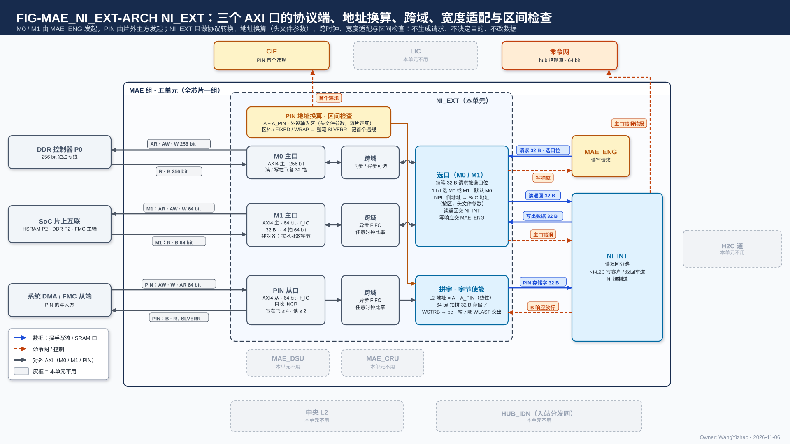
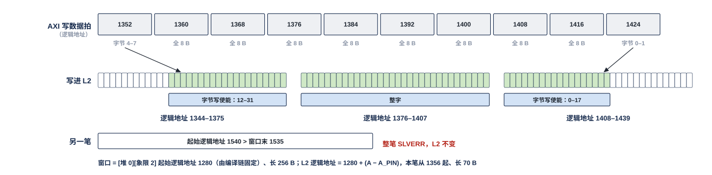

# MAE 片外接口（NI_EXT）需求

> Owner: WangYizhao｜2026-11-11

## 1 概述

NI_EXT 是 NPU 与 SoC 之间唯一的数据口外沿，属于 MAE 组（MAE_ENG、NI_EXT、NI_INT、MAE_DSU、MAE_CRU 五个交付单元之一；入站分发网 HUB_IDN 属 HUB 组，V18-NII-03 / 04、V18-MAE-11、V18-HUB-01），全芯片一份。它有三个 AXI 口：**主口 M0**（256 bit，独占 DDR 控制器 P0）、**主口 M1**（64 bit，经 SoC 片上互联到 HSRAM、DDR P2 与 FMC 主端的片外窗口）、**从口 PIN**（64 bit，供系统 DMA 与 FMC 从端把外设数据写进中央 L2 里编译链固定的 PIN 窗口），以及它们的时钟边界与宽度适配。口宽以架构篇 PORT-26 / 27 / 28 为准。

**NI_EXT 只做协议转换、地址换算、时钟边界与宽度适配；不生成请求、不决定目的、不改数据；选口只看每条请求的选口位。** 三个口的发起方不同：M0、M1 的每笔读写由 MAE_ENG 的搬运引擎给出地址、长度与选口位，NI_EXT 把它们转成 AXI 事务、把读返回与写响应交回；PIN 由片外主设备发起，NI_EXT 把 AXI 写换算成 L2 的段选与段内地址、取出有效字节交 NI_INT 写进 L2，并在数据真正写进 L2 之后才回 B 响应。三个口在 NPU 一侧只与 MAE_ENG、NI_INT 往来，彼此没有直接数据通路；与 MAE 组外的连接经 MAE 组的对外口（MAE 集成篇 §2.1 D1–D3）。

做与不做：

- 做：协议转换（MAE 的 32 B 请求 ⇄ AXI 事务；PIN 的 AXI 写 → L2 写入拍）、地址换算（三口，RTL 头文件参数）、跨时钟、宽度适配。
- 不做：不生成请求，不决定读哪些数据、写到哪里（MAE_ENG）；不补字、不读改写、不转置、不量化、不解码；**与片上一侧交接的数据一律从第 0 字节起放、带有效字节，落进存储字哪个字节位置由 SRAM 内部按地址低 5 位移位**（V18-TP-74）。
- 不连外设数据口、不发起外围 DMA、不直连 eMMC；NPU 不作为 M55 的从设备被推送数据；APB 只承载控制，经 CIF。

在 SoC 架构稿中本 NPU 称 **L3PU**；M0、M1 同名，PIN 即"L3PU SRAM 口"。SoC 互连内部、桥与时钟 / 位宽转换、PLL、时钟树与切频驱动归 SoC 设计者（用户 10-25）。

本篇用到的几个词（其余在首次出现处定义）：

| 词 | 含义 |
|---|---|
| NPU 侧地址 | MAE 指令里给的片外字节地址：L3PU 自己看到的 DDR / 共享内存地址 |
| SoC 地址 | SoC 统一地址图里的地址；L3PU 能访问的各段只占其中一部分 |
| L2 逻辑地址 | L2 一侧的地址，由段选信号 `seg`（堆选 + 象限的段掩码）与 24 bit 段内字节地址组成；定义见架构篇 §3.3 |
| 写入拍 | 链路上成交的一拍：≤ 32 B，带本拍首字节的段内地址 addr、从第 0 字节起放的数据与有效字节 be；写入握手与应写量都按写入拍计 |
| 选口位 | MAE_ENG 给每笔读写请求带的 1 bit，指定这笔事务从 M0 还是 M1 发出 |
| PIN 窗口 | 编译链按（调用种类, 输入种类）给每种片外输入在 L2 固定的一段地址（起始逻辑地址 + 长度上限）；所有 PIN 窗口所在的那段 L2 地址叫 PIN 输入地址段（编译链起的地址名，不是硬件分区） |
| 片外窗口 | M1 一侧某类数据在 SoC 地址空间里的一段地址（例：调用输入区、输出缓冲） |

## 2 接口需求

### 2.1 架构图与接口汇总

图中模块框内的结构是参考实现（见第 7 章），本章以框外的各口为准。

框外的口：左侧三对 AXI 线——M0 主口接 DDR 控制器 P0（AR · AW · W 出，R · B 入）、M1 主口接 SoC 片上互联（同上）、PIN 从口接系统 DMA / FMC 从端（AW · W · AR 入，B · R 出）。右侧是两个同组单元：MAE_ENG（读写请求与选口位进、写响应出）与 NI_INT（读返回 32 B 出、写出数据进、PIN 写入拍与 `src` 出、B 响应放行进）。LIC、中央 L2、HUB_IDN、MAE_DSU、MAE_CRU 画灰：NI_EXT 与它们没有直接往来。框内画的三行（每个口一个协议端加一级跨域，M0 / M1 汇到按选口位选路的选口点、PIN 一路经地址换算与拼写入拍）是参考结构。

| 口 | 对端 | 方向 | 位宽 | 握手 | 出处 |
|---|---|---|---|---|---|
| M0 | DDR 控制器 P0（独占专线） | 主（读写各一） | 256 bit，核时钟 $f_{\mathrm{core}}$ | AXI4 | 架构篇 PORT-26；本篇 §2.2 |
| M1 | SoC 片上互联（HSRAM P2、DDR P2、FMC 主端的片外窗口） | 主（读写各一） | 64 bit，$f_{\mathrm{IO}}$ | AXI4 | 架构篇 PORT-27；本篇 §2.3 |
| PIN | 系统 DMA、FMC 从端 | 从（写；读只用于调试） | 64 bit，$f_{\mathrm{IO}}$ | AXI4 | 架构篇 PORT-28；本篇 §2.4 |
| 读写请求 | MAE_ENG（搬运引擎） | 入 | 每笔 32 B + 选口位 | 组内约定（MAE 集成篇 §2.10.1） | 本篇 §2.5 |
| 写响应 | MAE_ENG | 出 | 每笔一个 | 组内约定 | 本篇 §2.5 |
| 读返回 | NI_INT 的读返回分路 | 出 | 32 B | 组内约定 | 本篇 §2.6 |
| 写出数据 | NI_INT | 入 | ≤ 32 B + 有效字节 | 组内约定 | 本篇 §2.6 |
| PIN 写入拍 | NI_INT 的 L2 写入合并器 | 出 | 32 B + addr 24 + `seg` 5 + be + `src` | en / ready | 本篇 §2.6、§3.5 |
| PIN 落地放行 | NI_INT 的 L2 写入合并器 | 入 | 每笔 PIN 事务一个 | 组内约定 | 本篇 §2.4.2 |

组内各口交什么、位宽与握手以 MAE 集成篇 §2.10.1 的组内约定为准，本表只为阅读方便列出。**NI_EXT 与 CIF 没有接口：三个口的地址换算参数都是 RTL 头文件参数、流片定死，CIF 不向 NI_EXT 装窗口表**（V18-NIE-03）；APB 32 bit 经 CIF。

### 2.2 M0 主口：DDR P0 专线，承载持续大流量

#### 2.2.1 信号、位宽与在飞

- **M0 是 AXI4 主口、读写各一，经独占的 256 bit 专线接 DDR 控制器 P0，一拍 32 B，与核内存储字同宽**；时钟为核时钟 $f_{\mathrm{core}}$（参考 1 GHz，与 DDR P0 同频同源）。
- **每笔请求由 MAE_ENG 的搬运引擎发起，NI_EXT 只做协议转换；读写两个方向都经过它**。M0 上的权重、K / V 等大流量主要是读，也承载激活与残差往返、训练数据。
- **写支持字节使能**；部分字的写只改有效字节（WSTRB 选字节）。
- **AXI 地址位宽【设计者定】**（V18-CIF-08）：取决于 SoC 地址图，由 MAE_NI_EXT 设计者与 SoC 外围架构负责方（DS）对接后确定；要定的是M0 可达的 DDR所在范围的地址位数，本篇不给数字。
- **在飞：读、写各 32 笔 × 32 B = 1 KB**，取 SoC 侧 DDR 控制器的在飞深度配置值，NPU 不在其上自行加深。**M0 侧须能同时维持读 32 笔、写 32 笔未完成事务，不因 NI_EXT 自身的事务名额、AXI ID 或读返回对应关系（本篇 §3.7）少于 32 而限速**；读请求记录的容量同样不使 M0 的在飞读请求数受限（NI_INT 篇 §3.3）。
- **M0 上的有效带宽：MAE 发请求的方式与 NI_EXT 的转换不使 M0 上的有效带宽低于 DDR 控制器能提供的带宽**（参考点 19.2 GB/s，V18-MAE-45 / NIE-04）。请求怎样发由 MAE_ENG 负责（MAE_ENG 篇 §7.5）；NI_EXT 一侧的参考做法（转换不改请求的大小与先后、不在请求之间插空拍）见本篇 §7.1。
- DDR 三口分工（SoC 10-30）：**P0 256 bit 归本 NPU 的 M0 专用，在 DDR 控制器上优先级最高**；P1 512 bit 接小核 NPU 侧 AXI 互联；P2 64 bit 接 SoC 片上互联总线（M55、系统 DMA、本 NPU 的 M1）。三口共享同一份 DDR 带宽（LPDDR5 x32 · 6400 MT/s）。

### 2.3 M1 主口：共享内存 / DDR 的小流量读写

#### 2.3.1 拆拍、可达范围与在飞

- **M1 是 AXI4 主口、读写各一，对外 64 bit、接口时钟 $f_{\mathrm{IO}}$**；经 SoC 片上互联总线可达 HSRAM P2、DDR P2 与 FMC 主端的片外窗口。到 DDR 经 P2，与 M55、系统 DMA 共享 P2，并与 P0 / P1 共享 DDR 总带宽（SoC 10-27 总线矩阵）。**NI_EXT 只做协议转换，读写两个方向都经过它。**
- **一笔 32 B 请求在 M1 上占 4 拍 64 bit**；读返回以 32 B 一笔交 NI_INT（拆拼做法见本篇 §7.1）。
- **AXI 地址位宽【设计者定】**（V18-CIF-08）：取决于 SoC 地址图，由 MAE_NI_EXT 设计者与 SoC 外围架构负责方（DS）对接后确定；要定的是M1 可达的共享内存 / DDR（HSRAM、DDR 共享区、FMC 主端的片外窗口）所在范围的地址位数，本篇不给数字。 **CIF 的调用描述符指针位宽等于 M1 口的 AXI 地址位宽**（CIF 篇 §2.2.2 / §6.2）。
- **承载 M55 放在共享内存 / DDR 里的小流量、时延敏感数据**：调用描述符（及随它的调用输入记录与结果记录）、指令、配置表源（含 KV 段表；段位置回写即写回 KV 段表）、M55 产的列表（KV 编辑列表等）、调用输入数据（Token ID、图像等）、输出缓冲追加写。**这类数据不走 APB**，APB 只写调用描述符指针与启动位（CIF 篇 §3.4）。各类数据的内容、落点与写出次序在 CIF、外部输入信息篇（`L3PU_EXTERNAL_INFORMATION.md`）与数据流篇。
- **M1 读回可按指令的目的口落 L2**（Token ID、图像等 SoC 侧数据，V18-MAE-09），与外部主方经 PIN 直写 L2 的 PIN 窗口（本篇 §2.4）并列，两条路都必须支持；NI_EXT 对 M1 读回只做协议转换，落 L2、交 LIC 直连口还是交 MAE_ENG（列表）由 NI_INT 按读请求记录分路（本篇 §3.7）。
- **调用描述符与配置表的读不得因同口写事务占满在飞资源而阻塞**；在飞名额与 AXI ID 的分配见本篇 §7.5。

### 2.4 PIN 从口：外部主方写 L2 的 PIN 窗口

PIN 是三个口里唯一由片外主设备发起的口，所以 NI_EXT 在这里要做一件主口上不需要的事：**给出可信的完成时点**（B 响应要等数据真正写进 L2，本篇 §2.4.2）。**PIN 写与推理整体分先后**（一帧传完才开始推理，本篇 §3.9）由 M55 软件保证，不要求 NI_EXT 为此设机制。

#### 2.4.1 支持的事务：突发类型、字节选通与在飞

- **AXI4 从口，对外 64 bit，接口时钟 $f_{\mathrm{IO}}$。写用于外部主方把外设数据写进 PIN 窗口；读只用于调试。**
- **AXI 地址位宽【设计者定】**（V18-CIF-08）：取决于 SoC 地址图，由 MAE_NI_EXT 设计者与 SoC 外围架构负责方（DS）对接后确定；要定的是SoC 地址图里 L3PU PIN 这一段（$A_{\text{PIN}}$ 起）所在范围的地址位数，本篇不给数字。
- **INCR、FIXED、WRAP 三种突发都支持；FIXED、WRAP 只保功能、不保速度**（V18-NIE-04）：NI_EXT 按 AXI 规则算出每拍各字节的地址，再按本篇 §3.5 交成写入拍；FIXED、WRAP 的拍间地址不连续，在不连续处断开写入拍，只降速。
- **支持字节使能与非 2 的 $n$ 次方字节数的写**（用户 11-05 夜，V18-TP-25）。**一笔写事务里的有效字节必须连续：首拍可从中间起、末拍可不满，中间不留空洞**（V18-NIE-04；例：一拍 8 B 的 WSTRB 为 `00001111` 是允许的形式，`11001111` 不支持）。这是对外部主方的要求（本篇 §5.2），NI_EXT 与 SRAM 都不为空洞的字节选通提要求。**FIXED、WRAP 突发下有效字节只要求每拍内连续**，拍间按 AXI 地址规则各自成写入拍（V18-TP-83 (5)）。
- **一笔写事务落在同一个象限的同一个堆里**（不跨象限、不跨堆；可跨存储字，V18-NIE-04）：这是 NI_EXT 交给 L2 的事务的性质，由编译链把 PIN 输入地址段放在一个象限的一个堆之内、外部主方只在 PIN 窗口内写来成立（本篇 §5.2）；NI_EXT 只按此交出写入拍。
- **每种输入的 PIN 窗口起点由编译链固定，默认按存储字对齐（数据组织的默认，不作硬限制，V18-DORG-10 (11)），外部主方从窗口起点顺序写、长度任意**（V18-TP-67，用户 11-09："是的，编译链定"；L2 篇 §3.3）。
- **在飞：写 4 笔、读 2 笔（SOW，要求值）**：PIN 从口能同时接收、尚未回 B 响应的写事务至少 4 笔，尚未回完读数据的读事务至少 2 笔；名额用满时按 AXI 握手拉低 AWREADY / ARREADY，让外部主方等待，不回错。由于 B 响应要等该笔数据写进 L2（本篇 §2.4.2），写名额占用的时间包含数据在 NI_INT 与 L2 里等待的时间。

#### 2.4.2 B 响应在该笔数据写进 L2 之后才回

**一笔 PIN 写事务的 B 响应，不早于该笔事务的最后一个写入拍写进 L2；判据是该事务发令号的写入握手数满**（协议篇 §3.8、§2.2.4，V18-TP-47）：每笔 PIN 写事务取一个发令号，事务的各拍带这个 `src` 进 L2；L2 在一个写入拍写进存储之后回一个带 `src` 的写入握手；NI_INT 数满该事务的写入拍数后通知 NI_EXT（"PIN 落地放行"），NI_EXT 才回该笔的 B 响应。发令号由 NI_INT 分配（MAE_NI_INT 篇 §3.6），号池的参考做法见本篇 §7.4。

- **判据不含任何固定拍数**：NI_INT 与 L2 所落的堆之间插几级流水、L2 上等几拍都不影响正确性；各象限写进存储的先后即使与链路顺序不同，每笔只数自己的号，也不会把后一笔的写入拍算到前一笔。
- **一个 AXI 写事务对应一个发令号，链路上没有切换段标记；突发长度（8 B × 1…256 拍）由外部主方定，NPU 不假设大小**（用户 11-06；V18-TP-42 / 43）。**一笔事务的写入拍不与别的事务合拼；事务结束后它的写入拍能全部交出，不等后续突发**（怎样交出尾拍见本篇 §7.3）。
- 同一 AXI ID 的 B 响应按序。

#### 2.4.3 拥塞时按 AXI 握手停住外部主方

- **NI_INT 的 L2 写入合并器不收时，NI_EXT 按 AXI 握手拉低 PIN 的 WREADY，让外部主方停发**；只降速、不丢数。
- PIN 不做地址检查与违规应答（本篇不含容错设计，V18-TP-75）。

### 2.5 与 MAE_ENG 的组内接口：读写请求与写响应

| 接口 | 方向 | 内容 |
|---|---|---|
| 读写请求 | 入 | **每笔 32 B，带选口位（M0 / M1）**；地址是 NPU 侧字节地址，长度与有效字节由搬运引擎给；一笔读请求的（去向, 目的逻辑地址）在发出时记下，供返回时分路（本篇 §3.7） |
| 写响应 | 出 | 每笔写的 AXI 写响应（即核间写入握手的片外形式，V18-TP-50）。**MAE 按指令给的数据量数写响应，数满即该指令的数据已写到片外、该指令执行完，由 MAE 带指令标号通知 LIC**（协议篇 §3.8，V18-MAE-13）。**每个写响应必须能对回发出它的那条指令：MAE 能按指令分别数满，任何一个写响应不得计入别的指令**（同一 AXI ID 内写响应按序，跨 ID 可乱序）；用 AXI ID、请求序号队列还是别的方式对回，见本篇 §7.5 |

### 2.6 与 NI_INT 的组内接口：读返回、写出数据、PIN 写入拍与落地放行

| 接口 | 方向 | 内容 |
|---|---|---|
| 读返回 | 出 | M0 / M1 读回的数据，32 B 一笔，从第 0 字节起放、带有效字节；**每笔返回按发出时记下的（去向, 目的逻辑地址）分路**，不定义标签格式（V18-TP-34，本篇 §3.7） |
| 写出数据 | 入 | 要写出的 ≤ 32 B 数据（从第 0 字节起放）与有效字节；**来源只有 L2 的 NI 读口（L2 → DDR / M1）与 DDR → DDR 区域复制的读返回；MAE_DSU 的整形输出与 MAE_CRU 的合并输出都不写片外**：DDR 只存前向形式的权重，MAE_CRU 的输出只写 L2（V18-NII-03、V18-CRU-07） |
| PIN 写入拍 | 出 | **每个写入拍 ≤ 32 B：addr = 本拍首字节的 L2 段内地址（24 bit），`seg` = 堆选与象限，数据从第 0 字节起放，be 标出从第 0 字节起连续的有效字节，`src` = 该笔 PIN 事务的发令号**；写入拍可以跨存储字（V18-NIE-04），落进存储字哪个位置由 L2 内部按 addr 低 5 位移位（L2 篇 §3.3）；en / ready 握手 |
| PIN 落地放行 | 入 | 某笔 PIN 事务的写入握手已数满（本篇 §2.4.2），NI_EXT 据此回该笔的 B 响应 |

### 2.7 时钟边界：三个口都支持异步跨域

- **M0、M1、PIN 三个口都必须支持异步跨域**（用户 11-05 夜）；**跨域不降低该口的持续带宽**。M0 参考配置下与 DDR P0、核时钟同频同源，此时可工作在同步模式；异步跨域能力仍须具备，以应对时钟关系变化与 SoC 端口处的实现差异。跨域结构与同步 / 异步的切换方式见本篇 §7.2。
- **M1 与 PIN 对外 64 bit、二者同频，公共接口时钟记作 $f_{\mathrm{IO}}$，数值【待确认】（与 SoC 集成对齐）；本篇不选 200 MHz / 800 MHz / 1 GHz，不定它与核时钟的关系**（用户 10-25；SoC 稿亦不标频率），**M1、PIN 按任意时钟比率异步**。APB 32 bit，经 CIF。
- 三个时钟域：核时钟 $f_{\mathrm{core}}$（参考 1 GHz、最低 200 MHz）、$f_{\mathrm{IO}}$、APB 时钟；跨时钟域边界都在 NI_EXT。NPU 内部只有一种 32 B 的存储字和一个核时钟，与端口位宽无关。
- PIN 的时钟域转换在 NPU 接口单元内由 NPU 方完成；M1 接入 SoC 片上互联一侧的时钟 / 位宽转换由 SoC 方完成（用户 10-25 保留跨时钟边界）。

## 3 功能描述

### 3.1 功能一览

| 功能 | 输入 | 输出 | 触发 / 生效条件 | 节 |
|---|---|---|---|---|
| 按选口位分流 | MAE 的读写请求 + 选口位 | M0 或 M1 上的 AXI 事务 | 每笔请求 | §3.2 |
| M0 / M1 地址换算 | NPU 侧地址 | SoC 地址 | 每笔请求；参数为 RTL 头文件 | §3.3 |
| PIN 地址换算 | AXI 地址 $A$ | L2 的 `seg` + 段内地址 | 每笔 PIN 事务；参数 $A_{\text{PIN}}$ 为 RTL 头文件 | §3.4 |
| PIN 写入拍 | AXI 写数据拍与 WSTRB | 写入拍（≤ 32 B，从第 0 字节起） | 每笔 PIN 写事务；事务结束后全部交出 | §3.5 |
| 片上一侧的字节交接 | 从第 0 字节起的数据 + 有效字节 / AXI 字节道 | AXI 字节道 + WSTRB / 从第 0 字节起的数据 | 每笔 M0 / M1 读写 | §3.6 |
| 读返回分路 | AXI 读返回 | 交 NI_INT，按记下的去向分路 | 每笔读返回 | §3.7 |
| 写响应交回 | AXI 写响应 | 交 MAE_ENG | 每笔写 | §3.8 |
| PIN B 响应 | 落地放行 | AXI B 响应 | 该笔事务的写入握手数满 | §2.4.2 |
| PIN 窗口与分先后、调试读 | — | — | PIN 写一帧期间不推理 | §3.9 |
| 宽度适配、字节序、全频段 | — | — | 恒定 | §3.10 |
| 复位与切频 | 复位 / 切频 | 不发半个事务 | 复位、切频 | §3.11 |

### 3.2 按选口位分流：选口是 MAE 的决定

**选口位是 MAE_ENG 给每条读写请求带的 1 bit，指定这笔事务从 M0 还是 M1 发出；NI_EXT 只看这一位分流，不看数据。** 默认 M0。哪笔请求走 M0 由 MAE 指令的选口位决定（MAE 不感知数据类型，V18-MAE-01）；按数据种类的流量清单在数据流篇。

| 口 | 能到哪里 | 适合 |
|---|---|---|
| M0 | DDR（经 P0 独占专线） | 持续大流量；**是唯一承载持续大流量的口** |
| M1 | HSRAM、DDR（经 P2）、FMC 主端的片外窗口 | 小而时延敏感的数据 |

HSRAM 与 FMC 主端的片外窗口只能经 M1 到达；DDR 两条路都能到，大流量走 M0、M55 放在 DDR 共享区的小数据可走 M1。同一类数据在不同场合可能放在 HSRAM 或 DDR，所以**选口不写死在 NI_EXT 里，由 MAE 的指令按数据所在位置填**。

### 3.3 M0 / M1 的地址换算：NPU 侧地址 → SoC 地址

**NI_EXT 发 AXI 请求前把 NPU 侧地址换成 SoC 地址：SoC 地址 = NPU 侧地址 − 该区 NPU 侧起点 + 该区 SoC 基址**（用户 11-06："对 M0 和 M1 的口其实也有一样的地址转换需求，但是配置的逻辑会在流片时定死"，V18-NIE-03）。

| 口 | 区 | 每区参数（RTL 头文件，流片定死） |
|---|---|---|
| M0 | 1 个：DDR（经 P0） | NPU 侧起点、长度、SoC 基址 |
| M1 | 至少 3 个：HSRAM、DDR 共享区（经 P2）、FMC 主端的片外窗口；区数【设计者定】：要定的是 M1 一侧的区数，约束是覆盖 SoC 地址图给 L3PU 的全部 M1 可达段 | 同上 |

- 换算只是按区减去起点、加上基址，不改数据、不拆请求、不改请求的先后。
- **MAE 给出的片外地址都落在某个区内**，由编译链保证、编译期检查，验收用仿真断言（本篇 §6.1）。
- 参数不经 CIF、不在运行期改；改 SoC 地址图要改头文件重新综合。

### 3.4 PIN 的地址换算：L2 逻辑地址 = $A - A_{\text{PIN}}$

**SoC 有一张统一的地址图，L3PU 的 PIN 只占其中一段；NI_EXT 把外部主方发来的 AXI 地址 $A$ 线性换成 L2 逻辑地址：L2 逻辑地址 = $A - A_{\text{PIN}}$**，$A_{\text{PIN}}$ 是 SoC 地址图给 L3PU PIN 的基址（用户 11-06："外部的 SoC 架构会有一个统一的地址注册，而 L3PU 的地址只在其中的一小部分，因此需要做转换"，V18-NIE-03）。**$A_{\text{PIN}}$ 是 RTL 头文件参数，流片时定死**，位宽按 SoC 地址图，不经 CIF 配置。

- **硬件不按窗口查表，只按 $A_{\text{PIN}}$ 线性换算**。
- **换算结果给出 L2 的段选与段内地址**：堆选与象限展开成写入拍上的 `seg`，其余为 24 bit 段内地址（架构篇 §3.3）。**$A - A_{\text{PIN}}$ 的低 24 bit 为段内地址，其上 2 bit 为象限号，再上 1 bit 为堆选**（V18-TP-83 (5)）；编译链给外部主方的 PIN 窗口地址按同一写法。
- 外部主方的写地址 = $A_{\text{PIN}}$ + 窗口在 L2 一侧的地址 + 本笔在窗口内的字节位置。

### 3.5 PIN 写入拍：按字节连续交给 L2，一笔事务不跨象限、不跨堆

**NI_EXT 把 64 bit 数据拍按 WSTRB 取出有效字节，按地址把相邻的有效字节依次装成写入拍交 NI_INT；写进 L2 的字节与 AXI 数据逐字节相同，未写字节保持原值**（L2 篇 §3.3）。规则：

1. **一个写入拍只装地址连续的有效字节，≤ 32 B，从第 0 字节起放**；addr = 本拍首字节的段内地址，be = 从第 0 字节起连续的有效字节（一拍 1–32 B）。
2. **写入拍可以跨存储字**（V18-NIE-04）：字节落进存储字哪个位置、跨字时怎样拆，由 L2 内部按 addr 低 5 位处理（V18-TP-74，L2 篇 §3.3）；链路与 NI_INT 都不移位。
3. **一笔写事务的全部写入拍带同一个 `src`（该事务的发令号），落同一个象限的同一个堆**。
4. **地址不连续处断开**（FIXED、WRAP 突发的拍间）；**一笔事务的写入拍不与别的事务合拼，事务结束后能全部交出**，不等后续突发。
5. **NI_EXT 不补字、不读改写。**

写入拍怎样切（按存储字边界切，或凑满 32 B 跨字）是参考实现的选择（本篇 §7.3，含数值例）。写入拍经 NI_INT 的 L2 写入合并器上 NI 写口，在所落的堆上与同一象限的其他链路共用，规则见架构篇 §3.4 CONC-2；不经 hub 写口、不给 L2 加口。

### 3.6 片上一侧的字节约定：从第 0 字节起交接，WSTRB 选字节

**NI_EXT 与片上一侧交接的数据一律从第 0 字节起放、带有效字节**（与 L2 写口、NI 读口同一约定，协议篇 §3.4）：

- **读入**：按 AXI 地址与读回的字节道取出有效字节，按次序（首字节在前）从第 0 字节起交 NI_INT。
- **写出**：把从第 0 字节起的有效字节按 SoC 地址的低位摆到对应的 AXI 字节道、生成 WSTRB。**不满一字的写只靠 WSTRB 选字节**：例如生成循环的输出缓冲每次追加一个 3 B 的 token，NI_EXT 按这 3 B 的 SoC 地址低位把它们摆到对应字节道。
- **片外窗口起点默认按存储字对齐，这是数据组织的默认，不作硬限制**（V18-DORG-10 (11)、V18-TP-74）。默认对齐时片外字节地址与 L2 段内地址对 32 取余都是 0，一笔 32 B 请求就是两侧各一个整字，NI_EXT 只拆拼 64 bit 拍、be ↔ WSTRB，**不引入额外拍数**。**片外起点不在字边界时，字节落进 L2 存储字的哪个位置由 SRAM 内部按段内地址低 5 位移位**，NI_EXT 只按片外地址摆字节道。
- 两个方向都**逐字节无损、只动有效字节**；NI_EXT 不补字、不读改写。

例：M1 一笔写只写 18 B、SoC 地址低 5 位为 3（落在片外 32 B 字内字节 3–20）时，NI_INT 从第 0 字节起交 18 B，NI_EXT 摆到字节道 3–20，4 拍的 WSTRB（位 $i$ 对应该拍的第 $i$ 字节）：

| 拍 | 覆盖的字节 | 有效字节 | WSTRB |
|---|---|---|---|
| 0 | 0–7 | 3–7 | `1111 1000` |
| 1 | 8–15 | 8–15 | `1111 1111` |
| 2 | 16–23 | 16–20 | `0001 1111` |
| 3 | 24–31 | 无 | `0000 0000` |

### 3.7 读返回按请求时记下的去向分路

本节是 NI_EXT 与 NI_INT 之间的约定：NI_EXT 保证"片外的完成时点与数据原样交到"，NI_INT 保证"按请求时记下的去向分路"，两边都不解释数据。

- **NI 对每笔读请求记下（去向, 目的逻辑地址），返回数据按请求对应关系分路**（用户 11-05 夜，V18-TP-34）——去 IDN 出口（→ HUB_IDN）、MAE_DSU、L2 写入合并器、LIC 直连口、NI_EXT 写通道，或 MAE_ENG（搬运引擎经 M0 / M1 读的列表、定长计数项与元数据项，NI_INT 篇 §3.3、§3.7，V18-MAE-08）；**NI_EXT 不解释去向，不定义"目的标签"格式**。对应关系怎样维持见本篇 §7.5。
- **同一 AXI ID 内按序；跨 ID 的乱序返回不重排**，每笔按自己记下的目的逻辑地址落位；需保序的读由 MAE 用同一 ID 发出。
- **下游收不下时只降速、不丢数**：NI_INT 下游停发时经 NI_EXT 拉低 M0 / M1 的 RREADY；DDR 读满带宽由 MAE 读序与指令编译保证（用户 11-05 夜，V18-NII-01）；是否设入站缓冲不作要求（V18-TP-84 (5)）。
- 逐位无损：读写数据在跨时钟、宽度拆拼、字节道摆放前后逐字节相等，有效字节逐个保持。

### 3.8 写响应是落地点：主口写响应交 MAE_ENG

**NPU 对共享内存 / DDR 的每笔写，以收到 AXI 写响应为"已落地、对他方可见"的时刻**；片内各核间写链路的写入握手本来就取自 AXI 写响应通道 B 的做法（从机写完回 BRESP、主机据此判写完成；协议篇 §3.8 / §3.8.1，V18-TP-50），片外一侧直接用 AXI B，不另加信号。NI_EXT 把写响应交回 MAE_ENG，MAE 按指令给的数据量计数，收齐即该指令执行完、由 MAE 带指令标号通知 LIC；MAE 不设完成计数器（协议篇 §3.8，V18-MAE-13）。

### 3.9 PIN 窗口由编译链固定；PIN 写与推理分先后；调试读

- **每种片外输入在 L2 的落点按（调用种类, 输入种类）由编译链固定，每种输入只有一个 PIN 窗口，外部主方往这个固定窗口写**（用户 11-05 夜，V18-NIE-02；用户 11-10，V18-MAE-44）：PIN 窗口 = 起始逻辑地址 + 长度上限，落在 PIN 输入地址段内、不跨堆与象限。各窗口在 PIN 输入地址段内怎样排、各种输入落在哪，是编译链与 M55 软件的约定；**PIN 窗口与 PIN 输入地址段的划分不由硬件保护**。
- **运行期不配置窗口**：MAE 没有窗口收回 / 释放指令，CIF 不装窗口表。**写完通知与实际长度由调用描述符与 CIF 的启动给出**：NI_EXT 不计 PIN 的写字节数、不产生外设写事件；外部主方写完后，实际长度可由指令给，也可由 M55 经 CIF 的 PIN 相关寄存器给，LIC 知道取哪一份（V18-CIF-06，CIF 篇 §3.9），再经 CIF 写启动位启动调用（CIF 篇 §3.4）；NPU 只在启动之后读该窗口。
- **片外经 PIN 写 L2 与推理整体分先后**（用户 11-10，V18-L2-07）：PIN 写一帧期间 L3PU 不推理、没有调用在执行，MAE 不为推理做搬运；一帧传完、M55 经 CIF 启动调用之后才开始推理，所以下一帧在本次推理结束之后才写，一个窗口就够。**这个先后由 M55 软件经 CIF 的启动与 LIC 的调用启动保证；不要求 NI_EXT 与 L2 为 PIN 写设保留堆、等待上界或专门的优先级。** PIN 写入只在 L3PU 空闲或已停止时进行（CIF 篇 §3.9）。因此 PIN 写一帧期间 L2 写入合并器里只有 PIN 一个来源；PIN 写与 DDR 写 L2 共用 NI 写口，只是分时使用。
- **PIN 读只用于调试**，经 NI 读口读 L2，只要求最终完成、不阻塞推理的读，不定等待上界；它在 NI_INT 的读请求里排在什么位置归 NI_INT 篇。

### 3.10 宽度适配、字节序与全频段功能正确

| 口 | 内部 ↔ 对外 |
|---|---|
| M0 | 与内部 32 B 等宽，不拆拼；片外起点不在字边界时按 SoC 地址低位取字节 / 摆字节道（§3.6） |
| M1 | 一笔 32 B ↔ 4 拍 64 bit；片上一侧从第 0 字节起交接，片外一侧按 SoC 地址低位摆字节道，有效字节 ↔ WSTRB（§3.6） |
| PIN | 64 bit 拍按地址装成写入拍（≤ 32 B、可跨存储字、从第 0 字节起放），不补字（§3.5） |

- **小端，低地址在低位字节；宽度转换不改变字节序。**
- M0、M1 的 AXI 请求都按 32 B 对齐发出，不满一字时写用 WSTRB 选字节、读只取有效字节；一笔写请求按 SoC 地址跨两个片外 32 B 对齐单元时由谁拆成 AXI 请求是 MAE 组内的分工（本篇 §7.5，MAE_ENG 篇 §7.5），约束是拆后字节次序不变。
- **$f_{\mathrm{core}}$ 为 200 MHz 到 1 GHz 的任一档都功能正确**；以拍计的结构参数（如在飞深度、流水级数）不随频率改变，以时间计的性能按 $f_{\mathrm{core}}$ 缩放；跨时钟的两侧各自可变。

### 3.11 复位与切频的前提

- **复位**：**复位输入来自 CIF（架构篇 PORT-41），硬复位与软复位不区分**（CIF 篇 §2.4 / §3.3）；三个口在各自时钟域内同步释放；**任一口复位期间不向对端发出半个事务**；复位后没有在途事务。复位树与片外一侧的复位归 SoC 集成。
- **停止请求**：NI_EXT 不接 CIF 的停止请求（架构篇 PORT-42）；搬运引擎停发后 M0 / M1 上不再有新请求，已发出的事务按 AXI 握手走完或停在握手上（MAE 集成篇 §3.12）；已停止期间 PIN 写照常处理（CIF 篇 §3.9）。
- **切频的前提**：NPU 处于空闲或就绪态、三个口无在飞事务、系统侧不发起 PIN 访问（由 M55 软件保证，与 §3.9 的 PIN 写与推理分先后同一机制）；切频前后不需重装表或重配 CIF。**切频流程与复位序列归 CIF 与 SoC 集成。**

## 4 性能指标

### 4.1 各口的速率要求

本节把三件事分开写（用户 10-25）：接口能力、DDR 带宽与在飞。

- **M0 接口能力** $B_{\mathrm{M0,if}} = 32\ \mathrm{B} \times f_{\mathrm{core}}$：1 GHz 时 32 GB/s；$f_{\mathrm{core}} < 600$ MHz 时低于 19.2 GB/s 分析点，M0 接口成为瓶颈。
- **M0 上的有效带宽**：MAE 发请求的方式与 NI_EXT 的转换不使它低于 DDR 控制器能提供的带宽（参考点 19.2 GB/s，本篇 §2.2.1）。有效吞吐另受 DDR 共享与在飞覆盖的读延迟限制（推导，说明三件事的关系，不是要求值）：

$$B_{\mathrm{M0,eff}} \le \min\big(32\ \mathrm{B} \cdot f_{\mathrm{core}},\ B_{\mathrm{DDR}} - B_{\mathrm{P1}} - B_{\mathrm{P2}},\ 1024\ \mathrm{B} / t_{\mathrm{rd}}\big)$$

  $B_{\mathrm{P1}}$、$B_{\mathrm{P2}}$ 为 P1、P2 两口占用的 DDR 带宽，$t_{\mathrm{rd}}$ 为端到端读延迟；维持 $B_{\mathrm{DDR}}$ 需 $t_{\mathrm{rd}} \le 1024\ \mathrm{B} / B_{\mathrm{DDR}}$（19.2 GB/s 时约 53 ns）。19.2 GB/s 只是 DDR 分析工作点，不是 M0 接口上限；验收不预设 DDR 有效率。
- **M1、PIN**：每方向 $8\ \mathrm{B} \times f_{\mathrm{IO}}$；有效吞吐另受 SoC 片上互联竞争与目标从方限制。
- **M1 / PIN 上传 $n$ B 的时间 = $4\lceil n/32 \rceil$ 个 64 bit 数据拍 ÷ $f_{\mathrm{IO}}$ + SoC 片上互联往返 $t_{\mathrm{rt,IO}}$**（$t_{\mathrm{rt,IO}}$ 由 SoC 集成给出，用户 10-25）。调用输入记录与结果记录的字节数由 CIF 与数据流篇给出，本篇不汇总。
- **跨域不降低该口的持续带宽**（本篇 §2.7）。
- PIN 的 FIXED、WRAP 突发只保功能、不保速度（本篇 §2.4.1）。

### 4.2 同时使用的口：与 NI 写口的速率衔接

M0 读回里目的为 L2 的部分、M1 读回里目的为 L2 的部分、PIN 写都经 NI_INT 进同一条 32 B/拍的 NI 写口。**PIN 写与推理分先后（本篇 §3.9），PIN 写一帧期间 NI 写口只有 PIN 一个来源**；推理期间只有 M0、M1 两路。NI 写口不低于 DDR 入流的条件见架构篇 §3.4 CONC-5（与同象限其他链路落在不同的堆）；推导值与参考工况见本篇 §7.6 与 NI_INT 篇 §4.2。

**NI 写口一侧不收时，NI_EXT 把停发传回片外，不丢数**：

| 口 | NI_INT 不收时 NI_EXT 的动作 | 依据 |
|---|---|---|
| M0 | 拉低 M0 的 RREADY | §3.7、V18-NII-01 |
| M1 | 拉低 M1 的 RREADY | §3.7 |
| PIN | 拉低 PIN 的 WREADY | §2.4.3 |

### 4.3 要求值表

| 项 | 要求值 | 说明 |
|---|---|---|
| M0 接口能力 | $32\ \mathrm{B} \times f_{\mathrm{core}}$ | 一拍 32 B |
| M0 有效带宽 | 不低于 DDR 控制器能提供的带宽（参考点 19.2 GB/s） | 由 MAE 的请求方式与 NI_EXT 的转换共同保证（V18-MAE-45 / NIE-04） |
| M0 在飞 | 读、写各 32 笔 | 取 DDR 控制器配置值；NI_EXT 自身名额不少于 32 |
| M1、PIN | 每方向 $8\ \mathrm{B} \times f_{\mathrm{IO}}$ | $f_{\mathrm{IO}}$【待确认】（与 SoC 集成对齐） |
| PIN 在飞 | 写 4 笔、读 2 笔 | SOW |
| PIN 突发类型 | INCR / FIXED / WRAP 都支持；FIXED、WRAP 只保功能 | V18-NIE-04 |
| PIN 字节选通 | 一笔写事务的有效字节连续（首拍可从中间起、末拍可不满） | V18-NIE-04 |
| 异步跨域 | M0、M1、PIN 三口都必须支持；跨域不降低该口的持续带宽 | 跨域结构与参考延迟见 §7.2 |
| 地址换算参数 | PIN：只有 $A_{\text{PIN}}$；M0：1 区；M1：≥ 3 区（HSRAM、DDR 共享区、FMC 主端的片外窗口），每区起点 / 长度 / SoC 基址 | RTL 头文件参数，流片定死（V18-NIE-03）；M1 区数【设计者定】 |
| 全频段 | $f_{\mathrm{core}}$ 200 MHz–1 GHz 任一档功能正确 | §3.10 |

## 5 约束与由使用者保证的事项

### 5.1 硬约束

- **三个口的地址换算参数都是 RTL 头文件参数、流片定死**；NI_EXT 没有运行期配置口，CIF 不装窗口表（V18-NIE-03）。
- **下游停发时只降速、不丢数**：经 RREADY / WREADY 把停发传回片外（V18-NII-01）；是否设入站缓冲不作要求（V18-TP-84 (5)）。
- **本篇不含容错设计**（V18-TP-75）。

### 5.2 由使用者保证的事项

| 事项 | 由谁保证 |
|---|---|
| 请求的地址、长度、目的与选口位；持续大流量只填 M0 | MAE_ENG |
| MAE 发请求的方式不使 M0 上的有效带宽低于 DDR 控制器能提供的带宽 | MAE_ENG（MAE_ENG 篇 §7.5） |
| M0 / M1 请求的片外地址都落在某个换算区内 | 编译链（编译期检查） |
| 调用结果"数据先落地、完成状态后给"与完成判定 | LIC：收到写结果记录那条指令的 MAE 完成通知（AXI 写响应已收齐，带指令标号）后，才写 CIF 的调用完成状态寄存器、由 CIF 发中断；结果记录里没有状态字（用户 11-06："我认为状态字应该是 CIF 的事情"，V18-MAE-13 / 26） |
| 每个读请求记下（去向, 目的逻辑地址）、返回按此分路 | MAE_ENG、NI_INT（组内分工见本篇 §7.5） |
| **PIN 窗口**：每种片外输入的落点按（调用种类, 输入种类）固定，每种输入只有一个窗口；窗口落在 PIN 输入地址段内；**PIN 输入地址段放在一个象限的一个堆之内** | 编译链 |
| 外部主方只写到该输入的固定窗口（$A_{\text{PIN}}$ + 窗口地址），从窗口起点顺序写 | M55 软件、编译链、外部主方 |
| **PIN 一笔写事务的有效字节连续**（首拍可从中间起、末拍可不满，中间不留空洞） | 外部主方（SoC 软件） |
| 写完通知与实际长度（指令或 CIF 的 PIN 相关寄存器，LIC 取其一；CIF 的启动）；**PIN 写与推理整体分先后**：一帧传完、启动之后才开始推理，PIN 写期间没有调用在执行（V18-L2-07） | M55 软件、LIC |
| 地址换算参数（$A_{\text{PIN}}$；M0 / M1 各区的起点 / 长度 / SoC 基址）与 SoC 地址图一致 | SoC 集成（RTL 头文件，流片定死） |
| PIN 写入拍与 NI 写口上其他来源的合并、发令号分配与写入握手计数 | NI_INT（MAE_NI_INT 篇 §3.6） |
| NI 写口与同象限其他链路落在同一个堆时的服务先后 | L2（架构篇 §3.4 CONC-2） |
| DDR 控制器的在飞深度、互联拓扑与仲裁、桥与时钟 / 位宽转换、DDR 三口优先级、复位树 | SoC 方 |
| 共享内存 / DDR 的缓存属性与 M55 侧缓存维护 | CIF / M55 |
| 切频前三个口无在飞事务、系统侧不发起 PIN 访问 | M55 软件 |

## 6 验收

### 6.1 本模块验收项

| 验收项 | 方法 | 用例 | 出处 |
|---|---|---|---|
| 端口与时钟 | 审查 | 端口宽度、读写通道与时钟关系 | §2.1–§2.4、§2.7 |
| M0 在飞 | 周期仿真 | M0 侧同时维持读 32 笔、写 32 笔未完成事务，不因 NI_EXT 的名额或 ID 少于 32 而限速 | §2.2.1 |
| M0 有效带宽 | 周期仿真 | 按 MAE 的请求方式持续读，M0 上的有效带宽不低于所配 DDR 控制器模型能提供的带宽；NI_EXT 不在请求之间插入空拍 | §2.2.1、§4.1 |
| 字节写 | 逐位比对 | 单字节写后相邻字节不变、无读改写事务 | §2.2.1、§3.6 |
| 选口 | 断言 | 随机选口位，事务只出现在对应口 | §3.2 |
| M0 / M1 地址换算 | 逐笔比对 | 每区首尾地址换算后的 SoC 地址与参照一致；"请求都落在某个区内"作仿真断言（验收用，不是硬件检查） | §3.3 |
| M0 / M1 部分字读写 | 逐位比对 | 随机有效字节，片外地址与 L2 段内地址对 32 取余随机（含默认的都为 0）；读写字节逐字节相同，WSTRB 与 §3.6 例一致；默认对齐时不多占拍 | §3.6 |
| PIN 续写与写入拍 | 逐位比对 | PIN 从窗口起点顺序写、随机分笔与长度（续写起点不在字边界），另含窗口起点不在字边界的用例；写入 L2 的字节与 AXI 数据逐字节相同，未写字节保持原值；每个写入拍 ≤ 32 B、数据从第 0 字节起、addr = 首字节地址；含跨存储字的写入拍；一笔事务的写入拍同一 `src`、同象限同堆；尾拍在 WLAST 交出 | §3.5 |
| PIN 突发类型 | 逐位比对 | INCR、FIXED、WRAP 各一组：写入 L2 的字节按 AXI 规则的地址落位，与参照逐字节相同 | §2.4.1 |
| PIN 窗口落位 | 逐位比对 | 按编译链窗口（每种输入一个窗口）写入各自落位，L2 逻辑地址按 $A - A_{\text{PIN}}$ 换算 | §3.4、§3.9 |
| PIN 在飞与拥塞 | 周期仿真 | 写 4 笔、读 2 笔在飞；名额满时 AWREADY / ARREADY 拉低、不回错；L2 写入合并器不收时 WREADY 拉低、不丢数 | §2.4.1、§2.4.3 |
| 写响应时点 | 周期仿真 | 主口写响应交回晚于 AXI 写响应；**PIN 的 B 响应晚于该事务号的写入握手数满**；随机化 NI_INT 到 L2 所落堆之间的流水级数、ready 时序与各象限写进先后，B 响应仍不早于该笔最后一个写入拍写进 L2、且不误归属到相邻一笔（PIN 写与推理分先后，不设 PIN 与 M0 / DSU / CRU 同时写 L2 的用例） | §2.4.2、§3.8 |
| 写响应对回指令 | 周期仿真 | 几条指令的写交错、跨 ID 乱序返回写响应，MAE 按指令数到的写响应数等于各自发出的写数 | §2.5 |
| 读返回分路与乱序 | 周期仿真 | 随机跨 ID 乱序返回，每笔按记下的（去向, 目的逻辑地址）分路、落位与顺序返回时相同，不外溢；下游停发时 RREADY 拉低、不丢数 | §3.7 |
| 全频段与异步跨域 | 周期仿真 | 三个口各在同步与异步两种时钟关系下；随机 $f_{\mathrm{IO}} / f_{\mathrm{core}}$ 比率与 200 MHz–1 GHz 各档功能正确；跨域前后持续带宽不降 | §2.7、§3.10 |
| 复位 | 周期仿真 | 复位注入下无半个事务；硬复位、软复位两种来源行为相同 | §3.11 |

### 6.2 与上下游模块的对接检查

| 对接项 | 对端 | 检查内容 |
|---|---|---|
| 读写请求与写响应 | MAE_ENG 篇 §7.5、MAE 集成篇 §2.10.1 | 每笔 32 B 带选口位；写响应按指令分别数满；请求方式满足 M0 有效带宽要求 |
| 读返回分路 | MAE_NI_INT 篇 §3.3、§3.7 | 每笔读返回按记下的（去向, 目的逻辑地址）分到六个去向之一；跨 ID 乱序不重排 |
| PIN 写入拍与 B 放行 | MAE_NI_INT 篇 §3.6、L2 篇 §3.7 / §2.3 | 写入拍带 addr / `seg` / be / `src`、可跨存储字；一笔事务不跨象限、不跨堆；NI_INT 数满该事务号的握手后放行 B |
| 片外数据落 L2 的字节位置 | L2 篇 §3.3 | 不对齐的写入拍由 L2 内部移位，读回与 AXI 数据逐字节相同 |
| PIN 窗口与写完通知 | 外部信息篇、CIF | 窗口地址与 $A - A_{\text{PIN}}$ 的写法一致（低 24 bit 段内地址、其上 2 bit 象限、再上 1 bit 堆选）；实际长度由调用描述符给出 |
| AXI 地址位宽 | SoC 外围架构负责方（DS）、CIF 篇 §2.2.2 / §6.2 | M1 口地址位宽与 SoC 地址图、CIF 调用描述符指针位宽一致；M0、PIN 的地址位宽与 SoC 地址图一致 |

## 7 参考实现

**本章内容可以换；换了之后别的模块不用改。** 本章给一套满足第 2–6 章的做法：M0 请求的发法、跨域结构、PIN 写入拍的切法、发令号池、字节道与对应关系的维持、参考工况与门数。

### 7.1 M0 请求：每笔 32 B，同一 64 B 单元的两笔背靠背

- 每次请求固定 32 B，不加宽请求或数据总线。
- **同一 64 B 单元两笔地址连续的请求保持背靠背发出，由 DDR 控制器合成一次 64 B 突发；成批按地址升序**（MAE_ENG 篇 §7.5）。NI_EXT 的地址换算只是按区减去起点、加上基址，不拆请求，同一 64 B 单元两笔背靠背的性质保持。
- 这是满足"M0 有效带宽不低于 DDR 控制器能提供的带宽"（本篇 §2.2.1）的参考做法：DRAM 效率由 64 B 突发决定，而 AXI 一拍只有 32 B。NI_EXT 的转换不改变请求的大小与先后、不在请求之间插入空拍。
- **M1**：一笔 32 B 请求在片外拆成 4 拍 64 bit 的 INCR 突发；读返回在 NI_EXT 内拼回 32 B 再交 NI_INT。

### 7.2 跨域结构：异步 FIFO，参考延迟 ≤ 6 个核拍

- 每个口后面一级跨域：M0 同步 / 异步可选，M1、PIN 为任意时钟比率的异步 FIFO（FIG-MAE_NI_EXT-ARCH 框内）。
- **跨域只用 FIFO，不用握手停顿换带宽**；跨域 FIFO 延迟参考 ≤ 6 个核拍，M0 同步同源时可为 0。
- 跨域的具体结构、同步 / 异步的切换方式与 FIFO 深度【设计者定】：约束是跨域不降低该口的持续带宽（本篇 §2.7），全频段功能正确（本篇 §3.10），两侧时钟各自可变。

### 7.3 PIN 写入拍的切法与数值例

需求只规定写入拍的形式（本篇 §3.5）；参考做法里事务的尾拍在 AXI WLAST 那一拍交出，不另设时间界。怎样从 64 bit 拍拼出写入拍【设计者定】：要定的是拼写入拍的结构（流写出缓冲字的个数、何时交出）；约束是本篇 §3.5 的 5 条规则。两种参考切法都满足：

- **做法 A：按存储字边界切**——一个写入拍只装落在同一个存储字内的有效字节，下一个有效字节换到下一个存储字时交出当前写入拍；默认窗口起点在存储字边界时，除首尾外每拍就是一个整字（下图的例子）。
- **做法 B：凑满 32 B 再交**——写入拍从上一拍末字节的下一个字节起装满 32 B 才交出，可以跨存储字，跨字的拆分由 L2 内部做。

本例的 PIN 窗口：[堆 0][象限 2]，起始逻辑地址 1280（= 40 × 32，在字边界）、长度上限 256 B，窗口末 1280 + 256 − 1 = 1535（窗口由编译链给定）。外部主方从窗口起点 1280 顺序写，上一笔写到 1355；**本笔是接着它的续写，从逻辑地址 1356 开始、长 70 B——起点不在字边界只因上一笔长度任意，字 1344–1375 里的 1344–1355 已由上一笔写过、本笔不写**（V18-TP-67）。本笔按 8 B 拍边界是 (1424 − 1352) / 8 + 1 = 10 个 AXI 数据拍（1352、1360、…、1424）：首拍只有字节 4–7 有效，末拍只有字节 0–1 有效。按做法 A 拼成三个写入拍：

| 写入拍 | addr | 有效字节 | 落进的存储字 | 字内字节位置 |
|---|---|---|---|---|
| 1 | 1356 | 20 B（1356–1375） | 1344–1375 | 12–31 |
| 2 | 1376 | 32 B（1376–1407） | 1376–1407 | 0–31（整字） |
| 3 | 1408 | 18 B（1408–1425） | 1408–1439 | 0–17 |

20 + 32 + 18 = 70 B；写入拍 1 的字内位置 12 = 1356 − 1344，由 L2 内部移位得到。其余字节保持原值。脚本断言写入字节与 AXI 数据逐字节相同。按做法 B 同一笔拼成 1356 · 32 B（跨字 1344 / 1376）、1388 · 32 B（跨字 1376 / 1408）、1420 · 6 B 三拍，写进 L2 的字节相同。图中最下一排画的就是做法 B：跨字的一拍分两段画，中间用虚线连上。

FIXED、WRAP 突发：NI_EXT 先按 AXI 规则算出每拍的地址（FIXED 每拍同址，WRAP 在回绕边界内回到起点），每拍的有效字节各成一个写入拍或与地址连续的下一拍拼在一起；地址不连续处断开。

### 7.4 PIN 发令号池

每笔 PIN 写事务从 NI_INT 的号池取一个发令号，回 B 响应之后释放（MAE_NI_INT 篇 §3.6）。**号池个数【设计者定】：约束是不小于本口可同时在飞的写事务数（本篇 §2.4.1 的写 4 笔）**；号用完时停收新事务（按 AXI 握手拉低 AWREADY）。

### 7.5 字节道排法、读返回对应关系与写响应的归属

- **NI_EXT 内部怎样排字节道【设计者定】**：要定的是读入取字节、写出摆字节道的结构；约束是两个方向都逐字节无损、只动有效字节，默认对齐时不引入额外拍数（本篇 §3.6）。
- **读返回对应关系怎样维持**（用几个 AXI ID、读请求记录队列多深、记录放在 MAE_ENG 还是 NI_INT）【设计者定】：约束是本篇 §3.7 的分路正确、M0 读 32 笔在飞不因此限速（本篇 §2.2.1）。
- **写响应与指令的对应关系**（用 AXI ID、请求序号队列还是别的方式）【设计者定】：约束是本篇 §2.5 的"MAE 按指令分别数满，任何一个写响应不计入别的指令"。
- **M1 的在飞名额（参考 ≤ 8 笔）与 AXI ID 分配**【设计者定】：约束是调用描述符与配置表的读不因同口写事务占满在飞资源而阻塞（本篇 §2.3.1）。
- **一笔写请求按 SoC 地址跨两个片外 32 B 对齐单元时由谁、怎样拆成 AXI 请求**【设计者定】（MAE 组内的分工，MAE_ENG 篇 §7.5）：参考做法是 NI_EXT 不拆请求、由 MAE_ENG 拆；约束是拆后字节次序不变。

### 7.6 参考工况：NI 写口的速率推导

推导值，不是要求值；核频 1 GHz，NI 写口 32 B/拍以 NI 写与同象限其他链路落不同的堆为前提（架构篇 §3.4 CONC-5）：推理期间 M0、M1 两路持续需求 $19.2 + 8\,f_{\mathrm{IO}}[\mathrm{GHz}]$ B/核拍，$f_{\mathrm{IO}} \le (32 - 19.2) / 8 = 1.6$ GHz 时不超过 32 B/拍；PIN 写一帧期间只有 $8\,f_{\mathrm{IO}}[\mathrm{GHz}]$ B/核拍，$f_{\mathrm{IO}} \le 4$ GHz 时不超过 32 B/拍。超过时只是更常停发（本篇 §4.2）。

### 7.7 门数参考与计数

- **门数**：≤ 50 k 门（NAND2 等效）：M0 约 15–25 k、M1 约 8–12 k、PIN 约 8–12 k；另加约 1.5 KB 寄存器堆；M0 / M1 按 SoC 地址低位取字节 / 摆字节道的逻辑（§3.6）计入各自门数【待标定】。建议值，不含 SRAM / RF 宏。
- **计数**：没有独立的性能计数，也不计 PIN 的写字节数（写完通知与实际长度由调用描述符与 CIF 的启动给出，§3.9）。

### 7.8 参考实现的自检项

| 自检项 | 方法 | 用例 |
|---|---|---|
| M0 请求形式（§7.1） | 断言 | 请求恒为 32 B；同一 64 B 单元两笔背靠背 |
| 跨域 FIFO（§7.2） | 周期仿真 | 随机时钟比率下 FIFO 不溢出、不丢拍；同步同源时延迟为 0 |
| 写入拍切法（§7.3） | 逐位比对 | 做法 A：写入拍不跨存储字、按 FIG-MAE_NI_EXT-PIN-WORDPACK 的三拍；做法 B：除尾拍外每拍 32 B |
| 发令号池（§7.4） | 周期仿真 | 4 笔写在飞时号池不耗尽；号用完时 AWREADY 拉低 |

## 8 为什么

### 8.1 需求的理由

- **三个口都是协议转换，主口由 MAE_ENG 发起**（用户 11-05 夜确认）：NI_EXT 的职责边界与"传什么、发给谁、写到哪由 MAE 定"（用户 11-03）一致；把"谁发起"写清，读者不会把 NI_EXT 当成只发数据的出口。
- **三个口的地址换算都是头文件参数、流片定死；PIN 只做 $L2 = A - A_{\text{PIN}}$ 的线性换算**（用户 11-06："外部的 SoC 架构会有一个统一的地址注册，而 L3PU 的地址只在其中的一小部分，因此需要做转换……我需要它在 RTL 里写成头文件可配，并且我认为这里对 M0 和 M1 的口其实也有一样的地址转换需求，但是配置的逻辑会在流片时定死"，V18-NIE-03）：窗口位置本来就由编译链定死，线性映射已能落到正确窗口。被否方案：CIF 装窗口表，多一个初始化接口。
- **本篇不含容错设计**（用户 11-10："M4不保留，M5不保留，我希望当前的架构设计无需包含任何容错设计，最后统一加"，V18-TP-75）：PIN 的区间检查与违规应答、主口 AXI 错误响应的上报都不在本篇；NPU 断电或复位期间对 PIN 访问的代答也不在本篇。
- **M0 的需求是有效带宽，不是请求形式**（用户 11-11："我认为64B背靠背也不是约定，满足DDR利用率才是约定"；"PIN和DDR我支持"，V18-MAE-45 / NIE-04）：需求写"不使 M0 上的有效带宽低于 DDR 控制器能提供的带宽"（参考点 19.2 GB/s，不另设利用率百分比）；每笔 32 B、64 B 两笔背靠背是满足它的参考做法。
- **接口能力、DDR 带宽与在飞分开写**（用户 10-25）：降频时接口能力同比下降，DDR 带宽由三口共享，1 KB 在飞只覆盖约 53 ns 读延迟。
- **M0 独占专线**：大流量要一条不与其他主方竞争互联的通路（SOW；SoC 10-27）。
- **M1 与选口位**：调用记录每轮只有几 KB、时延敏感但不占带宽，走 M1 不占 M0 的权重流时隙，也不走 APB；同一类数据可放 HSRAM 或 DDR，所以按选口位选口。训练数据走 M0 不走 M1：M1 慢且与系统主方共享 P2。
- **三个口都支持异步跨域，跨域不降低持续带宽**（SOW；用户 10-25 保留跨时钟边界；用户 11-05 夜："异步跨域的能力，对 M0，M1，PIN 都要支持，其他的可以交给 Designer 确定"；用户 11-11 对 D3"认可"）：参考频率相同不等于可以去掉跨域逻辑；$f_{\mathrm{IO}}$ 未定，M1 / PIN 按任意比率异步；M0 同步同源只是参考配置。跨域做法与 6 拍归参考实现。
- **PIN 的写入拍可跨存储字，一笔事务不跨象限、不跨堆**（用户 11-11："我认为可以跨存储字，只是不要跨物理Bank分区"，V18-NIE-04）：SRAM 已接受任意字节起点、一次 ≤ 128 B 的紧密写（V18-TP-74），写入拍落在一个存储字内不再是 L2 的输入约束；象限与堆是不同的存储范围，一笔事务的发令号与写入握手按一个范围计。
- **PIN 一笔写事务的有效字节必须连续**（用户 11-11："例如位宽是8B，然后他的有效是11001111这样的吗？那这种确实不需要L3PU支持，但是需要支持00001111有效的形式，咱们对SRAM提出支持11001111形式的意义不大"，V18-NIE-04）：从窗口起点顺序写本来如此；不支持空洞，写入拍的 be 才能始终写成"从第 0 字节起连续"。
- **PIN 的 INCR / FIXED / WRAP 三种突发都支持**（用户 11-11："我觉得这三个都可以支持吧？有什么影响吗？"；"我觉得这三个都可以支持吧"，V18-NIE-04）：改动只在 NI_EXT 的地址换算；FIXED、WRAP 地址不连续，只保功能不保速度。被否方案：外部主方只发 INCR。
- **PIN 窗口起点默认按字对齐、长度任意**（用户 11-05 夜："这个明显是一个兼容式设计，可以不用，但是不能没有"，V18-TP-25；用户 11-09："是的，编译链定"，V18-TP-67）：外设数据的长度不由 NPU 决定，起点则由编译链按（调用种类, 输入种类）默认固定在字边界；**SRAM 保留从任意字节起写的能力、移位在 SRAM 内部，对齐只是数据组织的默认**（V18-TP-74），所以 NI_EXT 只需把有效字节从第 0 字节起交出、给出有效字节，既不补字也不读改写。
- **片外窗口对齐不作硬限制**（用户 11-10："（11）这里不需要作为强限制，这里强限定在咱们解除了紧密存储限制后还有什么意义？"，V18-DORG-10 (11)）：默认对齐时 NI_EXT 只把有效字节与 WSTRB 互转，不对齐时只按 SoC 地址低位摆字节道。被否方案：片外与片内字内字节位置必须相同、NI_EXT 不移字节。
- **统一叫逻辑地址**（用户 11-05 夜："不应该叫偏移，统一叫逻辑地址是更合理的设计"）：窗口与换算都用 L2 逻辑地址表述，与协议篇、L2 篇同一种地址。
- **B 响应等数据真正可见**：系统 DMA 一报完成 M55 就会通知 NPU 用数据，所以 PIN 的 B 响应要等该笔数据写进 L2。**以写入完成为准，不用末拍 + 固定时延**（用户 11-05 夜，V18-TP-28："这里不应该是解除固定时延嘛"）：核间流水级数由后端定，固定时延会随之失效。
- **PIN 事务取发令号、按该号的写入握手数满才回 B**（用户 11-06："我认可方案 1"；"链路增加一个信号，它用来表明对应的是哪个 MAE 引擎"；V18-TP-47）：同一笔事务的写入拍在各象限写进的先后可与链路顺序不同，总计数会误归属；每笔只数自己的号即可。
- **一个 AXI 写事务对应一个发令号，突发长度不假设**（用户 11-06："一笔 AXI 写突发 = 一个搬运单位 这个真的合适吗？你认为一个 Burst 是多少数据量？"）：突发长度（8 B × 1…256 拍）由外部主方定，NPU 按事务分发令号、按写入握手判落地，与突发多长无关；链路上没有末拍标记（用户 11-06："为什么仍然有末拍的 LAST 拍？"；V18-TP-42）；尾拍怎样交出归参考实现。
- **PIN 写与推理整体分先后**（用户 11-10："当外部Slave需要写入L2 SRAM的时候，L3PU不会进入推理模式，L3PU会等待某帧数据传输完毕后，再开始推理，相当于直接做一个整体的先后隔离此问题"，V18-L2-07）：PIN 写与核侧的 L2 访问在时间上就不重叠，L2 与 NI_EXT 都不必为 PIN 准备专门的时延保证。被否方案：为 PIN 设外设写等待上界或在 L2 里留保留堆。
- **PIN 窗口由编译链固定，每种输入只留一个窗口**（用户 11-05 夜，V18-NIE-02："某些数据在编译链定死在某个地址了，然后做什么操作只能去这里取，我认为这个设计方案也是可以的，并且更简单"；用户 11-10："我认为只留一个窗口，咱们保证传完之后推理才开始，这个不是咱们的一个设计主打"，V18-MAE-44）：每种片外输入的落点静态确定，运行期不需要 CIF 逐次配置窗口与 MAE 的窗口收回 / 释放指令。被否方案：同一种输入用两个窗口按调用奇偶轮换。
- **读返回只要求"能分到正确去向"，不定义标签**（用户 11-05 夜，V18-TP-34："需要 ID 让 MAE 知道这是它之前发的哪个数据的返回（其实只要有这个功能就可以了，无需基于 ID 实现）"）：对应关系的实现交设计者。
- **写往片外以 AXI 写响应收齐为执行完，由 MAE 带指令标号通知 LIC**（用户 11-06："这里我认为不应该是完成计数器，而是 LIC 和 MAE 的握手机制……MAE 只需要在一个指令执行完的时候，通知 LIC 即可"，V18-MAE-13）。
- **DDR 读满带宽靠 MAE 读序与编译链，下游停发经 RREADY 传回片外，只降速不丢数**（用户 11-05 夜，V18-NII-01）；**入站缓冲不作要求**（用户 11-11 对排查清单 D4："确实可以取消"，V18-TP-84 (5)），设不设由设计者权衡。被否方案：NIB 入站缓冲。
- **PIN 地址的位划分与 FIXED / WRAP 的字节连续**（用户 11-11 对重整报告第 9、10 条"认可"，V18-TP-83 (5)）：编译链与外部主方据同一种位划分写窗口地址；FIXED、WRAP 拍间地址本来就不连续，只要求每拍内连续。
- **AXI 地址位宽不在本篇给数字**（V18-CIF-08）：位宽取决于 SoC 地址图，由 DS 给出；CIF 的调用描述符指针按同一位宽。
- 写入拍带 addr / be / `src`、无抢占优先级、无 dest（V18-TP-26 / 33 / 51，协议篇 §2.2、§8）。
- **SoC 事实以 10-27 SoC 架构稿为准**（V1.8 §3）：本 NPU = L3PU；M1 可达 HSRAM P2、DDR P2、FMC 主端；无 LSRAM。
- 本篇各项要求来自 SOW / SoC 稿约束与一步推导，均未仿真。

### 8.2 参考实现的选型理由

- **每笔 32 B、同一 64 B 单元两笔背靠背**：DRAM 效率由 64 B 突发决定、AXI 一拍只有 32 B；不加宽请求总线，由 DDR 控制器合成突发即可满足有效带宽要求。
- **跨域只用 FIFO、参考 ≤ 6 拍**（用户 11-11 对 D3"认可"：跨域做法归参考实现）：不用握手停顿换带宽，跨域才不降低持续带宽。
- **PIN 写入拍的两种切法都留给设计者**：做法 A 使默认对齐时的写入拍都是整字、与 L2 的默认用法一致；做法 B 少一些不满拍。SRAM 两种都接受（V18-TP-74 / NIE-04）。
- **号池个数不小于写在飞数**：号池是 PIN 写在飞 4 笔这一要求值的实现，个数归参考实现（下限引用写在飞 4 笔）。
