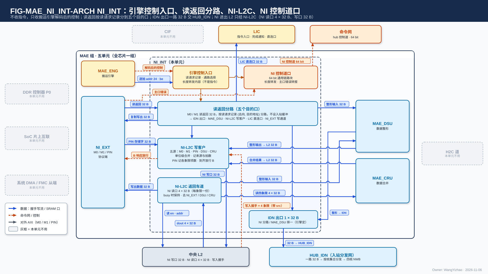

# MAE 片内网络接口（NI_INT）需求

> Owner: WangYizhao｜2026-11-11

## 1 概述

NI_INT 是 MAE 组五个交付单元之一（MAE_ENG、NI_EXT、NI_INT、MAE_DSU、MAE_CRU），全芯片一个。**它是 MAE 组里的数据通路：把搬运引擎发出的每一拍落到正确的口上——M0 / M1 的读返回回来时，按该请求发出时记下的（去向, 目的逻辑地址）分到六个目的口（IDN 出口、MAE_DSU、L2、LIC、片外写出、MAE_ENG）；MAE 进出中央 L2 的流量只经它的 NI 写口与 NI 读口。** 它不收指令、不生成 DDR 请求、不算地址（每拍地址由 MAE 的搬运引擎给出，V18-TP-27）、不改字的内容、不移位字节；下游收不下时只降速、不丢数；核间分发归 HUB 组的 HUB_IDN，字形态转换归 MAE_DSU，合并归 MAE_CRU，落地归 L1 的接收桥与 L2。

给谁用：MAE_ENG 的搬运引擎（给它控制、收它交回的列表与写入握手）、NI_EXT（读返回、PIN 写入、写出）、MAE_DSU 与 MAE_CRU（运算级的进出）、中央 L2（NI 写口、NI 读口）、HUB_IDN（IDN 出口）、LIC（直连口）、四核 CCU（NI 侧写完通知）。与 MAE 组外的连接经 MAE 组的对外口，口的个数、驱动与共享方式见 MAE 集成篇 §2.1（`MAE_INTEGRATION.md`）；组内单元之间交什么、位宽、握手是 MAE 集成篇 §2.10.1 的组内约定，本篇只写 NI_INT 一侧的输入、输出与语义。

本篇用到的几个词（其余术语在首次出现处定义）：

| 词 | 含义 |
|---|---|
| 逻辑地址 | 24 bit 段内字节地址；落在哪个存储范围由并行给出的段选信号 `seg`（5 bit：堆选 1 + 段掩码 4）选，定义见架构篇 §3.3；L2 的段掩码即象限 |
| 存储字 | 32 B；段内字节地址除以 32 取整是它的序号 |
| 链路上的一拍 | addr = 本拍第一个有效字节的目的地址；din 从第 0 字节起放本拍的有效数据；be 标出从第 0 字节起连续有效的字节。**数据组织默认 32 B 对齐，此时一拍就是一个存储字**；不对齐时由 L1 / L2 内部处理（紧密存储，架构篇 §3.5.4），NI_INT 不移位、不拆 |
| 写入拍 | 写链路上成交的一拍（en ∧ ready），默认 = 一个存储字；写入握手与应写量都按写入拍计 |
| 读请求记录 | 搬运引擎发每笔 M0 / M1 读请求时记下的（去向, 目的逻辑地址），读返回回来时按它分路 |
| 搬运引擎 | MAE_ENG 里执行搬运指令的引擎，逐拍产生源地址与目的地址；个数与组织归 MAE_ENG 篇。**NI_INT 只与执行本条指令的那个搬运引擎打交道** |
| 切换段 | 发令方内部的一段连续拍，是合并点换源的边界；**不上链路**（协议篇 §3.10） |
| 发令号 `src` | 每拍随带的发令方编号：搬运引擎号，或 PIN 事务号；写入握手按它回到发令方 |

## 2 接口需求

### 2.1 架构图与接口汇总

图中模块框内的结构是参考实现（见第 7 章），本章以框外的各口为准。

框外的口：左上是 MAE_ENG（给解码后的控制与每拍 addr / be，收列表与元数据项）；左侧是 NI_EXT（读返回、PIN 写入进；写出数据与 PIN 落地依据出）；右侧是 MAE_DSU、MAE_CRU 两个运算级的进出口；上方是 LIC 直连口，右上是四核 CCU（NI 侧写完通知专用信号组，紫点划线，每核一组、不经 hub）；下方是中央 L2 与 HUB_IDN——NI 写口（带写入握手）、NI 读口（四路读地址流出、读数据流入，旁边的反向短箭头是各自的 ready，四路各自独立），以及 IDN 出口。命令网、H2C 道、CIF 与三个片外对端与 NI_INT 没有直接连线，画灰。

| 口 | 对端 | 方向 | 位宽 | 握手 | 出处 |
|---|---|---|---|---|---|
| 引擎控制入口 | MAE_ENG（执行本条指令的搬运引擎） | 入 | 字段与位宽为组内约定 | 随请求或随切换段，组内约定 | MAE 集成篇 §2.10.1；本篇 §2.2.1 |
| 列表与元数据项出口 | MAE_ENG（同上） | 出 | 32 B | 组内约定 | 本篇 §2.2.2 |
| 写入握手分发 | MAE_ENG（按 `src` 交对应引擎） | 出 | valid + `src` | 只有 valid | 本篇 §2.2.3 |
| 读返回入口 | NI_EXT（M0 / M1） | 入 | 32 B | en / ready（ready 低经 NI_EXT 拉低 RREADY） | 本篇 §2.3.1 |
| PIN 写入口 | NI_EXT（PIN） | 入 | din 32 B + be 32 + addr 24 + `seg` 5 + `src` | en / ready（ready 低经 NI_EXT 拉低 WREADY） | 本篇 §2.3.2 |
| 写出口 | NI_EXT（M0 / M1 写通道） | 出 | 32 B + be + 片外地址 | en / ready | 本篇 §2.3.3 |
| PIN 落地依据 | NI_EXT | 出 | 每笔 PIN 事务一条（事务号） | 组内约定 | 本篇 §2.3.4 |
| DSU 输入 / DSU 输出 | MAE_DSU | 出 / 入 | 各 32 B + addr 24 + be 32 + `seg` 5 + `src` | en / ready | 架构篇 PORT-20 |
| CRU 输入 / CRU 输出 | MAE_CRU | 出 / 入 | 入 CRU 4 × 32 B；出 CRU 32 B + addr / be + `seg` + `src` | en / ready | 架构篇 PORT-21 |
| NI 写口 | 中央 L2 | 出 | din 32 B + be 32 + addr 24 + `seg` 5（段掩码可多位）+ `src` | en / ready | 架构篇 PORT-18 |
| NI 写入握手 | 中央 L2 | 入 | 4 组（每象限一组），每组 valid + `src` | 只有 valid | 架构篇 PORT-30 |
| NI 读口第 $q$ 路 · 读地址（$q$ = 0…3） | 中央 L2 | 出 | 每路 addr 24 + `seg` 5（段掩码恒为象限 $q$） | 每路 en / ready，各自独立 | 架构篇 PORT-19 |
| NI 读口第 $q$ 路 · 读数据 | 中央 L2 | 入 | 每路 32 B，四路合计 4 × 32 B/拍 | 每路 en / ready，各自独立 | 架构篇 PORT-19 |
| IDN 出口 | HUB_IDN | 出 | din 32 B + addr 24 + be 32 + `seg` 5 + `src` + 随拍 4 bit 核集合 | en / ready | 架构篇 PORT-17 |
| LIC 直连口 | LIC 专用小 SRAM | 出 | 32 B + addr | en / ready | 架构篇 PORT-22 |
| LIC 直连口写入握手 | LIC 专用小 SRAM | 入 | valid + `src` | 只有 valid | 架构篇 PORT-30 |
| NI 侧写完通知 | 四核 CCU | 出 | 4 组（每核一组），每组 valid + 载荷 | 是否带 ready【设计者定】 | 架构篇 PORT-37 |

口宽与条数以架构篇 §2.7 的 PORT-nn 为准，本表只为阅读方便列出；`src` 位宽 5 bit【待标定】（架构篇 §2.4）。

**各口共同的规则**：

- **组外的数据口（NI 写口、NI 读口、IDN 出口、LIC 直连口）都是核间链路，一律逐拍握手、与其他核间链路用同一套逻辑**（协议篇 §3.5；V18-TP-80）；组内数据口同样用核间协议（MAE 集成篇 §2.10.2）。**各口的链路一侧例化 HUB 提供的通用链路块**（V18-HUB-05，协议篇 §3.5.1）：时延无关、任意插级行为不变，ready 与送出的各信号寄存器输出、ready 拉低后仍在途的拍全部收下。
- **每拍自带地址、be、`seg` 与 `src`，链路上没有切换段标记、请求号或末拍标记**（协议篇 §3.10，V18-TP-42）。
- **NI_INT 不在命令网上**（V18-TP-79）：命令网只传指令与配置，NI_INT 不收指令，也没有经命令网发的配置；写完通知走 NI 侧专用信号组。MAE 在命令网上只有 MAE_ENG 一个端点（MAE 集成篇 §2.1）。

### 2.2 与 MAE_ENG 之间：引擎控制入口、列表与元数据项、写入握手

#### 2.2.1 引擎控制入口：只收解码后的控制，不收指令

**NI_INT 不收指令，只收执行本条指令的搬运引擎解码后的控制**（V18-MAE-27；不要求设指令队列）。三类控制与随数据的逐拍信息：

| 控制 | 什么时候给 | NI_INT 用它做什么 |
|---|---|---|
| 读请求记录（去向, 目的逻辑地址） | 每笔 M0 / M1 读请求发出时 | 读返回回来时按它分到去向，并把目的地址随数据交出（本篇 §3.3） |
| 通路选择与切换段边界 | 每个切换段开始时 | L2 读出分路这一段交 NI_EXT 写出、MAE_DSU、MAE_CRU 还是 MAE_ENG；L2 写入合并器这一段接哪个来源；IDN 出口这一段接读返回分路还是 MAE_DSU（本篇 §3.5、§3.7、§3.8） |
| 写完通知的内容（段选, 目的基址, 写入字数） | 经 IDN 落核 L1 的指令，引擎数满写入握手之后 | 经 NI 侧写完通知专用信号组发给目的核 CCU（本篇 §3.9） |
| 随数据的逐拍信息 | 每拍 | 写 L2、读 L2、IDN 出口、DSU / CRU 进出的 addr / be / `seg` / `src`；IDN 出口每拍的 4 bit 核集合 |

**控制随请求或随切换段到达**，不要求 NI_INT 缓冲"未来的指令"；某一路下游收不下时，经握手让引擎停发（本篇 §3.4）。各控制字段的位宽、随请求还是随切换段握手，是 MAE 组内约定（MAE 集成篇 §2.10.1）。

#### 2.2.2 交 MAE_ENG 的列表与元数据项

**搬运引擎为本指令自己读的列表、列表的定长计数项与紧凑 token 记录的元数据项，经 NI_INT 交回 MAE_ENG**：片外一侧（经 M0 / M1 读回）由读返回分路交出，L2 一侧（经 NI 读口读出）由 L2 读出分路交出（V18-MAE-08、V18-TP-69）；进 MAE 的列表本地副本。**约束：搬运引擎逐拍出地址时不因取列表而停拍（MAE_ENG 篇 §7.6），去往别处的数据不因此改字、不丢拍。** 交法见本篇 §7.5。

#### 2.2.3 写入握手按 `src` 交 MAE_ENG

NI 写口的 4 组写入握手（本篇 §2.4.2）与 LIC 直连口的写入握手（本篇 §2.7）回到 NI_INT 后，**`src` 为搬运引擎号的按号原样交 MAE_ENG 对应的引擎，不计数、不汇总；`src` 为 PIN 事务号的留给 NI_INT 自己数**（本篇 §3.6，V18-TP-47）。IDN 落地的写入握手由各核 NWB 各一组、经 HUB_IDN 原样回到引擎，不经 NI_INT（MAE 集成篇 §2.1 C10）。

### 2.3 与 NI_EXT 之间：读返回、PIN 写入、写出与 PIN 落地依据

#### 2.3.1 读返回入口

M0 / M1 的读返回，32 B 一笔；**按该请求发出时记下的（去向, 目的逻辑地址）分路，不定义标签格式**（V18-TP-34）。NI_INT 收不下时拉低本口 ready，由 NI_EXT 拉低 M0 / M1 的 RREADY（本篇 §3.4）。

#### 2.3.2 PIN 写入口

每拍带 addr = 本拍首字节的 L2 段内地址、`seg`、be = 从第 0 字节起的有效字节、`src` = 该笔 AXI 写事务的 PIN 事务号；**一笔 AXI 写事务是 L2 写入合并器的一个切换段**，各拍带同一个 `src`，事务结束后它的写入拍能全部交出（MAE_NI_EXT 篇 §2.4.2）。一笔 PIN 事务不跨象限、不跨堆、有效字节连续（FIXED、WRAP 突发只要求每拍内连续，V18-TP-83 (5)），由编译链把 PIN 输入地址段放在一个象限的一个堆之内、外部主方只在 PIN 窗口内写且有效字节连续来成立，NI_EXT 据此交出写入拍（MAE_NI_EXT 篇 §2.4.1 / §5.2，V18-NIE-04）；突发长度由外部主方定。

#### 2.3.3 写出口

要写到片外的 32 B 数据与字节使能、片外目的地址：L2 读出分路读出的 L2 数据（L2 → DDR / 共享内存），以及区域复制 DDR → DDR 的读返回（不经 MAE_ENG 的写聚合，V18-NII-07）。NI_EXT 写通道收不下时（AXI WREADY 低）拉低本口 ready。

#### 2.3.4 PIN 落地依据

**NI_INT 数 L2 回来的、`src` = 某笔 PIN 事务号的写入握手，达到该事务的写入拍数才通知 NI_EXT 回该笔 B 响应，随后释放这个事务号**（本篇 §3.6；MAE_NI_EXT 篇 §2.4.2，V18-TP-47）。

### 2.4 NI 写口：经 L2 写入合并器写 L2 任一象限

#### 2.4.1 信号与每拍含义

| 信号 | 方向 | 位宽 | 每拍含义 |
|---|---|---|---|
| en | 出 | 1 | 本拍有一次写 |
| ready | 入 | 1 | L2 本拍能收；en ∧ ready 成交 |
| din | 出 | 32 B | 从第 0 字节起放本拍的有效数据 |
| be | 出 | 32 | 从第 0 字节起连续有效的字节 |
| addr | 出 | 24 | 本拍首字节的段内地址，由搬运引擎给出（PIN 写入时由 NI_EXT 换算） |
| `seg` | 出 | 5 | 堆选 1 + 段掩码 4；**段掩码一位 = 写一个象限，多位 = 同一拍写进掩码内各象限的同一段内地址**（同址广播） |
| `src` | 出 | 5 bit【待标定】 | 发令号：执行该指令的搬运引擎号，或 PIN 事务号 |

**NI 写口可写任一象限；一个切换段不跨象限**（V18-L2-04 / TP-61）。NI_INT 把 addr / be 原样交出，不移位；首地址不在存储字边界时由 L2 内部移位（L2 支持紧密存储，架构篇 §3.5.4，V18-TP-74）。L2 本拍不能收时拉低 ready，L2 写入合并器停发，背压经握手回到各来源（本篇 §3.4、§3.5）。

#### 2.4.2 写入握手：每象限一组，L2 写进存储后逐拍回

**L2 每把 NI 写口的一个写入拍写进象限 $q$ 的存储，就在第 $q$ 组回一个写入握手（valid + 该拍的 `src`）**；同址广播到 $k$ 个象限时每个象限各回一个，共 $k$ 个；一拍跨两个存储字也只回一个（L2 篇 §2.3.2）。4 组各只有 valid、没有 ready。NI_INT 按 `src` 分发（本篇 §2.2.3、§3.6）。

### 2.5 NI 读口：四路各给读地址，四路读出

**NI 读口是 MAE 与 L2 之间唯一的读口，分四路，第 $q$ 路只读象限 $q$；每路是一条读地址流加一条读数据流，四路各给各的读地址、可以不同址，ready 各自独立**（V18-MAE-32 / TP-80 / L2-08）。四路合计 4 × 32 B/拍。

#### 2.5.1 每路的读地址流

| 信号 | 方向 | 位宽 | 每拍含义 |
|---|---|---|---|
| en | 出 | 1（每路） | 第 $q$ 路本拍有一个读地址 |
| ready | 入 | 1（每路） | L2 第 $q$ 路本拍能接受读地址；en ∧ ready 成交 |
| addr | 出 | 24（每路） | 要读的 32 B 的首字节段内地址，**一拍一个地址**（架构篇 §3.4 CONC-3），由发读这一路的搬运引擎给出 |
| `seg` | 出 | 5（每路） | 堆选 + 段掩码；**段掩码恒为该路的象限 $q$，L2 只用其中的堆选** |

- **四路的地址相互独立**：四个象限各存一份完整 token 记录时，因长度不同，同一条记录在各象限的地址不同，所以口上不要求同址（用户 11-11："我认为4路可以不同址，以为4象限各自存完整Token的时候，因为长短不同，就会导致不同址的问题"）。
- **每路的 ready 只看本路，与发读这一路的搬运引擎一一对应，一路被卡不影响另三路**（用户 11-11："ready问题我也认为各自独立会好一点，刚好和各自的ENG匹配"，V18-L2-08）。
- **读地址被 L2 接受之前，NI_INT 原样保持该路本拍的 en / addr / `seg`**；不要求按余量发读或知道 L2 的读出拍数（V18-TP-80，用户 11-11："我认为发读放方应该等ready了再发，这里应该和咱们的协议统一"）。读地址里没有请求号、没有长度：读多少由搬运引擎按指令的数据量自己数。

用途（MAE 的用法，NI_INT 不区分）：MAE_CRU 合并跨核定长份时四路给同一段内地址、一拍读四份（"同址异象限"是这种用法，不是口的限制，MAE_CRU 篇 §2.2.1）；带 bias 的归约另一拍读 bias；残差加的两路加数、紧凑残差的各部分、L2 → DDR / 共享内存、L2 → MAE_DSU、L2 → L2 按各自地址读一个或几个象限。

#### 2.5.2 每路的读数据流与背压

| 信号 | 方向 | 位宽 | 每拍含义 |
|---|---|---|---|
| en | 入 | 1（每路） | 第 $q$ 路本拍有一拍读出 |
| ready | 出 | 1（每路） | NI_INT 第 $q$ 路本拍能收 |
| 数据 | 入 | 32 B（每路） | 第 $q$ 路一个被接受的读地址的读出，从该地址的首字节起放在第 0 字节 |

规则：

- **第 $q$ 路交象限 $q$ 的读出，按本路读地址被接受的次序交出，不丢、不乱序；各路可以在不同拍交出**；几份怎样对齐由使用方做（MAE_CRU 篇 §2.2.1）。
- **某一路的去向（NI_EXT 写出、MAE_DSU、MAE_CRU、MAE_ENG）收不下时只停这一路、不丢数**：NI_INT 拉低这一路读数据流的 ready，L2 只拉低这一路读地址流的 ready，卡住发读这一路的搬运引擎，其余三路照常（L2 篇 §3.5，V18-TP-80 / L2-08）；L2 上已读出的数据不丢。
- **读出时延不固定，正确性只取决于两条流的握手**；NI_INT 的功能定义里不使用任何固定读出拍数。
- 同一个堆上几条链路争用、本路读地址连续时，L2 保持本路 32 B/拍（架构篇 §3.4 CONC-3 的读一侧）。

### 2.6 IDN 出口：一路 32 B 交 HUB_IDN，核集合随拍

**IDN 出口是 HUB_IDN 的唯一数据源，一路 32 B**（V18-HUB-03 / 04）：每拍 din 32 B + addr 24（目的段内地址）+ be 32 + `seg` 5 + `src`，en / ready 一对；**随每拍给一个 4 bit 核集合**（由搬运引擎给出，HUB_IDN 篇 §2.2）。一拍的格式按本篇 §1 的"链路上的一拍"。**HUB_IDN 按核集合把这一拍送到集合内各核的 32 B IDN 链路，不拆拍、不推算地址；be 原样传，部分有效的拍不限于尾字，是否整字由发送方与数据组织定，链路不感知**（V18-DORG-10 (4)）。IDN 落地的写入握手由各核 NWB 各一组经 HUB_IDN 回到搬运引擎，不经 NI_INT。

### 2.7 LIC 直连口：M1 读回的指令与配置直交 LIC 专用小 SRAM

**LIC 直连口宽 32 B（一个存储字，V18-NII-08），把 M1 读回的指令、配置表、调用描述符、KV 段表由读返回分路直接交 LIC 专用小 SRAM**（V18-NII-06、V18-LIC-01）；每拍带 addr（小 SRAM 内地址，由搬运引擎给出），en / ready；**不经 HUB_IDN，不走命令网**。LIC 小 SRAM 每写进一拍回一个写入握手（valid + `src`），NI_INT 按 `src` 交 MAE_ENG 对应引擎，引擎数满后通知 LIC（V18-TP-50）。

### 2.8 与 MAE_DSU、MAE_CRU 之间：运算级的进出

| 口 | 方向 | 数据从哪来、到哪去 |
|---|---|---|
| DSU 输入 | NI_INT → MAE_DSU | 指令运算字段为"经 MAE_DSU"的数据：来自读返回分路（DDR 原形）或 L2 读出分路（L2 原形）；**精算驻留模式的全码 key 记录是两源同一条指令交替**：L2 读出分路交 L2 的 K hi、读返回分路交 DDR 的 K lo，按指令给的次序进 DSU（V18-ATT-03） |
| DSU 输出 | MAE_DSU → NI_INT | 直通或转置后的 32 B 字，交 IDN 出口（去 L1）或 L2 写入合并器（去 L2）；**DSU 输出没有片外出口**（V18-NII-03） |
| CRU 输入 | NI_INT → MAE_CRU | 指令运算字段为"经 MAE_CRU"时，L2 读出分路把 NI 读口读出的存储字交 MAE_CRU（一拍至多四路各一个存储字，4 × 32 B）；**MAE_CRU 只读 L2**，读返回分路没有去 CRU 的一路（V18-CRU-07） |
| CRU 输出 | MAE_CRU → NI_INT | 合并结果，经 L2 写入合并器写 L2；**合并结果只写 L2**，要到核 L1 时另由一条指令经 H2C（V18-CRU-07） |

每拍的 addr / be / `seg` / `src` 由执行该指令的搬运引擎给出；DSU 做直通还是转置、CRU 做哪种合并，NI_INT 不感知（MAE_DSU 篇 §3.2、MAE_CRU 篇 §3.1）。四口都用 en / ready 握手，任一方收不下时经握手停住上游。

### 2.9 NI 侧写完通知专用信号组：每核一组，不经命令网

**NI 侧写完通知专用信号组每核一组、共 4 组，每组 = valid + 载荷（段选、目的基址、写入字数），一次通知一拍交出；载荷各字段的语义只在协议篇 §2.6 定义，位宽归 ISA**（V18-TP-70 / 77，架构篇 PORT-37）。NI_INT 把执行该指令的搬运引擎给的通知内容经本组送往目的核 CCU，不经 hub、不经命令网。是否带 ready 与 CCU 侧队列深度【设计者定】：约束是不丢、不重，CCU 来不及收时只降速。**从 CCU 一侧看每核收两路写完通知（经 H2C 落地的 hub 侧一路、经 IDN 落地的 NI 侧一路），两路互不等待、在核前不合并**；hub 侧那一路不经 NI_INT（MAE 集成篇 §2.9）。

## 3 功能描述

### 3.1 功能一览

| 功能 | 输入 | 输出 | 触发 / 生效条件 | 节 |
|---|---|---|---|---|
| 按引擎控制执行 | 搬运引擎的控制与逐拍信息 | 各口按通路选择接通 | 控制随请求或切换段到达 | §3.2 |
| 读返回分路 | M0 / M1 读返回 + 读请求记录 | 六个目的口之一（双目的时两处） | 每笔返回到达 | §3.3 |
| 停发传回 DDR | 任一下游 ready 低 | 读返回入口 ready 低（NI_EXT 拉低 RREADY） | 下游收不下时 | §3.4 |
| L2 写入合并 | M0、M1、PIN、DSU、CRU 五个来源 | NI 写口每拍一个写入拍 | 只在切换段边界换源 | §3.5 |
| 写入握手分发与 PIN 落地 | NI 写口 / LIC 直连口的写入握手 | 按 `src` 交引擎；PIN 事务数满后通知 NI_EXT 回 B | 每个握手到达 | §3.6 |
| L2 读出分路 | 读地址；NI 读口四路读数据 | NI_EXT 写出 / MAE_DSU / MAE_CRU / MAE_ENG | 读地址成交即发读；按切换段的通路选择交出 | §3.7 |
| IDN 出口择一 | 读返回分路去 L1 的一路、MAE_DSU 输出 | 一路 32 B + 核集合交 HUB_IDN | 只在切换段边界换源 | §3.8 |
| 写完通知 | 引擎给的通知内容 | NI 侧专用信号组到目的核 CCU | 引擎数满写入握手之后 | §3.9 |
| 不报完成 | — | — | 恒定 | §3.10 |
| 逐位无损与落位唯一 | 全部数据 | — | 恒定 | §3.11 |
| 复位 | CIF 的复位 | 在途状态清空 | 复位 | §3.12 |

### 3.2 按搬运引擎给的控制执行：不收指令、不算地址、不改字

**搬运指令由 MAE 分派给执行它的搬运引擎；NI_INT 是数据通路，不按指令类开路**（用户 11-06："为什么搬运引擎会给 INT 发指令？不应该是已经由 MAE 完成解码的控制命令了吗？"，V18-MAE-27）。L2 → L1 经 H2C 的指令不经 NI_INT（H2C 道的控制见 MAE 集成篇 §2.5）。

**相邻两条指令可以重叠**：后一条的读请求可以在前一条的读返回还没回完时发出。正确性不靠指令之间的间隔，而靠读请求记录（本篇 §3.3）：每笔返回按自己的记录落位。

**搬运指令的运算字段三选一：不经运算级 / 经 MAE_DSU / 经 MAE_CRU**（V18-MAE-12）；经 MAE_DSU 时 DSU 再做直通或转置两种运算之一（V18-MAE-41，MAE_DSU 篇 §3.2），NI_INT 不关心是哪一种。下表是各口对下 NI_INT 按引擎的通路选择接通的路（口对见 MAE_ENG 篇 §3.5.2）；未注明运算级的行都是"不经运算级"，括号里是例子：

| 口对 | 读返回的去向 | L2 写入合并器 | L2 读出分路 | 写完通知（NI 侧专用信号组） |
|---|---|---|---|---|
| M0 / M1 → L2 | L2 写入合并器 | 接收，送 NI 写口 | — | — |
| M0 → 核 L1（经 IDN 出口 → HUB_IDN） | IDN 出口 | — | — | 引擎数满写入握手后发（§3.9） |
| M0 → 核 L1，双目的（一次 DDR 读同时给前向核与训练核，MAE_ENG 篇 §3.14，V18-MAE-16） | 标准布局：MAE_DSU（训练那一份直通、前向那一份转置成行字区的字形态；权重只读一次、两份逐位不丢）；列深度优先布局：同一笔返回交两处——IDN 出口（前向那一份）与 MAE_DSU（训练那一份，转置） | — | — | 引擎数满写入握手后向各目的核发（§3.9） |
| L2 → DDR / 共享内存 | 无读返回 | — | 读 L2，交 NI_EXT 写出 | — |
| DDR → DDR（区域复制） | NI_EXT 写出（V18-NII-07） | — | — | — |
| L2 → L2 | 无读返回 | 接 L2 读出分路的数据 | 读 L2 | — |
| 经 MAE_DSU，源 DDR | MAE_DSU | 目的 L2 时接 MAE_DSU 输出 | — | 目的核 L1 时（IDN 出口接 MAE_DSU 输出）引擎数满写入握手后发（§3.9） |
| 经 MAE_DSU，源 L2（例：L2 驻留的 K hi 粗算时转置成行字区的字形态） | 无读返回 | 目的 L2 时接 MAE_DSU 输出 | 读 L2，交 MAE_DSU | 目的核 L1 时同上 |
| 经 MAE_CRU（源 L2、目的 L2） | 无读返回 | 接 MAE_CRU 输出 | 读 L2，交 MAE_CRU | — |
| **L2 + M0 → 核 L1**（精算驻留的全码 key 记录，经 MAE_DSU 直通，V18-ATT-03） | MAE_DSU（DDR 的 K lo） | — | 读 L2 的 K hi，交 MAE_DSU；与读返回分路交来的 K lo 同一条指令按指令给的次序进 DSU | 引擎数满写入握手后发（§3.9） |
| M1 → LIC 直连口（指令、配置表、调用描述符、KV 段表的装载） | LIC 直连口 | — | — | — |
| 搬运引擎为本指令读片外的列表、定长计数项与元数据项（经 M0 / M1） | MAE_ENG（§2.2.2） | — | — | — |
| 搬运引擎为本指令读 L2 里的列表、定长计数项与元数据项 | 无读返回 | — | 读 L2，交 MAE_ENG（§2.2.2） | — |

**DSU 与 CRU 是运算级的两路，并列、互不依赖，一条指令只选其一。** DSU 输出去 L1 时经 IDN 出口、去 L2 时经 L2 写入合并器，不去片外（V18-NII-03）；**合并输出只经 L2 写入合并器写 L2**（V18-CRU-07）。

**数据进 L1 前的整形有几条路，硬件都支持，由编译链按位点选**（V18-MAE-45 (5)，架构篇 §3.8）：L2 里存原形时走 NI 读口 → MAE_DSU → IDN 出口；先经 MAE_DSU 整形存进 L2 的，之后经 H2C 进核（不经 NI_INT）；从 DDR 来的走读返回分路 → MAE_DSU → IDN 出口；核内产生的数据由 QNT 直接排成目的形态（不经 MAE）。**进 L1 的数据到达时已是 L1 的字形态，IDN 出口、HUB_IDN 与接收桥都不变形**；gather（含按元数据项聚集——源端按元数据项逐片取数的一种地址生成方式）的目的地址在搬运引擎内展开（MAE_ENG 篇 §3.6）。**MAE 搬运的数据不用环形缓冲**：跨环尾时由编译链拆成两条指令（V18-MAE-17）。

### 3.3 读返回分路：按读请求记录分到六个目的口

**每笔读返回按该请求发出时记下的（去向, 目的逻辑地址）分到去向，目的逻辑地址随数据交出——去 L2 时就是 NI 写口那一拍的 addr，去各核时作为这一拍的目的地址经 IDN 出口交给 HUB_IDN**（V18-TP-27 / 34）。读返回只按指令给的目的口分，**不按数据类型分**（V18-MAE-01）：

| 目的口 | 数据（括号里只是例子） |
|---|---|
| IDN 出口（去核 L1） | 目的为核 L1、不经运算级的读（激活、位置数组、DDR 里已是 L1 字形态的数据） |
| MAE_DSU | 指令运算字段为"经 MAE_DSU"的读（用法与参数见 MAE_DSU 篇 §3.2 典型用法表：标准布局权重送前向核、lo 稀疏读副本、V、粗算 K hi 转置成行字区的字形态；列深度优先布局权重送训练核时转置；录取 key 的 K / V 尺度按录取次序排成整字；标准布局权重送训练核、精算全码 key 记录的 K lo 直通） |
| L2 写入合并器（去 L2） | 一切目的为 L2 的读（权重 tile、调用输入、chunk、装进 L2 固定区的配置表；M1 读回的 Token ID、图像等 SoC 侧数据，V18-MAE-09） |
| LIC 直连口 | M1 读回的指令、配置表、调用描述符、KV 段表（V18-NII-06、V18-LIC-01） |
| NI_EXT 写出 | 区域复制 DDR → DDR 的读返回，直接写出；整行拷贝不需要攒，行起点不对齐时由 NI_EXT 按目的地址给写掩码（V18-NII-07） |
| MAE_ENG | 搬运引擎为本指令经 M0 / M1 读回的列表、列表的定长计数项与紧凑 token 记录的元数据项（本篇 §2.2.2） |

读请求记录的内容：

| 字段 | 位宽 | 来源 |
|---|---|---|
| 去向 | 六选一；双目的见下 | 发该请求的搬运引擎按口对给出（本篇 §3.2） |
| 目的逻辑地址 | 24 bit 段内地址 + `seg` | 该请求所属搬运引擎发请求时生成的目的地址 |

规则：

- **读请求记录是"把发请求时就已知道的目的，存到数据回来时再用"**：AXI 读返回本身不带目的，DDR 又可能乱序，目的只能在发请求那一刻记下。**跨 AXI ID 的乱序返回不要求重排**，每笔按自己的记录落位；相邻两条指令重叠执行时，各自的返回同样只按各自的记录落位，记录里不需要指令号（用户 11-06："只要有这个功能就可以了，无需基于 ID 实现"）。
- **读请求记录的容量不使 M0 / M1 的在飞读请求数受限**（本篇 §4.3），否则在飞名额用不满、DDR 读流断续。记录放在 MAE_ENG 还是 NI_INT、怎样实现见本篇 §7.2（MAE 集成篇 §2.10.1）。
- **双目的**：一笔返回可同时交 IDN 出口与 MAE_DSU 两处（列深度优先布局权重一次 DDR 读同时给前向核与训练核，本篇 §3.2 表）。**约束：权重只读一次、两份逐位不丢；IDN 出口仍只在切换段边界在读返回分路与 MAE_DSU 之间择一；任一份的下游停发都使这次读停住**（本篇 §3.4）。怎样分出两份、两份怎样共用 IDN 出口见本篇 §7.4（MAE_ENG 篇 §3.14、MAE_DSU 篇 §3.8）。
- **配置表装进 LIC 专用小 SRAM 或 L2 固定区由一条普通搬运指令完成，NI_INT 不核对表头**；表的版本由调用描述符引用、LIC 在下一调用入口切换（`L3PU_EXTERNAL_INFORMATION.md` §3.3）。

### 3.4 下游停发经 RREADY 回到 DDR：只降速、不丢数

**任何下游收不下，NI_INT 都经 NI_EXT 拉低 M0 / M1 的 RREADY，只降速、不丢数**（V18-NII-01）；是否设入站缓冲吸收 DDR 的时延抖动不作要求（V18-TP-84 (5)）。下游收不下的例子：IDN 多播在等最慢的核、NWB 将满、L2 的 NI 写口 ready 低（所写的堆本拍在服务别的链路）、MAE_DSU / MAE_CRU 入口 ready 低。AXI 允许这样停，只降速、不丢数、不报错（协议篇 §3.5）。

这一条的意思是：需求不靠 NI_INT 的缓冲"抹平" DDR；抖动由上游（MAE 的预取距离，LIC 操作 15）与下游（L1 里编译链安排的 ping-pong 缓冲）吸收，**DDR 读始终满带宽是 MAE 读序与指令编译要保证的事**（用户 11-05 夜，V18-NII-01）。

**M0、M1 两路读返回同时到达、去同一个去向时，这里是一个合并点，只在切换段边界换源**（协议篇 §3.10，V18-TP-36 / 45；切换段边界由两路各自的搬运引擎给出）；没轮到的一路经 RREADY 停住。先收哪一路见本篇 §7.3。

### 3.5 L2 写入合并器：五个来源按切换段合并，逐拍带地址与发令号

**NI 写口的五个来源：M0 读返回（目的为 L2 的读）、M1 读返回（调用输入等）、PIN 写入、MAE_DSU 输出、MAE_CRU 输出（部分和归约值、标量合并值、读集并集）**（V18-NII-03、V18-CRU-07）。

- **五个来源只在切换段边界切换，一个切换段的各拍连续，NI 写口上切换段不交错**（协议篇 §3.10，V18-TP-36 / 45）：M0 / M1 读返回、MAE_DSU 输出与 MAE_CRU 输出的切换段由各自的搬运引擎给出；PIN 的切换段是一笔 AXI 写事务，以 AXI WLAST 为界（MAE_NI_EXT 篇 §3.5）。**切换段边界是发令侧交给 L2 写入合并器的内部信号，不上链路**（V18-TP-42）。
- **每拍带目的 addr、be、`seg` 与 `src`**（本篇 §2.4.1）：M0 / M1 / DSU / CRU 的拍用执行该指令的搬运引擎号，PIN 的拍用该笔事务的 PIN 事务号（V18-TP-47）。**NI_INT 把 addr / be 原样交出，不移位**；首地址可为任意字节，由 L2 内部移位（紧密存储，V18-TP-74）。片外数据（PIN、M1 读入的调用输入）的片外窗口起点按字对齐只是数据组织的默认，不作硬限制（V18-DORG-10 (11)）。
- **广播**：搬运引擎给的 `seg` 段掩码多位时，同一拍写进掩码内各象限，每个象限各回一个握手，应写量由引擎按象限数倍计。
- **数据过了 L2 写入合并器就不再经 MAE_DSU、MAE_CRU 与 HUB_IDN**；L2 写入合并器本身不改字。
- **M1 读回 → L2 与外部主方经 PIN 直写 L2 的 PIN 窗口是并列的两条路，两条都必须支持**（V18-MAE-09、V18-NIE-02 / MAE-44）。
- **PIN 写与推理整体分先后**：外部主方经 PIN 写一帧期间 L3PU 不推理、没有调用在执行，**这段时间 NI 写口只有 PIN 一个来源**；一帧传完之后推理才开始（V18-L2-07）。所以 PIN 不与 M0 / M1 / DSU / CRU 同时争 NI 写口，L2 写入合并器不为 PIN 设等待上界。

几个来源同时要写、超过 32 B/拍时，没轮到的来源在各自的口上停发（本篇 §4.2）；推理期间来源之间的先后见本篇 §7.6。

### 3.6 写入握手按发令号分发；PIN 的 B 响应按事务号数满才回

**NI 写口每回一个写入握手（valid + `src`），NI_INT 按 `src` 分发：搬运引擎号的转交 MAE_ENG 里对应的引擎（引擎据此判 L2 写入完成），PIN 事务号的由 NI_INT 自己数，某笔事务数满它的写入拍数才通知 NI_EXT 回 B 响应，随后释放这个号**（V18-TP-47，MAE_NI_EXT 篇 §2.4.2）。LIC 直连口的写入握手同样按 `src` 交引擎。

这样做的原因：NI 写口被几个搬运引擎共用（推理之外还有 PIN 的几笔事务），各象限写进存储的先后又可以与链路上的先后不同；握手带发令号后，**每个发令方只数自己的号，归属自然完成**，NI_INT 不需要"按切换段、按象限"的记账表，L2 也不维护写计数（用户 11-06："链路增加一个信号，它用来表明对应的是哪个 MAE 引擎呢？相当于不对数据打标签，但是区分数据的通道"）。

- **PIN 写入在飞 4 笔是要求值**（MAE_NI_EXT 篇 §2.4.1）：NI_INT 能同时持有的 PIN 事务号不少于 PIN 口可同时在飞的写事务数；**事务号用完时 NI_INT 对 NI_EXT 停收新事务**，只降速、不丢。事务号池的个数见本篇 §7.6。
- **B 响应不早于该事务最后一个写入拍写进 L2**：判据只看握手数，不含任何固定拍数；NI_INT 与 L2 所落的堆之间插几级流水、L2 同堆服务等几拍，都不影响正确性。

### 3.7 L2 读出分路：读 L2，按通路选择交 NI_EXT、MAE_DSU、MAE_CRU 或 MAE_ENG

**L2 读出分路在 NI 读口四路各自的读地址流上给出搬运引擎生成的读地址，L2 接受后在各路的读数据流上交回读出；读出按本切换段的通路选择交 NI_EXT 写出（L2 → DDR / 共享内存）、MAE_DSU（直通或转置）、MAE_CRU（合并输入）或 MAE_ENG（列表、定长计数项与元数据项）**（V18-NII-03、V18-CRU-07、V18-MAE-08 / 32）。

- **发读**：每路读地址流每拍一个地址；**该路 ready 为低时原样保持本拍，不丢、不跳**（本篇 §2.5.1）。读请求里没有长度与请求号，读多少由搬运引擎按指令的数据量计数。
- **背压**：某一路的去向收不下时，L2 读出分路拉低这一路读数据流的 ready，L2 随之只拉低这一路读地址流的 ready，发读这一路的搬运引擎停发（本篇 §2.5.2）；L2 上读出的数据不丢。
- **交出**：每拍的 addr / be 由搬运引擎给出；交 NI_EXT 时 addr 是片外目的地址。**L2 驻留的 K hi 下发到核一律走 NI 读口 → MAE_DSU → IDN 出口**：粗算时转置成行字区的字形态，精算驻留模式时与读返回分路交来的 K lo 同一条指令按指令给的次序进 DSU、直通（V18-ATT-03 / DORG-08）。MAE_CRU 的读法（归约四路同址、带 bias 另一拍、残差加两路分拍、紧凑残差按片读元数据项、E8M0 项与码块、不读 F 列表）由搬运引擎按 MAE_CRU 篇 §2.2.1 给出地址，NI_INT 照转（V18-MAE-44）。
- **L2 读出分路与核内读 L1 不同**：核内 RRAM 口无握手、读出固定 1 拍；NI 读口是核间链路，两条流都握手（V18-TP-80）。

### 3.8 IDN 出口：读返回分路与 MAE_DSU 输出择一，只在切换段边界换源

**读返回分路去 L1 的一路与 MAE_DSU 去 L1 的输出在 IDN 出口择一，由搬运引擎给的通路选择在切换段边界决定，切换段不交错；交 HUB_IDN 的只有一路 32 B**（用户 11-07："MAE 只负责透传 32B 的数据给 IDN"；11-08："IDN 的输入应该是一个 32B 的数据，然后分发到各个 CC 的 32B 通路中"；V18-HUB-03 / 04）。目的地址与核集合都由搬运引擎算；几核共享时各核的拍怎样排由搬运引擎定（HUB_IDN 篇 §2.3.1 / §3.3）。两源怎样排先后见本篇 §7.7。

### 3.9 写完通知：引擎数满写入握手之后，经 NI 侧专用信号组发给目的核 CCU

**经 IDN 搬运到某核 L1 的每条指令，执行它的搬运引擎数满写入握手之后，把写完通知的内容交 NI_INT，NI_INT 经 NI 侧写完通知专用信号组发往目的核 CCU；目的核 CCU 收到即可消费**（V18-TP-70，协议篇 §3.8、§2.6）。

- **NI_INT 只转送，不计数、不判断何时该发**：应写量怎样计、何时数满、多播与几核共享时各核各自数满就各自收通知（各带写进该核的字数、不等其他核）、搬紧凑 token 记录四块时目的基址 = 码块的目的基址且字数 = 四块之和，都是搬运引擎的规则（MAE_ENG 篇 §3.20，V18-MAE-42 / 43 / 45 (2)）。
- **写完通知必晚于它所报的数据写进 L1**：数据走 IDN 出口 → HUB_IDN 的数据链路、通知走专用信号组，两者时延无关、到达先后不保证；但通知只在握手数满之后才由引擎给出，握手数满已说明数据写进了 L1（V18-TP-70）。接收桥常开、按每拍 addr 写，不需要长度、也不等通知；数据先于位点指令落地不是错误。
- **覆盖经 IDN 落 L1 的全部数据**（权重、K / V 与全码 key 记录、录取 key 的 K / V 尺度字、嵌入行、VNU 用的配置表、OPT 状态与梯度等）：接收桥没有写计数，写完通知是目的核 CCU 唯一的写完依据；**写完通知里的写入字数就是变长数据的实际长度**。
- **跨核搬运与消费按批流水**：每一批是一条搬运指令的一次执行，各发一次写完通知（V18-DORG-10 (10)，LIC 的 Fusion 段）。
- H2C 落地的写完通知不经 NI_INT（MAE 集成篇 §2.9）。

### 3.10 完成：NI_INT 不报完成，收发两端按指令数据量计数

**NI_INT 处在发令方（搬运引擎）与接收方（L1 / L2 / LIC / 片外）之间，只搬、不记账，不发完成信号**；两本账一本在发令方、一本在落地处，管道里有多少级流水都不影响对账结果（协议篇 §3.8、§3.8.1）。

- **发令一侧**：搬运引擎数自己发出的拍，数到指令给的数据量即"发送完成"；链路上不打末拍标记（协议篇 §3.8.5）。
- **接收侧**：写 L2 的由 L2 在每个写入拍写进存储之后回写入握手，发令的引擎按应写量数；去各核的由 L1 接收桥写进之后回握手，经 HUB_IDN 原样回到引擎；写 LIC 小 SRAM 的由小 SRAM 回握手；**写往片外以 AXI 写响应为准**，由 NI_EXT 交 MAE（V18-TP-47 / 50 / 70）。不设排空信号。
- **"执行完"按目的判定，执行完由 MAE 带指令标号通知 LIC**（V18-MAE-13，MAE_ENG 篇 §3.18 / §3.18）。

时序上：目的空间在数据到达前已读完、压紧激活按位点的容量窗口预留，由编译链经 LIC 操作 15 保证（V18-TP-40）；通路选择随切换段切换，指令的先后由 LIC 与搬运引擎决定，NI_INT 只按到达的控制与数据执行。

### 3.11 必须保持的性质：逐位无损、落位唯一、拍数守恒

- **逐位无损**：读返回、L2 读写、交给 IDN 出口 / MAE_DSU / MAE_CRU / NI_EXT / LIC / MAE_ENG 的数据不改任何数据位，字节写使能逐位保持；**V 与权重 MXINT4 不展开**（V18-NII-02）。
- **每笔读返回落到且只落到它的读请求记录给出的位置**；跨 ID 乱序返回下结果与顺序返回相同。
- **每条指令经 NI_INT 发出的拍数等于指令给的数据量**。
- **NI_INT 内的合并点（L2 写入合并器、M0 / M1 读返回去同一去向、IDN 出口）切换段不交错**（V18-TP-36 / 45）。

### 3.12 复位

**复位输入来自 CIF（架构篇 PORT-41），硬复位与软复位不区分**（CIF 篇 §2.4 / §3.3）。**复位后 NI_INT 没有在途状态，也没有跨调用驻留的状态**；复位后不需要装载任何参数。参考结构里要清的是在途读请求记录、PIN 事务号池与合并点的切换段先后记录（本篇 §7.2、§7.6）。

NI_INT 不接 CIF 的停止请求（架构篇 PORT-42）：搬运引擎停发之后，NI_INT 只把已在途的拍按握手走完或停在握手上，回来的写入握手照常转交、PIN 事务号的握手照常计数（MAE 集成篇 §3.12）。

## 4 性能指标

### 4.1 各口的速率要求

| 口 | 要求速率 | 说明 |
|---|---|---|
| 读返回入口 / 读返回分路 | 32 B/拍（核时钟） | 等于 M0 每核拍一笔 32 B 的接口能力（MAE_NI_EXT 篇 §4.1），分路不得成为 M0 的瓶颈 |
| NI 写口 | 32 B/拍；**持续带宽不低于 DDR 灌入 L2 的流量（参考 19.2 B/核拍）** | 条件见本篇 §4.2 |
| NI 读口 | 4 × 32 B/拍（每象限一路，各 32 B/拍；四路地址独立、ready 独立） | V18-MAE-32 / L2-08 |
| IDN 出口 | 1 × 32 B/拍 | 与 HUB_IDN 输入相同（HUB_IDN 篇 §4） |
| LIC 直连口 | 32 B/拍 | V18-NII-08；流量：指令每调用几十 KB（调用之间装载，不在关键路径）、配置表若干 KB、调用描述符约 256 B |
| DSU 进 / 出 | 各 32 B/拍 | 架构篇 PORT-20 |
| CRU 进 / 出 | 进 4 × 32 B/拍，出 32 B/拍 | 架构篇 PORT-21 |

这些速率在下游不背压、所访问的 L2 堆满足架构篇 §3.4 的并发约定时成立；默认 32 B 对齐（不对齐由 L2 内部处理，允许慢）。

### 4.2 NI 写口的持续带宽与并发条件

**NI 写口只有一条 32 B/拍。推理期间要承接两个片外来源（DDR 读返回、M1 读返回）同时写 L2 的数据**；DSU 输出写 L2 与 DDR 来源分时，不同时达峰；MAE_CRU 合并输出写 L2 是另一个来源。**PIN 写与推理分时**（本篇 §3.5），不计入推理期间的峰值和：

| 来源 | 每拍最大 | 来源的时钟 | 说明 |
|---|---|---|---|
| DDR 读返回（目的为 L2 的读） | 32 B / 核拍 | 核时钟 | M0 口 256 bit，持续读时每核拍一笔 32 B；参考工况下 DDR 可用带宽 19.2 B/核拍（Ref19.2，1 GHz 核频） |
| M1 读返回（调用输入、装进 L2 固定区的配置表；Token ID、图像等 SoC 侧数据） | 8 B / IO 拍 | $f_{\mathrm{IO}}$ | M1 口 64 bit；每轮调用只有几 KB |
| PIN 写——**与推理分时** | 8 B / IO 拍 | $f_{\mathrm{IO}}$ | PIN 口 64 bit；写一帧期间 NI 写口只有这一个来源 |

要求：

1. **持续带宽**：NI 写口的持续速率不得低于 DDR 读返回中目的为 L2 的那部分的到达速率；否则 RREADY 被反复拉低，DDR 读流断续（V18-NII-01 的"DDR 满带宽"失效）。**这一要求成立的条件由架构篇 §3.4 CONC-5 给出：NI 写口与同象限其他链路落在不同的堆**（V18-TP-81）；落同一个堆时按 CONC-2 / CONC-3 处理（地址连续时各写入方保持 32 B/拍，否则只降速）。由编译链与 MAE 安排 DDR 灌入 L2 的目的堆（本篇 §5.2）。
2. **超额时的行为**：推理期间两个片外来源的峰值之和 $32 + 8\,f_{\mathrm{IO}}/f_{\mathrm{core}}$ B/核拍可能超过 32 B/拍。超额不是错误：没轮到的来源在各自的口上停发——DDR 来源经 NI_EXT 拉低 M0 的 RREADY，M1 来源由 NI_EXT 拉低 M1 的就绪信号——只降速、不丢数；**不要求写口加宽**（用户 11-07："我认为无需加宽写口"）。
3. **PIN 与推理分先后**：PIN 写期间没有推理来源与它争 NI 写口，不为 PIN 设等待上界（V18-L2-07）。

$f_{\mathrm{IO}}$ 及其与核频的关系【待确认】（MAE_NI_EXT 篇 §2.1）；一条写口够用的推导见本篇 §8.1。

### 4.3 读请求记录数与在飞

**读请求记录的容量不使 M0 / M1 的在飞读请求数受限**（M0 读在飞 32 笔是要求值，MAE_NI_EXT 篇 §4.1）；否则在飞名额用不满、DDR 读流断续。按参考工况推出的记录数见本篇 §7.2。**PIN 写入在飞 4 笔是要求值**（MAE_NI_EXT 篇 §2.4.1），NI_INT 能同时持有的 PIN 事务号不少于它。

### 4.4 要求值表

| 项 | 要求值 | 说明 |
|---|---|---|
| 读返回分路 | 32 B/拍（核时钟） | 本篇 §4.1 |
| NI 写口 | 1 × 32 B/拍；持续不低于 DDR 入流（参考 19.2 B/核拍） | 条件：架构篇 §3.4 CONC-5；不加宽 |
| NI 读口 | 4 × 32 B/拍（每象限一路）；每路一条读地址流 + 一条读数据流，四路地址独立、ready 独立 | 本篇 §2.5 |
| IDN 出口 | 1 × 32 B/拍 + 随拍 4 bit 核集合 | 本篇 §2.6 |
| LIC 直连口 | 32 B/拍 | 本篇 §2.7 |
| NI 侧写完通知 | 4 组（每核一组），valid + 段选 + 目的基址 + 写入字数 | 架构篇 PORT-37；字段位宽归 ISA |
| 写入握手 | NI 写口 4 组（每象限一组）+ LIC 直连口 1 组，每组 valid + `src` | 架构篇 PORT-30 |
| `src` 位宽 | 5 bit【待标定】 | 架构篇 §2.4 |
| 在途控制 | 随请求或切换段，不排队 | 本篇 §2.2.1 |
| 读请求记录容量 | 不使 M0 / M1 的在飞读请求数受限 | 本篇 §4.3；推导值见 §7.2 |
| PIN 事务号 | 不使 PIN 写入在飞数低于要求值 4 笔；号池个数见 §7.6 | 本篇 §3.6、§4.3 |
| 读出时延 | 不规定 | 正确性只取决于握手 |

## 5 约束与由使用者保证的事项

### 5.1 硬约束

- **下游收不下时只降速、不丢数**：停发经握手传回 DDR（本篇 §3.4，V18-NII-01）；是否设入站缓冲不作要求（V18-TP-84 (5)）。
- **不收指令、不算地址、不改字、不移位字节**：每拍地址由搬运引擎给出（V18-TP-27）；字形态转换在 MAE_DSU，合并在 MAE_CRU；首地址不在存储字边界时由 L1 / L2 内部移位（V18-TP-74）。
- **不拆拍**：IDN 出口每拍一个存储字位置交 HUB_IDN（V18-HUB-04）。
- **链路一侧例化 HUB 提供的通用链路块，时延无关**：任一位置再插一级，NI_INT 的行为不变；功能定义里不出现任何固定拍数（V18-TP-32 / 38、V18-HUB-05）。
- **不在命令网上**（V18-TP-79）。
- **本篇不含容错设计**（V18-TP-75）。

### 5.2 由使用者保证的事项

| 事项 | 由谁保证 |
|---|---|
| **DDR 读始终满带宽**：读序、预取距离与缓冲轮转 | MAE_ENG、编译链（LIC 操作 15）（V18-NII-01） |
| 每拍目的逻辑地址、be、`seg`、核集合；切换段边界（内部信号，不上链路） | MAE 搬运引擎（V18-TP-27 / 42、V18-HUB-04） |
| 转置的输入（一个小矩阵的连续 $N$ 行）按指令次序到达 | MAE_ENG（MAE_DSU 篇） |
| 目的空间在数据到达时已读完；压紧激活按位点的容量窗口静态分配 | 编译链（LIC 操作 15、V18-TP-40） |
| 跨核搬运与消费按批流水：每一批是一条搬运指令的一次执行 | 编译链、LIC 的 Fusion 段（V18-DORG-10） |
| L2 上几条链路先在调度上错开或放到不同的堆，硬件依次服务只是保底；DDR 灌入 L2 时 NI 写口与同象限其他链路落不同的堆 | 编译链与 MAE（架构篇 §3.4 CONC-2 / CONC-5） |
| 要满速的链路，每条的目的地址连续 | MAE 与编译链（架构篇 §3.4 CONC-3） |
| 写入握手在每个写入拍写进最终存储之后才回 | L2（L2 篇 §2.3.2、§3.4）、L1 的接收桥、LIC 小 SRAM |
| NI 写一个切换段不跨象限；段掩码与应写量一致（广播 $k$ 个象限按 $k$ 倍计） | MAE 搬运引擎 |
| 一笔 PIN 事务不跨象限、不跨堆、有效字节连续 | MAE_NI_EXT（V18-NIE-04） |
| PIN 写完一帧之后推理才开始 | LIC / CIF 与 SoC 侧（V18-L2-07） |
| DSU 的输入读序与输出地址 | MAE_DSU 篇、MAE 搬运引擎 |
| 合并的读入与输出地址；合并指令收齐参与核的发出报告才开始 | MAE_CRU 篇、MAE 搬运引擎（V18-CRU-07） |
| 写完通知的内容与时机（数满写入握手之后、多播与几核共享的规则） | MAE 搬运引擎（MAE_ENG 篇 §3.20） |
| 环形缓冲不用于 MAE 搬运，跨环尾拆成两条指令 | 编译链（V18-MAE-17） |

## 6 验收

### 6.1 本模块验收项

| 验收项 | 方法 | 用例与判据 | 出处 |
|---|---|---|---|
| 分路 | 随机跨 ID 乱序返回 | 每笔按记录分路、落位与顺序返回时逐位相同 | §3.3 |
| 指令重叠 | 随机指令间隔与跨 ID 乱序 | 后一条指令的请求在前一条返回未回完时发出，各返回按各自记录落位，与串行执行逐位相同 | §3.2、§3.3 |
| 双目的 | 逐位比对；随机化两份下游的 ready | 一笔返回交两处、两份逐位不丢；任一份停发时这次读停住 | §3.3 |
| 去各核 | 逐位比对 | IDN 出口每拍的数据与搬运引擎给的目的地址、be、`seg`、核集合对应，部分 be 的拍原样交出；读返回与 MAE_DSU 输出只在切换段边界切换 | §2.6、§3.8 |
| NI 写口 | 逐位比对 | 逐拍地址与字节写使能原样交 L2；首地址不在存储字边界时 addr / be 原样交出、由 L2 内部移位后落位正确；五个来源切换段不交错；每拍的 `src` 正确；象限掩码广播时各象限内容相同 | §2.4、§3.5 |
| 写入握手分发 | 逐拍检查 | 握手按 `src` 分到正确的引擎；几个搬运引擎与几笔 PIN 事务在 NI 写口上交替、各象限写进先后与链路顺序相反时不误归属 | §2.2.3、§3.6 |
| PIN | 周期仿真（推理之外单独写） | 该事务号的握手数满后才回 B 响应；事务号用完时停收、不丢 | §3.6 |
| NI 读口四路两条握手流 | 逐位比对；随机化各路读地址流 ready 与读数据流时序 | 四路给不同地址、同址两种情形读出都正确；某路读地址 ready 低时 NI_INT 原样保持该路；各路按本路接受次序交出、各路晚到时不错拍；一路去向长时间不收时只有该路停住、不丢数据，另三路照常 | §2.5、§3.7 |
| 停发 | 随机化各下游 ready | RREADY 拉低且不丢拍、不重复 | §3.4 |
| 写完通知 | 随机化数据链路、专用信号组与握手回程的相对时延与级数 | 每条经 IDN 落 L1 的指令，NI_INT 把引擎给的通知内容恰发一次、发到正确的核；通知不早于引擎数满写入握手 | §2.9、§3.9 |
| 时延无关 | 随机化各通用链路块实例的流水级数与 ready 时序 | 逐位一致、不丢拍、不重复（协议篇 §3.5.1） | §5.1 |
| 复位 | 硬复位、软复位两种来源 | 行为相同；复位后无在途状态 | §3.12 |

### 6.2 与上下游模块的对接检查

| 对接项 | 对端 | 检查内容 |
|---|---|---|
| NI 写口与写入握手 | L2 篇 §2.3 / §3.4 | 每拍带 addr / be / `seg` / `src`；4 组握手各只有 valid + `src`；一拍跨两个存储字只回一个；广播 $k$ 个象限回 $k$ 个 |
| NI 读口 | L2 篇 §2.1 / §3.5 | 四路各一条读地址流（段掩码恒为本路象限）、各一条读数据流，ready 各自独立；某路下游背压时 L2 只拉低该路读地址流 ready；L2 一侧"每个堆一拍一次访问"见架构篇 §3.4 CONC-2 |
| 读返回与写出 | MAE_NI_EXT 篇 §2.2、§2.3、§2.4 | NI_INT ready 低时 RREADY 拉低；写出口 ready 跟 WREADY；PIN 每拍带 PIN 事务号，B 响应在事务号握手数满后才通知 |
| IDN 出口 | HUB_IDN 篇 §2.2 | 一路 32 B + 随拍核集合；HUB_IDN 不拆拍；IDN 落地握手不经 NI_INT |
| 引擎控制与列表 | MAE_ENG 篇 §2.9、§7.6、§3.20；MAE 集成篇 §2.10.1 | 控制随请求或切换段到达；列表与元数据项交回时引擎不停拍；写完通知内容由引擎给 |
| 运算级 | MAE_DSU 篇 §2.4、MAE_CRU 篇 §2.2.1 | DSU 进出 32 B、CRU 进 4 × 32 B 出 32 B，都握手；CRU 合并的四份属于同一输出位置、不丢不错拍 |
| LIC 直连口 | LIC（`LIC_STAGING.md`）、外部信息篇 §3.2 | 32 B + addr；写入握手按 `src` 交引擎、引擎数满后通知 LIC |
| NI 侧写完通知 | 计算核 CCU（`CCU_STAGING.md`）、协议篇 §2.6 | 每核一组，载荷三字段；与 hub 侧一组互不等待 |

## 7 参考实现

**本章内容可以换；换了之后别的模块不用改。**

### 7.1 内部三块：读返回分路、IDN 出口、L2 客户通道 NI-L2C

结构图见本篇 §2.1 的 FIG-MAE_NI_INT-ARCH（框内部分）。参考切法：NI_INT 由三块数据通路组成——**读返回分路**（按读请求记录分到六个目的口，框内即运算级 MUX）、**IDN 出口**（读返回分路去 L1 的一路与 MAE_DSU 输出择一，一路 32 B 交 HUB_IDN）、**L2 客户通道 NI-L2C**（L2 写入合并器 + L2 读出分路；NI 读口 4 × 32 B、NI 写口 1 × 32 B）；另有一个**引擎控制入口**收搬运引擎的读请求记录、通路选择与写完通知内容，并经 NI 侧写完通知专用信号组（紫点划线，每核一组）发往四核 CCU。

框内各块的连线：读返回分路左接 NI_EXT 的读返回，出六路——IDN 出口、MAE_DSU（输入 32 B）、L2 写入合并器、LIC 直连口 32 B、NI_EXT（区域复制写出）、MAE_ENG（列表 · 元数据项）；L2 读出分路右接 L2 的 NI 读口、下交 NI_EXT 写出数据、MAE_DSU 与 MAE_CRU（4 × 32 B）；L2 写入合并器收 M0 · M1 · PIN · DSU · CRU 五个来源，送 NI 写口 32 B，收 4 组写入握手 · `src`。

### 7.2 读请求记录：按 AXI ID 排队

**AXI 保证同一 ID 内按序返回，所以记录是按 ID 排的队列**；每笔返回到达时取所属 ID 队头的记录。要定的是 AXI ID 的个数、每个 ID 的记录队列深度、记录放在 MAE_ENG 还是 NI_INT【设计者定】，约束是本篇 §4.3（记录容量不使在飞读请求数受限）。参考工况下的推导值：记录数 ≥ M0 读在飞 32 笔 + M1 读在飞（参考 ≤ 8 笔，MAE_NI_EXT 篇 §2.3.1），即约 40。转置输入等需保序的读由 MAE 用同一 AXI ID 发出（MAE_ENG 篇 §7.5）。搬运引擎数着该指令还有几笔没回，用于发送完成计数，不上链路（协议篇 §3.8.5 / §3.8.5）。

### 7.3 M0 / M1 两路读返回同拍时的先后

两口读返回同拍都有效时先收哪一路【设计者定】。约束：(1) 读返回分路合计 32 B/拍，两路是真竞争；(2) 两路去同一去向时只在切换段边界换源（本篇 §3.4）；(3) M1 读返回去 L2 时还要过 L2 写入合并器，须满足本篇 §4.2 的持续带宽要求。参考：去不同去向时同拍各走各的；去同一去向时按切换段轮流。

### 7.4 双目的读的分出做法

列深度优先布局的双目的读，一笔返回要交 IDN 出口与 MAE_DSU 两处：记录带两个去向与两个目的地址，还是另由别的方式分出【设计者定】；两份怎样共用 IDN 出口与 DSU 的暂存【设计者定】（MAE_ENG 篇 §3.14、MAE_DSU 篇 §3.8）。约束见本篇 §3.3（权重只读一次、两份逐位不丢；IDN 出口只在切换段边界择一；任一份停发都使这次读停住）。

### 7.5 列表与元数据项交 MAE_ENG 的两种交法

两种都可以：(a) 作为读返回分路 / L2 读出分路的又一个去向，与其他去向一样按切换段由通路选择切换；(b) 在送往别处的元数据项上旁取首字交 MAE_ENG（引擎读元数据项首字算各片地址，V18-TP-69）。约束见本篇 §2.2.2。

### 7.6 L2 写入合并器的来源先后与 PIN 事务号池

- **推理期间来源之间的先后与老化【设计者定】**：约束是本篇 §4.2 要求 1（NI 写口持续带宽不低于 DDR 入流），且只在切换段边界换源。参考：M0 来源优先、其余来源在切换段边界轮流；PIN 与推理分先后，不参加推理期间的轮流。
- **PIN 事务号池**：个数【设计者定】，下限 = PIN 写入在飞数 4 笔（本篇 §4.3），参考取 4。号用完时对 NI_EXT 停收新事务；事务号与搬运引擎号在 `src` 的 5 bit 里怎样分区，与 MAE_ENG 的引擎号分配一起定（MAE 集成篇 §3.8）。

### 7.7 IDN 出口两源的择一做法

参考做法：由执行指令的搬运引擎在切换段边界按两条指令的优先级字段决定，暂不老化（V18-HUB-03，MAE_ENG 篇 §3.16）；同一时刻只有一个切换段在 IDN 出口上。

### 7.8 通用链路块实例与参数

NI_INT 例化的 HUB 通用链路块实例（V18-HUB-05，协议篇 §3.5.1）：

| 实例 | 方向 | 数据位宽 $W$ | 旁带 $S$ | 说明 |
|---|---|---|---|---|
| NI 写口（L2 写入合并器 → L2） | 出 | 256 bit | addr 24 + be 32 + `seg` 5 + `src` | ready 来自 L2 |
| NI 读口 · 每路读地址流 | 出 | —（4 路） | addr 24 + `seg` 5 | 每路 ready 来自 L2；ready 低时保持该路本拍 |
| NI 读口 · 读数据流（L2 → L2 读出分路） | 入 | 4 × 256 bit（每象限一路） | — | NI_INT 回每路 ready；数据进 L2 读出分路后交本切换段的去向 |
| L2 读出分路 → NI_EXT 写出 | 出 | 256 bit | 片外 addr（位宽按 NI_EXT 定）+ be | ready 跟 AXI WREADY |
| IDN 出口 → HUB_IDN | 出 | 256 bit（一路） | addr 24 + be 32 + `seg` 5 + `src`；核集合 4 bit（随拍） | — |
| 读返回分路 → MAE_DSU、MAE_DSU → L2 写入合并器 / IDN 出口 | 出 / 入 | 256 bit | addr 24 + be 32 + `seg` 5 + `src` | — |
| L2 读出分路 → MAE_CRU、MAE_CRU → L2 写入合并器 | 出 / 入 | 读入 4 × 256 bit；写出 256 bit | addr 24 + be 32 + `seg` 5 + `src` | — |
| 读返回分路 → LIC 直连口 | 出 | 256 bit | addr | 反向写入握手 valid + `src` |
| 引擎控制入口（搬运引擎 → NI_INT） | 入 | 读请求记录、通路选择、写完通知内容 | 切换段边界 | 组内接口，不是命令网链路 |

**每个实例的 skid 深度 = 从本块拉低 ready 到上游真正停发之间的在途拍数**（单级寄存器为 1），**流水级数**按后端布线需要定；两者都是例化参数【设计者定】，可以逐实例不同。读数据流一侧的 skid 深度须不小于 L2 读出到 NI_INT 第一级之间的在途拍数，使 NI_INT 拉低 ready 后仍在途的读出全部收下（读侧改成握手流之后，不再需要"按余量发读"的将满信号）。

### 7.9 计数与门数参考

- 不上报计数；停顿由 MAE 计入位点计数（MAE_ENG 篇 §7.11）。
- **门数参考**：读返回分路、NI-L2C 仲裁约 8–12 k 门（NAND2 等效，V1.7_3 NII-R-190 的一阶推导值）【待标定】；通用链路块实例未估；NI_INT 不设存储（读请求记录若放在 NI_INT 内另计）。读侧改成握手流后的读数据流一级 skid 未计入。

### 7.10 参考实现的自检项

| 自检项 | 方法 | 用例 |
|---|---|---|
| 读请求记录队列（§7.2） | 断言 | 每个 ID 的记录队列不溢出；在飞读数达到 M0 + M1 上限时记录仍够用 |
| M0 / M1 先后（§7.3） | 周期模型 | 两路同拍去同一去向时只在切换段边界换源；DDR 来源持续带宽满足 §4.2 |
| 来源先后与 PIN 事务号（§7.6） | 周期仿真 | 推理期间 DDR 来源持续 ≥ 19.2 B/核拍；PIN 号池用完时停收 |
| 链路块参数（§7.8） | 随机化 skid 与级数 | 逐位一致；读数据流 ready 拉低后在途读出全部收下 |

## 8 为什么

### 8.1 需求的理由

- **NI_INT 只做"引擎控制 → 分路 → 进出 L2"，不收指令**（用户 11-06："为什么搬运引擎会给 INT 发指令？不应该是已经由 MAE 完成解码的控制命令了吗？"，V18-MAE-27）；**HUB_IDN、MAE_DSU 独立成单元**（用户 11-05 夜："我认为 IDN 通路也应该是独立的模块""权重整形必然需要，但是我认为可以调整下它的位置"）。
- **DDR 满带宽由读序与编译保证，下游收不下只降速、不丢数**（用户 11-05 夜："MAE 要保证的是 DDR 在读取的时候能始终满带宽利用，这里应该是指令编译要考虑的时候，根本不需要 NIB 这个模块"）：时延抖动由预取距离与 L1 里编译链安排的 ping-pong 缓冲消化。**入站缓冲不作要求**（用户 11-11 对排查清单 D4："确实可以取消"，V18-TP-84 (5)），设不设由设计者权衡。
- **PIN 事务的握手由 NI_INT 数**（用户 11-11："'按（核, src）分别计数''由 NI_INT 数' 这是架构性的设计吧？"，V18-TP-84 (2)）：PIN 事务没有搬运引擎，发令方在 NI_INT；其余握手 NI_INT 只转交、不计数。
- **读请求记录的需求是容量不限制在飞**（排查清单 §B NI_INT O1，V18-TP-84 (3)）：放在 MAE_ENG 还是 NI_INT 归设计者，所以需求只写对外的效果，数字是推导值。
- **不做 V 4 bit 展开与权重 MXINT4 展开**（用户 11-05 夜："它的存在没有任何意义，MXU 本身就支持算 MXINT4"）。
- **不含容错设计**（用户 11-10："我希望当前的架构设计无需包含任何容错设计，最后统一加"，V18-TP-75；11-05 夜："我认为不需要错误检查"）：NI 侧只发写完通知，不转报错误。
- **每拍地址由 MAE 搬运引擎给出、核边界两侧各一个主**（用户 11-05 夜："我建议统一每个数据的每一拍地址都是 MAE 算来的"；11-06 "谁拥有源，谁发令"，V18-TP-27 / 35）。
- **读返回只要求能分到正确去向、不定义标签**（用户 11-06："只要有这个功能就可以了，无需基于 ID 实现""现在已经有 address 的话，ID 确实可以取消了"，V18-TP-34）。
- **完成按计数、不发完成信号**（用户 11-05 夜："指令是可以规范一个 MAE 指令发的数据量的"；11-06 统一按写进的字数判完成，V18-TP-37）。
- **NI 读口改成读地址流 + 读数据流两条握手流**（用户 11-11："我认为这不是一个设计漏洞吗？咱们应该要补上，H2C是核间通信，因此应该有握手卡住MAE，核内协议只包括L1 SRAM暴露给MXU，VNU等CC内部模块的链路"；"我认为发读放方应该等ready了再发，这里应该和咱们的协议统一"，V18-TP-80）：读出时延不再需要固定或登记，NI_INT 不按余量发读；读侧与写侧、与其他核间链路同一套握手逻辑。
- **NI 读口四路各给读地址、ready 各自独立**（用户 11-11："我认为4路可以不同址，以为4象限各自存完整Token的时候，因为长短不同，就会导致不同址的问题"；"ready问题我也认为各自独立会好一点，刚好和各自的ENG匹配"；"我认为可以，读取和写入都可以有这个逻辑"，V18-L2-08）："四路同址"只是跨核合并定长份的一种放法，不是口的限制；读一侧争用且地址连续时同样合并保速（CONC-3）。
- **NI 写口持续带宽的条件由架构篇定义**（V18-TP-81；用户 11-11："如果类似于NI写口持续带宽的前提，会受L2的并发条件限制的话，那并发条件应该是咱们架构和需求文档的设计点，而不应该归设计者，这点非常重要"）：编译链与 MAE 要据此安排 DDR 灌入 L2 的目的堆，这条不能随 L2 设计者的选择变化。
- **一条 32 B 写口够用**：推理期间 DDR 19.2 B/核拍 + M1（$f_{\mathrm{IO}} \le 0.8$ GHz、核频 1 GHz 时 $8 \times 0.8 / 1 = 6.4$ B/核拍）= 25.6 B/核拍，在 32 B/拍以内；PIN 在推理之外单独写，峰值同为 6.4 B/核拍。这是参考依据，不是要求值（用户 11-07："我认为无需加宽写口"，V18-MAE-32）。
- **LIC 直连口**（用户 11-06："Q6 可以增加直连口"）：调用描述符约 256 B、配置表若干 KB，走 64 bit 命令网太慢，经 HUB_IDN 又要占核的链路；**口宽 32 B**（用户 11-06："直接设置成 32B，省去位宽转换"，V18-NII-08）。
- **LIC 直连口交 LIC 专用小 SRAM、配置表装载不核对、读返回按目的口分路**（用户 11-06："这些由 LIC 消费的信息，建议当前在 LIC 放一个专用的小 SRAM 消费这些数据"，V18-LIC-01；"MAE 不需要感知它发的是什么数据"，V18-MAE-01）：装表就是一条目的口为 LIC 直连口或 L2 固定区的普通搬运指令。
- **区域复制不经写聚合**（用户 11-06："区域复制 DDR->DDR 无需过 WKE"）：整行拷贝的每拍已是连续 32 B。
- **信号与核内 RRAM 口同名、没有末拍标记**（用户 11-06："这里我叫你统一和 RRAM 的命名，你也没有统一，并且为什么仍然有末拍的 LAST 拍？"；V18-TP-41 / 42）：搬运引擎自己数还有几笔没回就能判发送完成，接收方每写进一拍回一个写入握手、发令方数满即写完，链路上的末拍标记没有消费者。
- **IDN 出口只出一路 32 B，核集合随拍，没有拆拍**（V18-HUB-04；用户 11-08："32B 拆 8B 传输的意义是什么？32B 先走道 0 到核 0，然后是下一个 32B 走道 1 到核 1，不是也可以吗？而且这样也不会降低利用率，同时控制逻辑更简单"）：IDN 链路与 H2C 链路同为每核 32 B，每拍一个地址加 be，链路不感知是否整字（用户 11-10："IDN链路可以拜托整字限制，不需要感知它"，V18-DORG-10）。
- **相邻指令可重叠**（V18-TP-44）：重叠靠读请求记录保证落位。
- **写入握手带发令号、按号分发**（用户 11-06："链路增加一个信号，它用来表明对应的是哪个 MAE 引擎呢？相当于不对数据打标签，但是区分数据的通道"，V18-TP-47）：PIN 事务就是一个带 `src` 的发令方，B 响应按事务号数满才回。
- **写完通知在写入握手数满之后发**（用户 11-09："对于接受桥使能，我认为它不需要使能信号，它应该常开……不过这里确实需要一个方案，能够判断数据是否已经写入完毕"；"对于块尺度和写完判断，我完全认可"，V18-TP-70）：握手数满已说明数据写进了 L1，通知只是把这件事告诉 CCU；接收桥因此常开、无写计数。
- **写完通知走专用信号组，命令网只传指令与配置**（用户 11-11："命令网在我的设想里是只负责传指令和配置信号了"；选 (a)，完成类消息改成专用信号组）；**不设 NI 控制道，NI_INT 不在命令网上**（用户 11-11 选"撤去 NI 控制道"，V18-TP-79）；**写完通知每核两组（hub 侧、NI 侧）**（用户 11-11 选"每核 2 组，共 8 组"）：IDN 搬运的通知经 NI 侧一组发，与 hub 侧一组互不等、在核前不合并。
- **IDN 写入握手逐核回发令的引擎，不经 NI_INT、HUB_IDN 不汇总**（用户 11-11："对于同拍多src问题，我希望每个核都可以传回一个src，发给MAE，L3PU内类似问题都采取这个方案"）。
- **CRU 并入 MAE、运算级三选一、L2 写入合并器五源**（用户 11-06："要不咱们重新划分下，CRU 归纳到 MAE 中，和 DSU 并行"；"我认为可以选择一个 MUX，决定数据要不要过 CRU 还是直接传……DSU 和 CRU 可以是并行的，因为他们没有依赖关系"；V18-MAE-11 / 12）：CRU 只从 L2 读、只写回 L2（V18-CRU-07）；紧凑残差不读 F 列表（用户 11-10："既然如此，那就不需要读F列表"，V18-MAE-44）。
- **NI 读口 4 × 32 B（四象限拼接），写口 1 × 32 B**（用户 11-07："这个 128B 可以是 4 个象限的读拼接"；"我认为无需加宽写口"，V18-MAE-32）。
- **PIN 写与推理整体分先后**（用户 11-10："当外部Slave需要写入L2 SRAM的时候，L3PU不会进入推理模式，L3PU会等待某帧数据传输完毕后，再开始推理"，V18-L2-07）：PIN 写期间 NI 写口只有 PIN 一个来源，推理期间的峰值和只计 DDR 与 M1。
- **MAE_DSU 只有直通与转置两种运算**（用户 11-10："对于一个数据形状，以什么逻辑重排"，V18-MAE-41）：NI_INT 只按运算字段把数据交 DSU、把 DSU 输出接到 IDN 出口或 L2 写入合并器；运算字段的三个取值叫"不经运算级 / 经 MAE_DSU / 经 MAE_CRU"，免得与 DSU 的"直通"同名。**数据进 L1 前的整形几条路硬件都支持**（用户 11-11："当前的DSU输出只能走IDN不能走H2C吗？我认为需要留出兼容性"，V18-MAE-45）。
- **字节移位放在 SRAM 内部**（用户 11-10："字节移位逻辑要放在SRAM内部"，V18-TP-74）：NI_INT 把每拍的 addr / be 原样交出。
- **链路一侧用 HUB 提供的通用链路块**（用户 11-11："我认为核间链路本身就是HUB的工作，HUB需要提供这一个Common模块"，V18-HUB-05；用户 11-05 夜："skid 是应该有的设计，这是必须要的"，V18-TP-32）。
- **MAE 不做环形回绕**（用户 11-06："对于环形缓冲问题，我认为 MAE 不感知这件事"；V18-MAE-17）。
- **gather 的写入字数随写完通知给出**（用户 11-06 ME9："我认为应该选 A"；V18-MAE-15 / TP-70）：不设"列表到齐计数"消息。
- 被否方案（需求层面）：写完通知经 NI 控制道以命令网消息发出（改 NI 侧专用信号组）；IDN 写入握手经 HUB_IDN 汇总后交引擎（改逐核回）；NI 读口"busy + 发读方保持地址"、"读出固定 $t_{\text{r}}$ 拍、按余量发读、将满信号"（V18-TP-80 撤，改两条握手流）；长度转发（并入写完通知）与"数据到达而配置未就绪 = 致命错误"；NIB；目的标签 / 单位标签；NI 内置地址生成器与 V 散写；NI 报完成；末拍 + 固定时延；LIC 作 IDN 的逻辑客户；区域复制经写聚合；每条入链路一个总写计数；MAE 完成计数器与指令等待条件；搬运引擎内的环形回绕；L2 写计数交两处与 PIN 按象限记账（改写入握手 + 发令号，V18-TP-47）；PIN 外设写等待上界（PIN 与推理分先后）；NI_EXT 主口错误经 NI 控制道转报 LIC（V18-TP-75）；NI 控制道（写完通知移出命令网后无流量，撤）；DSU 按用途分的几种整形模式（V18-MAE-41）；NI 写口持续带宽的前提由 L2 设计者给出（V18-TP-81 撤，改由架构篇定义）。

### 8.2 参考实现的选型理由

- **三块切法**：读返回分路、IDN 出口、NI-L2C 各管一类对端，组内的合并点都在一侧、能看到切换段边界（V18-TP-45）；换成别的切法不影响第 2–6 章。
- **读请求记录按 AXI ID 排队**：AXI 同一 ID 内按序返回，队列即可；用户只要求"有这个功能"（用户 11-06）。
- **列表与元数据项的两种交法都留着**：引擎读元数据项首字算各片地址（V18-TP-69），旁取首字省一次读，作为又一个去向则控制最简单。
- **PIN 事务号池参考取 4**：等于 PIN 写入在飞的要求值，号用完即停收，不需要更多。
- **IDN 出口按优先级字段择一、暂不老化**：与 MAE_ENG 的切换段仲裁同一套字段（V18-HUB-03）。
- **读数据流一侧的 skid 接住在途读出**：读侧改成握手流后，这正是通用链路块 skid 的本来用法，不再需要"上游没有 ready 时按余量发读"的变通（V18-TP-80）。
- 被否方案（实现层面）：NIB（V18-NII-01）；NI 读口第一级按"深度 − 在途拍数"给发读方将满信号（V18-TP-80 后不需要）；NI-L2C 按切换段、按象限的记账表（改按 `src` 分发）。
