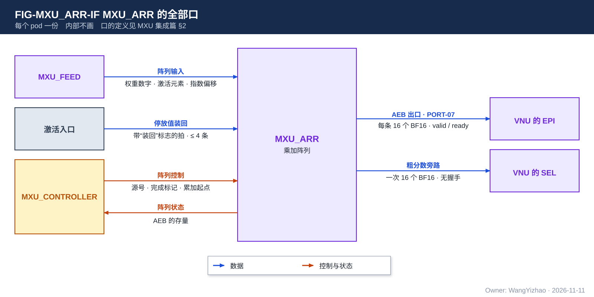
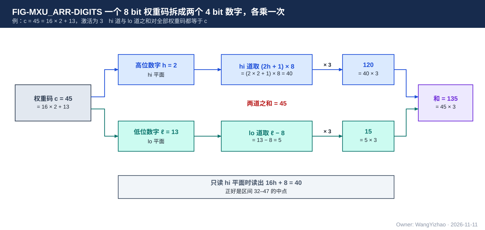
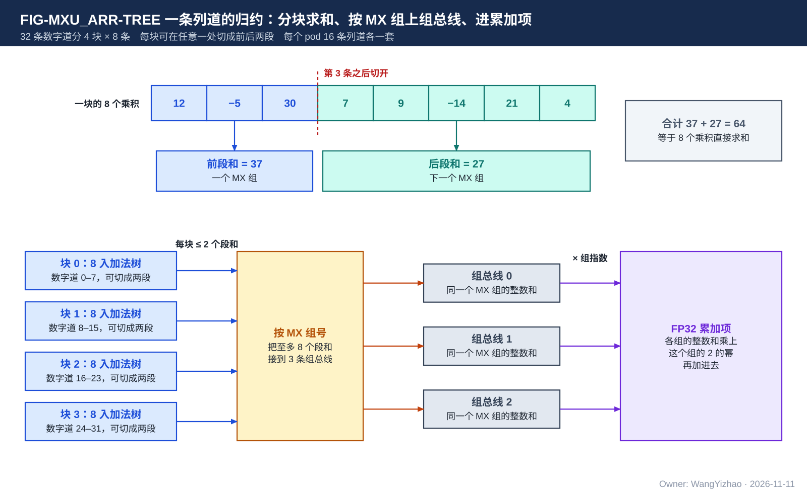

# MXU_ARR 需求：pod 的乘加阵列

> Owner: WangYizhao｜2026-11-11

## 1 概述

**MXU_ARR 是 pod 里做乘法、求和、累加与导出的部分，每个 pod 一份。** 它每拍从 MXU_FEED 收到 32 条数字道 × 16 条列道的 4 bit 权重数字和一个源的激活元素，做 512 次乘法，按列求和，加进这个源的累加项；一个源在一个 pass 上算完时，把累加项舍入成 BF16，写进出口缓冲 AEB。

阵列的形状：

- **数字道**：沿归约维的一条通路，每个 pod 32 条。一条数字道上是一个激活元素（或它的一段），16 条列道共用它。
- **列道**：沿输出维的一条通路，每个 pod 16 条，对应一个 pass 的 16 个输出通道：输入稀疏时是一个列块（16 个相邻输出通道），输出稀疏时是这个 pass 读集里的至多 16 列。
- 一条数字道与一条列道的交点是一个乘法器：4 bit 权重数字 × 激活有效数。
- **累加项**：每（源, 列道）一个，每个 pod 至多 8 个源，共 128 个。

MXU_ARR 给谁用：MXU_ARR 的设计者；MXU_FEED 与 MXU_CONTROLLER 的设计者（阵列要什么、何时要）；EPI 与 SEL 的设计者（阵列交出什么）。

不属于本篇的内容：

- 权重数字与激活元素怎样取来：归 MXU_FEED。
- 哪一拍算哪个源、何时导出：归 MXU_CONTROLLER。
- 从 AEB 取走之后的事（残差加、bias 加、停放的写出、量化）：归 VNU 的 EPI 等。

## 2 接口需求

### 2.1 架构图与接口汇总

| 口 | 对端 | 方向 | 内容 | 出处 |
|---|---|---|---|---|
| 阵列输入 | MXU_FEED | 入 | §2.2 | MXU 集成篇 §2.10 |
| 阵列控制 | MXU_CONTROLLER | 入 | §2.3 | MXU 集成篇 §2.10 |
| 阵列状态 | MXU_CONTROLLER | 出 | AEB 的存量 | MXU 集成篇 §2.10 |
| 停放值装回 | 激活入口（带"装回"标志的拍） | 入 | §2.6 | MXU 集成篇 §2.3.4 |
| AEB 出口（PORT-07） | VNU 的 EPI | 出 | §2.4 | MXU 集成篇 §2.6 |
| 粗分数旁路 | VNU 的 SEL | 出 | §2.5 | MXU 集成篇 §2.7 |

### 2.2 阵列输入：每拍从 MXU_FEED 收到什么

与 MXU_FEED 篇 §2.5 是同一个口：

- 32 条数字道 × 16 条列道的 4 bit 权重数字；
- 每条数字道的平面标志（hi 平面、lo 平面、单平面）；
- 每条数字道的激活元素：有效数、符号、元素指数；
- 每条数字道的指数偏移；
- 每条数字道属于哪个 MX 组，以及这一拍各组的指数（至多 3 个组）；
- 每条数字道的有效位。

**两种工作模式交来的形式相同，阵列不区分模式。**

### 2.3 阵列控制

MXU_CONTROLLER 每拍给：

- 这一拍是哪个源（决定用哪一组 16 个累加项）；
- 这是不是这个源在当前 pass 上的最后一拍（完成标记）；
- 这个源第一次被访问时，累加项从 0 开始，还是从停放值开始；
- 本 pod 这一轮的 AEB 条目可以输出了。

### 2.4 AEB 出口

- 一条 AEB 条目 = 一个源在一个 pass 上的 16 个结果，每个 BF16，共 256 bit。
- 每个 pod 一路 valid / ready；本 pod 的一轮算完后，这一路按驻留位次序输出，不等别的 pod；条目不带 token 标记（MXU 集成篇 §2.6）。
- EPI 拉低 ready 时条目留在 AEB；AEB 满了以后，阵列不能再导出，由 MXU_CONTROLLER 停住取数（MXU_CONTROLLER 篇 §3.8）。

### 2.5 粗分数旁路

attention 粗算时，一个（查询行, 16 个 key）算完的那一拍，16 个累加项舍入成 BF16，直接送 SEL，不进 AEB。没有握手，SEL 不反压。

### 2.6 停放值装回

一条停放条目 = 16 个 BF16 = 一个源在一个 pass 的 16 个输出通道上没有算完的部分和。带"装回"标志的拍里至多 4 条停放条目到达（128 B），按 MXU_CONTROLLER 给的次序，各扩成 16 个 FP32，作为对应源的累加起点。

## 3 功能描述

### 3.1 功能一览

| 功能 | 输入 | 输出 | 触发 / 生效条件 |
|---|---|---|---|
| 乘法（§3.2） | 权重数字、激活有效数 | 每条数字道在每条列道上的乘积 | 每拍 |
| 各种操作数格式（§3.3） | — | — | pass 配置 |
| 组内整数和（§3.4） | 同一个 MX 组的乘积 | 每列、每组一个整数和 | 每拍 |
| 指数偏移的施加（§3.5） | 每条数字道的指数偏移 | 对齐后的乘积 | 尺度沿归约维不同的运算 |
| 全码两条列道的合并（§3.6） | 列道 $l$ 与 $l + 8$ 的整数和 | 一个结果 | pass 配置为全码 |
| 累加与导出（§3.7） | 整数和、组指数 | 累加项；AEB 条目 | 每拍；完成标记 |
| 停放值装回（§3.8） | 停放条目 | 累加起点 | 源的第一次访问 |
| 粗分数（§3.9） | 累加项 | 16 个 BF16 | attention 粗算的完成标记 |

### 3.2 一种乘法：4 bit 权重数字 × 激活有效数

**阵列里只有一种乘法器：一个 4 bit 的权重数字乘一个激活有效数。8 bit 的权重不用 8 bit 乘法器，而是把它的两个数字分到两条数字道上各乘一次。**

权重码 $c = 16h + \ell$，$h$ 是带符号的高位数字，$\ell \in [0, 15]$ 是低位数字。两条数字道的权重分别取：

$$\text{hi 道}:\ (2h + 1) \cdot 8, \qquad \text{lo 道}:\ \ell - 8, \qquad \text{两道之和}:\ (2h+1) \cdot 8 + (\ell - 8) = 16h + \ell = c$$

图中的例子：$c = 45 = 16 \times 2 + 13$。hi 道取 $(2 \times 2 + 1) \times 8 = 40$，lo 道取 $13 - 8 = 5$，和为 45。激活为 3 时，两条道的乘积是 120 与 15，和为 $135 = 45 \times 3$。

这样取的好处是：**只读 hi 平面时，hi 道给出的 $16h + 8$ 正好是这个高位数字所代表区间的中点**（上例为 40，区间是 32 到 47）；需要完整精度时再加上 lo 道。

- 4 bit 权重只有一个平面，直接作为权重数字相乘。
- 对全部权重码，两道之和都等于 $c$（验收：全码穷举）。

### 3.3 操作数格式：阵列按 BF16 / FP16 这一最大情况设计

**阵列按 BF16 / FP16 这一最大情况设计**：乘法器的有效数一侧、元素指数的范围、对齐移位的范围，都要容得下 BF16 与 FP16。

| 激活格式 | 一个元素占几条数字道 | 每 pod 每拍（归约位置 × 输出通道），权重 8 bit / 4 bit |
|---|---|---|
| MXFP6（E2M3） | 1 | 16 × 16 / 32 × 16 |
| FP8（E4M3、E5M2） | 1 | 16 × 16 / 32 × 16 |
| BF16、FP16 | 2 | 8 × 16 / 16 × 16 |

- **BF16 / FP16：32 × 16 的阵列重构成 16 × 16。** 一个元素的有效数分成低段和高段，各占一条数字道；两条道用同一个权重数字，高段那条道的权重高出低段的位数。两段合起来要覆盖 FP16 的 11 位有效数。分段的位置【设计者定】。一遍算完，不走两遍。
- 两平面 8 bit 权重的一个归约位置占两条数字道（§3.2），所以 8 bit 权重下每拍的归约位置数减半。
- MXFP6 与 FP8 的元素指数相对所在 MX 组的差，作为这条数字道上的左移。

### 3.4 一个 MX 组内先做精确的整数和

**同一个 MX 组（共用一个尺度的归约位置）里的乘积已经对齐到同一个指数，阵列先把它们精确地加成一个整数，不做舍入。** 每条列道、每个 MX 组得到一个整数和。

- 一拍的 32 条数字道至多属于 3 个 MX 组（由 MXU_FEED 保证），所以每条列道一拍至多 3 个整数和。
- 整数和的位宽按最宽的激活格式定【设计者定】；MXFP6 时不超过 19 bit。

### 3.5 指数偏移的施加

尺度沿归约维逐位置不同的运算里（MXU_FEED 篇 §3.6.2），MXU_FEED 给每条数字道一个指数差 $\Delta$。**阵列把这条道上的乘积按 $2^{-\Delta}$ 的比例对齐后，再做整数和**；这一拍的 32 条数字道作为一个组，公共指数是这些位置的最大指数。指数差很大的道怎样处理由设计者定，标准是 MXU 集成篇 §6.1 的精度。

### 3.6 全码：两条列道合成一个结果

全码时（MXU_FEED 篇 §3.7），列道 $l$ 上是某一列的 hi 数字，列道 $l + 8$ 上是同一列的 lo 数字，两者同一个尺度。**阵列把列道 $l + 8$ 的整数和并进列道 $l$ 的整数和，得到这一列完整的结果，进同一个累加项。** 这时一个源只用 8 个累加项，一条 AEB 条目里有 8 个有效结果。

### 3.7 累加与导出

- **每（源, 列道）一个 FP32 累加项。** 每拍只更新当前这个源的 16 个累加项。
- 每个 MX 组的整数和乘上这个组的 2 的幂（组指数），加进累加项。一拍有几个组时怎样相加【设计者定】。
- **完成标记到达的那一拍，这个源的 16 个累加项舍入成 BF16（就近舍入、遇半取偶），写成一条 AEB 条目。**
- 一个源在这个 pass 上没有任何乘积时，照样导出一条全 0 的条目，使每个 pod 一轮的条目数固定。
- 累加器不预装 bias。

精度按 MXU 集成篇 §6.1：任务精度不低于 Reference，不要求与 GPU 的结果逐位一致。累加项用别的格式或别的做法，只要满足这条精度并且面积、能耗不差于参考设计，都可以。

### 3.8 停放值的装回

位点配置为"从停放值接着累加"时，一个源的累加项不从 0 开始，而是从装回的 16 个 BF16 开始（§2.6）。装回的值在这个源这一轮第一次被访问之前到位；次序由 MXU_CONTROLLER 排。

### 3.9 粗分数

见 §2.5。粗分数与 AEB 条目来自同一组累加项，区别只在去向。

## 4 性能指标

| 项 | 要求 |
|---|---|
| 每 pod 每拍的乘法数 | 512 |
| 各格式一拍的归约位置 × 输出通道 | §3.3 的表 |
| 一拍的 MX 组数 | 至多 3 个 |
| 导出 | 完成标记的当拍形成 AEB 条目，不另占拍 |
| AEB 出口 | 每 pod 每拍至多 1 条 |
| 面积 | 小于参考设计（MXU 集成篇 §4.5） |
| 移位能耗 | 不高于参考设计【待标定】 |

**降低移位能耗是需求。** 阵列按 BF16 / FP16 的范围设计，但多数位点用的是 MXFP6：它的元素指数只相差 0 到 2。**较窄的格式不应为最宽格式的移位范围付能耗。** 做法归设计者（§7.6）。

## 5 约束与由使用者保证的事项

### 5.1 硬约束

1. 只有一种乘法器；不为某种格式另建乘法通路。
2. 阵列不区分两种工作模式。
3. 累加器不预装 bias。
4. 阵列按 BF16 / FP16 这一最大情况设计。

### 5.2 由使用者保证的事项

| 事项 | 由谁保证 |
|---|---|
| 一拍的数字道至多属于 3 个 MX 组；全码时 hi、lo 落在列道 $l$ 与 $l + 8$ | MXU_FEED |
| 每拍只有一个源；源号、完成标记正确 | MXU_CONTROLLER |
| 停放值在源的第一次访问之前到位 | MXU_CONTROLLER、CCU |
| AEB 将满时不再导出 | MXU_CONTROLLER |
| 按时取走 AEB 条目 | EPI |

## 6 验收

| 编号 | 验收项 | 出处 |
|---|---|---|
| ARR-A-01 | 对全部权重码，hi 道与 lo 道之和等于 $c$；只读 hi 时读出 $16h + 8$ | §3.2 |
| ARR-A-02 | MXFP6、E4M3、E5M2 一个元素一条数字道，BF16、FP16 一个元素两条数字道；乘积与位级参照逐位相同；对 FP16 的有效数全范围穷举 | §3.3 |
| ARR-A-03 | 一个 MX 组内的整数和与直接求和逐位相同 | §3.4 |
| ARR-A-04 | 全码时两条列道合并后的结果，与用完整 8 bit 权重直接算的整数和逐位相同 | §3.6 |
| ARR-A-05 | 累加与导出满足 MXU 集成篇 §6.1 的精度 | §3.7 |
| ARR-A-06 | 没有乘积的源也导出一条全 0 的条目 | §3.7 |
| ARR-A-07 | 装回的停放值扩成 FP32 后数值不变 | §3.8 |
| ARR-A-08 | MXFP6 位点的移位能耗不高于参考值 | §4 |

与上下游的对接检查：阵列输入与 MXU_FEED 篇 §2.5 一致；AEB 条目与 EPI 篇一致；粗分数与 SEL 篇一致。

## 7 参考设计

本章的做法可以换；换的方案须满足第 4 章相对参考设计的指标。

### 7.1 一条数字道的五步

1. **激活解码**：每条数字道一个，把码解成有效数、符号、元素指数；16 条列道共用。
2. **权重入口的模式选择**：每个乘法器的权重入口一个选择，按平面标志取——hi 平面取奇数码 $2h + 1$（幅值不超过 15；把 4 bit 的 $h$ 与它的符号位异或后左移一位、末位补 1 得到，不用加法器），并让这条道的权重高 3 位；lo 平面取 $\ell - 8$（存的是 $\ell$ 与 8 的异或）；单平面取数字本身。
3. **乘法**：权重数字 × 激活有效数，有效数一侧至少 6 bit。
4. **道级左移与取符号**：左移量 = 元素指数相对组的差，尺度沿归约维不同的运算再加上指数偏移。
5. **乘积进归约树。**

因为 hi 道直接乘奇数码，阵列不需要另设一列去加"区间中点"的常数。

### 7.2 分段归约树

每条列道的 32 个乘积这样归约：

- 32 条数字道分成 4 块，每块 8 条，每块一棵 8 入的加法树。
- 每棵树的每个节点带 1 位切分位：一块的 8 条数字道可以在任意一处切成前后两段，分别求和，各带自己的 MX 组号。图中的例子：一块的 8 个乘积是 12、−5、30、7、9、−14、21、4，在第 3 条之后切开，前段和 37、后段和 27，合计 64，等于直接求和。
- 4 棵树出来的至多 8 个段和，按组号接到 3 条组总线上，同一个组的直接相加，得到这个 MX 组的精确整数和。
- 每个 pod 16 条列道各一套。
- 规模：比不分段的加法树多约 3 万个 2 选 1 等效（全芯片），约占乘加数据通路的 3%。
- 这一拍没有对应组的组总线，以及它后面的逻辑，应可门控。

### 7.3 累加器

- **存储**：每个 pod 128 个 FP32 累加项，按源组织，一次读写一个源的 16 项（512 bit）。参考做法是用一读一写的寄存器堆宏，外加每条列道一个工作寄存器。
- **访问**：每拍至多读一个源、写一个源。换源只需提前 1 拍知道下一个源。
- **连续访问同一个源**：上一拍刚写回的值这一拍又要读时，直接用工作寄存器里的值，不读宏。一个源换走后下一拍又换回来的情形也要正确。
- **第一次访问一个源**：不读宏，起点取 0 或装回的停放值。
- **完成即导出**：完成标记的那一拍，工作寄存器里的终值直接舍入成 BF16 进 AEB，不再写回。
- **整数和怎样变成 FP32 加进去**：一种做法是把每个组的整数和先规格化成浮点，再依次加进累加项；另一种是把同一拍的几个组先在一个较宽的定点上对齐相加，再做一次浮点加。两种的面积、时序与舍入次数不同【设计者定】。
- 宏的宽度、工作寄存器与规格化逻辑的规模按 FP32 核算【待标定】。

### 7.4 全码两条列道的合并

列道 $l + 8$ 的组总线输出在进累加之前并进列道 $l$：每个 pod 8 条列道各加一个二选一的入口。两条列道同一个尺度，合并在整数和上做，不引入舍入。

### 7.5 AEB

每个 pod 8 条 × 256 bit。一个 pod 一轮至多导出 8 条（8 个源各一条），所以 8 条正好装下一轮；下一轮的条目要等 EPI 取走才有位置。全芯片 4.1 KB，约 0.032 mm²。

### 7.6 降低移位能耗的参考做法

- 移位器分级：MXFP6 只用到最低的 0–2 位移位，较高的移位级在这种位点里保持不动。
- 这一拍没有数据的数字道、没有对应组的组总线不翻转。
- 输出稀疏时没保留的归约位置按 0 送，可以用保留位图直接关掉这条数字道的乘法器。
- BF16 / FP16 的元素各有自己的指数，对齐的范围大；可以按这一拍 32 个元素的指数分布限定对齐窗口。
- 指数偏移的窗口（MXU_FEED 篇 §7.5）越小，移位能耗越低。

### 7.7 流水与规模参考

- 流水级数由设计者按时序定。有两处回路不能随意加级：累加项的读、加、写回；以及"上一拍写、这一拍读"的前推。
- 规模（全芯片，一阶推导）：乘法与归约约 104 万个 2 选 1 等效、约 0.64 mm²（按 MXFP6 的位宽计）；累加项存储与工作寄存约 0.095 mm²；AEB 约 0.032 mm²。按 BF16 / FP16 加宽与 FP32 加法逻辑的增量【待标定】。

### 7.8 参考设计的自检项

- 权重码穷举；各格式的乘积与位级参照对拍。
- 累加器的访问协议穷举：连续访问同一个源、换走又换回、第一次访问、完成即导出。
- 归约树在任意切点下的段和与直接求和相同。
- 用不到的移位级、没有对应组的组总线、没有数据的数字道在该拍不翻转。

## 8 为什么

### 8.1 需求的理由

- **只有一种乘法器、按数字拆分**：4 bit 的权重数字使一个乘法器很小；8 bit 权重、4 bit 权重、只读高位平面都用同一个阵列，只是占的数字道数不同。
- **阵列按 BF16 / FP16 这一最大情况设计，并降低移位能耗**（用户 11-11："对于ARR的需求是要根据BF16/FP16这个最大情况去设计阵列，并且也需要去减少移位能耗"）。
- **BF16 / FP16 重构成 16 × 16、一遍算完**（用户 11-11："我需要32x16的阵列直接重构成16x16的阵列去计算"）。
- **累加项用 FP32**（用户 11-09）：不需要事先知道结果的最大指数，尺度沿归约维变化的运算也能直接累加。
- **精度看任务精度，不要求逐位一致**（用户 11-11）：累加的先后可以随数据到达的先后变化。
- **不预装 bias、到 AEB 为止**（用户 11-08）：bias 与残差在 EPI 加，结果只舍入一次。
- **面积与移位能耗要好于参考设计**（用户 11-11）。

### 8.2 参考设计的选型理由

- **分段归约树**：一拍里的归约位置可以跨 MX 组的边界，不必为了凑齐一个组而让数字道空着。
- **组内先做整数和**：同一个组内不舍入，舍入只发生在进累加项的那一次。
- **完成即导出**：一个 pass 结束时不需要再花几拍把累加项逐个读出来。
- **被否的做法**：定点的累加项加一个事先定好的公共指数（要预先知道权重与激活的最大指数，尺度沿归约维变化时不好用）；左操作数拆成两个 MXFP6 平面分别算（$O = PV$ 里多一次量化）；把一个 BF16 元素分两遍算（拍数加倍）。
