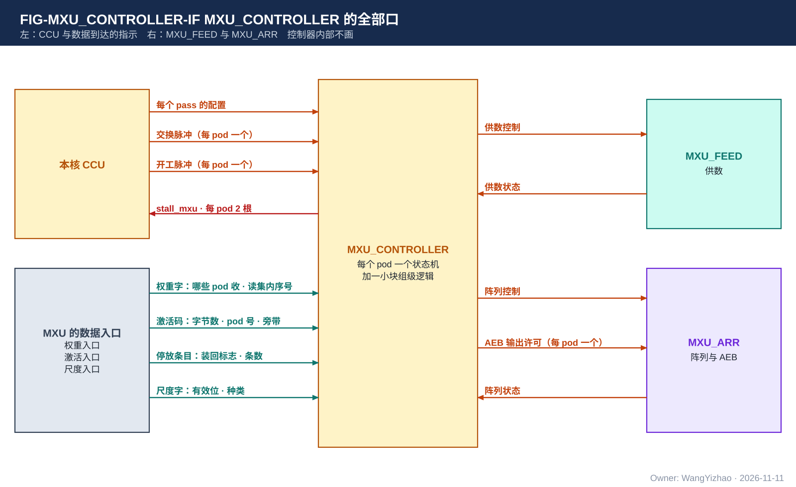
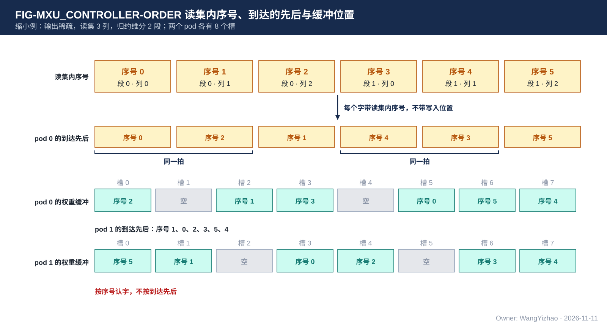

# MXU_CONTROLLER 需求：MXU 自己的控制器

> Owner: WangYizhao｜2026-11-11

## 1 概述

**MXU_CONTROLLER 是 MXU 自己的状态机控制器。CCU 只在每个 pass 开始时给配置，一个 pass 之内逐拍的事都由它在 MXU 内部做**：权重字放在权重缓冲的哪里、这一拍让哪个源占用阵列、取哪些字的数、一个字占的位置什么时候可以装新的字、哪一拍导出、什么时候告诉 CCU 收不下。

它与 CCU 的分工：

| 事情 | 谁做 |
|---|---|
| 每个 pass 算哪些行、哪些列；读集与选择位图 | CCU |
| L1 的全部读地址；每一拍把读出送给谁 | CCU |
| 每个 pass 的配置、交换与开工脉冲 | CCU |
| 权重字发放的先后、每个字的读集内序号 | CCU |
| 权重字放在权重缓冲的哪里 | MXU_CONTROLLER |
| 这一拍让哪个源占用阵列、从哪里取数 | MXU_CONTROLLER |
| 用完的字的释放、缓冲的交替使用 | MXU_CONTROLLER |
| 累加项的管理、何时导出、每一路 AEB 的输出 | MXU_CONTROLLER |
| 握手与 stall | MXU_CONTROLLER |

MXU_CONTROLLER 不知道一个权重字是原矩阵的第几行、第几列，只知道它的读集内序号。

本篇给谁用：MXU_CONTROLLER 的设计者；CCU 的设计者（读集内序号的编法、激活的推送次序，两边要用同一个约定）；MXU_FEED、MXU_ARR 的设计者。

不属于本篇的内容：MXU 对外各口的定义以 MXU 集成篇 §2 为准；取数与对齐的做法在 MXU_FEED 篇；乘加与累加在 MXU_ARR 篇。

## 2 接口需求

### 2.1 架构图与接口汇总

| 口 | 对端 | 方向 | 内容 | 出处 |
|---|---|---|---|---|
| CCU 配置口 | 本核 CCU | 入 | 每个 pass 的配置；交换脉冲、开工脉冲 | MXU 集成篇 §2.5 |
| 数据到达的指示 | 权重入口、激活入口、尺度入口 | 入 | §2.3 | MXU 集成篇 §2.2–§2.4 |
| 供数控制 / 供数状态 | MXU_FEED | 出 / 入 | §2.4 | MXU 集成篇 §2.10 |
| 阵列控制 / 阵列状态 | MXU_ARR | 出 / 入 | §2.4 | MXU 集成篇 §2.10 |
| stall_mxu | 本核 CCU | 出 | 每 pod 两根：权重收不下、激活收不下 | MXU 集成篇 §2.8 |
| AEB 输出许可 | MXU_ARR 的 AEB | 出 | 每个 pod 各一个：本 pod 的一轮算完，这一路可以输出 | MXU 集成篇 §2.6 |

### 2.2 CCU 配置口

- **配置**：每个 pass 一份，带 4 位"哪些 pod 用"，内容见 MXU 集成篇 §2.5.1。配置在开工脉冲之前给到，开工脉冲到达时生效；一个 pod 的一个 pass 进行中，它的配置不变。
- **开工脉冲**：每个 pod 各一个，表示这个 pod 的下一个 pass 可以开始。上一个 pass 还没算完时也可以给下一个 pass 的配置与开工脉冲：MXU_CONTROLLER 把下一个 pass 的配置先存下，上一个 pass 的权重字仍按上一个 pass 的配置用完。能预先存下几个 pass 的配置【设计者定】：要定的是个数；约束是至少 1 个，并与 CCU 设计者对接。
- **交换脉冲**：每个 pod 各一个，表示这个 pass 给这个 pod 的权重字已经全部送到。此后到达这个 pod 的权重字属于它的下一个 pass。

配置的字段位宽与在指令里的位置，由 MXU 与 CCU 的设计者对接。

### 2.3 数据到达的指示

**数据都带有效信号，MXU_CONTROLLER 按有效信号自己判断每一拍进来多少数据。**

| 数据 | 有效信号 |
|---|---|
| 权重字 | 4 路各带"哪些 pod 收"与读集内序号；对某个 pod，这一拍收到 0 到 4 个字 |
| 激活码 | 有效字节数、pod 号；同时有保留位图、F 掩码、MX 组边界 |
| 停放条目 | "装回"标志、pod 号；条数由有效字节数得出（每条 32 B） |
| 尺度字 | 每路一个有效位与去向（送权重一侧还是激活一侧）；是四种尺度字里的哪一种由 pass 的配置决定 |

### 2.4 对 MXU_FEED、MXU_ARR 的控制与状态

- 给 MXU_FEED：到达的权重字放在权重缓冲的哪里；这一拍取哪些字的数、按哪个源的选择位图取；模式；哪些位置释放。
- 从 MXU_FEED 收：权重缓冲的空位；激活缓冲的存量。
- 给 MXU_ARR：这一拍是哪个源；完成标记；累加的起点；AEB 输出许可。
- 从 MXU_ARR 收：AEB 的存量。

## 3 功能描述

### 3.1 功能一览

| 功能 | 输入 | 输出 | 触发 / 生效条件 |
|---|---|---|---|
| 给到达的数据排位置（§3.2） | 数据到达的指示、读集内序号 | 权重字在缓冲里的位置；激活进哪个 pod | 每个到达的字 |
| 决定哪个源占用阵列（§3.3） | 各源的进度、缓冲的状态 | 源号、取数位置 | 每拍 |
| 权重缓冲的交替使用与释放（§3.4） | 各源的读出位置 | 位置的释放 | 每拍 |
| 累加项的管理（§3.5） | 各源的进度 | 完成标记、累加起点 | 源的第一拍与最后一拍 |
| 每个 pod 一轮结束时的输出（§3.6） | 本 pod 各源的进度 | 这一路的 AEB 输出许可 | 每个 pod 的每一轮 |
| pass 的衔接（§3.7） | 配置、脉冲 | — | pass 之间 |
| 握手与 stall（§3.8） | 缓冲与 AEB 的存量 | stall_mxu | 每拍 |
| 卷积的调度（§3.9） | 配置 | — | 卷积位点 |
| 只开部分 pod、源数可配（§3.10） | 配置 | — | 每个 pass |
| CCU 不送数据时（§3.11） | — | — | 任何时候 |

### 3.2 给到达的数据排位置：权重字按读集内序号认，激活码按固定次序数

**权重字到达时带读集内序号、不带写入位置。MXU_CONTROLLER 把每个到达的字放进权重缓冲的一个空位，并记下"序号为 $i$ 的字放在哪里"。** 放哪个空位由 MXU_CONTROLLER 定；各 pod 各放各的，不要求放在相同的位置。

- **到达的先后可以与序号的先后不同**：CCU 会调整发放的先后（MXU 集成篇 §2.2.2）。一拍里可以有几个字同时到达同一个 pod（4 路至多 4 个），它们各带各的序号，不需要规定谁先谁后。
- 一个源要用序号为 $i$ 的字而它还没到时，这个源等待（§3.3）。
- 一个 pass 的字是否到齐，由交换脉冲告知（§2.2）。

CCU 与 MXU_CONTROLLER 必须对"序号为 $i$ 的字是什么"有同一个约定：

| 情形 | 一个 pass 里读集内序号的编法 |
|---|---|
| 输入稀疏 | 读集里的被选行每 4 行一个字，按读集里行的次序从 0 编号；一个 pass 只有一个列块的 16 个输出通道 |
| 输出稀疏 | 归约维每 64 个位置为一段；先编第 0 段里读集各列的字（按列在读集里的次序），再编第 1 段的，依此类推 |
| 全码 | 同输出稀疏；每一列先编 hi 平面的字、紧接着编同一列 lo 平面的字 |

图中的缩小例：输出稀疏，读集是 3 列，归约维分 2 段，共 6 个字，序号 0 到 5 依次是（段 0, 列 0）、（段 0, 列 1）、（段 0, 列 2）、（段 1, 列 0）、（段 1, 列 1）、（段 1, 列 2）。CCU 调整后，到达 pod 0 的先后是序号 0、2、1、4、3、5，其中序号 0 与 2 同一拍到，4 与 3 同一拍到。pod 0 把它们依次放进位置 5、0、2、7、3、6，于是记下：序号 0 在位置 5，序号 1 在位置 2，序号 2 在位置 0，序号 3 在位置 3，序号 4 在位置 7，序号 5 在位置 6。pod 1 收到的先后与空位都可以不同，它记自己的一份。图里的"位置"按参考设计的槽画（§7.2）。

激活码一侧：

- 这一拍的码属于哪个 pod 由 pod 号给出，进这个 pod 的激活缓冲，顺序存放。
- 属于这个 pod 的哪个源、哪一个发读步长（MXU 集成篇 §2.3.1）：CCU 对每个 pod 按"发读步长为主序、同一个发读步长里源的序号从小到大"推送。MXU_CONTROLLER 按这一段的保留位图里 1 的个数乘元素位宽，数出当前这个源在这个发读步长上还剩多少码；数完就轮到下一个源；这个 pod 的各个源都推完这个发读步长，就轮到下一个发读步长。每一段从首字起始位偏移给出的那一位开始数。
- 带"装回"标志的拍：停放条目按源的序号从小到大到达，一拍至多 4 条。

这些次序约定由 MXU 与 CCU 的设计者共同维护；要改时两边一起改。

### 3.3 哪个源此刻占用阵列

**一个 pod 一拍只让一个源占用阵列。** 激活码的推送次序是固定的（发读步长为主序、同一个发读步长里源的序号从小到大，§3.2）；**在已经到达的数据里，这一拍让哪个源占用阵列由 MXU_CONTROLLER 定**，累加的先后不要求固定（MXU 集成篇 §6.1）。

- 一个源要用的权重字还没到齐，或它的激活码还没到，它就不能占用阵列；没有任何源可算时阵列空拍，计入利用率。
- 参考的处理次序见 §7.2。

### 3.4 权重缓冲的交替使用与释放

- **一个权重字什么时候用完，由 MXU_CONTROLLER 自己数**：本 pod 的每个源的读出位置都越过它之后，就用完了。
- 用完的字占的位置立即释放，下一拍就可以装新的字——可以是同一个 pass 后面的字，也可以是下一个 pass 的字。
- 一个位置在"正在装"的那一拍不能取。
- 本 pod 的空位数不足以接住在途的字时，拉高"权重收不下"（§3.8）。

### 3.5 累加项的管理

- 每拍给 MXU_ARR 当前的源号。
- **完成标记**：一个源在当前 pass 上的最后一拍。它的条件是：这个 pass 配置为"结束时导出"，这个 pod 的交换脉冲已到，并且这个源已经用完读集里它要用的最后一个位置。完成标记由 MXU_CONTROLLER 自己判出，不由 CCU 给。
- 一个源在这个 pass 里一个位置都不选时，也给它一个完成标记，让阵列导出一条全 0 的条目。
- **累加的起点**：按配置，从 0、从停放值，或接着上一个 pass 留下的累加项。从停放值开始时，停放条目要在这个源第一次占用阵列之前到齐，否则这个源等待。
- 配置为"结束时不导出"的 pass，不给完成标记，累加项留给下一个 pass。

### 3.6 每个 pod 一轮结束时的输出：各路各自输出

- 4 个 pod 各自推进，快慢可以不同，可以处在不同的 pass。
- **一个 pod 的一轮结束 = 这个 pod 的各个源在它当前的 pass 上都已导出进它的 AEB。** 这时 MXU_CONTROLLER 给这个 pod 输出许可，这一路按驻留位 0 到 $n - 1$ 的次序输出；不等别的 pod。
- 一个 pod 算完一轮后可以立即开始它的下一个 pass 的装入与计算，只要它的 AEB 还有位置；AEB 里上一轮的条目没有被取走之前，这一轮不能导出（§3.8）。
- 4 个 pod 之间相差多远，MXU_CONTROLLER 不管，由 CCU 控制（MXU 集成篇 §3.4）。

### 3.7 pass 的衔接：模式是 pass 的属性，切换不排空

- 模式、权重平面、格式都随 pass 的配置给，相邻两个 pass 可以不同。
- **相邻 pass 模式不同时不排空权重缓冲**：前一个 pass 的字用完一个、释放一个，后一个 pass 的字随即装进空出来的位置。两个 pass 的字可以同时在权重缓冲里，MXU_CONTROLLER 记着每个字属于哪个 pass。
- 取数的接法与阵列侧的接线按 pass 的模式切换，切换点随这个 pass 的第一拍数据在流水里向前走，不需要整个 pod 停下来。
- 切换时残余的空拍只来自阵列的流水深度与后一个 pass 第一批权重的装入【待标定】。

### 3.8 握手与 stall

| 情形 | MXU_CONTROLLER 做什么 |
|---|---|
| 某个 pod 的权重缓冲空位数 ≤ 在途的权重字数 | 拉高这个 pod 的"权重收不下" |
| 某个 pod 的激活缓冲余量 ≤ 在途的码 | 拉高这个 pod 的"激活收不下" |
| AEB 里还有上一轮的条目没被取走，而这个 pod 又有源要导出 | 这个 pod 停止取数，等 AEB 有位置；装入不停 |
| EPI 拉低某一路的 ready | 这一路不输出条目；条目留在这个 pod 的 AEB |

- 在途的量由 L1 读的固定拍数与 CCU 到 MXU 的流水级数决定，MXU 设计者据此定阈值（与协议篇 §7.9 的将满阈值是同一条规则）。
- 阵列的流水里已经在算的拍不撤回：MXU_CONTROLLER 停的是"取下一拍的数"，所以 AEB 的位置要按流水深度留余量。
- 任何一个 pod 的 stall、任何一路的 ready 都只影响它自己。

### 3.9 卷积的调度模式

**MXU_CONTROLLER 要支持卷积与逐通道卷积的调度，按稠密算，不要求稀疏。阵列与两种工作模式不变。**

- **卷积**：把（输入通道, 核位置）合起来当作归约维，就是一次稠密的矩阵乘。滑动窗口里的输入由 CCU 按地址读出，按归约维的次序推给 MXU；MXU 这边与稠密的线性位点没有区别。
- **逐通道卷积**：每个输出通道只与自己那一个输入通道的几个核位置相乘。MXU_CONTROLLER 需要支持的是：**连续几个 pass 加进同一组累加项，最后一个 pass 才导出**（配置里的"接着上一个 pass 继续加"与"结束时不导出"）。怎样把逐通道卷积排成这样的几个 pass，见 §7.4。

卷积位点的效率不作要求【待标定】。

### 3.10 只开部分 pod、源数可配

- 配置给出开哪些 pod、每个 pod 几个源。没开的 pod 不收数据、不占用阵列、不输出条目；没用的驻留位同样。
- 例：某种调用只开 2 个 pod、每个 pod 5 个源。
- 权重梯度的左操作数只有 32 行：这 32 行就是 32 个源，按 MXU 集成篇 §2.3.2 的固定归属分到各 pod；开几个 pod、每个 pod 几个源由配置给（例：4 个 pod 各 8 个）。

### 3.11 CCU 不送数据时

MXU 不收停止请求。CCU 不再送数据时（包括 CCU 被停住），MXU_CONTROLLER 让各 pod 把已经收到的数据算完，然后各自停在等待数据的状态；数据继续到达时接着做，不丢、不重。

## 4 性能指标

| 项 | 要求 |
|---|---|
| 排位置 | 一拍至多为每个 pod 的 4 个到达的字排位置 |
| 决定取数 | 每拍一次，不因控制器的决定在数据齐备时让阵列空拍 |
| 释放 | 用完的字占的位置下一拍可以装新的字 |
| 模式切换 | 不排空；残余空拍【待标定】 |
| 利用率 | 不低于参考设计（MXU 集成篇 §4.5） |
| 面积 | 小于参考设计【待标定】 |

## 5 约束与由使用者保证的事项

### 5.1 硬约束

1. MXU_CONTROLLER 不产生 L1 的地址，不决定算哪些行与列。
2. 各 pod 的控制互相独立，输出也各自进行；MXU_CONTROLLER 不让一个 pod 等另一个 pod。
3. 本篇不含容错设计：不检查 CCU 送来的数量与配置是否相符。

### 5.2 由使用者保证的事项

| 事项 | 由谁保证 |
|---|---|
| 每个权重字带的读集内序号符合 §3.2 的编法；每个 pod 在一个 pass 里不缺不重 | CCU |
| 激活码按"发读步长为主序、同一个发读步长里源的序号从小到大"到达；停放条目按源的序号到达 | CCU |
| 一个发读步长用到的权重不超过权重缓冲装得下的量 | CCU |
| 保留位图里 1 的个数与实际的码数一致 | QNT、CCU |
| 配置在开工脉冲之前给到；交换脉冲在这个 pod 的最后一个权重字之后给 | CCU |
| stall 拉高后，在途拍数之内停发 | CCU |
| 一个 pass 的列数、源数不超过 MXU 集成篇 §5.2 的接口常数 | CCU |

## 6 验收

| 编号 | 验收项 | 出处 |
|---|---|---|
| CTL-A-01 | 两种模式与全码下，按 §3.2 的编法给序号、以任意先后送入（包括同一拍几个字），各 pod 各源的结果正确 | §3.2 |
| CTL-A-02 | 4 个 pod 以不同的快慢收权重、各放各的位置、处在不同的 pass，结果正确 | §3.2、§3.4、§3.6 |
| CTL-A-03 | 同一批数据按不同的到达拍送入（中途停送、各 pod 交错），功能正确，精度满足 MXU 集成篇 §6.1 | §3.11 |
| CTL-A-04 | 用完的字占的位置下一拍可装；正在装的位置不被取；没用完的字不被覆盖 | §3.4 |
| CTL-A-05 | 完成标记只在源的最后一拍给一次；一个位置都不选的源也导出一条 | §3.5 |
| CTL-A-06 | 每一路的条目按驻留位次序输出，各路互不等待；没开的 pod 与没用的驻留位不输出 | §3.6 |
| CTL-A-07 | 相邻 pass 模式不同、权重平面不同、格式不同时衔接正确，不需要排空 | §3.7 |
| CTL-A-08 | 各种 stall 组合下不丢数据、不死锁（状态穷举或形式验证） | §3.8 |
| CTL-A-09 | 连续几个 pass 加进同一组累加项、最后一个 pass 导出 | §3.9 |

与上下游的对接检查：与 CCU 的次序约定、配置与脉冲的时序（CCU 篇）；控制与状态信号与 MXU_FEED 篇 §2.6、MXU_ARR 篇 §2.3 一致。

## 7 参考设计

本章的做法可以换；换的方案须满足第 4 章相对参考设计的指标。

### 7.1 组织：每个 pod 一个状态机，加一小块组级逻辑

- **pod 状态机**（4 个，相同）：管本 pod 的排槽、取数、释放、累加项、stall，以及本 pod 一轮结束时的输出许可。
- **组级逻辑**（1 份）：按"哪些 pod 用"把配置分给 4 个 pod；各 pod 各存自己当前与下一个 pass 的配置。

**参考设计里权重缓冲按槽组织**：一个槽放一个权重字（32 B），每 pod 128 个槽；§3 里说的"位置"在参考设计里就是槽号。

这与参考工程（PandaChip NCC）的前处理控制器是同一种组织：主控给层的配置与"交换""开工"脉冲，数据带有效位，前处理单元自己的状态机按层的类型（全连接、卷积、逐通道卷积等）分状态，在内部算缓存的读写位置。

### 7.2 pod 状态机的主要计数

| 计数 | 个数 | 用途 |
|---|---|---|
| 本 pass 已收到的权重字数 | 每 pod 1 个 | 与交换脉冲一起判断这个 pass 的权重是否到齐 |
| 槽的状态与所属 pass | 每槽 1 项 | 空、正在装、可读 |
| "序号为 $i$ 的字在哪个槽"的对应 | 每槽 1 项 | 字到达时按它带的序号写入；取数时按序号找到槽 |
| 各源的读出位置 | 每源 1 个（输入稀疏时每源每组 1 个，共 4 个组） | 这个源用到读集的哪个序号；全部源越过的字可以释放 |
| 当前发读步长里当前源剩余的码数 | 每 pod 1 个 | 由保留位图里 1 的个数初始化，数到 0 换下一个源 |
| 当前源、当前发读步长 | 每 pod 各 1 个 | 调度 |

参考的处理次序：

- 输入稀疏：对当前的发读步长，源 0 把它在这一段上的码全部算完，再轮到源 1……各个源都算完这个发读步长，再进下一个。每个源每拍取多少个归约位置，取决于它的选择位图在候选窗口里选中了多少（MXU_FEED 篇 §7.1：每组 8 条数字道至多取 8 个）。
- 输出稀疏：对当前的一段归约位置，源 0 用它选中的列算完这一段，再轮到源 1……
- 稠密：各个源用的是同样的行，取出的一拍权重数字保持几拍、每拍换一个源（MXU_FEED 篇 §7.7）；这要求这几个源在这一段上的激活码都已经在激活缓冲里。

### 7.3 pod 状态机的状态

空闲 → 收到开工脉冲后进入运行。运行中三件事并行：装（给到达的字排槽）、算（按源的序号取数、给阵列源号与完成标记）、放（释放用完的槽）。这个 pod 的各个源都导出后，这一路输出条目，回到空闲或直接进入已经给了开工脉冲的下一个 pass。

### 7.4 逐通道卷积的参考排法

逐通道卷积：$y_{t,c} = \sum_{j} x_{t-j,c}\, w_{j,c}$，$c$ 是通道，$j$ 是核位置（核长 2 到 4）。

- **参考排法（不改通路）**：每个核位置一个 pass。一个 pass 里取 16 个通道同时作为归约维和输出维，权重是对角的（只有"通道 $c$ 对通道 $c$"的位置非零），激活是第 $t - j$ 个 token 的这 16 个通道。几个核位置的 pass 加进同一组累加项，最后一个 pass 导出。每个 pod 每拍得到 16 个（通道, 核位置）的乘积，一个核 64 个；阵列的 512 个乘法器里每拍只有 16 个有效。
- **后备：每条列道各给一路激活**。让 16 条列道各自乘自己的激活元素，数字道上放核位置；权重按核位置紧挨着存放，不必存对角以外的 0。**这种排法要改阵列的激活输入（现在是一条数字道上的激活元素由 16 条列道共用），不属于现行参考设计**；只有在 CCU 设计者确认上一种排法拆不开或代价不可接受时才考虑。

需求只要求 §3.9；阵列与两种工作模式不因卷积而改。

### 7.5 规模参考

控制器是新划出来的部分，旧账里它的逻辑分散在供数与阵列两边，没有单独的数字【待标定】。参考量级：每个 pod 的计数与状态约几百 bit 的寄存器，加每槽十几 bit 的状态。

## 8 为什么

### 8.1 需求的理由

- **MXU 自带控制器**（用户 11-11："相当于CCU不是唯一控制器，MXU，VNU都有一个自己的状态机Controller"；"MXU的压缩模式，ping-pong交替，握手信号，也是由MXU Controller模块负责的"）：这些决定都要在一拍之内闭环，留在 MXU 内部最直接。
- **不接收写入位置**（用户 11-11）：CCU 不必知道 pod 的权重缓冲里哪里是空的；各 pod 各放各的，一个字不需要 4 个 pod 的同一个位置同时空出。
- **权重字按读集内序号认，不按到达的先后认**（用户 11-11）：CCU 要前看未来几拍的权重需求、调整发放的先后，才能每拍用满 W 类读口的 4 路并把几个 pod 要的同一个字合成一次读出；先后一调整，到达次序就不等于读集次序，按到达计数会认错。带序号后，同一拍几个字的先后也不必规定。序号只说明"这是哪个字"，不是写入位置。
- **批的边界用脉冲**（用户 11-11 认可，照参考工程的形式）：一批有多少个字随运行时的选择而变，CCU 数着自己发的读，读完给脉冲。
- **换源与释放由 MXU 内部计数，不设结束脉冲**（用户 11-11："直接让MXU内部计某个权重是否已经全部被消费不是更好吗"）。
- **源按序号从小到大**（用户 11-11 认可）：最简单的固定次序，并且与每一路 AEB 的输出次序一致。
- **各 pod 独立，输出也各自进行**（用户 11-11："各pod各自要，是基本的设计需求"；"4路各自输出，带路号是更能提升利用率的设计"）：在线稀疏下各 pod 的工作量事先不知道，先算完的 pod 不在出口等最慢的。
- **需求里不写槽**（用户 11-11：槽可以作为设计参考，需求是阵列利用率）：权重缓冲怎样组织由设计者定，本篇第 3 章只说"位置"，槽放在第 7 章。
- **模式切换不排空**（用户 11-09：作为明确的设计需求写出）。
- **卷积的调度写在 MXU**（用户 11-11："可能确实会有一些要兼容DCONV和CONV调度模式的需求，只是可以不要求他们稀疏，建议写在MXU的需求文稿里"）。

### 8.2 参考设计的选型理由

- **每个 pod 一个状态机**：各 pod 快慢不同，互不拖累。
- **被否的做法**：CCU 逐拍给槽号与 pod 号（把一拍的回路拉过模块边界）；按"此刻哪个源可取的字最多"动态挑源（需要把每个源的激活都留在 pod 里，激活缓冲要大得多）；整批权重用完才换下一批（装与算要互相等待）。
