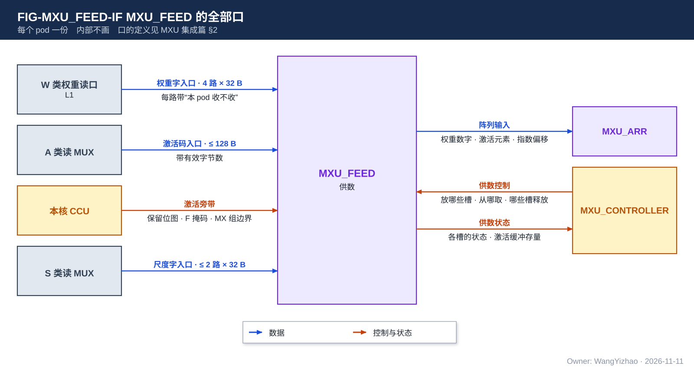
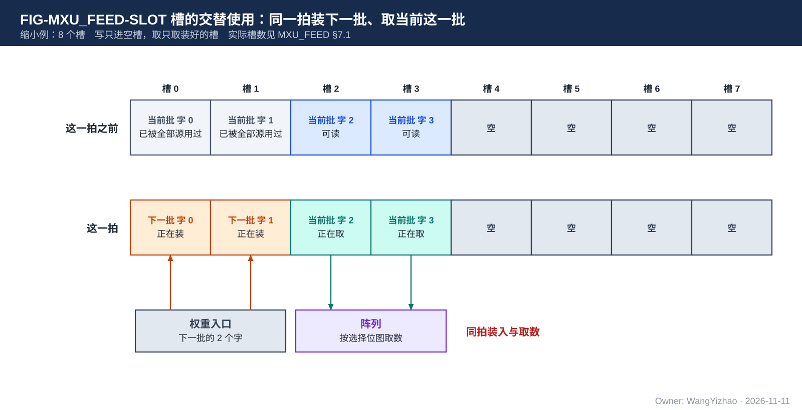
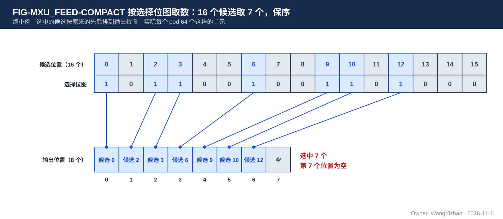
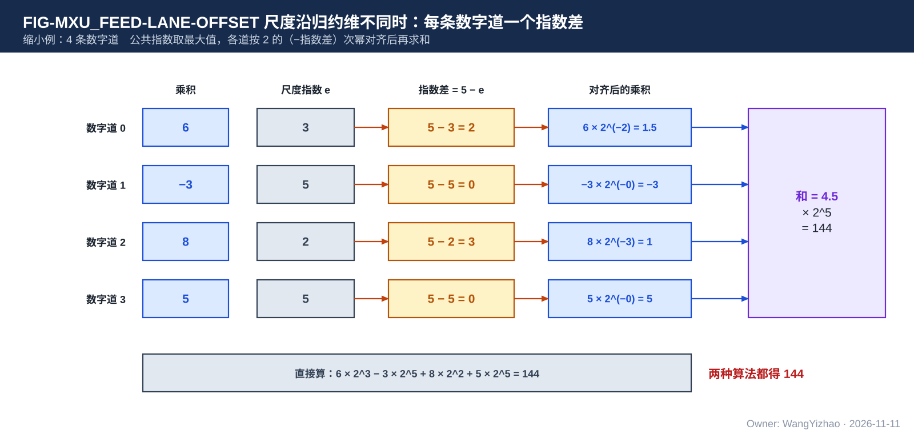

# MXU_FEED 需求：pod 的供数

> Owner: WangYizhao｜2026-11-11

## 1 概述

**MXU_FEED 是 pod 里给阵列供数的部分，每个 pod 一份。** 它把从 L1 读来的三样东西——权重字、压紧的激活码、尺度字——整理成阵列每拍要的形式：32 条数字道 × 16 条列道的 4 bit 权重数字、这一拍的激活元素、每条数字道的指数偏移。

**pod 两侧的缓冲不同构：**

- **激活一侧**：激活进来时已经是压紧过的码（没保留的通道不占位置），所以激活缓冲只是一个顺序进出的小缓冲。
- **权重一侧**：权重进来时没有压紧（读集是全部源的并集，单个源只用其中一部分），所以权重缓冲要能把到达的字放进任意一个空位，取数时再按每个源的选择位图在线压紧。

本篇的术语：

| 术语 | 含义 |
|---|---|
| 源 | 左操作数 $X$ 的一行，一个 pod 同时算至多 8 个 |
| 数字道 | 阵列沿归约维的一条通路，每个 pod 32 条 |
| 列道 | 阵列沿输出维的一条通路，每个 pod 16 条 |
| 读集 | 一个 pod 在一个 pass 里全部源要用的行（或列）的并集 |
| 读集内序号 | 一个权重字是读集里的第几个字；随字到达（MXU 集成篇 §2.2.2） |
| 读集次序 | 读集里的行（或列）按读集内序号排成的次序；权重字到达的先后可以与它不同 |
| 选择位图 | 某个源在读集次序上要用哪些行（或列） |

权重缓冲内部怎样组织不属于需求；参考设计按"槽"组织（§7.1）。

MXU_FEED 给谁用：MXU_FEED 的设计者；MXU_ARR 的设计者（阵列收到的是什么）；MXU_CONTROLLER 的设计者（要控制什么）。

不属于本篇的内容：

- 何时取、让哪个源取、到达的字放在权重缓冲的哪里：归 MXU_CONTROLLER。
- 乘法与累加：归 MXU_ARR。
- MXU 对外各口的定义：以 MXU 集成篇 §2 为准，本篇只引用。

## 2 接口需求

### 2.1 架构图与接口汇总

| 口 | 对端 | 方向 | 内容 | 出处 |
|---|---|---|---|---|
| 权重字入口 | L1 的 W 类权重读口 | 入 | 4 路 × 32 B，每路带"本 pod 收不收"与读集内序号 | MXU 集成篇 §2.2 |
| 激活码入口 | A 类读 MUX | 入 | 至多 128 B 的码与有效字节数 | MXU 集成篇 §2.3 |
| 激活旁带 | CCU | 入 | 保留位图、首字起始位偏移、F 掩码、MX 组边界 | MXU 集成篇 §2.5.3 |
| 尺度字入口 | S 类读 MUX | 入 | 每路 32 B，至多 2 路 | MXU 集成篇 §2.4 |
| 阵列输入 | MXU_ARR | 出 | §2.5 | MXU 集成篇 §2.10 |
| 供数控制 | MXU_CONTROLLER | 入 | §2.6 | MXU 集成篇 §2.10 |
| 供数状态 | MXU_CONTROLLER | 出 | §2.6 | MXU 集成篇 §2.10 |

### 2.2 权重字入口

一拍至多 4 个存储字到达，各带"本 pod 收不收"与读集内序号；序号由 MXU_CONTROLLER 使用，MXU_FEED 只按 MXU_CONTROLLER 指定的位置存放。两种字形态（定义见数据组织篇 §2.12）：

| 字形态 | 一个 32 B 存储字 | 用于 |
|---|---|---|
| 行字区 | 4 个相邻被选行 × 16 个输出通道，每个元素一个 4 bit 数字 | 输入稀疏 |
| 列字区 | 一个输出通道的 64 个连续归约位置，每个元素一个 4 bit 数字 | 输出稀疏 |

一个存储字里是同一个平面的数字：两平面 8 bit 权重的 hi 平面字与 lo 平面字分开到达；4 bit 权重只有一个平面。传播梯度 $\mathrm dX = \mathrm dY\,W^{\mathsf T}$ 用的也是列字区：这时的一列是 $W^{\mathsf T}$ 的一列（数据组织篇 §2.12），对 MXU_FEED 仍是"一个输出通道的 64 个连续归约位置"。

### 2.3 激活码入口

- 码按元素位宽 $w \in \{6, 8, 16\}$ 首尾相接；一次到达的是一个源在一个发读步长上的码（发读步长见 MXU 集成篇 §2.3.1）。
- 一拍至多 128 B，带有效字节数。
- 同时到达的旁带：这个发读步长的保留位图（每个通道 1 bit）、F 掩码、MX 组边界、首字起始位偏移（第一个码在读出的第一个字里从哪一位开始）。
- 带"装回"标志的拍送来的不是激活码，而是停放条目（MXU 集成篇 §2.3.4）：这一拍不进激活缓冲，直接交 MXU_ARR 的累加器（MXU_ARR 篇 §2.6）。

### 2.4 尺度字入口

四种尺度字见 MXU 集成篇 §2.4。尺度字到达的拍与用它的数据到达的拍没有固定关系；**MXU_FEED 把收到的尺度字保持到用它的数据算完为止**，保持的做法归设计者（§7.5）。

### 2.5 阵列输入：每拍交给阵列什么

| 内容 | 数量 | 说明 |
|---|---|---|
| 权重数字 | 32 条数字道 × 16 条列道，每个 4 bit | 没有数据的位置给 0，并标无效 |
| 平面标志 | 每条数字道 1 个 | 这条道上的数字是 hi 平面、lo 平面，还是单平面 |
| 激活元素 | 这一拍占用阵列的那个源的元素，每条数字道 1 个 | 16 条列道共用同一个元素；有效数、符号、元素指数 |
| 指数偏移 | 每条数字道 1 个 | §3.6 |
| MX 组边界与组指数 | 一拍至多 3 个 MX 组 | 每条数字道属于哪个组，各组的指数 |
| 有效位 | 每条数字道 1 个 | |

**两种模式交给阵列的形式相同**，阵列不区分模式。

### 2.6 控制与状态

- **MXU_CONTROLLER 给 MXU_FEED**：这一拍到达的权重字放在权重缓冲的哪里；这一拍取哪些字的数、按哪个源的选择位图取；模式；哪些位置释放。
- **MXU_FEED 给 MXU_CONTROLLER**：权重缓冲的各个位置是空、正在装还是可读；激活缓冲里还有多少码。

## 3 功能描述

### 3.1 功能一览

| 功能 | 输入 | 输出 | 触发 / 生效条件 |
|---|---|---|---|
| 权重缓冲的装与取（§3.2） | 权重字、存放位置 | 缓冲里的权重数字 | 每个到达的字 |
| 按选择位图取数（§3.3） | 缓冲里的权重数字、选择位图 | 这一拍的权重数字 | 每拍 |
| 几个源轮流用同一份权重（§3.4） | — | — | 每个 pass |
| 激活码的对齐（§3.5） | 码、保留位图 | 激活元素 | 每拍 |
| 尺度的处理（§3.6） | 尺度字 | 指数偏移、组指数 | 随数据 |
| 全码（§3.7） | hi 平面字与 lo 平面字 | 两条列道的权重数字 | pass 配置 |
| BF16 / FP16 的左操作数（§3.8） | 16 bit 的码 | 低段、高段两条数字道 | pass 配置 |

### 3.2 权重缓冲：装与取互不等待

**权重缓冲要做到三件事：装与取互不等待；一个字用完，它占的位置立即可以装新的字；相邻 pass 模式不同时不排空。** 缓冲内部怎样组织不作规定，由阵列利用率的指标约束（MXU 集成篇 §4.5）。

- 一拍至多 4 个字到达，各放进 MXU_CONTROLLER 指定的空位。
- **写只进空位，取只取已经装好的字。** 一个字正在写入的那一拍不能取。
- **一个字被本 pod 的每个源都用过之后，它占的位置立即可以装新的字**，不必等这一批其余的字用完。
- 位置不分模式：前一个 pass 是输出稀疏、后一个是输入稀疏时，后一个 pass 的字直接装进前一个 pass 空出来的位置。

图按参考设计画：参考设计把权重缓冲分成"槽"，一个槽放一个存储字（§7.1）。图中的缩小例：8 个槽，槽 0–3 装着当前这一批的 4 个字，其中槽 0、1 已被全部源用过；这一拍槽 0、1 装进下一批的两个字，同时阵列从槽 2、3 取数。

### 3.3 按选择位图取数

**每一拍只为一个源取数。取数就是按这个源的选择位图，从权重缓冲里挑出它要用的行（或列）的权重数字，按次序紧挨着排到阵列的数字道（或列道）上。**

图中的缩小例：16 个候选位置，选择位图选中其中第 0、2、3、6、9、10、12 个，共 7 个；取出的 7 个按原来的先后排到输出的第 0–6 个位置，第 7 个位置这一拍为空。

- **输入稀疏**：候选是读集次序里相邻的归约位置（权重的行）。每个输出通道各取同样的一组行，排到这条列道的数字道上。被这个源保留的归约位置才取，所以阵列每拍处理的都是有码的位置。
- **输出稀疏**：候选是读集次序里相邻的列。每条数字道各取同样的一组列，排到列道上。归约位置不跳：没保留的归约位置，激活元素按 0 送。
- **读集为全部行或全部列时就是稠密**，选择位图全 1。
- 选择位图按读集次序给（MXU 集成篇 §2.5），MXU_FEED 不需要知道这些行或列在原矩阵里的位置。
- F 掩码为 0 的归约位置只用 hi 平面的数字；为 1 的位置 hi、lo 两个平面的数字都用。

取数的结果必须与"按位图直接取"的结果逐位相同（§6）。

### 3.4 几个源轮流用同一份权重

一个 pod 的各个源共用权重缓冲里的同一份权重。每个源各有自己的读出位置：它已经用到了读集次序里的第几个位置。源与源的读出位置互不影响；一个字在全部源的读出位置都越过它之后才算用完（§3.2）。

### 3.5 激活码的对齐

**激活码进来时是压紧的：第 $i$ 个码对应保留位图里第 $i$ 个 1。MXU_FEED 从首字起始位偏移给出的那一位起，按元素位宽 $w$ 把连续的码切成元素，不解包、不把没保留的通道补出来。**

缩小例：$w = 6$，一个发读步长 8 个通道，保留位图 1011 0100，有 4 个 1，所以这一段有 4 个码，共 24 bit；它们依次是通道 0、2、3、5 的码。首字起始位偏移为 2 时，第一个码占读出数据的第 2 到第 7 位。

- 输入稀疏时，这 4 个元素依次配上取数取出的 4 行权重（§3.3），一一对应。
- 输出稀疏时，没保留的通道按 0 送。
- 一个发读步长的码数等于它的保留位图里 1 的个数；一个源的这一段在哪里结束由 MXU_CONTROLLER 据此数出。
- **激活缓冲至少装得下两个时间片的码**（MXU 集成篇 §2.3.3），顺序进、顺序出。

### 3.6 尺度的处理

#### 3.6.1 MX 组与组指数

- 权重的 MX 组固定是 32 个相邻归约位置，每个（MX 组, 输出通道）一个 E8M0。
- 激活的 MX 组长 $G$ 是位点属性，32 的倍数；每 $G$ 个通道一个 E8M0，从哪个通道起换下一个由旁带的 MX 组边界给出。
- 一个 MX 组内的乘积共用同一个指数（权重的指数加激活的指数），阵列先做组内的整数和，再按这个组指数进累加器。MXU_FEED 给出每条数字道属于哪个组和各组的指数。
- **一拍里交给阵列的归约位置至多跨 3 个 MX 组**，由取数时保证（§7.6）。

#### 3.6.2 尺度沿归约维逐位置不同时：每条数字道一个指数偏移

有些运算里，右操作数的尺度沿归约维逐位置不同，同一拍的 32 个归约位置不属于同一个 MX 组的尺度。这时 **MXU_FEED 取这些位置的指数的最大值 $e_{\max}$ 作为公共指数，给每条数字道算一个指数差 $\Delta = e_{\max} - e$**，阵列把这条道上的乘积按 $2^{-\Delta}$ 的比例对齐后再求和。

图中的缩小例：4 条数字道，尺度指数依次是 3、5、2、5，$e_{\max} = 5$，指数差是 2、0、3、0；各道的乘积是 6、−3、8、5。直接算：$6 \cdot 2^3 - 3 \cdot 2^5 + 8 \cdot 2^2 + 5 \cdot 2^5 = 144$。对齐后算：$(6 \cdot 2^{-2} - 3 + 8 \cdot 2^{-3} + 5) \cdot 2^5 = 4.5 \cdot 32 = 144$，两者相同。

用到它的三种情形：

| 情形 | 尺度从哪来 |
|---|---|
| 传播梯度 $\mathrm dX = \mathrm dY\,W^{\mathsf T}$ | pod 读前向本来就有的权重尺度行（一个 K 组下 32 个输出通道的 32 个 E8M0），自己取最大值、算 32 个指数差。一次计算里的列来自不同 K 组时，各读各的尺度行 |
| $O = PV$ 里 V 的每 key 尺度 | 录取 key 的 V 尺度字，按录取次序；V 的尺度分组长度是位点属性，任意分组长度都要支持 |
| 权重梯度的右操作数（$\mathrm dY$、$X$ 改写成权重形态） | 尺度沿训练行逐行不同，随权重一侧的尺度字给。改写后的权重码是原值的 16 倍，所以尺度的指数要减 4；**这个减 4 由 QNT 写尺度时减去，还是由 pod 作为固定的指数偏移加上【设计者定】**，由 MXU 与 QNT 的设计者对接，约束是结果与"码乘 $2^{E-4}$"逐位相同 |

指数差很大的道对和的贡献很小。**这类道怎样处理由设计者定，标准是 MXU 集成篇 §6.1 的精度**。

#### 3.6.3 LM Head 列副本的尺度

LM Head 的 TOPK 列补算读的是按列存放的权重副本，它的尺度字是"一列的 32 个 K 组的 E8M0"，与常规的"一个 K 组的 32 个输出通道"方向不同。怎样把它配到各归约位置【设计者定】，由 MXU 与 CCU 的设计者对接；约束是每个 E8M0 用在它对应的那 32 个归约位置上。

### 3.7 全码：同一列的 hi、lo 各占一条列道

attention 精算与 LM Head 的 TOPK 列补算要用完整的 8 bit 权重，而且走输出稀疏。这时 **同一列的 hi 平面字与 lo 平面字各占一条列道：列道 $l$ 放 hi，列道 $l + 8$ 放同一列的 lo**，两条列道用同一个选择位图、同一个尺度。阵列把这两条列道的结果合成一个（MXU_ARR 篇 §3.6）。所以全码时一个 pass 至多算 8 列。

### 3.8 BF16 / FP16 的左操作数：一个元素占两条数字道

$w = 16$ 的位点（例如 $O = PV$ 的左操作数 $\tilde p$），激活是整个的 BF16 或 FP16 值，没有 E8M0。**一个元素的有效数分成低段和高段，各占一条数字道，两条道用同一个权重数字**；32 × 16 的阵列因此重构成 16 × 16。分段的位置由 MXU_ARR 定（MXU_ARR 篇 §3.3），MXU_FEED 照此把一个元素送到两条数字道上。

## 4 性能指标

| 项 | 要求 |
|---|---|
| 每拍交给阵列的量 | 32 条数字道 × 16 条列道的权重数字，一个源的激活元素 |
| 装与取 | 互不等待（§3.2）；这是必要需求 |
| 权重入口 | 一拍至多收 4 个字 |
| 激活入口 | 一拍至多收 128 B |
| 面积 | 小于参考设计（MXU 集成篇 §4.5） |
| 利用率 | 不低于参考设计（MXU 集成篇 §4.5）；供数造成的阵列空拍计入利用率 |

## 5 约束与由使用者保证的事项

### 5.1 硬约束

1. 交给阵列的形式在两种模式下相同。
2. 权重缓冲从 MXU 之外不接收任何位置信息；一个字放在哪由 MXU_CONTROLLER 给；MXU_FEED 不知道这个字在原矩阵里的位置。

### 5.2 由使用者保证的事项

| 事项 | 由谁保证 |
|---|---|
| 写入的位置是空的；取数的字已经装好 | MXU_CONTROLLER |
| 一个 pass 的列数不超过上限（输出稀疏 16 列，全码 8 列） | CCU |
| 每个权重字带正确的读集内序号 | CCU |
| 保留位图与码一致：1 的个数等于码数 | 写出紧凑 token 记录的 QNT、读它的 CCU |
| "收不下"拉高之后，在途拍数之内的数据仍收得下 | MXU_FEED 与 MXU_CONTROLLER 留出余量，CCU 及时停发 |

## 6 验收

| 编号 | 验收项 | 出处 |
|---|---|---|
| FEED-A-01 | 两种模式下，取数的结果与"按选择位图直接取"的参照逐位相同 | §3.3 |
| FEED-A-02 | 输出稀疏时，没保留的归约位置按 0 送，结果与跳过这些位置的参照相同 | §3.3 |
| FEED-A-03 | 写只进空位、取只取装好的字；用完的字占的位置下一拍可以装新字 | §3.2 |
| FEED-A-04 | 相邻 pass 模式不同时，后一个 pass 的字能装进前一个 pass 空出的位置 | §3.2 |
| FEED-A-05 | 激活码的对齐：$w$ 取 6、8、16 时，第 $i$ 个码配到保留位图第 $i$ 个 1 对应的通道 | §3.5 |
| FEED-A-06 | 指数差的计算与参照逐位相同；三种情形各一组 | §3.6.2 |
| FEED-A-07 | 一拍交给阵列的归约位置不超过 3 个 MX 组 | §3.6.1 |
| FEED-A-08 | 全码时 hi、lo 落在列道 $l$ 与 $l + 8$，同一个选择位图 | §3.7 |

与上下游的对接检查：阵列输入的各项与 MXU_ARR 篇 §2.2 一致；控制与状态与 MXU_CONTROLLER 篇 §2.4 一致；字形态与数据组织篇 §2.12 一致。

## 7 参考设计

本章的做法可以换；换的方案须满足第 4 章相对参考设计的指标。

### 7.1 权重缓冲的组织

- **槽**：参考设计把权重缓冲分成槽。一个槽放一个 32 B 的存储字，是装入、取用、释放的最小单位；一拍至多 4 个字同时写进 4 个槽。第 3 章说的"位置"在参考设计里就是槽号。
- **容量**：每个 pod 128 个槽 × 32 B = 4,096 B，用 SRAM 或寄存器堆的宏实现，参考分成几个宏、每个宏不超过 4 KB，深度【设计者定】。
- **候选窗口**：取数每拍只看权重缓冲里读集次序上相邻的一段。
  - 输入稀疏：相邻 64 个被选行（16 个行字区的字）。阵列的 32 条数字道分成 4 组、每组 8 条；每组每拍从 16 个候选行里至多取 8 行。
  - 输出稀疏：相邻 32 列（32 个列字区的字）。每条数字道每拍从这 32 列里至多取 16 列，一个 pass 之内取的列不变。
- **逐字交替使用**：每个槽记"空、正在装、可读"三种状态；一个字被全部源越过之后回到"空"。128 个槽大约是 4 个候选窗口的量，用来吸收装与取的快慢差。槽数是多少最合适【待标定】。

窗口与槽的具体划分【设计者定】：要定的是候选窗口怎样落在槽上、槽分成几个宏；约束是一拍能写进 4 个字、取数每拍能看到一个完整的候选窗口。

### 7.2 逐源压紧器：16 个候选取 8 个

- 每个 pod 64 个相同的单元。每个单元 16 个候选口、8 个输出口，每个口 4 bit，保序，由 16 bit 的选择位图控制。
- 两种模式用同一套单元，只是候选接的东西和输出接的位置不同：
  - 输入稀疏：单元（输出通道 $m$, 组 $g$）的候选是这个输出通道在组 $g$ 的 16 个候选行，输出排到列道 $m$ 的第 $8g$ 到 $8g + 7$ 条数字道。
  - 输出稀疏：单元（数字道 $k$, 半区 $h$）的候选是这条数字道上的 16 个候选列，输出排到数字道 $k$ 的第 $8h$ 到 $8h + 7$ 条列道。
- 每拍读 1,024 个 4 bit 候选，出 512 个。
- **输出稀疏的配对预选**：32 个候选列分成 16 对（第 $j$ 列与第 $j + 8$ 列一对），两个半区的第 $j$ 个候选口都接第 $j$ 对，口前一个 2 选 1 决定取对里的哪一列。一对里两列都选中时一边一个，只选中一列时给有空口的一边，所以 32 个候选列里任选不超过 16 列都放得下。每个单元 16 个 4 bit 的 2 选 1。配对预选是否保留、列怎样落到候选口【设计者定】。
- 规模（一阶推导）：逐源压紧器每个 pod 约 0.025 mm²，全芯片约 0.40 mm²；配对预选使它增加约 12%，这部分增量全芯片约 0.05 mm²。两者都在 MXU 集成篇 §4.5 供数侧的参考值之内。

### 7.3 阵列侧接线

逐源压紧器的输出按模式接到阵列：输入稀疏时沿数字道铺，输出稀疏时沿列道铺。每个（数字道, 列道）的权重数字入口一个 2 选 1，每个 pod 2,048 个（512 个位置 × 4 bit），按 pass 的模式位切换。参考做法是让两种模式下同一组单元的输出落在同一块区域（8 条数字道 × 16 条列道），两根输入线都在本区域内；全芯片约 0.004 mm²（推导）。

### 7.4 激活缓冲与对齐移位

- 激活缓冲：256 B（两个时间片 × 128 B），顺序进出。
- 对齐移位：按 $w$ 和当前的起始位，把缓冲里连续的码切成这一拍要的元素。移位的范围只与 $w$ 和一拍取的元素数有关，与 MX 组长 $G$ 无关。
- 激活解码：每条数字道一个，把码解成有效数、符号和元素指数，16 条列道共用。

### 7.5 尺度寄存与指数差的计算

- 尺度寄存：约 256 B，保持当前在用的尺度字。需要同时保持几份（当前这一批与下一批）【设计者定】。
- 指数差：对 32 个 E8M0 取最大值、各做一次减法。它要在用到这些数字道的第一拍之前算完，能否放进流水由设计者确认。
- 指数差很大的道：一种做法是给对齐移位设一个窗口，指数差超过窗口的道按 0 处理。窗口越小，移位器越小、移位能耗越低，但舍掉的越多。是否这样做、窗口多大，由设计者在满足精度的前提下定。旧结构下的一个缩小例：窗口 12 时相对误差约 $1.2 \times 10^{-5}$（推导）。

### 7.6 一拍至多跨 3 个 MX 组怎样保证

输入稀疏时，压紧之后一拍取到的 32 个归约位置可能来自好几个 MX 组。参考做法：每组 8 条数字道每拍只从相邻两段候选里取，于是全 pod 一拍至多跨 3 个 MX 组；取数时按组号的先后发放。输出稀疏时归约位置不跳，一拍只有一个组。

### 7.7 稠密时权重的保持与复用

稠密位点里各个源用的是完全相同的行。参考做法：取出的一拍权重数字保持若干拍，每拍换一个源的激活与它相乘，同一拍权重数字被至多 8 个源各用一次。

### 7.8 存储与面积参考

每个 pod 的存储约 4.8 KB（权重缓冲 4,096 B、尺度寄存 256 B、激活缓冲 256 B、读出位置计数 48 B、选择位图接收寄存 128 B），全芯片约 76.5 KB。面积参考值见 MXU 集成篇 §4.5 与 §7.2。

## 8 为什么

### 8.1 需求的理由

- **两侧缓冲不同构**（用户 11-11："我的理解里MXU的Pod的两侧BUFFER应该是异构的，因为激活值已经被压紧，而权重BUFFER在在线压紧"）。
- **需求只约束阵列利用率，不规定权重缓冲怎样组织**（用户 11-11："实际MXU的需求非常简单，保证ARR的阵列利用率大于某个指标即可，这个阵列利用率指的是一个计算从L1 SRAM读开始的利用率，而现行的设计都是为了满足这个要求"）：槽、候选窗口、压紧器都是为了达到利用率的做法，放在第 7 章。
- **装与取互不等待是必要需求**（用户 11-11："低面积，ping-pong，都是必要的需求"）。
- **pod 不解包**（用户 11-09）：保留位图、F 掩码、MX 组边界 CCU 读记录时已经知道，随码给 pod 即可。
- **右操作数的尺度一律由 pod 处理**（用户 11-11："V和K的折叠也不应该放在VNU"）：传播梯度、V 的尺度、权重梯度用同一套逐归约道的指数偏移。
- **指数差很大的道怎样处理不作规定**（用户 11-11："真实需求应该是损失低于Reference"）。
- **BF16 / FP16 重构成 16 × 16**（用户 11-11）：一遍算完，不走两遍。

### 8.2 参考设计的选型理由

- **按槽存放**（用户 11-11：槽是可以并行写入的最小单位，作为设计参考）：一拍至多 4 个字同时写进 4 个槽；逐槽记状态，才能做到用完一个字就装一个新字。
- **16 取 8 的压紧单元**：保留率在一半以上时阵列能被填满；两种模式共用一套单元，只换接线。
- **配对预选**：让一个 pass 能从 32 个候选列里任取 16 列，不受列落在哪个半区的限制。
- **被否的做法**：进权重缓冲之前先按全部源的并集再压紧一次（读集已经是并集，重复）；激活进 pod 后先解包成稠密的 32 个通道（把已经压紧的又展开）；每个权重字固定接到某个位置（不同 pod 的同一个位置要同时空出）；把尺度沿归约维不同的运算事先在别处折算好（多一次搬运与舍入）。
