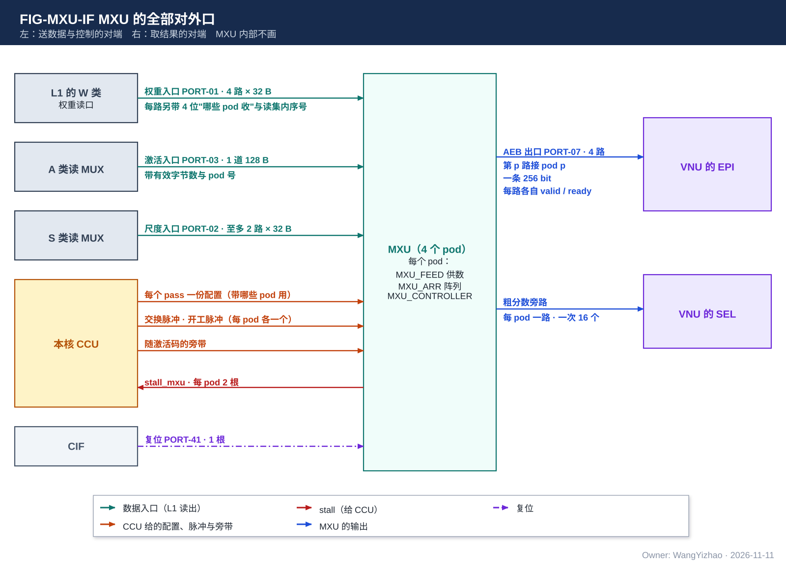
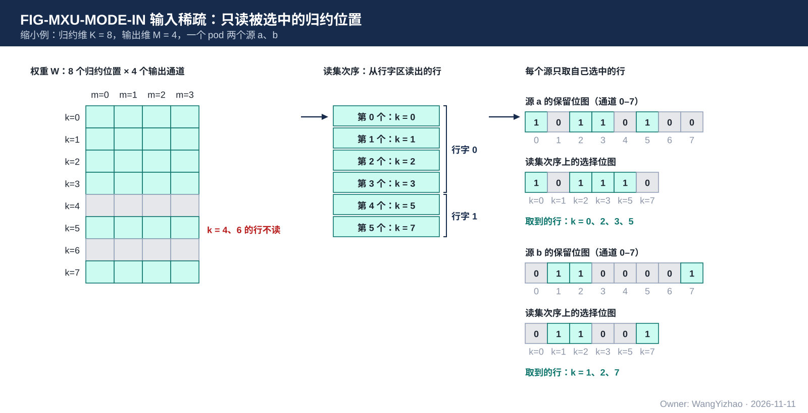
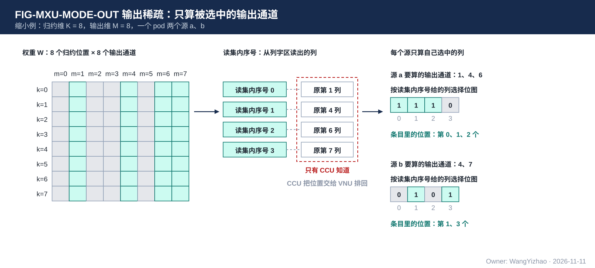
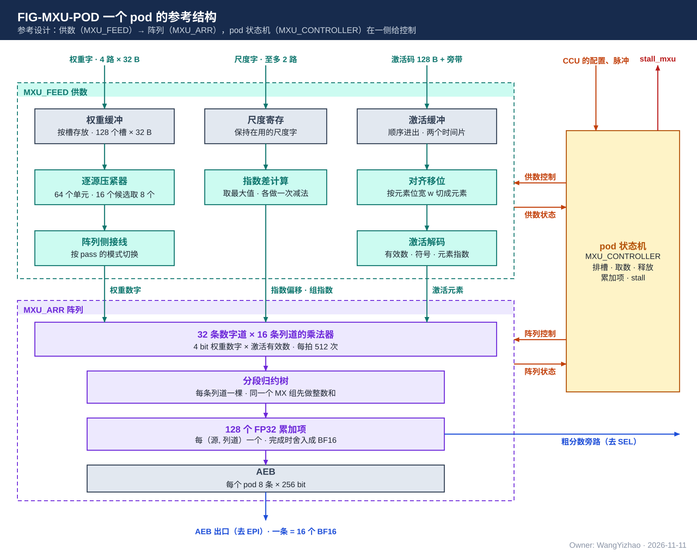

# MXU 集成需求：每核 4 个 pod 的稀疏矩阵乘加

> Owner: WangYizhao｜2026-11-11

## 1 概述

**MXU 是每个计算核里做矩阵乘加的部分：4 个结构相同的 pod，每个 pod 一拍做 512 次"4 bit 权重数字 × 激活有效数"的乘法并按输出通道累加。** 全芯片 4 个核、16 个 pod。

MXU 只算一种形态：$Y = XW$。$W$ 是 $K \times M$ 的右操作数（权重侧），$k$ 是归约位置，$m$ 是输出通道；$X$ 是左操作数（激活侧），它的一行叫一个**驻留激活源**（下称"源"）——一个 token 的激活向量、attention 里一个查询行，或一条补算记录。一个 pod 同时算几个源，这几个源共用同一份权重。

$$y_{s,m} = \sum_{k} x_{s,k}\, W_{k,m}$$

**MXU 只有两种工作模式**（哪个运算用哪种模式见架构篇 §3.6，本篇不重复运算清单）：

| 模式 | 挑什么 | 权重在 L1 W 类的排法 |
|---|---|---|
| 输入稀疏 | 只读被选中的归约位置 $k$ | 行字区：一个存储字 = 4 个相邻归约位置 × 16 个输出通道 |
| 输出稀疏 | 只算被选中的输出通道 $m$ | 列字区：一个存储字 = 一个输出通道的 64 个连续归约位置 |

两种模式在被选中的是全部行或全部列时，就是稠密计算。

MXU 由四部分组成，各有一篇：

| 篇 | 管什么 |
|---|---|
| 本篇 MXU_INTEGRATION | MXU 对外的全部口、组内各部分之间交什么、4 个 pod 的关系、组级的性能与验收 |
| MXU_FEED（供数） | 把读来的权重字、激活码、尺度字整理成阵列每拍要的形式 |
| MXU_ARR（阵列） | 乘法、组内整数和、累加、舍入导出、出口缓冲 |
| MXU_CONTROLLER（控制器） | MXU 自己的状态机：按 CCU 给的配置，在 MXU 内部做逐拍的控制 |

**MXU 到出口缓冲 AEB 为止。** 从 AEB 取走结果之后的事（残差加、bias 加、未算完的部分和写进 L1、量化、判决）都不在 MXU，归 VNU。

本篇给三类读者用：MXU 各部分的设计者（各自的对外口以本篇为准）；CCU 的设计者（每个 pass 要给 MXU 什么）；编译链（一拍能算多少、有哪些接口常数）。

不属于 MXU 的内容：

- 每个 pass 算哪些行、哪些列：由 CCU 定。**MXU 不感知当前计算的行或列在原矩阵里的实际位置，只做矩阵计算。**
- L1 的读地址：全部由 CCU 发。
- 选择位图从哪来：SEL 的判决结果，经 CCU 交给 MXU。
- 本篇不含容错设计。

## 2 接口需求

### 2.1 架构图与接口汇总

图中只画"MXU（4 个 pod）"一个框与它的全部口，不画内部。**本节的接口汇总表是 MXU 对外口的唯一出处**；MXU 另三篇与别的模块篇引用这些口时写"MXU 集成篇 §2.x"。口宽与条数以架构篇 §2.7 的 PORT 编号为准。

| 口 | 对端 | 方向 | 位宽 | 握手 |
|---|---|---|---|---|
| 权重入口（PORT-01） | L1 的 W 类权重读口 | 入 | 4 路 × 32 B，每路另带 4 位"哪些 pod 收"与读集内序号 | 无（L1 读固定 1 拍返回） |
| 激活入口（PORT-03） | A 类读 MUX | 入 | 1 道 128 B，带有效字节数与 pod 号 | 无 |
| 尺度入口（PORT-02） | S 类读 MUX | 入 | 每路 32 B，至多 2 路 | 无 |
| CCU 配置口 | 本核 CCU | 入 | 每个 pass 一份配置，带 4 位"哪些 pod 用"；"交换""开工"两个脉冲，每个 pod 各一个；随激活码的旁带 | 配置在开工之前给到 |
| AEB 出口（PORT-07） | VNU 的 EPI | 出 | 4 路，第 $p$ 路固定接 pod $p$；一条 256 bit = 16 个 BF16 | 每路各自 valid / ready |
| 粗分数旁路 | VNU 的 SEL | 出 | 每 pod 一路，一次 16 个分数 | 无 |
| stall_mxu | 本核 CCU | 出 | 每 pod 2 根：权重收不下、激活收不下 | 电平 |
| 复位（PORT-41） | CIF | 入 | 1 根 | 无 |

### 2.2 权重入口：4 路 × 32 B，各 pod 各自要

**L1 的 W 类权重读口一拍读出至多 4 个存储字（4 路，每路 32 B），送到 MXU。每一路的字带两样旁带：4 位"哪些 pod 收"（对应位为 1 的 pod 在这一拍收下这个字），以及这个字的读集内序号（§2.2.2）。**

#### 2.2.1 各 pod 各自要权重

**各 pod 各自要权重是基本需求。** 4 个 pod 算的是同一个子位点的同一份权重，但各 pod 的源稀疏程度不同，用完一个权重字的快慢也不同。所以每个 pod 各自表示"我还能收"（§2.8），CCU 按各 pod 的进度分别给：

- 几个 pod 这一拍要的是同一个字时，这个字只读一次，同拍送给这几个 pod；4 个 pod 步调一致时，每个字都同时送给 4 个 pod。
- 各 pod 要的字不同时，一拍里 4 路可以是 4 个不同的字，各送各的 pod。

每个 pod 在一个 pass 里收到的字，读集里的每个字一个不少、一个不重。读集是这个 pod 在这个 pass 里全部源要用的行（或列）的并集，由 CCU 定。

#### 2.2.2 权重字带读集内序号，不带写入位置

**每个权重字带一个读集内序号：它是这个 pod 这个 pass 的读集里的第几个字。MXU 按序号认字，不按到达的先后认字。**

- **为什么要带序号**：L1 的 W 类读口一拍 4 路，一个字走哪一路由它的地址决定；CCU 会前看未来几拍 4 个 pod 的权重需求，调整发放的先后，让每拍尽量用满 4 路，并把几个 pod 要的同一个字对齐成一次读出。调整之后，字到达 pod 的先后不再等于读集次序。MXU 如果按到达的先后数"第几个字"，就会认错。带上序号后，CCU 可以按任意先后发，同一拍到达同一个 pod 的几个字也不必规定谁先谁后。
- **序号不是写入位置**：这个字放在权重缓冲的哪里，仍由 MXU 的控制器定（MXU_CONTROLLER 篇 §3.2）。MXU 也不知道这个字是原矩阵的第几行、第几列。
- 序号可以是相对 CCU 前看窗口起点的偏移；位宽与编码【设计者定】，由 MXU 与 CCU 的设计者对接。要定的是位宽与起点怎样推进；约束是 CCU 可能乱序发放的范围之内，每个字的序号互不相同。

#### 2.2.3 权重字的内容

- 字形态两种（行字区、列字区），定义见数据组织篇 §2.12。
- 一个权重码是 8 bit 整数 $c = 16h + \ell$，拆成高位数字 $h$ 与低位数字 $\ell$，各 4 bit，分别存成两个平面（hi 平面、lo 平面）；一个存储字里是同一个平面的 64 个 4 bit 数字。4 bit 权重只有一个平面。
- **全码**：同一列的 hi 平面字与 lo 平面字都读进来，合成完整的 8 bit 权重（attention 精算、LM Head 的 TOPK 列补算）。

### 2.3 激活入口：1 道 128 B，送哪个 pod 是固定的

**A 类读 MUX 轮到 MXU 的那一拍，把至多 128 B 的激活码送到 MXU，同时带这一拍的有效字节数与 pod 号。** 4 个 pod 在 A 类读 MUX 上算一个使用者。

#### 2.3.1 收到的是压紧后的码，MXU 不解包

激活按紧凑 token 记录存放：被保留的通道的码首尾相接，没保留的通道不占位置（数据组织篇 §2.5）。**MXU 收到的是一段首尾相接的码，不解包**：这一段里第 $i$ 个码对应这一段的保留位图里第 $i$ 个 1。CCU 推送一个源的激活码时，一次只推进归约维上的一段，这一段叫一个**发读步长**（数据组织篇 §1.2）；发读步长有多长属 CCU 的设计，它不必等于紧凑 token 记录的通道片。一个发读步长的第一个码不一定从读出的第一个字节的最低位开始，所以 CCU 同时给出首字起始位偏移（§2.5.3）。

元素位宽 $w \in \{6, 8, 16\}$：6 是 MXFP6（E2M3），8 是 FP8（E4M3 或 E5M2），16 是 BF16 或 FP16。

#### 2.3.2 送哪个 pod、属于哪个源

- **源属于哪个 pod 是固定的**：一个核的第 $s$ 个源属于第 $\lfloor s/n \rfloor$ 个 pod 的第 $s \bmod n$ 个驻留位，$n$ 是每个 pod 的源数（配置给出）。AEB 的第 $p$ 路按驻留位次序输出 pod $p$ 的各个源（§2.6）。
- **这一拍的码属于哪个 pod**：由 pod 号给出。pod 号是 CCU 这一拍选了哪个 pod 来服务，不是缓冲的写入位置。
- **属于这个 pod 的哪个源**：不另给。CCU 对每个 pod，按源的序号从小到大，依次推送各源在当前发读步长上的码，各源都推完再进下一个发读步长；MXU 的控制器按保留位图里 1 的个数，数出一个源在这个发读步长上的码到哪里结束（MXU_CONTROLLER 篇 §3.2）。

#### 2.3.3 pod 的激活缓冲与 CCU 的分时

CCU 在各 pod 之间分时：连续几拍服务同一个 pod，再换下一个。CCU 连续服务一个 pod 的那几拍叫一个时间片。**每个 pod 的激活缓冲至少装得下两个时间片的码**，使 CCU 去服务别的 pod 时，这个 pod 手里还有码可算。时间片的长度由 CCU 设计者按激活缓冲的容量定。

#### 2.3.4 停放值的装回复用这一道

一个源在某个输出通道上没有算完的部分和，由 EPI 写进本核 L1 的 A 类暂存（停放）；下次接着算之前，要读回累加器。**读回走的就是这一道激活入口**：A 类读 MUX 送 MXU 的那一拍带"装回"标志与 pod 号，一拍 128 B = 4 条停放条目（一条 = 16 个 BF16 = 32 B）；这一拍有几条由有效字节数得出。

### 2.4 尺度入口：经 S 类读 MUX 进 pod

**尺度（E8M0，一个 8 bit 的 2 的幂指数）从 L1 的 S 类读出，经 S 类读 MUX 送到 MXU；一拍至多 2 路，每路一个 32 B 的字。** 每路带一个有效位与去向：送 pod 的权重一侧还是激活一侧（CCU 给 S 类读 MUX 去向时定）；是下表四种里的哪一种由这个 pass 的配置决定。何时读由 CCU 安排；pod 何时收、怎样保持到用它的时候，归 MXU 设计者。

四种尺度字：

| 尺度字 | 一个字装什么 | 用在哪 |
|---|---|---|
| 权重尺度行 | 一个 K 组（32 个相邻归约位置）下 32 个输出通道的 32 个 E8M0 | 线性位点 |
| 录取 key 的 K、V 尺度 | 32 个录取 key 在同一个尺度分组上的 E8M0，按录取次序 | attention 精算、$O = PV$ |
| LM Head 列副本的尺度 | 一列的 32 个 K 组的 E8M0 | LM Head 的 TOPK 列补算 |
| 激活 E8M0 | 32 个，激活每 $G$ 个通道一个；$G$ 是激活的 MX 组长，位点属性，32 的倍数 | 全部位点 |

**右操作数的尺度一律由 pod 处理**，包括尺度沿归约维逐位置不同的情形（MXU_FEED 篇 §3.6）。

### 2.5 CCU 配置口：每个 pass 一份配置，两个脉冲

**CCU 只在每个 pass 开始时把配置交给 MXU 的控制器；一个 pass 之内逐拍的事由 MXU 自己做。** 一个 pass 是一个 pod 的一次"装一批权重、让本 pod 的各个源用它算一遍"。

**每份配置带 4 位"哪些 pod 用"。** 4 个 pod 做同一个 pass 时，一份配置同时给 4 个 pod；各 pod 做的 pass 不同时（§3.4），CCU 分别给。

#### 2.5.1 每个 pass 的配置

| 配置项 | 含义 |
|---|---|
| 模式 | 输入稀疏或输出稀疏 |
| 权重平面 | 这个 pass 用 hi 平面、lo 平面、单平面（4 bit 权重），还是全码（同一列的 hi 与 lo 在同一个 pass） |
| 激活格式与元素位宽 $w$ | MXFP6、FP8（E4M3 / E5M2）、BF16、FP16 |
| 激活的 MX 组长 $G$ | 位点属性 |
| 哪些 pod 用、每个 pod 几个源 | 例：只开 2 个 pod、每个 pod 5 个源 |
| 这一批的大小 | 这个 pass 送给这个 pod 多少个权重字；归约维分成多少个发读步长 |
| 输出稀疏时每个源的列选择位图 | 位图的第 $i$ 位对应读集内序号为 $i$ 的那一列 |
| 累加的起点 | 各源从 0 开始累加、从停放值接着累加，还是接着上一个 pass 留下的累加项继续加 |
| 这个 pass 结束时是否导出 | 导出成 AEB 条目，还是把累加项留给下一个 pass 接着加（例：先算 hi 平面的 pass，再算 lo 平面的 pass，两个 pass 加进同一组累加项） |

配置的字段位宽、放在指令的哪里，由 MXU 与 CCU 的设计者对接后归指令设计。

#### 2.5.2 两个脉冲：批的边界由 CCU 给

**数据带有效信号，MXU 的控制器按有效信号判断每一拍进来多少数据；一批权重到哪里结束由 CCU 用脉冲告诉 MXU。** CCU 自己数着发了多少读：

- **交换脉冲**：这个 pass 给某个 pod 的权重字已经全部送到，每个 pod 各一个。
- **开工脉冲**：某个 pod 的下一个 pass 的配置已经生效，可以开始，每个 pod 各一个。

不设首拍标记：一个 pod 上一个 pass 的交换脉冲之后到达这个 pod 的权重字，属于它的下一个 pass。

#### 2.5.3 随激活码的旁带

一个源在一个发读步长上的码到达时，CCU 同时给（内容与数据组织篇 §3.4.3 相同）：

- 保留位图：这个发读步长里哪些通道有码；输入稀疏时它按读集里行的次序给，同时是这个源的行选择位图：第 $i$ 位对应读集里的第 $i$ 行，即读集内序号为 $\lfloor i/4 \rfloor$ 的那个字的第 $i \bmod 4$ 行。
- 首字起始位偏移：这一段的第一个码在读出的第一个字里从哪一位开始。
- F 掩码：哪些通道的权重要用到 lo 平面。
- MX 组边界：从哪个通道起换下一个 E8M0。

### 2.6 AEB 出口：4 路各自输出，路号就是 pod 号

**AEB 是每个 pod 的出口缓冲。一条 AEB 条目 = 16 个 BF16 = 一个源在一个 pass 上的 16 个结果，256 bit。** 输入稀疏时这 16 个结果是一个列块（16 个相邻输出通道）；输出稀疏时是这个 pass 读集里的至多 16 列，条目里第 $j$ 个结果属于读集内序号为 $j$ 的那一列。

- **4 路各自输出**：第 $p$ 路固定接 pod $p$。一个 pod 的各个源在它当前的 pass 上都算完（称这个 pod 的一轮）后，这一路就输出，不等别的 pod。
- **路内次序固定**：驻留位 0 到驻留位 $n - 1$。
- **条目的身份 = 路号 + 路内次序**：路与路之间不规定先后。4 路可以同一拍各出一条，也可以先后相差很多拍。
- **条目不带 token 标记**：条目属于哪个 token 或查询行、是原矩阵的哪些输出通道，只有 CCU 知道；CCU 把位置另交给 VNU（VNU_CONTROLLER 篇 §2.4）。
- 每一路各自 valid / ready；EPI 来不及收某一路时拉低这一路的 ready，别的路不受影响。
- 没开的 pod、没用的驻留位不输出条目。

### 2.7 粗分数旁路：直达 SEL

attention 粗算时，每个 pod 每算完一个（查询行, 16 个 key）的 16 个粗分数，直接送本核的 SEL，不进 AEB。无握手，SEL 不反压（VNU 集成篇 §2.3）。

### 2.8 stall_mxu：每个 pod 各自表示收不收得下

**每个 pod 给 CCU 两根电平：权重缓冲收不下、激活缓冲收不下。** CCU 见到某个 pod 的某一根为高，就不再给这个 pod 发对应的读；别的 pod 不受影响。

L1 的读固定 1 拍返回、口上没有握手，CCU 发出的读在途中不能撤回。所以 MXU 要在"还剩下在途的拍数那么多空位"时就拉高，阈值由 MXU 设计者按在途拍数定。这与核间链路上"占用到深度减在途拍数就拉低 ready"是同一条规则（协议篇 §7.9）。

### 2.9 复位

MXU 只有一个复位输入，来自 CIF，不区分硬复位与软复位（CIF 篇 §2.4）。复位后各缓冲为空，累加器清零，AEB 为空。MXU 没有启动输入，也不收停止请求：CCU 不再送数据时，MXU 把已经收到的数据算完，然后停在原地等新的数据。

### 2.10 组内口：三个部分之间交什么

这些口不出 MXU，这里只列交什么；位宽与编码【设计者定】，由三部分的设计者对接。

| 组内口 | 方向 | 交什么 |
|---|---|---|
| 阵列输入 | FEED → ARR | 每拍：32 条数字道 × 16 条列道的 4 bit 权重数字；每条数字道的平面标志；这一拍的激活元素；每条数字道的指数偏移；MX 组边界与各组的指数；有效位 |
| 供数控制 | CONTROLLER → FEED | 到达的权重字放在权重缓冲的哪里、这一拍取哪些字的数、当前是哪个源、模式、哪些位置已经释放 |
| 阵列控制 | CONTROLLER → ARR | 当前是哪个源、这是不是该源在本 pass 的最后一拍、是否从停放值接着累加、输出许可 |
| 供数状态 | FEED → CONTROLLER | 权重缓冲的空位、激活缓冲的存量 |
| 阵列状态 | ARR → CONTROLLER | AEB 的存量 |

数字道、列道的含义：一个 pod 的阵列有 32 条数字道（沿归约维排）和 16 条列道（沿输出维排），一条数字道与一条列道的交点是一个乘法器（MXU_ARR 篇 §1）。权重缓冲内部怎样组织不属于需求；参考设计按"槽"组织，一个槽放一个权重字（§7.1）。

## 3 功能描述

### 3.1 功能一览

| 功能 | 输入 | 输出 | 触发 / 生效条件 |
|---|---|---|---|
| 一次乘加（§3.2） | 权重数字、激活元素、尺度 | 累加项 | 每拍 |
| 输入稀疏模式（§3.3） | 行字区的权重、压紧的激活码、保留位图 | 每个源在各输出通道上的结果 | pass 配置的模式位 |
| 输出稀疏模式（§3.3） | 列字区的权重、激活码、列选择位图 | 每个源在被选列上的结果 | pass 配置的模式位 |
| 4 个 pod 的关系（§3.4） | — | 4 路各自输出 | 每个 pod 的每一轮 |
| 一个 pass 的先后（§3.5） | 配置、脉冲、数据 | AEB 条目 | 每个 pass |
| 复位（§3.6） | 复位 | — | 任何时候 |

### 3.2 一次乘加算什么

**一个 pod 一拍让一个源占用阵列：这个源的一批激活元素，各乘上 16 个输出通道的权重数字，按输出通道求和，加进这个源在这 16 个输出通道上的累加项。**

- 权重码 $c = 16h + \ell$ 的两个数字各乘一次：$c \cdot x = 16\,(h \cdot x) + \ell \cdot x$。
- 共用一个尺度的 32 个相邻归约位置叫一个 MX 组。一个 MX 组内的乘积先做精确的整数和，再按这个组的指数加进累加项。
- 累加项是 FP32。一个源在一个列块上算完时，累加项舍入成 BF16，进 AEB。

一拍能算多少归约位置 × 多少输出通道，随操作数格式而定，见 §4.1。

### 3.3 两种工作模式

#### 3.3.1 输入稀疏：只读被选中的归约位置

图中的缩小例：归约维 $K = 8$，输出维 $M = 4$，一个 pod 算两个源 a、b。

- 源 a 的保留位图是 1011 0100，保留通道 0、2、3、5；源 b 的是 0110 0001，保留通道 1、2、7。
- 读集是两者的并集：通道 0、1、2、3、5、7，共 6 行，按这个次序从行字区读出；通道 4、6 的权重行不读。每 4 行一个字：第一个字是通道 0、1、2、3，第二个字只有通道 5、7 两行，字里余下的位置无效、不参与计算。
- 交给 pod 的选择位图按读集次序给：源 a 是 101110（取读集里第 0、2、3、4 个，即通道 0、2、3、5），源 b 是 011001（通道 1、2、7）。
- 每个源只拿自己选中的行与自己的激活相乘、累加，得到 4 个输出通道的结果。

实际尺寸：行字区一个存储字是 4 个相邻被选行 × 16 个输出通道；一个 pod 至多 8 个源；一个列块是 16 个输出通道。

#### 3.3.2 输出稀疏：只算被选中的输出通道

图中的缩小例：归约维 $K = 8$，输出维 $M = 8$，一个 pod 算两个源 a、b。

- 源 a 要算输出通道 1、4、6；源 b 要算输出通道 4、7。
- 读集是两者的并集：列 1、4、6、7，读集内序号依次是 0、1、2、3；这 4 个字从列字区读出，到达的先后由 CCU 定，各带自己的序号。
- 列选择位图按读集内序号给：源 a 是 1110，源 b 是 0101。
- **pod 按读集内序号算，条目里第 $j$ 个结果属于序号为 $j$ 的列；"序号 0、1、2、3 的列是原矩阵的第 1、4、6、7 列"只有 CCU 知道。** CCU 把每个结果的真实位置交给 VNU，由 VNU 排回原来的次序（VNU_CONTROLLER 篇 §3.5）。

实际尺寸：列字区一个存储字是一列的 64 个连续归约位置；一个 pass 至多算 16 列。

#### 3.3.3 模式是 pass 的属性

模式由每个 pass 的配置给出，相邻两个 pass 可以是不同的模式。**相邻 pass 模式不同时不排空**：前一个 pass 的权重字用完一个、释放一个，后一个 pass 的权重字随即装进空出来的位置（MXU_CONTROLLER 篇 §3.7）。

### 3.4 4 个 pod：同一个子位点，各自推进，各自输出

- **4 个 pod 做同一个子位点**：同一种运算、同一份权重。
- **pod 之间只按源分**：第 $s$ 个源属于哪个 pod 是固定的（§2.3.2）。
- **各 pod 各自推进**：各自要权重（§2.2.1）、各自收激活、各自算、各自输出（§2.6），快慢可以不同。一个 pod 算完自己的一轮就可以开始它的下一个 pass，不等别的 pod；所以同一时刻 4 个 pod 可以处在不同的 pass。
- **MXU 不要求 4 个 pod 同步。** pod 之间相差多远由 CCU 控制：CCU 沿输出维把一个子位点分成若干个输出分段，一个输出分段之内各 pod 各自推进、各 pass 的先后可以调整，输出分段之间依次进行（VNU_CONTROLLER 篇 §3.5）。输出分段是 CCU 与 VNU 之间的约定，MXU 不感知。
- 可以只开一部分 pod，每个 pod 的源数可配（§2.5.1）。

### 3.5 一个 pass 从配置到 AEB 的先后

下面以一个 pod 为例；4 个 pod 做同一个 pass 时，各步同时对 4 个 pod 进行。

1. CCU 把这个 pass 的配置交给 MXU 的控制器，给这个 pod 开工脉冲。
2. CCU 发权重读。权重字带着读集内序号到达这个 pod，控制器把它放进权重缓冲的空位，并记下这个序号的字放在哪里。
3. CCU 分时给各 pod 推送激活码与旁带，并发尺度读。
4. 控制器让本 pod 的各个源轮流占用阵列：按这个源的选择位图，从权重缓冲里取出它要的权重数字，与这个源的激活元素一起交给阵列。
5. 阵列每拍做乘加，更新这个源的累加项。
6. 一个权重字被本 pod 的每个源都用过之后，它占的位置就释放，可以装新的字。有空位时 pod 撤下"权重收不下"，CCU 继续给它发读。
7. CCU 把这个 pass 给这个 pod 的权重字全部送到后，给这个 pod 交换脉冲。
8. 一个源在这个 pass 上的最后一拍，阵列把它的 16 个累加项舍入成 BF16，写进 AEB。
9. 这个 pod 的各个源都写进 AEB 后，这一路按驻留位次序输出 AEB 条目。

第 2、3 步与第 4–6 步同时进行：**装下一批与算当前这一批互不等待**（§4.4）。

### 3.6 复位

见 §2.9。

## 4 性能指标

### 4.1 一拍的计算量

**每个 pod 每拍 512 次数字乘（32 条数字道 × 16 条列道），每核 2,048 次，全芯片 8,192 次。** 按操作数格式，每个 pod 每拍算的归约位置数 × 输出通道数：

| 激活格式 | 权重两平面 8 bit | 权重单平面 4 bit |
|---|---|---|
| MXFP6（E2M3）、FP8（E4M3、E5M2） | 16 × 16 | 32 × 16 |
| BF16、FP16 | 8 × 16 | 16 × 16 |

- "权重两平面 8 bit"一栏是把 hi、lo 两个平面的工作量合在一起的等效值：一个归约位置的两个数字各占一条数字道的一拍。线性位点先算 hi 平面的 pass、再算 lo 平面的 pass，不要求两个平面同拍；全码时两个平面在同一个 pass。
- **BF16 / FP16 的一个激活元素占两条数字道**（有效数的低段与高段各一条），所以 32 × 16 的阵列重构成 16 × 16，一遍算完（MXU_ARR 篇 §3.3）。

### 4.2 各口的速率与同时使用

| 口 | 速率 | 说明 |
|---|---|---|
| 权重入口 | 全核至多 128 B / 拍 | 4 个 pod 步调一致时每个字同时喂 4 个 pod；各读各的时共享这 128 B |
| 激活入口 | 轮到 MXU 的拍至多 128 B | A 类读出每拍只给一个使用者（架构篇 §3.7） |
| 尺度入口 | 至多 2 路 × 32 B / 拍 | 架构篇 CONC-6 |
| AEB 出口 | 每 pod 每拍至多 1 条 | 4 个 pod 合计至多 128 B / 拍 |

权重入口、激活入口、尺度入口可以在同一拍都有数据到达。

**权重读口每核 128 B / 拍是否够阵列用，由 MXU 设计者评估，读口不改。** 评估时一并考虑片外访存带宽：片内访存带宽已高于片外，系统的瓶颈在片外。最坏情况下（4 个 pod 每拍各用掉 32 个压紧后的归约位置、激活不复用），激活读入比阵列消耗慢约 1.06 倍（$w = 6$）或 1.31 倍（$w = 8$）。

### 4.3 与 EPI 的关系

**EPI 处理一路的一轮 AEB 条目的拍数，不超过这个 pod 产出下一轮的拍数**（EPI 篇 §4）。一轮的拍数随位点而变【待标定】；$O = PV$ 是最紧的位点。EPI 来不及收某一路时拉低这一路的 ready，这个 pod 只降速、不丢结果。

### 4.4 ping-pong：装与算互不等待

**这是必要需求。** 权重缓冲与激活缓冲都要能一边装下一批数据、一边算当前这一批：

- 一个权重字用完就释放，新的字随即装入，不必等整批用完。
- 相邻 pass 模式不同时不排空（§3.3.3）；切换时残余的空拍只来自阵列的流水深度与第一批权重的装入【待标定】。
- 激活缓冲至少两个时间片（§2.3.3）。

### 4.5 面积与利用率：好于参考设计

**这是必要需求。MXU 设计者给出的方案，面积要小于参考设计，阵列利用率不低于参考设计。** 参考设计是 MXU 另三篇第 7 章给出的做法；参考值如下，推导见 §7.2 与 §7.3。

**阵列利用率是 MXU 供数与控制一侧的核心需求：权重缓冲怎样组织、怎样取数、各源怎样轮流，都只用这一个指标约束，不规定做法。** 它的定义：

- **测试条件**：规定的测试负载（位点 + 真实的稀疏位图）；CCU 只要 MXU 不拉 stall 就按口宽满速发读。
- **起止**：从这个计算第一拍发 L1 读算起，到它的最后一条 AEB 条目导出为止。读出的在途拍、第一批权重的装入、各源之间的等待、模式切换的空拍都算在内。
- **利用率** = 这段时间里的有效乘法次数 ÷（参与的 pod 数 × 每 pod 512 个乘法器 × 这段拍数）。有效乘法指权重数字与激活元素都有效的那些乘法。

| 项 | 参考值（全芯片 16 个 pod） | 状态 |
|---|---|---|
| 阵列（乘法、归约、累加器、AEB） | 约 0.77 mm²，另加按 BF16 / FP16 加宽与 FP32 加法逻辑的增量 | 一阶推导；增量【待标定】 |
| 供数（权重缓冲、取数网络、激活缓冲） | 不超过约 3.62 mm² | 一阶推导，旧供数结构的账【待标定】 |
| 供数侧存储 | 每 pod 约 4.8 KB，全芯片约 76.5 KB | 一阶推导 |
| 控制器 | — | 【待标定】 |

| 位点类 | 利用率参考值 | 状态 |
|---|---|---|
| 线性位点，输入稀疏 | 0.86–0.98 | 旧供数结构下仿真【待标定】 |
| gate / up 的列补算，输出稀疏 | 0.80（Qwen）/ 0.91（MiniCPM） | 旧供数结构下仿真【待标定】 |
| attention 粗算 | 0.79 | 旧供数结构下仿真【待标定】 |
| 传播梯度，4 个 pod 都走输出稀疏 | — | 【待标定】 |

表中的旧仿真数字按"阵列做有效乘法的拍数 ÷ 阵列被这个位点占用的总拍数"统计，口径与上面的定义不完全相同；按上面的定义重新标定后替换【待标定】。

### 4.6 要求值表

| 项 | 要求 |
|---|---|
| 每 pod 每拍数字乘 | 512 |
| 各格式一拍的归约位置 × 输出通道 | §4.1 的表 |
| 装与算 | 互不等待（§4.4） |
| 面积 | 小于参考设计（§4.5） |
| 利用率 | 不低于参考设计（§4.5） |
| 移位能耗 | 不高于参考设计（MXU_ARR 篇 §4） |
| 精度 | 任务精度不低于 Reference（§6.1） |

## 5 约束与由使用者保证的事项

### 5.1 硬约束

1. MXU 只有两种工作模式。
2. 4 个 pod 做同一个子位点；各 pod 各自推进、各自输出，MXU 不要求它们同步。
3. MXU 到 AEB 为止；累加器不预装 bias。
4. MXU 的缓冲不接收写入位置；MXU 不感知行、列在原矩阵里的实际位置。
5. 本篇不含容错设计。

### 5.2 CCU 排 pass 时要用的接口常数

下表是现行值。CCU 与编译链按它排 pass；MXU 设计者要改其中某一项时，与 CCU 设计者对接。

| 常数 | 现行值 |
|---|---|
| 每核 pod 数 | 4 |
| 每个 pod 的源数上限 | 8 |
| 一个列块的输出通道数（一条 AEB 条目的元素数） | 16 |
| 输出稀疏时一个 pass 至多算的列数 | 16；全码时 8 |
| 权重的 MX 组长 | 32 |
| 激活的 MX 组长 $G$ | 32 的倍数 |

### 5.3 由使用者保证的事项

| 事项 | 由谁保证 |
|---|---|
| 每个 pod 在一个 pass 里收到的权重字不缺不重；每个字带正确的读集内序号 | CCU |
| 每个 pod 的各个源按序号从小到大推送激活，一个发读步长一个发读步长地推；一个发读步长用到的权重不超过权重缓冲装得下的量 | CCU |
| 配置在开工脉冲之前给到；交换脉冲在这个 pod 的最后一个权重字之后给 | CCU |
| 某个 pod 拉高"收不下"之后，在途拍数之内不再有新的读发给它 | CCU |
| 选择位图按读集内序号给；读集是这个 pod 全部源的选择的并集 | CCU |
| 4 个 pod 之间相差多远（按输出分段控制） | CCU |
| 每个结果的真实位置交给 VNU；结果写到哪里 | CCU |
| 把结果排回原来的次序 | VNU |
| 权重按字形态与读集次序落在 L1 | 编译链、MAE_DSU、QNT |
| 按时取走 AEB 条目 | EPI |
| 读固定 1 拍返回 | L1 |

## 6 验收

### 6.1 精度：任务精度不低于 Reference

**MXU 的精度标准是任务精度（Acc）不下降。** Reference 是 GPU 用与硬件完全相同的量化操作数（同样的权重码、激活码、尺度）、按 FP32 累加做同样的计算得到的任务精度。

- **不要求 MXU 的结果与 GPU 的结果逐位一致**，允许一定误差，包括累加先后不同带来的差别。
- 同一批数据，到达 MXU 的拍不同时，结果的末几位可以不同。
- 与先后无关的部分（数字拆分、按位图取数、激活码的对齐）用位级参考模型对拍，要求逐位相同（MXU_FEED 篇、MXU_ARR 篇 §6）。

### 6.2 本篇条目的验收项

| 编号 | 验收项 | 出处 |
|---|---|---|
| MXU-A-01 | 两种模式下，各源的结果满足 §6.1 | §3.3 |
| MXU-A-02 | 每个 pod 只收"哪些 pod 收"里有自己的字；各 pod 进度不同、处在不同的 pass 时各自的结果都正确 | §2.2、§3.4 |
| MXU-A-02a | 同一个 pass 的权重字按任意先后到达（包括同一拍几个字）时，结果满足 §6.1；与按读集次序到达时相比，按位图取出的数字逐位相同 | §2.2.2 |
| MXU-A-03 | 激活按 pod 号进固定的 pod；源的归属与 §2.3.2 的规则一致 | §2.3 |
| MXU-A-04 | 每一路按驻留位次序输出，一路的 ready 拉低不影响别的路；没开的 pod 与没用的驻留位不输出 | §2.6 |
| MXU-A-05 | 相邻 pass 模式不同时，不需要先排空权重缓冲 | §3.3.3 |
| MXU-A-06 | 拉高"收不下"之后在途的数据都收得下 | §2.8 |
| MXU-A-07 | CCU 停送数据后 MXU 停在原地；继续送后不丢、不重 | §2.9 |
| MXU-A-08 | 面积小于 §4.5 的参考值；按 §4.5 的定义统计的阵列利用率不低于参考值 | §4.5 |

### 6.3 与上下游模块的对接检查

| 编号 | 检查项 | 对端 |
|---|---|---|
| MXU-I-01 | 配置各项与"哪些 pod 用"、每 pod 的两个脉冲、随码旁带的内容与时序 | CCU |
| MXU-I-02 | 各 pod 各自要权重：stall 与"哪些 pod 收"配合正确，同一路的两个请求由 CCU 错到不同拍；读集内序号的位宽与推进方式 | CCU、L1 篇、架构篇 CONC-4 |
| MXU-I-03 | PORT-01 / 02 / 03 / 07 的口宽 | 架构篇 §2.7 |
| MXU-I-04 | 4 路各自输出、路内次序、每个 pod 一轮的拍数关系、停放条目的格式 | EPI 篇、VNU_CONTROLLER 篇 |
| MXU-I-05 | 粗分数的格式与节拍 | SEL 篇 |
| MXU-I-06 | 两种字形态、读集次序、随码交 pod 的旁带内容（数据组织篇 §2.12） | 数据组织篇 |

## 7 参考设计

本章的做法可以换；换的方案须满足第 4 章相对参考设计的指标。

### 7.1 一个 pod 的结构与一拍的数据流

一个 pod 的参考结构，自上而下：

| 部分 | 部件 | 所在篇 |
|---|---|---|
| 权重一侧 | 权重缓冲（按槽存放）→ 逐源压紧器（按选择位图取数）→ 阵列侧接线（按模式接到数字道与列道） | MXU_FEED |
| 激活一侧 | 激活缓冲 → 对齐移位 → 激活解码 | MXU_FEED |
| 尺度 | 尺度寄存、指数差计算 | MXU_FEED |
| 乘加 | 32 条数字道 × 16 条列道的乘法器 → 每列的分段归约树 | MXU_ARR |
| 累加与出口 | 128 个 FP32 累加项 → 舍入成 BF16 → AEB | MXU_ARR |
| 控制 | pod 的状态机 | MXU_CONTROLLER |

激活缓冲是顺序进出的小缓冲（码进来时已经压紧）；权重缓冲按槽存放、取数时在线压紧。两侧不同构。**槽是参考设计里权重缓冲的组织单位**：一个槽放一个权重字（32 B），是装入、取用、释放的最小单位，一拍至多装 4 个；参考设计每 pod 128 个槽。需求只约束阵列利用率（§4.5），不规定用不用槽。图中没有画停放值的装回：它从激活入口进来（带"装回"标志的拍），不经激活缓冲，直接到累加项（§2.3.4）。

### 7.2 面积参考值的来历

**阵列一侧**（全芯片，一阶推导）：

| 项 | 面积 | 依据 |
|---|---|---|
| 乘法与归约的数据通路 | 0.64 mm² | 约 104 万个 2 选 1 等效，平均每 pod 约 6.5 万；按 E2M3 的位宽计 |
| 阵列侧接线 | 0.004 mm² | 每 pod 2,048 个 2 选 1 |
| 累加项存储 | 约 0.065 mm² | 每 pod 128 项 × 32 bit = 512 B；由 40 bit 定点项的 0.081 mm² 按位数折算 |
| 累加的工作寄存 | 约 0.030 mm² | 由 40 bit 时的 0.038 mm² 按位数折算 |
| AEB | 0.032 mm² | 每 pod 8 条 × 256 bit，全芯片 4.1 KB |
| **合计** | **约 0.77 mm²** | |
| 按 BF16 / FP16 加宽的增量 | 【待标定】 | 乘法器有效数一侧、指数加法与对齐移位的范围 |
| FP32 加法逻辑的增量 | 【待标定】 | 每 pod 每拍更新 16 个累加项，规格化与舍入的逻辑 |

**供数一侧**（全芯片）：旧供数结构的一阶账是约 3.62 mm²。这个数不含后来撤掉的几样部件，但它自己的分项包含关系在原账里就没有核清，所以只作上限使用【待标定】。

**供数侧存储**（每 pod，一阶推导）：

| 项 | 容量 |
|---|---|
| 权重缓冲 | 4,096 B（128 个槽 × 32 B） |
| 尺度寄存 | 256 B |
| 激活缓冲 | 256 B（两个时间片 × 128 B） |
| 读出位置的计数 | 48 B |
| 选择位图的接收寄存 | 128 B |
| **合计** | **约 4.8 KB**，全芯片约 76.5 KB |

### 7.3 利用率参考值的来历

§4.5 的利用率都是旧供数结构下的周期级仿真结果，旧结构与现行参考设计的差别在权重读口（每核 256 B / 拍）、激活入口（每 pod 一个 32 B 的读口）和驻留方式。现行参考设计下要重新仿真【待标定】。

| 位点 | 旧结构下的数字 |
|---|---|
| 线性位点，输入稀疏 | 实际拍数 ÷ 理想拍数：q/k/v 1.094（Qwen）/ 1.020（MiniCPM），o 1.050 / 0.970，down 1.159 / 1.136，gate 的 hi 平面 1.070 / 1.024；折合利用率 0.86–0.98 |
| gate / up 的列补算，输出稀疏 | 利用率 0.80（Qwen）/ 0.908（MiniCPM）；按"一个 pass 只属于一个源"一阶推导约 0.62 |
| attention 粗算 | 每（查询行, 64 个 key）忙拍 14.89，利用率 0.79（Qwen Verify 1K） |
| attention 精算 | 每（查询行, 64 个 key）忙拍 3.24（Qwen Verify 1K，两个 pod） |
| $O = PV$ | 每（查询行, 64 个 key）7.14 拍（Qwen Verify 1K，两个 pod） |
| 传播梯度，只走输出稀疏 | 每 token 每 K 组每 256 个输出通道 6.15 拍（Qwen q/k/v，两个 pod） |

### 7.4 各 pod 快慢不同时的参考处理

- 每个 pod 的权重缓冲留有余量，吸收 pod 之间的快慢差。
- CCU 或编译链把 token 分给 4 个 pod 时，尽量让各 pod 的稀疏程度相近。
- 4 个 pod 步调一致时每个权重字只读一次；分化之后各读各的，共享 128 B / 拍。CCU 前看未来几拍的需求、调整发放的先后，尽量把几个 pod 要的同一个字对齐成一次读出（CCU 篇）。
- CCU 按输出分段控制：一个输出分段包含的输出维度越多，4 个 pod 各自的总工作量越接近，分段结束时相差越小。

## 8 为什么

### 8.1 需求的理由

- **只有两种模式**（用户 11-10："一共就两个，一个输入稀疏，一个输出稀疏"）：前向、反传、attention、权重梯度都归到"挑归约位置"或"挑输出通道"，不为某一种运算另设模式。
- **MXU 不感知行、列的实际位置**（用户 11-11："算哪些列必然要由CCU控制，MXU其实不需要感知当前计算的列对应的实际位置，它只负责做矩阵计算"）：与对 L1 W 类一侧的要求一致——哪一列放在哪个地址、读哪些列，都不归 L1 与 MXU。
- **MXU 自带控制器、缓冲不接收写入位置**（用户 11-11："他们接受数据的时候理论上是不需要接收写入地址的，这两个逻辑可以内部计算地址"；"MXU的压缩模式，ping-pong交替，握手信号，也是由MXU Controller模块负责的"）：逐拍的决定留在用它的地方，CCU 只给每个 pass 的配置。
- **批的边界用脉冲、数据带有效信号**（用户 11-11 认可）：与参考工程里主控对前处理单元的做法相同——主控数自己读了多少，一批读完给交换与开工脉冲。
- **各 pod 各自要权重**（用户 11-11："我认为各pod各自要，是基本的设计需求"）：各 pod 的源稀疏程度不同，快的 pod 不应死等最慢的；L1 的 W 类读口一拍 4 个地址正好服务这一点。
- **权重字带读集内序号**（用户 11-11）：CCU 要前看未来几拍的权重需求并调整发放的先后，才能每拍用满 W 类读口的 4 路、并把几个 pod 要的同一个字合成一次读出（用户 11-11："保证每次可以最大化地利用L1 SRAM的位宽，以及广播"）。发放的先后一调整，到达次序就不等于读集次序，所以字要自己带着"我是第几个"；序号不是写入位置，缓冲里放在哪仍由 MXU 定。
- **AEB 4 路各自输出**（用户 11-11："4路各自输出，带路号是更能提升利用率的设计，并且这本身也是一个解决在线稀疏计算的设计优化点"）：在线稀疏下各 pod 的工作量事先不知道，统一输出会让先算完的 pod 在出口等最慢的；路号就是 pod 号，条目不必另带标签，CCU 按路记账。
- **激活送哪个 pod 是固定的、不带源的序号、不设结束脉冲**（用户 11-11）：源的归属按序号固定；一个源的一段码在哪里结束、一个权重字何时用完，MXU 自己数得出来。
- **4 个 pod 做同一个子位点**（用户 11-08）：VNU 的处理链按子位点配置，4 路做的是同一种处理；各路处在哪个 pass，由 CCU 随条目把位置交给 VNU。
- **需求只约束阵列利用率，槽只是参考**（用户 11-11："实际MXU的需求非常简单，保证ARR的阵列利用率大于某个指标即可，这个阵列利用率指的是一个计算从L1 SRAM读开始的利用率"）：从 L1 读开始计，才能把读出的在途拍、装入与等待都算进去，供数一侧的各种做法都由这一个数衡量。
- **到 AEB 为止、不预装 bias**（用户 11-08）：残差加、bias 加与量化集中在 VNU，结果只舍入一次。
- **精度看任务精度**（用户 11-11："标准也不是和GPU计算的结果严格一致，而是可以有一定程度的误差，但是Acc不能下降"）。
- **权重读口 128 B / 拍不改**（用户 11-11）：系统的瓶颈在片外访存带宽。
- **面积、利用率、ping-pong 是必要需求**（用户 11-11）。

### 8.2 参考设计的选型理由

- **权重缓冲按槽、逐字释放**：不必等整批用完才换下一批，模式切换也不排空。
- **两侧缓冲不同构**（用户 11-11）：激活进来时已经压紧，只需要顺序缓冲；权重进来时没有压紧，取数时在线压紧。
- **被否的做法**：pod 之间分不同角色、各做各的子位点（调度复杂，EPI 要处理带标签的条目）；每个权重字写进 4 个 pod 的同一个位置（要求 4 个 pod 的同一个位置同时空出）；阵列前设解包器把紧凑记录展开（把 CCU 已经知道的信息再算一遍）。
