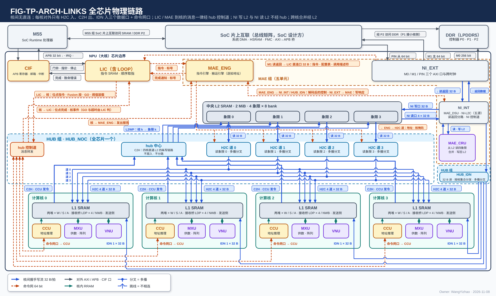
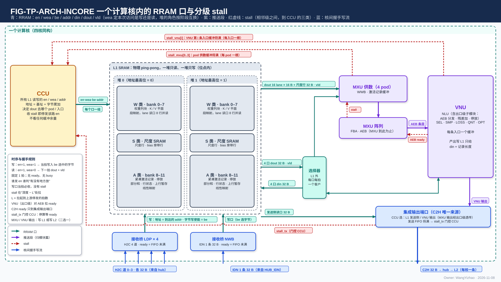
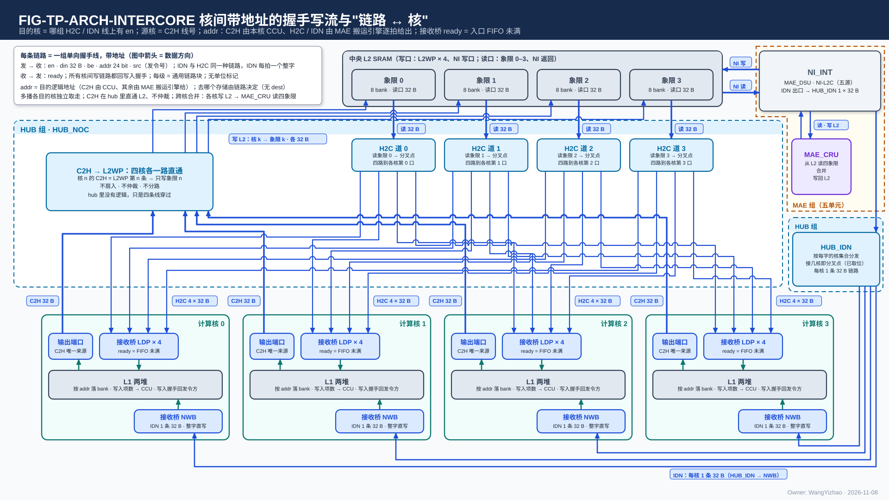
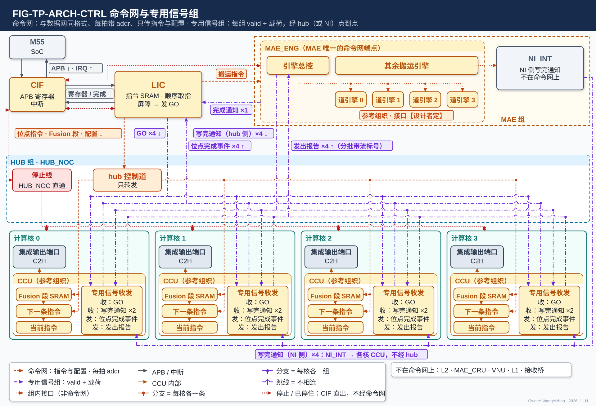

# 片上数据通路架构

> Owner: WangYizhao｜2026-11-11

## 1 概述

**本篇回答"有什么、谁连谁、每个口每拍多宽、哪些访问能同拍"**：L3PU 片上的存储、链路、端口、条数、方向、发令方，段选信号 `seg` 与逻辑地址的定义，以及存储并发约定。L3PU 的片上数据通路由四个计算核、中央 L2、HUB 组（HUB_NOC + HUB_IDN）、MAE 组（MAE_ENG、NI_EXT、NI_INT、MAE_DSU、MAE_CRU）、LIC、CIF 之间的全部存储、链路与端口组成。**全芯片只有三种总线——核内 RRAM 协议、核间带地址的握手写流、64 bit 命令网——每种只有一种格式，不按数据类型分形态；每条数据链路单向、点到点、同一组信号、同一位宽 32 B。** 每个核对外只有 H2C 入（4 × 32 B）、C2H 出（1 × 32 B）、IDN 入（1 × 32 B）三个数据口、一个命令网口，以及经 hub 的几组专用信号线（GO、位点完成事件、写完通知、发出报告，§2.5.2）；核间没有直连，所有跨核数据都经中央 L2 流转，所有跨核合并都在 L2 一侧完成。

本篇给各模块篇、编译链与 ISA 用：**§2.7 的全口宽总表是各模块篇引用口宽与条数的唯一出处**；**§3.3 的段选信号与"象限""堆"的定义、§3.4 的存储并发约定（CONC-1…CONC-6）、§3.6 的计算核两种工作模式与各运算的对应表**也都只在本篇定义，别的篇只引用。本篇只给预设位宽，不写实际利用带宽、不标定利用率（用户 11-08 T3）。

### 1.1 本篇的范围与相邻各篇的分工

| 内容 | 归属 |
|---|---|
| 存储、链路、端口、条数、方向、发令方；`seg` 与逻辑地址；存储并发约定；两种工作模式与各运算的对应 | 本篇 |
| 链路上怎样成交、背压、多播、写入完成；专用信号组的载荷语义；同一链路上切换段不交错 | 协议篇 |
| 三种打包方式、元数据项、列表、W 类两种字形态、各并行模式的落点 | 数据组织篇 |
| 每类数据走哪条路 | 登记篇 |
| L1 外四个 MUX（写 MUX、A 类读 MUX、S 类读 MUX、W 类读出到 VNU 读口的一路）的内部实现 | 计算核集成（`CORE_INTEGRATION_STAGING.md`） |
| MXU、VNU 各自的逐拍控制与内部缓冲（权重缓冲、激活缓冲、共用寄存器堆）里的位置 | MXU_CONTROLLER 篇、VNU_CONTROLLER 篇 |
| hub 内部 MUX 与分叉点的实现；HUB_IDN 的分发实现 | HUB_NOC 篇、HUB_IDN 篇 |
| L1 / L2 的物理组织（bank、地址换算、同一个堆上几个访问者怎样依次服务）、容量建议 | L1 篇、L2 篇（各自第 7 章） |
| 各口为什么是这个位宽的仿真依据 | 设计记录篇 |

### 1.2 术语新旧对照（V1.8 改名）

V1.8 统一改名后，各篇一律用新名（V18-NAME-07）。下表只列改了的名称；"码块""全码区""道引擎"等保留原名的不列。

| 旧名 | 新名 | 含义 |
|---|---|---|
| 变长列表 | 序号列表（项数另存） | 项数运行时才知道、按选中项写的序号列表，项数另记在一个定长计数项里 |
| 封顶 / 封顶值 | 每片保留上限 $k$ | SEL 对每个通道片最多保留的通道数 |
| 封顶模式 / 有封顶的选择模式 | 限个数选择模式 | 每片最多选 $k$ 个的选择模式（"阈值后封顶模式" → "阈值后限个数模式"） |
| 码块占位 | 码块片长（按 32 B 取整） | 一个通道片的码在 A 类占的字节数，按 32 B 取整 |
| 补算列表 | TOPK 重算词号列表 | LM Head TOPK 选出、要用 hi + lo 全码重算 logits 的词号升序列表 |
| （32 列块, 段） | （32 列块, K 组） | 只限权重尺度行的定位 |
| 道（W 类读口接一个读出通道之义） | W 类读口第 $b$ 路 | H2C 的"道"、接收桥的"道"保留 |
| 段（L2 里与"堆"指同一物理单位） | 堆 | "段选"只作链路信号 `seg` 的名字 |
| 写项 / 写入项 | 写入拍 | 链路上的一拍，写入握手与应写量的计数单位 |
| 单位（搬运单位） | 切换段 | 发令方内部用于合并点切换的一段连续拍，不上链路；"单位不交错" → "切换段不交错" |
| 发送侧 | 发送 FIFO 入口 | 计算核集成输出端口的入口（A / S 类读 MUX 的一个去向），不是 L1 的口 |
| 已取位 | 各核已取标记 | 多播分叉点上记录每个目的核是否已取走当前字 |
| 待回数 | 未回握手数 | 已写进存储、尚未沿链路回写入握手的拍数 |
| LSC | lo 稀疏读副本 | lo 平面按 F 行读的副本 |
| 在用列表缓存 | 列表本地副本 | 搬运引擎正在按它出地址的列表在 MAE 本地的副本 |
| 模式 1 / 模式 2（L2 → L1 经 H2C） | 合并送 / 分送 | 合并送 = 四个象限的读出合并送一个核集合；分送 = 象限 $c$ 只送核 $c$ |
| 读时合并（MAE 集成篇） | 四道并行读 | 一条 L2 → L1 指令同时读四个象限、四道并行送出 |
| 外设输入区 | PIN 输入地址段 | 编译链给 PIN 输入划的一段 L2 地址 |
| 返回车道（NI_INT） | L2 读出分路 | NI_INT 里接 NI 读口、把读出数据交 NI_EXT / MAE_DSU / MAE_CRU / MAE_ENG 的一侧 |
| 写客户（NI_INT） | L2 写入合并器 | NI_INT 里把几个来源合并后送上 NI 写口的一侧 |
| 攒字寄存器 | 流写出缓冲字（32 B） | QNT 每条输出流凑满一个存储字再写的寄存器 |
| 窗口（四种含义） | 容量窗口 / 列窗口 / PIN 窗口 / 片外窗口 | 编译链给变长数据的静态容量窗口 / 列字区的列窗口（只指列字区一段的列数 $C$）/ PIN 固定窗口 / 片外地址窗口 |
| 列窗口（指权重驻留时一次驻 L1 的 $W_{\text{win}}$ 列这一义） | 权重窗口 | $W_{\text{win}}$ 一律称权重窗口：权重驻留时一次驻在 L1 的 $W_{\text{win}}$ 个输出通道，token 逐个流过、过完换下一个权重窗口；"列窗口"只指列字区的列数 $C$ |
| 发读窗口 | 发读步长 | CCU 往 pod 送紧凑激活时算读地址的步长：每前进 128 个通道（按压紧前数），按保留位图数出这一段的码数、定出码在码块里的位置并发一次读；它不是一段存储空间（V18-NAME-08）。定义与 CCU 的读取步骤属 CCU 的设计，见 `CCU_STAGING.md` |
| FIG-VNU_INTEGRATION-RW-LANES | FIG-VNU_INTEGRATION-A-READ | 图号 |
| FIG-MAE_DSU-REGROUP | FIG-MAE_DSU-TRANSPOSE-STD | 图号 |

**码块**沿用原名：码块 = 紧凑 token 记录一个通道片四部分之一，只装保留通道的 6 bit 码（元素宽 $w$ 取 8 或 16 时装对应宽度的码）。

## 2 接口需求

### 2.1 架构图与接口汇总：全芯片部件、三种总线与全部口

图中模块框内的结构是参考实现（见第 7 章），本章以框外的各口为准。

图中每一条线都是一条物理链路，三种颜色对应三种总线：**核内 RRAM 协议（青）只在计算核的框内**；**核间带地址的握手写流（蓝）**是 L2 四个象限读口 → HUB_NOC 的四条 H2C 道 → 四核各自的同号道、四核的 C2H（来源 = 各核的集成输出端口）→ L2WP 的本核写链路、NI_INT 的 IDN 出口 → HUB_IDN → 各核 NWB 的一条 32 B 链路、NI_INT ↔ L2 的 NI 写口 / NI 读口，以及 MAE_CRU ⇄ NI_INT（从 L2 读四个象限、合并、写回 L2，不连核间链路）；L2 的读口（象限读口、NI 读口）画成读地址流与读数据流两条握手流（§2.4.2）。**命令网（橙）只传指令与配置**，每条线单向：LIC → hub 控制道 → 各核 CCU（位点指令、Fusion 段、阈值装载等配置写）、LIC → MAE_ENG（搬运指令），**LIC 到各核的指令一律经 hub 控制道，没有直达核的线**。**GO、位点完成事件、写完通知、完成通知、发出报告不走命令网，是 hub（或 NI）里的专用信号组**（§2.5.2），画成紫色点划线：LIC、MAE_ENG 各与 HUB_NOC 框里的"专用信号组"块相连，经核下方的线束分到各核 CCU（分支点 = 每核各一组，不是多播），完成通知是 MAE_ENG → LIC 的一根，NI 侧写完通知由 NI_INT 直接下行到各核 CCU、不经 hub。橙色细实线是搬运引擎的逐拍控制，带握手、不属命令网：道引擎 $n$ → L2 象限 $n$ 的读地址流、道引擎 $n$ → H2C 道 $n$ 的目的信息流（§2.4.2 / §2.4.3），以及搬运引擎 → L2 的 NI 读口读地址（4 路各给，V18-L2-08）；L2 → 下游的读数据流是蓝线。MAE_ENG 框内的引擎总控与道引擎是参考组织（§7.5）。灰线是对外 AXI（M0 / M1 / PIN）、CIF 的 APB 与 CIF ⇄ LIC 的寄存器读写 / 完成。红色线是 CIF 直出的控制线：复位（PORT-41）画成 CIF 下方的短箭头，表示扇出到全部模块；停止请求 / 已停住应答（PORT-42，红色点线、双向）连 LIC、MAE_ENG，到四核 CCU 的一组经 HUB_NOC 框里的专用信号块随核下方线束分到各核（§2.5.3）。HUB 组画成两个虚线框（HUB_NOC、HUB_IDN）都标 HUB 组：二者不必放在一起，但同属"只传输"的 HUB（用户 11-07）。

#### 2.1.1 部件清单

| 部件 | 全芯片个数 | 在数据通路里的角色 |
|---|---|---|
| 计算核（CCU、MXU 组、L1 组、VNU 组） | 4，物理同构 | 数据的产出方与消费方；每核一个 L1（W / S / A 三类各两堆，只暴露 RRAM 口，§3.5.1）；本核 CCU 是核内 L1 读写与 C2H 的发令方；**核内有三个控制器：CCU、MXU_CONTROLLER、VNU_CONTROLLER，后两个不是发令方**（§3.2） |
| 中央 L2 | 1（四个象限 × 两堆） | 全部跨核数据的中转与跨核合并的输入；**象限 $n$ 与核 $n$ 绑定写**（V18-L2-04，§3.3） |
| HUB 组 · HUB_NOC | 1 | 四条 H2C 道（L2 象限读口 → 四核，含多播分叉点）、四条 C2H 直通链路（核 $n$ → L2WP 第 $n$ 条）、hub 控制道（命令网在 hub 内的链路）、hub 承载的专用信号组（§2.5.2）与各核逐组回的写入握手（§2.7.5）；**核间链路使用的通用链路块是 HUB 的交付物**（V18-HUB-05）；只传输、不寻址、不仲裁、不汇总（V18-TP-51 / L2-03） |
| HUB 组 · HUB_IDN | 1 | 把 NI_INT 给的一路 32 B 按每个存储字随带的 4 bit 核集合送到各核的 NWB（每核一条 32 B 链路）；只做分发与多播分叉，不拆拍、不缓存、不算地址（V18-HUB-01 / 04） |
| MAE 组（MAE_ENG、NI_EXT、NI_INT、MAE_DSU、MAE_CRU） | 1 | 源在核外的一切搬运的发令方（搬运引擎，按并发指令数例化，个数与组织归 MAE_ENG 篇）、三个片外 AXI 口、搬运途中的整形（DSU）与合并（CRU） |
| LIC | 1 | 指令分发与调度：顺序取指、经命令网向四核 CCU 与 MAE 下发指令与配置；经专用信号组收位点完成事件与 MAE 的完成通知、发 GO；专用小 SRAM 不在段选体系内 |
| CIF | 1 | APB 寄存器、复位与启停、中断；与 M55 的调用边界（复位分发给全部模块，启动只交 LIC，停止请求送三类发令方，§2.5.3） |

**"HUB" 不是缩写**，取英文 hub（hub-and-spoke 的中心枢纽）之义：指中央端（L2、NI）与四核之间的全部核间数据链路，以及命令网的转发与专用信号组的连通（V18-NAME-05）；HUB_NOC 的 NoC = Network-on-Chip。

#### 2.1.2 三种总线与专用信号组

| 总线 | 在哪里 | 传什么 | 信号 | 一拍 |
|---|---|---|---|---|
| **核内 RRAM 协议**（协议篇 §2.3 / §3.16；RRAM 是给核内 SRAM 口总线起的名字，用户 11-05） | 一个计算核内部，L1 与 MXU、VNU 等核内模块之间 | 数据 | en、wea、addr（首字节地址）、`seg`、有效字节（len 或 be，形式【设计者定】：约束是能表达任意字节起点与 1–128 B 的长度，V18-TP-74）、din、dout、vld；相邻级之间另有 stall；**口上无握手** | 一次访问 ≤ 128 B（A / W 类）或一个整字（S 类读、S 类写）；W 类权重读口一拍 4 路各一个整字（CONC-3 / 4 / 6） |
| **核间带地址的握手写流**（协议篇 §2.2 / §3.14 / §3.17；**信号与核内 RRAM 口同名，核间只多 ready、发令号 `src` 与反向的写入握手**） | 核 ↔ hub ↔ L2，HUB_IDN → 核，NI ↔ L2 | 数据 | en、ready、din、be、addr、`seg`、`src`；反向写入握手（valid + `src`） | 32 B |
| **命令网**（协议篇 §2.5；**与核间数据网同一协议格式，每拍都带 addr**，用户 11-11） | LIC、MAE_ENG、hub 控制道、各核 CCU 之间（**MAE 只有 MAE_ENG 一个端点，NI 一侧没有命令网链路**；VNU、MAE_CRU 不在网上；**标量不走本网**，是数据，V18-TP-55） | **只传指令与配置**：位点指令、Fusion 段、搬运指令（带指令标号）、配置写 | en、ready、addr（目的端点内的寄存器 / SRAM 地址，端点按 addr 写入）、data | 64 bit |
| **专用信号组**（协议篇 §2.5；不是总线，hub 或 NI 里点到点的状态线，用户 11-11） | LIC ↔ 各核 CCU、MAE ↔ 各核 CCU、MAE_ENG → LIC | GO、位点完成事件、写完通知、完成通知、发出报告 | 每组 valid + 载荷；是否带 ready【设计者定】，约束：不丢、不重，接收侧来不及收时只降速 | 一组一拍一条（§2.5.2） |

**核间链路一律握手、用同一套逻辑，不做特殊设计；无握手的核内 RRAM 协议只用于 L1 对 MXU、VNU 等计算核内部模块的口**（V18-TP-80，用户 11-11："核内协议只包括L1 SRAM暴露给MXU，VNU等CC内部模块的链路"）。**每种总线只有一种格式，不按数据类型分形态**（用户 11-04）。数据总线之间的转换只发生在产出数据的模块里（§2.3.1 的集成输出端口、§2.3.2 的接收桥），不设独立的转换单元。**核间链路与命令网都使用 HUB 提供的同一个通用链路块**（V18-HUB-05，协议篇 §3.5），所以数据网和命令网的 skid、寄存器输出、时延无关这些条款只写一次；**命令网就是数据宽 64 bit、旁带为 addr 的同一种链路块**。专用信号组与写入握手回程不是总线：前者是 hub（或 NI）按上下级模块的接口需求连通的状态线（§2.5.2），后者是数据链路的反向旁带（§2.7.5）。

#### 2.1.3 接口汇总表

下表每行一个口，完整条目（条数、每拍含义、发令方、依据）在 §2.7。

| 口 | 对端（发 → 收） | 方向 | 每拍位宽 | 握手 |
|---|---|---|---|---|
| PORT-01 W 类权重读口 | L1 W 类 → 4 个 pod；另一路经 L1 外送 VNU 读口 | 核内 | 4 路 × 32 B，每路另带 4 位"哪些 pod 收" | 无（RRAM，读固定 1 拍） |
| PORT-02 S 类读口 | L1 S 类 → S 类读 MUX → pod 旁带 / VNU 读口 / EPI / 发送 FIFO 入口 | 核内 | 一拍 2 个地址，2 路 × 32 B | 无（RRAM） |
| PORT-03 A 类读口 | L1 A 类 → A 类读 MUX → MXU / VNU 读口 / CCU / 发送 FIFO 入口 | 核内 | 一次 ≤ 128 B | 无（RRAM） |
| PORT-04 / 05 / 06 A / W / S 类写口 | 写 MUX（H2C 接收桥、NWB、VNU 写口，写 MUX 自己轮流）→ L1 | 核内 | ≤ 128 B / ≤ 128 B / 32 B 整字 | 无（RRAM，写当拍写入） |
| PORT-07 AEB 条目 | MXU 阵列 → EPI | 核内 | 4 × 256 bit | valid / ready |
| PORT-08 EPI → VNU 各单元 | EPI → NLU 本体 / QNT / SEL + LOSS / SMP | 核内（VNU 组内） | 参考 256 bit | 由 VNU 集成设计者定 |
| PORT-09 集成输出端口 | 发送 FIFO 入口 / VNU 输出口 → C2H | 核内 ↔ 核间 | 入 128 B / 32 B，出 32 B | 出侧 en / ready；stall_tx 门控 CCU |
| PORT-10 H2C 接收桥 | H2C 道 0–3 → 写 MUX | 核间 ↔ 核内 | 入 4 × 32 B，出一个 ≤ 128 B 请求 | 入侧每道 en / ready；回写入握手 |
| PORT-11 NWB | IDN → 写 MUX | 核间 ↔ 核内 | 入 32 B，出一个 ≤ 128 B 请求 | 同上 |
| PORT-12 H2C 道 | L2 象限读口 $n$ → HUB_NOC → 各核接收桥第 $n$ 道 | 核间 | 32 B | en / ready；写入握手 |
| PORT-13 C2H | 集成输出端口 → HUB_NOC → L2WP | 核间 | 32 B | en / ready；写入握手 valid + `src` |
| PORT-14 L2WP | HUB_NOC → L2 象限 $n$ | 核间 | 32 B | en / ready；写入握手 valid + `src` |
| PORT-15 L2 象限读口 | 搬运引擎 → L2 象限 $n$（读地址）；L2 → H2C 道 $n$（读数据） | 核间 | 32 B | 读地址流、读数据流各 en / ready |
| PORT-16 IDN 链路 | HUB_IDN → 各核 NWB | 核间 | 32 B | en / ready；写入握手 |
| PORT-17 IDN 出口 | NI_INT → HUB_IDN | 核间 | 32 B + 4 bit 核集合 | en / ready |
| PORT-18 NI 写口 | NI_INT → L2 | 核间 | 32 B | en / ready；写入握手 4 × (valid + `src`) |
| PORT-19 NI 读口 | MAE 搬运引擎 → L2（读地址）；L2 → NI_INT（读数据） | 核间 | 4 × 32 B（每象限一路） | 读地址流、读数据流各 en / ready |
| PORT-20 MAE_DSU 进 / 出 | NI_INT ⇄ MAE_DSU | MAE 组内 | 32 B | en / ready |
| PORT-21 MAE_CRU 进 / 出 | NI_INT ⇄ MAE_CRU | MAE 组内 | 进 4 × 32 B，出 32 B | en / ready |
| PORT-22 LIC 直连口 | NI_INT → LIC 小 SRAM | MAE 组 → LIC | 32 B | en / ready；写入握手 |
| PORT-23 hub 控制道 | LIC → 四核 CCU | 命令网 | 64 bit + addr | en / ready |
| PORT-24 LIC → MAE_ENG | LIC → MAE_ENG | 命令网 | 64 bit + addr | en / ready |
| PORT-26 / 27 / 28 / 29 M0 / M1 / PIN / APB | NI_EXT ⇄ DDR P0 / SoC 互联 / 外部主方；CIF ⇄ M55 | 片外 | 256 / 64 / 64 / 32 bit | AXI4 / APB |
| PORT-30 写入握手 | 各接收方 → 发令方 | 核间反向旁带 | valid + `src` | 只有 valid |
| PORT-35…39 专用信号组 | GO / 位点完成事件 / 写完通知 / 完成通知 / 发出报告 | hub（或 NI）点到点 | valid + 载荷 | 是否带 ready【设计者定】 |
| PORT-41 复位 | CIF → L3PU 全部模块 | 控制 | 1 根，扇出到全部模块 | 无 |
| PORT-42 停止请求 / 已停住应答 | CIF ⇄ LIC、MAE_ENG、四核 CCU | 控制 | 停止请求 1 根电平扇出 6 路；已停住应答每个发令方 1 根电平，共 6 根 | 请求 / 应答（电平） |

撤销号 PORT-25、PORT-31…34 空着、不复用；PORT-40 只在参考实现的一种放法下出现（§2.7.6、§7.5）。

### 2.2 核内口：L1 的 RRAM 读口、写口与 L1 外的使用者入口

**本篇对核内只收到两层：L1 的 RRAM 读口 / 写口与 L1 外的四个 MUX（写 MUX、A 类读 MUX、S 类读 MUX、W 类读出到 VNU 读口的一路）及各使用者入口，以及核的唯一核间发送口（集成输出端口）与两个接收桥；单元内部（pod、VNU 各单元）的口归各模块篇**（用户 11-07 A2）。**四个 MUX 是计算核内、L1 外的部件，L1 不感知；三个读出一侧的 MUX 由本核 CCU 每拍定去向，写 MUX 不由 CCU 逐拍选来源、自己按固定规则轮流（V18-L1-32）；本篇只给它们的输入、输出与每拍规则（§3.7），内部实现归计算核集成（`CORE_INTEGRATION_STAGING.md`）**（V18-L1-21 / 24，用户 11-09："对于W类到VNU的读口，我认为这种外部MUX是CC集成篇需要说明的内容，也是CCU需要调控的内容，但是L1 SRAM无需感知这件事"）。VNU 对 L1 的读口、写口与输出口在这里只给口宽与接法，组内怎样分发、合并归 VNU 集成篇 §2。

**写 MUX = L1 写口前的选择器，在 H2C 接收桥、NWB、VNU 写口三个来源之间按固定规则本地轮流，不由 CCU 逐拍选；写与读碰到同一个堆时写让读**（V18-L1-32）。各篇沿用"写 MUX"这个名字，含义以此为准。

**核内有三个控制器：CCU、MXU_CONTROLLER、VNU_CONTROLLER**（V18-MXU-19 / 20 / 22、VNU-11 / 12）。**L1 的读写地址只有 CCU 一个来源**（接收桥的落地写地址随数据到达、由 MAE 给，§2.3.2）；**MXU、VNU 内部缓冲（权重缓冲、激活缓冲、共用寄存器堆）里的位置由各自的控制器算，缓冲接收数据时不接收写入位置**。CCU 给两个控制器的是：每个 pass（MXU）或每个位点（VNU）一份配置，数据随有效信号到达，批的边界用"交换""开工"或阶段结束的脉冲，不设首拍标记（MXU 集成篇 §2.5、VNU_CONTROLLER 篇 §2.2 / §2.3）。MXU_CONTROLLER、VNU_CONTROLLER 不发 L1 的读写，不是发令方（§3.2）。

图中模块框内的结构是参考实现（见第 7 章），本章以框外的各口为准。

图与 VNU 组各图同一画法，分三层：

- **左列**：CCU 发核内一切 L1 读的 en / wea / addr / `seg` 与有效字节、VNU 写口那一路的写地址与 `seg`，并给中层三个读出一侧部件每拍的去向；W 类权重读口每路另带 4 位"哪些 pod 收"（各 pod 各自要权重，V18-CCU-01）；每个 pass 给 MXU_CONTROLLER 一份配置与"交换""开工"脉冲，每个位点给 VNU_CONTROLLER 一份配置（MXU 集成篇 §2.5、VNU_CONTROLLER 篇 §2.2）；**权重字放进 pod 的哪个槽由 MXU_CONTROLLER 内部排，CCU 不给槽号**（MXU_CONTROLLER 篇 §3.2）。CCU 经 A 类读 MUX 收元数据项与 F 列表，据此给出码字的读地址与交 pod 的旁带（读取步骤与 CCU 一侧的缓冲属 CCU 的设计，见 `CCU_STAGING.md`）。图中 MXU_CONTROLLER 画在 CCU 下方、接 MXU 供数，VNU_CONTROLLER 画在 VNU 组内（排槽、共用寄存器堆位置）；CCU 到两个控制器的橙色虚线是配置，不给缓冲位置。
- **上排（使用者与来源）**：MXU 供数 → 阵列（MXU 组到 AEB 为止）→ VNU 组。AEB 条目只进 EPI（NLU 的后处理子模块），条目在 EPI 里放在哪由 EPI 设计者定（V18-EPI-06）；VNU 共用寄存器堆图中分向量、标量两块（V18-VNU-10）；MXU 供数框标"激活：pod 号 + 装回标志（不带源序号）"与"权重旁带含 V 尺度"：V 尺度经 S 类读 MUX 进 pod 权重旁带（V18-MXU-15）；累加器粗分数走旁路直达 SEL，不经 EPI。计算核的集成输出端口收两个核内来源——发送 FIFO 入口（收 A 类读 MUX 或 S 类读 MUX 的读出）与 VNU 输出口（MXU 输出经 EPI 透传后算 VNU 输出）——由 CCU 选一路上 C2H。右上是两个接收桥（H2C 接收桥四道成一个请求源；NWB 是单道实例；常开，写地址随数据到达，数据写进 L1 之后才逐拍回写入握手，V18-L1-27 / TP-70）。
- **中层"L1 外"**（三个读出部件框内标"去向由 CCU 给"，写 MUX 框内标"本地轮流、写让读"）：从左到右是 W 类读出一路（OPT 读前向副本 → VNU 读口）、A 类读 MUX（收 A 类读口 ≤ 128 B 已按地址对齐的读出，**只选使用者、不排字序**，整拍只送一个使用者：MXU、VNU 读口、CCU、发送 FIFO 入口）、S 类读 MUX（S 类读口一拍 2 个地址的读出进，送 pod 权重旁带与激活旁带、VNU 读口、EPI、发送 FIFO 入口）、写 MUX（三个来源——两个接收桥与 VNU 写口——**由写 MUX 自己按固定规则轮流，不由 CCU 逐拍选**，每类写口每拍写一个来源一次，不同来源不合并，没轮到的在自己的 FIFO 里等；接收桥一路的地址与 `seg` 来自 MAE、随数据到达，VNU 写口一路的地址与 `seg` 由 CCU 给；VNU 写口可写 A / W / S 三类，V18-L1-32）。A、S 类读 MUX 的输出画成带分接点的总线，表示每拍只送其中一个使用者。**W 类权重读口 4 路连同每路的 4 位"哪些 pod 收"直达 pod，不经中层。**
- **下层"L1（只暴露 RRAM 口）"**：W / S / A 三类，每类两堆并排、都可读可写；读口：W 类 4 路各给地址，S 类一拍 2 个地址，A 类是首地址 + ≤ 128 B 的一个逻辑口；三个 RRAM 写口（A、W 各 ≤ 128 B，S 32 B 整字）从写 MUX 进本次访问选中的堆。**图示是 ping-pong 用法的一个时刻（这一拍读堆 1、写堆 0）；实际堆选随每次访问的 `seg` 给出，三类互不相关；读由 CCU 排，写与读碰到同一个堆时写让读，由写 MUX 本地判断**（CONC-1 / 2，V18-L1-16 / 32）。
- 红色虚线是 stall：stall_mxu 每 pod 两根（权重收不下、激活收不下）回 CCU（MXU 集成篇 §2.8），stall_vnu、stall_tx 画成指向 CCU 的短箭头，EPI 对 AEB 拉 ready，阵列对供数拉 stall；规则在协议篇 §3.16。

**L1 的每次读都由本核 CCU 发 en / wea / addr / `seg`；写的地址与 `seg`，接收桥一路随数据到达（MAE 给），VNU 写口一路由 CCU 给；读固定 1 拍返回（从存储字边界起时）、写当拍写入，口上无 ready、无 busy（协议篇 §2.3）。L1 不做任何选择：没有优先级表、没有"选中"、没有仲裁；同一拍能做哪些访问只由 §3.4 的并发约定决定——读由 CCU 排开，写的来源由 L1 外的写 MUX 轮流、碰到正在读的堆时让读（V18-L1-32）。**

#### 2.2.1 W 类权重读口：一拍 4 路，各路各自给地址

**W 类只有一个读口，就是 4 路的权重读口；送 VNU 读口的那一路是它在 L1 外的一个去向**（V18-L1-26）。**一拍接收 4 个地址，分属 4 路，各路各自给地址（CONC-4）**；每路一拍交一个整字（32 B），4 路合计 128 B/拍：行字区每拍至多 4 个存储字 = 16 个归约位置 $k$ × 16 列；列字区每拍至多 4 列、每列 64 个连续 $k$（两种字形态的定义见数据组织篇 §2.12，各运算用哪种见 §3.6）。读出的字直达 4 个 pod，**L1 不重组，读什么交什么**；**每路的字另带 4 位"哪些 pod 收"：各 pod 各自要权重，几个 pod 要同一个字时只读一次、同拍送给这几个 pod，要的字不同时 4 路各送各的 pod**（V18-CCU-01，MXU 集成篇 §2.2）；读序列由 CCU 按列所在的路排（同一路的两个请求不同拍，CONC-4），"哪一列放在哪个地址"由编译链分配。**字到达 pod 时不带写入位置，放进哪个槽由 MXU_CONTROLLER 定；MXU 不感知列在原矩阵里的位置**（V18-MXU-19 / 20，MXU_CONTROLLER 篇 §3.2）。**列按到达次序进 pod 计算，"到达的第 $i$ 列 ↔ 原 hidden state 列号"的映射由 CCU 持有、算完后的排回归 CCU**（用户 11-10："不需要单设，计算完后统一重组，不过这样要求CCU要知道当前计算的数据在原hidden state中的映射位置"）；CCU 发读的次序与 MXU_CONTROLLER 排位置的次序须是同一个约定（MXU_CONTROLLER 篇 §3.2）。

**W 类读出到 VNU 读口的一路**：OPT 读前向副本时，W 类权重读口的读出在 L1 外送 VNU 读口（每拍至多 VNU 读口宽 128 B），CCU 给各路地址（读连续的副本码时给出连续字的地址即可），L1 不感知（V18-L1-21 / 26）。**L1 不限制 W 类与 A 类同拍读出；VNU 入口一拍怎样收 W 类与 A 类的数据由 VNU 设计者定**（V18-VNU-09）。

#### 2.2.2 S 类读口：一拍 2 个地址，经 S 类读 MUX 送需要它的模块

**S 类读口一拍可接收 2 个地址，可以是同一个堆里的两个数据（CONC-6，V18-L1-31 / TP-84），每个地址每拍一个整字（32 B）；读出经 L1 外的 S 类读 MUX 送需要它的模块**（V18-L1-21，用户 11-09："只要允许S类的数据接向需要它的模块不就可以了，例如MXU，VNU"）：pod 权重旁带（权重、K、V、LM Head 列副本的尺度）、pod 激活旁带（激活 E8M0）、VNU 读口、EPI（bias）、发送 FIFO 入口；送哪个去向由 CCU 给。**同拍需要的多于 2 路时由 CCU 错开**（CONC-6）。S 类的字格式：

| 字 | 一个存储字装什么 |
|---|---|
| 权重尺度行 | 一个 K 组 × 32 个输出通道的 32 个 E8M0（以（32 列块, K 组）定位） |
| LM Head 列副本的尺度 | 一列的 32 个 K 组的 E8M0；每列补到 32 B 的倍数（$K$ = 2,560 时 80 → 96 B，一列 3 个字，V18-MXU-09 / DORG-05） |
| K、V 的尺度 | V 的每 key 尺度作为**权重一侧的尺度**进 pod 权重旁带，由 pod 处理（V18-MXU-15）；录取 key 的 V 尺度由 MAE_DSU 按录取次序排成整字 |
| 激活 E8M0 | 32 个，激活每 $G$ 个通道一个（**激活 MX 组长 $G$ 是位点属性，可配为 32 的倍数，上限【设计者定】且不大于片长；权重的 MX 组固定 32**，V18-MXU-10 / ATT-04）、按通道片排，作控制旁带交 pod；一个查询行全部 q 头的 E8M0 连续存、只在行末补到 32 B（V18-DORG-08） |
| bias | 一个 16 通道列块的 16 个 BF16（只有 BF16 一种精度、不量化，V18-EPI-02 / 05）；**bias 在 $K$ 全部累加完、出 AEB 之后由 EPI 加到结果上一次，MXU 累加器不预装 bias**；bias 由 CCU 发 S 类读、经 S 类读 MUX 交 EPI，何时读、怎样保持归 EPI 与 CCU 的设计（V18-EPI-05） |

LM Head 列副本补算时，S 类一个字是一列的 32 个 K 组的尺度，与常规"一字 = 一个 K 组 × 32 个输出通道"的读法不同；读出节拍与 pod 怎样把它配到各归约位置属 MXU 与 CCU 的设计（MXU_FEED 篇 §3.6.3）。

#### 2.2.3 A 类读口与 A 类读 MUX 的使用者入口

**A 类读口是一个逻辑读口：一次 = 首字节地址 + 长度（≤ 128 B），支持紧密存储，L1 交回从首字节起对齐好的数据**（字节移位在 SRAM 内部，§3.5.4；从存储字边界起一拍，否则允许多拍，CONC-3）。读出经 L1 外的 A 类读 MUX，**整拍只送一个使用者**（§3.7）：

| A 类读 MUX 的使用者 | 收到什么 |
|---|---|
| MXU（4 个 pod 算一个使用者，MUX 带 pod 号） | 从片的码块起点起的码字，连同 CCU 给的 keep 掩码、F 掩码、MX 组边界与 S 类读 MUX 给的 E8M0 旁带，交 pod；pod 不解包（V18-L1-21 / DORG-05）。**pod 号 = CCU 这一拍服务哪个 pod；源属于哪个 pod 是固定的，码不带源的序号；停放值装回累加器也复用这一道（带"装回"标志，一拍 4 条停放条目）**；入口宽度、分时与激活缓冲见 MXU 集成篇 §2.3 |
| VNU 读口（128 B） | 轮到 VNU 的拍，A 类读出整拍给 VNU；读紧凑 token 记录时码块由 CCU 按元数据项定位（VNU 集成篇 §2.4） |
| CCU（128 B） | 元数据项与 F 列表；CCU 用它们算出这一片要读的码字数与地址（数据组织篇 §3.4）；CCU 一侧怎样缓冲属 CCU 的设计，见 `CCU_STAGING.md` |
| 发送 FIFO 入口（128 B） | 进集成输出端口（§2.3.1）；**发送 FIFO 入口不是 L1 的口** |

#### 2.2.4 L1 写口与写 MUX 的三个来源

**L1 每类一个 RRAM 写口，共三个（A / W / S）；一次写 = 一个来源的首字节地址 + 长度 ≤ 128 B（A / W 类，首地址可以是任意字节），S 类一次一个整字；写口不做任何选择：三个来源（H2C 接收桥、NWB、VNU 写口）之间每拍写谁，由 L1 外的写 MUX 决定**（V18-L1-14 / 24 / TP-73 / 74）。**写 MUX 不由 CCU 逐拍选来源，自己按固定规则在三个来源之间轮流，没轮到的在自己的 FIFO 里等；写与读碰到同一个堆时写让读——读由 CCU 发、口上没有握手、不能等，这一拍不写、下一拍再写，在本地判断，CCU 不参与；写等久了经 FIFO 与 ready（或 wr_stall）反压，只降速**（V18-L1-32，用户 11-11："我认为CCU不应该控制这件事，这个控制不能让LANDING自己做吗？"）。接收桥一路的地址与 `seg` 来自 MAE、随数据到达；VNU 写口一路的地址与 `seg` 由本核 CCU 给（§2.2.5）。轮流的规则与各来源 FIFO 的深度【设计者定】，约束：三个来源之间任何一个都不被另两个饿死（因让读而推迟的拍不计入）；归计算核集成（`CORE_INTEGRATION_STAGING.md`）。

| 口 | 一次写 | 来源（经写 MUX） | 说明 |
|---|---|---|---|
| **A 类写口** | ≤ 128 B：首字节地址 + 有效字节；紧密存储（按字节首尾相接、不补齐） | H2C 接收桥、NWB、VNU 写口 | 元数据项、F 列表、码块、停放值等都经本口（V18-L1-20） |
| **W 类写口** | ≤ 128 B：首字节地址 + 有效字节（与 A 类同形，紧密存储） | H2C 接收桥、NWB、**VNU 写口**（V18-VNU-09） | 权重与 K / V 的码。**到达 W 类时已是 W 类的字形态**：片外来的由 MAE_DSU 转成行字区或列字区的字形态（MAE_DSU 篇 §3.2 典型用法表），核内产生的由 QNT 排好后经 VNU 写口写（本核产生、本核消费的 K / V 可直写、不绕 L2；权重梯度进权重侧的 $\mathrm dY$、$X$ 见 §3.6.3） |
| **S 类写口** | 32 B：一次 1 个存储字，**整字写、不带 be** | NWB、H2C 接收桥、VNU 写口（激活 E8M0、OPT 新副本的 E8M0） | 尺度与 bias；生产方把每片末字补 0 后整字写（V18-DORG-04）；地址由编译链分配 |

有效字节用"长度"还是"从第 0 字节起连续的字节有效位 be"表达、字段位宽【设计者定】，约束：能表达任意字节起点与 1–128 B 的长度。写当拍写入、无应答。

#### 2.2.5 VNU 对 L1 的一个读口与一个写口

**VNU 对 L1 只有一个读口、一个写口，各 ≤ 128 B**（V18-VNU-04，用户 11-08："我希望对于VNU本身最多暴露一个读出口和一个写入口"）：进 VNU 读口的三路（A 类读 MUX、S 类读 MUX、W 类读出到 VNU 读口的一路）都在 L1 外；**L1 不设限，VNU 入口一拍怎样收 W 类、A 类、S 类的数据由 VNU 设计者定**（V18-VNU-09，用户 11-10："我认为SRAM不要受限，这个由VNU的设计者来判断"）。VNU 各单元的读由 VNU_CONTROLLER 按 CCU 给的配置在 VNU 内部分发，各单元的写在 VNU 内合并进这一条写入口（VNU 集成篇 §2.4 / §2.6，VNU_CONTROLLER 篇 §3.2）。**VNU 写回只交数据与每一拍的有效字节数（≤ 128 B），不报地址、不报长度；这一次写的首字节地址与 `seg` 由本核 CCU 内部计数推出、随这一路交写 MUX**（V18-VNU-12，VNU_CONTROLLER 篇 §3.9）；按 `seg` 进 A 类写口（码、元数据项、F 列表、停放、部分和、OPT 新副本的码等）、W 类写口（本核产生、本核消费的 K / V 码，权重梯度进权重侧的操作数，由 QNT 排成 W 类字形态）或 S 类写口（激活 E8M0、OPT 新副本的 E8M0，整字）（V18-L1-18 / 20 / 21 / VNU-09）。写 MUX 这一拍没轮到 VNU 写口（或因让读而推迟）时，待写的数据在这一路的 FIFO 里等、不丢，停顿不到 CCU（协议篇 §3.16；VNU 内部怎样停归 VNU_CONTROLLER 篇 §3.8）。**VNU 同一拍读 128 B、写 128 B 的前提是读与写落不同的堆；落同一个堆时写让读**（CONC-1 / 2，V18-L1-32）。

#### 2.2.6 核内推送链：AEB 条目、粗分数旁路与 EPI 出口

**MXU 组的边界到阵列出口缓冲 AEB 为止**（V18-MXU-06）：供数 → 阵列 → AEB → EPI（VNU 共用寄存器堆）→ VNU 写口 → L1 写口（A / W / S，按 `seg`）是一条推送链，上游按节拍往下送，相邻级之间一根 stall（协议篇 §3.16）。**EPI 是 NLU 的后处理子模块**（Epilogue，V18-EPI-01）：NLU 里必须实现、与 NLU 本体共用 BF16 向量通路，AEB 之后的条目都由它接收（EPI 篇 §1）。

| 口 | 每核 | 每拍 | 方向 | 说明 |
|---|---|---|---|---|
| **AEB 条目**（PORT-07） | 4（每 pod 一条） | 参考每 pod 每拍 1 条 = 256 bit = 16 × BF16（一个（token 或查询行, 列块）的 16 个输出通道），4 pod 合计 128 B/拍；valid / ready | MXU 阵列 → EPI | **4 个 pod 算完一轮统一输出，次序固定（pod 0 → pod 3，每 pod 驻留位 0 → $n-1$，$n$ = 每 pod 源数、由配置给），条目不带标签**；没开的 pod、没用的驻留位不输出条目；$n$ = 8、4 pod 全开时 8 拍一轮（32 条 = 1 KB）；条目属于哪个 token 或查询行由它在一轮中的位置决定，**这个对应关系只由 CCU 持有、不交给 VNU**；VNU 收到的条目相对 token 的自然次序可能是乱序的，是否需要先后信息由 VNU 设计者评估（V18-VNU-13，MXU 集成篇 §2.6，VNU_CONTROLLER 篇 §2.4）；EPI 来不及收时拉低 ready |
| **粗分数旁路** | 每 pod 一路 | 每 pod 每算完一个（查询行, 16 个 key）出 16 个粗分数 | MXU 累加器 → SEL | attention 粗算的**累加器粗分数直达 SEL，不经 EPI、不进 AEB、不进寄存器堆**；无握手，SEL 不反压、判完即丢（VNU 集成篇 §2.2） |
| EPI → VNU 各单元（PORT-08） | — | 参考每拍至多 16 个元素（256 bit + 握手） | NLU 本体、QNT、SEL + LOSS、SMP | 组内传输；互连方式（点对点或交叉开关、几条）由 VNU 集成设计者定（V18-VNU-08，VNU 集成篇 §3.6）；处理链怎样串接、逐拍推进由 VNU_CONTROLLER 按 CCU 给的配置做（VNU_CONTROLLER 篇 §3.2） |

推送链唯一的速率要求见 §4.3。

### 2.3 计算核的核间口：集成输出端口与两个接收桥

#### 2.3.1 集成输出端口：C2H 的唯一来源

**每核只有一个核间发送口。核内两个来源——发送 FIFO 入口（收 A 类读 MUX 或 S 类读 MUX 的读出）、VNU 输出口（含经 EPI 透传的 MXU 输出，如 K 切分部分和、位点指令选直接写 L2 的结果）——由本核 CCU 按指令在切换段边界选一路，上 C2H**（V18-TP-56 / 59 / L1-21）。**VNU 输出口只是一个接口：数据来自 VNU 哪个单元、写到 L2 哪里，由 CCU 解码指令得到**（V18-VNU-07，VNU 集成篇 §2.7）。MXU / VNU 的输出每条指令只能选写 L1 或写 L2，不两边都写。CCU 逐拍给出 C2H 上的 L2 地址（段内 24 bit + `seg`，象限由链路固定）；**集成输出端口来不及上 C2H 时拉 stall_tx 门控 CCU（停发全部 en、停算，等 C2H ready），这是核内唯一的全局门控**（协议篇 §3.16）。L2 沿 C2H 反向回的写入握手（valid + `src`）由 CCU 计数，数满即数据块已写进 L2，再经 hub 的发出报告信号组（PORT-39）向 MAE 发出报告（**目的起始地址 = 码块的容量窗口基址**，V18-DORG-10 (8)）。

| 项 | 值 |
|---|---|
| 入 | 发送 FIFO 入口：每拍至多 4 个存储字（128 B，A 类读 MUX 或 S 类读 MUX 的读出，整字）；VNU 输出口 32 B/拍；两源由 CCU 选一路 |
| 出 | C2H：en / ready / din 32 B / be 32 / addr 24 / `seg` 5 / `src`（本核 CCU 的号） |
| 反向 | ready（L2 能收）；写入握手一组 valid + `src`（与其他链路同形，V18-TP-80，PORT-30） |

发送缓冲的组织、深度与将满阈值属计算核集成的设计（`CORE_INTEGRATION_STAGING.md`，参考做法见 §7.4）。

#### 2.3.2 H2C 接收桥与 NWB：写 MUX 前的两个请求源

**接收桥是一种模块、两个实例：H2C 接收桥（H2C 四道）与 IDN 接收桥 NWB（一道），统一设计；交给 L1 外的写 MUX 的各是一个请求源；常开、无使能、无写计数**（V18-L1-15 / 27 / TP-70、HUB-04）。内部实现归接收桥篇（`L1_LANDING_BRIDGE.md`，参考做法见 §7.3）；本篇给它的口宽、每次交出多少与请求源身份：

| 桥 | 每核 | 入（每道） | 交给写 MUX | 说明 |
|---|---|---|---|---|
| **H2C 接收桥** | 1（四道） | en / ready / din 32 B / be 32 / addr 24 / `seg` 5 / `src` | **一个请求源**：每次一个写请求 = 同一道、同 `seg`、同 `src`、地址连续的 1–4 拍（合计 ≤ 128 B）；按 `seg` 进 A / W / S 三类写口之一 | **每道 ready 独立，只看本道**；**写入握手在数据写进 L1 之后才回**：每写进一拍沿本道回一个 valid + `src` 给发地址的 MAE 搬运引擎；**每核每道一组握手线直达本道的发令方，hub 不汇总、不按 `src` 归并**（PORT-30）；各道都在有上界的时间内被交出，不被饿死 |
| **NWB** | 1（一条 32 B 链路） | 同上 | 同一种接收桥的单道实例 | 同上 |

请求的形成规则（接口可见的部分）：**"地址连续"指后一拍的 addr = 前一拍的 addr + 前一拍的有效字节数**（默认对齐、整字时就是相差 32）；**请求在 `src` 变化处、`seg` 变化处断开**（接收桥篇 §3.3）；`seg` 为 S 类的请求每次只交 1 个字（S 类写口一次只收一个整字）；**写 MUX 这一拍没轮到桥（或因让读而推迟）时，数据不丢、各道在桥内等**（桥怎样再交是参考做法，§7.3）。接收桥对写 MUX 交出的请求里给哪些字段（道号、拍数等）由计算核集成定（`CORE_INTEGRATION_STAGING.md`）；有效字节不足 32 的一拍之后能否在同一请求里接着放，取决于写 MUX 一侧接口的形式，也归计算核集成（`CORE_INTEGRATION_STAGING.md` CI-S-05），接收桥的参考做法是让这一拍结束本次请求（接收桥篇 §7.2）。

**接收桥的写地址就是随数据到达的 addr，由 MAE 搬运引擎给出，不经 CCU；接收桥不解析数据、不攒 token、不按工况切换、不做任何形态变换、不移位**（地址不在字边界时由 SRAM 内部移位，§3.5.4）。链路侧的从口使用 HUB 提供的通用链路块；在写 MUX 前它与 VNU 写口同为请求源，先后由写 MUX 按固定规则轮流，不由 CCU 排（§3.7，V18-L1-32）。**写完不由接收桥或 L1 判断**（§3.9）；桥常开，数据可以先于对应的位点指令落地。

### 2.4 核间链路：一组信号、单向、点到点

**所有核间数据链路单向、点到点、同一组信号（正向 en / din 32 B / be 32 / addr 24 / `seg` 5 / `src`，反向 ready 与写入握手 valid + `src`），同一位宽；数据链路上没有核号字段，目的核 = 哪组线上有 en，源核 = 线号**（V18-TP-41 / 42 / 61 / 80）。成交、skid、背压、多播、写入握手的规则见协议篇 §2.2。

图中模块框内的结构是参考实现（见第 7 章），本章以框外的各口为准。

图中上方是中央 L2（四个象限、每象限两堆；写链路 L2WP × 4、NI 写口，读链路象限读口 0–3、NI 读口（4 路，各路各给读地址），读口画成读地址流与读数据流两条握手流）；HUB_NOC 框里是"C2H → L2WP"一个框（四核各一路直通、核 $n$ 只写象限 $n$，框内没有逻辑、只是四条线穿过）与四条 H2C 道（各带分叉点、四路到各核 H2C 接收桥的同号道）；MAE 组框里有 NI_INT、MAE_CRU（只与 NI_INT 相连）与 MAE_ENG（给 L2 象限读口读地址流、给 H2C 四道目的信息流，橙色细实线，带握手；道 3 旁分别标出读地址流、读数据流、目的信息流三条，各自 en / ready，V18-TP-82）；HUB 组另一框是 HUB_IDN（一路 32 B 进，按每字的核集合分发、接几核即分叉点，每核一条 32 B 链路）；下方四核各有集成输出端口（C2H 唯一来源）、H2C 接收桥（四道成一个请求源）、NWB 与 L1（W / S / A 三类，每类一个 RRAM 写口，来源经 L1 外的写 MUX）；两个接收桥常开，数据写进 L1 之后逐拍回写入握手（每个写入方一组，直达发令方，中途不汇总，§2.7.5）。

#### 2.4.1 链路表

| 链路 | 方向 | 条数 | din | 每拍地址 | 目的与核的标识 |
|---|---|---|---|---|---|
| **H2C** | hub → 核 | 每核 4 道，全芯片 16 条 | 32 B | 24 + `seg` 5，本道的搬运引擎给（§2.4.3） | 核 L1。每核独立一组线，目的核 = 哪组线上有 en；**多播时各目的核独立取走，慢核落后不超过 $M_{\text{mc}}$ 拍时不拖其他核，这段余量由接收桥提供、HUB 不承担**（V18-TP-53 / HUB-05，$M_{\text{mc}}$ 的定义见接收桥篇 §3.9）；分叉点之前的段带 4 bit 核掩码，到核的最后一段不带；各核 H2C 接收桥把数据写进 L1 之后沿本道逐拍回写入握手，**每个目的核各一组握手线直达本道的发令方（多播给 4 核即回 4 组），分叉点不汇总、不按 `src` 归并**（PORT-30）；写完通知各核各自收（§3.9）。**两种用法（合并送 / 分送）见 §3.8** |
| **C2H** | 核 → hub | 每核 1，全芯片 4 | 32 B | 24 + `seg` 5，本核 CCU 给 | L2。源核 = 线号；**来源是该核的集成输出端口；只到 L2，直通 L2WP 第 $n$ 条，没有通路选择**（V18-CRU-07）；不与其他核合并 |
| **L2WP** | hub → L2 | 每核 1，全芯片 4（合计 128 B/拍） | 32 B | 同 C2H | **第 $n$ 条只写象限 $n$**（象限由链路固定，V18-L2-03 / 04）；ready = L2 能收；同一个堆上几条链路同拍到达时 L2 依次服务、只降速（CONC-2 / 3）；反向回写入握手一组 valid + `src` 到本核 CCU |
| **L2 象限读口** | L2 → hub | 4（各接 H2C 道 $n$） | 32 B | 24 + `seg` 5，本道的搬运引擎给 | 象限 $n$ 只送 H2C 道 $n$；**读地址流与读数据流两条握手流**（§2.4.2，V18-TP-80） |
| **IDN** | HUB_IDN → 核 | 每核 1 条，全芯片 4 条 | 32 B | 24 + `seg` 5，MAE 搬运引擎给 | 核 L1（NWB）。**与 H2C 到核的链路同一组信号**；每个存储字随带 4 bit 核集合，HUB_IDN 按它分发、接几核即多播分叉点；每拍一个地址；**链路不受整字限制、也不感知是否整字，只按 be 原样传**（V18-DORG-10 (4)）；DDR 布局与 L1 行字区 / 列字区字形态之间的差由 MAE_DSU 的直通或转置调（MAE_DSU 篇 §3.2 典型用法表，V18-MAE-41）；几核共享 M0 带宽时每个字带核集合，总量以 32 B/拍为上限（单核 32 B/拍，四核按 $m$ 切分平均每核 8 B/拍；各核的字怎样排出归 MAE）；精算的全码 key 记录两种模式（K hi 驻 L2 或从 DDR 重读）都经本链路**按列字区的列位落 W 类**（V18-ATT-03 / DORG-08）；NWB 写进 L1 之后沿本链路逐拍回写入握手，**几核共享或多播时各核 NWB 各一组直达发令的搬运引擎，HUB_IDN 不汇总**；写完通知见 §3.9 |
| **IDN 出口** | NI_INT → HUB_IDN | 全芯片 1 | 32 B | 24 + `seg` 5 + 随字 4 bit 核集合 | HUB_IDN 的唯一数据源：NI_INT 读返回分路与 MAE_DSU 输出在 NI_INT 内择一（V18-HUB-03 / 04） |
| **NI 写口** | NI_INT → L2 | 全芯片 1 | 32 B | 24 + `seg` 5，MAE 搬运引擎给 | L2 任一象限，一个切换段不跨象限；**`seg` 段掩码多位为 1 = 同址广播到掩码内各象限**（V18-L2-04 / TP-61）；反向写入握手 4 象限 × (valid + `src`)；M0 / M1 / PIN / MAE_DSU / MAE_CRU 五个来源在 NI_INT 的 L2 写入合并器里按切换段合并；**PIN 写与推理整体分先后**，PIN 写一帧期间 NI 写口只有 PIN 一个来源（V18-L2-07） |
| **NI 读口** | L2 → NI_INT | 全芯片 1，4 × 32 B（每象限一路） | 每象限 32 B | 每路 24 + `seg` 5，各路的 MAE 搬运引擎给；**四路各给读地址、可以不同址，ready 各自独立**（V18-L2-08） | MAE 与 L2 之间唯一的读口；**第 $q$ 路读象限 $q$，一拍至多读四个象限拼成 128 B**（V18-MAE-32）；每路是读地址流与读数据流两条握手流（§2.4.2）；去 NI_EXT 写出、MAE_DSU 整形或 MAE_CRU 合并 |
| **MAE_DSU 进 / 出** | NI_INT → DSU / DSU → NI_INT | 各 1 | 32 B | 24，MAE 搬运引擎给 | 入自读返回分路（DDR 原形）或 L2 读出分路（L2 原形）；出去 IDN 出口（→ L1）或 L2 写入合并器（→ L2）；无片外出口（V18-NII-03）；**MAE_DSU 只有两种运算：直通（字内内容不变、按搬运引擎给的次序与地址交出）与转置（连续 $N$ 行、每行 $J$ 个元素、元素宽 $b$ 的小矩阵按列交出、装成 32 B 的字，尾块用 be；尺寸由指令给）**，各用法的参数只在 MAE_DSU 篇 §3.2 典型用法表（V18-MAE-41）；转置只动数字，反传读前向的尺度行，块尺度由 pod 在线算（V18-MXU-11 / L1-30）；精算驻留模式的全码 key 记录 = L2 来的 K hi + DDR 来的 lo，经 MAE_DSU 直通（只给地址）后经 IDN 出口按列字区的列位落 W 类（V18-ATT-03 / DORG-08） |
| **MAE_CRU 进 / 出** | L2 读出分路 → CRU / CRU → L2 写入合并器 | 各 1 | 进 4 × 32 B，出 32 B | 24，MAE 搬运引擎给 | **MAE_CRU 不连核间链路、不在命令网上**（V18-CRU-07 / TP-55）：从 L2 读、写回 L2；输入 / 输出编码由指令给（V18-CRU-08） |
| **LIC 直连口** | NI_INT → LIC 小 SRAM | 1 | 32 B | 24，MAE 搬运引擎给 | 只收 M1 读回的指令、配置表、调用描述符（V18-NII-06 / 08） |

`src`（发令号）**5 bit【待标定】**（要求值，先按现行参考值标定、后续再调，V18-MAE-45；须覆盖发令方总数 = MAE 搬运引擎数 + 4 个 CCU + 在途 PIN 事务号，V18-TP-47 / 50）；只有一个发令方的链路上为常数。

#### 2.4.2 L2 读口：读地址流与读数据流两条握手流

**L2 的两种读口（象限读口 0–3、NI 读口每象限一路）都是两条握手流**（V18-TP-80，用户 11-11："我认为这不是一个设计漏洞吗？咱们应该要补上，H2C是核间通信，因此应该有握手卡住MAE"）：

| 流 | 方向 | 信号 | 语义 |
|---|---|---|---|
| **读地址流** | 发读方（MAE 搬运引擎）→ L2 | 发读方给 en、addr 24、`seg`；L2 回 ready | en = 1 且 ready = 1 的一拍成交一个读地址；每拍一个地址、读出 ≤ 32 B（CONC-3）；ready = 0 时发读方保持本拍不变 |
| **读数据流** | L2 → 下游（H2C 道 $n$，或 NI_INT 的 L2 读出分路） | L2 给 en、dout 32 B；下游回 ready | en = 1 且 ready = 1 的一拍交出一拍读出；**读出按读地址的成交次序返回** |

**下游收不下时，L2 把读地址流的 ready 拉低，卡住发读的 MAE 搬运引擎**；同一个堆同拍几条链路争用时 L2 依次服务（CONC-2），也只表现为读地址流的 ready 拉低、只降速不出错。**读出拍数不规定数值**：正确性只取决于两条流的握手。读地址的形式（是否另带读出长度）由 L2 与 MAE 对接确定【设计者定】：约束是每拍一个地址、读出 ≤ 32 B、按成交次序返回。

**NI 读口四路各给读地址、ready 各自独立**（V18-L2-08，用户 11-11："我认为4路可以不同址，以为4象限各自存完整Token的时候，因为长短不同，就会导致不同址的问题"；"ready问题我也认为各自独立会好一点，刚好和各自的ENG匹配"）：第 $q$ 路只读象限 $q$，每路一条读地址流加一条读数据流，与发读这一路的搬运引擎一一对应；一路被卡不影响另三路。四路给同一段内地址（MAE_CRU 一拍取四份）只是跨核合并定长份的一种用法，不是口的限制；四份的对齐由 MAE 一侧做（MAE_CRU 篇 §2.2.1）。

#### 2.4.3 搬运引擎给 H2C 道的逐拍控制与多播

**H2C 道 $n$ 的发令方是 MAE 里执行该指令在道 $n$ 上那部分的搬运引擎（道引擎，MAE_ENG 篇 §1）**：它给 L2 象限读口 $n$ 的读地址流（§2.4.2），并给道一条**目的信息流**（每拍：目的 addr / be / `seg` / `src` 与 4 bit 核掩码）。**H2C 道上读地址流、读数据流、目的信息流三条流各自握手、不要求同拍，道内按次序配对：第 $i$ 个成交的目的信息配第 $i$ 拍读出**（V18-TP-82，用户 11-11："这是正确的，核间协议本来也应该带目的地址"）；**目的信息流用 en / ready 握手：道不能收时拉低 ready，引擎保持本拍不变**（V18-TP-80，用户 11-11 HUB_NOC D1"认可"）。**四道各自停发、互不等待**；四道之间怎样协调归 MAE（MAE_ENG 篇 §3.10）；搬运引擎放在哪是后端的事，需求按搬运引擎在 MAE 内写（参考放法见 §7.5）。

**多播**：道 $n$ 在分叉点把一拍复制给核掩码里的各核，**各目的核独立取走；慢核落后不超过 $M_{\text{mc}}$ 拍时不拖其他核；这段余量由接收桥提供，HUB 不承担**（V18-HUB-05）。分叉点的做法归 HUB_NOC 篇（参考见 §7.5 末）。

#### 2.4.4 时钟与插级

**核间链路全部在同一时钟域；任意位置插任意级寄存器，协议功能不变，流水级数【设计者定】**（V18-TP-26 / 31）：要定的是每段的级数，约束是协议篇 §3.5 的 A1–A7（每段级数独立、每级满吞吐、分叉点可移动可拆级、不依赖同拍到达、回程级数独立、门限是 RTL 头文件参数、验收随机化）。

### 2.5 命令网与专用信号组

图中 LIC 在上排左；MAE 组在上排右，画出 MAE 在命令网上唯一的端点 MAE_ENG（NI 一侧没有命令网链路）；图例旁注明不在命令网上的部件（L2、MAE_CRU、VNU、L1、接收桥）；hub 控制道横贯中间；四核的 CCU 端点在下排（各含当前 / 下一条指令寄存器、Fusion-CCU 段 SRAM、收发专用信号的一块，框标"参考组织"，以及它控制的集成输出端口）；CIF 的停止请求 / 已停住应答画成红色点线（CIF 直出，不经命令网）：直连 LIC、MAE_ENG，经 HUB_NOC 里的"停止线"块到四核（PORT-42）；MAE 组里另画 NI_INT，只作 NI 侧写完通知的发出处，不是命令网端点。命令网的线单向，只画指令与配置的去向；GO、位点完成事件、写完通知（每核两组：hub 侧、NI 侧）、完成通知、发出报告画成 hub（或 NI）里另走的专用信号组，线上标组名与条数（§2.5.2）。

#### 2.5.1 命令网：只传指令与配置，端点按 addr 写入

**命令网与核间数据网同一协议格式：en、ready、addr、data，每拍都带 addr；数据宽 64 bit**（用户 11-11："命令网无需首字带目标地址，我希望他的协议格式和数据网完全一致，因此每拍都会带一个addr"）。**addr 是目的端点内的寄存器 / SRAM 地址，端点按 addr 写入，不按内容判断写到哪里**：例如 CCU "下一条"指令寄存器的第几个 64 bit 字、Fusion-CCU 段 SRAM 的字地址、某个配置寄存器；一条 1,024 bit 的 CCU 指令 = 写进"下一条"指令寄存器 16 个字地址的 16 拍。链路单向、点到点，目的端点由链路决定；addr 是端点内地址、不是全局地址，hub 控制道不按 addr 选路。addr 位宽、是否另带 be【设计者定】，约束：能寻址一个端点内全部可写的寄存器与 SRAM 字。**一条指令何时生效**（例如写到"下一条"指令寄存器的末字地址即生效，或另写一个生效寄存器）【设计者定】，约束：CCU 不执行写了一半的指令；ready 只表示端点能收。

| 端点 | 个数 | 收 | 发 |
|---|---|---|---|
| LIC | 1 | — | 位点指令 / Fusion 段 / 阈值装载等配置写（经 hub 控制道到各核 CCU）、搬运指令（到 MAE_ENG，可多条、带指令标号） |
| MAE_ENG（MAE 在命令网上唯一的端点） | 1 | 搬运指令（LIC 经 PORT-24 写入） | —（**NI 一侧没有命令网链路**：IDN 搬运的写完通知走 NI 侧专用信号组 PORT-37） |
| 各核 CCU | 4 | 位点指令 / Fusion 段 / 配置写 | — |
| hub 控制道 | 1 | — | 只转发，不解析、不按 addr 选路 |

**不在命令网上的**：VNU 各单元（指令由本核 CCU 给）、MAE_CRU（合并参数是 MAE 组内信号）、L1 / L2 / hub 数据道与接收桥（不报完成：完成由发令方逐核数写入握手判定）、CIF（APB 与中断不属于命令网）；**状态类往来（GO、位点完成事件、写完通知、完成通知、发出报告）也不在命令网上，走 §2.5.2 的专用信号组**。**L2 不在命令网上、不存指令**：指令序列在共享内存 / DDR，经 M1 读口、NI_INT 的 LIC 直连口装进 LIC 专用小 SRAM，LIC 取指后把 MAE 指令交搬运引擎、把 CCU 指令经命令网交各核 CCU（V18-TP-75 / LIC-01）。**标量不走命令网**：它是数据，经 C2H 写 L2、由 MAE_CRU 合并（V18-TP-55）。每条链路 64 bit + addr、单向、与数据网物理分开、使用同一通用链路块（协议篇 §2.5）。

#### 2.5.2 专用信号组：按上下级模块的接口需求连通

**完成类与同步类往来每类一组专用信号线，不经命令网；hub 的需求就是把这些组按下表连通并计条数**（用户 11-11："如果握手信号是单独的信号线，那么它也应该体现在HUB中，HUB的需求就是根据各个上下级模块的接口握手需求，去考虑要有多少根这样的信号线"）。各组的固定编号与位宽在 §2.7.6；**载荷各字段的语义只在协议篇 §2.6 定义**。

| 信号组 | 发出 → 接收 | 经 | 条数（按端点对） | 载荷字段 |
|---|---|---|---|---|
| GO | LIC → 各核 CCU | hub | 4（每核一组） | 位点号 |
| 位点完成事件 | 各核 CCU → LIC | hub | 4 | 事件号 |
| 写完通知 | MAE → 各核 CCU | H2C 搬运经 hub，IDN 搬运经 NI | **每核两组（hub 侧、NI 侧），全芯片 8 组** | 段选、目的基址、写入字数 |
| 完成通知 | MAE_ENG → LIC | MAE 组与 LIC 之间直连 | 1 | 指令标号 |
| 发出报告 | 各核 CCU → MAE_ENG | hub | 4 | 目的起始地址（码块的容量窗口基址）；分批搬运时另带流标号（V18-MAE-45） |

1. **每组 = valid + 载荷**，载荷宽按字段定、各字段位宽归 ISA；**是否带 ready 与接收侧队列深度【设计者定】，约束：不丢、不重；接收侧来不及收时只降速**。
2. **从 CCU 一侧看，每核收两路写完通知（经 H2C 落地的一路、经 IDN 落地的一路），两路互不等待、在核前不合并，四核各自独立**（用户 11-11："我认为是每核收两路的说法，我认为要留出4核各自灵活的自由度"）；全芯片 8 组是由此推出的数。H2C 搬运的走 hub 侧一组，IDN 搬运的走 NI 侧一组（由 MAE 的 NI 一侧点到点送各核 CCU，不经 hub）。
3. **写入握手不在本表**：它是各条核间写链路的反向旁带，**逐核（逐写入方）回发令方、不在中途汇总**，条数见 PORT-30（§2.7.5）。

#### 2.5.3 复位、启动与停止请求：CIF 直接给出，不经命令网

**L3PU 的复位与启停由 CIF 统一给出，不走命令网，也不是 §2.5.2 的专用信号组；以 CIF 篇 §2.4–§2.6 为准**（V18-CIF-04）：

| 口 | 发 → 收 | 信号 | 规则 |
|---|---|---|---|
| **复位**（PORT-41） | CIF → L3PU 全部模块（LIC、MAE 组各单元、HUB_NOC、HUB_IDN、L2，四个核的 CCU、MXU、VNU、L1、接收桥） | 1 根，扇出到全部模块 | **每个模块只有一个复位输入，不区分硬复位与软复位**；各模块在自己的时钟域内同步释放；**复位释放之后、启动之前 L3PU 不发起任何访问**（核间链路与命令网上没有有效拍）；各模块复位后的状态见各篇"复位"一节 |
| **启动** | CIF → LIC | 1 拍脉冲 + 调用描述符指针 | **只交 LIC**；其余模块没有启动输入：MAE 收到搬运指令才动，各核 CCU 收到指令与 GO 才动，MXU / VNU / L1 只听本核 CCU，HUB 与 L2 只听链路上的握手（CIF 篇 §2.5） |
| **停止请求 / 已停住应答**（PORT-42） | CIF ⇄ 三类发令方：LIC、MAE_ENG、四个核的 CCU（共 6 个） | 停止请求 1 根电平扇出 6 路；每个发令方回 1 根已停住电平 | **发令方收到停止请求后，在自己登记的拍数上界内不再发起新的访问、保持上下文，再拉高已停住**（已发起的访问都已结束或停在握手上）；MAE_ENG 停住时搬运引擎不再发地址；**停止请求撤销后各发令方接着做，不丢数据、不重复计算，任务精度与没有停过时相同；不要求逐位相同**（停住会改变数据到达各模块的时刻，MXU 累加的先后可以不同，V18-CIF-10 / MXU-21）；上界【待标定】，登记在 CIF 篇 §4.3。到四核 CCU 的这两组线由 HUB_NOC 连通（HUB_NOC 篇） |

CIF 在 L3PU 一侧另有只对 LIC 的寄存器读写口与事件置位口（CIF 篇 §2.7），属 CIF 与 LIC 的组内对接，本篇不编 PORT 号。

### 2.6 对外口：M0、M1、PIN、APB

| 口 | 方向 | 对外位宽 | 时钟 | 对端 | 承载 |
|---|---|---|---|---|---|
| M0 | AXI4 主 | 256 bit | 核时钟 $f_{\mathrm{core}}$（参考 1 GHz，与 DDR P0 同频同源） | DDR 控制器 P0（本 NPU 独占） | 权重、K / V、激活与残差往返、训练数据 |
| M1 | AXI4 主 | 64 bit | $f_{\mathrm{IO}}$ | SoC 片上互联（HSRAM P2、DDR P2、FMC 主端的片外窗口） | 指令、配置表、调用描述符、M55 产的列表、调用输入、结果记录 |
| PIN | AXI4 从 | 64 bit | $f_{\mathrm{IO}}$（与 M1 同频） | 系统 DMA、FMC 从端 | 外设数据直写 L2 的 PIN 窗口（编译链固定，每种输入一个；PIN 窗口起点按存储字对齐只是数据组织的默认，不作硬限制）；**PIN 写一帧期间 L3PU 不推理，一帧传完才开始推理**，L2 不为 PIN 设保留堆或等待上界（V18-L2-07 / MAE-44 / DORG-10）；调试读 |
| APB | 从 | 32 bit | APB 时钟 | M55 | CIF 的寄存器（三类）、中断 |

**片外 AXI 口的频率 $f_{\mathrm{IO}}$ 可能与 L3PU 核时钟不一致，取值及其与核时钟的关系【待确认】（交设计者与 SoC 集成对齐）；本篇不选具体值**（用户 11-07 A5："直接交给设计者，只需要说明，外部的 AXI 频率可能和 L3PU 不一致即可"）。核时钟 1 GHz 是参考点，须兼容 200 MHz 下调。三个时钟域（核、$f_{\mathrm{IO}}$、APB）的跨时钟域边界都在 NI_EXT（NI_EXT 篇 §2.7）；NPU 内部只有一种 32 B 存储字和一个核时钟，与端口位宽无关。**M0 的有效带宽要求在 MAE：MAE 发请求的方式不使 M0 上的有效带宽低于 DDR 控制器能提供的带宽（参考点 19.2 GB/s）**（V18-MAE-45，MAE_ENG 篇 §4.1；参考做法见 MAE_ENG 篇 §7.5、NI_EXT 篇 §7.1）。**PIN 的写入**：一笔 AXI 写事务的写入拍可跨存储字，一笔事务不跨象限、不跨堆；有效字节必须连续（首拍可从中间起、末拍可不满），不支持空洞；INCR / FIXED / WRAP 三种突发都支持，FIXED、WRAP 只保功能不保速度（V18-NIE-04，NI_EXT 篇 §2.4）。其余（DDR 三口分工、burst、ID 用法、PIN 窗口）归 NI_EXT 篇。

### 2.7 全口宽总表（各模块篇引用口宽与条数的唯一出处）

**本表每个口一个固定编号 PORT-nn，其他篇引用口宽、条数、方向时写"架构篇 PORT-nn"，不各自给数字；发现不一致以本表为准并报告**（用户 11-07 A3；编号给条目、不给表行，用户 11-08）。编号只作标识：新增的口取下一个号、放进所属小节，已有编号不重排，撤销的编号空着、不复用（撤销号：PORT-25、PORT-31、PORT-32、PORT-33、PORT-34）。每个条目：位置｜条数｜每拍位宽｜方向｜发令方 → 接收方｜一拍对应什么｜依据。

#### 2.7.1 核内口

- **PORT-01 W 类权重读口**：核内｜每核 1｜4 路 × 32 B = 128 B/拍｜L1 W 类 → 4 个 pod；另有一路在 L1 外送 VNU 读口（OPT 读前向副本，每拍至多 128 B，CCU 控制；L1 不限制它与 A 类读出同拍，VNU 入口怎样收由 VNU 设计者定）｜本核 CCU 发各路的 en / 地址 → L1，并给每路 4 位"哪些 pod 收"（各 pod 各自要权重，V18-CCU-01）；字到达 pod 时不带写入位置，放进哪个槽由 MXU_CONTROLLER 定（MXU 集成篇 §2.2）｜**一拍接收 4 个地址，分属 4 路，各路各自给地址（CONC-4）**，每路一次一个整字；一拍 = 行字区至多 4 个存储字（16 个 $k$ × 16 列）或列字区至多 4 列、每列 64 个连续 $k$；读序列由 CCU 按列所在的路排，同一路（同一个 bank）的两个请求排在不同拍；几个 pod 要同一个字时只读一次、同拍送给这几个 pod；**L1 不重组，列按到达次序计算，"到达的第 $i$ 列 ↔ 原列号"由 CCU 持有、回排由 CCU 负责**（§2.2.1）｜V18-L1-26 / 30 / VNU-09 / TP-81 / CCU-01 / MXU-19 / 20，L1 篇 §2.1 / §3.6，MXU 集成篇 §2.2。
- **PORT-02 S 类读口**：核内｜每核 1 个 S 类读口，**一拍 2 个地址**（CONC-6）｜每个地址每拍 1 个整字 32 B，合计 64 B/拍；2 个地址是否够用的数值【待标定】｜L1 S 类 → L1 外的 S 类读 MUX → pod 权重旁带（权重、K、V、LM Head 列副本的尺度）/ pod 激活旁带（激活 E8M0，随码字）/ VNU 读口 / EPI（bias）/ 发送 FIFO 入口｜本核 CCU 发两路各自的 en / 地址，并给 S 类读 MUX 每拍的去向｜**一拍接收 2 个地址，可以是同一个堆里的两个数据**（CONC-6）；一拍每路一个整字；读固定 1 拍。字格式见 §2.2.2；会同时读 S 类的是 pod 权重一侧的尺度、pod 激活一侧的尺度、EPI 的 bias、VNU 读尺度、发送 FIFO 入口，**同拍需要的多于 2 路时由 CCU 错开**｜V18-L1-31 / TP-81 / TP-83 / TP-84 / L1-21 / EPI-02 / EPI-05 / DORG-05 / MXU-15，L1 篇 §2.4.1 / §2.1，EPI 篇 §3.4，数据组织篇 §3.4。
- **PORT-03 A 类读口**：核内｜每核 1｜一次 ≤ 128 B｜L1 A 类 → L1 外的 A 类读 MUX → 每拍一个使用者：MXU（4 个 pod 算一个使用者，1 道 128 B，带这一拍的有效字节数、pod 号与"装回"标志；pod 号 = CCU 这一拍服务哪个 pod，源属于哪个 pod 固定、码不带源的序号，停放值装回累加器复用这一道，MXU 集成篇 §2.3）/ VNU 读口 128 B / CCU 128 B / 发送 FIFO 入口 128 B｜本核 CCU 发首字节地址与长度，并给 MUX 每拍的使用者与 pod 号｜**一次读 = 首字节地址 + 长度（≤ 128 B），支持紧密存储（数据按字节首尾相接、不补齐），L1 交回从首字节起对齐好的数据**（字节移位在 SRAM 内部）；从存储字边界起一拍，否则允许多拍（CONC-3）；**A 类读 MUX 只选使用者、整拍只送一个**；使用者一侧不设移位器（V18-TP-74）｜V18-L1-21 / VNU-04 / TP-73 / 74 / 81，L1 篇 §2.1 / §2.5，VNU 集成篇 §2.4。
- **PORT-04 A 类写口**：核内｜每核 1｜RRAM 写口 ≤ 128 B：首字节地址 + 有效字节（len 或 be，形式【设计者定】）｜L1 外的写 MUX → L1 A 类；**写 MUX 自己按固定规则在三个来源（H2C 接收桥、NWB、VNU 写口）之间轮流，每拍写一个来源一次、不合并，不由 CCU 逐拍选；写与读碰到同一个堆时写让读、本地判断**｜地址：接收桥由到达的 addr（MAE 给），VNU 写口由本核 CCU 按计数推出（VNU 只交数据与有效字节数，V18-VNU-12）｜一次 = 一个来源的 1–128 B；**支持紧密存储：同一来源的数据按字节首尾相接写入、不补齐，首地址不在字边界时 SRAM 内部移位**；从存储字边界起一拍，否则允许多拍（CONC-3）；**写口不做任何选择**：没轮到的来源在自己的 FIFO 里等、不丢（接收桥来不及收时拉低链路 ready；VNU 一侧的停顿不到 CCU）｜V18-L1-14 / 24 / 27 / 32 / TP-74 / VNU-04 / VNU-12，L1 篇 §2.2，VNU 集成篇 §2.6。
- **PORT-05 W 类写口**：核内｜每核 1｜RRAM 写口 ≤ 128 B：首字节地址 + 有效字节，与 PORT-04 同形｜写 MUX（H2C 接收桥、NWB、VNU 写口，写 MUX 自己轮流、写让读，同 PORT-04）→ L1 W 类｜接收桥由到达的 addr，VNU 写口由本核 CCU｜一次 = 一个来源的 1–128 B，支持紧密存储（同 PORT-04）；**到达时已是 W 类的字形态**（片外来的由 MAE_DSU 转，核内产生的由 QNT 排）；"哪一列放在哪个地址"由编译链分配（CONC-4）｜V18-L1-24 / 26 / 27 / 30 / VNU-09 / MAE-41，L1 篇 §2.2 / §3.10。
- **PORT-06 S 类写口**：核内｜每核 1｜RRAM 写口 32 B：一次 1 个存储字，**整字写、不带 be**（生产方把每片末字补 0）｜写 MUX（NWB、H2C 接收桥、VNU 写口，同 PORT-04）→ L1 S 类（地址由编译链分配）｜接收桥由到达的 addr，VNU 写口由本核 CCU｜一次一个存储字：一个尺度字（权重尺度行、32 个激活 E8M0、V 尺度字；VNU 写口写的是激活 E8M0 与 OPT 新副本的 E8M0）或 16 个 BF16 bias；接收桥对 `seg` 为 S 类的请求每次只交 1 个字｜V18-L1-14 / 24 / 31 / DORG-04 / EPI-02，L1 篇 §2.4.1 / §7.4 / §2.2。
- **PORT-07 AEB 条目**：核内推送链、MXU 组的边界｜每核 4（每 pod 一条）｜参考每 pod 每拍 1 条 = 256 bit = 16 × BF16，4 pod 合计 128 B/拍；valid / ready｜MXU 阵列 → EPI（条目在 EPI 里放在哪由 EPI 设计者定，V18-EPI-06）｜4 个 pod 算完一轮统一输出、次序固定（pod 0 → 3，每 pod 驻留位 0 → $n-1$）、条目不带标签；没开的 pod、没用的驻留位不输出条目；**条目属于哪个 token 或查询行只由 CCU 持有、不交给 VNU**，VNU 收到的条目相对自然次序可能是乱序的；EPI 来不及收时拉低 ready｜一条 = 一个（token 或查询行, 列块）的 16 个输出通道；$n$ = 8、4 pod 全开时一轮 32 条、8 拍；速率要求见 §4.3；累加器粗分数直达 SEL 的旁路不经本口｜V18-EPI-03 / MXU-06 / VNU-13，MXU 集成篇 §2.6，EPI 篇 §2.2，VNU 集成篇 §2.2，VNU_CONTROLLER 篇 §2.4。
- **PORT-08 EPI → VNU 各单元**：核内组内传输｜每核 1 组｜参考每拍至多 16 个元素（256 bit + 握手）｜EPI → NLU 本体 / QNT / SEL + LOSS / SMP｜去向与串接由 VNU_CONTROLLER 按 CCU 给的配置排（VNU_CONTROLLER 篇 §3.2）｜一拍 ≤ 16 个 BF16；互连方式（点对点或交叉开关、几条）由 VNU 集成设计者定｜V18-VNU-02 / 08 / EPI-01，VNU 集成篇 §3.6。
- **PORT-09 计算核的集成输出端口**：核内 ↔ 核间的桥｜每核 1｜入：发送 FIFO 入口 128 B（A 类读 MUX 或 S 类读 MUX 的读出，每拍至多 4 个存储字）/ VNU 输出口 32 B（两源由 CCU 在切换段边界选一路）；出：C2H 32 B｜本核 CCU 选来源、逐拍给 L2 地址；VNU 输出口的源单元与去向由 CCU 解码指令｜一拍一个存储字上 C2H；来不及上 C2H 时拉 stall_tx 门控 CCU；L2 回的写入握手由 CCU 计数，数满后经 PORT-39 向 MAE 发出报告（目的起始地址 = 码块的容量窗口基址）｜V18-TP-56 / 59 / VNU-07 / L1-21 / DORG-10，协议篇 §3.17，VNU 集成篇 §2.7。
- **PORT-10 H2C 接收桥**：核内 ↔ 核间的桥｜每核 1（四道）｜入：每道 en / ready / din 32 B / be 32 / addr 24 / `seg` 5 / `src`；出：一个请求源，每次一个写请求（首字节地址 + `seg` + 同一道、同 `src`、地址连续的 1–4 拍，≤ 128 B）交 L1 外的写 MUX｜H2C 道 0–3 → 写 MUX → L1（PORT-04 / 05 / 06，按 `seg` 选类）｜地址随数据到达（本道的搬运引擎）｜**常开、无使能**；写 MUX 这一拍没轮到桥（或因让读而推迟）时数据不丢；请求在 `src` / `seg` 变化处断开，S 类每次只交 1 个字；每道 ready 独立、只看本道；各道等待有上界；四道各自地址连续时合计 128 B/拍（§4.3）；**写入握手在数据写进 L1 之后才回：每写进一拍沿本道回一个 valid + `src`，每道一组直达本道的发令方**（PORT-30）；无写计数、不移位、不做任何形态变换｜V18-L1-15 / 24 / 27 / TP-50 / 53 / 70，接收桥篇 §3.3 / §3.6 / §3.8。
- **PORT-11 接收桥 NWB**：核内 ↔ 核间的桥｜每核 1（一条 32 B 链路）｜入：en / ready / din 32 B / be 32 / addr 24 / `seg` 5 / `src`，与 H2C 接收桥的一道相同；出：一个请求源，每次 1–4 拍的连续写交写 MUX｜HUB_IDN → 写 MUX → L1 A / W / S 类｜地址随数据到达（MAE 搬运引擎）｜与 PORT-10 的一道同一请求与握手规则（同一种模块的单道实例）；持续 32 B/拍（§4.3）｜V18-L1-15 / 27 / HUB-04 / TP-70，接收桥篇。

#### 2.7.2 核间链路

- **PORT-12 H2C 道**：核间｜每核 4 道、全芯片 16 条｜32 B + addr 24 + be 32 + `seg` 5 + `src`，反向 ready 与写入握手｜L2 象限读口 $n$ → HUB_NOC 道 $n$（分叉点）→ 各核 H2C 接收桥第 $n$ 道｜本道的搬运引擎：给 L2 象限读口 $n$ 的读地址流，给道的逐拍目的 addr / be / `seg` / `src` / 核掩码，**道不能收时拉低 ready、引擎保持本拍**（§2.4.3）｜一拍 ≤ 32 B，从第 0 字节起放、be 标出有效字节，默认对齐时一拍一个存储字；多播时各目的核独立取走，慢核落后不超过 $M_{\text{mc}}$ 拍不拖其他核，余量由接收桥提供；**写入握手每个目的核各一组回本道的发令方，分叉点不汇总**（PORT-30）；写完通知经 PORT-37（§3.9）｜V18-TP-26 / 53 / 57 / 61 / 80 / MAE-40 / 42 / HUB-05，HUB_NOC 篇 §2.1。
- **PORT-13 C2H**：核间｜每核 1、全芯片 4｜32 B + addr 24 + be 32 + `seg` 5 + `src`，反向 ready 与写入握手一组 **valid + `src`**（与其他链路同形）｜核 $n$ 集成输出端口 → HUB_NOC 直通 → L2WP 第 $n$ 条｜本核 CCU｜一拍 ≤ 32 B（从第 0 字节起放、be 标出有效字节），默认一个存储字；只到 L2 象限 $n$｜V18-TP-35 / 56 / 80 / CRU-07 / L2-04。
- **PORT-14 L2WP**：核间｜全芯片 4（每核一条）｜32 B（合计 128 B/拍）｜HUB_NOC → L2 象限 $n$（核 $n$ 的写入）｜本核 CCU（地址随数据）｜一拍 ≤ 32 B，默认一个存储字；L2 支持紧密存储（同一发送方的数据按字节首尾相接、不补齐，§3.5.4）；ready = L2 能收；同一个堆上几条链路同拍到达时 L2 依次服务，地址连续时各自保持 32 B/拍（CONC-2 / 3）；反向写入握手一组 valid + `src` 回本核 CCU（PORT-30）｜V18-L2-03 / 04 / 06 / 07 / TP-80，L2 篇 §7.4。
- **PORT-15 L2 象限读口**：核间｜4（各接 H2C 道 $n$）｜各 32 B｜读地址流：发读方 → L2 象限 $n$（en / addr 24 / `seg`），L2 回 ready；读数据流：L2 → H2C 道 $n$（en / dout 32 B），道回 ready｜本道的搬运引擎｜一拍一个读地址、读出 ≤ 32 B；读出按成交次序返回；**下游收不下时 L2 拉低读地址流的 ready，卡住发读的搬运引擎**；读出拍数不规定数值；读地址的形式【设计者定】（§2.4.2）｜V18-TP-80 / L2-04 / 07，L2 篇 §2.4 / §3.5。
- **PORT-16 IDN 链路**：核间｜每核 1 条、全芯片 4 条｜32 B + addr 24 + be 32 + `seg` 5 + `src`，反向 ready 与写入握手，与 H2C 到核的链路同一组信号｜HUB_IDN 分叉点 → 各核 NWB｜MAE 搬运引擎｜一拍一个地址；**链路不受整字限制、不感知是否整字，只按 be 原样传**；哪一拍到哪个核由该字的核集合定，几核共享时总量以 32 B/拍为上限（单核 32 B/拍）；**几核共享时各核各自数满写入握手就各自收写完通知（带写进该核的字数），全部数满后再通知 LIC**；写入握手各核一组直达发令的搬运引擎（PORT-30），写完通知经 PORT-37｜V18-HUB-04 / MAE-41 / 43 / 45 / DORG-10，HUB_IDN 篇 §2.3 / §3.2。
- **PORT-17 IDN 出口**：核间（MAE 组 → HUB 组）｜全芯片 1｜32 B + addr 24 + be 32 + `seg` 5 + `src` + 随字 4 bit 核集合（旁带），en / ready｜NI_INT（读返回分路与 MAE_DSU 输出择一）→ HUB_IDN｜MAE 搬运引擎｜一拍 ≤ 32 B（从第 0 字节起放、be 标出有效字节，默认对齐时一个存储字；链路不感知是否整字），HUB_IDN 按核集合分发、不拆拍｜V18-HUB-03 / 04，MAE_INTEGRATION 篇 D6。
- **PORT-18 NI 写口**：核间（MAE 组 → L2）｜全芯片 1｜32 B + addr 24 + be 32 + `seg` 5（段掩码可多位 = 同址广播）+ `src`，反向写入握手 4 象限 × (valid + `src`)｜NI_INT 的 L2 写入合并器（M0 / M1 / PIN / MAE_DSU / MAE_CRU 五个来源按切换段合并）→ L2 任一象限｜MAE 搬运引擎（PIN 为外部主方）｜一拍 ≤ 32 B，默认一个存储字；L2 支持紧密存储（§3.5.4）；一个切换段不跨象限（PIN 的一笔写事务不跨象限、不跨堆）；持续带宽的条件见 CONC-5；PIN 写与推理整体分先后｜V18-L2-04 / 07 / TP-61 / MAE-32 / NIE-04，MAE_INTEGRATION 篇 D4。
- **PORT-19 NI 读口**：核间（L2 → MAE 组）｜全芯片 1，4 × 32 B（每象限一路）｜每路读地址流（en / addr 24 / `seg`，L2 回 ready）与读数据流（en / dout 32 B，NI_INT 回 ready）；**四路各给读地址、可以不同址，ready 各自独立**（V18-L2-08）｜MAE 搬运引擎 → L2；L2 → NI_INT 的 L2 读出分路（→ NI_EXT 写出 / MAE_DSU / MAE_CRU）｜MAE 搬运引擎｜一拍至多 4 个存储字（每象限一个）；一路被卡不影响另三路（§2.4.2）｜V18-MAE-32 / TP-80 / L2-08，MAE_INTEGRATION 篇 D5。
- **PORT-20 MAE_DSU 进 / 出**：MAE 组内｜各 1｜32 B + addr 24 + be 32 + `seg` 5 + `src`，en / ready｜进：NI_INT 读返回分路或 L2 读出分路 → DSU；出：DSU → IDN 出口或 L2 写入合并器｜MAE 搬运引擎｜一拍 ≤ 32 B，默认一个存储字（转置的尾块用 be）；做直通或转置（转置的元素位宽、行数、列数由指令给，各用法的参数见 MAE_DSU 篇 §3.2 典型用法表）｜V18-MAE-03 / 41 / 45 / NII-03，MAE_DSU 篇 §2.1。
- **PORT-21 MAE_CRU 进 / 出**：MAE 组内｜各 1｜进 4 × 32 B（NI 读口四路各一份，四路各给读地址；合并四核同址异象限的定长份时四路给同一段内地址；残差加指令的两路数据块分拍）；出 32 B + addr / be + `src`｜NI_INT 的 L2 读出分路 → CRU → L2 写入合并器｜MAE 搬运引擎｜一拍进至多四份、出一个结果；不连核间链路｜V18-CRU-07 / 08 / MAE-32，MAE_CRU 篇 §2.1。
- **PORT-22 LIC 直连口**：MAE 组 → LIC｜1｜32 B + addr，en / ready，反向写入握手 valid + `src`｜NI_INT 读返回分路 → LIC 专用小 SRAM｜MAE 搬运引擎｜一拍一个存储字｜V18-NII-06 / 08 / LIC-01，MAE_INTEGRATION 篇 D7。

#### 2.7.3 命令网

**命令网的口与数据网同一协议格式：en / ready / addr / data，每拍都带 addr，数据 64 bit；addr 是目的端点内的寄存器 / SRAM 地址，端点按 addr 写入；只传指令与配置**（用户 11-11，§2.5.1）。addr 位宽、是否另带 be【设计者定】，约束：能寻址一个端点内全部可写的寄存器与 SRAM 字。

- **PORT-23 hub 控制道**：命令网｜全芯片 1（每个方向、每个端点对一条单向线）｜64 bit + addr，en / ready｜LIC → 四核 CCU（位点指令 / Fusion 段 / 阈值装载等配置写）｜LIC 逐拍给 addr｜**一拍一个 64 bit 字写进 addr 指的寄存器或 SRAM 字**；一条 CCU 指令 = 写"下一条"指令寄存器 16 个字地址的 16 拍；指令何时生效【设计者定】，约束：CCU 不执行写了一半的指令；hub 控制道只转发、不按 addr 选路；参考实现把搬运引擎放到 H2C 道旁时另有一路分派（§7.5）｜V18-TP-07 / 55 / 76，协议篇 §2.5。
- **PORT-24 LIC → MAE_ENG**：命令网｜1 条单向｜64 bit + addr，en / ready｜LIC → MAE_ENG：搬运指令（带指令标号，可多条在飞），按 addr 写进 MAE_ENG 的指令接收寄存器｜LIC｜一拍一个 64 bit 字；MAE 的完成通知走 PORT-38｜V18-MAE-13 / TP-76，MAE_INTEGRATION 篇 C1 / C2。

#### 2.7.4 对外口

- **PORT-26 M0**：片外｜1｜AXI4 主 256 bit，$f_{\mathrm{core}}$｜NI_EXT ⇄ DDR P0（独占）｜MAE 搬运引擎（经 NI_EXT）｜一拍 32 B，与核内存储字同宽；有效带宽要求见 MAE_ENG 篇 §4.1（V18-MAE-45）；AXI 地址位宽取决于 SoC 地址图【设计者定】，定法同 PORT-27（V18-CIF-08）｜NI_EXT 篇 §2.1 / §2.2。
- **PORT-27 M1**：片外｜1｜AXI4 主 64 bit，$f_{\mathrm{IO}}$【待确认】｜NI_EXT ⇄ SoC 片上互联（HSRAM、DDR 共享区、FMC 主端的片外窗口）｜MAE 搬运引擎｜一笔 32 B 请求在片外拆成 / 拼成 4 拍 64 bit（NI_EXT 篇 §3.6）；**AXI 地址位宽取决于 SoC 地址图【设计者定】**：由 MAE_NI_EXT 设计者与 SoC 外围架构负责方（DS）对接后确定，要定的是共享内存 / DDR 所在范围的地址位数，本篇不给数字；CIF 的调用描述符指针位宽等于本口的 AXI 地址位宽（CIF 篇 §2.2.2 / §6.2）｜V18-MAE-09 / NII-08 / CIF-08，NI_EXT 篇 §2.3。
- **PORT-28 PIN**：片外｜1｜AXI4 从 64 bit，$f_{\mathrm{IO}}$｜系统 DMA / FMC 从端 → NI_EXT → L2 写入合并器 → L2 的 PIN 窗口｜外部主方（每种输入一个由编译链固定的 PIN 窗口）｜AXI 地址位宽取决于 SoC 地址图【设计者定】，定法同 PORT-27（V18-CIF-08）；64 bit 拍按地址拼成写入拍（≤ 32 B，可跨存储字）；**一笔写事务不跨象限、不跨堆；有效字节必须连续（首拍可从中间起、末拍可不满），不支持空洞；INCR / FIXED / WRAP 都支持，FIXED、WRAP 只保功能不保速度**；B 响应在该笔事务的发令号写入握手数满后回（协议篇 §3.8.1）；**PIN 写一帧期间 L3PU 不推理**｜V18-NIE-02 / 04 / TP-47 / MAE-44 / L2-07，NI_EXT 篇 §2.4。
- **PORT-29 APB**：片外｜1｜32 bit，APB 时钟｜M55 ⇄ CIF｜M55｜CIF 的寄存器（三类：启动与打断类、配置与控制类、状态与信息类）读写；中断是另一根线（CIF 篇 §2.3）｜CIF 篇 §2.2。

#### 2.7.5 写入握手回程：每个写入方一组，直达发令方

- **PORT-30 写入握手**：核间反向旁带｜**每个写入方一组，逐核（逐源）直达发令方，中途不汇总、不按 `src` 归并、不仲裁**（用户 11-11："对于同拍多src问题，我希望每个核都可以传回一个src，发给MAE，L3PU内类似问题都采取这个方案"）：H2C 4 道 × 4 核 = 16 组（核 $c$ 的 H2C 接收桥第 $n$ 道 → 道 $n$ 的发令方，道 $n$ 多播给 $k$ 个核时回 $k$ 组）；IDN 4 核 × 每核 1 组 = 4 组（各核 NWB → 发令的搬运引擎）；C2H / L2WP 4 组（L2 象限 $n$ 的核 $n$ 写入 → 核 $n$ 的 CCU）；NI 写口 4 组（每象限一组 → 发令的搬运引擎）；LIC 直连口 1 组；全芯片 16 + 4 + 4 + 4 + 1 = 29 组；片外 PIN 为 AXI 写响应｜**每组一律 valid + `src`**（`src` 位宽【设计者定】；C2H / L2WP 那 4 组与其他链路同形，V18-TP-80）｜接收方（L2、L1 的 H2C 接收桥 / NWB、LIC 小 SRAM）→ 发令方（CCU 或 MAE 搬运引擎）｜**接收方每把一拍（默认 = 一个存储字）的有效字节写进最终存储之后回一个**，只有 valid 没有 ready；**发令方按（写入方, `src`）分别计数**，H2C 一道的发令方一拍至多收 4 个（各核 1 个）；`src` = 发令号，一个号任何时刻只对应一条未完成的指令，同一道上相邻两条指令的 `src` 是否不同【设计者定】（MAE 内部分派）；落进 L1 的数据，发令的 MAE 数满后经 PORT-37 给目的核 CCU 发写完通知；hub、HUB_IDN 只把这些组连通｜V18-TP-47 / 50 / 70 / 78 / 80 / L1-19，协议篇 §3.8。

#### 2.7.6 专用信号组

**完成类与同步类往来每类一组专用信号线，由 hub（或 NI）按上下级模块的接口需求连通，不经命令网；每组 = valid + 载荷、单向、点到点；是否带 ready 与接收侧队列深度【设计者定】，约束：不丢、不重，接收侧来不及收时只降速；载荷各字段位宽归 ISA，语义在协议篇 §2.6**（用户 11-11，§2.5.2）。

- **PORT-35 GO**：专用信号组（经 hub）｜4 组（每核一组）｜valid + 位点号｜LIC → 各核 CCU｜LIC｜一条 = 放行该核执行一个位点；LIC 收齐本位点各核的位点完成事件（PORT-36）与 MAE 的完成通知（PORT-38）后发｜V18-TP-77，协议篇 §3.9 / §2.6。
- **PORT-36 位点完成事件**：专用信号组（经 hub）｜4 组（每核一组）｜valid + 事件号｜各核 CCU → LIC｜各核 CCU｜一条 = 一个事件｜V18-TP-77，协议篇 §2.6。
- **PORT-37 写完通知**：专用信号组（H2C 搬运经 hub、IDN 搬运经 NI）｜**每核两组（hub 侧一组、NI 侧一组），全芯片 8 组**；从 CCU 一侧看每核收两路（经 H2C 落地 / 经 IDN 落地），两路互不等待、在核前不合并，四核各自独立；NI 侧 4 组由 MAE 的 NI 一侧点到点送各核 CCU、不经 hub｜valid + 段选 + 目的基址 + 写入字数｜MAE → 目的核 CCU｜MAE｜一条 = 落进该核 L1 的一批数据已写完：**每个目的核在写进本核的数据数满后收自己的通知，不等其他核**（H2C 多播、分送、IDN 几核共享都如此，带写进本核的字数）；合并送时一个核的数据来自几条道，这几条道对该核都数满后发；搬紧凑 token 记录四块时目的基址 = 码块的目的基址、字数 = 四块之和（§3.9）｜V18-TP-70 / 77 / 84 / MAE-42 / 43 / 45。
- **PORT-38 完成通知**：专用信号组（MAE 组与 LIC 之间直连）｜1 组｜valid + 指令标号｜MAE_ENG → LIC｜MAE_ENG｜一条 = 一条搬运指令执行完｜V18-MAE-13 / TP-77，协议篇 §3.9。
- **PORT-39 发出报告**：专用信号组（经 hub）｜4 组（每核一组）｜valid + 目的起始地址（码块的容量窗口基址），分批搬运时另带流标号｜各核 CCU → MAE_ENG｜各核 CCU｜一条 = 本核经 C2H 写进 L2 的一个数据块已写完（L2 回的写入握手数满）｜V18-DORG-10 (8) / TP-77 / MAE-45。
- **PORT-40 执行完成**：**按需求（搬运引擎在 MAE 内）不设本组**；只在参考实现把搬运引擎放到远离 MAE 处（例如道引擎放在 H2C 道旁）时出现：valid + 搬运引擎号，远端搬运引擎 → MAE，组数按远端引擎数（§7.5）｜V18-MAE-40 / TP-80。

#### 2.7.7 复位与停止请求

- **PORT-41 复位**：控制线｜1 根，扇出到 L3PU 全部模块｜1 bit，无握手｜CIF → 全部模块｜CIF（合成 SoC 硬复位与 M55 软复位）｜**每个模块一个复位输入、不区分硬复位与软复位**；各模块在自己的时钟域内同步释放；复位释放后、启动之前不发起任何访问｜V18-CIF-04，CIF 篇 §2.4 / §3.3。
- **PORT-42 停止请求 / 已停住应答**：控制线｜停止请求 1 根电平扇出 6 路；已停住应答 6 根（LIC、MAE_ENG、四个核的 CCU 各 1 根）｜电平，请求 / 应答｜CIF ⇄ 三类发令方｜CIF 发请求，发令方回应答｜收到请求后在登记的上界内停发新的访问、保持上下文、回已停住；撤销后接着做，不丢、不重，任务精度与没停过时相同（不要求逐位相同）；到四核 CCU 的两组线经 HUB_NOC 连通；**停止请求在核内只到 CCU**，MXU、VNU、L1、接收桥不收停止请求，CCU 不再送数据时它们把已收到的做完后停在原地｜V18-CIF-04 / 10，CIF 篇 §2.6 / §3.5，MXU 集成篇 §2.9，VNU_CONTROLLER 篇 §3.10。

## 3 功能描述

### 3.1 功能一览

| 规则 | 管什么 | 谁依赖 | 生效条件 |
|---|---|---|---|
| §3.2 发令方：核边界两侧各一个主 | 每条链路、每个口的每拍地址由谁给 | 全部模块、编译链 | 恒定 |
| §3.3 段选信号 `seg`、逻辑地址与"象限""堆" | 地址怎样表达、落到哪个存储范围 | 全部发令方与存储、ISA | 恒定 |
| §3.4 存储并发约定 CONC-1…6 | 哪些访问能同拍、各要多快、前提是什么 | CCU、MAE、编译链、接收桥、QNT、pod / EPI / NLU | 恒定；改约定属于架构变更 |
| §3.5 存储 | 有哪些存储、各装什么、对齐默认 | 编译链、数据组织篇 | 恒定（W / A 容量调配在位点边界生效） |
| §3.6 两种工作模式与各运算的对应 | 每个运算用输入稀疏还是输出稀疏、权重侧排法、核间切分建议 | MXU、CCU、编译链、数据组织篇 | 按位点 |
| §3.7 L1 外的读写选择 | 四个 MUX 每拍只服务一个使用者或来源 | CCU、计算核集成、VNU | 每拍；读出一侧三个由 CCU 给，写 MUX 本地轮流、写让读（V18-L1-32） |
| §3.8 跨核数据经 L2 | C2H 只到 L2；L2 → L1 的合并送与分送；进 L1 前的整形路径 | MAE、编译链、数据组织篇 | 按搬运指令 |
| §3.9 写入完成 | 写入握手、写完通知、LIC 屏障 | CCU、MAE、LIC、HUB | 每条指令 |

### 3.2 发令方：核边界两侧各一个主

**源在核内的搬运由本核 CCU 发令，源在核外的搬运由 MAE 搬运引擎发令；每条链路的发送端只有一个主**（V18-TP-27 / 35，用户："谁拥有源，谁发令"）：

| 链路 | 发令方（给每拍地址） |
|---|---|
| 核内全部 RRAM 读口、VNU 写口那一路的写、C2H | 本核 CCU |
| 接收桥（H2C 接收桥、NWB）落地写 L1 | 发该链路的 MAE 搬运引擎（地址随数据到达，不经 CCU） |
| H2C 道 | MAE 里执行该指令在本道那部分的搬运引擎（道引擎，§2.4.3）；一条 L2 → L1 指令怎样分给四道归 MAE（MAE_ENG 篇 §3.10） |
| IDN、NI 写口 / NI 读口、MAE_DSU 进出口、MAE_CRU 进出口 | MAE 搬运引擎（MAE_ENG 的实例，按并发指令数例化、与链路数解耦，V18-MAE-02 / 10）；引擎总数与组织归 MAE_ENG 篇 |
| PIN 直写 L2 | 外部主方（系统 DMA、FMC 从端），每种输入只有一个由编译链固定的 PIN 窗口；**PIN 写一帧期间 L3PU 不推理，一帧传完才开始推理**（V18-NIE-02 / MAE-44 / L2-07） |

因此 hub、NI_INT、HUB_IDN 和所有接收方都是无状态的转运与落位逻辑：不寻址、不记数据块、不数切换段。地址、段选与长度由编译链与地址生成器给出。

**核内三个控制器只有 CCU 是发令方**（V18-MXU-19 / 20、VNU-11 / 12）：

- **L1 的地址只有 CCU 一个来源**：核内 L1 读的地址、VNU 写回的地址（VNU 只交数据与有效字节数，CCU 内部计数推出）都由 CCU 给；接收桥的落地写地址来自 MAE。每个 pass 算哪些行与列由 CCU 定，MXU 不感知它们在原矩阵里的位置。
- **模块内部缓冲的位置归各模块控制器**：MXU 的权重缓冲、激活缓冲由 MXU_CONTROLLER 排位置，VNU 共用寄存器堆的逐拍读写位置由 VNU_CONTROLLER 算（CCU 只给分区配置）；缓冲接收数据时不接收写入位置。
- **MXU_CONTROLLER、VNU_CONTROLLER 不是发令方**：它们不发 L1 的读写、不上任何链路，只按 CCU 给的配置与脉冲在模块内部做逐拍控制（MXU 集成篇 §2.5，VNU_CONTROLLER 篇 §2.2）。
- **A 类读出、S 类读出、W 类读出到 VNU 的一路、计算核集成输出端口这四处的去向由 CCU 定**：这些读与发送的请求都是 CCU 发的；**写 MUX 的来源不由 CCU 选**：落地写不是 CCU 发的，写 MUX 自己轮流（V18-L1-32）。

### 3.3 段选信号 `seg`、逻辑地址与"象限""堆"的定义

**芯片上任何读写的逻辑地址都只是 24 bit 的段内字节地址；落在哪个存储范围由与地址并行给出的 5 bit 段选信号 `seg` 单独选，所有链路与核内 RRAM 口同宽；`seg` 不属于逻辑地址**（V18-TP-57 / 61 / 81，用户 11-11："我认为物理分堆的信号不应该归入逻辑地址"）。

| 字段 | 位宽 | L1 侧（核内 RRAM 口、H2C、IDN、VNU 写口） | L2 侧（C2H / L2WP、H2C 读、NI 写口、NI 读口） |
|---|---|---|---|
| 堆选 | 1 bit | 选本类的哪一堆 | 选本象限的哪一堆 |
| 段掩码 | 4 bit，独热 | **三位对应 W / S / A 三类**（指令里类选 2 bit，用三个值），第 4 位恒 0 | 四位对应四个象限 |
| 逻辑地址 | 24 bit | 所选类、所选堆内的字节地址 | 所选象限、所选堆内的字节地址 |

**两个词的定义**（各篇照用，含义以此为准）：

- **象限 $n$**（$n = 0…3$）= L2 里由段掩码第 $n$ 位选中的那部分存储，**是核 $n$ 的 C2H 写入、H2C 第 $n$ 道与 NI 读口第 $n$ 路读出的那部分**。绑定由接线固定：核 $n$ 的 C2H 只写象限 $n$，象限 $n$ 的读口只送 H2C 道 $n$（V18-L2-04）；在 L2WP 第 $n$ 条与象限读口 $n$ 上段掩码恒指象限 $n$。NI 写口可写任一象限。
- **堆** = 由堆选选中的存储范围，**是与另一堆可以一读一写同拍的范围**（CONC-1）。L1 的 W / S / A 三类各两堆，L2 每个象限两堆；**W / S / A 三类的堆选各自随每次访问给出、互不相关**（V18-L1-16）。两堆没有物理读写分工：ping-pong（读一堆、写另一堆）只是编译链排地址的用法，两堆都可读可写。

于是 L1 有 3 类 × 2 堆 = 6 个由 `seg` 选的存储范围，L2 有 4 象限 × 2 堆 = 8 个；每个范围各自从 0 编址。**`seg` 一拍只许段掩码一位为 1；多位为 1（同址广播）只出现在 NI 写口**（NI 读口四路各给读地址，见 §2.4.2）。24 bit 为参考值【设计者定】：要定的是段内地址位宽，约束是覆盖 L1 任一类任一堆、L2 任一象限任一堆的全部字节，并与 ISA 地址字段同宽。地址以字节计。**L1 的 A / W 类与 L2 支持紧密存储：同一发送方的数据按字节首尾相接、不补齐，一次至多 128 B，移位在 SRAM 内部、使用者不移位；数据组织默认 32 B 对齐，不对齐允许慢（拍数见 CONC-3）**（V18-TP-74，§3.5.4）；W 类权重读口与 S 类一律整字。

### 3.4 存储并发约定（CONC-1…CONC-6）

**本节规定 SRAM 至少保证什么（紧密存储的需求见 §3.3 / §3.5.4）；物理 bank 组织归 L1 / L2 篇第 7 章，并在那里逐条说明参考实现怎样满足；改约定属于架构变更。** 各篇引用写"架构篇 §3.4 CONC-n"，不复述、不另定条件（V18-TP-81，用户 11-11："并发条件应该是咱们架构和需求文档的设计点，而不应该归设计者，这点非常重要"）。

- **CONC-1 堆由段选信号选，不属于逻辑地址**。落在不同堆的访问互不影响；一读一写分落两堆时都不降速。依赖它的：编译链（按堆安排读旧写新）、CCU（排 L1 访问）、MAE（排 L2 访问）。
- **CONC-2 同一个堆同一拍只做一次访问（读或写），不把不同来源的数据拼成一次写**。L1 上读由 CCU 错开；写与读碰到同一个堆时写让读，由 L1 外的写 MUX 本地判断（V18-L1-32）；L1 本身不回 busy、不设轮流（L1 的 RRAM 口无握手）；L2 上同一个堆同一拍来了几条链路时依次服务，只降速、不丢、不错，每条链路的等待有上界。依赖它的：CCU（L1 读排拍）、写 MUX（写让读）、编译链与 MAE（L2 上先在调度上错开，硬件依次服务只是保底）。
- **CONC-3 访问粒度按口定**。核间链路口（C2H、H2C、NI 写口、NI 读口、IDN）每拍一个地址、至多 32 B；核内 A / W 类读写口一次给首地址 + 长度、至多 128 B，**从存储字边界起一拍，否则允许多拍**（拍数不作规定，V18-TP-83）。**同一个堆上几个发送方争用、且各自地址连续时，SRAM 须能把同一发送方连续的数据合并、分拍写入，使各发送方保持 32 B/拍——这项合并能力是需求**；**读一侧同样（V18-L2-08）：同一个堆上几条链路争用时，同一条读链路地址连续的读请求，SRAM 须能合并成一次访问、分拍交出，使该链路保持 32 B/拍。**合并用的缓冲深度、服务先后、一次合并几个字归参考实现。依赖它的：CCU（排核内访问）、MAE 与编译链（让每条链路的目的地址连续以得到满速）、接收桥（四道各自连续时合计 128 B/拍）。
- **CONC-4 L1 W 类读口一拍接收 4 个地址，分属 4 路，各路各自给地址**（W 类的特殊需求）：第 $b$ 路（$b = 0…3$）读存储字号除以 4 余 $b$ 的字（存储字号 = 段内字节地址 ÷ 32），4 路的地址相互独立、不要求同一行。这是全类唯一的落位规则；"哪一列放在哪个地址"是编译链分配地址的事。**几个 pod 各自要权重时（V18-CCU-01），同一路（同一个 bank）的两个请求由 CCU 错到不同拍**；几个 pod 要的是同一个字时只读一次、带 4 位"哪些 pod 收"同拍送给这几个 pod。依赖它的：CCU（按列所在的路排读序列，同一路的两个请求不同拍）、编译链与 MAE（列的地址分配）、QNT（写 W 类时的地址）。
- **CONC-5 L2 各象限之间互不影响**。NI 写口持续不低于 DDR 入流（参考 19.2 B/核拍）的条件是：它与同象限其他链路落在不同的堆。依赖它的：编译链与 MAE（安排 DDR 灌入 L2 的目的堆）。
- **CONC-6 S 类读口一拍可接收 2 个地址，可以是同一个堆里的两个数据**（V18-L1-31 / TP-84；参考组织下是两个不同 bank 各读一次，§7.1），与 CONC-4 的 W 类读口同一种写法；每个地址每拍一个整字。**会同时读 S 类的模块**：pod 权重一侧的尺度、pod 激活一侧的尺度、EPI 的 bias、VNU 读尺度、发送 FIFO 入口。**同拍需要的多于 2 路时由 CCU 错开。** 2 路够不够用【待标定】。依赖它的：CCU（S 类读排拍）、编译链（尺度落位）。

**补充说明**：

1. **CONC-4、CONC-6 是 CONC-2 在读侧的两处例外**：W 类权重读口一拍 4 个地址、S 类读口一拍 2 个地址，S 类的 2 个地址可以落在同一个堆；同一个堆的写与这些读仍不同拍：读由 CCU 排，写碰到正在读的堆时让读（写 MUX 本地判断，V18-L1-32）。**两个 S 类地址落在同一个物理 bank 时怎样处理【待确认】**：建议由编译链按 L1 篇第 7 章登记的 S 类参考落位避开（不写成本约定的落位规则），避不开时由 CCU 错拍。
2. **L1 的 A 类读口、A / W 类写口与 L2 各堆的"从任意字节起"访问**：从存储字边界起的 ≤ 128 B 一拍完成，否则允许多拍，拍数不作规定（V18-TP-74 / TP-83，用户 11-11："我觉得不用规定的那么细"）。**L1 的 RRAM 口无握手时 CCU 怎样知道一次不对齐访问占几拍【待确认】**：建议由 L1 设计者在 L1 篇第 7 章登记参考拍数、读侧另以 vld 标出数据，CCU 设计者按登记值排拍（这是 L1 与 CCU 的对接，不是并发条件）。
3. **同一时段可以又读又写，同一拍不行**（用户 11-10："同一时段可行，同一Clock不行"）：这是 CONC-2 对同一个堆的含义；读口、写口只是逻辑口（V18-TP-73）。
4. 与本节相关的速率要求（四道并行 128 B/拍、NWB 32 B/拍等）在 §4.3。

### 3.5 存储：每核 L1 三类、中央 L2 与不在段选体系内的小存储

**只列有哪些存储、由 `seg` 分成哪几个范围、各装什么；物理组织与容量归 L1 / L2 篇第 7 章（参考见本篇 §7.1 / §7.2），存储里的数据格式归数据组织篇。**

#### 3.5.1 每核 L1：W / S / A 三类各两堆，只暴露 RRAM 口

| 类（类选） | 堆 | 装什么（由编译链地址决定） | 读 / 写口 |
|---|---|---|---|
| W 类 | 两堆 | 权重的 hi / lo 平面与 K / V 平面，**只有两种排法**：**行字区**（一个存储字 = 4 个相邻归约位置 $k$ × 16 列，输入稀疏模式用）与**列字区**（一个存储字 = 一列即一个输出通道 $m$ 的 64 个连续 $k$，输出稀疏模式用）（§3.6，V18-L1-30；字形态的定义见数据组织篇 §2.12）；**被挑的是输出维的数据（全码 key 记录、LM Head 列副本、gate/up 的列）按列字区的列位落，hi、lo 各是整字、平面分开**（V18-DORG-08；"录取 key 全码区"只是编译链给列字区里这一段起的地址名） | W 类权重读口 4 路 × 32 B（PORT-01；另有一路在 L1 外送 VNU 读口）、W 类写口（PORT-05） |
| S 类 | 两堆 | **所有尺度与 bias 一律落 S 类**：权重、K、LM Head 列副本的 E8M0；V 的尺度（作为权重一侧的尺度进 pod，V18-MXU-15）；激活、Q 的 E8M0（激活每 $G$ 个通道一个；一个查询行全部 q 头的 E8M0 连续存、只在行末补到 32 B，V18-DORG-08）；bias（BF16 不量化，V18-EPI-02）；字格式见 §2.2.2。**放在哪由编译链分配；读口一拍 2 个地址（CONC-6）**；反传用列字区排法时仍读前向的尺度行（V18-L1-30） | S 类读口一拍 2 个地址（PORT-02，去向经 L1 外的 S 类读 MUX）、S 类写口 32 B 整字（PORT-06） |
| A 类 | 两堆 | 紧凑 token 记录的元数据项、F 列表与码块，稠密残差的码，停放值、部分和、行状态、上行暂存（V18-L1-20） | A 类读口（一次 = 首字节地址 + 长度 ≤ 128 B，PORT-03，去向经 L1 外的 A 类读 MUX）、A 类写口（PORT-04） |

**L1 只暴露 RRAM 口：读出去向与写入来源的选择全在 L1 外，L1 不感知；读出去向由本核 CCU 控制，写入来源由写 MUX 自己轮流**（§3.7，V18-L1-21 / 24 / 32）。**W、A 两类的容量可在两类总量之间调配，在位点边界生效，调配前后对外口宽与并发约定都不变**（V18-L1-23；调配范围的参考值见 §7.1）。

#### 3.5.2 中央 L2：四个象限、每象限两堆

| 项 | 值 |
|---|---|
| 存储范围 | **4 个象限 × 两堆 = 8 个**，由 `seg` 选（§3.3）；各自从 0 编址；**支持紧密存储**（§3.5.4）；**L2 没有"哪堆在读、哪堆在写"的状态** |
| 链路 | 每个象限四条 32 B 链路：本象限对应核的 L2WP 写、NI 写口、象限读口 $n$（固定接 H2C 道 $n$）、NI 读口的本象限一路；并发按 CONC-1 / 2 / 3 / 5 |
| 绑定 | **核 $n$ 的 C2H 只写象限 $n$；象限 $n$ 的读口只送 H2C 道 $n$**（V18-L2-04）；NI 写口可写任一象限、可同址广播；NI 读口四路各给读地址、ready 各自独立 |

**L2 没有逻辑分区**：区域名只是编译链的地址名（L2 篇 §3.2）。**PIN 经 NI 写口写 L2 与推理整体分先后**：PIN 写一帧期间 L3PU 不推理，L2 不为 PIN 设保留堆、不设等待上界（V18-L2-07）。四核分别产出的同一张量的四份落在四个象限的同一段内地址（同址异象限），MAE_CRU 一拍读四份合并；**变长数据（码块、F 列表、元数据项、E8M0 项）在四个象限的基址相同，一条指令只带一套基址**（各象限内同一 token 的地址随各自长度不同，所以 NI 读口四路各给读地址，V18-L2-08）**；产出方按下一位点的读法分块写 L2，H2C 读出只做顺序读**（V18-DORG-06，数据组织篇 §3.6）。

#### 3.5.3 不在段选体系内的小存储

这些存储有自己的口、不走 24 bit 段内地址 + `seg`，本篇只登记"有"与对外行为；个数与容量归各模块（参考见 §7.6）：

| 存储 | 在哪 | 装什么 | 口 |
|---|---|---|---|
| LIC 专用小 SRAM（TCM 式） | LIC | 指令区、配置表区、调用描述符区（V18-LIC-01）；**可在当前调用执行期间装入下一调用的指令与配置表，不影响当前调用，在下一调用入口生效**（外部信息篇 §3.2 / §3.3） | NI_INT 的 LIC 直连口 32 B 写入（PORT-22）；LIC 取指 |
| CCU 指令端点 | 每核 CCU | 命令网可写的指令寄存器与 Fusion-CCU 段 SRAM：命令网按每拍的 addr 写进其中的 64 bit 字，一条指令写全才执行；寄存器的组织属 CCU 的设计；GO、写完通知两组专用信号的接收（约束：不丢、不重，来不及收时只降速）；容量属 CCU 的设计（`CCU_STAGING.md`） | 命令网（PORT-23）；专用信号组（PORT-35 / 37） |
| 集成输出端口的发送缓冲 | 每核 | 待上 C2H 的地址、数据与有效字节；入口每拍至多收 4 个存储字（128 B），出口每拍一个存储字上 C2H；组织与深度属计算核集成（`CORE_INTEGRATION_STAGING.md`，参考 §7.4） | §2.3.1 |
| VNU 共用寄存器堆 | 每核 VNU 组 | VNU 各单元小而频繁的暂存，用途由 VNU 各单元设计者定（EPI 是否先把条目存进它也由 EPI 设计者定，V18-EPI-06）；**分存向量与存标量两部分、物理分开，只用单端口**（V18-VNU-10，VNU 集成篇 §3.3）；**分区（两部分里各用途占多少）由 CCU 在位点边界作为配置给出，逐拍读写哪里由 VNU_CONTROLLER 算，别的模块不给它的读写位置**（V18-VNU-12，VNU_CONTROLLER 篇 §2.6 / §3.6） | VNU 内部读写 |
| MAE 列表本地副本 | MAE_ENG | 搬运引擎正在按它出地址的列表（大批列表在 L2，V18-MAE-08） | MAE 内部 |

CCU 收元数据项与 F 列表时一侧的缓冲属 CCU 的设计，见 `CCU_STAGING.md`。MXU 的权重缓冲、激活缓冲不在段选体系内，位置由 MXU_CONTROLLER 排（MXU 集成篇 §2.2 / §2.3，MXU_CONTROLLER 篇 §3.2）。

#### 3.5.4 紧密存储与对齐：A / W 类与 L2 按字节首尾相接存放，数据组织默认 32 B 对齐

**L1 的 A / W 类与 L2 支持紧密存储：同一发送方的数据按字节首尾相接、不补齐，一次至多 128 B，移位在 SRAM 内部、使用者不移位；数据组织默认 32 B 对齐，不对齐允许慢（拍数见 CONC-3）**（V18-TP-74，用户 11-10："紧密存储的粒度我希望128B紧密，只是128B的支持效果可以不好，咱们默认在数据组织的角度保证32B对齐"；"字节移位逻辑要放在SRAM内部"）。数据组织的默认是数据块与通道片各部分的起点落在存储字边界、地址是 32 的倍数；紧密存储时，写的首地址可以是任意字节、数据从第 0 字节起给，SRAM 按地址移位后写入，写进的字节与给出的字节逐字节相同、未写字节保持原值；读时 SRAM 把首字节移到输出的第 0 字节后交出。**不从存储字边界起的访问允许慢（允许多拍，CONC-3）**。**W 类权重读口与 S 类一律整字。使用者（pod、VNU、CCU、MAE、接收桥、HUB、IDN）一侧都不设移位器**（协议篇 §3.4，数据组织篇 §2.3）。

**紧凑 token 记录的一个通道片分四部分存：元数据项、F 列表、码块在 A 类，E8M0 项在 S 类；四部分默认各自从存储字边界开始、片尾补到 32 B**（V18-L1-20 / TP-68 / DORG-04）。码块 = 紧凑 token 记录四部分之一，只装保留通道的码（$w$ = 6 时 6 bit）。元数据项首字放码块片长（按 32 B 取整）16 bit 与 F 项数 16 bit，后接 keep 位图（$P$ bit，$P$ = 片长），项宽 $\lceil (4 + P/8)/32 \rceil \times 32$ B；E8M0 项每 $G$ 个通道一个；F 列表与码块变长。各部分的基址都在指令里；CCU 经 A 类读 MUX 读元数据项、算出这一片要读几个码字，pod 没有解包器（V18-TP-65，协议篇 §3.4，数据组织篇 §3.4）。

### 3.6 计算核的两种工作模式与各运算的对应

**计算核只有两种工作模式：输入稀疏 = 挑归约维，权重侧用行字区排法；输出稀疏 = 挑输出维，权重侧用列字区排法。两种模式都能降级成稠密（读集为全部行 / 全部列）；核内不分前向模式与反传模式**（V18-MXU-14 / L1-30，用户 11-10："还要对应CC的工作模式（一共就两个，一个输入稀疏，一个输出稀疏）"）。本节是查"哪个运算用哪种模式"的唯一出处，别篇只引"架构篇 §3.6"。符号按 AW 写法：$Y = XW$，$W$ 为 $K \times M$，$k$ 是归约位置、$m$ 是输出通道；左操作数是激活侧（从 A 类经 A 类读 MUX 进 pod），右操作数是权重侧（从 W 类经 W 类权重读口进，§2.2.1）。读集（被挑的行或列的并集）的形成与落 L1 的次序见数据组织篇 §3.5。**各运算的核间切分方式是编译链建议，硬件对切分方式不设限制**（V18-DORG-11 (3)，用户 11-11："我认为这只是一个编译链建议，但是咱们的硬件灵活度应该是怎样都可以支持"）；下两表"核间切分"一列都是建议。

#### 3.6.1 两种模式

| 模式 | 挑什么 | 权重侧在 L1 W 类的排法 | 权重读口一拍送进 pod 的量 | 读集为全部时 |
|---|---|---|---|---|
| **输入稀疏** | 归约维 $k$：只读被选中的 $k$ 行 | **行字区**：一个存储字 = 4 个相邻 $k$（稀疏时是读集次序里相邻的 4 个被选行）× 16 列 | 至多 4 个存储字 = 16 个 $k$ × 16 列 | 稠密 $XW$ |
| **输出稀疏** | 输出维 $m$：只算被选中的列 | **列字区**：一个存储字 = 一列（一个输出通道）的 64 个连续 $k$ | 至多 4 列、每列 64 个连续 $k$ | 稠密，逐列算全部输出 |

上表的 $k$ / $m$ 泛指"这次乘法的归约位置 / 输出通道"。**反传 $\mathrm dX = \mathrm dY\,W^{\mathsf T}$ 的输出维是前向的 $k$、归约维是前向的 $m$：列字区的一个存储字 = 1 个 $k$ × 64 个连续 $m$，恰是 DDR 标准布局的一拍，所以标准布局权重送训练核经 MAE_DSU 直通，列深度优先布局送训练核仍转置**（参数见 MAE_DSU 篇 §3.2 典型用法表）；块尺度仍读前向的尺度行（一个 K 组 × 32 个 $m$），一次计算里的列来自不同 K 组时各读各的尺度行（V18-L1-30）。**右操作数的尺度一律由 pod 处理，包括沿归约维逐位置不同的情形**（V18-MXU-15 / MXU-11）。

#### 3.6.2 各运算用哪种模式

| 运算 | 左操作数（激活侧：源，几行） | 右操作数（权重侧） | 归约维 | 输出维 | 工作模式 | 权重侧排法 | 核间切分（编译链建议） |
|---|---|---|---|---|---|---|---|
| 前向线性位点 hi 平面 $Y = XW$ | 紧凑 token 记录 $X$，$T$ 行 | $W$ 的 hi 平面 | $k$（hidden 通道） | $m$ | 输入稀疏 | 行字区 | 位点配置：按 T / M / K 之一（数据组织篇 §3.6.2–§3.6.4） |
| 前向线性位点 lo 平面 | 同上 | $W$ 的 lo 平面，只读 F 标记的行 | $k$ | $m$ | 输入稀疏 | 行字区 | 与同位点的 hi 相同 |
| gate/up 的列补算 | 紧凑 token 记录 $X$，$T$ 行 | gate / up 被选中的列（hi、lo 平面分开） | $k$ | 被选中的 $m$ | 输出稀疏 | 列字区（按列位落） | 随所在 gate/up 位点的切分 |
| attention 粗算 $S = QK^{\mathsf T}$ | Q 粗算查询行记录（只含选中维），$T_q$ 行（$T_q$ = token 数 × 该 kv 头下的 q 头数） | K hi 平面（一个 key 作一列） | head_dim $d$（选中维） | key | 输入稀疏 | 行字区（MAE_DSU 转置成，MAE_DSU 篇 §3.2 典型用法表） | 按 kv 头分核；kv 头少于核数时按 key 分核（数据组织篇 §3.6.5） |
| attention 精算 $QK^{\mathsf T}$ | Q 全维记录，$T_q$ 行 | 录取 key 的全码 key 记录（hi + lo，一个 key 一列） | $d$ | 录取 key | 输出稀疏 | 列字区（按列位落） | 同粗算 |
| P×V $O = PV$ | $\tilde p$（每查询行每 tile 一条稠密 BF16，按录取次序，未折 V 尺度；数据组织篇 §2.10），$T_q$ 行 | V 平面（一个 key 作一行）；**V 的每 key 尺度作为权重一侧的尺度经 S 类读 MUX 进 pod 权重旁带，由 pod 处理**（V18-MXU-15） | 录取 key | $d$ | 输入稀疏 | 行字区（MAE_DSU 转置成，key 当作行） | 同粗算；按 key 分核时 $(m_{\text{run}}, l)$ 与 $O$ 部分值经 MAE_CRU 合并 |
| LM Head | 最后一层输出的 token 记录，$T$ 行 | $W_{\text{head}}$ 的 hi 平面（DDR 标准布局，数据组织篇 §3.7.1；登记篇 REG-01；为出 TOPK 跑的高位平面遍，VNU_LOSS 篇 §3.2） | $k$ | 词表 | 输入稀疏（数据组织篇 §3.7.1 把 LM Head hi 列为输入维度稀疏位点） | 行字区 | 随 LM Head 位点的切分配置；建议按词表（输出维）分核 |
| LM Head TOPK 列补算 | 同一 token 记录，$T$ 行 | TOPK 重算词号列表选中列的按列全码副本（hi 段接 lo 段） | $k$ | TOPK 重算词号列表里的词号 | 输出稀疏 | 列字区（按列位落） | 只在负责 LM Head 的核（由指令指定，VNU_SMP 篇） |
| 传播梯度 $\mathrm dX = \mathrm dY\,W^{\mathsf T}$ | $\mathrm dY$（默认 MXFP6），$T$ 行 | $W$ 原样（即 $W^{\mathsf T}$ 的列字） | $m$ | $k$ | 输出稀疏 | 列字区 | 建议与同位点的权重梯度同核、按输出通道 $k$ 切分、不经 MAE_CRU（LoRA 位点见 §3.6.3）；也可沿 $m$ 切分，此时各核的部分和经 MAE_CRU 归约（MAE_CRU 篇 §3.1）；切分轴按（模型, 位点）由训练表给（外部信息篇 §3.3） |
| attention 反传 $\mathrm dP = \mathrm dO\,V^{\mathsf T}$ | $\mathrm dO$，$T_q$ 行 | V 平面（一个 key 作一列，即一列 = 一个 key 的 64 个连续 $d$） | $d$ | 录取 key | 输出稀疏 | 列字区（按列位落，同精算的 K） | 同前向 attention |
| attention 反传 $\mathrm dQ = \mathrm dS\,K$ | $\mathrm dS$，$T_q$ 行 | K 的码平面（一个 key 作一行，同 P×V 的 V） | 录取 key | $d$ | 输入稀疏 | 行字区（MAE_DSU 转置成，key 当作行） | 同前向；按 key 分核时各核的部分和经 MAE_CRU 归约 |
| attention 反传 $\mathrm dK = \mathrm dS^{\mathsf T} Q$ | $\mathrm dS^{\mathsf T}$（一个录取 key 一行），录取 key 数行 | $Q$（改写成权重侧形态，一个查询行作一行） | 查询行 | $d$ | 输入稀疏 | 行字区 | 按 kv 头分核；按查询行分核时各核的部分和经 MAE_CRU 归约（MAE_CRU 篇） |
| attention 反传 $\mathrm dV = P^{\mathsf T}\,\mathrm dO$ | $P^{\mathsf T}$（一个录取 key 一行），录取 key 数行 | $\mathrm dO$（改写成权重侧形态，一个查询行作一行） | 查询行 | $d$ | 输入稀疏 | 行字区 | 同 $\mathrm dK$ |
| 卷积、逐通道卷积（GDN 短卷积、DFlash2 动态卷积） | 滑动窗口里的输入，由 CCU 按地址读出、按归约维次序推给 MXU | 卷积核 | （输入通道, 核位置）；逐通道卷积为单通道的核位置 | 输出通道 | 按稠密算（两种模式之一读集取全部），不要求稀疏；逐通道卷积排成连续几个 pass 加进同一组累加项 | 随调度排法（MXU_CONTROLLER 篇 §7.4） | 随所在位点 |
| LoRA 七次矩阵乘 | 见 §3.6.3 | | | | | | |

卷积一行的调度模式归 MXU_CONTROLLER 篇 §3.9，阵列与两种工作模式不为卷积改动（V18-MXU-18 / 19）。

**attention 反传四行【待确认】**（按两种模式的定义推出的写法，用户未逐条认可）：$\mathrm dS$ 由 NLU 按 softmax′ 逐元素算出（VNU_NLU 篇）；$\mathrm dS^{\mathsf T}$、$P^{\mathsf T}$ 的转置不设部件，由 CCU 给 QNT 写入地址直接写成转置次序（同 §3.6.3 的 $H^{\mathsf T}$）；$Q$、$\mathrm dO$ 进权重侧时由 QNT 无损改写成 8 bit 两个平面、按行字区排（同 §3.6.3 的 $\mathrm dY$、$X$）；$\mathrm dS$、$\mathrm dO$ 用流动梯度格式中的哪一种见 VNU_NLU 篇、VNU_QNT 篇。MXU 篇不列运算清单，各篇引用本表（V18-MXU-14）。

**核内 4 个 pod 永远做同一个 pass**：同一种模式、同一个子位点、同一个列块、同一份权重；pod 之间只按源分（第 $s$ 个源固定属于 pod $\lfloor s/n \rfloor$ 的第 $s \bmod n$ 个驻留位，$n$ = 每 pod 源数），**一轮之内各 pod 各自要权重、各自推进，只在一轮结束时对齐、统一输出 AEB 条目**（V18-MXU-07 / CCU-01 / MXU-24 / D-02，MXU 集成篇 §3.4，数据组织篇 §3.6.1）；所以一轮的 AEB 条目总是同一列块。可以只开一部分 pod、每个 pod 的源数可配；权重梯度两行（§3.6.3 第 4、7 行）的左操作数只有 32 行，按上面的固定归属分到各 pod，开几个 pod、每 pod 几个源由配置给（例：4 × 8；MXU 集成篇 §2.3.2，MXU_CONTROLLER 篇 §3.10）。

#### 3.6.3 LoRA 位点：三级七次矩阵乘的模式、先后与切分

**LoRA 位点 $Y = XW + (XA)B$ 按稠密处理**（$A$ 为 $K \times r$、$B$ 为 $r \times M$、$r = 32$），前向、传播梯度、权重梯度三级共七次矩阵乘，按执行先后：

| 序 | 运算 | 左操作数（源，几行） | 右操作数 | 归约维 | 输出维 | 模式 | 排法 | 核间切分（编译链建议） |
|---|---|---|---|---|---|---|---|---|
| 1 | $H = XA$ | $X$，$T$ 行 | $A$ | $k$ | $r$ | 输入稀疏 | 行字区 | 随所在线性位点：按 T 时各核算自己 token 的 $H$；按 M 时各核都收到全部 token 的 $X$，各自算全部 $H$（只有 $T \times 32$） |
| 2 | $Y_{\text{L}} = HB$ | $H$（MXFP6），$T$ 行 | $B$ | $r$ | $m$ | 输入稀疏 | 行字区 | 随所在线性位点：按 T 时各核算自己 token 的 $Y_{\text{L}}$；按 M 时各核只算自己那 $M/4$ 列 |
| 3 | $\mathrm dH = \mathrm dY\,B^{\mathsf T}$ | $\mathrm dY$，$T$ 行 | $B$（原样即 $B^{\mathsf T}$ 的列字） | $m$ | $r$ | 输出稀疏 | 列字区 | 一个核算完、多播给各核 |
| 4 | $\mathrm dB = H^{\mathsf T}\mathrm dY$ | $H^{\mathsf T}$，32 行 | $\mathrm dY$（改写成权重侧形态） | $t$ | $m$ | 输入稀疏 | 行字区 | 按输出通道 $m$ |
| 5 | $\mathrm dX_{\text{L}} = \mathrm dH\,A^{\mathsf T}$ | $\mathrm dH$，$T$ 行 | $A$（原样即 $A^{\mathsf T}$ 的列字） | $r$ | $k$ | 输出稀疏 | 列字区 | 按输出通道 $k$ |
| 6 | $\mathrm dX = \mathrm dY\,W^{\mathsf T}$ | $\mathrm dY$，$T$ 行 | $W$（原样即 $W^{\mathsf T}$ 的列字） | $m$ | $k$ | 输出稀疏 | 列字区 | 按输出通道 $k$ |
| 7 | $\mathrm dA^{\mathsf T} = \mathrm dH^{\mathsf T}X$ | $\mathrm dH^{\mathsf T}$，32 行 | $X$（改写成权重侧形态） | $t$ | $k$ | 输入稀疏 | 行字区 | 按输出通道 $k$ |

之后 $A$、$B$ 的更新是逐元素运算，归 OPT，不经阵列。**四条先后约束**：

1. $X$、$H$ 留到反传（第 4、7 行要用）。
2. $\mathrm dH$（第 3 行）先于 $\mathrm dX_{\text{L}}$（第 5 行）与 $\mathrm dA$（第 7 行）。
3. $\mathrm dB$（第 4 行）在 $\mathrm dY$ 到达后即可算。
4. **$A$、$B$ 的更新排在最后**：$\mathrm dH$ 用旧 $B$、$\mathrm dX_{\text{L}}$ 用旧 $A$。

**第 4、7 行用输入稀疏**：右操作数 $\mathrm dY$、$X$ 本来按训练行（token $t$）存，每 4 行排成一个行字区的字即可，不必转置，且与前向同一模式（两种模式在这里都可用，理由见 §8.1）。

**$H$ 量化成 MXFP6**：由 QNT 写出，之后作第 2 行的左操作数，也是第 4 行 $H^{\mathsf T}$ 的来源。**$H^{\mathsf T}$、$\mathrm dH^{\mathsf T}$ 的转置不设部件：QNT 写出 $H$、$\mathrm dH$ 时，由 CCU 按地址逻辑给出每个元素的写入地址，直接写成转置后的次序**；QNT 只照地址写，转置体现在 CCU 给的地址上。

**权重梯度里进权重侧的操作数（$\mathrm dY$、$X$）由 QNT 把 MXFP6 码无损改写成 8 bit 两个平面，按行字区排法经 VNU 写口写进 W 类；pod 与阵列不改**：E2M3 的每个值都能无损写成一个带符号 8 bit 整数（最大 120），组尺度沿用、不重新量化，所以改写无损；尺度沿归约维 $t$ 逐位置不同，由 pod 用反传已有的逐归约道指数偏移处理（V18-MXU-11，MXU_FEED 篇 §3.6.2）。$\mathrm dY$、$X$ 因此各有激活侧、权重侧两种形态（VNU_QNT 篇写这一种写出用法）。

**切分建议：传播梯度与权重梯度放在同一个核，核间按输出通道切分，不经 MAE_CRU 跨核合并**（编译链建议，可推广到其他位点，硬件不设限制，V18-DORG-11 (3)）；中间量 $\mathrm dH$（$T \times 32$）由一个核算完多播。**LoRA 的 $A$ + $B$（单位点至多约 384 KiB）可在 PROPOSAL 期间驻留片上**（V18-MXU-14）。MXU、CCU 为这些运算要做的数据调用归各自篇章（V18-MXU-13，MXU_CONTROLLER 篇、`CCU_STAGING.md`）。

### 3.7 L1 外的读写选择：读出去向由 CCU 定，写入来源由写 MUX 轮流，每拍只服务一个使用者或来源

**L1 只暴露 RRAM 口；读出去向与写入来源的选择全在 L1 外的四个 MUX，L1 不感知**（V18-L1-21 / 24）。**判断规则：一个读写请求本来就是 CCU 发的，它的去向由 CCU 定；不是 CCU 发的，就不由 CCU 仲裁**（V18-L1-32，用户 11-11："如果说这个数据的读写请求本来就来自CCU，那我认为它的去向由CCU仲裁就很合理"）。所以 A 类读 MUX、S 类读 MUX、W 类读出到 VNU 读口的一路（以及集成输出端口，§2.3.1）由本核 CCU 每拍给出；写 MUX 自己轮流。四个 MUX 的规则：

| MUX | 输入 | 输出 | 每拍规则 |
|---|---|---|---|
| **A 类读 MUX** | A 类读口一次读出（≤ 128 B，已按地址对齐） | MXU（带 pod 号）、VNU 读口、CCU、发送 FIFO 入口 | **只选使用者、不排字序，整拍只送一个使用者；L1 不合并两个使用者的读**（用户 11-09："在一次L1 SRAM使用中，它只能被一个使用者读取，不需要存在两个消费者同时花费读取请求，然后L1 SRAM主动拼接两个需求，这样对L1 SRAM的控制难度要求太大了"） |
| **S 类读 MUX** | S 类读口一拍 2 个地址的读出 | pod 权重旁带、pod 激活旁带、VNU 读口、EPI、发送 FIFO 入口 | 每路的读出每拍送一个去向，去向由 CCU 给 |
| **W 类读出到 VNU 读口的一路** | W 类权重读口的读出 | VNU 读口（每拍至多 128 B） | OPT 读前向副本时由 CCU 打开；L1 不限制它与 A 类读出同拍 |
| **写 MUX** | H2C 接收桥、NWB、VNU 写口三个请求源（接收桥的地址与 `seg` 来自 MAE、随数据到达；VNU 写口的由 CCU 给） | A / W / S 类写口（按请求的 `seg`） | **不由 CCU 逐拍选来源：写 MUX 自己按固定规则在三个来源之间轮流，每拍为每类写口写一个有待写请求的来源一次，不同来源不合并进同一次写**（CONC-2）；**这一拍要写的堆正被读时写让读，下一拍再写，本地判断，CCU 不参与**；轮到的当拍写入，没轮到的在自己的 FIFO 里等（V18-L1-32） |

- **每拍 A 类读出只给一个使用者；编译链不做读写带宽保证，需求超出口宽时使用者自己等**：读侧由 CCU 排拍，写侧来源在自己的 FIFO 里等、反压上游（接收桥拉低链路 ready，VNU 写口拉 wr_stall）（V18-L1-21，用户 11-09："编译链不应该保证带宽"）。
- **多开读入口不增加带宽**：A 类只有一个逻辑读口，一次访问至多 128 B（CONC-3），128 B/拍就是 A 类读出的上限（最坏情况下的推导值见 §7.7）。
- 读一片要几个码字由 CCU 按该片元数据项里的码块片长算出，发读节拍由 CCU 定（数据组织篇 §3.4）；某个 pod 的激活缓冲或权重缓冲收不下时，该 pod 的 stall_mxu 对应一根（激活收不下 / 权重收不下）拉高，CCU 只停发给这个 pod 的读（MXU 集成篇 §2.8）。
- **同一拍的读与写落不同的堆时都不降速；落同一个堆时写让读**（CONC-1 / 2）；VNU 同一拍读 128 B、写 128 B 以读写落不同的堆为前提。
- **VNU 写口的写由 CCU 发起，CCU 要知道它何时写完：由写 MUX 告知 CCU，或由 VNU 报完成【设计者定】**（V18-L1-32 (3)），约束：CCU 在数据确已写进 L1 之后才判定写完（§3.9）。
- 四个 MUX 的内部实现、写 MUX 的轮流规则与各来源 FIFO 的深度属计算核集成的设计（`CORE_INTEGRATION_STAGING.md`）。

### 3.8 跨核数据经 L2：C2H 只到 L2，L2 → L1 的合并送与分送

**核间没有直连：核产出的数据经 C2H 写进 L2 本核的象限，跨核合并由 MAE_CRU 从 L2 读四份、合并、写回 L2，再由 MAE 经 H2C 或 IDN 送进各核 L1**（V18-CRU-07 / TP-55 / 56）。C2H 只到 L2（不去 MAE_CRU、没有通路选择），H2C 只有 L2 象限读口一个源。

**L2 → L1 经 H2C 只有两种用法，各一条 MAE 指令**（V18-MAE-37 / 42）：

| 用法 | 怎样读 | 送给谁 | 每核有效带宽 |
|---|---|---|---|
| **合并送** | 参与的象限读出合并成一路，H2C 四道并行 | 一个核集合（多播，或只含一个核） | 开 $n$ 个象限时 $n \times 32$ B/拍，四个象限都开时 128 B/拍 |
| **分送** | 象限 $c$ 只读本象限 | 只送核 $c$ | 32 B/拍 |

- **合并送用 H2C 四道并行达到 128 B/拍的条件是各道的目的地址各自连续（CONC-3）；不连续只降速、不出错**。所以编译链在 L2 里把一条要四道并行送的流按"块分四段连续"放：象限 $n$ 放第 $n$ 段，使每道的字在目的地连续；只放在一个象限的流走单道 32 B/拍（V18-MAE-36，数据组织篇 §3.6.6）。
- **合并送的目的排法（片交织 / 段接续）由指令的 1 bit 给出**（V18-MAE-45，MAE_ENG 篇 §3.10）；目的 L1 里的排列符合数据组织篇 §3.6.6 的衔接表。
- 同一时刻 L2 的四个象限读口服务几条 L2 → L1 指令是 MAE 的约定，见 MAE_ENG 篇 §3.10 / §3.16。
- **同一链路上切换段不交错**是发令方一侧的规则，见协议篇 §2.2。

**数据进 L1 前的整形有几条路，硬件都支持，由编译链按位点选**（V18-MAE-45，用户 11-11："当前的DSU输出只能走IDN不能走H2C吗？我认为需要留出兼容性"）：L2 里存原形时走 NI 读口 → MAE_DSU → IDN → NWB；先经 MAE_DSU 整形存进 L2 的走 H2C；核内产生的数据由 QNT 直接排成目的形态写 L1（H2C 道只有 L2 象限读口一个源）。从 DDR 来的数据经 M0 → NI_INT → MAE_DSU（直通或转置）→ IDN 落 L1。

### 3.9 写入完成：写入握手逐写入方回发令方，数满后发写完通知

1. **核间写的完成由发令方数写入握手判定**：每个接收方把一拍的有效字节写进最终存储之后，沿该链路回一个写入握手（valid + `src`）；**每个写入方一组线直达发令方，中途不汇总、不按 `src` 归并、不仲裁**（PORT-30，V18-TP-78）；发令方按（写入方, `src`）分别计数，数满即数据已写进目的存储。接收桥与 L1 都没有写计数（V18-TP-70）。
2. **落进 L1 的核间数据，由发令的 MAE 数满写入握手后经写完通知信号组（PORT-37）给目的核 CCU 发写完通知**，CCU 收到即可消费：**每个目的核在写进本核的数据数满后收自己的通知，不等其他核**——H2C 多播、分送（象限 $c$ 只送核 $c$，核 $c$ 本道数满即收）、IDN 几核共享都如此；**合并送时一个核的数据来自几条道，这几条道对该核都数满后才发给该核**（V18-TP-84）；一条指令搬紧凑 token 记录四块时写完通知带码块的目的基址、字数 = 四块之和，其余三块的位置由 CCU 按元数据项推出（V18-MAE-42）；写完通知带写进该核的字数；**写往全部目的核的数据都数满后，MAE 再带指令标号通知 LIC 指令完成**（V18-MAE-45）。
3. **核内写 L1 的完成由 CCU 判定**：VNU 写口的写由 CCU 发起（地址由 CCU 计数推出）；写 MUX 自己轮流、遇读让读，CCU 不知道每一拍写没写进，所以**由写 MUX 告知 CCU 写进了哪些拍，或由 VNU 报完成，二者取一【设计者定】**（V18-L1-32 (3)，协议篇 §3.8）；L1 本身不提供完成信号。
4. **核写进 L2 的完成**：L2 沿 C2H 反向回写入握手，本核 CCU 数满后经发出报告信号组（PORT-39）向 MAE 报告（§2.3.1）。
5. **LIC 的屏障判据：收齐本位点各核的位点完成事件与 MAE 的完成通知后发 GO**（协议篇 §3.9）。
6. 桥常开，数据可以先于对应的位点指令落地；消费以 CCU 收到写完通知为准。

## 4 性能指标

**本章只放要求值：口宽之和与必须达到的速率；哪些口在一个位点里同时忙、忙到几成，由数据流篇与各模块篇按位点算，本篇不标定**（用户 11-08："只需要给出咱们的预设位宽即可"）。同拍能做哪些访问以 §3.4 的 CONC-n 为准。

### 4.1 核内各口的预设位宽合计

| 方向 | 组成 | 合计 |
|---|---|---|
| L1 读（RRAM 口） | W 类权重读口 4 × 32 + A 类读口 128 + S 类读口 2 × 32 | 320 B/拍 |
| L1 外的使用者入口（A 类读 MUX 之后） | MXU、VNU 读口 128、CCU 128、发送 FIFO 入口 128；A 类读 MUX 每拍只给其中一个 | 每拍至多 128 B（= A 类读出） |
| L1 写 | A 类 128 + W 类 128 + S 类 32（每类每拍一次写；同一拍的读与写落同一个堆时写让读，CONC-1 / 2） | 288 B/拍 |
| 核间入 | H2C 4 × 32 + IDN 1 × 32 | 160 B/拍 |
| 核间出 | C2H 1 × 32 | 32 B/拍 |

数字是口宽的和，表示同拍最多能交多少字节。

### 4.2 核间与中央各处的口宽合计与对称

| 位置 | 入 | 出 |
|---|---|---|
| 中央 L2 | 写：L2WP 4 × 32 + NI 写 32 = 160 B/拍 | 读：象限读口 4 × 32 + NI 读口 4 × 32 = 256 B/拍 |
| 每核 | H2C 4 × 32 + IDN 1 × 32 = 160 B/拍 | C2H 32 B/拍 |
| MAE 组 ↔ L2 | NI 读口 128 B/拍 | NI 写口 32 B/拍 |
| 片外进 | M0 32 B/拍（256 bit × $f_{\mathrm{core}}$）；M1 / PIN 8 B × $f_{\mathrm{IO}}$ | — |

**L2 写侧四条 32 B 链路与读侧四个象限读口对称（各 128 B/拍），四核各写自己的象限、互不等待**（V18-L2-03）；NI 读口 128 B 只为 MAE_CRU 一拍取四份，写口不加宽（每拍只出一个结果）。每核出 32 B 远小于入 160 B：每核的产出只有自己那一份，而输入要收权重、K / V、多核产出的激活。

### 4.3 速率要求与同时使用的口

| 项 | 要求值 | 条件 | 出处 |
|---|---|---|---|
| H2C 接收桥 | **四道各自目的地址连续时合计 128 B/拍**；只有一道有数据时该道 32 B/拍 | 写 MUX 每拍轮到它、目的堆这一拍不被读；地址不连续只降速、不出错 | §2.3.2，CONC-3 |
| NWB | **32 B/拍** | 同上 | §2.3.2 |
| L2 → L1 合并送 | 开 $n$ 个象限时每核 $n \times 32$ B/拍 | 各道目的地址各自连续 | §3.8 |
| L2 → L1 分送 | 每核 32 B/拍 | — | §3.8 |
| L2 同一个堆上几条写链路 | 各自保持 32 B/拍 | 各自地址连续（CONC-3 的合并能力）；地址不连续时只降速 | CONC-2 / 3 |
| NI 写口 | 持续不低于 DDR 入流（参考 19.2 B/核拍） | 与同象限其他链路落在不同的堆 | CONC-5 |
| M0 | MAE 发请求的方式不使 M0 有效带宽低于 DDR 控制器能提供的带宽（参考点 19.2 GB/s） | — | MAE_ENG 篇 §4.1（V18-MAE-45） |
| 核内推送链 | **EPI 处理一轮的拍数 ≤ MXU 产出下一轮的拍数**；满足它 MXU 累加器就不会被持续反压 | 一轮至多 $4n$ 条 AEB 条目（$n$ = 每 pod 源数，配置给出；全开且 $n = 8$ 时 32 条） | §2.2.6，EPI 篇 §4.1 |
| VNU 读写同拍 | 读 128 B、写 128 B 同拍 | 读与写落不同的堆（CONC-1） | §2.2.5 |
| S 类读 | 一拍 2 个地址，每个地址每拍一个整字；够不够用【待标定】 | 同拍需要多于 2 路时由 CCU 错开 | §2.2.2，CONC-6 |

## 5 约束与由使用者保证的事项

### 5.1 硬约束

1. **SRAM 只用单端口宏；SRAM 总量不增**（读口、写口只是逻辑口，V18-TP-73）。
2. **全芯片只有三种总线，每种一种格式；每条数据链路单向、点到点、同一组信号、32 B**（§2.1.2）。
3. **核间链路一律握手、用同一套逻辑；无握手的核内 RRAM 协议只用于 L1 对计算核内部模块的口**（V18-TP-80）。
4. **核间没有直连，所有跨核数据经中央 L2；所有跨核合并在 L2 一侧由 MAE_CRU 完成**（§3.8）。
5. **核间链路全部在同一时钟域**；片外 AXI 的跨时钟域边界都在 NI_EXT（§2.4.4、§2.6）。
6. **象限 ↔ 核的绑定（核 $n$ ↔ 象限 $n$ ↔ H2C 道 $n$）由接线固定**（§3.3）。
7. **本篇不含容错设计**（V18-TP-75）。

### 5.2 由使用者保证的事项

| 事项 | 性质 | 由谁 |
|---|---|---|
| 各口的条数、每拍位宽、方向 | 定值（§2.7） | 架构，各模块篇引用 |
| 链路的流水级数、分叉点位置、skid 深度、`src` 位宽 | RTL 头文件参数，无运行期配置 | 后端 / 各模块设计者（协议篇 §3.5 A1–A7） |
| 同一拍的访问满足并发约定 | L1：读由 CCU 排、写与读落同一个堆时写让读，W 类同一路的两个请求不同拍、S 类一拍至多 2 个地址；L2：几条链路先放不同的堆或错开时间（没错开时 L2 依次服务，只降速） | 本核 CCU（L1 读）、写 MUX（写让读）、MAE 与编译链（L2）（CONC-1…6） |
| L1 外三个读出一侧 MUX 每拍的选择（A 类读 MUX 选使用者与 pod 号、S 类读 MUX 选去向、W 类读出到 VNU 读口的一路）；A / S 类读口的地址与长度、W 类权重读口各路的地址与每路 4 位"哪些 pod 收"；VNU 写回的地址（计数推出） | 运行期由指令给出 | 本核 CCU（实现归计算核集成） |
| 写 MUX 在三个来源之间轮流、写让读 | 固定规则，本地判断，不由 CCU 逐拍选；轮流规则与 FIFO 深度【设计者定】 | 写 MUX（实现归计算核集成，V18-L1-32） |
| VNU 写口的写何时写完 | 由写 MUX 告知 CCU 或由 VNU 报完成【设计者定】 | 计算核集成 / VNU 与 CCU 对接（V18-L1-32） |
| W 类权重读口的读序列与"到达的第 $i$ 列 ↔ 原 hidden state 列号"映射 | 同一路的两个请求排在不同拍；发读次序与 MXU_CONTROLLER 排位置的次序同一个约定；算完后按映射统一排回 | CCU（CONC-4；MXU_CONTROLLER 篇 §3.2、`CCU_STAGING.md`） |
| MXU 权重缓冲、激活缓冲里的位置；VNU 共用寄存器堆逐拍的读写位置 | 由模块控制器按 CCU 给的配置算，缓冲不接收写入位置 | MXU_CONTROLLER、VNU_CONTROLLER（V18-MXU-19、VNU-12） |
| AEB 条目属于哪个 token 或查询行 | 只由 CCU 持有，不交 VNU | CCU（V18-VNU-13） |
| 读写带宽需求超出口宽 | 不由编译链保证；使用者自己等：读侧由 CCU 排拍，写侧来源在自己的 FIFO 里等、反压上游 | 本核 CCU、各来源（V18-L1-21） |
| S 类尺度与 bias 的落位；同拍需要多于 2 路时错开 | 编译链分配地址；CCU 排 S 类读 | 编译链、CCU（CONC-6） |
| W 类"哪一列放在哪个地址" | 只受 CONC-4 的落位规则约束 | 编译链、MAE、QNT |
| 数据块起点在存储字边界；紧凑 token 记录一片 = 元数据项、F 列表、码块（A 类）+ E8M0 项（S 类），四部分各自从字边界起、片尾补到 32 B；变长数据四象限同址；L2 里四道并行的流按块分四段连续放；S 类整字写时末字补 0 | 数据组织的默认；SRAM 可从任意字节起读写（§3.5.4） | 编译链（数据块起点、L2 放置、子块基址）、生产方（四部分按片补齐、按下一位点读法分块写 L2）、MAE 搬运引擎（先搬元数据项、再搬码块与 F 列表，协议篇 §3.11 / §3.13） |
| 合并送四道并行满速 | 各道目的地址各自连续 | MAE（排各道目的地址）、编译链（L2 放置） |
| 落进 L1 的数据写完 | 发令的 MAE 数满写入握手后经 PORT-37 发写完通知；核内写 L1 由 CCU 判定 | MAE（V18-TP-70 / MAE-42 / 43 / 45）、本核 CCU |
| 写入握手逐个写入方回发令方 | 每个写入方一组线直达发令方；发令方按（写入方, `src`）分别计数 | 发令方（CCU、MAE）；hub / HUB_IDN 按 PORT-30 的条数连通 |
| 命令网按 addr 写端点、只传指令与配置；指令何时生效 | 生效方式【设计者定】，约束 CCU 不执行写了一半的指令 | LIC、MAE、各端点设计者 |
| 专用信号组的条数与连通 | 定值（PORT-35…39）；是否带 ready 与接收队列深度【设计者定】，约束不丢、不重、只降速 | hub / NI 连通，收发两端设计者 |
| 地址、段选与长度的正确性（段选合法、不越界、压紧数据块不超容量窗口） | 编译链与地址生成器给对；验收用仿真断言检查 | 编译链（编译期检查）、MAE / CCU 的地址生成器 |
| PIN 写 L2 与推理分先后 | PIN 写一帧期间不推理，一帧传完才开始推理 | M55、LIC、CIF（V18-L2-07） |
| AEB 统一输出的次序与条目格式（无标签） | 定值 | MXU（V18-EPI-03） |
| EPI 处理一轮的拍数 ≤ MXU 产出下一轮的拍数 | 唯一速率要求 | EPI 设计者与 MXU、CCU 设计者对接（EPI 篇 §4.1） |
| 段内地址 24 bit 覆盖 L1 任一类任一堆、L2 任一象限任一堆 | 参考值【设计者定】 | L1 / L2 设计者与 ISA 对齐 |
| IDN 每字的核集合、H2C 多播核掩码 | 随搬运指令（IDN 的核集合由搬运引擎逐字给出） | MAE 搬运引擎、编译链 |
| 各运算的核间切分 | 编译链建议（§3.6），硬件不设限制 | 编译链 |
| 收到停止请求后在登记的上界内停住、保持上下文、回已停住；继续后不丢、不重，任务精度与没停过时相同 | 拍数上界【待标定】，登记在 CIF 篇 §4.3 | LIC、MAE_ENG、各核 CCU（CIF 篇 §2.6 / §3.5） |
| 片外 AXI 频率 $f_{\mathrm{IO}}$ 与核时钟的关系 | 【待确认】，交设计者 | NI_EXT 设计者与 SoC 集成（用户 11-07 A5） |
| 哪些口在同一位点同时忙、忙到几成 | 本篇不标定 | 数据流篇、各模块篇 |

## 6 验收

### 6.1 本篇条目的验收项

| 编号 | 验收项 | 方法 | 判据 | 出处 |
|---|---|---|---|---|
| ARCH-A1 | 各模块篇引用的口宽、条数、方向与 §2.7 一致 | 脚本比对各篇的 PORT-nn 引用 | 无不一致；不引用撤销号（PORT-25、31–34） | §2.7 |
| ARCH-A2 | 所有核间数据链路同一组信号、32 B、单向点到点 | RTL 接口审查 | 正向 en / din / be / addr / `seg` / `src`，反向 ready 与写入握手 valid + `src`，无核号、无末拍标记 | §2.4，§2.1.2 |
| ARCH-A3 | L2 读口两条握手流 | 周期模型与 RTL 对拍；下游 ready 随机拉低 | 下游收不下时读地址流 ready 拉低、发读方保持；读出按成交次序返回、不丢不重 | §2.4.2，PORT-15 / 19 |
| ARCH-A4 | 搬运引擎 → H2C 道的握手 | 道 ready 随机拉低 | 引擎保持本拍不变；四道各自停发、互不等待 | §2.4.3 |
| ARCH-A5 | C2H / L2WP 写入握手与其他链路同形 | 接口审查与仿真 | 每拍写进 L2 后回一个 valid + `src`，CCU 按 `src` 数满 | PORT-13 / 14 / 30 |
| ARCH-A6 | 并发约定 CONC-1…6 | 周期模型与 RTL 对拍，随机地址与随机争用 | 不同堆的读写同拍不降速；同一个堆同拍一次访问、不拼写；W 类 4 路按存储字号除以 4 的余数各给地址；S 类一拍 2 个地址（含同一个堆）；L2 同堆争用只降速、等待有上界；地址连续的几个发送方各自保持 32 B/拍 | §3.4 |
| ARCH-A7 | `seg` 与逻辑地址 | 仿真断言 | `seg` 5 bit；段掩码只有 NI 写口可多位为 1；L1 侧第 4 位恒 0；L2WP 第 $n$ 条与象限读口 $n$ 恒指象限 $n$ | §3.3 |
| ARCH-A8 | 任意字节起点 | 随机首地址与长度 | 写进的字节逐字节相同、未写字节不变；读出首字节在第 0 字节；拍数不超过 CONC-3 | §3.5.4 |
| ARCH-A9 | L1 外 MUX 每拍只服务一个使用者 / 来源 | 仿真断言 | A 类读出整拍只到一个使用者；写口一次写只来自一个来源；写与读落同一个堆的那一拍不写、之后补写，不丢；三个来源都不被饿死 | §3.7 |
| ARCH-A10 | 写入握手逐写入方直达 | 多播与 IDN 共享场景 | 多播给 $k$ 核回 $k$ 组；hub、HUB_IDN 不汇总；发令方按（写入方, `src`）计数 | §3.9，PORT-30 |
| ARCH-A11 | 写完通知 | 随机多播、IDN 共享、紧凑记录四块 | 只在写往该核的写入握手数满之后发；每核两路互不等待；H2C 多播、分送、IDN 共享时各核各自数满各自收、不等其他核；合并送时该核的几条道都数满才发 | §3.9，PORT-37 |
| ARCH-A12 | 命令网按 addr 写入 | 随机 ready | 端点按 addr 写；CCU 不执行写了一半的指令 | §2.5.1 |
| ARCH-A13 | 时延无关 | 随机插级 | 各段任意插级后功能不变 | §2.4.4 |
| ARCH-A14 | 推送链速率 | 位点仿真 | EPI 一轮拍数 ≤ MXU 下一轮拍数时 MXU 累加器不被持续反压 | §4.3 |
| ARCH-A15 | 两种工作模式表覆盖全部运算 | 文档审查 | 每个阵列运算在 §3.6 有且只有一行；MXU / CCU 篇只按两种模式提需求 | §3.6 |
| ARCH-A16 | H2C 道的三条流 | 三条流的 ready 各自随机拉低 | 读地址流、读数据流、目的信息流各自握手；目的信息与读出按次序一一配对、不丢不错 | §2.4.3 |
| ARCH-A17 | 复位与停止 | 随机时刻复位、随机时刻停止请求与撤销 | 复位释放后、启动之前无任何访问；停止请求后各发令方在登记上界内回已停住；撤销后不丢、不重，任务精度与没停过时相同（不要求逐位相同） | §2.5.3，PORT-41 / 42 |

### 6.2 与上下游模块的对接检查项

| 编号 | 对接项 | 对端篇与节 | 判据 |
|---|---|---|---|
| ARCH-I1 | L1 的口与 PORT-01…06 | L1 篇 §2.1 / §2.2 | 口宽、路数、整字规则一致；L1 篇第 7 章逐条说明参考实现怎样满足 CONC-1 / 2 / 3 / 4 / 6 |
| ARCH-I2 | L2 的口与 PORT-14 / 15 / 18 / 19 | L2 篇 §2.1 | L2 读口按两条握手流；L2 篇第 7 章说明怎样满足 CONC-1 / 2 / 3 / 5 |
| ARCH-I3 | 接收桥与 PORT-10 / 11 | 接收桥篇 §2.1 / §3.3 / §3.8 | 请求形成规则、写入握手时点一致；吞吐 128 B/拍、32 B/拍 |
| ARCH-I4 | HUB_NOC 的链路与专用信号组条数 | HUB_NOC 篇 §2.1 / §2.7 | H2C 16 条、C2H 4 条、写入握手 29 组、专用信号组 PORT-35…39 条数一致；通用链路块由 HUB 提供 |
| ARCH-I5 | HUB_IDN 与 PORT-16 / 17 | HUB_IDN 篇 §2.3 / §3.2 | 每核一条 32 B、核集合随字、写入握手 4 组直达 |
| ARCH-I6 | MAE 的搬运引擎对外行为 | MAE_ENG 篇 §2.1 / §3.10 / §3.18 | L2 读地址流与道控制带握手；写完通知时点；合并送排法 1 bit |
| ARCH-I7 | NI_INT 的 NI 读写口、IDN 出口、LIC 直连口 | MAE_NI_INT 篇 §2.1 / §3.5 | 与 PORT-17…22 一致；NI 读口四路各给读地址、ready 各自独立 |
| ARCH-I8 | VNU 的读口、写口、输出口、AEB 入口 | VNU 集成篇 §2 / §3.6，EPI 篇 §2.2，VNU_CONTROLLER 篇 §2 / §3.9 | VNU 一读一写各 ≤ 128 B；AEB 条目格式与次序；VNU 写回只交数据与有效字节数、地址由 CCU 计数推出；共用寄存器堆位置归 VNU_CONTROLLER |
| ARCH-I9 | 两种工作模式与 MXU / CCU | MXU 集成篇 §3.3 / §3.4，MXU_CONTROLLER 篇，`CCU_STAGING.md` | MXU、CCU 按 §3.6 的两种模式提需求；V 尺度由 pod 处理 |
| ARCH-I12 | MXU 的对外口与 PORT-01 / 02 / 03 / 07、stall_mxu | MXU 集成篇 §2.1–§2.8 | W 类权重读口每路带 4 位"哪些 pod 收"；激活入口带 pod 号与装回标志、不带源序号；AEB 条目次序与"对应关系只由 CCU 持有"；stall_mxu 每 pod 两根 |
| ARCH-I10 | 专用信号组载荷 | 协议篇 §2.6，登记篇 §2.5 | 载荷语义只在协议篇定义；字段与 PORT-35…39 一致 |
| ARCH-I11 | CIF 的复位、启动与停止请求 | CIF 篇 §2.1 / §2.4–§2.6 / §6.2 CIF-I-08 | PORT-29 / 41 / 42 的接法与 CIF 篇一致；停止请求与已停住应答到四核的连通（HUB_NOC 篇） |

## 7 参考实现

**本章内容可以换；换了之后别的模块不用改。** 本章收的是源自各模块内部做法的参考说明，每节指向该模块篇第 7 章；正式的参考实现以各模块篇为准。2.1–2.4 的三张总览图（FIG-TP-ARCH-LINKS / -INCORE / -INTERCORE）框内画的结构就是本章所说的参考组织，本章只引用图号、不另嵌图。

### 7.1 L1 的参考组织：每堆 4 个 bank 按字交织，容量参考值与 A / W 调配范围

参考组织（L1 篇第 7 章）：**W 类、A 类每堆 = 4 个 32 B 宽的单端口 bank，相邻存储字依次落 4 个 bank（按字交织）**；两堆合计 W 类 8 个、A 类 8 个，共 16 个 32 B 字节写使能宏；S 类由若干个浅 bank 组成，个数与深度见 L1 篇 §7.4（V18-TP-73 / L1-26 / 29 / 31）。它怎样满足 §3.4：

| 约定 | 参考组织的满足方式 |
|---|---|
| CONC-1 / 2 | 每个堆一组 4 个 bank，一拍一次访问；两堆的 bank 互不相干 |
| CONC-3 | 存储字号 $r$ 落 bank $r \bmod 4$、深度 $\lfloor r/4 \rfloor$：从字边界起的 ≤ 128 B 覆盖至多 4 个连续字、落 4 个不同 bank，一拍做完；不从字边界起的 128 B 覆盖 5 个字，同一 bank 要两个深度，参考组织下分两拍（CONC-3 只要求"允许多拍"） |
| CONC-4 | W 类权重读口第 $b$ 路固定接所读堆的 W 类 bank $b$，各路各给深度（V18-L1-26）；行字区的字 $r$ 落 bank $r \bmod 4$；列字区的参考落位（不是规定）：列窗口内列 $j$ 的第 $p$ 个字落字号 $pC + j$（$C$ = 列窗口列数，取 4 的倍数），即 bank $j \bmod 4$ |
| CONC-6 | S 类读口一拍 2 个地址：两个地址落两个不同 bank 时各读一次（同一个堆里也可以）；bank 个数与落位是 L1 篇 §7.4 的参考实现；它要满足的是一个位点用到的权重尺度行、当前容量窗口的激活尺度与本核那部分 bias（$M$ × 2 B 中本核的列块，可按权重窗口轮换）都放得下，每个 bank 深度尽量浅（只装当前权重窗口用到的行） |

**字节移位的例子**：某堆 A 类 bank 1 的字节 0–15 已有数据，再写 31 B，落 bank 1 的字节 16–31 与 bank 2 的字节 0–14，下一批从 bank 2 的字节 15 起；SRAM 按地址低 5 位移位、拆到相邻 bank、生成各 bank 的字节写使能（V18-TP-74）。

**容量参考值**：W、A 两类两堆共 16 个 bank，总容量参考值 432 / 480 KB，平均每 bank 27 / 30 KB（推导值：432 KB ÷ 16 = 27 KB，27 × 1,024 B ÷ 32 B = 864 个存储字；480 KB ÷ 16 = 30 KB，即 960 个存储字）。**A 类容量可在 W、A 两类总量的 1/3 到 2/3 之间调配（参考值）**（V18-L1-23，用户 11-11"参考值"）；默认比例、调配方式、两类各自的 bank 深度与宏几何【设计者定】：约束是只用单端口宏、SRAM 总量不增、在位点边界生效、调配前后口宽与并发约定不变。

### 7.2 L2 的参考组织：每堆 4 个 bank、入口缓冲与同堆依次服务

参考组织（L2 篇第 7 章，V18-TP-73 / L2-06 / 07）：

| 项 | 参考值 |
|---|---|
| bank | 每象限两堆、每堆 4 个 32 B 单端口 bank 按存储字交织（每象限 8 个，"2 MiB · 4 象限 × 8 bank"） |
| 堆口 | 每个堆一个口、一拍一次访问、读写不分；一次访问 = 首字节地址 + 连续 1–4 个存储字，同一 bank 一拍一个深度 |
| 写入口 | 象限 $n$ 的 L2WP 写与 NI 写各带一条入口 FIFO（深度 > 4【设计者定】），与 L1 接收桥同一套逻辑（§7.3） |
| 同堆争用 | 同一拍落在同一个堆的几条链路按拍轮流（保底），不分读写；轮流先后【设计者定】（可做成 RTL 头文件参数），约束是任何一条有请求的链路等待有上界；没轮到的写留在入口 FIFO，没轮到的读地址由 L2 对读地址流拉低 ready |
| 合并写（满足 CONC-3） | 轮到的写链路从入口 FIFO 队头起取同一堆、同一 `src`、地址连续的 1–4 个存储字一次写出；两条链路同用一个堆、地址连续时各自仍可 32 B/拍；地址不连续时各得一半 |
| 读 | 读与写同形；L2 一次读几个字、读出缓冲的组织【设计者定】，约束是按成交次序返回、读数据流每拍一拍、下游收不下时拉低读地址流 ready（§2.4.2） |

### 7.3 接收桥的参考做法：每道一条道 FIFO、道间轮流、握手计数器

参考做法（接收桥篇第 7 章，V18-L1-27）：

1. **每道一条道 FIFO 与一个写入握手计数器**（H2C 接收桥各 4 个，NWB 各 1 个）；FIFO 一项 = 链路上到达的一拍（≤ 32 B 数据从第 0 字节起放 + be + addr + `seg` + `src`；默认对齐时一拍就是一个存储字）；ready = 本道 FIFO 未满（带 skid）。
2. **有字的道之间轮流；轮到的道把队头地址连续的至多 4 拍作为一次写交给写 MUX**；轮流先后【设计者定】，约束是每条有字的道等待有上界。
3. **写 MUX 这一拍没轮到桥（或因让读而推迟）时，轮到的那一道保留资格，下一拍原样再交**，不并入新到的字，不另设优先；期间各道照常收字。
4. **只有一条道有字时每拍写一个字**；四道各自目的地址连续时合计 128 B/拍。
5. **道 FIFO 深度 > 4【设计者定】**：正确性下限是深度 > $L_{\text{skid}}$（ready 拉低后仍会到的拍数），满速下限 $D_{\text{FIFO}} \ge 4 + L_{\text{skid}} + W_{\text{wait}} + M_{\text{mc}}$（$W_{\text{wait}}$ = 写 MUX 连续不写本桥的最长拍数，含轮到别的来源与让读，$M_{\text{mc}}$ = 多播余量；符号由接收桥篇定义）。
6. **握手计数器**在一拍的数据写进 bank 时加拍数，之后每拍沿本道回一个写入握手（valid + `src`）；已写进、尚未回的拍数即未回握手数。
7. L2 每象限的写入口 FIFO 是同一套逻辑（§7.2）。

### 7.4 计算核集成输出端口与 VNU 写口的参考做法

属计算核集成与 VNU 集成的设计（`CORE_INTEGRATION_STAGING.md`、VNU 集成篇第 7 章）：

- **集成输出端口的发送 FIFO**：addr、data、en 三条同步 FIFO 即可；入口每拍至多收 4 个存储字（128 B），出口每拍一个存储字上 C2H；深度【设计者定】：> CCU 停算到最后一拍进 FIFO 的在途拍数 $L$，将满阈值 = 深度 − $L$，将满时拉 stall_tx（V18-TP-56）。
- **VNU 写口 FIFO**：一项 = VNU 交的 ≤ 128 B 数据 + 有效字节（len 或 be，形式【设计者定】）与 CCU 按计数推出的首字节地址 + `seg`，可写 A / W / S 三类；FIFO 将满时拉 wr_stall 给 VNU（由 VNU_CONTROLLER 让正在写的单元停住，不到 CCU）。
- **写 MUX**：三个来源各在自己的 FIFO 前排队（接收桥用桥内的道 FIFO，VNU 写口用上一条的 FIFO），写 MUX 按拍轮流取各来源队头的一次写；这一拍目标堆正被读（读口这一拍的 `seg` 与之同堆）时不写、下一拍原样再交（V18-L1-32）。

### 7.5 MAE 搬运引擎的参考组织：H2C 每道一个道引擎、引擎总控与放置

参考组织（MAE_ENG 篇 §7.1，V18-MAE-40）：

- **H2C 四道每道由一个搬运引擎（道引擎）执行，MAE 的引擎总控协调四道**：总控把一条 L2 → L1 指令拆给四道的引擎，按指令与元数据项给各道引擎目的地址序列；每道引擎只管本道的读地址、目的地址与写入握手；总控按核收各道的执行完成：一个核的数据所来自的各道都数满即给该核 CCU 发写完通知（分送时就是本道），全部数满后给 LIC 发完成通知。引擎总数、总控与各引擎的接口【设计者定】。
- **道引擎放在 MAE 内还是 H2C 道旁是后端的事**（用户 11-11："物理上不是咱们需要考虑的问题，这是后端任务……为了解决时延问题，当前想出来的解法是放道旁"）。**选用"放道旁"时 HUB 要加线**：
  - 引擎总控 → 道引擎的分派经命令网（hub 控制道，PORT-23）：总控把本道那部分指令按道引擎内寄存器的字地址逐拍写给道引擎；道引擎内的寄存器地址表、哪一字写入即生效【设计者定】，约束：道引擎不会执行写了一半的分派。
  - 道引擎 → 引擎总控的执行完成走 hub 的执行完成专用信号组（**PORT-40**）：每个远端引擎一组，valid + 搬运引擎号；道引擎数满本道写入握手后才发；是否带 ready 与总控一侧的队列深度【设计者定】，约束：不丢、不重，来不及收时只降速。
  - 放在 MAE 内的引擎直接把执行完成交总控，不经命令网与专用信号组。
- **分批搬运的起点**：分批搬运时下一批的起点由 MAE 接续；参考做法是 MAE 为每条流记游标、跨指令续接（V18-MAE-45，MAE_ENG 篇 §3.11）。

### 7.6 HUB 多播分叉点的参考做法

参考做法（HUB_NOC 篇第 7 章，V18-TP-53 / HUB-05）：分叉点是一级通用链路块 + 每个目的核一个各核已取标记，**不另配存储**；一拍在分叉点保留到核掩码里的各核都取走；快慢核的差距由各核分支的 skid 与该核接收桥该道的空余部分吸收（§7.3 第 5 条的 $M_{\text{mc}}$）。

### 7.7 小存储的参考容量

| 存储 | 参考 | 归属 |
|---|---|---|
| LIC 专用小 SRAM | 指令区与配置表区各两份（当前 / 下一调用），运行期只写非活动份，下一调用入口切换 | 外部信息篇、`LIC_STAGING.md` |
| CCU 指令端点、CCU 一侧的元数据缓冲 | 见 `CCU_STAGING.md` | CCU |
| VNU 共用寄存器堆 | 全组一份；需要 ping-pong 的用途物理分堆；参考约 3 KB【待标定】，实际由 VNU 设计者定（V18-VNU-05） | VNU 集成篇第 7 章 |
| MAE 列表本地副本 | 【设计者定】 | MAE_ENG 篇 |

### 7.8 参考速率：A 类读带宽的推导值

A 类一次访问至多 128 B，是 A 类读出的上限。推导值：最坏情况（4 个 pod 每拍各吃 32 个压紧后的归约位置、激活不复用）A 类读带宽不足，$w$ = 6 时约慢 1.06 倍、$w$ = 8 时约慢 1.31 倍（V18-L1-21）。

### 7.9 参考实现的自检项

| 编号 | 自检项 | 判据 |
|---|---|---|
| ARCH-R1 | L1 / L2 参考组织满足 CONC-1…6 | 一拍内同一个 bank 只访问一个深度；从字边界起的 ≤ 128 B 一拍完成；W 类第 $b$ 路只读 bank $b$ |
| ARCH-R2 | 接收桥与 L2 写入口 FIFO | 深度不低于 §7.3 第 5 条的下限；写进 bank 之后才回握手 |
| ARCH-R3 | 发送 FIFO 将满阈值 | 阈值 = 深度 − $L$ 时 stall_tx 拉起后不溢出 |
| ARCH-R4 | 道引擎放道旁时的附加接口 | 命令网分派写完整才执行；PORT-40 不丢不重 |

## 8 为什么

### 8.1 需求的理由

- **三种总线各一种格式**（用户 11-04）：旧协议按数据类型分四种流控形态、20 条链路，读者无法掌握；统一后每种总线一页写完，所有链路是同一个通用链路块的实例。
- **核内 RRAM、核间握手写流、命令网独立**（用户 11-05）：核内 L1 每个堆一拍一次访问、使用者由本核 CCU 排拍，固定 1 拍无握手的口面积与时延最低；核间链路长、要插寄存器，必须时延无关；指令与数据分网后互不阻塞，VC 没有意义。
- **核间链路一律握手、同一套逻辑；L2 读口改成读地址流与读数据流两条握手流；C2H 的写入握手与其他链路同形**（V18-TP-80，用户 11-11："我认为这不是一个设计漏洞吗？咱们应该要补上，H2C是核间通信，因此应该有握手卡住MAE，核内协议只包括L1 SRAM暴露给MXU，VNU等CC内部模块的链路"；"我需要所有的核间协议，都用一套逻辑，不要特殊设计，除非它真的很必要"）：读数据下游收不下时由 L2 拉低读地址流的 ready 直接卡住发读的搬运引擎，发读方不必按余量发读、L2 不必登记读出拍数，搬运引擎放在哪也不再影响正确性，时延不必规定数值。
- **通用链路块是 HUB 的交付物**（V18-HUB-05，用户 11-11："我认为核间链路本身就是HUB的工作，HUB需要提供这一个Common模块"）。
- **并发条件由架构篇定义，不归模块设计者**（V18-TP-81，用户 11-11："如果类似于NI写口持续带宽的前提，会受L2的并发条件限制的话，那并发条件应该是咱们架构和需求文档的设计点，而不应该归设计者，这点非常重要"；"认可，保持现状，并发条件由架构篇定义"）：CCU、MAE、编译链都按并发条件排地址与节拍，条件一变它们都要跟着改，所以条件是模块间约定；物理 bank 组织只是满足约定的一种做法。**堆选不属于逻辑地址**（用户："我认为物理分堆的信号不应该归入逻辑地址"）；**同一个堆同一拍不拼不同来源的写**（"这是正确的，拒绝同拍不同来源的拼接写入"）；**发送方一律每拍 32 B，地址连续且有几个争用方时由 SRAM 合并、分拍写入**（"各个数据的发送方，本身还是仍然是32为单位去发送，但是如果地址是连续，同时当前有多个抢占方的话，SRAM需要能把数据合并，并分时钟写入"）；**W 类读口一拍 4 个地址**（"它应该被归纳成，可以接收4个地址，访问不同Bank的不同深度"）。
- **命令网与数据网同格式、每拍带 addr、只传指令与配置；状态往来是专用信号组**（用户 11-11："命令网无需首字带目标地址，我希望他的协议格式和数据网完全一致，因此每拍都会带一个addr"；"命令网在我的设想里是只负责传指令和配置信号了"；"如果握手信号是单独的信号线，那么它也应该体现在HUB中，HUB的需求就是根据各个上下级模块的接口握手需求，去考虑要有多少根这样的信号线"）：端点按 addr 写寄存器与 SRAM，不需要解析消息类型与长度，命令网与数据网共用一套链路块与时序；GO、事件、写完通知、完成通知、发出报告都是短而定长的状态，一组 valid + 载荷的线即可，不与指令抢命令网，hub 的需求也就落成"连哪几组、各几条"。
- **写入握手逐个写入方回发令方、中途不汇总**（用户 11-11："对于同拍多src问题，我希望每个核都可以传回一个src，发给MAE，L3PU内类似问题都采取这个方案"）：多播时几个核同一拍各回一个、`src` 可能不同，各回各的就不需要汇总点的归并与仲裁；代价只是线数（H2C 16 组、IDN 4 组），发令方一拍至多收 4 个、逐源计数。
- **每个堆一拍一次访问、读写只是逻辑口、调度先错开**（V18-TP-73，用户 11-10："对于SRAM我必须要求同拍单端口设计，写口和读口只是逻辑行为，我认为这里对L1也有相同要求"；"同一时段可行，同一Clock不行"；"我从来没有规定过物理的分区读写，两个堆都可以一起读，即使咱们规范了pingpong"）：单端口宏下读写只是逻辑行为，两堆都可读可写，ping-pong 只是编译链排地址的用法。
- **W 类权重读口一拍 4 路各给地址、L1 不重组、CCU 持"到达的第 $i$ 列 ↔ 原列号"映射**（用户 11-10："对于W类，我认为单独为他准备一个这样的设计是合理的，我认为这样可以提升利用率"；"W类的读可以作为例外"；"不需要单设，计算完后统一重组，不过这样要求CCU要知道当前计算的数据在原hidden state中的映射位置"；V18-L1-26）：输出稀疏时一拍要的几列散在不同行，各路各给地址才能每拍取满 4 列；列在 pod 里按读出次序算、算完统一排回，L1 与 MXU 都不必重组。
- **S 类读口一拍 2 个地址，bias 与权重尺度分时；所有尺度与 bias 落 S 类**（V18-L1-31，用户 11-11："我认为Bias和权重尺度是可以分时的，我认为S类同拍只需要设计到2路"；11-09："我需要所有尺度都落 S 类，包括激活值的 MX"；"只要允许S类的数据接向需要它的模块不就可以了，例如MXU，VNU"）：尺度量小（按现稿格式估算各类尺度平均不到每拍 1 个字），2 路足以覆盖权重一侧与激活一侧；读出经 S 类读 MUX 送到需要它的模块，不给每个读口固定接一个去向。**S 类读口一拍 2 个地址、可以同一个堆**（V18-TP-84，用户 11-11："我觉得S区也可以接受两个地址，相当于能够支持同一堆中两个数据的同时读"）；**约定只列出哪些模块会同时读 S 类**（用户 11-11："我觉得只需要说明S类需要同时被哪些模块有读取数据的需求即可"）；尺度、bias 何时到达、谁保持不作需求，与 bias 同理归各使用者的设计（V18-TP-83 / EPI-05，用户 11-11："我认为bias的先后这种级别的设计是EPI的负责人要考虑的"）。**不对齐访问只写"从字边界起一拍，否则允许多拍"**（V18-TP-83，用户 11-11："我觉得不用规定的那么细"）。
- **右操作数的尺度一律由 pod 处理，V 的尺度作为权重侧尺度进 pod**（V18-MXU-15，用户 11-11："对于梯度反传的矩阵转置来说，它的MX组是否由pod直接折叠？那我认为V和K的折叠也不应该放在VNU"；"这里也可以折叠呀，没有什么区别"）：与反传 $\mathrm dX = \mathrm dY\,W^{\mathsf T}$ 的逐归约道指数偏移是同一套做法，NLU 只交 $\tilde p$。
- **计算核只有输入稀疏、输出稀疏两种模式，各运算的对应集中在 §3.6 一张表**（用户 11-10："我认为这个表非常重要，你需要调一个架构属性的篇章加进去，并且还要对应CC的工作模式（一共就两个，一个输入稀疏，一个输出稀疏）"；V18-MXU-14 / L1-30）：反传 $\mathrm dX = \mathrm dY\,W^{\mathsf T}$ 是挑输出维 $k$ 的输出稀疏，用列字区排法读原样的 $W$ 即可，核内不需要单独的反传模式与转置后的权重块；两种模式都能降级成稠密，CCU、MXU 只按两种模式提需求。**LoRA 权重梯度选输入稀疏**（用户 11-10："他其实走哪个模式都一样，你可以自行判断，并且说明理由"）：右操作数本来按训练行存，每 4 行排成一个行字区的字即可，不必转置，且与前向同一模式。**$H^{\mathsf T}$、$\mathrm dH^{\mathsf T}$ 由 CCU 给地址直接写成转置次序**（用户 11-10："对于H，我希望是MXFP6，对于HT和dHT，我认为应该是CCU在QNT模式下，根据地址逻辑写入"）。**核间切分是编译链建议**（V18-DORG-11 (3)，用户 11-11："我认为这里可以推广给其他位点，但是我认为这只是一个编译链建议，但是咱们的硬件灵活度应该是怎样都可以支持"；"线性位点切分"——"我认可"）。
- **目的 / 源核按物理链路，链路上没有核号**（用户 11-05 / 11-06）：四核对中央端各一组独立线，直连零开销；有了地址线与链路标识，切换段标签、ID、dest 都不需要（V18-TP-42 / 51）。
- **L2 写侧每核一条 32 B 链路（128 B/拍）**（用户 11-06："L2 为什么共享写口位宽是 32B？这明显不合理，它应该被设计成 128B"；V18-L2-03）：与读侧四象限读口对称，四核各写自己的象限，hub 不扇入仲裁，L2 回的写入握手天然按核链路分开、各核 CCU 只数自己的那一条。
- **象限按核绑定写入**（用户 11-06："不然在此之前，象限的意义是什么？"；V18-L2-04）：象限在读写两侧意义一致，每象限一进一出。**"象限""堆"两词沿用、定义成 `seg` 的两个字段**（用户 11-11："沿用"）。
- **NI 读口 4 × 32 B、写口不加宽**（用户 11-07："这个 128B 可以是 4 个象限的读拼接"；"我认为无需加宽写口"；V18-MAE-32）：MAE_CRU 一拍要四份才出一个结果。
- **分送每核有效带宽 32 B/拍**（用户 11-10："如果是模式2，很明显这里的有效带宽就是32B而不是128B"；V18-MAE-42）。**写完通知各核各自收**：IDN、分送、H2C 多播都是每个目的核在写进本核的数据数满后收自己的通知，不等其他核；合并送时一个核的数据来自几条道，仍要这几条道对该核都数满（用户 11-10："我认可四道一起通知的思路"，限于一个核的几条道；11-11："D7：各核各自收"；V18-TP-84）。**H2C 道上另有目的信息流，三条流各自握手、道内按次序配对**（V18-TP-82，用户 11-11："这是正确的，核间协议本来也应该带目的地址"）。**合并送的目的排法由指令 1 bit 给出**（用户 11-11："这不应该成为一个问题，指令加一位就行，各个模块的设计者需要按需整理都需要哪些指令"；V18-MAE-45）。
- **进 L1 前的整形几条路都支持、编译链按位点选**（用户 11-11："当前的DSU输出只能走IDN不能走H2C吗？我认为需要留出兼容性"；V18-MAE-45）。
- **IDN 每核一条 32 B 链路、核集合随字、不拆 8 B，链路不受整字限制**（用户 11-08："32B 拆 8B 传输的意义是什么？32B 先走道 0 到核 0，然后是下一个 32B 走道 1 到核 1，不是也可以吗？而且这样也不会降低利用率，同时控制逻辑更简单"；11-10："IDN链路可以拜托整字限制，不需要感知它"；V18-HUB-04 / DORG-10）：DDR 布局（标准布局一拍 = 同一 $k$ 行 4 个列组各 8 B，是输入维度稀疏按 $k$ 行读所必需的排法——用户 11-08："我无法接收统一列字布局，因为这会使得输入维度稀疏完全无法减少 EMA"）与 L1 行字区 / 列字区字形态之间的差由 MAE_DSU 的直通或转置调，链路只按 be 原样传；16 × 8 B 与 4 × 32 B 线数相同，一核一条链路就没有几道同拍耦合，每字时延 1 拍，IDN 与 H2C 成为同一种口；开核少时 IDN 仍全力供给这几个核（用户 11-05），总量受 M0 限制，怎样分只是 MAE_ENG 排字的次序。**IDN 共享时各核各自数满各自通知**（V18-MAE-45，用户 11-11"认可"）：各核不必等最慢的核。
- **IDN 归 HUB 组、MAE 只给一路 32 B**（用户 11-07；V18-HUB-01 / 03）：IDN 不寻址、不数切换段、不改数据，与 H2C 道同一类"只传输"的部件；两源（NI 分路 / MAE_DSU）在 MAE 内择一。
- **C2H 唯一来源 = 集成输出端口，核内来源只剩两种**（用户 11-07："对于 C2H 口，它只有一个来源，即 CC 的集成输出端口"；11-08："如果需要走 C2H，先过 VNU 透传"；V18-TP-56 / 59）：发送端只有一个主（本核 CCU）；MXU 输出经 EPI 透传，集成输出端口不必在 MXU 与 VNU 之间再做一级选择。
- **C2H 只到 L2，跨核合并经 L2**（用户 11-07："相当于把 CRU 的 FIFO 复用 L2 SRAM"；"先写到 L2，再交到 L1，这样的设计会比较有序"；V18-CRU-07）：C2H 只剩一个去向、H2C 只剩一个源，HUB 里没有通路选择与两源 MUX，MAE_CRU 从 L2 读四份即可合并。
- **MXU 组到 AEB 为止，AEB 之后由 NLU 的后处理子模块 EPI 接收**（用户 11-08："它应该成为NLU模块中一个被强制需求的子模块"；"我觉得EPI会好一点"；V18-EPI-01 / MXU-06）：EPI 与 NLU 本体的 BF16 向量加法本是一套，两者的指令都来自 CCU，合成一套由 CCU 调配；推送链少一级。
- **AEB 统一输出、条目不带标签，唯一速率要求是"EPI 一轮拍数 ≤ MXU 下一轮拍数"**（用户 11-08："要不采取Pod推理完之后统一输出呢？这样控制逻辑会很好做"；"接口也没必要按照峰值定宽了"；V18-EPI-03）：次序固定后条目身份由位置给出，MXU 不带标签；AEB → EPI 按每 pod 每拍 1 条定宽，8 拍读完一轮，代价只是几拍时延；VNU 不为短时峰值提高并行度。
- **A 类一个逻辑读口（首字节地址 + ≤ 128 B）、去向由 L1 外的 MUX 选；VNU 只有一个读口、一个写口，各 ≤ 128 B**（用户 11-08："我希望对于VNU本身最多暴露一个读出口和一个写入口"；"是否可以通过外部的MUX来决定数据去向？"；V18-VNU-04 / TP-73）：一次访问至多 128 B，多开读入口不增加带宽、只增加 L1 的接线；L1 交回已按地址对齐的数据，A 类读 MUX 只选使用者，送给谁成为 CCU 控制的路由。
- **L1 只暴露 RRAM 口，读出去向的选择全在 L1 外；每拍 A 类读出只给一个使用者；编译链不保证带宽**（用户 11-09："A类读出的形式我认为对于L1SRAM来说，它只需要遵守RRAM协议即可，其他控制信息由CCU给出"；"在一次L1 SRAM使用中，它只能被一个使用者读取……这样对L1 SRAM的控制难度要求太大了"；"我认可Pod算一个使用者"；"编译链不应该保证带宽"；V18-L1-21）：L1 不合并两个使用者的读，选择与排拍集中在 CCU 一处；带宽不足时使用者等。pod 入口的形式（用户："统一成1道128B是理论上更好的设计……我觉得不如分时给Pod压入不同的Token"）是 MXU 与 CCU 的独立需求（用户 11-11："我认为这是MXU和CCU的独立需求"），见 MXU 集成篇 §2.3、`CCU_STAGING.md`。
- **A 类与 W 类之间按位点调配容量、口宽与并行度固定**（用户 11-09："8Bank配置和4Bank配置能有什么区别？Bank增加不需要提升并行度，这个可调的Bank只是为了动态调整容量需求，或者可以给L1 SRAM的Designer提出这个需求，让其去调研相关论文"；V18-L1-23）：调配只改容量；范围是参考值（§7.1）。
- **数据组织默认 32 B 对齐，SRAM 内部保留任意字节起点**（用户 11-10："紧密存储的粒度我希望128B紧密，只是128B的支持效果可以不好，咱们默认在数据组织的角度保证32B对齐"；"字节移位逻辑要放在SRAM内部"；V18-TP-74）：不对齐时只降速；移位只在 SRAM 一处，pod、VNU、CCU、MAE、接收桥、HUB、IDN 都不设移位器。
- **紧凑 token 记录一片四部分、元数据定长成项、CCU 解、pod 无解包器**（用户 11-09："我认为Pod不需要解包器了，解包的任务由CCU承担了"；"我认为现在无需长度表，长度表应该和一个 Token 的表，位图信息合并存储"；"我认为对于后三者应该在于数据的最前面，这样可以让CCU最先接触到这些信息"；V18-TP-65 / 66 / 68）：码块片长与 F 项数放在项首、后接 keep 位图，合成每片一个定长元数据项，按"基址 + 片序号 × 项宽"定位，CCU 读一项就能算出这一片要读的码字数与地址，发读节拍完全确定，pod 入口只收码字与控制旁带。**四部分各自按片补齐到 32 B**（用户 11-09："第2条，我认可"；V18-DORG-04）：同一片在源与目的里的字内字节位置才相同，M 切分合并、按片取、按容量窗口聚集都是整字拷贝，代价约多 5%（只在一条 token 记录拆成多片的位点）。
- **激活 MX 组长 $G$ 可配，权重的 MX 组固定 32**（用户 11-09："我希望分组可以解放32为一组，他需要支持32，64，128等组的配置"；"我认为 Attention 也可以解放组"；V18-MXU-10 / ATT-04）：$G$ 是位点属性（32 的倍数，上限【设计者定】且不大于片长；32 是精度基准、验收工况与效果最好的配置），只改变激活尺度的密度，口宽与链路不变。
- **元数据放在 A 类，CCU 是 A 类读 MUX 的一个使用者**（用户 11-09："那我认为还是取消元数据SRAM区，复用Activation区吧"；V18-L1-20）：按片补齐后元数据从字边界开始，单独成类的对齐理由消失；A 类写口 128 B，四道 H2C 送元数据不被 32 B 写口卡住；硬件更少，容量与码在 A 类里互相调剂。元数据约为码的 0.3–0.4 倍（含 F 列表与补齐）。**不走命令网**：命令网 8 B/拍只有数据网 128 B 的 1/16，且没有 CCU → CCU 的路、没有批量落 SRAM 的端点。
- **L1 每类一个 RRAM 写口、来源按拍错开、不合并；谁写由 L1 外的写 MUX 定**（用户 11-09："……不能把两者的数据来源合并写入，而是要错拍"；"对于问题3，我认为L1无需感知这件事"；V18-L1-14 / 24）：一次写只来自一个来源、地址连续；L1 没有优先级表与"选中"；等待都在各来源自己那里。
- **写 MUX 不由 CCU 逐拍选来源，自己轮流；写与读碰到同一个堆时写让读**（V18-L1-32，用户 11-11："我认为CCU不应该控制这件事，这个控制不能让LANDING自己做吗？"；"如果说这个数据的读写请求本来就来自CCU，那我认为它的去向由CCU仲裁就很合理"）：判断逻辑是"请求是谁发的，去向就由谁仲裁"——落地写的地址与数据都来自 MAE，不是 CCU 发的，不由 CCU 仲裁；读由 CCU 发、口上没有握手、不能等，所以写让读，这一拍不写、下一拍再写，在本地就能判断；写等久了经 FIFO 与 ready 反压，只降速。A 类读出、S 类读出、W 类读出到 VNU 的一路、计算核输出口四处的请求都由 CCU 发，仍由 CCU 定去向。
- **VNU 写口可写 W 类；核内写 L1 的完成由 CCU 判定**（用户 11-10："我觉得VNU确实可以输出数据到W口，因为对于K/V，也可能存在原地产生K/V直接消费的情况"；"SRAM内部不需要计数逻辑"；V18-VNU-09）：本核产生、本核消费的 K / V 不必绕 L2；写 MUX 自己轮流之后 CCU 不再知道每一拍写没写进，由写 MUX 告知或 VNU 报完成【设计者定】（V18-L1-32），L1 内部仍不设计数逻辑。
- **核内三个控制器，L1 的地址只有 CCU 一个来源，模块内部缓冲的位置归各模块控制器**（V18-MXU-19 / 20，用户 11-11："我认为对于MXU和VNU的BUFFER（寄存器堆来看），首先我认为他们接受数据的时候理论上是不需要接收写入地址的，这两个逻辑可以内部计算地址，由MXU和VNU的控制器，相当于CCU不是唯一控制器"；"算哪些列必然要由CCU控制，MXU其实不需要感知当前计算的列对应的实际位置，它只负责做矩阵计算"）：参照参考工程主控对前处理 / 后处理单元的形式（V18-MXU-22、VNU-11），CCU 只给配置、带有效信号的数据与批边界的脉冲，模块自己排位置；VNU 写回只交数据与有效字节数、CCU 计数推出地址（V18-VNU-12）；AEB 条目属于哪个 token 只由 CCU 持有（V18-VNU-13）。
- **各 pod 各自要权重，W 类读口每路带 4 位"哪些 pod 收"**（V18-CCU-01，用户 11-11："我认为各pod各自要，是基本的设计需求"；"L1的W区本来就可以接收4个地址，刚好是为了这个场景服务的对吧……这种问题能否在调度上被解决？"）：各 pod 的源稀疏程度不同、用完一个权重字的快慢不同，等最慢的 pod、始终广播会浪费快 pod 的时间；同一个 bank 两个深度的请求在调度上由 CCU 错拍。
- **调用中途停止再继续不要求逐位相同**（V18-CIF-10 / MXU-21，用户 11-11："CIF篇的改动我认可"）：停住会改变数据到达各模块的时刻，MXU 累加的先后可以不同；要求是不丢、不重、任务精度不变。
- **接收桥是写进 L1 之前的一个请求源；写进之后才回握手；常开**（用户 11-09："我建议把H2C的4合一合并模块单独作为一个模块需求"；"你确实可以统一这两者的设计需求"；"我希望一个来源的数据实际写进 L1 SRAM 后，才会返回握手信号"；"对于接受桥使能，我认为它不需要使能信号，它应该常开"；V18-L1-15 / TP-70）：发令方数满即数据已在 L1 里；写 MUX 前只看到一个请求源，NWB 是同一模块的单道实例。**128 B/拍与 32 B/拍是要求值**（用户 11-11"认可"）。
- **落进 L1 的数据，写完由发令方判定并通知**（用户 11-09："……它直接写入L1 SRAM就行了，不过这里确实需要一个方案，能够判断数据是否已经写入完毕"；"对于块尺度和写完判断，我完全认可"；V18-TP-70）：MAE 搬运引擎本来就数写入握手，数满后经写完通知信号组给目的核 CCU 发一条写完通知，CCU 收到即可消费；接收桥与 L1 都不需要写计数；代价是最后一个字的握手回程再加一跳写完通知，由 ping-pong 盖住。**每核收两路写完通知、四核各自独立**（用户 11-11："我认为是每核收两路的说法，我认为要留出4核各自灵活的自由度"；写完通知条数选"每核 2 组，共 8 组"）：H2C 与 IDN 的搬运由不同引擎同时执行，两侧分开就不必在 MAE 里给两类通知排先后。
- **精算全码 key 记录两种模式都经 IDN 按列字区的列位落 W 类**（用户 11-09："MAE DSU 来输出，精算 K hi 驻留模式实现是 K 驻留在 L2 上，而不是 L1"；"对于第6条：我建议走IDN"；V18-ATT-03 / DORG-08）：DSU 每拍出 32 B、IDN 每核一条 32 B 链路正好匹配；先写 L2 再经 H2C 每 key 要多写读 256 B，且不会更快；精算是挑输出维（key）的输出稀疏，按列位落才能用 W 类权重读口每拍取 4 个 key。
- **当前架构不含容错设计，容错在架构定稿后统一加**（用户 11-10："我希望当前的架构设计无需包含任何容错设计，最后统一加"；V18-TP-75）：每拍地址都由硬件地址生成器按编译期给定的指令推出，错了是编译链或 MAE 的缺陷，由编译期检查与仿真断言发现。
- **PIN 写与推理整体分先后，PIN 每种输入只留一个固定窗口**（用户 11-10："当外部Slave需要写入L2 SRAM的时候，L3PU不会进入推理模式，L3PU会等待某帧数据传输完毕后，再开始推理，相当于直接做一个整体的先后隔离此问题"；"我认为只留一个窗口，咱们保证传完之后推理才开始，这个不是咱们的一个设计主打"；V18-L2-07 / MAE-44）：PIN 写期间 L2 上没有推理的访问，不需要为它留堆或给等待上界。**PIN 写入拍可跨存储字、一笔事务不跨象限不跨堆、有效字节连续、三种突发都支持**（V18-NIE-04，用户 11-11："我认为可以跨存储字，只是不要跨物理Bank分区"；"咱们对SRAM提出支持11001111形式的意义不大"；"我觉得这三个都可以支持吧"）。
- **四道并行满速的条件是各道目的地址各自连续；L2 里四道并行的流按块分四段连续放**（用户 11-09："我希望的存储格式一个完整存在一个Token之后再存下一个"；V18-MAE-36；分层清单 G9 用户"认可"）：这是写口"首地址 + 连续 ≤ 128 B"的端口形式决定的使用条件；"块分四段连续"是编译链为满足它的放法。
- **三类的堆选各自独立**（用户 11-09："我希望L1 SRAM中，A区，W区，S区的ping-pong完全独立"；V18-L1-16）：堆选随每次访问给出，ping-pong 只是用法；各类的写完成与最后读者完成互不相关，强行共用翻转时机只会让先满足条件的类空等。
- **bias 在 $K$ 全部累加完、出 AEB 之后由 EPI 加一次，MXU 累加器不预装 bias**（用户 11-08："我认为可以把Bias和E8M0的存储在L1 SRAM中单开bank，这样就可以解决这个问题了"；V18-EPI-02）：bias 落 S 类、读出经 S 类读 MUX 送 EPI；与权重尺度分时读（V18-L1-31）。
- **标量是数据、不走命令网**（用户 11-07："他们不属于控制网，需要走数据通信协议"；V18-TP-55）：标量与部分和、读集同一条路（C2H → L2 → MAE_CRU），VNU 与 MAE_CRU 都不需要命令网端点。
- **段选 `seg` 统一 5 bit**（用户 11-07："统一定宽"；"以 (b) 定"；V18-TP-61）：所有链路同一组信号，不为某条链路少一位；NI 写口的广播不需要独有的旁带。
- **HUB 命名**（用户 11-07："HUB 为什么要叫 HUB？"；V18-NAME-05）：不是缩写，取中心枢纽义；NoC 与 IDN 不必放一起，但都标 HUB。
- **$f_{\mathrm{IO}}$ 交设计者、只说明可能与核时钟不一致**（用户 10-25 不选具体值；11-07 A5）：M1 / PIN 的频率是 SoC 集成的事，架构只约束跨时钟域边界在 NI_EXT。**M0 写成有效带宽要求**（用户 11-11："我认为64B背靠背也不是约定，满足DDR利用率才是约定"；V18-MAE-45）。
- **只列预设位宽、不标定利用率**（用户 11-08 T3；存储类不标吞吐的规则同源）：口宽是接线事实，利用率随位点与调度变，归数据流篇。
- **EPI 不要求先把一轮 AEB 条目整轮存进寄存器堆、再分两份轮换处理**（V18-EPI-06，用户 11-11："我觉得残差加和Bias加本身属于一次加法计算，这里不需要折叠，而且也就只能吃到1-2拍的优化，意义不大"）：AEB 一段只要求"EPI 来不及收时拉低 ready"。
- **复位与启停统一由 CIF 定义**（V18-CIF-04，用户 11-11："我认为当前的L3PU缺少复位与启动信号，我希望这些是统一的"；"复位与启停你直接采用最标准通用的设计就可以了"）：每个模块一个复位输入、不区分硬复位与软复位；片上访问只由 LIC、MAE_ENG、CCU 三类发令方发起，停止请求只送它们。
- **被否方案各一句**：L2 共享 32 B 写口 + C2H 四核扇入；IDN 每核 4 条 8 B 链路 + 拆拍 / 4 拍同地址；同一拍按字节切给几个核；C2H 去 MAE_CRU 的分支与 H2C 第二源；MXU 输出直接进集成输出端口（三源）；4 个激活类读口各可读任一 A 类 bank；使用者入口的字节对齐器；L1 写侧按 bank 的多源选择器与 6 条入口 FIFO（V18-L1-14）；L1 两堆物理上一堆只读、一堆只写（V18-TP-73）；L2 写口先成交、读口回 busy 与写口三方竞争，两个写来源的先后参数（V18-L2-07）；**L2 读口用 busy + 发读方保持地址、发读方按余量发读、L2 把读出拍数登记给发读方、H2C 道首级将满阈值（V18-TP-80）**；**C2H 写入握手只有 1 bit valid、不带 `src`（V18-TP-80）**；**并发条件由 L1 / L2 设计者给出（V18-TP-81）**；W 类 8 道 256 B 段读口、每 bank 的读口重组器与读请求的直通 / 重组位、lane 固定接槽（V18-L1-26）；A 类读 MUX 按字号 $r \bmod 4$ 排字序（V18-L1-26）；S 类固定三个 bank 并写默认分配（V18-L1-28 / 29）；**每个 S bank 一个读口、bank 个数随同拍要读的尺度种类数定、尺度与数据同拍读（V18-L1-31）**；**NLU 把 V 尺度折进 $P$（V18-MXU-15）**；核内单设反传模式与转置后的训练权重块（V18-L1-30）；**各运算核间切分作为硬件规定（V18-DORG-11）**；接收桥的每道 4 拍请求拍、截断判断与顺延优先（V18-L1-27）；H2C 一个引擎带四个道地址寄存器（V18-MAE-40）；合并送不设排法字段、由引擎总控展开（V18-MAE-45）；MAE_DSU 按用途分的整形模式（V18-MAE-41）；PIN 两个窗口按调用奇偶轮换、L2 为 PIN 设保留堆或等待上界（V18-MAE-44 / L2-07）；L2 按存储字交织放四道并行的流、M 切分的四片四区（V18-MAE-36）；W 类两来源（W0 / W1 分供两组 pod，V18-L1-16）；数据里的 32 通道段头与 pod 侧的段解包器（V18-TP-65）；单独存储的 token 长度表与 M 切分时的合并表（V18-TP-66）；CCU 旁独立的元数据 SRAM 与元数据读口 / 写口、元数据走命令网（V18-L1-17 / 20）；激活 E8M0 与码同在 A 类（V18-L1-18）；接收桥按"地址不连续或若干拍无新字"冲刷、W 类写口"一次 = 半段"（V18-L1-19）；接收桥的使能、每道写计数与 CCU 本地比对、长度转发（V18-L1-22 / TP-70）；L1 写口的优先级表与"选中"（V18-L1-24）；A 类 4 / 8 bank 两种配置与两套换算（V18-L1-23）；各 pod 入口 2 道 64 B、L1 合并两个使用者的读、编译链保证同一阶段读写总需求 ≤ 口宽（V18-L1-21）；bias 读口直通 EPI、激活尺度读口只到 pod（V18-L1-21）；精算全码 key 记录经 H2C 落 L1、K hi 在 L1 双写驻留（V18-ATT-03）；落地写的地址检查、搬运异常上报、NI_EXT 对 AXI 异常响应的上报与 PIN 区间检查（容错统一后加，V18-TP-75）；定基累加器 FBA 与 tokmax（V18-MXU-12）；VNU 每个单元各一条 L1 读写入口；S 类单读口加 MUX 读 bias；AEB 按峰值定宽、"排空优先"的动态读；命令网的消息首字带类型与长度、端点按消息类型选目标，GO、事件、写完通知、完成通知、发出报告走命令网，H2C 道的握手汇总点与按 `src` 归并（用户 11-11）；写完通知每核只设一组（hub、NI 两侧在核前合并）、NI 控制道（用户 11-11 选"每核 2 组，共 8 组""撤去 NI 控制道"）；尺度 / bias 在用到之前到达、由使用者保持、CCU 提前安排读作为需求，不对齐访问的拍数公式（V18-TP-83）；分送与 H2C 多播的写完通知等四道或全部目的核数满后同时发（V18-TP-84）；EPI 整轮先进寄存器堆、两份轮换（V18-EPI-06）；`seg` 按链路定宽；dest 信号；链路上的核号 / 切换段标签 / 末拍标记；星形 / star 命名；**写 MUX 由本核 CCU 每拍选来源（V18-L1-32）**；**CCU 给 pod 槽号、槽号与收的 pod 由 CCU 直接给 pod（V18-MXU-19）**；**CCU 给 VNU 各单元共用寄存器堆的读写地址（V18-VNU-12）**；**AEB 条目与 token 的对应关系交给 VNU（V18-VNU-13）**；**4 个 pod 等最慢的 pod、权重始终广播（V18-CCU-01）**；**激活时间片带源的序号、激活一侧的结束脉冲、每个 pass 的首拍标记（V18-MXU-22 / 25）**；**停止再继续结果逐位相同（V18-CIF-10）**。

### 8.2 参考实现的选型理由

- **L1、L2 同一种构造：每堆 4 个 bank 按字交织**（V18-TP-73，用户 11-10："我觉得应该统一L1和L2 SRAM的构造，因此Bank交织在我看来仍然是更好的设计"；"我支持宽松读法，唯一约束是跨行的时候不要出现同一个SRAM Bank的不同深度被读取的情况"）：从字边界起的 4 个连续字恰落 4 个不同 bank，一拍做完 CONC-3 的 128 B 访问；W 类第 $b$ 路接 bank $b$ 恰好满足 CONC-4 的"按存储字号除以 4 的余数分路"。
- **L2 同堆按拍轮流只作保底**（用户 11-10："分Clock错拍，理论上需要在调度层面直接错开，这个作为保底方案，和L1一样的处理"；"我认为不需要区分读写，他们在错拍的逻辑应该是一致的"）：没错开只降速不出错；读写一视同仁，判定逻辑与写共用。
- **接收桥每道一条 FIFO、道间轮流、一次交队头连续的至多 4 拍，与 L2 入口同一套逻辑**（用户 11-10："认可，并且这里和L2一致"；上一会话："在我看来它就是一个写入SRAM之前的FIFO，用来隔离同时有两个数据源写入时，不丢数据，分拍写入"；V18-L1-27；分层清单接收桥 D1 用户"认可"归参考实现）：轮到时一次交出攒下的连续字，四道都有字时轮流也能跑满 128 B/拍；块尾不需要标记与冲刷条件。
- **H2C 每道一个道引擎、MAE 另设引擎总控**（用户 11-10："MAE的设计者给了我一个设计想法，他希望对于每路H2C，分别用一个MAE引擎调控，然后MAE会有一个总的控制逻辑去控制协作，我认为这是一个合理的设计"；V18-MAE-40）：每道引擎只管本道的地址与握手，四道之间的协作集中在总控。**放道旁是为时延的一种解法、不是需求**（用户 11-11："物理上不是咱们需要考虑的问题，这是后端任务，不过设计上确实是需要后端感知，因此可以提这个参考实现"）。**MAE 记游标续接分批搬运**（用户 11-11："MAE记录此信息（但是可以标注作为参考实现）"）。
- **多播分叉点不配存储**（V18-HUB-05，用户 11-11："我认为也无需作为硬约束"）：余量由接收桥提供，分叉点只要一级链路块与各核已取标记。
- **A / W 调配范围 1/3–2/3**（用户 11-11："参考值"）：给 L1 设计者一个调研起点，范围本身不影响别的模块。
- **发送 FIFO 用 addr / data / en 三条同步 FIFO**：集成输出端口只做排队与门控，不变换数据，同步 FIFO 最简单；将满阈值按门控时延留余量，使 stall_tx 拉起后在途的拍不溢出。
