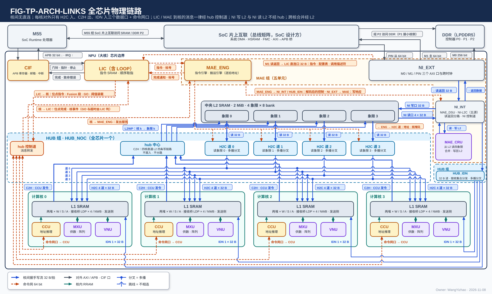

# 传输数据类别登记篇

> Owner: WangYizhao｜2026-11-11

## 1 概述

本篇是协议家族四篇之一（架构篇 `ONCHIP_DATAPATH_ARCH.md`、协议篇 `DATA_TRANSFER_PROTOCOL.md`、数据组织篇 `DATA_ORGANIZATION.md`、本篇）：**一张清单，按"产出方 → 消费方"列出芯片上搬运的每一类数据；每个条目都能在架构篇找到路径（PORT-nn）、在协议篇找到完成方式、在数据组织篇找到打包方式与格式，四篇互相校验。** 本篇给编译链、各模块篇的设计者与验证用：查某类数据从哪来、经哪些口、落在哪、谁发令、怎样判完成。

**本篇不定义任何机制；与前三篇冲突时改本篇。MAE 不感知数据类型**（V18-MAE-01）：这里的类别只服务编译链、文档与验证，不进任何硬件字段。

本篇的组织：第 2 章写条目共用的约定——条目引用的口（§2.1）、条目格式（§2.2）、L1 读写口在条目里的写法（§2.3）、四种完成方式与写完通知（§2.4），以及命令网与专用信号组上的往来（§2.5，它们不是数据）；第 3 章是全部 REG-nn 条目（§3.1 为索引）。

本篇用到的几个词（其余以架构篇 §1.2 与数据组织篇 §1.2 为准）：

| 词 | 含义 |
|---|---|
| 存储字 | 32 B，L1 / L2 读写的基本单位 |
| 写入拍 | 写链路上成交的一拍（en ∧ ready），默认 = 一个存储字；写入握手与应写量都按写入拍计 |
| 码块 | 紧凑 token 记录一个通道片四部分之一，只装保留通道的码（$w = 6$ 时每码 6 bit） |
| 码块片长 | 一个通道片的码块在 A 类占的字节数，按 32 B 取整；记在该片元数据项的首字里 |
| 发令方 | 给链路每拍地址的一方：源在核内的是本核 CCU，源在核外的是 MAE 的搬运引擎（架构篇 §3.2） |

## 2 接口需求

### 2.1 架构图与接口汇总：条目路径引用的口

图中模块框内的结构是参考实现（见架构篇第 7 章），本章以框外的各口为准。

本篇没有自己的口：**条目的"路径"一栏只用架构篇 §2.7 的口号 PORT-nn 写，口宽、条数、方向与握手一律以架构篇为准**。上图是架构篇 §2.1 的全芯片链路图，条目里出现的口都在图上。下表列条目路径里出现的口，位宽只为阅读方便摘自架构篇 §2.7：

| 口 | 条目里的写法 | 每拍位宽 | 握手 |
|---|---|---|---|
| PORT-01 | W 类权重读口（L1 外另有一路送 VNU 读口） | 4 路 × 32 B | 无（核内 RRAM） |
| PORT-02 | S 类读口，经 S 类读 MUX 送 pod 旁带 / VNU 读口 / EPI / 发送 FIFO 入口 | 一拍 2 个地址，2 路 × 32 B | 无 |
| PORT-03 | A 类读口，经 A 类读 MUX 送 MXU / VNU 读口 / CCU / 发送 FIFO 入口 | 一次 ≤ 128 B | 无 |
| PORT-04 / 05 / 06 | A / W / S 类写口，来源经 L1 外的写 MUX | ≤ 128 B / ≤ 128 B / 32 B 整字 | 无 |
| PORT-07 | AEB 条目（MXU → EPI） | 4 × 256 bit | valid / ready |
| PORT-09 | 计算核的集成输出端口（发送 FIFO 入口 / VNU 输出口 → C2H） | 出 32 B | 出侧 en / ready |
| PORT-10 / 11 | H2C 接收桥 / NWB | 入 4 × 32 B / 32 B | en / ready，回写入握手 |
| PORT-12 / 13 / 14 | H2C 道 / C2H / L2WP | 32 B | en / ready，写入握手 valid + `src` |
| PORT-15 | L2 象限读口（读地址流 + 读数据流） | 32 B | 两条流各 en / ready |
| PORT-16 / 17 | IDN 链路 / IDN 出口 | 32 B | en / ready |
| PORT-18 / 19 | NI 写口 / NI 读口 | 32 B / 4 × 32 B | en / ready |
| PORT-20 / 21 | MAE_DSU 进出 / MAE_CRU 进出 | 32 B / 进 4 × 32 B | en / ready |
| PORT-22 | LIC 直连口 | 32 B | en / ready，写入握手 |
| PORT-23 / 24 | 命令网：hub 控制道 / LIC → MAE_ENG | 64 bit + addr | en / ready |
| PORT-26 / 27 / 28 | M0 / M1 / PIN | 256 / 64 / 64 bit | AXI4 |
| PORT-30 | 写入握手回程 | valid + `src` | 只有 valid |
| PORT-35…39 | 专用信号组 GO / 位点完成事件 / 写完通知 / 完成通知 / 发出报告 | valid + 载荷 | 是否带 ready【设计者定】（架构篇 §2.7.6） |

架构篇 §2.7 开头列出的撤销口号不出现在任何条目里。

### 2.2 条目格式：REG-nn 编号与十个固定栏

#### 2.2.1 编号规则

**每类数据一个固定编号 `REG-nn`，编号只增不重排，撤销的编号空着、不复用**（撤销号登记在 _build/check_registry.py；元数据类条目已并入 REG-13 / REG-22）；其他篇引用写"登记篇 REG-nn"。**一类数据一个条目**，核间切分轴（T / M / K）的差别写在条目内部的"落点"一栏里，不另开条目。

#### 2.2.2 十个固定栏

每个条目固定写下面十栏；决定行为的一句加粗。第 3.5 节（只在核内流动）的条目允许"路径 / 发令方""应写量 / 完成"合并成一栏；第 3.6 节（多播）的条目只说明它与原条目的差别。

| 栏 | 写什么 |
|---|---|
| 是什么 | 按矩阵维度写这类数据（形状、平面、每项字节） |
| 产出方 → 消费方 | 哪个模块产出、哪个模块消费 |
| 路径 | 依次经过的口，用架构篇 §2.7 的 PORT-nn |
| 发令方 | 本核 CCU、MAE 搬运引擎、外部主方三者之一（架构篇 §3.2） |
| 落点 | 落在哪个存储的哪一类（L1 的 W / S / A 类、L2 的象限、LIC 小 SRAM、DDR）；核间切分轴的差别写在这里 |
| 打包方式 | 定长 / 定长项 / 变长（数据组织篇 §1.2），或紧密、随原数据、设计者定 |
| 元素格式 | 码的格式与位宽、尺度格式 |
| 应写量来源 | 发令方据以数写入握手的写入拍数从哪来：指令给定、生产核 CCU 累加、MAE 按列表展开或按元数据项累加 |
| 完成方式 | §2.4 的 (a)–(d) 之一或组合 |
| 为什么这样走 | 这条路径与放法的理由 |

#### 2.2.3 打包方式用词

| 用词 | 含义（定义在数据组织篇 §1.2） |
|---|---|
| 定长 | 整块长度由指令给 |
| 定长项 | 每项定长，有效项数由指令给 |
| 变长 | 长度运行时才知道，由元数据项或计数项给出 |
| 紧密 | 按 CIF 等共享格式紧挨排列 |
| 随原数据 | 拷贝类条目，与被拷贝的数据相同 |
| 设计者定 | 只在核内、不进 MXU / VNU 规范输入格式的工作数据，格式由所属单元设计者定 |

### 2.3 L1 的读写口在条目里的写法：路径只写到 RRAM 口

**L1 只暴露 RRAM 口**（V18-L1-21 / 24）：进 L1 的路径写到 L1 的类写口为止，中间经 L1 外的写 MUX（在 H2C 接收桥、NWB、VNU 写口之间按固定规则本地轮流，不由 CCU 逐拍选，写与读碰到同一个堆时写让读，V18-L1-32）；从 L1 读出写到类读口为止，去向经 L1 外、本核 CCU 控制的 A 类读 MUX / S 类读 MUX。这些 MUX 归计算核集成（`CORE_INTEGRATION_STAGING.md`），条目里不逐条写出。每个口的口宽与每拍规则见架构篇 §3.7 与 PORT-01…06，同拍能做哪些访问见架构篇 §3.4 的 CONC-n：

| 口 | 条目里的写法 | 要点 |
|---|---|---|
| W 类权重读口 PORT-01 | "W 类权重读口" | **一拍接收 4 个地址，分属 4 路，各路各自给地址，每路一次一个整字**（架构篇 §3.4 CONC-4）；每路另带 4 位"哪些 pod 收"（V18-CCU-01，MXU 集成篇 §2.2）；W 类只有这一个读口，送 VNU 读口的一路是它在 L1 外的一个去向 |
| S 类读口 PORT-02 | "S 类读口（PORT-02）" | **一拍接收 2 个地址，可以是同一个堆里的两个数据，每个地址一拍一个整字**（CONC-6，V18-L1-31 / TP-84）；同拍需要多于 2 路时由 CCU 错开；去向经 S 类读 MUX（pod 权重旁带 / pod 激活旁带 / VNU 读口 / EPI / 发送 FIFO 入口） |
| A 类读口 PORT-03 | "A 类读口" | 一次给首字节地址与长度（≤ 128 B），L1 交回从首字节起对齐好的数据（字节移位在 SRAM 内部，V18-TP-74）；从存储字边界起一拍，否则允许多拍（CONC-3） |
| 写口 PORT-04 / 05 / 06 | "A / W / S 类写口" | A / W 类一次 ≤ 128 B，支持紧密存储；S 类一次一个整字；W 类写口的来源有 H2C 接收桥、NWB、VNU 写口（V18-VNU-09） |

**S 类装的尺度与 bias**：权重（前向与反传共用同一份尺度行）、K、V、LM Head 列副本的尺度，激活与 Q 的尺度，以及 bias；**地址由编译链分配**；读口一拍 2 个地址（CONC-6）。**被挑的是输出维的数据按 W 类列字区的列位落：使用者给逻辑地址，落位规则只有架构篇 §3.4 CONC-4 一条，"哪一列放在哪个地址"由编译链分配**；W 类两种字形态（行字区、列字区）的定义在数据组织篇。

### 2.4 完成方式：条目只用四种写法

条目的"完成方式"一栏只用下面四种写法（规则在协议篇 §3.8 / §3.8.1 / §3.8 与架构篇 §3.9，本节只汇总，不另定）：

- **(a) 核内写**：写者经 L1 外的写 MUX 写进本核 L1（写 MUX 自己轮流、写让读，V18-L1-32；VNU 只交数据与有效字节数，地址由 CCU 计数推出，V18-VNU-12）；**完成由本核 CCU 判定，依据由写 MUX 告知 CCU 或由 VNU 报完成【设计者定】；L1 本身不提供完成信号**（协议篇 §3.8）。
- **(b) 核间写**：**接收方每把链路上的一拍（默认 = 一个存储字）写进最终存储之后，沿同一链路回一个写入握手（valid + `src`，PORT-30）；发令方（CCU 或 MAE 搬运引擎）数握手到应写量**。**C2H / L2WP 的写入握手与其他链路同形，也是 valid + `src`**（V18-TP-80）。**每个写入方（例如多播时每个目的核的接收桥）各回一组写入握手直达发令方，中途不汇总、不按 `src` 归并，发令方按（写入方, `src`）分别计数**；接收方的写入握手都在数据写进存储之后才回、逐拍回（V18-L1-19 / 27）。按落点再分三种收尾：
  - 落进 L1 的数据：发令的 MAE 数满后给目的核 CCU 发写完通知（§2.4.1）。
  - 核经 C2H 写进 L2 的数据：本核 CCU 数 L2 回的写入握手，满后经发出报告信号组（PORT-39）向 MAE 发出报告；报告只带目的起始地址（变长数据 = 码块的容量窗口基址），分批搬运时另带流标号（V18-MAE-45）。
  - MAE 写进 L2 的数据：搬运引擎数 NI 写口回的写入握手。
- **(c) 片外写**：AXI 写响应（NI_EXT 交 MAE）。
- **(d) LIC 小 SRAM**：搬运引擎数 LIC 直连口回的写入握手，满后经完成通知信号组（PORT-38）带指令标号通知 LIC。

**变长数据的写入字数随写完通知交消费核 CCU，不另发长度消息**（V18-TP-70）。命令网只传指令与配置；写完通知、发出报告、完成通知、GO、位点完成事件都走专用信号组（§2.5）。

#### 2.4.1 写完通知：从 CCU 一侧看每核收两路，互不等待

**从 CCU 一侧看，每核收两路写完通知——经 H2C 落地的一路、经 IDN 落地的一路——两路互不等待、在核前不合并，四核各自独立**（架构篇 §2.5.2，PORT-37）。一条写完通知的载荷 = 段选 + 目的基址 + 写入字数（各字段语义只在协议篇 §2.6 定义）：**发令的 MAE 数满写往该核的写入拍后给该核发出，每个目的核在写进本核的数据数满后收自己的通知、不等其他核，目的核 CCU 收到即可消费**（V18-TP-70 / 84）。几种情形：

1. **一条指令搬一份紧凑 token 记录的四块**（元数据项、E8M0 项、F 列表、码块）：**通知带码块的目的基址，字数 = 四块之和**，其余三块的位置由 CCU 按元数据项推出（V18-MAE-42）。
2. **经 H2C 合并送**：一个核的数据来自参与的几条道，**这几条道对该核都数满后给该核发**；多播给几个核时各核各自收、不等其他核（V18-TP-70 / 84）。
3. **经 H2C 分送**（象限 $c$ 只送核 $c$）：**核 $c$ 本道数满即收，不等其他核**（V18-TP-84）。
4. **经 IDN 几个核共享（按字分核或多播）**：搬运引擎的应写量 = 各核实际收到的字数之和；**各核各自数满写入握手就各自收写完通知，各带写进该核的字数；全部数满后 MAE 再向 LIC 发完成通知**（V18-MAE-43 / 45）。以上各情形写往全部目的核的数据都数满后，MAE 才向 LIC 发完成通知。

#### 2.4.2 按批流水：每批一次写完通知

**跨核搬运与消费结合 Fusion 指令按批流水**：一批 = 一条搬运指令的一次执行，先搬一批、算一批，算的同时搬下一批；每批各发一次写完通知，应写量按批判，不要求整份搬完（V18-DORG-10）。**分批搬运时下一批的起点由 MAE 接续**（V18-MAE-45，做法见 MAE_ENG 篇）；消费核 CCU 收到本批的写完通知后才读本批的元数据项。

### 2.5 命令网与专用信号组上的往来（不是数据）

**下面这些不是数据，不进第 3 章，也不占任何数据链路**（协议篇 §2.5 / §2.6）。

#### 2.5.1 命令网：只传指令与配置

**命令网只传指令与配置**：它与数据网同一协议格式，每拍带 addr（目的端点内的寄存器 / SRAM 地址），端点按 addr 写入（PORT-23 / 24）；**MAE 在命令网上只有 MAE_ENG 一个端点**；**L2 不在命令网上，指令不存 L2**（V18-TP-75）。

| 往来 | 方向 | 内容 |
|---|---|---|
| 位点指令 / Fusion 段 | LIC → 核 CCU（经 hub 控制道） | 1,024 bit 指令 = 16 个 64 bit 字，按 addr 写进 CCU 端点可写的指令寄存器或 Fusion 段 SRAM（端点内组织属 CCU 的设计，`CCU_STAGING.md`） |
| 搬运指令 | LIC → MAE_ENG | 带指令标号，可多条在飞 |
| 配置写 | 命令网链路的上游 → 该链路的端点 | 端点内配置寄存器，按 addr 写入 |

参考实现把 H2C 的道引擎放到道旁时，命令网上另有一路分派，见 §7.2。

#### 2.5.2 专用信号组：状态类往来

**状态类往来走 hub（或 NI）里的专用信号组**：每组 = valid + 载荷，按端点对一组，不经命令网；是否带 ready 与接收侧队列深度【设计者定】，约束是不丢、不重、接收侧来不及收时只降速（架构篇 §2.5.2 / §2.7.6）。**载荷各字段的语义只在协议篇 §2.6 定义**，下表只列字段名。写入握手不在此列，它是数据链路的反向旁带（PORT-30），每个写入方一组直达发令方。

| 信号组 | 方向 | 组数 | 载荷字段 |
|---|---|---|---|
| GO（PORT-35） | LIC → 核 CCU | 每核一组 | 位点号；门限随 SEL 的比较指令字段下发，不另装载（V18-SEL-18） |
| 位点完成事件（PORT-36） | 核 CCU → LIC | 每核一组 | 事件号：位点完成、组完成与其他核事件 |
| 写完通知（PORT-37） | MAE → 目的核 CCU | **每核收两路：经 H2C 落地一路、经 IDN 落地一路，互不等待、在核前不合并，四核各自独立** | 段选 + 目的基址 + 写入字数（规则见 §2.4.1） |
| 完成通知（PORT-38） | MAE_ENG → LIC | 一组 | 指令标号 |
| 发出报告（PORT-39） | 核 CCU → MAE_ENG | 每核一组 | 目的起始地址（变长数据 = 码块的容量窗口基址），表示该数据块已写进 L2；分批搬运时另带流标号（V18-MAE-45） |

**标量不在此列**（V18-TP-55）：$\sum x^2$ 等是数据，走 REG-19 / REG-27。

## 3 功能描述

### 3.1 功能一览：条目索引

| 条目 | 数据 | 产出方 → 消费方 | 发令方 | 完成方式 | 节 |
|---|---|---|---|---|---|
| REG-01 | 前向权重数字块 | DDR → 各核 MXU（L1 W 类） | MAE | (b) | §3.2 |
| REG-02 | 权重尺度数据块 | DDR → 各核 pod 权重旁带（L1 S 类） | MAE | (b) | §3.2 |
| REG-03 | bias 数据块 | DDR → EPI（L1 S 类）/ MAE_CRU（L2） | MAE | (b) | §3.2 |
| REG-04 | 训练核的权重 | DDR → 训练核 MXU（L1 W 类列字区） | MAE | (b) | §3.2 |
| REG-05 | K / V 平面读回 | DDR KV cache → MXU（L1 W / S 类） | MAE | (b) | §3.2 |
| REG-06 | 嵌入表（三张） | DDR → NLU / EPI | MAE | (b) | §3.2 |
| REG-07 | 调用输入 | M55 / 系统 DMA → L2 → L1 | MAE / 外部主方 | (b) / B 响应 | §3.2 |
| REG-08 | 指令、配置表、调用描述符 | 共享内存 / DDR → LIC 小 SRAM | MAE | (d) | §3.2 |
| REG-09 | 阈值表与 VNU 配置表 | 共享内存 / DDR → LIC / NLU、QNT | MAE | (d) / (b) | §3.2 |
| REG-10 | OPT 状态与参数梯度读入 | DDR → OPT | MAE | (b) | §3.2 |
| REG-11 | 监督记录与独立训练的入口梯度 | DDR / 共享内存 → LOSS / 训练核 MXU | MAE | (b) | §3.2 |
| REG-12 | 激活、残差与梯度的 DDR 卸载与重装 | L2 ⇄ DDR | MAE | (c) / (b) | §3.2 |
| REG-13 | 紧凑 token 记录（前向激活） | QNT → 下一位点各核 MXU | CCU / MAE | (b) | §3.3 |
| REG-14 | 残差流 | EPI + QNT / MAE_CRU → EPI、NLU | CCU / MAE | (a) / (b) | §3.3 |
| REG-15 | 反传流动梯度 | QNT、LOSS → 反传下一算子 MXU | CCU / MAE | 同 REG-13 | §3.3 |
| REG-16 | Q 粗算查询行记录 | QNT → 本核 MXU | CCU | (a) | §3.3 |
| REG-17 | K / V 新写入与读时旋转后的 K | QNT → DDR / 各核 L1 | CCU / MAE | (a) / (b) / (c) | §3.3 |
| REG-18 | 未归约部分和 | MXU（经 EPI）→ MAE_CRU | CCU | (b) | §3.3 |
| REG-19 | 跨核标量 | NLU / QNT → MAE_CRU | CCU | (b) | §3.3 |
| REG-20 | 读集位图 | SEL → MAE_CRU → MAE | CCU | (b) | §3.3 |
| REG-21 | 序号列表、TOPK 重算词号列表、TOPK 项与参与词号列表 | SEL / SMP / LOSS → MAE、CCU_RTR、M55 | CCU | (b) | §3.3 |
| REG-22 | 元数据项与列掩码来源（跨核消费） | QNT / MAE_CRU / SEL → 消费核 CCU、MAE | CCU / MAE | (b) | §3.3 |
| REG-23 | 结果记录 | SMP / LOSS → M55 | CCU / MAE | (b) / (c) | §3.3 |
| REG-24 | OPT 写回 | OPT → DDR | CCU / MAE | (b) / (c) | §3.3 |
| REG-25 | 归约结果 | MAE_CRU → 残差加或各核 | MAE | (b) | §3.4 |
| REG-26 | 残差加结果 | MAE_CRU → 下一层 | MAE | (b) | §3.4 |
| REG-27 | 标量合并值 | MAE_CRU → 各核 VNU | MAE | (b) | §3.4 |
| REG-28 | 读集并集 | MAE_CRU → MAE、各核 CCU_RTR | MAE | (b) | §3.4 |
| REG-29 | attention 行状态 | NLU 独占 | CCU | (a) | §3.5 |
| REG-30 | 停放值与 PS 部分和 | EPI → MXU 累加器 / EPI | CCU | (a) | §3.5 |
| REG-31 | 分数暂存、夹心归一化暂存与工作区 | NLU / SEL / SMP 自用 | CCU | (a) | §3.5 |
| REG-32 | 本核消费的元数据项、F 列表与列掩码来源 | SEL / QNT → 本核 CCU | CCU | (a) | §3.5 |
| REG-34 | attention 的 $P$ 向量 | NLU → 本核 pod | CCU | (a) | §3.5 |
| REG-33 | 多播的同一份数据 | （同原条目） | MAE | (b) | §3.6 |

编号中间的空号是撤销号（元数据类条目已并入 REG-13 / REG-22），不复用。

### 3.2 来自片外的数据（MAE 发令）

**这一节的数据都在核外产生，所以都由 MAE 的搬运引擎发令**（"谁拥有源，谁发令"，V18-TP-35）：一条搬运指令 = 口对 + 两端地址生成器 + 几何 + 核集合 + 运算级（不经运算级 / 经 MAE_DSU / 经 MAE_CRU），MAE 按地址与长度搬字节、不看内容；**经 MAE_DSU 时只有直通与转置两种运算**，转置由指令给元素位宽、行数、列数三个字段，各用法的参数只在 MAE_DSU 篇 §3.2 典型用法表里给（V18-MAE-41）；按元数据项聚集是源端的一种地址生成方式。L2 → L1 指令在 H2C 各道上怎样执行归 MAE（MAE_ENG 篇 §3.10，参考做法见本篇 §7.2）。进核的数据有两条路——经 IDN 出口 → HUB_IDN → NWB 直进核 L1，或先进 L2 再经 H2C → H2C 接收桥落 L1；选哪条由编译链按"要不要多核共享、要不要在 L2 换读法"定。**数据到达 L1 时已经是 L1 的字形态**：DDR 布局只为省访存定，它与 L1 W 类两种排法（行字区、列字区，V18-L1-30）之间的差由 MAE_DSU 调，H2C、IDN、接收桥、L1、pod 都不变形；**数据进 L1 前的整形有几条路，硬件都支持，由编译链按位点选**：L2 里存原形时走 NI 读口 → MAE_DSU → IDN，先经 MAE_DSU 整形存进 L2 的走 H2C，核内产生的由 QNT 直接排（V18-MAE-41 / 45，架构篇 §3.8）。链路只按字节有效位原样传、不受整字限制（V18-DORG-10）。

### REG-01 前向权重数字块

- **是什么**：$W$（$K \times M$）的 hi 平面或 lo 平面，MXINT8 码 $c = 16h + \ell$ 拆成 4 bit 的 $h$（hi）与 $\ell \oplus 8$（lo）；MXINT4 只有 hi。按位点以 DDR 标准布局（一拍 = 1 个 $k$ 行 × 4 个列组 × 8 B）或列深度优先布局（一拍 = 一列 64 个连续 $k$）存放（数据组织篇 §3.7.1 / §3.7.2）。**LM Head 另存一份 $W_{\text{head}}$ 按列连续的全码副本**：一列 = hi 段 1,280 B 接 lo 段 1,280 B 共 2,560 B（平面分开、不按字节交织），只供 LM Head TOPK 列补算按 TOPK 重算词号列表逐列读（REG-21，V18-MXU-09，数据组织篇 §2.11）；标准布局的 hi 平面仍供粗算。
- **产出方 → 消费方**：编译期写入 DDR → 各核 MXU 供数（经 L1 W 类）。
- **路径**：PORT-26 M0 → NI_INT 读返回分路 → [标准布局 / lo 稀疏读副本：PORT-20 MAE_DSU 转置成行字区的字形态，参数见 MAE_DSU 篇 §3.2 典型用法表；列深度优先：不经运算级] → PORT-17 IDN 出口 → PORT-16 IDN 链路 → PORT-11 NWB → PORT-05 W 类写口；或 M0 → [PORT-20 MAE_DSU 按 DDR 布局选转置或直通] → PORT-18 NI 写口 → L2（**L2 里存的已是 L1 的字形态**）→ PORT-15 / PORT-12 H2C → PORT-10 H2C 接收桥 → PORT-05（权重驻 L2 的位点）。
- **发令方**：MAE 搬运引擎。
- **落点**：L1 W 类——标准布局与 lo 稀疏读副本经 MAE_DSU 转置后落行字区（行字区的一个存储字 = 一个列组 4 个相邻 $k$ × 16 个 $m$；lo 稀疏读副本的输出与 hi 相同，L1 不另设它的字形态），列深度优先落列字区（列字区的一个存储字 = 一列 64 个连续 $k$）；**列字区按列位落：使用者给逻辑地址，落位规则是架构篇 §3.4 CONC-4，哪一列放在哪个地址由编译链分配**；**LM Head 全码副本按列字区的列位落，不在一段地址里按列连续排**（每列 80 个存储字 = hi 40 + lo 40，$K = 2{,}560$ 时 $2{,}560/64 = 40$，每字为该列 64 个连续 $k$，平面分开，V18-DORG-08）。核间按 M 切分时列组 $g$ → 核 $g$：**编译链排 DDR 标准布局单元时让列组 $g$ 装核 $g$ 那 $M/4$ 列里的 16 列，使每核拿到连续的 $M/4$ 列**（V18-DORG-11）；单核 / 按 T 切分时整块多播或单播；或 L2 任一象限。
- **打包方式**：定长（行字节数 × 行数由指令给）。
- **元素格式**：4 bit 码（MXINT8 的 hi / lo 平面，MXINT4 只 hi）。
- **应写量来源**：指令给定。
- **完成方式**：(b) 引擎数 NWB / H2C 接收桥的写入握手，数满后发写完通知；写 L2 时数 NI 写口的握手。
- **为什么这样走**：**标准布局保留"一拍一个 $k$ 行"是输入维度稀疏按 F 行读、减少片外访存的前提，不能改成按列组排字**（用户 11-08）；**DDR 布局只为省访存定，L1 的 W 类只有行字区、列字区两种排法，两者之间的差全部由 MAE_DSU 的直通或转置调**（V18-MAE-41，用户 11-10："DSU的需求不应该是，它应该对权重做转置，对Key怎样，对Value怎样，而是，对于一个数据形状，以什么逻辑重排"），链路、接收桥、L1 写口与 pod 都不调。

### REG-02 权重尺度数据块

- **是什么**：每（层, 位点）$\lceil K/32 \rceil \times M$ 个 E8M0（1 B），只 hi 平面有，lo 与 lo 稀疏读副本复用；独立于数字块，按 K 组主序或 32 列段主序排列（V18-DORG-01，数据组织篇 §3.7.1）。**LM Head 列副本的尺度另是一个按列主序、每列补到 32 B 倍数的尺度数据块**（按 REG-21 的 TOPK 重算词号列表逐列读，数据组织篇 §3.7.4）。
- **产出方 → 消费方**：编译期写入 DDR → 各核 pod（经 L1 S 类、S 类读 MUX 进 pod 的权重旁带）；训练核 pod（反传 $\mathrm dX = \mathrm dY\,W^{\mathsf T}$ 用同一份尺度行——一个 K 组 × 32 个 $m$ 的 32 个 E8M0——由 pod 在线算逐归约道的指数偏移；一次计算里的列来自不同 K 组时各读各的尺度行，V18-MXU-11 / L1-30）。
- **路径**：PORT-26 M0 → NI_INT → PORT-17 / PORT-16 → PORT-11 NWB → PORT-06 S 类写口（整字落尺度行）；用时经 S 类读口（PORT-02，一拍 2 个地址之一）→ S 类读 MUX → pod 权重旁带；训练核与前向核同一种搬运。
- **发令方**：MAE 搬运引擎（与数字块是不同的搬运指令）。
- **落点**：L1 S 类（地址由编译链分配；读口一拍 2 个地址，CONC-6，V18-L1-31），一个存储字 = 一个 K 组下 32 个输出通道的 32 个 E8M0；核间按 M 切分时各核只收自己列块的尺度行；或 L2。
- **打包方式**：定长。
- **元素格式**：E8M0 8 bit。
- **应写量来源**：指令给定。
- **完成方式**：(b)。
- **为什么这样走**：**尺度本来就落 S 类、MAE 本来就不感知类型，独立成块后数字单元纯数字、hi / lo 等长；MAE_DSU 只动数字的位置，训练核与前向共用同一份尺度行**（用户 11-08："E8M0 和 Bias 本来就是存在 L1 SRAM 的 S 专项里的，MAE 仍然可以做到无数据感知的读取"；11-09："对于块尺度和写完判断，我完全认可"）。

### REG-03 bias 数据块

- **是什么**：一个位点 $M$ 个 BF16 偏置，按 $m$ 连续（V18-DORG-01）。
- **产出方 → 消费方**：编译期写入 DDR → 后处理子模块（EPI）的 bias 加：**$K$ 全部累加完、条目出 AEB 之后加一次**（V18-EPI-02，EPI 篇 §3.4）；**核间 K 切分位点各核只有部分和，bias 不在各核 EPI 加，由 MAE_CRU 的归约指令在四份相加之后加一次**（V18-CRU-09 / 10，MAE_CRU 篇 §3.4）。bias 只有 BF16 一种精度、不量化（V18-EPI-05）。
- **路径**：同 REG-02，经 PORT-06 S 类写口按地址落 S 类；用时经 S 类读口（PORT-02）→ S 类读 MUX → EPI（V18-L1-21，VNU 集成篇 §2.5），S 类读由 CCU 发；何时读、怎样保持归 EPI 与 CCU 的设计（V18-EPI-05）。核间 K 切分位点：bias 数据块由搬运指令经 PORT-18 写进 L2，MAE_CRU 经 PORT-19 读入（MAE_CRU 只读 L2）。
- **发令方**：MAE 搬运引擎；S 类读由本核 CCU 发。
- **落点**：**L1 S 类**（地址由编译链分配；每 32 列块两个存储字（32 × 2 B = 64 B））；按 M 切分时各核只收自己列块的；核间 K 切分位点落 L2。
- **打包方式**：定长。
- **元素格式**：BF16，不量化（用户 11-04）。
- **应写量来源**：指令给定。
- **完成方式**：(b)。
- **为什么这样走**：与尺度同一套存放逻辑（用户 11-08："偏置可以是一个存放逻辑"）；bias 只有 $m$ 一维，两种排序退化为一种。**bias 与权重尺度分时读**（V18-L1-31，用户 11-11："我认为Bias和权重尺度是可以分时的，我认为S类同拍只需要设计到2路"）：同拍需要多于 2 路时由 CCU 错开。**EPI 对 bias 的需求只有三件事：能把 bias 加到结果上、bias 在 L1 S 类由 CCU 发读、只有 BF16 一种精度**；何时到达、谁保持归 EPI 设计者（V18-EPI-05，用户 11-11："我认为bias的先后这种级别的设计是EPI的负责人要考虑的，EPI的需求就是，它要能够累加Bias值，Bias值存在哪，有哪些精度"）。

### REG-04 训练核的权重（反传 $\mathrm dX = \mathrm dY\,W^{\mathsf T}$ 的右操作数）

- **是什么**：传播梯度 $\mathrm dX = \mathrm dY\,W^{\mathsf T}$ 的右操作数，就是前向的 $W$（$K \times M$）原样：归约维是 $m$、输出维是 $k$，计算核以输出稀疏模式算（挑输出维，架构篇 §3.6）。**权重侧用 L1 W 类的列字区排法：一个存储字 = 1 个 $k$ × 64 个连续 $m$ 的 4 bit 码（32 B），对 $W^{\mathsf T}$ 而言就是一列（输出通道 $k$）的 64 个连续归约位置，恰等于 DDR 标准布局的一拍**（V18-L1-30）。只有数字：块尺度不随数字走，前向的尺度数据块（REG-02）由普通搬运直送训练核 S 类，pod 用尺度行（一个 K 组 × 32 个 $m$）在线算逐归约道的指数偏移；一次计算里的列来自不同 K 组时各读各的尺度行（V18-MXU-11 / L1-30）。
- **产出方 → 消费方**：DDR 的前向形式权重（与 REG-01 同一份）→ 训练核 MXU。
- **路径**：标准布局：PORT-26 M0 → NI_INT → PORT-20 MAE_DSU 直通（字内内容不变，只按搬运引擎给的次序与地址交出）→ PORT-17 IDN 出口 → PORT-16 → PORT-11 NWB → PORT-05 W 类写口；列深度优先布局：同一条路，PORT-20 MAE_DSU 做转置（参数见 MAE_DSU 篇 §3.2 典型用法表）。也可经 PORT-18 先写进 L2（L2 里存的已是列字区的字形态）再经 H2C 多播。**双目的**：一次 DDR 读同时给前向核与训练核时，标准布局下训练那一份直通、前向那一份转置成行字区的字形态，列深度优先布局下前向那一份不经运算级、训练那一份转置；**权重只读一次**（V18-MAE-16 / L1-30）。尺度行另由 REG-02 的搬运经 PORT-06 落训练核 S 类。
- **发令方**：MAE 搬运引擎（运算级 = 经 MAE_DSU：标准布局直通、列深度优先转置）。
- **落点**：训练核 L1 W 类列字区（按列字区的列位落：使用者给逻辑地址，落位规则是架构篇 §3.4 CONC-4，哪一列放在哪个地址由编译链分配）；或先落 L2 再多播。
- **打包方式**：定长。
- **元素格式**：4 bit 码（MXINT8 的 hi / lo 平面，MXINT4 只 hi）。
- **应写量来源**：指令给定。
- **完成方式**：(b)，引擎数握手，数满后发写完通知。
- **为什么这样走**：**DDR 只存前向形式，反传要的形态在搬运途中由 MAE_DSU 一次给出（标准布局直通、列深度优先转置）**（用户 11-06），同一次 DDR 读可同时服务前向核与训练核；**单个计算核内不分反传模式与前向模式，只分行稀疏与列稀疏；$\mathrm dX$ 挑的是输出维，用列字区排法，L1 不另设第三种排法**（V18-L1-30，用户 11-10："对于训练块，它在反传的时候不是也只有归约维稀疏和输出维稀疏两个模式吗？这里需要有第三个模式吗"）；标准布局的一拍恰是列字区的一个存储字，所以直通即可；**DSU 只动数字、块尺度由 pod 在线算**，训练核与前向共用同一份尺度行（V18-MXU-11，用户 11-09："对于块尺度和写完判断，我完全认可"）。被否方案：L1 另设 512 B 的 $W^{\mathsf T}$ 块作第三种排法——它只是列稀疏的一种特例。

### REG-05 K / V 平面读回

- **是什么**：历史 key 的 $K$（$T_{\text{ctx}} \times d_h$，每 kv 头）hi / lo 平面（每 key hi 64 B 码、lo 64 B）与 K 尺度数据块（每 key $d_h/g_K$ 个 E8M0，$g_K = 32$ 时 4 B，与码分开；Q / K / V 的 MX 组长由指令给，V18-ATT-04），$V$ 平面（8 bit 两平面各 64 B 或 4 bit 单平面 64 B）与 V 尺度数据块（每 key $d_h/g_V$ 个 E8M0）；**没有每 key 的最大指数字段**（V18-MXU-12）；精算用的全码 key 记录 = 一个录取 key 的 hi 2 个存储字与 lo 2 个存储字，共 128 B（$d_h = 128$，数据组织篇 §2.13），进 L1 时这 4 个字各落各的列位、平面分开。
- **产出方 → 消费方**：DDR KV cache → MXU（粗算 $\tilde S = QK_{\text{hi}}^{\mathsf T}$、精算、P×V）；**K 尺度与 V 尺度都作为权重一侧的尺度进 pod 的权重旁带，由 pod 处理**（V18-MXU-15）。
- **路径**：粗算顺序流：PORT-26 M0 → NI_INT → PORT-20 MAE_DSU 转置成行字区的字形态（K hi 在 DDR 是每 key 64 B、按 key 连续的原形，参数见 MAE_DSU 篇 §3.2 典型用法表）→ PORT-17 / PORT-16 → PORT-11 NWB → PORT-05 W 类行字区；K 尺度数据块不经运算级，经 PORT-17 / PORT-16 → PORT-11 → PORT-06 S 类（用时经 S 类读口（PORT-02）→ S 类读 MUX → pod 权重旁带）。**精算选驻留模式时**，K hi 走 M0 → PORT-18 NI 写口 → L2 的 K hi 驻留区（存 DDR 原形），**从 L2 下发一律走 PORT-19 NI 读口 → PORT-20 MAE_DSU → PORT-17 IDN 出口**：送粗算核时转置成行字区的字形态，精算时直通、按列字区的列位落；K hi 不经 H2C 下发。录取后按读集 gather（列表驱动，REG-28）：**全码 key 记录经 PORT-20 MAE_DSU 直通（只按指令给地址，hi、lo 两路源按指令次序接续）→ PORT-17 IDN 出口 → PORT-16 → PORT-11 NWB → PORT-05，按列字区的列位落，驻留与重读两种模式走同一出口**——重读模式 hi、lo 都从 DDR 读，驻留模式 hi 从 L2 驻留区经 PORT-19 NI 读口读、lo 从 DDR 读（V18-ATT-03 再修订，MAE_ENG 篇 §3.12）；V 按读集 gather 后经 PORT-20 MAE_DSU 转置成行字区的字形态（把 key 当作行）→ PORT-17 / PORT-16 → PORT-11 → PORT-05；**录取 key 的 K / V 尺度：源端对同一个尺度字只读一次，MAE_DSU 输入侧按搬运引擎给的选择位图只取被选中 key 的元素、按录取次序排成整字（一个字 = 32 个录取 key 在同一尺度组上的 E8M0）**，经同一 IDN 出口 → PORT-06 S 类（V18-MAE-41，参数见 MAE_DSU 篇 §3.2 典型用法表）；V 尺度用时经 S 类读口（PORT-02）→ S 类读 MUX → pod 权重旁带（V18-MXU-15）。
- **发令方**：MAE 搬运引擎（gather 用 SEL 产出的读集并集，REG-28）。
- **落点**：L1 W 类——粗算的 K hi 与录取后的 V 落行字区（MAE_DSU 转成的行字区字形态；稀疏读时一个存储字的"4 个相邻 $k$"是读集次序里相邻的 4 个被选行），全码 key 记录按列字区的列位落（落位规则 CONC-4，地址由编译链分配；编译链的地址名"录取 key 全码区"）；S 类——K 尺度与 V 尺度都经 S 类读 MUX 送 pod 的权重旁带，地址由编译链分配（CONC-6，数据组织篇 §2.13）；精算驻留模式下另有 L2 的 K hi 驻留区（DDR 原形，编译链地址名）；按 kv 头分核时各核自持自己 kv 头的平面，按 key 分核时各核自持自己 key 段。
- **打包方式**：定长项（一个 key 一项，有效 key 数由指令给）；**K 尺度数据块在 DDR 与片上同一排法：一个存储字 = 32 个 key 在同一尺度组上的 E8M0**；V 尺度在 DDR 的排法见数据组织篇 §2.13；录取 key 的 K / V 尺度由 MAE_DSU 按录取次序排成整字（见路径，V18-MAE-41）。
- **元素格式**：MXINT8 拆 hi / lo 4 bit；E8M0（MX 组长由指令给，例 32，V18-ATT-04）。
- **应写量来源**：顺序流由指令给定；gather 由 MAE 按列表展开、自己数发出的拍数（列表项数 × 每项拍数；默认整字项时每项拍数 = 每项存储字数），写完通知带写入字数。
- **完成方式**：(b)，数满后发写完通知。
- **为什么这样走**：**粗算只读 hi 平面 + K 尺度，录取后才补读 lo 与 V**（用户 11-04），每类数据各自一个平面按 key 连续，顺序流与 gather 各取所需；精算 K hi 驻留 / 重读两种模式按位点选（V18-ATT-01），**驻留 = hi 驻 L2，两种模式都经 IDN 出口落同一种全码 key 记录**（V18-ATT-03 再修订，用户 11-09："对于第6条：我建议走IDN"：DSU 每拍出 32 B、IDN 每核一条 32 B 链路正好匹配），K 两种处理路径格式相同（V18-KV-01）；**L2 驻留区存 DDR 原形、从 L2 下发一律经 MAE_DSU**，形态转换只在 MAE_DSU 一处做，粗算要的行字区字形态与精算要的列位都从同一份原形出（V18-MAE-41）；**粗算与 P×V 挑归约维、用行字区，精算挑输出维（key）、按列位落**（V18-DORG-08）；**V 的尺度与反传的权重尺度同一种处理，归 pod**（V18-MXU-15，用户 11-11："对于梯度反传的矩阵转置来说，它的MX组是否由pod直接折叠？那我认为V和K的折叠也不应该放在VNU"）。

### REG-06 嵌入表（三张）

- **是什么**：词表矩阵 $E$ 的一行（$d_{\text{hidden}}$ 维，第 0 层直接作残差）与第 0 层归一化用的两个 FP32 标量（$\sum x^2$、$\sum\lvert x\gamma\rvert$）。**分三张表单独存、单独访问**：码表（每词 $d_{\text{hidden}}$ 个 6 bit 码）、E8M0 表（每词 $d_{\text{hidden}}/G$ 个 E8M0）、标量表（每词 2 × FP32）（V18-DORG-03，用户 11-09："不希望拼接，而是单独存储，单独访问"；数据组织篇 §2.8）。
- **产出方 → 消费方**：DDR 嵌入表 → NLU（第 0 层归一化，读标量）/ 后处理子模块 EPI（第 0 层残差，读码与 E8M0）。
- **路径**：三张表各一条搬运指令，按同一 token 列表 gather 三次：PORT-26 M0 → NI_INT → PORT-17 / PORT-16 → PORT-11 NWB → 码表与标量表经 PORT-04 A 类写口、E8M0 表经 PORT-06 S 类写口；用时 EPI 经 PORT-03 → A 类读 MUX 读码、经 S 类读口（PORT-02）→ S 类读 MUX 读 E8M0，NLU 经 A 类读 MUX 读标量。
- **发令方**：MAE 搬运引擎（列表驱动：按 token id 列表 gather，三条指令）。
- **落点**：消费核 L1——码与两个标量落 A 类，E8M0 落 S 类；按 T 切分时各核收自己 token 的行。
- **打包方式**：定长项（三张表各自每词一项；**码表与 E8M0 表每项默认补到 32 B 的倍数**（数据组织的默认对齐，每项一次 gather 从存储字边界开始）：码表按 $\lceil d_{\text{hidden}} \cdot 6/256 \rceil \times 32$、E8M0 表 Qwen $2{,}560/32 = 80$ → 96 B；**标量表每项 8 B 紧挨存、不补齐**：8 B 整除 32 B，一项不跨存储字；按词号 gather 时每项一拍、有效字节 8 B，经 A 类写口从该项的字节起点写，地址不是 32 的倍数时由 SRAM 内部移位（L1 A 类支持紧密存储，V18-TP-74 / DORG-08，数据组织篇 §2.8））。
- **元素格式**：码 MXFP6 E2M3（稠密残差格式的码块），MX 组长 $G$ 为位点属性；$G$ 的上限【设计者定】：约束是 32 的倍数且不大于片长；32 是精度基准、验收工况与效果最好的配置（V18-MXU-10）；E8M0 8 bit；标量 2 × FP32。
- **应写量来源**：每张表 = 列表项数 × 该表每项拍数（码表、E8M0 表每项拍数 = 每项存储字数；标量表每项 1 拍、有效字节 8 B），MAE 自己数发出的拍数，写完通知带写入量。
- **完成方式**：(b)，三条指令各自数满后发写完通知。
- **为什么这样走**：嵌入行与残差同为 MXFP6、同一 $G$、次序一致，第 0 层不必经 NLU → QNT 重编码；**三张表单独存**：码与 E8M0 落不同的类（A 类与 S 类），标量只给 NLU，拼在一起反而要在落地时拆开。

### REG-07 调用输入

- **是什么**：token id、图像块、传感器向量等 SoC 侧输入，格式由 CIF 篇定义（与 M55 共用）。
- **产出方 → 消费方**：M55 / 系统 DMA → 各核（经 L2）。
- **路径**：PORT-27 M1 读回 → PORT-18 NI 写口 → L2；或 PORT-28 PIN 直写 → PORT-18 → L2 的 PIN 窗口；用时 PORT-15 / PORT-12 H2C → PORT-10 H2C 接收桥 → L1。
- **发令方**：M1 路由 MAE 搬运引擎；PIN 路由外部主方（PIN 窗口由编译链固定；位置与长度多数在指令里，也可能由 M55 经 CIF 的 PIN 相关寄存器在运行期给出，LIC 知道取哪一份，V18-CIF-06）。
- **落点**：L2 的 PIN 输入地址段（一个象限的一堆内；**每种输入一个 PIN 窗口，起点由编译链固定，默认按存储字对齐、不作硬限制（L2 支持紧密存储，可从任意字节起写）；外部主方从起点顺序写、长度任意；一笔写事务不跨象限、不跨堆，有效字节连续（首拍可从中间起、末拍可不满），末拍用字节有效位标出有效字节**，V18-TP-67 / 74、V18-MAE-44、V18-NIE-04，L2 篇 §3.3）→ L1 A 类。
- **打包方式**：紧密（由 CIF 格式定）。
- **元素格式**：CIF 篇。
- **应写量来源**：M1 由指令给定；PIN 为 AXI 事务长度，实际输入长度由 M55 写进调用描述符（`L3PU_EXTERNAL_INFORMATION.md` §3.4）。
- **完成方式**：M1 → L2 为 (b)；PIN 为 B 响应（该笔事务的写入握手数满后回，V18-TP-47，MAE_NI_EXT 篇 §2.4.2）。
- **为什么这样走**：**PIN 直写 L2 与 M1 读回 → L2 两条路都必须有**（V18-MAE-09）：一个由外部主方推、一个由 MAE 拉，覆盖 SoC 两类输入方式；**PIN 写 L2 与推理整体分先后**：PIN 写一帧期间 L3PU 不推理，一帧传完才开始推理，所以 L2 不为 PIN 设保留堆、PIN 的每种输入只留一个 PIN 窗口（V18-L2-07、V18-MAE-44，用户 11-10："我认为只留一个窗口，咱们保证传完之后推理才开始，这个不是咱们的一个设计主打"）。

### REG-08 指令、配置表、调用描述符

- **是什么**：外部输入信息五类之三（`L3PU_EXTERNAL_INFORMATION.md`）：1,024 bit 位点指令与 Fusion 段、各位点配置表、调用描述符。
- **产出方 → 消费方**：共享内存 / DDR → LIC。
- **路径**：PORT-27 M1 → NI_INT 读返回分路 → PORT-22 LIC 直连口 → LIC 专用小 SRAM（不在 L1 / L2 段选体系内，V18-LIC-01）。
- **发令方**：MAE 搬运引擎（LIC 下发的搬运指令）。
- **落点**：LIC 小 SRAM；**可在当前调用执行期间装入下一调用的指令与配置表，不影响当前调用，在下一调用入口生效**（外部信息篇 §3.2 / §3.3）。
- **打包方式**：定长。
- **元素格式**：指令 1,024 bit 等（ISA）。
- **应写量来源**：指令给定。
- **完成方式**：(d) 引擎数 LIC 小 SRAM 的写入握手，满后带标号通知 LIC（V18-MAE-29 MI8）。
- **为什么这样走**：LIC 像 TCM 一样从自己的小 SRAM 取指令与表，不经 L2 绕一圈——**指令不存 L2，L2 不在命令网上**（V18-TP-75）；MAE 仍是唯一的搬运主。

### REG-09 阈值表与 VNU 配置表

- **是什么**：两种离线产生的表（格式归 SEL / NLU 篇，数据组织篇 §1.1 不定）：**阈值表**——各位点的录取 / keep / FFN 门限，每个门限是一对阈值 $(\tau_{\text{hi}}, \tau_{\text{lo}})$（V18-SEL-18），每调用按套号选一套；**VNU 配置表**——NLU / QNT 的逐通道向量（$\gamma$ 等）、RoPE cos / sin 表、近似系数与查找表（若可装载）。**标量参数（$\epsilon_{\text{norm}}$、温度、门限、个数）不在此列，走指令字段**（V18-NLU-07）。
- **产出方 → 消费方**：共享内存 / DDR → **阈值表：LIC**（LIC 按调用描述符的套号与位点查出一对阈值，填进 SEL 的比较指令字段；SEL 不读阈值表，只持当前指令带来的门限）；**VNU 配置表：各核 NLU / QNT**（经 VNU 读口从 L1 读入）。
- **路径**：阈值表：PORT-27 M1（或 PORT-26 M0）→ NI_INT 读返回分路 → PORT-22 LIC 直连口 → LIC 专用小 SRAM 的配置表区（与 REG-08 同一条路）；VNU 配置表：PORT-27 M1 或 PORT-26 M0 → PORT-18 NI 写口 → L2，用时 PORT-15 / PORT-12 H2C → PORT-10 H2C 接收桥 → PORT-04 L1 A 类；或 PORT-26 M0 → PORT-17 / PORT-16 HUB_IDN → PORT-11 NWB → PORT-04 直接进核 L1 A 类（V18-NLU-07）。
- **发令方**：MAE 搬运引擎（LIC 下发的搬运指令；不经 CCU 交来）。
- **落点**：阈值表：LIC 专用小 SRAM（不在 L1 / L2 段选体系内，V18-LIC-01）；VNU 配置表：L1 A 类（经 L2 时先落 L2；核内地址由编译链给，用法归 NLU / QNT 篇）。
- **打包方式**：定长。
- **元素格式**：各单元篇定。
- **应写量来源**：指令给定。
- **完成方式**：阈值表 (d)；VNU 配置表 (b)。
- **为什么这样走**：**门限随指令走，阈值表只是 LIC 填指令的离线来源**（V18-SEL-18：一条比较指令带一对阈值），所以阈值表与其他 LIC 配置表一样装进 LIC 小 SRAM，不进核；VNU 配置表大、离线产生，存 DDR / HSRAM 由 MAE 搬进核，多核共用一份时先进 L2 再多播，或经 HUB_IDN 直接投各核（用户 11-09："除了查找表以外的数据可以来自指令，而查找表本身很大，它需要被存在DDR，然后可以走IDN或者其他逻辑到VNU内部"）。

### REG-10 OPT 状态与参数梯度读入

- **是什么**：优化器一阶 / 二阶状态、累加后的参数梯度 $\mathbf G$（与参数同形，暂定 BF16）、参数副本。
- **产出方 → 消费方**：DDR → OPT（VNU_OPT 篇）。
- **路径**：PORT-26 M0 → NI_INT → PORT-17 / PORT-16 → PORT-11 NWB → PORT-04 A 类写口（状态、梯度）；参数副本的码 → PORT-05 W 类、E8M0 → PORT-06 S 类，OPT 经 PORT-01 W 类权重读口在 L1 外去 VNU 读口的一路读码（CCU 给各路地址，CONC-4；L1 不限制它与 A 类读出同拍，VNU 入口怎样收归 VNU 设计者，V18-VNU-09）、经 S 类读口（PORT-02）→ S 类读 MUX 的 VNU 去向读尺度（V18-L1-21）。
- **发令方**：MAE 搬运引擎。
- **落点**：OPT 执行核的 L1 A 类（状态、梯度）；参数副本在 W 类（码）与 S 类（E8M0）。
- **打包方式**：定长。
- **元素格式**：状态与 $\mathbf G$ 的格式由 OPT 设计者与训练核、数据组织篇对接后登记（$\mathbf G$ 暂定 BF16，V18-OPT-02）；前向读的参数副本为 MXINT8 g32（底线格式）。
- **应写量来源**：指令给定。
- **完成方式**：(b)，数满后发写完通知。
- **为什么这样走**：OPT 是放权模块（用户 11-04），只固定别的模块直接消费的格式；搬运上与其他 DDR → L1 数据无区别。

### REG-11 监督记录与独立训练的入口梯度

- **是什么**：蒸馏 teacher 的截断分布（一个采样位置 $K_{\text{top}}$ 项）、独立训练由 M55 算出的入口梯度（CIF 格式的头 + 载荷，头的格式在 CIF 篇；片上数据格式里没有记录头，数据组织篇 §2.4）。
- **产出方 → 消费方**：DDR / 共享内存 → LOSS（VNU_LOSS 篇）；入口梯度作首跳 dY → 训练核 MXU。
- **路径**：PORT-26 M0（载荷）/ PORT-27 M1（CIF 格式的头）→ NI_INT → PORT-17 / PORT-16 → PORT-11 → L1 A 类；或经 L2 → H2C。
- **发令方**：MAE 搬运引擎。
- **落点**：L1 A 类（LOSS 读）；入口梯度按训练位点的驻留侧落 L2 或训练核 L1。
- **打包方式**：变长（监督记录起点对齐到存储字，长度由 CIF 格式的头给）或 CIF 共享格式。
- **元素格式**：LOSS 篇 / CIF 篇定；入口梯度格式【待确认，CIF 篇】。
- **应写量来源**：指令给定；变长的由 MAE 数发出的字数，写完通知带写入字数。
- **完成方式**：(b)，数满后发写完通知。
- **为什么这样走**：teacher 只用 Verify 的截断分布（10-30 裁定），监督记录小、随调用给；LOSS 从 L1 读，不设专用口。

### REG-12 激活、残差与梯度的 DDR 卸载与重装

- **是什么**：L2 放不下时整块卸到 DDR 的紧凑激活 / 流动梯度 / 残差流（紧凑 token 记录连同元数据项、E8M0 项、F 列表、码块四个数据块），以及重装回来的同一数据（数据组织篇 §3.6.9 / §3.7.3）。
- **产出方 → 消费方**：L2 → DDR → L2 或核 L1。
- **路径**：卸载：PORT-19 NI 读口（4 × 32 B，每象限一路）→ NI_EXT → PORT-26 M0；重装：M0 → PORT-18 NI 写口 → L2（可重选象限、可按段掩码广播），或 M0 → PORT-17 / PORT-16 → PORT-11 → L1。
- **发令方**：MAE 搬运引擎。
- **落点**：DDR 布局与片上相同（紧凑 token 记录为四个数据块，四部分每片默认从存储字边界开始、片尾补齐，元数据项定长）；重装落点按下一位点的读法由指令给（数据组织篇 §3.6.6）。
- **打包方式**：随原数据（变长 / 定长项）。
- **元素格式**：随原数据。
- **应写量来源**：指令给定（整块拷贝，不解析）。
- **完成方式**：卸载 (c) AXI 写响应；重装 (b)。
- **为什么这样走**：**相邻位点切分轴不同的衔接都在 L2 内完成、不回 DDR**（V18-TP-48），只有容量放不下才卸载；同址异象限的几份卸载时一拍读四个象限同址、重装时按象限拆回，只是地址几何（V18-MAE-28）。

### 3.3 核内产生、出核的数据（本核 CCU 发令，C2H 只到 L2）

**核内产生的数据由本核 CCU 发令出核**（"谁拥有源，谁发令"）：MXU / VNU 的输出每条指令二选一——写本核 L1，或由 CCU 给出 L2 地址、经计算核的集成输出端口（PORT-09）上 C2H 直接写 L2（V18-TP-56）；**C2H 只有一个去向：L2 本核象限 $n$**（PORT-13 / PORT-14，V18-L2-04 / CRU-07），别的核要用时另由 MAE 的 L2 → L1 指令经 H2C 送下去。所以出核数据的"落点"一律先写成 L2 象限 $n$ 内的位置：要跨核合并的份同址异象限；**变长数据四个象限同址、产出方按下一位点的读法分块写**（V18-DORG-06，数据组织篇 §3.6）。CCU 对每个数据块数 L2 回的写入握手（valid + `src`，V18-TP-80），满后向 MAE 发出报告（只带目的起始地址；变长数据 = 码块的容量窗口基址，V18-DORG-05；分批搬运时另带流标号，V18-MAE-45），MAE 由此知道它可以读。

### REG-13 紧凑 token 记录（前向激活）

- **是什么**：线性位点输出 $Y$（$T \times M$）经 NLU 归一化、SEL 判决后的下一位点输入副本 $\hat X$。**一条 token 记录按消费方的 $k$ 边界切成若干通道片（每片含该 token 在一段连续通道范围上的全部数据，片长 $P$ 由编译链按位点定：$K/4$、$K_t$ 或整条，V18-DORG-03）；一个通道片 = 四部分，各在一个数据块里、默认各自从存储字边界开始、片尾补到 32 B**（V18-TP-65 / 68、DORG-04；SRAM 支持紧密存储（V18-TP-74），这是数据组织的默认；数据组织篇 §2.5）：**元数据项**（定长：项首码块片长 16 bit + F 项数 16 bit，后接 keep 位图 $P$ bit，补到 32 B 的倍数；keep = SEL 的判决位图）、**E8M0 项**（每 $G$ 个通道一个，每片 $P/G$ B 补到 32 B 的倍数，$w = 16$ 时没有）、**F 列表**（片内 F = 1 的通道序号，升序，每项 2 B，变长，= SEL 的序号列表输出，按片补齐）、**码块**（保留通道的码按通道序紧密排列，每码 $w$ bit，片尾补齐）；四个数据块的基址由指令给，被判 Z 的通道不出码。
- **产出方 → 消费方**：QNT 写四部分（keep 位图与 F 列表来自 SEL）→ 下一位点各核 MXU 供数（码经 PORT-03 → A 类读 MUX 进 pod、E8M0 经 S 类读口（PORT-02）→ S 类读 MUX 进 pod 的激活旁带）；元数据项与 F 列表由消费核 CCU 经 A 类读 MUX 读入（CCU 一侧怎样缓冲属 CCU 的设计，`CCU_STAGING.md`；V18-L1-20 / 21）。
- **路径**：本核产出：QNT → VNU 写口按 `seg` 分写 PORT-04 A 类写口（元数据项、F 列表、码块）与 PORT-06 S 类写口（E8M0 项，整字）；出核：CCU 的发送指令读 PORT-03 A 类读口（元数据项、F 列表、码块）与 S 类读口（PORT-02，E8M0 项）→ A 类 / S 类读 MUX 的发送 FIFO 入口去向 → PORT-09 集成输出端口 → PORT-13 C2H → PORT-14 L2WP → L2 象限 $n$（四部分都是普通数据块），或 VNU 输出经 PORT-09 直接上 C2H（二选一）；下一位点 PORT-15 / PORT-12 H2C → PORT-10 H2C 接收桥 → 按 `seg` 进 PORT-04 / PORT-06。
- **发令方**：出核由本核 CCU（位点指令 / 发送指令）；回核由 MAE 搬运引擎。
- **落点**：本核消费：元数据项、F 列表、码块 L1 A 类，E8M0 项 L1 S 类；跨核：**按 T 切分时象限 $n$ 放核 $n$ 那组 token 的整条 token 记录；按 M 切分时象限 $n$ 放所有 token 在核 $n$ 那 $M/4$ 列上的通道片；按 K 切分时各核收自己那 $K/4$ 个通道的通道片；四部分在四个象限一律同址，一条指令一套基址；产出方按下一位点的读法分块写**（M 接 T 按下一位点的 token 组分 4 个子块，T 接 K 按片号分 4 个子块，子块基址由编译链给，V18-DORG-06；数据组织篇 §3.6.2–§3.6.4、§3.6.6）。**L2 → L1 经 H2C 只有合并送与分送两种用法**（V18-MAE-37，架构篇 §3.8）：合并送 = 参与象限的读出合并成一路、H2C 四道并行送一个核集合；分送 = 象限 $c$ 只送核 $c$，**每核的有效带宽是 32 B/拍**（一条 H2C 道，V18-MAE-42）；一条 L2 → L1 指令在各道上怎样执行归 MAE（MAE_ENG 篇 §3.10，参考做法见本篇 §7.2）。**回到消费核 L1 后一律一个完整 token 接下一个**：合并送时四个象限的元数据项逐项整字照抄，码块与 F 列表的目的地址按各片码块片长与 F 列表片长的前缀和算定，E8M0 项按片序号乘项宽；**合并送的目的排法（片交织 / 段接续）由指令的 1 bit 给出**（V18-MAE-45，MAE_ENG 篇 §3.10）；约束：每道的字在目的地址上连续（四道并行达到 128 B/拍的条件，架构篇 §3.4 CONC-3），目的 L1 里的排列符合数据组织篇的衔接表；**四部分默认按片补齐，换排列的搬运默认是整字拷贝**（V18-DORG-04）；消费方读法见数据组织篇 §3.4。**分批搬运时下一批的起点由 MAE 接续**（V18-MAE-45，做法见 MAE_ENG 篇）。
- **打包方式**：变长（四部分中码块、F 列表变长，元数据项、E8M0 项定长）。
- **元素格式**：MXFP6 / FP8 E4M3 / BF16 / FP16，元素位宽 $w \in \{6, 8, 16\}$ 由位点指令给（V18-TP-63）；MX 组长 $G$ 为位点属性，$G$ 的上限【设计者定】：约束是 32 的倍数且不大于片长；32 是精度基准、验收工况与效果最好的配置（V18-MXU-10）。
- **应写量来源**：写 L2 时生产核 CCU 累加四部分写出字数（发出报告只带目的起始地址 = 码块的容量窗口基址，V18-DORG-05）；回核时 MAE 先搬元数据项得出各片长度、自己数发出的字数（V18-TP-69）；**一条指令搬四块时，写完通知带码块的目的基址、字数 = 四块之和**，其余三块的位置由 CCU 按元数据项推出（V18-MAE-42）。
- **完成方式**：写 L2 为 (b)：CCU 数 L2WP 的写入握手（四部分之和），满后发出报告；回核为 (b)：MAE 数满各核接收桥直达的写入握手后，经写完通知信号组给各目的核 CCU 发写完通知，CCU 收到即可消费（每个目的核在写进本核的数据数满后收自己的通知；合并送时该核的几条道都数满；§2.4.1，V18-TP-70 / 84）；**跨核搬运与消费按批流水**：结合 Fusion 指令先搬一批、算一批，算的同时搬下一批，消费核按批收写完通知、按批读元数据项，不要求整份搬完（V18-DORG-10）。
- **为什么这样走**：**先落 L2 再分发、而不是核对核直送**，是因为相邻位点的切分轴可能不同（T → M、M → T 等），在 L2 里换读法只是地址几何、不回 DDR（V18-TP-48）；**每片的码块片长、F 项数与 keep 合成一个定长元数据项、计数在项首**（V18-TP-68），合并时整项照抄；**元数据项与 F 列表与码同在 A 类**（V18-L1-20，用户 11-09："那我认为还是取消元数据SRAM区，复用Activation区吧"）：按片补齐后元数据从存储字边界开始，A 类写口 128 B，四道 H2C 送元数据不被单字写口卡住；**四部分默认按片补齐**：从存储字边界起的访问一拍完成（CONC-3），M 切分合并时整项照抄（V18-DORG-04，用户 11-09："第2条，我认可"）；**SRAM 支持紧密存储（字节移位在 SRAM 内部），但不从存储字边界起的访问允许多拍（CONC-3），所以片与片按字节紧挨不作数据组织的默认**（V18-TP-74，用户 11-10："紧密存储的粒度我希望128B紧密，只是128B的支持效果可以不好，咱们默认在数据组织的角度保证32B对齐"）；**码块每片起点默认对齐到存储字，任何写者的一次写都从存储字边界起、一拍完成**（用户原话见 §8.1）；**消费核里物理连续，是为了 CCU 一条记录只给一个起点**（用户 11-09："我希望的存储格式一个完整存在一个Token之后再存下一个"）。

### REG-14 残差流

- **是什么**：每层残差 $x$（一个 token 一行 $d_{\text{hidden}}$ 个元素）。**两种存储格式硬件都支持、按位点配置**：稠密残差格式（MXFP6 E2M3，"码块 + E8M0 项"两块，每 $G$ 个元素一个 E8M0，定长项，V18-TP-65）或紧凑 token 记录（与 REG-13 同一格式（元数据项 + E8M0 项 + F 列表 + 码块），变长）（V18-DORG-02，数据组织篇 §2.8）。
- **产出方 → 消费方**：后处理子模块 EPI + QNT（核内残差位点）或 MAE_CRU（K 切分位点，REG-26）→ 下一层的 EPI（残差加）与 NLU（层入口归一化）。
- **路径**：核内：QNT → PORT-04 写 L1 A 类（码块；紧凑格式另有元数据项、F 列表）、PORT-06 写 S 类（E8M0 项），下一层 EPI 经 PORT-03 → A 类读 MUX 读码、经 S 类读口（PORT-02）→ S 类读 MUX 的 EPI 去向读 E8M0（V18-L1-21）；**紧凑格式时由 CCU 经 A 类读 MUX 读元数据字、把 keep 位图交给 VNU（EPI），EPI 不自读元数据项**（V18-DORG-09、V18-VNU-10）；K 切分：残差流驻 L2，MAE_CRU 残差加指令经 PORT-19 读、PORT-18 写回（残差流为紧凑 token 记录时 CRU 只用元数据项里的 keep 位图、E8M0 与码，不读 F 列表，V18-MAE-44），核读 $x''$ 经 PORT-15 / PORT-12 → PORT-10 → L1；紧凑格式由核侧 QNT 在 SEL 之后经 PORT-09 / PORT-13 写回 L2。
- **发令方**：核内写 L1 由 CCU；写回 L2 由 CCU（C2H）；L2 上的残差加与读回由 MAE。
- **落点**：**T / M 切分（及单核）位点驻本核 L1 A 类；K 切分位点驻 L2**（V18-CRU-08）。
- **打包方式**：稠密格式 = 定长项；紧凑格式 = 变长（四部分）。
- **元素格式**：MXFP6 E2M3（两种格式相同，只差有没有 keep 压缩），MX 组长 $G$ 为位点属性，$G$ 的上限【设计者定】：约束是 32 的倍数且不大于片长；32 是精度基准、验收工况与效果最好的配置（V18-MXU-10）；E8M0 落 S 类；四部分（稠密时两部分）默认按片补齐（V18-DORG-04）。
- **应写量来源**：稠密由指令给定；紧凑写 L2 时由 CCU 累加写出字数，回核时 MAE 先搬元数据项、写完通知带写入字数。
- **完成方式**：核内 (a)；写 L2 (b)；回核 (b)，写完通知。
- **为什么这样走**：**残差只加一次、加完只编码一次**（用户 11-03）；K 切分位点的残差加放在 MAE_CRU 是因为归约结果就在 L2，加完再下发比先下发再加少一次往返；紧凑格式只能在 SEL 判完 $\mathrm{RMSNorm}(x'')$ 后产生，所以 CRU 的残差加输出稠密（用户 11-08）。

### REG-15 反传流动梯度

- **是什么**：算子之间流动的梯度 dX / dY / dH / dP / dS / dz（与对应前向激活同形）。
- **产出方 → 消费方**：QNT（EPI 交来的归约完成梯度、NLU 逐元素反传输出）、LOSS（dz）→ 反传下一算子的 MXU 供数。
- **路径**：同 REG-13。
- **发令方**：同 REG-13。
- **落点**：同 REG-13（训练核 L1 A 类或 L2 的 dY 池（编译链地址名），按训练位点的驻留侧）。
- **打包方式**：变长（与 REG-13 同一格式（元数据项 + E8M0 项 + F 列表 + 码块））。
- **元素格式**：默认 MXFP6 单平面；MXFP6 承载不了时 FP8 / BF16 / FP16（同一格式（元数据项 + E8M0 项 + F 列表 + 码块）、$w$ 不同，MX 组长 $G$ 由指令给）。
- **应写量来源 / 完成方式**：同 REG-13。
- **为什么这样走**：流动梯度与前向激活用同一套紧凑格式与搬运路径，MXU 单平面进阵列（10-23 裁定）；只有未归约的部分和保持 BF16（REG-18、REG-30）。

### REG-16 Q 粗算查询行记录

- **是什么**：Q 粗算查询行记录 = 一个查询行按 QDS 位图选中维的码 + 每个 MX 组一个 E8M0，**用与紧凑 token 记录同一套格式：元数据项（keep = QDS 选中维位图）+ 码块 + E8M0 项（S 类），没有 F 列表**（V18-ATT-04）；**E8M0 项按查询行成一项：一个查询行全部 q 头的 E8M0 连续存，只在行末补到 32 B**（V18-DORG-08）。P×V 的左操作数 $P$ 不是查询行记录、不出核，单列为 REG-34。
- **产出方 → 消费方**：QNT → 本核 MXU（粗算 $\tilde S = QK_{\text{hi}}^{\mathsf T}$）。
- **路径**：QNT → PORT-04 写 L1 A 类（元数据项、码块）、PORT-06 写 S 类（E8M0 项）；CCU 经 PORT-03 → A 类读 MUX 读元数据项，码经 A 类读 MUX 进 pod，E8M0 经 S 类读口（PORT-02；地址由编译链分配，读口一拍 2 个地址，CONC-6）→ S 类读 MUX 进 pod 的激活旁带；跨核（按 key 分核时 Q 多播）同 REG-13。
- **发令方**：本核 CCU；跨核时 MAE。
- **落点**：本核 L1——码块与元数据项 A 类、E8M0 项 S 类（多数情形不出核）。
- **打包方式**：变长（元数据项与 E8M0 项定长、码块变长）。
- **元素格式**：MXFP6；**Q 的 MX 组长与 K / V 一样由指令给、硬件任意分组**（V18-ATT-04），组长的上限【设计者定】：约束是 32 的倍数且不大于片长。
- **应写量来源 / 完成方式**：(a)；出核时同 REG-13。
- **为什么这样走**：attention 的查询行记录随选中维数变长，与紧凑 token 记录同一套变长规则，不另设格式。

### REG-17 K / V 新写入与读时旋转后的 K

- **是什么**：本步新 key 的 $K$ hi / lo 平面（每 key 64 + 64 B）与 K 尺度（每 key $d_h/g_K$ 个 E8M0，单独成数据块）、$V$ 平面与 V 尺度（每存储 tile 一个尺度数组）；**没有每 key 的最大指数字段**（V18-MXU-12）；K 选"先 RoPE 再处理"时读时旋转后的 K **由 QNT 分两块写出——码（粗算段 = hi 平面；精算段 = 全码 key 记录 128 B）与 E8M0**（码落 W 类、E8M0 落 S 类，V18-DORG-05 / 10）；**本核产生、本核消费的 K / V 可由 VNU 写口直接写本核 W 类（码）与 S 类（E8M0），不必绕 L2**；给别的核用的经集成输出端口出核、多播落消费核（V18-VNU-09）；区块摘要（MXINT8，每（区块, kv 头）128 B 码，尺度 4 B 与 K 一样另成尺度数据块）。
- **产出方 → 消费方**：QNT → DDR KV cache（经 L2）；本核消费的 K / V 与读时旋转后的 K → 需要它的核的 L1 W 类与 S 类。
- **路径**：**本核消费**：QNT → VNU 写口 → PORT-05 W 类写口（码，到达时已是 W 类字形态）/ PORT-06 S 类写口（E8M0）；落列字区的（精算段，一个 key 一列）与 QNT 的产出次序一致，QNT 直接写：**使用者给逻辑地址，落位规则是架构篇 §3.4 CONC-4，哪一列放在哪个地址由编译链分配；QNT 只交数据与有效字节数，写入地址由 CCU 按计数推出（V18-VNU-12）**；**需要行字区字形态的（粗算段），QNT 把 key 攒成行字区字形态后直接写进 W 类，必须支持；这是 QNT 的需求，也是 CCU 的需求（CCU 给写入地址与次序）**（V18-QNT-14 (1)）；也可按 key 写进 L2、再由 MAE 经 PORT-19 NI 读口 → PORT-20 MAE_DSU 转置 → PORT-17 IDN 出口送回，两条路硬件都支持，由编译链按位点选（V18-MAE-45 (5)）。**写 DDR 与给别的核**：QNT → PORT-04 写 L1 A 类（码）、PORT-06 写 S 类（E8M0）→ 码经 PORT-03、E8M0 经 S 类读口（PORT-02）→ A 类 / S 类读 MUX 的发送 FIFO 入口去向 → PORT-09 / PORT-13 → PORT-14 → L2；卸载 PORT-19 → PORT-26 M0 → DDR；旋转后的 K 给别的核：L2 里存 L1 字形态、由 MAE 经 PORT-15 / PORT-12 H2C 多播（→ PORT-10 → PORT-05 / PORT-06），或存按 key 的形态、经 PORT-19 → PORT-20 MAE_DSU 转置 → PORT-17 / PORT-16 IDN 多播；两条路硬件都支持，由编译链按位点选（V18-MAE-45 (5)）；前一条是同一能力的可选用法，前提是 CCU 本来就能按 L1 字形态写回，不另加需求（V18-QNT-14 (2)）。**E8M0 的排法与 K 尺度数据块相同：一个存储字 = 32 个 key 在同一尺度组上的 E8M0**；地址由编译链分配（CONC-6，数据组织篇 §2.13）。
- **发令方**：本核写 L1 由 CCU；出核由 CCU；L2 → DDR、L2 → 各核由 MAE。
- **落点**：L2 本核象限 → DDR 各平面（按 key 连续）；本核消费的 K / V 与旋转后的 K → 各核 L1 W 类（码：粗算段落行字区，精算段按列字区的列位落）与 S 类（E8M0）。
- **打包方式**：定长项（一个 key 一项）。
- **元素格式**：MXINT8 拆 hi / lo + E8M0（MX 组长由指令给，例 32，V18-ATT-04）。
- **应写量来源**：指令给定（有效 key 数）。
- **完成方式**：本核经 VNU 写口写 L1 为 (a)（V18-VNU-09；写完的依据由写 MUX 告知 CCU 或由 VNU 报完成【设计者定】，V18-L1-32）；写 L2 (b)；写 DDR (c)；多播回核 (b)，写完通知。
- **为什么这样走**：每 key 只量化一次、按平面分存，使粗算顺序流与录取 gather 各取所需；**读时旋转后的 K 先写 L2 再多播，多个核需要同一批 K 时可按核切分旋转、互相多播**（V18-L1-05）；**本核产生、本核消费的 K / V 可原地直写 W 类**（用户 11-10："我觉得VNU确实可以输出数据到W口，因为对于K/V，也可能存在原地产生K/V直接消费的情况"）。

### REG-18 未归约部分和（核间 K 切分）

- **是什么**：归约维 $K$ 切给四核时核 $c$ 的部分和 $Y^{(c)} = X_{:,\mathcal K_c} W_{\mathcal K_c,:}$（$T \times M$，BF16），不含残差。
- **产出方 → 消费方**：MXU（AEB 条目，经后处理子模块 EPI 透传出核，EPI 篇 §3.9）→ MAE_CRU 归约（REG-25）。
- **路径**：PORT-07 AEB → EPI 透传 → VNU 输出口 → PORT-09 集成输出端口 → PORT-13 C2H → PORT-14 → L2 象限 $c$（或先写 L1 再经 A 类读 MUX 的发送 FIFO 入口去向发出）。
- **发令方**：本核 CCU。
- **落点**：**L2 象限 $c$ 的同一段内地址（同址异象限）**，四核同址（数据组织篇 §2.15 / §3.6.4）。
- **打包方式**：定长项（BF16 16 个一字）。
- **元素格式**：BF16。
- **应写量来源**：位点指令（本次发送项数）。
- **完成方式**：(b) CCU 数 L2WP 握手，满后发出报告。
- **为什么这样走**：**同址异象限使 MAE 一拍从 NI 读口取到四份**（PORT-19），合并不必等各核的份先后到达（V18-CRU-07）；MXU 输出经 EPI 透传上 C2H，使集成输出端口的核内来源只剩发送 FIFO 入口（L1 读出经读 MUX 进入）与 VNU 输出口（V18-TP-59、V18-VNU-07、L1-21）。部分和不含残差与 bias：有 bias 位点的 bias 由 MAE_CRU 的归约指令在四份相加之后加一次，残差位点的残差加由其后的残差加指令做（V18-CRU-08 / 09、V18-EPI-02）。

### REG-19 跨核标量

- **是什么**：$\sum x^2$、$\sum\lvert x\gamma\rvert$、F5 amax、$(m_{\text{run}}, l)$ 对、$\sum g^2$ 的各核部分值。
- **产出方 → 消费方**：NLU / QNT → MAE_CRU 标量合并（REG-27）→ 各核 NLU / QNT / OPT / LOSS。
- **路径**：同 REG-18（标量是数据，不走命令网，V18-TP-55）。
- **发令方**：本核 CCU。
- **落点**：L2 象限 $c$ 同址异象限。
- **打包方式**：定长项，**紧密排列、可单个发送（一拍、be 只开有效字节）、不补 32 B**（用户 11-07）。
- **元素格式**：FP32；$(m_{\text{run}}, l)$ 两个相邻成一项。
- **应写量来源**：位点指令。
- **完成方式**：(b)。
- **为什么这样走**：**标量走数据协议、经 L2 合并**（用户 11-07："如果这些标量走的仍然是核间通信协议，那我认为他们也要存在 L2 SRAM"），VNU 不设结果 / 合并值寄存器接口；命令网只传指令与配置，完成类往来走专用信号组。

### REG-20 读集位图

- **是什么**：**稀疏取数统一成读集一条路**（V18-DORG-08，数据组织篇 §3.5）：SEL 给用这份数据的每个源出选择位图（每候选 1 bit），各源取并得读集——核内由 SEL 还是 CCU 取并【设计者定】（约束：读集在 MAE 发起按读集搬运之前就绪），跨核由 MAE_CRU 取并（REG-28）。**读集只按被挑的维度分两类**：归约维读集（用途：线性位点 hi / lo 挑的行、粗算、P×V 的录取 key）与输出维读集（用途：gate/up 的列、精算的录取 key、LM Head 列补算、dX）；**hi 与 lo 同一套，hi 是读集为全部行的情形**；区块搜索选出的区块也是一份位图，按同一规则取并。本条目登记要出核合并或交 MAE 的那份位图（编码见数据组织篇 §2.6）。
- **产出方 → 消费方**：SEL → MAE_CRU 读集合并（REG-28）→ MAE 列表驱动地址生成。
- **路径**：SEL → PORT-04 写 L1 → A 类读 MUX 的发送 FIFO 入口去向 → PORT-09 / PORT-13 → PORT-14 → L2 象限 $c$（或直接上 C2H）。
- **发令方**：本核 CCU。
- **落点**：L2 象限 $c$ 同址异象限（要合并的）；不需合并的位图写 L2 任一位置。
- **打包方式**：定长（$N/8$ B，一个存储字 256 位）。
- **元素格式**：位图。
- **应写量来源**：位点指令。
- **完成方式**：(b)。
- **为什么这样走**：**跨核按位取并只能对位图做**，所以要合并的读集一律出位图；位图与序号列表是同一选择结果的两种编码，按位点二选一、不转换（数据组织篇 §2.6）；**两类读集只差被挑的维度，搬运、落 L1、pod 取用是同一套**（用户 11-10："我希望将这类方案能统一，最多分出维度的区别"；"我认为对hi也要用一套方案，相当于不要做区分了"）。

### REG-21 序号列表、TOPK 重算词号列表、TOPK 项与参与词号列表

- **是什么**：流式 TOPK 的胜出者序号（每项 3 B，升序）；**LM Head TOPK 列补算的 TOPK 重算词号列表**（要用 hi + lo 全码重算 logits 的词号，SEL 在选择域结束时按词号升序写出，V18-SMP-02）；LM Head 的 TOPK 项（词号 + logit / 概率）；LOSS 的参与词号列表（两组流式 TOPK 的并集）。
- **产出方 → 消费方**：SEL（序号列表、TOPK 重算词号列表）/ SMP（TOPK 项）/ LOSS（参与词号列表）→ MAE 搬运引擎（列表驱动 gather；TOPK 重算词号列表驱动按列读 $W_{\text{head}}$ 的按列连续全码副本——一列 = hi 段 1,280 B 接 lo 段 1,280 B 共 2,560 B，按列字区的列位落 L1 W 类（每列 80 个存储字各落各的列位，V18-DORG-08），阵列按 8 bit 权重模式一遍算完，V18-MXU-09；**列副本的尺度单独成数据块**——按列主序每列 $K/32$ 个 E8M0、**每列补到 32 B 的倍数（$K = 2{,}560$ 时 80 → 96 B），按列 gather 整字**，由同一 TOPK 重算词号列表另一条 gather 落 S 类（用时经 S 类读口（PORT-02）→ S 类读 MUX 送 pod 权重旁带；地址由编译链分配，CONC-6），V18-MXU-09 再修订 / DORG-05）、CCU_RTR（要用的那份经 H2C 落消费核 L1 A 类，同 REG-22 的回核路径）、M55（经结果记录）。
- **路径**：同 REG-20；MAE 用时经 PORT-19 NI 读口读入。
- **发令方**：本核 CCU。
- **落点**：L2 本核象限（MAE 消费的那份留在 L2，MAE 用时读入本地，参考做法见 §7.1；CCU_RTR 用的那份由 L2 → L1 指令送到消费核 L1 A 类）。
- **打包方式**：变长（每项 3 B；按选择域只在末尾补齐，V18-DORG-03）；**项数由生产核 CCU 写成一个定长计数项（地址由编译链给，与列表同在 L2），MAE 读列表前先读它**（V18-DORG-05）。
- **元素格式**：序号 3 B；TOPK 项格式归 SMP / CIF 篇。
- **应写量来源**：生产核 CCU 累加写出字数（列表与计数项），满后发出报告。
- **完成方式**：(b)。
- **为什么这样走**：选中数远小于候选数时序号列表比位图省（LM Head 词表 15 万选几十个：120 B 对 18,992 B）；列表没有头，项数来自单独的定长计数项（V18-DORG-05）。

### REG-22 元数据项与列掩码来源（跨核消费）

- **是什么**：紧凑 token 记录（REG-13 / 14 / 15）与 Q 粗算查询行记录（REG-16）**每个通道片一个的定长元数据项**：项首码块片长 16 bit（按 32 B 取整）+ F 项数 16 bit，后接 keep 位图（$P$ bit），项宽 $\lceil (4 + P/8)/32 \rceil \times 32$ B（V18-TP-68，数据组织篇 §2.5.1）；以及**别的核 CCU_RTR 要用的列掩码来源**（位图 / 序号列表，SEL 产出或读集并集 REG-28）。**片起点只来自元数据项**：第 $s$ 片码块起点 = 码块基址 + 前 $s$ 片的码块片长之和；F 列表起点 = F 列表基址 + 前 $s$ 片的 $\lceil 2 f_i/32 \rceil \times 32$ 之和（$f_i$ = 各片 F 项数，按片补齐，V18-DORG-04）；元数据项与 E8M0 项定长、按片序号乘项宽（E8M0 项宽 $\lceil (P/G)/32 \rceil \times 32$ B）。
- **产出方 → 消费方**：生产核 QNT（keep 位图来自 SEL，经 VNU 写口写本核 L1 A 类）或 MAE_CRU 的压缩输出 → 消费核 CCU（经 A 类读 MUX 读入，定位通道片、按 keep popcount 算读码字数，数据组织篇 §3.4；CCU 一侧怎样缓冲属 CCU 的设计）；MAE：**每条搬运指令先搬元数据项，码块与 F 列表每个字的源、目的地址由元数据项算定**（V18-TP-69）；L2 → L1 时各道的字在目的 L1 的地址由 MAE 给出（合并送的目的排法由指令的 1 bit 给出，V18-MAE-45；MAE 内部的分工见 §7.2）。列掩码来源：生产核 SEL（或 MAE_CRU 读集合并）→ 消费核 CCU_RTR。
- **路径**：出核：CCU 的发送指令读 PORT-03 → A 类读 MUX 的发送 FIFO 入口去向 → PORT-09 / PORT-13 → PORT-14 → L2 象限 $n$（普通数据块）；MAE 读 PORT-19；回核 PORT-15 / PORT-12 → PORT-10 H2C 接收桥 → PORT-04 A 类写口（`seg` 的类选 = A，V18-L1-20）。**不走命令网**。
- **发令方**：出核本核 CCU；回核 MAE 搬运引擎。
- **落点**：L2 本核象限（编译链给地址，四个象限同址，V18-DORG-06）；消费核 L1 A 类。**核间按 M 切分合并时 MAE 把四个象限的元数据项逐项整字照抄**（V18-MAE-36）；DDR 卸载 / 重装与码块同行（REG-12）。
- **打包方式**：定长项（元数据项每片一项，项宽 32 B 的倍数）；列掩码来源为定长（位图）或变长（序号列表，按选择域只在末尾补齐）。
- **元素格式**：元数据项 = 16 bit + 16 bit + keep 位图 $P$ bit，补齐到 32 B 的倍数；列掩码来源为位图或 3 B 序号。
- **应写量来源**：指令给定（片数 × 项宽）；列掩码来源由生产核 CCU 累加；回核时写完通知带写入字数。
- **完成方式**：(b)；回核由 MAE 数满握手后发写完通知，**消费核 CCU 收到本批的写完通知后才读本批元数据项**：结合 Fusion 指令按批流水，一批 = 一条搬运指令的一次执行，不要求整份搬完（V18-TP-70、DORG-05 / 10）。
- **为什么这样走**：**数据块与元数据分开、互不内嵌**（用户 11-07），运行期才知道的只有每片的码块片长、F 项数与 keep，合成一个定长项按片序号定位，计数在项首让 CCU 最先拿到（V18-TP-68，用户 11-09："我认为对于后三者应该在于数据的最前面，这样可以让CCU最先接触到这些信息"）；**四部分都按片补齐，M 切分合并时整项照抄、不重算、四道不共用存储字**（V18-DORG-04）；**元数据与码同在 A 类、走同一条 C2H → L2 → H2C 路，MAE 当普通数据块搬、不感知类型**（V18-L1-20 / MAE-01）：元数据约为码的 0.3–0.4 倍（含 F 列表与补齐），命令网 8 B/拍只有数据网 128 B 的 1/16，且命令网只传指令与配置、没有 CCU → CCU 路，所以不走命令网；消费核 CCU 顺序累加片长定位每一片。

### REG-23 结果记录

- **是什么**：输出 token、可选 log-prob / 熵 / 最大概率、Proposal 的位置主序 × TOPK 项、Verify 的接受路径等，格式由 CIF 篇定义。
- **产出方 → 消费方**：SMP / LOSS（负责 LM Head 的核，由指令指定为任一核，V18-SMP-09）→ M55。
- **路径**：写 L1 → A 类读 MUX 的发送 FIFO 入口去向 → PORT-09 / PORT-13 → PORT-14 → L2 该核象限 → PORT-19 NI 读口 → NI_EXT → PORT-27 M1 → 共享内存 / DDR。
- **发令方**：出核由负责 LM Head 的核的 CCU；L2 → 共享内存由 MAE。
- **落点**：L2 该核象限的结果区（编译链地址名）→ 共享内存。
- **打包方式**：CIF 共享格式（紧密）。
- **元素格式**：CIF 篇。
- **应写量来源**：指令给定（变长时由该核 CCU 累加写出字数）。
- **完成方式**：写 L2 (b)；写共享内存 (c)，MAE 通知 LIC 之后，LIC 写好它登记的 (c) 类寄存器（调用完成时留给 M55 的信息）、经事件置位口置调用完成事件位（V18-CIF-02 / 05，CIF 篇 §2.2.2 / §3.4）。
- **为什么这样走**：一次完整调用是边界（R38），结果记录是调用的出口，与 M55 共用的格式只在 CIF 篇定义一处（CIF 篇 §2.8.1 格式登记表）。

### REG-24 OPT 写回

- **是什么**：新参数副本（MXINT8 g32，前向直接读的底线格式）与新优化器状态。
- **产出方 → 消费方**：OPT → DDR（及前向核）。
- **路径**：OPT → 新副本的码与状态经 PORT-04 写 L1 A 类、E8M0 经 PORT-06 写 S 类 → 码经 PORT-03、E8M0 经 S 类读口（PORT-02）→ A 类 / S 类读 MUX 的发送 FIFO 入口去向 → PORT-09 / PORT-13 → PORT-14 → L2 → PORT-19 → NI_EXT → PORT-26 M0 → DDR。
- **发令方**：出核由本核 CCU；L2 → DDR 由 MAE。
- **落点**：L2 → DDR（写到 DDR 哪里由 MAE 指令给）。
- **打包方式**：定长。
- **元素格式**：参数副本 MXINT8 g32（不放开）；状态格式由 OPT 设计者与训练核、数据组织篇对接后登记（V18-OPT-02）。
- **应写量来源**：指令给定。
- **完成方式**：写 L2 (b)；写 DDR (c)；全部写回完成后 CCU 经位点完成事件专用信号组向 LIC 报组完成事件。
- **为什么这样走**：OPT 的输出走现有上行通路，不另开 DDR 流；只有前向要读的那一份格式是底线。

### 3.4 MAE_CRU 产生的数据

**MAE_CRU 是搬运指令的运算级，它的输入只来自 L2（经 NI 读口四路各取一份——合并四核同址异象限的定长份时四路给同一段内地址——或残差加指令的两路数据块）、输出只经 NI 写口写回 L2；要到核 L1 的结果另由一条 L2 → L1 指令经 H2C 送下去**（V18-CRU-07，用户 11-07："先写到 L2，再交到 L1，这样的设计会比较有序"）。合并的启动条件是参与核的发出报告都已到达 MAE。

### REG-25 归约结果

- **是什么**：$Y = \sum_c Y^{(c)}$（$T \times M$），四核部分和（REG-18）逐元素相加；**有 bias 的位点由同一条归约指令在四份相加之后加一次 bias，输出 $Y + \mathbf b$**（V18-CRU-09 / 10，MAE_CRU 篇 §3.4；速率要求见 MAE_CRU 篇性能指标），非残差位点也一样。
- **产出方 → 消费方**：MAE_CRU 归约指令 → 残差加指令（REG-26）或需要它的核。
- **路径**：PORT-19 NI 读口（四路各取一份，合并定长份时四路给同一段内地址；带 bias 时另分拍读 bias 数据块，REG-03）→ PORT-21 MAE_CRU → PORT-18 NI 写口 → L2；回核 PORT-15 / PORT-12 → PORT-10。
- **发令方**：MAE 搬运引擎（运算级 = 经 MAE_CRU）。
- **落点**：L2 任一象限（指令给）。
- **打包方式**：定长（输出编码定长）或变长（按列表压缩时为 REG-13 的格式（元数据项 + E8M0 项 + F 列表 + 码块））；**输出写成紧凑格式时 F 列表不经 CRU 运算，由执行该指令的 MAE 搬运引擎整字搬；元数据项里的 F 项数：F 列表由 SEL 按通道片补齐，每片 F 项数由 SEL 按片写成定长计数项进本核 L1 A 类，CCU 随 F 列表经 C2H 送 L2，MAE_ENG 先读计数项、再按片交 MAE_CRU 填写**（V18-MAE-44、V18-DORG-11、V18-TP-83 (5)，数据组织篇 §2.5.1）。
- **元素格式**：输出编码由指令给：BF16 / FP16 / MXFP6 稠密 / MXFP6 按列表压缩（V18-CRU-08）。
- **应写量来源**：指令给定；压缩输出由引擎数四部分的发出量（元数据项由 CRU 随片产出，四部分按片补齐，不另写表）。
- **完成方式**：(b) 引擎数 NI 写口握手，满后带标号通知 LIC。
- **为什么这样走**：加法次序按象限固定、结果与各核先后无关；输入 / 输出编码都是指令字段，CRU 不感知位点；**bias 只能在 $K$ 全部累加完之后加一次，K 切分时这就是四份相加之后，所以并入归约指令**（用户 11-09："我认为需要归入归约指令"），残差加仍是两路加数；CRU 不看 F 列表，所以 F 项数由 MAE_ENG 从 SEL 已按片补齐的 F 列表的计数项得出、交 CRU 填写（V18-DORG-11，用户 11-11"认可"）。

### REG-26 残差加结果

- **是什么**：K 切分残差位点的 $x'' = x' + Y$：归约结果（REG-25，BF16）+ L2 里的残差流（REG-14，稠密或紧凑）。
- **产出方 → 消费方**：MAE_CRU 残差加指令 → 下一层（经核读入）。
- **路径**：PORT-19（两路数据块分拍）→ PORT-21 → PORT-18 → L2 残差流（残差流为紧凑 token 记录时 CRU 只用元数据项里的 keep 位图、E8M0 与码，不读 F 列表；为控制简单把一片的几部分当一块数据读进来时可以读、不处理，读入哪几部分【设计者定】：约束是 F 列表不参与相加、结果与不读时逐位相同，V18-MAE-44）；核读 PORT-15 / PORT-12 → PORT-10。
- **发令方**：MAE 搬运引擎（与归约是两条指令，分块流式时由 Fusion-L3PU 段循环下发）。
- **落点**：L2 残差流（本层 $x''$ 的位置由指令给）。
- **打包方式**：定长项（稠密残差格式）。
- **元素格式**：**稠密**——BF16 / FP16 / MXFP6 稠密残差格式；紧凑残差只能由核侧 QNT 在 SEL 之后写出（V18-DORG-02）。
- **应写量来源**：指令给定。
- **完成方式**：(b)。
- **为什么这样走**：**残差只加一次、编码一次**；CRU 加完当拍没有 $x''$ 的 keep，所以输出稠密（用户 11-08）。

### REG-27 标量合并值

- **是什么**：REG-19 各核部分值按类合并后的值（求和、取最大、$(m_{\text{run}}, l)$ 对合并）。
- **产出方 → 消费方**：MAE_CRU → 各核 NLU / QNT / OPT / LOSS（从 L1 读）。
- **路径**：PORT-19 → PORT-21 → PORT-18 → L2；回核 PORT-15 / PORT-12 → PORT-10 → L1 A 类。
- **发令方**：MAE 搬运引擎。
- **落点**：L2 → 各核 L1 A 类（多播）。
- **打包方式**：定长项，紧密、可单发。
- **元素格式**：FP32。
- **应写量来源**：指令给定。
- **完成方式**：(b)。
- **为什么这样走**：合并值回核后 VNU 从 L1 读，不设合并值寄存器接口（V18-TP-55）。

### REG-28 读集并集

- **是什么**：四核读集位图（REG-20）按位取并的结果，与 REG-20 同样只分归约维读集与输出维读集两类（区块读集同一规则）。
- **产出方 → 消费方**：MAE_CRU 读集合并 → MAE 搬运引擎（列表驱动 gather，如 REG-05 的 K lo / V 补读）、各核 CCU_RTR（列掩码来源，REG-22）。
- **路径**：PORT-19 → PORT-21 → PORT-18 → L2 列表区（编译链地址名）；MAE 用时经 PORT-19 读入（参考做法见 §7.1）；CCU_RTR 用的那份由一条 L2 → L1 指令经 PORT-15 / PORT-12 → PORT-10 → PORT-04 落各核 L1 A 类（多播）。
- **发令方**：MAE 搬运引擎。
- **落点**：L2 列表区；CCU_RTR 用的那份在各核 L1 A 类。
- **打包方式**：定长位图。
- **元素格式**：位图。
- **应写量来源**：指令给定。
- **完成方式**：(b)。
- **为什么这样走**：**只读一次再多播**：并集后 gather 一次、分叉点复制给需要的核，不让每核各自读 DDR；**MAE 只按读集从 DDR / L2 搬、按读集次序落 L1，L1 读出广播 4 个 pod，各 pod 的逐源压紧器按该源的位图在读集次序里取**（V18-DORG-08）。

### 3.5 只在核内流动、不出核的数据

**这一节的数据只在本核 L1 A 类里读写（REG-31 也可在 VNU 共用寄存器堆），发令方都是本核 CCU，完成都是 (a) 核内写**；它们不经任何核间链路，所以没有段选以外的落点问题。列在这里是为了让"哪些东西永远不出核"有一处可查。

### REG-29 attention 行状态

- **是什么**：每个查询行的 $O$（BF16，$2 d_h$ B）+ $m_{\text{run}}$ / $l$（FP32 各 4 B），$d_h = 128$ 时 264 B。
- **产出方 → 消费方**：NLU 独占读写。
- **路径 / 发令方**：PORT-03 读、PORT-04 写；CCU。
- **落点**：本核 L1 A 类。
- **打包方式**：定长项。
- **元素格式**：BF16 + FP32。
- **应写量 / 完成**：指令给定；(a)。
- **为什么这样走**：$O$ 跨 tile 累加按 BF16、$m_{\text{run}}$ / $l$ 按 FP32（数值合同），由 NLU 统一持有。

### REG-30 停放值与 PS 部分和

- **是什么**：归约未完成的 MXU 累加器部分和（FP32，psum 1）在 K 段 / $K_t$ 分块 / $m$ 组边界以 BF16 停放的项（每项 2 B，如 FFN 补 lo 之前的 hi 部分和）；attention 块间的部分分数；down 的 PS 部分和（BF16，溢出时进 L2）。LM Head TOPK 列补算按 TOPK 重算词号列表读 $W_{\text{head}}$ 的按列连续全码副本（每列 2,560 B，hi 段接 lo 段；列尺度另成数据块落 S 类）一遍算完，不停放（V18-MXU-09）。
- **产出方 → 消费方**：后处理子模块 EPI（停放写、部分和读改写：EPI 篇 §3.6、§3.8）→ 下一次累加以它为初值、扩成 FP32 接着累加，每个部分和只计入一次（V18-MXU-12）；**装回走 pod 的 128 B 激活入口（A 类读 MUX 送 MXU 的那一拍带"装回"标志与 pod 号，一拍 4 条停放条目，V18-MXU-17，MXU 集成篇 §2.3.4）**；PS 部分和由 EPI 读改写继续累加。
- **路径 / 发令方**：PORT-04 写、PORT-03 读；CCU。溢出到 L2 时同 REG-13 的出核路径。
- **落点**：本核 L1 A 类（编译链地址名 PPR）；down 溢出进 L2 的部分和溢出区（编译链地址名）。
- **打包方式**：定长项。
- **元素格式**：BF16（RNE），装回扩成 FP32（V18-MXU-12）。
- **应写量 / 完成**：指令给定；(a)。
- **为什么这样走**：只有归约未完成的量保持 BF16，停放不另加口。

### REG-31 分数暂存、夹心归一化暂存与工作区

- **是什么**：粗分数 / 精确分数的暂存、夹心归一化位点的投影结果暂存、区块搜索的摘要部分和与分数缓冲、采样状态等在线产生的小表。
- **产出方 → 消费方**：NLU / SEL / SMP 自用。
- **路径 / 发令方**：PORT-03 / PORT-04；CCU。
- **落点**：本核 L1 A 类或 VNU 共用寄存器堆，放哪由指令的 1 bit 指明（V18-TP-83）；**放 L1 时读写地址由 CCU 给（写回地址由 CCU 计数推出）；放共用寄存器堆时，CCU 只给分区配置，逐拍读写位置由 VNU_CONTROLLER 算**（V18-VNU-10 / 12 / SEL-19，VNU_CONTROLLER 篇 §3.6）；**格式与容量由各单元设计者定**（数据组织篇 §1.1，用户 11-08 Q2）。
- **打包方式 / 元素格式**：设计者定（BF16 / FP32 语义）。
- **应写量 / 完成**：指令给定；(a)。
- **为什么这样走**：在线数据怎么存不是架构合同，只要不出核、不进 MXU / VNU 的规范输入格式即可。

### REG-32 本核消费的元数据项、F 列表与列掩码来源

- **是什么**：只给本核 CCU 用的元数据项（REG-22 的核内版）、F 列表（REG-13 的一部分），以及本核 SEL 产出、本核 CCU_RTR 消费的列掩码来源（位图 / 序号列表）。
- **产出方 → 消费方**：SEL / QNT → 本核 CCU（定位通道片、出 pass）。
- **路径 / 发令方**：VNU 写口按 `seg` 写 PORT-04 A 类写口，CCU 经 PORT-03 → A 类读 MUX 读入（V18-L1-20 / 21；CCU 一侧怎样缓冲属 CCU 的设计，`CCU_STAGING.md`）；CCU。
- **落点**：本核 L1 A 类（编译链给地址）。
- **打包方式**：定长（元数据项 / 位图）或变长（F 列表、序号列表）。
- **元素格式**：元数据项（16 + 16 bit + keep 位图，补到 32 B 倍数）/ F 列表每项 2 B（按片补齐）/ 位图 / 3 B 序号。
- **应写量 / 完成**：指令给定或 CCU 累加；(a)。
- **为什么这样走**：与跨核版同一格式，只是不出核、不发出报告；**元数据与码同在 A 类**（V18-L1-20，用户 11-09："那我认为还是取消元数据SRAM区，复用Activation区吧"；"我支持元数据放回A类，CCU增加ping-pong预取缓冲"）：CCU 是 A 类读 MUX 的一个使用者，激活驻留时 pod 计算期间 A 类读出基本空闲；元数据与码在 A 类里互相调剂容量。

### REG-34 attention 的 $P$ 向量

- **是什么**：P×V（$O = PV$）的左操作数。**$P$ 是每（查询行, tile）一条按录取次序排列的稠密 BF16 向量**，第 $j$ 项是第 $j$ 个录取 key 的 $\tilde p_j$，长度 = 该 tile 的录取 key 数 × 2 B；**不设元数据项与 E8M0 项、不压缩、不量化、不出核**。**交给阵列的是 $\tilde p$，V 的尺度不折进 $P$：V 的每 key 尺度作为权重一侧的尺度由 pod 处理**（V18-MXU-15）；V 的尺度分组长度是位点属性、由指令给，硬件对任意分组长度都支持。**$l$ 用交给阵列的这同一组 BF16 舍入后的 $\tilde p$ 值按 FP32 累加**，分子分母一致。
- **产出方 → 消费方**：NLU（在线 softmax）→ 本核 4 个 pod 的激活入口（P×V）；哪个 $p$ 对应哪个 key 由 SEL 的录取位图给出，pod 逐源压紧器按它在读集次序里挑 V 的行（V 在行字区，V18-DORG-08）。
- **路径 / 发令方**：本核 CCU。**$\tilde p$ 只经 L1 A 类进 MXU**：NLU 经 VNU 写口（PORT-04）写 L1 A 类，pod 经 PORT-03 → A 类读 MUX 读入；VNU → pod 的直送通路不是需求（MXU 集成篇 §2.3，同步清单 VNU_NLU 行）。
- **落点**：本核 L1 A 类；不进 L2、不进 DDR。
- **打包方式**：定长项（一项 = 一个录取 key 的 BF16 $\tilde p$，2 B）；有效个数 = 录取位图在该 tile 里置 1 的个数，由 CCU 从录取位图数出，NLU 不另交（V18-DORG-09）。
- **元素格式**：BF16。
- **应写量 / 完成**：应写量 = 录取 key 数 × 2 B，完成为 (a)。
- **为什么这样走**：**$P$ 可原地执行，压缩不减少片外访存**（用户 11-09："我认为P的压缩毫无意义，因为它可以被原地执行，它不可能增加EMA"）；BF16 $\tilde p$ 直接进阵列（阵列重构成 16 × 16 单遍算，V18-MXU-23）省一次量化，每（行, key, 维）仍是 4 次数字乘，拍数不变；key 的对应已在录取位图里，向量本身不需要元数据块；**V 的尺度归 pod，与反传权重尺度同一种处理**（V18-MXU-15，用户 11-11："O=PV在VNU折叠MX的意义到底是什么？咱们已经规定P是FP16或者BF16了……这里也可以折叠呀，没有什么区别"）。

### 3.6 多播的同一份数据

### REG-33 多播的同一份数据

- **是什么**：向多核同发的同一份权重（REG-01…04）、K / V（REG-05）、激活（REG-13 的 T → M、M → M 衔接）、配置表（REG-09）、合并值（REG-27）。
- **路径**：H2C 道的分叉点（PORT-12，HUB_NOC）或 HUB_IDN 的分叉点（PORT-16）复制；**各目的核按自己的 ready 独立取走；慢核落后不超过 $M_{\text{mc}}$ 拍时不拖其他核，这段余量由接收桥提供**（V18-HUB-05，协议篇 §3.7）；分叉点的参考做法见架构篇 §7.6。
- **发令方**：MAE 搬运引擎（核掩码 / 核集合随指令或随字）。
- **落点**：各目的核的同一类、同一地址（地址随数据到达）。
- **应写量来源**：指令给定；多播到 $k$ 核时发令方按 $k$ 倍计握手；**IDN 几个核共享（按字分核、多播）时，引擎的应写量 = 各核实际收到的字数之和**（V18-MAE-43）。
- **完成方式**：(b)，每个目的核各回自己的一组写入握手、直达发令方，hub / HUB_IDN 不汇总；**写完通知各核各自收：每个目的核在写进本核的数据数满后收自己的通知（带写进该核的字数），不等其他核**——经 H2C 多播、经 IDN 几核共享都如此；全部数满后 MAE 再通知 LIC（V18-TP-70 / 84、MAE-45，§2.4.1）。
- **为什么这样走**：多播只是分叉点的复制，不是一类新数据；核对核直送不存在——核产的数据都先到 L2。

## 4 性能指标

**本篇不定义速率与并发条件**：各口的口宽与速率要求以架构篇 §2.7 / §4.3 为准，同拍能做哪些访问以架构篇 §3.4 的 CONC-n 为准。条目里出现的速率与并发只是引用，汇总如下：

| 条目里的说法 | 出处 |
|---|---|
| H2C 分送每核 32 B/拍；合并送四道各自目的地址连续时 128 B/拍，不连续只降速 | 架构篇 §3.8、CONC-3 |
| IDN 单核 32 B/拍；几核共享时总量以 32 B/拍为上限 | 架构篇 PORT-16 |
| S 类读口一拍 2 个地址（可以同一个堆），同拍需要多于 2 路时由 CCU 错开；2 个地址是否够用【待标定】 | 架构篇 CONC-6、PORT-02 |
| W 类权重读口一拍 4 路各一个整字 | 架构篇 CONC-4、PORT-01 |
| A 类读写从存储字边界起一拍，否则允许多拍 | 架构篇 CONC-3 |
| NI 写口持续不低于 DDR 入流的条件 | 架构篇 CONC-5 |
| M0 有效带宽不低于 DDR 控制器能提供的带宽（参考点 19.2 GB/s） | 架构篇 §2.6，MAE_ENG 篇 §4.1 |

## 5 约束与由使用者保证的事项

### 5.1 约束

1. **本篇不定义任何机制**；与架构篇、协议篇、数据组织篇冲突时改本篇。
2. **类别不进硬件**：REG-nn 只服务编译链、文档与验证，不进任何指令或硬件字段（V18-MAE-01）。
3. **条目的路径只用架构篇 §2.7 定义的口**；撤销的口号与撤销的条目编号不再引用。
4. **专用信号组的载荷语义只在协议篇 §2.6 定义**，本篇只列字段名。
5. 本篇不含容错设计（V18-TP-75）。

### 5.2 由使用者保证的事项

| 事项 | 由谁保证 |
|---|---|
| 各数据块、列表、计数项的地址；被挑输出维的数据在列字区的列位（落位规则 CONC-4） | 编译链 |
| S 类的落位；同拍需要多于 2 路时错开（CONC-6） | 编译链；CCU 排 S 类读 |
| 合并送时每道目的地址连续（L2 里块分四段连续） | 编译链（数据组织篇 §3.6.6） |
| 按输出通道切分的位点，DDR 标准布局单元的列组 $g$ 装核 $g$ 那 $M/4$ 列里的 16 列 | 编译链（V18-DORG-11） |
| 序号列表（项数另存）、TOPK 重算词号列表、参与词号列表的项数写成定长计数项 | 生产核 CCU |
| SEL 写进 L2 的 F 列表按通道片补齐 | SEL（V18-DORG-11） |
| 核经 C2H 写 L2 的数据块写完后向 MAE 发出报告；数据块的源在报告到达前不被 MAE 读 | 生产核 CCU；MAE |
| 消费核收到本批写完通知后才读本批的元数据项与数据 | 消费核 CCU |
| 每条搬运指令先搬元数据项；分批搬运时下一批的起点接续 | MAE |
| 状态与参数梯度的格式登记 | OPT 设计者（与训练核、数据组织篇对接，V18-OPT-02） |
| PIN 一帧传完后才提交调用；PIN 一笔写事务不跨象限、不跨堆、有效字节连续 | M55 Runtime 与外部主方；NI_EXT |

## 6 验收

### 6.1 本篇条目的验收项

| 编号 | 验收项 | 出处 |
|---|---|---|
| REG-A1 | 每个条目的路径只用架构篇 §2.7 定义的口，口的方向、条数与发令方与架构篇一致 | §2.1、§3.2–§3.6 |
| REG-A2 | 每个条目十个固定栏齐全，编号唯一、只增不重排，撤销号不复用 | §2.2 |
| REG-A3 | 每个条目的完成方式是 §2.4 的 (a)–(d) 之一或组合，且与协议篇 §3.8 / §3.8.1 / §3.8 的规则一致 | §2.4 |
| REG-A4 | 每个条目的打包方式只用 §2.2.3 的用词，打包方式与元素格式与数据组织篇对应节一致 | §2.2.3 |
| REG-A5 | 进出 L1 的路径只写到 RRAM 口；S 类读写只写"S 类读口（PORT-02）""S 类写口（PORT-06）"，不出现物理组织 | §2.3 |
| REG-A6 | 涉及写完通知的条目与 §2.4.1 的四种情形一致（每核两路、四块之和、多播 / 分送 / IDN 共享各核各自、合并送该核几条道都数满） | §2.4.1 |
| REG-A7 | 别的正式稿里引用的"登记篇 REG-nn"都存在 | §2.2.1 |

REG-A1 的口号存在性、REG-A2、REG-A4 的用词与 REG-A7 由 `_build/check_registry.py` 机械检查。

### 6.2 与上下游各篇的对接检查项

| 编号 | 检查项 | 对端 |
|---|---|---|
| REG-I1 | 条目里的口号、口宽与发令方与架构篇 PORT-nn 一致 | 架构篇 §2.7 |
| REG-I2 | 写完通知、发出报告、完成通知的载荷字段与协议篇 §2.6 一致；发出报告分批时带流标号 | 协议篇 §2.6，MAE_ENG 篇 |
| REG-I3 | 紧凑 token 记录四部分、元数据项、W 类两种字形态与数据组织篇的定义一致 | 数据组织篇 §2.5、§2.12、§3.5 |
| REG-I4 | 合并送的目的排法 1 bit、分批起点接续、写完通知各核各自收与 MAE_ENG 一致 | MAE_ENG 篇 §3.10 / §3.18 |
| REG-I5 | CCU 一侧每核收两路写完通知、按批读元数据项 | `CCU_STAGING.md` |
| REG-I6 | MAE_CRU 压缩输出的 F 项数由 MAE_ENG 交入 | MAE_CRU 篇 §3.9 |
| REG-I7 | V 尺度经 S 类读 MUX 进 pod 权重旁带；NLU 交给阵列的是 $\tilde p$ | MXU 集成篇 §2.4、MXU_FEED 篇 §3.6，VNU_NLU 篇 |

## 7 参考实现

本章内容可以换；换了之后别的模块不用改。

### 7.1 列表本地副本：MAE 用列表时读入本地

MAE 按列表出地址时（REG-05、REG-21、REG-28 等），参考做法是把正在被某个搬运引擎使用的列表经 PORT-19 读进 MAE 本地的列表本地副本；大批列表仍存 L2 列表区。本地副本的容量、预取深度与替换由 MAE 设计者定，需求只有一条：搬运引擎逐拍出地址时不因取列表而停拍（外部信息篇 §3.5；参考：每个搬运引擎一段 ≥ 1 KB 的列表窗口）。

### 7.2 L2 → L1 指令在 H2C 四道上的执行：道引擎与引擎总控

参考做法（V18-MAE-40，架构篇 §7.5）：**H2C 四道每道一个搬运引擎（道引擎），一条 L2 → L1 指令由 MAE 的引擎总控拆给各道的引擎执行**；其余指令由一个搬运引擎执行。合并送时，元数据项由谁读、各道在目的 L1 里的目的地址序列怎样得到，由 MAE 设计者定：约束是每道的字在目的地址上连续、目的 L1 里的排列符合数据组织篇的衔接表、排法按指令的 1 bit（片交织 / 段接续）。分批搬运时下一批起点的接续，参考做法是 MAE 记游标、跨指令续接（MAE_ENG 篇）。

**道引擎放在 H2C 道旁时**，命令网上另有引擎总控 → 道旁道引擎的分派（本道要执行的那部分指令），并另设执行完成专用信号组（远端搬运引擎 → MAE，载荷 = 搬运引擎号，组数按远端引擎数；架构篇 PORT-40）。按需求（搬运引擎在 MAE 内）不设这两样。

### 7.3 写完通知的组数：全芯片 8 组

由 §2.4.1"每核收两路"推出：全芯片 4 核 × 2 路 = 8 组。参考接法是 hub 侧一组承载 H2C 搬运的通知、NI 侧一组承载 IDN 搬运的通知，NI 侧 4 组由 MAE 的 NI 一侧点到点送各核 CCU、不经 hub（架构篇 §2.5.2）。

### 7.4 条目里出现的编译链地址名

下列名字只是编译链给某段地址起的名字，不是硬件分区（L2 没有逻辑分区，L2 篇 §3.2；L1 的类与堆见架构篇 §3.3）：

| 地址名 | 在哪 | 条目 |
|---|---|---|
| 录取 key 全码区 | L1 W 类列字区里放全码 key 记录的一段 | REG-05 |
| K hi 驻留区 | L2，精算驻留模式下存 K hi 的 DDR 原形 | REG-05 |
| PIN 输入地址段 / PIN 窗口 | L2，一个象限的一堆内 | REG-07 |
| 列表区 | L2，大批列表与读集并集 | REG-21、REG-28 |
| 结果区 | L2 负责 LM Head 的核的象限 | REG-23 |
| dY 池 | L2，入口梯度与流动梯度（权重驻留侧） | REG-11、REG-15 |
| PPR | L1 A 类，停放值 | REG-30 |
| 部分和溢出区 | L2，down 的 PS 部分和溢出 | REG-30 |

### 7.5 多播分叉点

各目的核独立取走、余量由接收桥提供是需求（REG-33）；分叉点不配存储、按各核已取标记分叉是参考做法，见架构篇 §7.6。

## 8 为什么

### 8.1 需求的理由

- **四篇互相校验**（用户 11-07："四篇协议篇共同构成架构设计"）：登记篇不定义机制，只把每类数据在另外三篇里的落点串成一行，任何一篇改了都能在这里查出不一致。
- **编号给条目、不给表行**（用户 11-08）：md 转 pdf 后表行会变成段落，固定编号给"一段一个条目"才能长期引用。
- **类别不进硬件**（V18-MAE-01）：MAE 只认几何，数据类型差异在编译链消化，新增一类数据只加一个条目、不改硬件。
- **写完通知从 CCU 一侧写成每核收两路、互不等待、四核各自独立**（用户 11-11："我认为是每核收两路的说法，我认为要留出4核各自灵活的自由度"）：H2C 与 IDN 两条路的数据互不相干，任何一路等另一路都会把快的拖慢。**IDN、分送、H2C 多播一律各核各自收**（V18-TP-84，用户 11-11："D7：各核各自收"）：消费核不必等最慢的核；合并送时一个核的数据来自几条道，仍要这几条道对该核都数满。
- **尺度、bias 只写"在哪、什么格式、经哪个口"**（V18-TP-83 / 84、EPI-05，用户 11-11："我认为bias的先后这种级别的设计是EPI的负责人要考虑的"；"对于其他的问题，我确实认可这里有过度需求"）：到达先后与保持归使用者的设计，条目里不写。
- **核间写入握手一律 valid + `src`，包括 C2H / L2WP**（V18-TP-80，用户 11-11："我需要所有的核间协议，都用一套逻辑，不要特殊设计，除非它真的很必要"）。
- **S 类读口一拍 2 个地址、bias 与权重尺度分时**（V18-L1-31，用户 11-11："我认为Bias和权重尺度是可以分时的，我认为S类同拍只需要设计到2路"）。
- **右操作数的尺度一律归 pod**（V18-MXU-15，用户 11-11）：V 的尺度与反传的权重尺度同一种处理，NLU 只交 $\tilde p$。
- **码块每片起点默认对齐到存储字**（用户 11-09："这里唯一需要额外标定的是每个Token的起始地址需要和Bank对齐，这样避免同一Bank不同深度的写入"）：数据组织的默认 32 B 对齐让每次写从存储字边界起、一拍完成；SRAM 本身支持紧密存储，不对齐只是慢（CONC-3）。
- **合并送的目的排法由指令的 1 bit 给出**（V18-MAE-45，用户 11-11："这不应该成为一个问题，指令加一位就行，各个模块的设计者需要按需整理都需要哪些指令"）。
- **IDN 几核共享时各核各自通知**（V18-MAE-45 (2)，用户 11-11 第 13 条"认可"）：与"四核各自独立"同一口径。
- **F 项数由 MAE_ENG 交 CRU 填写**（V18-DORG-11 (4)，用户 11-11"认可"）：CRU 不看 F 列表、数不出这个数；SEL 判出时 F 项数已知，按片写成计数项进本核 L1、CCU 随 F 列表送 L2，计数现成（V18-TP-83 (5)）。
- 各条目各自的理由写在条目的"为什么这样走"一栏。

### 8.2 参考实现的选型理由

- **列表本地副本**（用户 11-06："类似于 CPU 的 TCM 和 Cache 概念……大批数据的存储可以交给 L2 SRAM，但是正在被使用的列表需要在 MAE 处有存储的配置"）：大批列表放 L2，正在用的放本地，搬运引擎出地址不必每拍去 L2 取列表。
- **H2C 每道一个道引擎 + 引擎总控**（V18-MAE-40）：每道有独立的地址来源、各自停发、互不等待；放在 MAE 内不加 HUB 的接口，放道旁只为缩短引擎到道的时延（用户 11-11：放哪是后端任务，"放道旁"只作参考实现）。
