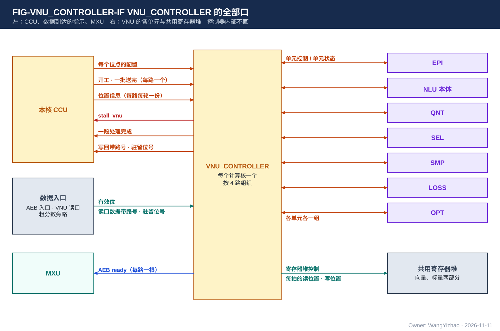
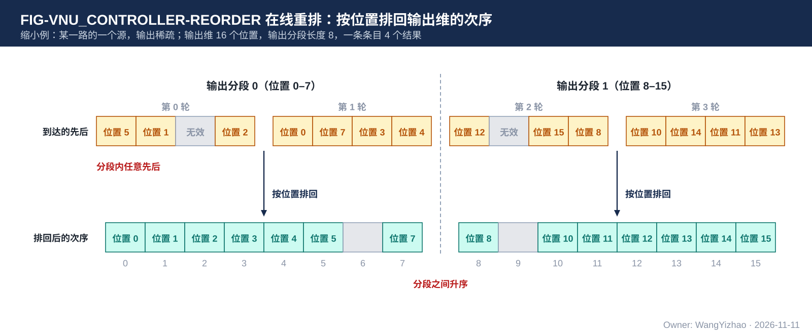

# VNU_CONTROLLER 需求：VNU 自己的控制器

> Owner: WangYizhao｜2026-11-11

## 1 概述

**VNU_CONTROLLER 是 VNU 组自己的状态机控制器，每个计算核一个。CCU 把本位点要做的处理作为配置交给它；VNU 内部各单元怎样串起来、谁先谁后、共用寄存器堆读写哪里、单元之间怎样握手，都由它按配置在 VNU 内部做。**

VNU 组有六个单元：NLU（非线性运算，含后处理子模块 EPI；下文把 EPI 与 NLU 本体分开说）、QNT（量化）、SEL（选择）、SMP（采样）、LOSS（损失）、OPT（优化器），以及一份全组共用的寄存器堆（VNU 集成篇 §1.1）。

它与 CCU 的分工：

| 事情 | 谁做 |
|---|---|
| 本位点做哪些处理、各项参数 | CCU（来自指令），作为配置给 VNU_CONTROLLER |
| L1 的读写地址；VNU 读口每一拍轮到谁；计算核输出口的去向 | CCU |
| VNU 写口的数据哪一拍写进 L1 | L1 写口前的选择器：它自己在 H2C 接收桥、NWB、VNU 写口之间轮流，不由 CCU 逐拍选（计算核集成） |
| 一条结果属于哪个 token 或查询行 | 只有 CCU 知道 |
| 一条结果是输出维上的哪些位置 | CCU 知道，并随每一轮交给 VNU_CONTROLLER |
| 把结果排回输出维原来的次序 | VNU_CONTROLLER（在线重排，§3.5） |
| SEL 按档用门限时用哪一档 | CCU 给门限的 MUX 序号 |
| 几个单元怎样串成一条处理链并推进 | VNU_CONTROLLER |
| 共用寄存器堆每一拍读写哪里 | VNU_CONTROLLER |
| 同一个单元被几处要用时的先后 | VNU_CONTROLLER（按配置） |
| 单元之间、与 MXU 之间的握手 | VNU_CONTROLLER |

它的形式参照参考工程（PandaChip NCC）的后处理控制器：**收配置、带有效位的数据、数据的大小、阶段的脉冲；给带有效位的数据与缓冲的空满状态；不接收缓冲的读写位置。**

**VNU 按 4 路组织：第 $p$ 路固定对应本核的 pod $p$。** MXU 的 4 个 pod 各自推进、各自输出（MXU 集成篇 §2.6），VNU 的接收、逐源状态与交出也按路分开，一路的快慢不影响别的路。4 路是数据与控制的组织方式；运算是每路一套还是几路分时，由 VNU 的设计者定（§3.4）。

本篇给谁用：VNU_CONTROLLER 的设计者；CCU 的设计者；VNU 各单元与 VNU 集成的设计者。

不属于本篇的内容：

- VNU 对外各口的定义、各单元之间交什么、格式与精度：VNU 集成篇。
- 各单元算什么：各单元篇。
- 本篇不含容错设计。

## 2 接口需求

### 2.1 架构图与接口汇总

| 口 | 对端 | 方向 | 内容 |
|---|---|---|---|
| CCU 配置口 | 本核 CCU | 入 | 每个位点（或一段连续执行的指令）一份配置；"开工""一批送完"两个脉冲（§2.2、§2.3） |
| 位置信息 | 本核 CCU | 入 | 每一路的每一轮一份：这一轮的结果是输出维上的哪些位置（§2.4） |
| 数据到达的指示 | AEB 入口、VNU 读口、粗分数旁路 | 入 | 有效位；经 VNU 读口来的数据另带路号与驻留位号（§2.4） |
| 单元控制 / 单元状态 | VNU 的各单元 | 出 / 入 | §2.5 |
| 寄存器堆控制 | 共用寄存器堆 | 出 | 每拍的读位置、写位置（§2.6） |
| 给 CCU 的状态 | 本核 CCU | 出 | stall_vnu、一段处理完成；每次写回带路号与驻留位号（§2.7） |
| AEB ready | MXU | 出 | 每路一根；EPI 来不及收某一路时拉低这一路（§2.8） |

### 2.2 CCU 配置口

每个位点开始时，CCU 给 VNU_CONTROLLER 一份配置：

| 配置项 | 含义 |
|---|---|
| 处理链 | 这个位点用到哪些单元、它们怎样串接；每个单元做哪一种运算、各项参数 |
| 输入从哪来 | AEB、VNU 读口，或粗分数旁路 |
| 输出去哪 | VNU 写口（写进本核 L1）、VNU 输出口（经 C2H 上行），或留在共用寄存器堆 |
| 数据的大小 | 开哪几路、每一路一轮有多少条 AEB 条目（= 这个 pod 的源数）；经 VNU 读口送来的一批有多少 |
| 输出维的分段 | 分段长度：一个源的结果在一个输出分段之内可以按任意先后到达（§3.5） |
| 门限的 MUX 序号 | SEL 按档用门限时，每个源用哪一档，由 CCU 按（路, 驻留位）给（§2.4） |
| 共用寄存器堆的分区 | 向量、标量两部分里，各用途各占多少 |
| 工作数据放哪 | 某项工作数据放共用寄存器堆还是放 L1（指令的 1 bit） |

配置在这个位点的数据到达之前给到，位点进行中不变。配置的字段位宽与在指令里的位置，由 VNU 与 CCU 的设计者对接。

### 2.3 两个脉冲：开工、一批送完

数据的大小在配置里；**一批数据到哪里结束，由送数据的一方用脉冲告诉 VNU_CONTROLLER**。数据进 VNU 时只带有效位；定长的数据可以按配置数完，变长的数不出来（例如经 VNU 读口送来的紧凑记录，送几拍取决于保留了多少通道），所以需要脉冲。这与 CCU 给 MXU 的是同一种做法（MXU 集成篇 §2.5.2）：

- **开工**：这个位点的配置已经生效，可以开始；之后到达的数据属于这个位点。
- **一批送完**：每路各一个。CCU 经 VNU 读口给这一路送的一批数据送完时给一个脉冲，VNU 据此收尾（写出未满的组、交出统计量）。它对应 MXU 一侧的交换脉冲；VNU 没有交替使用的缓冲，所以不叫"交换"。
- MXU 的一轮 AEB 条目：VNU_CONTROLLER 按配置里这一路一轮的条数数有效位；是否另由 MXU 给"一轮交完"的脉冲【设计者定】，由 VNU 与 MXU 的设计者对接。要定的是用计数还是用脉冲；约束是一轮的边界两边判断一致。

### 2.4 数据到达的指示与位置信息

**到达 VNU 的数据都带有效位，不带"这是哪个 token 的"标记。** VNU_CONTROLLER 按有效位判断每一拍来了多少。

#### 2.4.1 AEB 条目：4 路各自到达

- **第 $p$ 路固定接 pod $p$；每一路里，一轮的条目按驻留位 0 到 $n - 1$ 的次序到达**（MXU 集成篇 §2.6）。
- **条目的身份 = 路号 + 路内次序。** 路与路之间不规定先后：4 路可以同一拍各到一条，也可以相差很多拍。
- 一个源由（路, 驻留位）指明。**（路, 驻留位）对应哪个 token 或查询行只有 CCU 知道**；VNU 用（路, 驻留位）区分不同的源，不需要知道它是哪个 token。
- 源的次序与 token 的自然次序没有固定关系。**VNU 的设计者要评估这对各单元有没有影响；哪个单元确实需要 token 之间的先后信息，由设计者提出，与 CCU 设计者对接。**

#### 2.4.2 位置信息：CCU 把每一轮的结果在输出维上的位置交给 VNU

**MXU 不知道它算的是原矩阵的哪些输出通道（MXU 集成篇 §1）；这个信息在 CCU。CCU 把每一路每一轮的位置信息交给 VNU_CONTROLLER，VNU 据此把结果排回输出维原来的次序（§3.5）。**

| 这一轮的模式 | 一条条目的 16 个结果 | CCU 给的位置信息 |
|---|---|---|
| 输入稀疏 | 一个列块：16 个相邻的输出通道 | 一个列块号 |
| 输出稀疏 | 这个 pass 读集里的至多 16 列，第 $j$ 个结果属于读集内序号为 $j$ 的列 | 16 个位置，每个结果一个；另给每条条目的有效位图（这个源选了这 16 列里的哪些，没选的结果无效） |

- 一个 pod 的一轮是同一个 pass 上各个源的结果，所以位置（列块号或 16 个位置）一轮给一份，这一路这一轮的各条条目共用；有效位图每条条目各一份。
- **位置信息按路给**：第 $p$ 路的第 $i$ 份位置信息，对应第 $p$ 路到达的第 $i$ 轮条目。位置信息在这一轮的第一条条目被处理之前给到。
- 位置的位宽随输出维的大小而定；可以给绝对位置，也可以给输出分段内的偏移（§3.5）。位宽、编码、VNU_CONTROLLER 预先存下几份【设计者定】，由 VNU 与 CCU 的设计者对接；约束是每条条目都能拿到自己的位置与有效位图，不错位。
- 输出维指这个运算的输出通道：线性位点是 hidden 通道，attention 是 key，LM Head 是词号。

#### 2.4.3 经 VNU 读口来的数据：带路号与驻留位号

VNU 的一些输入不来自 MXU，而由 CCU 从 L1 读出、经 VNU 读口送来（做残差加的残差、逐通道向量、紧凑记录等）。**这些数据到达时，CCU 同时给路号与驻留位号，指明它是给哪个源用的**；与位置有关的数据（例如某个列块的 $\gamma$）由 CCU 按 VNU 当前要处理的位置读出对应的字。全组共用、不分源的数据（例如查找表）不带。

#### 2.4.4 门限的 MUX 序号

SEL 按档用门限时（一个位点有几档门限，不同的 token 用不同的档），**用哪一档由 CCU 给：CCU 根据 VNU 当前正在判别的是哪个源，给出门限的 MUX 序号**。SEL 不需要知道 token 是谁。一个源在一个位点里固定对应某一路的某个驻留位，所以序号可以按（路, 驻留位）给；是随配置给一张表，还是判别时给【设计者定】，约束是每个评分用到的档与它所属的源一致。

### 2.5 对各单元的控制与状态

- 给每个单元：开始；这一段的输入取自谁（上一个单元、AEB、VNU 读口、共用寄存器堆）；输出交给谁；这一段的运算与参数。
- 从每个单元收：是否空闲；这一段是否完成；输出是否有效；能不能再收输入。

### 2.6 共用寄存器堆的读写控制

VNU_CONTROLLER 每拍给共用寄存器堆读位置与写位置。**各用途的分区来自配置，分区之内读写哪里由 VNU_CONTROLLER 算**；别的模块不给共用寄存器堆的读写位置。

### 2.7 给 CCU 的状态

| 状态 | 含义 |
|---|---|
| stall_vnu | VNU 读入口来不及收；CCU 见到后不再给 VNU 发读，已经在途的读出 VNU 全部收下 |
| 一段处理完成 | 这个位点（或这一段指令）在 VNU 里的处理已经全部完成，输出已经全部交出 |

VNU 写回 L1 时交数据、每一拍的有效字节数，以及这一次写属于哪个源（路号与驻留位号）。**写回的地址由 CCU 内部计数推出**，VNU 不报地址：

- 4 路各自推进，几个源的输出会交错着交出，所以每一次写要指明是哪个源的；CCU 按源各自计数。路号与驻留位号不是 token 身份，对应哪个 token 仍只有 CCU 知道。
- QNT 的输出分成几条流（紧凑记录的元数据项、E8M0、F 列表、码），各流的长度随内容变化；QNT 的每一次写另带所属的流（QNT 篇 §2.9），CCU 按（源, 流）各自计数。
- 别的单元的变长输出（列表、名次项）一份在哪里结束，由"一段处理完成"或单元的完成指示给出，具体形式【设计者定】，由 VNU 与 CCU 的设计者对接；约束是 CCU 能分清每一份的起止。

VNU 写口的数据哪一拍真正写进 L1，由 L1 写口前的选择器决定，不由 CCU 逐拍选。**VNU 的一批写何时全部写完，由选择器告知 CCU，或由 VNU_CONTROLLER 在最后一拍写进之后报给 CCU【设计者定】**：要定的是用哪一种；约束是 CCU 在得知写完之后才把这批数据当作可读。

### 2.8 给 MXU 的 AEB ready

每路一根 ready。EPI 来不及收某一路的 AEB 条目时，VNU_CONTROLLER 把这一路的 ready 拉低；条目留在这个 pod 的 AEB 里，不丢；别的路不受影响。

## 3 功能描述

### 3.1 功能一览

| 功能 | 输入 | 输出 | 触发 / 生效条件 |
|---|---|---|---|
| 把几个单元串成一条处理链并推进（§3.2） | 配置、各单元的状态 | 各单元的控制 | 每个位点 |
| 同一个单元一时一个任务（§3.3） | 配置 | 先后 | 几处要用同一个单元时 |
| 几个单元同时工作、4 路的组织（§3.4） | 配置 | — | 资源不冲突时 |
| 接收 AEB 条目并排回原来的次序（§3.5） | 有效位、位置信息 | EPI 的控制、AEB ready、排回后的结果 | 每一路的每一轮 |
| 共用寄存器堆读写位置的计算（§3.6） | 分区配置 | 读位置、写位置 | 每拍 |
| NLU 运算元件的分时借用（§3.7） | 配置 | 借用的先后 | LOSS、OPT 要用时 |
| 握手与停发（§3.8） | 各处的空满 | stall_vnu、AEB ready、单元间的停发 | 每拍 |
| 写回与完成（§3.9） | 各单元的输出 | 给 CCU 的完成指示 | 每一段 |
| CCU 不送数据时（§3.10） | — | — | 任何时候 |
| 复位（§3.11） | 复位 | — | 任何时候 |

### 3.2 把几个单元串成一条处理链并推进

**一个位点里，VNU 的几个单元可以串成一条处理链：前一个单元的输出直接作为后一个单元的输入，不必每一步都写回 L1。** 例如线性位点的出口：EPI（残差加）→ NLU 本体（归一化）→ SEL（判决）→ QNT（量化、打包）；LM Head：EPI → SEL（流式 TOPK）→ NLU 本体（归一化）→ SMP（取项）。

- 哪些单元串成一条链、链上的先后，由配置给出，VNU_CONTROLLER 不自行决定。
- VNU_CONTROLLER 负责让这条链动起来：前一个单元有输出、后一个单元能收时交过去；后一个来不及时让前一个停住。
- 链上的单元可以依次工作，也可以流水地同时工作，由 VNU_CONTROLLER 按各单元的状态推进。
- 一条链处理完一个位点的全部数据后，给 CCU "一段处理完成"。

### 3.3 同一个单元一时一个任务

**一个单元同一时刻只服务一个任务。** 几处都要用同一个单元时（例如 EPI、NLU 本体、LOSS 都要 QNT 量化），按配置给的先后一个一个来；QNT 一次处理一个完整的请求，请求之间不交错。单元内部不设把几个来源合在一起的逻辑。

### 3.4 资源不冲突时几个单元同时工作

配置里互不依赖、又不争同一份资源的处理可以同时进行。例如 attention 时，EPI 把精确分数交给 NLU 本体做在线 softmax，SEL 同时在判下一批粗分数的录取（粗分数走旁路直达 SEL）。

会冲突的资源有三类，冲突时的先后由配置给：同一份计算资源（EPI 与 NLU 本体共用的 BF16 向量通路、被借用的 NLU 运算元件）；同一个对外口（VNU 读口与输出口每拍轮到谁由 CCU 定；VNU 写口由 L1 写口前的选择器轮流）；共用寄存器堆的同一个分区。

**4 路的组织**：

- 每一路各有自己的条目入口、自己的一套逐源状态（每个源的累计量、未凑满的组、排回用的暂存）、自己的写出暂存。
- **一路停住不影响别的路**，除非它们正在等同一份运算资源。
- **运算资源是每路一套，还是几路分时共用【设计者定】**：要定的是各单元的运算通路做几份；约束是不长时间反压 AEB（§4），以及一份运算资源同一时刻只服务一个任务（§3.3）。一个 pod 的一轮条目要隔一个 pass 的拍数才来一次，平均到每拍的量远低于 4 路同时满速，所以不要求每路一套。
- SMP、LOSS、OPT 处理的是单条流，不分路。

### 3.5 接收 AEB 条目并排回原来的次序

**接收**：

- 每一路一轮的条数在配置里（这个 pod 的源数）。VNU_CONTROLLER 按路数有效位，数满即这一路的一轮结束。
- 条目交给 EPI；EPI 需要的其他输入由 CCU 按（路, 驻留位）送来：残差经 VNU 读口，bias 经 S 类读 MUX 直接送 EPI，保留位图由 CCU 交给 EPI（EPI 篇 §3.6）。
- 条目先暂存再处理、还是到达即处理，由 EPI 的设计者定（EPI 篇 §7.2）；暂存在共用寄存器堆时，位置由 VNU_CONTROLLER 算（§3.6）。
- EPI 来不及收某一路时拉低这一路的 AEB ready（§2.8）。

**在线重排**：

- **一个源的结果到达的先后，可以与它们在输出维上的次序不同。** CCU 为了提高阵列利用率会调整各个 pass 的先后与一个 pass 里各列的先后（CCU 篇）；输出稀疏时一条条目里的 16 个结果本来就不是相邻的通道。
- **VNU_CONTROLLER 按 CCU 给的位置信息（§2.4.2），把每个源的结果排回输出维原来的次序，再交给需要按次序处理的单元。** 需要次序的例子：QNT 把相邻的通道凑成 MX 组、按通道序排码；SEL 的名次项里要写元素的序号；NLU 的逐通道向量要与通道对上。只做逐元素运算或只求和的处理不需要次序，可以不排。
- 无效的结果（有效位图为 0）不参与排回与后面的处理。

图中的缩小例：输出维 16 个位置，输出分段长度 8，一条条目 4 个结果。某一路一个源的 4 轮结果依次到达：第 0 轮是位置 5、1、6、2（其中位置 6 的结果无效），第 1 轮是位置 0、7、3、4，这两轮合起来正好是分段 0 的位置 0–7；第 2 轮是位置 12、9、15、8（位置 9 无效），第 3 轮是位置 10、14、11、13，合起来是分段 1。VNU 在每个分段之内按位置排回，交出的次序是位置 0 到 7、再是 8 到 15；位置 6、9 没有结果。实际一条条目 16 个结果，分段长度由配置给。

**乱序有上界：按输出分段。**

- **CCU 沿输出维把一个位点分成若干个输出分段，分段长度在配置里。一个源的结果在一个输出分段之内可以按任意先后到达；输出分段之间按位置升序——前一个输出分段的结果全部到达之后，才有后一个输出分段的结果。**
- 所以排回只需要在一个输出分段之内进行：VNU 要能存下每个正在处理的源的一个输出分段的结果。
- 一个输出分段在哪一轮结束：由 CCU 随那一轮的位置信息给"分段末"标志，或由 VNU_CONTROLLER 从位置越过输出分段的边界推出【设计者定】；约束是最后一个输出分段的结束两边判断一致。
- 分段长度取多大由 CCU 与 VNU 的设计者对接【设计者定】：分段长度越大，CCU 调整先后的余地越大，4 个 pod 在一个输出分段上的总工作量也越接近；VNU 排回要存的也越多。
- **排回的做法【设计者定】**：要定的是先存下一个输出分段再按位置读出，还是按位置直接放到位；暂存放共用寄存器堆还是 L1。约束是交给后面单元的次序与原始次序相同，一个结果不丢、不重。

### 3.6 共用寄存器堆读写位置的计算

- **分区由配置给，位置由 VNU_CONTROLLER 算。** 配置给出向量、标量两部分里各用途各占多少（例如未满一个 MX 组的暂存、名次项、跨组共用的标量）；分区之内每拍读写哪里由 VNU_CONTROLLER 算，算法见 §7.3。
- **向量与标量两部分物理分开**（VNU 集成篇 §3.3）。
- 需要一边写、一边读的用途（ping-pong），读的一方不会读到写了一半的数据。
- 同一个分区同一时刻只有一个写者。
- 分区只在位点边界切换；切换之前，上一个位点留在寄存器堆里的数据已经用完。
- 某项工作数据由指令选放在 L1 时，它的读写走 VNU 读口、写口，地址由 CCU 给；放在共用寄存器堆时，位置由 VNU_CONTROLLER 算。单元本身不区分这两种情况。

### 3.7 NLU 运算元件的分时借用

NLU 本体的运算元件（指数、对数、倒数平方根等）对 LOSS 与 OPT 分时开放（VNU 集成篇 §3.6.3）。VNU_CONTROLLER 按配置给的先后安排谁在用；一个元件同一时刻只给一个单元用。

### 3.8 握手与停发

| 情形 | VNU_CONTROLLER 做什么 |
|---|---|
| 链上后一个单元来不及收 | 让前一个单元停发、保持数据 |
| VNU 读入口来不及收 | 拉高 stall_vnu；已经在途的读出全部收下 |
| 写口这一拍没有被 L1 写口前的选择器轮到 | 待写的数据保持，必要时让正在写的单元停住；不向 CCU 报 |
| EPI 来不及收某一路的 AEB 条目 | 拉低这一路的 AEB ready |

以上都只降速，不丢数据。例外：LOSS 在收 logit 流时不让它停（LOSS 篇 §4.2），由配置保证这时 LOSS 收得下。

### 3.9 写回与完成

- VNU 的输出经 VNU 写口写进本核 L1，或经 VNU 输出口上行。**VNU 交处理好的数据、每一拍的有效字节数、这一次写属于哪个源（路号与驻留位号）；CCU 按源各自计数，推出这一拍写到哪里**（§2.7）。
- 一个源的输出按输出维的原始次序交出（排回之后，§3.5）；不同源的输出可以交错。
- 变长的输出（紧凑 token 记录、列表）同样不报地址；QNT 的每一次写另带所属的流。
- 一个位点在 VNU 里的处理全部完成、输出全部交出后，VNU_CONTROLLER 给 CCU "一段处理完成"。输出交出不等于已经写进 L1：写进 L1 的时刻由写口前的选择器定，写完怎样让 CCU 知道见 §2.7。

### 3.10 CCU 不送数据时

VNU 不收停止请求。CCU 不再送数据、不再给写回地址时，VNU_CONTROLLER 让各单元把已经收到的数据处理到能处理的地方，然后停在原地；之后接着做，不丢、不重。

### 3.11 复位

复位输入来自 CIF，不区分硬复位与软复位。复位后状态机回到空闲，各单元的工作状态与共用寄存器堆清空；VNU 没有需要跨调用保留的状态。

## 4 性能指标

| 项 | 要求 |
|---|---|
| 推进处理链 | 前一个单元有输出、后一个单元能收时，不因控制器多等 |
| 与 MXU 的关系 | 不因控制器的决定，使某一路处理一轮 AEB 条目的拍数超过这个 pod 产出下一轮的拍数（EPI 篇 §4）；不长时间反压 AEB |
| 在线重排 | 一个输出分段之内任意先后的结果都能排回；不因排回让后面的单元多等超过一个输出分段 |
| 寄存器堆 | 每拍给出读位置与写位置 |
| 面积 | 【待标定】 |

## 5 约束与由使用者保证的事项

### 5.1 硬约束

1. VNU_CONTROLLER 不产生 L1 的地址。
2. 处理链的组成与先后来自配置，VNU_CONTROLLER 不自行决定。
3. 别的模块不给共用寄存器堆的读写位置。
4. 本篇不含容错设计。

### 5.2 由使用者保证的事项

| 事项 | 由谁保证 |
|---|---|
| 配置在这个位点的数据到达之前给到 | CCU |
| 处理链不成环；同时进行的处理不争同一份资源，或配置给了先后 | 编译链、指令 |
| 共用寄存器堆各分区之和不超过容量；分区够这个位点用 | 编译链 |
| 经 VNU 读口送来的数据带正确的路号与驻留位号，并与 VNU 当前处理的位置对应 | CCU |
| 每一路每一轮的位置信息与有效位图正确，并在这一轮被处理之前给到 | CCU |
| 一个源的结果只在一个输出分段之内乱序，输出分段之间按位置升序；分段长度不超过 VNU 排回能存下的量 | CCU |
| SEL 按档用门限时给出门限的 MUX 序号 | CCU |
| 写回地址的计数；一个源属于哪个 token | CCU |
| stall_vnu 拉高后停发读 | CCU |
| 按时取走 AEB 条目所需的余量 | EPI 与 VNU_CONTROLLER 的设计者 |

## 6 验收

| 编号 | 验收项 | 出处 |
|---|---|---|
| VCTL-A-01 | 配置给出的各条处理链功能正确：单元依次工作与流水工作两种情形 | §3.2 |
| VCTL-A-02 | 几处要用同一个单元时按配置的先后处理，请求不交错 | §3.3 |
| VCTL-A-03 | 互不冲突的处理同时进行，结果与分别进行相同 | §3.4 |
| VCTL-A-04 | 4 路各自接收 AEB 条目，一路的 ready 拉低不影响别的路；只开部分 pod、各路源数不同时条数随配置变 | §3.5 |
| VCTL-A-04a | 一个源的结果在一个输出分段之内按任意先后到达（两种模式，含无效结果）时，交给后面单元的次序与原始次序相同，不丢、不重；4 路处在不同的 pass 时各路都正确 | §3.5 |
| VCTL-A-04b | SEL 按档用门限时，每个评分用到的档与 CCU 给的序号一致 | §2.4.4 |
| VCTL-A-05 | 共用寄存器堆：同一个分区同一时刻只有一个写者；一边写一边读的用途不读到写了一半的数据；位点边界切换分区时没有残留 | §3.6 |
| VCTL-A-06 | 各种停发的组合下不丢数据、不死锁 | §3.8 |
| VCTL-A-07 | 同一批数据按不同的到达拍送入（中途停送、写口迟迟轮不到），功能正确 | §3.10 |
| VCTL-A-08 | 每个源的输出按输出维的原始次序交出；每次写带的路号、驻留位号（QNT 另带流）正确，有效字节数与内容相符 | §3.9 |

与上下游的对接检查：配置各项、两个脉冲、位置信息、门限序号、写回带的源号与"一段处理完成"的时序（CCU）；4 路 AEB 的路内次序与 ready（MXU 集成篇 §2.6）；对各单元的控制与状态（各单元篇）；共用寄存器堆的分区与容量（VNU 集成篇 §3.3）。

## 7 参考设计

本章的做法可以换；换了之后别的模块不用改。

### 7.1 参照参考工程后处理控制器的信号组织

参考工程（PandaChip NCC）的后处理控制器收的是：层的配置（做哪些后处理、各项参数）；结果数据与逐元素的有效位；这次输出的通道数与长度；上游每个子阶段算完时给的脉冲。给的是：处理后的数据与有效位；自己的输出缓冲是否已空。它不接收任何缓冲的读写位置。VNU_CONTROLLER 照这个组织：

| 参考工程 | VNU_CONTROLLER |
|---|---|
| 层的配置 | 位点的配置（§2.2） |
| 结果数据 + 有效位 | AEB 条目、VNU 读口的数据 + 有效位 |
| 输出的通道数与长度 | 数据的大小（每路一轮的条数、分段长度） |
| 子阶段结束的脉冲 | "开工""一批送完"两个脉冲（§2.3） |
| 处理后的数据 + 有效位 | VNU 写口、输出口的数据 + 有效字节数 + 属于哪个源 |
| 输出缓冲已空 | 一段处理完成 |

参考工程里没有、本篇多出来的两样：每一轮的位置信息与在线重排（参考工程的结果按固定次序产出，这里因在线稀疏而乱序）；4 路各自推进。

### 7.2 状态机

空闲 → 收到配置后按处理链逐个启动单元 → 运行（接收、推进、交出并行）→ 输入全部到齐、各单元全部完成、输出全部交出后给"一段处理完成"→ 空闲。处理链上每个单元一个小的子状态：空闲、等输入、工作中、等输出被取走。每一路另有一个接收状态：等条目、收一轮、等这一轮的位置信息、排回。

**排回的参考做法**：每个源一块分段长度大小的暂存，结果到达时按"位置减分段基址"直接放到位；一个输出分段到齐后从头按次序读出，交给后面的单元，同时这块暂存开始收下一个输出分段（两块交替）。分段长度取 MX 组长的整数倍，使一个输出分段之内的 MX 组都是完整的。

### 7.3 共用寄存器堆位置的参考算法

每个分区一个基址（由配置里各分区的大小依次累加得到）、一个写计数、一个读计数。顺序使用的用途按计数递增；一边写一边读的用途把分区对半分，写满一半后两半交换。

### 7.4 规模参考

每个核一个，状态与计数约几百 bit 的寄存器；门数【待标定】。

## 8 为什么

### 8.1 需求的理由

- **VNU 自带控制器，内部的串接由它负责**（用户 11-11："MXU，VNU都有一个自己的状态机Controller"；"对于例如VNU内部数据的Fusion等，就应该是Controller负责的模块"）。
- **参照参考工程后处理控制器的形式**（用户 11-11："对于VNU的类似行为，我也希望参考PE-Post的形式"）。
- **缓冲不接收读写位置**（用户 11-11："他们接受数据的时候理论上是不需要接收写入地址的，这两个逻辑可以内部计算地址"）；共用寄存器堆只由 CCU 给分区（用户 11-11 认可）。
- **写回的地址由 CCU 计数推出**（用户 11-11："可以和参考项目一致，VNU写回处理好的数据，CCU内部计数，并且推理本轮写回的地址"）。4 路各自推进后几个源的输出会交错，所以每次写带路号与驻留位号，CCU 才能按源计数；QNT 的几条流长度随内容变化，所以另带所属的流。
- **结果属于哪个 token 只由 CCU 持有，VNU 收到的数据可能是乱序的**（用户 11-11："这个信息由CCU持有，VNU来判断是否需要先后信息，在接口的地方需要写清楚，它接收到的信息可能是乱序的，VNU的Designer来评估是否有问题"）。
- **按 4 路组织**（用户 11-11 认可）：AEB、VNU 读口、写口本来就是 4 × 32 B；路号就是 pod 号，条目不必带标签，4 路之间也不必规定先后；运算做几份留给设计者，因为平均到每拍的量远低于 4 路满速。
- **位置由 CCU 给，VNU 在线重排**（用户 11-11："VNU就应该是从CCU那里接收到，本轮的每个数据对应的真实位置，然后在线重排"；"我希望这个位置可以由CCU给出"）：MXU 算完的结果直接进 VNU，不经 L1 绕一圈；只有 CCU 知道每个结果在输出维上的位置，而需要次序的处理都在 VNU。
- **乱序按输出分段设上界**（用户 11-11："我认可乱序要有上界，各个Pod可以做沿输出维度之间的分段，分段内保证利用乱序实现高利用率，并且维度多的话，更难出现4个Pod间的严重不同步问题"）：分段内的乱序换来阵列利用率；分段把 VNU 排回要存的量限制住；一个输出分段包含的维度多，4 个 pod 各自的总工作量更接近，彼此不会差得太远。
- **两个脉冲**（用户 11-11 认可）：变长的数据 VNU 数不出边界，要 CCU 用脉冲告知。
- **门限的 MUX 序号由 CCU 给**（用户 11-11："CCU会根据当前VNU正在判别的Token来提供阈值的MUX Index"）：token 身份只在 CCU，SEL 只需要知道用哪一档。
- **处理链由配置给**（用户 11-11："VNU只有一个需求是这些模块之间可能会串行依赖，需要Fusion执行"）：哪些单元串在一起是编译链与指令的事，VNU_CONTROLLER 只负责执行。
- **同一个单元一时一个任务、冲突时按先后**（用户 11-08）。

### 8.2 参考设计的选型理由

- **每个分区一个基址加读写计数**：分区来自配置，位置只需要计数，不需要别的模块逐拍给。
- **按位置直接放到位、两块交替**：不需要排序网络，位置减分段基址就是暂存里的下标。
- **被否的做法**：CCU 逐拍给共用寄存器堆的读写位置（把一拍的回路拉过模块边界）；AEB 条目带上 token 的标签（MXU 与 VNU 都不需要它，只有 CCU 写回时用）；4 个 pod 算完一轮后统一输出、路间规定先后（先算完的 pod 要在出口等最慢的）；MXU 保证结果按输出维的次序产出（CCU 就不能调整发放的先后）；把输出稀疏的结果先写进 L1、由 CCU 读出重排后再送 VNU（多绕一圈 L1）。
