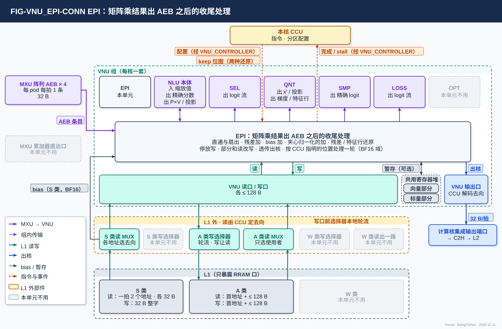
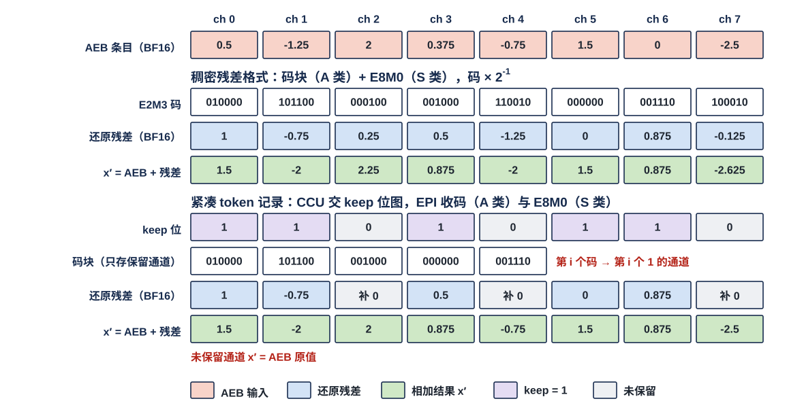
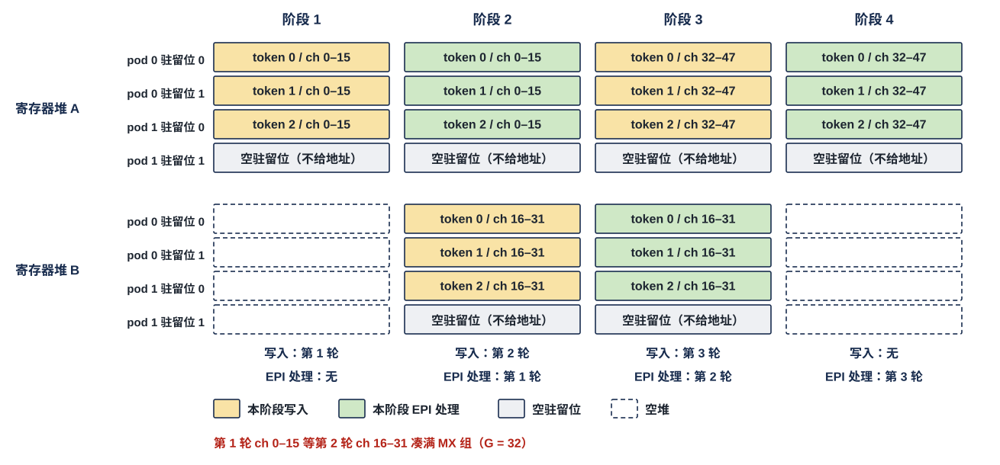

# VNU 后处理子模块（EPI）需求

> Owner: WangYizhao｜2026-11-11

## 1 概述

EPI（Epilogue，后处理子模块）是 NLU 里必须实现的子模块，每核一个、全芯片 4 个、物理相同，属 VNU 组。它接收 MXU 阵列的归约完成或未完成的结果，在 BF16 域做矩阵乘之后、量化之前的收尾处理，再把结果交给下一个消费者；给它发指令的是本核 CCU。

### 1.1 EPI 做矩阵乘结果出阵列之后的收尾处理

名称取自 GEMM 里 epilogue 的通用含义：乘加之后的加 bias、加残差、格式转换与写出。

EPI 的输入单位是一条 **AEB 条目**：阵列出口缓冲（Array Egress Buffer，AEB）里的一项，等于一个（token 或查询行, 列块）的 16 个输出通道，每通道 1 个 BF16，共 32 B。按 $Y = XW$（$W$ 为 $K \times M$）的写法，一条 AEB 条目是 $Y$ 的一行里沿 $m$ 连续的 16 个元素，且已沿 $k$ 加完本次归约。

EPI 做的事：

- 按 CCU 指令把条目直通或扇出给 VNU 各单元；
- 加 bias、加残差（核内残差位点）、夹心归一化位点的"先归一化再加残差"；
- 把残差、特征行从存储格式还原成 BF16；
- 把归约未完成的条目停放到 L1，或与 L1 里的部分和相加（读改写）；
- 把要出核的 MXU 输出透传到 VNU 输出口。

**EPI 不做的事**：不量化（QNT）；不向 MXU 累加器回注数据——停放值由 CCU 发 A 类读，读出经 A 类读 MUX 走 pod 的 128 B 激活入口装回累加器（带"装回"标志与 pod 号，一拍 4 条停放条目；V18-MXU-17，MXU 集成篇 §2.3.4），不经 EPI；不做核间按 $k$ 切分位点的残差加与 bias 加（MAE_CRU，§3.3、§3.4）；不经手累加器直达 SEL 的粗分数（§2.1）；不发 DDR 请求，不参与调度。

### 1.2 EPI 与 NLU 本体共用一套 BF16 向量通路

**EPI 是 NLU 里必须实现的子模块**（用户 11-08："它应该成为NLU模块中一个被强制需求的子模块"）。

- **与 NLU 本体共用一套 BF16 向量通路**：残差加、bias 加、读改写这些逐元素加法，与 NLU 本体的 $O \leftarrow \alpha O + PV$、缩放、dK / dV 相加用同一组运算道，不各备一套（用户 11-08："它的功能是应该被合并的"）。功能复用是 VNU 的底层需求（V18-VNU-10，VNU 集成篇 §3.6.3）。
- **资源冲突的先后由指令给出、VNU_CONTROLLER 执行**（用户 11-08："由CCU排冲突顺序"）：EPI 的动作与 NLU 本体的运算不抢同一份计算资源时可同时进行；抢时的先后由指令给出，CCU 作为配置交 VNU_CONTROLLER，由 VNU_CONTROLLER 执行（VNU_CONTROLLER 篇 §3.4）。
- **EPI 的设计者须按 MXU 与 CCU 的实际要求调整**（用户 11-08）：接收节奏、暂存用量与各动作的安排，都要与 MXU、CCU 的设计者对接（§4.1、§4.2）。

### 1.3 MXU 组到 AEB 为止，AEB 之后都是 EPI

**MXU 组的边界在 AEB**（V18-MXU-06）：AEB 之后没有 MXU 自己的运算。条目一出 AEB，就由 EPI 按位点去向处理。

### 1.4 EPI 只提供动作，动作与去向由配置给出，L1 地址只在 CCU

EPI 不自定去向。**每条条目做哪个动作、从哪读残差或部分和、结果交给谁，由本核 CCU 按指令作为配置交 VNU_CONTROLLER，VNU_CONTROLLER 按配置控制 EPI**（VNU_CONTROLLER 篇 §2.2、§2.5）；配置按条目在一轮中的位置给出每条的动作与去向。**从 L1 读残差、部分和的地址由 CCU 发；EPI 写 L1 时只交数据与有效字节数，写的地址由 CCU 内部计数推出**（V18-VNU-12）。**条目属于哪个 token 或查询行只由 CCU 持有，不交 EPI**（V18-VNU-13，§2.2.2）。某件事由指令给出时本篇写明，指令字段由 EPI 设计者按需整理，本篇不写指令字段表。

## 2 接口需求

### 2.1 架构图与接口汇总

图中模块框内的结构是参考实现（见第 7 章），本章以框外的各口为准。

VNU 各单元篇的连接图用同一个外框：绿色虚线框是 VNU 组，框外画出 VNU 组的全部直接对端，框内上排是 VNU 的六个单元（NLU 拆成 EPI 与 NLU 本体两格），下排是三项组级共用资源；本单元不用的对端与单元画灰，对端之后的去向不画，在下文交代。

- **框内上排**：本单元那格标"本单元"，在中部展开、只写动作；与 EPI 往来的 NLU 本体、SEL、QNT、SMP、LOSS 点亮，框内的"入 / 出"以 EPI 为准；OPT 画灰。
- **左侧**：MXU 阵列的 AEB，本核 4 个 pod 各一条；MXU 累加器直达口画灰——**attention 粗算的粗分数由 MXU 累加器直达 SEL，不进 AEB、不进寄存器堆、不占 EPI 的通路**（用户 11-08："无需经过EPI透传，直接旁路"；口在 VNU 集成篇 §2.3）。
- **框内下排**：EPI 可以用**共用寄存器堆**暂存条目，用不用由 EPI 设计者定，用时读写位置由 VNU_CONTROLLER 按分区算（§3.10、§7.2；图中这根线标"暂存（可选）"，展开框写"按 CCU 指明的位置处理一轮"）；经 **VNU 读口 / 写口**读写 L1（§2.4）；要出核的 MXU 输出经 **VNU 输出口**进框外的计算核集成输出端口，再经 C2H 写 L2（§2.6）。
- **下方**两层：上层是 L1 外的读写选择部件：S 类读 MUX、A 类读 MUX、W 类读出一路由 CCU 定去向，三类写口前的选择器自己按固定规则在 H2C 接收桥、NWB、VNU 写口之间轮流，不由 CCU 逐拍选（V18-L1-32；规则在架构篇 §3.7）；下层是只暴露 RRAM 口的 L1。**bias 经 S 类读 MUX 直接进 EPI**（§2.3；图中标"bias（S 类，BF16）"，S 类框写读口一拍 2 个地址）；EPI 不读也不写 W 类，也不写 S 类，相应部件画灰。
- **上方**：本核 CCU 经 VNU_CONTROLLER 给出动作与去向的配置，并直接交两种还原用的 keep 位图（虚线）；EPI 把完成与能否再收报给 VNU_CONTROLLER，由它汇总给 CCU、对 AEB 拉 ready（VNU_CONTROLLER 篇 §2.5、§2.7、§2.8）。图中两根线分别标"配置（经 VNU_CONTROLLER）"与"完成 / stall（经 VNU_CONTROLLER）"；单元连接图不画 VNU_CONTROLLER 框，它的位置见集成篇 FIG-VNU_INTEGRATION-ARCH。

| 口 | 对端 | 方向 | 内容 | 位宽与握手 | 节 |
|---|---|---|---|---|---|
| AEB 条目 | MXU 阵列的 AEB，本核 4 个 pod 各一条 | 入 | 归约完成或未完成的 BF16 结果，每条 16 个输出通道；**条目不带标签，次序可能与 token 的自然次序无关** | 一条 32 B；valid / ready（架构篇 PORT-07） | §2.2 |
| bias | L1 外的 S 类读 MUX | 入 | 一个 16 通道列块的 16 个 BF16 bias，由 CCU 发读 | 一个整字（32 B）；读固定拍数、无握手（架构篇 PORT-02） | §2.3 |
| L1 读写 | VNU 读口 / 写口（VNU 集成篇 §2.4、§2.6） | 入 / 出 | 读：残差、特征行、停放值、部分和旧值、经 H2C 落 L1 的 MAE_CRU 合并结果；写：停放值、部分和新值（只交数据与有效字节数） | 共用 VNU 的读口、写口，各一次 ≤ 128 B | §2.4 |
| 组内各单元 | NLU 本体、QNT、SEL 与 LOSS、SMP；共用寄存器堆 | 入 / 出 | §2.5 | 组内握手；互连方式由 VNU 集成设计者定（VNU 集成篇 §3.6） | §2.5 |
| 透传出核 | VNU 输出口 → 计算核的集成输出端口 | 出 | 核间按 $k$ 切分位点的部分和、位点指令选直接写 L2 的结果 | 共用 VNU 输出口，32 B/拍；C2H 不 ready 时 CCU 被门控 | §2.6 |
| 配置与 keep 位图 | 本核 CCU（配置经 VNU_CONTROLLER） | 入 | 配置：按一轮中的位置给出的每条条目的动作、输入源、去向，MX 组长 $G$；keep 位图：两种还原时本条目 16 个通道的 keep 位，由 CCU 直接交 | §2.7 | §2.7 |
| 完成与能否再收 | VNU_CONTROLLER | 出 | 动作完成；能否再收（由 VNU_CONTROLLER 汇总成给 CCU 的"一段处理完成"与 stall_vnu、给 MXU 的 AEB ready） | — | §2.7 |

### 2.2 AEB 条目入口：pod 算完一轮统一输出

#### 2.2.1 一轮至多 $4n$ 条（$n$ = 每 pod 源数），全开时 32 条

MXU 每核 4 个 pod，每个 pod 同时驻留至多 8 个激活源（token 或查询行）的累加值，一个列块 16 个输出通道；开几个 pod、每个 pod 几个源由配置给（MXU 集成篇 §2.5.1），**一轮 = 开着的各 pod 各完成一个列块、各 $n$ 个驻留位的归约，至多 $4n$ 条**（$n$ = 每 pod 源数，由配置给出；没开的 pod、没用的驻留位不输出）。全开、$n = 8$ 时：

$$4\ \text{pod} \times 8\ \text{驻留位} = 32\ \text{条} = 32 \times 16\ \text{个 BF16} = 1\ \text{KB}$$

下文举数按全开 4 × 8（MXU 集成篇 §2.6）。**全码 pass（同一列的 hi 与 lo 在同一个 pass）导出的 AEB 条目只有前 8 个元素有效**（一个源只用 8 个累加项，MXU_ARR 篇 §3.6）；哪一轮是全码轮由 CCU 的配置知道，EPI 对这类条目按配置只处理前 8 个元素。

#### 2.2.2 次序固定、条目不带标签，身份只由 CCU 持有

**4 个 pod 都算完一轮后统一输出，次序固定：pod 0 的各条 → pod 1 → pod 2 → pod 3，每个 pod 内按驻留位 0 → $n-1$**（用户 11-08："要不采取Pod推理完之后统一输出呢？这样控制逻辑会很好做"）。

- **全部条目都不带标签，P×V 条目也一样**（用户 11-08："条目不带，由CCU来控制，这样可以简化MXU"）。一条条目属于哪个 token 或查询行、哪个列块，由它在一轮中的位置决定；"驻留位 → token / 查询行"的对应**只由 CCU 持有，不交 EPI**（V18-VNU-13）。
- **EPI 收到的条目次序与 token 或查询行的自然次序没有固定关系，可能是乱序的**：EPI 按到达次序处理、按同样次序交出；乱序对本单元有没有影响由 EPI 的设计者评估，确需先后信息时与 CCU 设计者对接（VNU_CONTROLLER 篇 §2.4）。
- 结果与条目到达的先后无关，逐位确定。
- 代价：P×V 一轮要等录取 key 最多的那一行算完；某个 pod 先算完也要等其他 pod。这是统一输出的取舍，后续的调度优化不改架构。

**CCU 在配置里按一轮中的位置指明每条条目的动作与去向，空驻留位不处理**（V18-EPI-06；用户 11-08："CCU会通知给VNU向条目中的具体地址去读取数据，因此等效于不输出"）。**一轮装不满时，空的驻留位等效于不输出**：例如 70 个 token 分 32 + 32 + 6 三轮，第 3 轮的 26 个空驻留位 CCU 不给动作，EPI 不处理、不补数，也不写垃圾数据；配置里没开的 pod、没用的驻留位，MXU 本来就不输出条目（MXU 集成篇 §2.6）。条目要不要在 EPI 外暂存由 EPI 设计者定，暂存在共用寄存器堆时位置由 VNU_CONTROLLER 按分区算（§3.10）。

#### 2.2.3 接收：接口不按峰值定宽，来不及时拉低 ready

**AEB → EPI 的接口不按峰值定宽**（用户 11-08："接口也没必要按照峰值定宽了"）：只要满足 §4.1 的拍数条件，代价只是几拍时延；参考节奏见 §7.1。**EPI 来不及接收时，VNU_CONTROLLER 对 AEB 拉低 ready（VNU_CONTROLLER 篇 §2.8），AEB 满后反压 MXU；只降速、不丢条目**（§4.3）。

### 2.3 bias 入口：bias 存在 L1 S 类、由 CCU 发读、精度只有 BF16

**EPI 对 bias 的需求只有三件事**（V18-EPI-05）：

1. **能把 bias 加到结果上**（§3.4）。
2. **bias 存在 L1 的 S 类，由 CCU 发读**，经 L1 外的 S 类读 MUX 直接进 EPI，不经 VNU 读口（V18-L1-21 / 28、V18-EPI-02）。一个存储字 = 一个 16 通道列块的 16 个 bias。EPI 读 bias 是 S 类读口的使用者之一：S 类读口一拍可接收 2 个地址，同拍需要的多于 2 路时由 CCU 错开（架构篇 §3.4 CONC-6）。bias 在 S 类的地址由编译链分配。
3. **bias 的精度只有 BF16，不量化**。

bias 何时读入、在 EPI 里保持多久、与 AEB 条目的先后，由 EPI 设计者与 CCU 设计者对接确定（参考见 §7.5）。

### 2.4 经 VNU 读口 / 写口读写 L1

**EPI 共用 VNU 的读口、写口（各一次 ≤ 128 B，VNU 集成篇 §2.4、§2.6），读写 L1 的 A 类与 S 类；EPI 不读也不写 W 类，不写 S 类。**

| 方向 | 内容 | 经过 |
|---|---|---|
| 读 | 残差码（A 类）与 E8M0（S 类），两种存储格式（§3.3） | 码经 A 类读 MUX，E8M0 经 S 类读 MUX |
| 读 | 特征行码（A 类）与 E8M0（S 类），格式同残差（§3.6） | 同上 |
| 读 | 停放值、部分和旧值（BF16，A 类） | A 类读 MUX |
| 读 | **经 H2C 落 L1 的 MAE_CRU 合并结果**（例如核间按 $k$ 切分位点归约、残差加之后写回 L2、再由一条 L2 → L1 指令送进本核 L1 的结果），EPI 按指令还原、直通或扇出 | A 类读 MUX（尺度经 S 类读 MUX） |
| 写 | 停放值、部分和新值（BF16，A 类，停放条目见 §3.7） | 写 MUX → A 类写口 |

- **读**：一次访问给首字节地址与长度（≤ 128 B），默认从存储字边界起（数据组织默认 32 B 对齐）；首地址不在字边界时由 SRAM 内部移位、把首字节放在第 0 字节交出，**EPI 一侧不需要移位**（V18-TP-74）；不从字边界起的访问允许多拍（架构篇 §3.4 CONC-3）。A 类读出每拍只给一个使用者，编译链不做读写带宽保证，需求超出时 EPI 等（V18-L1-21）。
- **写**：**EPI 只交数据与这一拍的有效字节数（≤ 128 B，数据从第 0 字节起给），不给地址；写进 L1 的首字节地址与 `seg` 由 CCU 内部计数推出**（V18-VNU-12，VNU_CONTROLLER 篇 §3.9）；首地址可以是任意字节（L1 支持紧密存储）。VNU 写口进 A 类写口前的选择器，选择器自己在各来源之间轮流；这次写何时写完由选择器告知 CCU 或由 VNU 报完成【设计者定】（V18-L1-32）。
- **两种还原都不读元数据项**：紧凑格式的残差与特征行，元数据项由 CCU 读、keep 位图由 CCU 交来（§2.7、§3.6，V18-VNU-10）。

### 2.5 交组内各单元

组内传输的位宽、链路条数与互连方式由 VNU 集成设计者定（VNU 集成篇 §3.6）；下表只写 EPI 与各单元之间交什么。

| 对端 | 方向 | 交什么 | 内容格式 |
|---|---|---|---|
| NLU 本体 | 出 | 精确分数、区块打分的粗分数、$(P \times V)_{\text{tile}}$、q / k 的投影结果；夹心归一化位点的投影结果 $Y$ | BF16 |
| NLU 本体 | 入 | 夹心归一化后的缩放值 $\mathrm{RMSNorm}(Y)$（参考做法下，§3.5、§7.5） | BF16 |
| QNT | 出 | 残差加结果 $x'$、归约完成的投影结果（gate、up、v 等）、反传归约完成的梯度、已还原的特征行，交 QNT 量化或编码 | BF16 |
| SEL 与 LOSS | 出 | LM Head 的 logit 流；**按指令同时交两者时，两者都收到才算交出；LOSS 收不收由指令逐位点指定**（V18-LOSS-08） | BF16 |
| SMP | 出 | TOPK 列补算后的精确 logit。**补算开启时，归一化、采样与比对所用的 TOPK 项的 logit 须是这些精确值；一个节点的全部项都换成精确值之后才进入归一化与采样；精确值对应哪一项由 CCU 给；词号与成员不变**。TOPK 项只存一份（V18-SMP-09）；由 EPI、SMP 还是别的单元写入【设计者定】（V18-SMP-10）；TOPK 项放 L1 时写入地址由 CCU 给，放共用寄存器堆时位置由 VNU_CONTROLLER 按分区算 | BF16 |
| 共用寄存器堆 | 入 / 出 | 选用时暂存 AEB 条目（用不用由 EPI 设计者定，读写位置由 VNU_CONTROLLER 按分区算，§3.10、§7.2） | BF16 |

### 2.6 透传出核：经 VNU 输出口

核间按 $k$ 切分位点的部分和、位点指令选"直接写 L2"的结果，**不改数值**交 VNU 输出口，经计算核的集成输出端口上 C2H（VNU 集成篇 §2.7、架构篇 §2.3.1）。每拍写 L2 的地址由 CCU 给出；C2H 不 ready 时 CCU 被门控（协议篇 §3.17）。

### 2.7 CCU 给的配置、keep 位图与 EPI 回报

| 线 | 方向 | 内容 |
|---|---|---|
| 配置 | CCU → VNU_CONTROLLER → EPI | 按一轮中的位置给出的每条条目的动作、输入源、去向；MX 组长 $G$（VNU_CONTROLLER 篇 §2.2、§2.5）。**不含 L1 地址，也不含驻留位 → token / 查询行的对应**（后者只由 CCU 持有，V18-VNU-13） |
| keep 位图 | CCU → EPI | **还原紧凑残差与还原紧凑格式的特征行时，CCU 读该片的元数据项，按条目把本条目 16 个通道的 keep 位交 EPI**（V18-VNU-10）；通路与位宽【设计者定】，约束：每条条目能拿到本条目 16 个通道的 keep 位 |
| 完成 | EPI → VNU_CONTROLLER | 动作完成；一个位点的处理全部完成后由 VNU_CONTROLLER 给 CCU"一段处理完成"（VNU_CONTROLLER 篇 §2.7） |
| 能否再收 | EPI → VNU_CONTROLLER | EPI 或下游来不及时；VNU_CONTROLLER 据此对 AEB 拉低 ready、对 CCU 拉高 stall_vnu（VNU_CONTROLLER 篇 §2.7、§2.8） |

## 3 功能描述

### 3.1 功能一览

EPI 的全部动作只在 BF16 域，由"逐元素加"与"两部分和相加"两种运算实现，**不新增运算形态**（运算形态的定义见 NLU 篇 §3.1）。

| 动作 | 输入 | 运算 | 输出去向 | 典型用途 | 节 |
|---|---|---|---|---|---|
| 直通与扇出 | AEB 条目 | 无 | NLU 本体、QNT、SEL（+ LOSS）、SMP | 精确分数、P×V、投影结果、logit 流、精确 logit | §3.2 |
| 残差加 | 条目 + 残差 | 逐元素加 | QNT；同时交 NLU 本体累加归一化统计 | o / down 投影后的残差连接 | §3.3 |
| bias 加 | 条目 + bias | 逐元素加 | 同条目去向 | 有 bias 的线性层（视觉编码器、投影层） | §3.4 |
| 夹心归一化的加 | $\mathrm{RMSNorm}(Y)$ + 残差 | 逐元素加 | QNT | Gemma 类 o / down 之后另做一次 RMSNorm | §3.5 |
| 残差 / 特征行还原 | L1 里的残差或特征行 + CCU 交的 keep 位图 | 码 × 尺度、按 keep 展开 | 残差加；特征行交 QNT | 残差连接、特征行重用 | §3.6 |
| 停放写 | 归约未完成的条目 | 无 | L1 停放区 | K 段末、$K_t$ 分块末、attention 块间部分分数 | §3.7 |
| 部分和读改写 | 条目 + L1 部分和 | 两部分和相加 | L1（继续累加）或 QNT（归约完成） | down 沿 $k$ 分遍的部分和 | §3.8 |
| 透传出核 | 条目 | 无 | VNU 输出口 | 核间按 $k$ 切分的部分和、直接写 L2 的结果 | §3.9 |
| 按 CCU 指明的位置处理一轮 | 一轮 AEB 条目 | 按每条的动作 | 每条的去向；空驻留位不处理 | 全部条目 | §3.10 |

### 3.2 直通与扇出：不改数值交下游

**直通与扇出不改条目的数值。** 精确分数必须不加、不改地交 NLU 本体做在线 softmax，EPI 不留存已录取（query 行, key）对的粗分数。LM Head 的 logit 流按指令同时交 SEL 与 LOSS 时，两个对端都收到才算交出；**LOSS 收不收这条流由指令逐位点指定**（V18-LOSS-08），不收时只交 SEL。

### 3.3 残差加：核内残差位点，两种残差存储格式都支持

**残差加在 EPI 只用于核内残差位点**：残差驻本核 L1，按 T 或 M 切分的核间位点也在这里加。**核间按 $k$ 切分的位点不在 EPI 加**：各核手里只有部分和，不含残差；归约与残差加由 MAE_CRU 的两条指令在 L2 完成（V18-CRU-08）。

残差从 L1 读入，**两种存储格式都支持**（V18-DORG-02）：

- **稠密残差格式 = 码块（A 类）+ E8M0（S 类）**（V18-L1-18）：码块每通道一个 6 bit E2M3 码、按通道序；E8M0 每 $G$ 个通道（一个 MX 组，$G$ 为位点属性、由指令给，V18-MXU-10）一个尺度；还原为码 × 尺度，结果精确落在 BF16 上。
- **紧凑 token 记录 = 每通道片一个元数据项（A 类）+ E8M0 项（S 类）+ F 列表（A 类）+ 码块（A 类）**（V18-TP-66 / 68、V18-DORG-04，数据组织篇 §2.5）。这里的**码块**是紧凑 token 记录四部分之一，只装保留通道的 6 bit 码：第 $i$ 个码属于 keep 位图里第 $i$ 个 1 的通道，未保留的通道补 0。

紧凑残差的还原按 §3.6：CCU 读元数据项、把本条目的 keep 位交 EPI，EPI 经 VNU 读口收码字与本条目所在 MX 组的 E8M0，按 keep 位展开。残差还原不用 F 列表（F 只决定下一位点读不读权重 lo 平面）。一条 AEB 条目 16 个通道，是一个 MX 组的 $16/G$（$G = 32$ 时是一半）；条目落在哪个组、用哪个尺度由 CCU 给的地址与动作定。

**相加之前不量化投影结果；残差不预装为 MXU 累加器初值；残差只加一次、加完只编码一次。** 结果 $x'$ 交 QNT 编码（稠密残差格式，或位点配置为紧凑时等 SEL 判完再编码成紧凑 token 记录），同时交 NLU 本体累加归一化统计。

**逐位参照（以收到的 AEB 条目为输入）**：残差加的结果须与"残差还原成 BF16 → 与 AEB 条目 BF16 相加（一次舍入）→ 一次 MXFP6 编码"这条参照链逐位相同；bias 加同样按"与 AEB 条目 BF16 相加、一次舍入"作参照（§3.4）。AEB 条目本身的数值按 MXU 的精度口径：任务精度不低于 Reference，不要求与 GPU 的结果逐位一致（MXU 集成篇 §6.1）。

图中取 8 个通道（实际一条 AEB 条目 16 个通道，一个 MX 组 $G$ 个通道）：

- 上半是稠密残差格式：E2M3 码乘以尺度 $2^{-1}$ 还原成 BF16，与 AEB 条目逐元素相加。
- 下半是紧凑 token 记录：CCU 交来 keep 位图，码块只存 keep 为 1 的 5 个通道的码，第 $i$ 个码放到第 $i$ 个 1 的通道（通道 0、1、3、5、6）；keep 位为 0 的通道 2、4、7 没有码，还原值补 0，所以 $x'$ 等于 AEB 原值。
- 例中数值都由 2 的幂组合而成，BF16 能精确表示，脚本断言了还原值与和。

### 3.4 bias 加：$K$ 全部累加完、结果出 AEB 之后加一次

**bias 只加一次，在 $K$ 全部累加完、条目出 AEB 之后，由 EPI 加**（用户 11-08："结果级的Bias只在Pod和Array计算完成之后再累加"）。MXU 累加器不预装 bias。

- bias 在 L1 S 类、BF16、由 CCU 发读，经 S 类读 MUX 进 EPI（§2.3）。
- 同一条目残差与 bias 都要时，各加一次。
- **核间按 $k$ 切分的位点不在 EPI 加 bias**：bias 并入 MAE_CRU 的归约指令，只加一次，非残差位点也如此（V18-CRU-09 / 10，MAE_CRU 篇）。

### 3.5 夹心归一化的加：$x' = x + \mathrm{RMSNorm}(Y)$，残差只加一次

**夹心归一化**是 Gemma 类模型的结构：在 o / down 投影之后、残差加之前，再做一次 RMSNorm：

$$x' = x + \mathrm{RMSNorm}(Y), \qquad Y = X W_o\ \text{或}\ X W_{\text{down}}$$

**需求只有两条：结果等于上式；残差只加一次**（用户 11-11 认可）。$\sum y^2$ 与缩放由 NLU 本体做；与残差相加在 EPI 还是 NLU 本体里做是参考实现的选择（§7.5）。结果交 QNT。

**这里要等统计量**。核间按 $m$ 切分时，一个 token 的 $Y$ 分在几个核上，$\sum y^2$ 要经 MAE_CRU 跨核合并一次往返（各核写 L2 → MAE_CRU 合并 → 写回 L2 → 落本核 L1）；往返期间本核继续产出的 $Y$ 都要暂存，等合并值到了才能缩放。

- 暂存默认放在 L1；**暂存的容量与位置由编译链安排**（用户 11-08："这里是编译链的任务，但是需要给出这个情况"）。
- 暂存不够时，NLU 本体只能经握手停上游，EPI 随之对 AEB 拉低 ready；这是降速，不是错误。
- **合并值落进 L1 之后 CCU 才发缩放指令，EPI 与 NLU 都不因合并值未到而 stall**。

**层入口 RMSNorm 属同一情形**（V18-EPI-04 写的"夹心归一化等"覆盖它）：核间按 $m$ 切分时，EPI 残差加得到的 $x'$ 交 NLU 本体累加 $\sum x'^2$，往返期间待缩放的 $x'$ 同样由编译链安排暂存（默认 L1，NLU 篇 §3.4）；层入口的缩放由 NLU 本体做完直接交 QNT，不回 EPI。暂存不够时 NLU 本体经握手停 EPI，EPI 随之对 AEB 拉低 ready，同样只降速。

### 3.6 残差 / 特征行还原：CCU 交 keep 位图，EPI 读码与尺度、按 keep 展开

**两种还原的保留位图都由 CCU 交给 EPI，EPI 不读元数据项**（V18-VNU-10；用户 11-11："EPI我认为统一CCU交是对的"）：

1. **CCU 读元数据项、定地址**：CCU 经 A 类读 MUX 读这一片的元数据项，算出本条目要的码在码块里从哪个字起、读几个字（定位规则见数据组织篇 §3.2；CCU 一侧的做法属 CCU 的设计，`CCU_STAGING.md`）。
2. **CCU 把本条目的 keep 位交 EPI，EPI 经 VNU 读口收两样**：本条目 16 个通道的 keep 位（16 bit）由 CCU 直接交；EPI 经 VNU 读口收码字（A 类，CCU 发读）与本条目所在 MX 组的 E8M0（S 类，经 S 类读 MUX）。
3. **EPI 按 keep 位展开**：第 $i$ 个码放到第 $i$ 个 1 的通道、未保留的通道补 0，乘本组尺度，每 $G$ 个通道换一个尺度。稠密格式没有 keep 位图，直接码 × 尺度。

每拍 A 类读出只给一个使用者，CCU 读元数据项、VNU 读码字各占自己的拍（V18-L1-21）。**还原是精确的**（6 bit 码乘 2 的幂尺度，落在 BF16 上无舍入）。**残差还原后用于残差加；特征行还原后交 QNT 做不归一量化。**"第 $i$ 个码对应 keep 位图里第 $i$ 个 1"与 pod 逐源压紧器挑权重行用的是同一规则（pod 侧不解包，V18-TP-65）。

### 3.7 停放写：归约未完成的条目只停放在本核 L1

归约未完成的条目——K 段末、$K_t$ 分块末、attention 块间的部分分数——以 BF16 写进本核 L1 的停放区，每项 2 B。

- **停放只许本核 L1；同一个部分和 tile 只有一份活拷贝；停放值不量化。**
- **一个停放条目 = 一条 AEB 条目的 16 项 × 2 B = 32 B，默认 32 B 对齐、正好一个存储字**（V18-EPI-03）；这是 EPI 与 MXU 的约定（装回时按同一格式读回，一拍 128 B = 4 条）。经 VNU 写口写，一次写 ≤ 128 B，只交数据与有效字节数。
- **装回不经 EPI**：CCU 发 A 类读，读出经 A 类读 MUX 走 pod 的 128 B 激活入口，带"装回"标志与 pod 号，一拍 128 B = 4 条停放条目（V18-MXU-17，MXU 集成篇 §2.3.4）。
- **停放值写出、读回之间数值逐位不变**；读改写以收到的条目与读回的旧值为输入，结果与"BF16 相加一次舍入"的参照逐位相同（§3.8）。含停放的整次归约的精度按 MXU 的口径（MXU 集成篇 §6.1）。

### 3.8 部分和读改写：读旧值、写新值，同一拍不落同一个堆

条目与 L1 里同一位置的部分和逐元素相加：未归约完的结果写回 L1 继续累加，归约完成的交 QNT。down 投影沿 $k$ 分遍时的部分和用这一路。

**每个堆同一拍只做一次访问：读由 CCU 排；写新值与读碰到同一个堆时写让读，由写口前的选择器本地判断，这一拍不写、下一拍再写**（架构篇 §3.4 CONC-1 / 2，V18-TP-73 / L1-32）。L1 的两堆都可读可写，旧值、新值放在哪个堆由编译链排地址，同一个堆上不同拍的原地读改写也允许。同一个部分和 tile 只有一份活拷贝（§3.7），与放法无关。

### 3.9 透传出核：不改数值进 VNU 输出口

核间按 $k$ 切分位点的部分和、位点指令选"直接写 L2"的结果，**不改数值**（与直通、扇出一样逐位不变）交 VNU 输出口（§2.6）。

### 3.10 按 CCU 指明的位置处理一轮：条目放在哪由 EPI 设计者定

**一轮里每条条目做哪个动作、交给谁，由 CCU 在配置里按它在一轮中的位置指明；空驻留位不处理**（§2.2.2）。停放写、部分和读改写、透传出核的条目也一样按 CCU 指明的动作走。

**EPI 不要求把一轮条目先整轮存进共用寄存器堆、再分两份轮换处理**（V18-EPI-06）。对外只要求：

- **结果 = 累加结果加残差、加 bias，各只加一次**（§3.3、§3.4）；
- **EPI 处理一轮的拍数不超过 MXU 产出下一轮的拍数时，不对 AEB 持续拉低 ready**（§4.1）；
- **来不及时对 AEB 拉低 ready、只降速，不丢条目**（§4.3）；
- **每条条目的动作、输入源、去向由配置给；L1 地址只在 CCU**（§1.4）。

条目在 EPI 里放在哪、要不要用共用寄存器堆暂存，由 EPI 设计者定；用共用寄存器堆时，CCU 只给分区配置，逐拍读写位置由 VNU_CONTROLLER 算（V18-VNU-12，VNU_CONTROLLER 篇 §3.5、§3.6）。"整轮先进寄存器堆、两个分堆轮换"是一种可选做法，见 §7.2。

### 3.11 复位

- **复位输入来自 CIF（架构篇 PORT-41），硬复位与软复位不区分**（CIF 篇 §2.4）。
- 复位清 EPI 的在途条目与暂存；EPI 没有需要跨次保留的状态。
- EPI 不是发令方，CIF 的停止请求（架构篇 PORT-42）不送 EPI：本核 CCU 停住后 EPI 没有新的动作，在途条目停在握手上（CIF 篇 §2.6）。

## 4 性能指标

### 4.1 唯一的速率要求：EPI 处理一轮的拍数 ≤ MXU 产出下一轮的拍数

**EPI 处理一轮——含 bias / 残差加、交 QNT 或写 L1——所用的拍数，不得多于 MXU 产出下一轮的拍数。** 满足这一条时，EPI 不对 AEB 持续拉低 ready，MXU 累加器不会被持续反压。

- **每拍处理几个元素不规定**，由设计者按这一条件定；不为短时峰值提高 VNU 的并行度（用户 11-08："不需要提升VNU的单位峰值并行度，还是只需要让他的拍数能够匹配MXU得到新的一批数据的拍数就可以了"）。
- **"下一轮"指 MXU 实际产出的下一轮，不一定属于同一子位点**：4 个 pod 永远做同一个 pass、只在一轮结束时对齐（V18-MXU-07、V18-CCU-01，MXU 集成篇 §3.4），attention 按精算（更新组 $\nu$）/ P×V（$\nu-1$）/ 粗算（$\nu+1$）的相位交替执行，FFN 按 gate-hi（列块 $g+1$）/ up-hi + lo（$g$）交替。一轮 P×V 之后 MXU 的下一轮可能是精算的一轮，拍数条件按这一实际次序核算；相位怎样排归 CCU 与数据流篇。
- **MXU 一轮的拍数以 MXU 的设计为准**（MXU 集成篇 §4.3），本篇只引其结论；EPI 一轮的工作量至多 $4n$ 条（全开 $n = 8$ 时 32 条 = 512 个元素）。各位点的推导参考值见 §7.3。

### 4.2 与上下游对接的速率

**EPI 的处理能力须满足 §4.1 的拍数条件，由 EPI 设计者与下列各模块对接确定**；参考值见 §7.4。

| 相关模块 | 接口 | 要求 |
|---|---|---|
| MXU（AEB） | AEB 条目 | 满足 §4.1；接口不按峰值定宽 |
| QNT、NLU 本体 | 组内传输 | 不使 EPI 违反 §4.1 |
| SEL + LOSS | logit 流 | LOSS 收这条流时不让它停发（LOSS 篇 §4.2） |
| SMP | 精确 logit | 补算开启时把精确值交出；由谁写入 TOPK 项【设计者定】（V18-SMP-10），不使 EPI 违反 §4.1 |
| VNU 读口 / 写口 | 残差、停放、部分和 | 各一次 ≤ 128 B；读口每拍读什么由 CCU 排，与其他单元轮用读口 / 写口的先后由 VNU_CONTROLLER 按配置定；编译链不做读写带宽保证，需求超出时 EPI 等（V18-L1-21） |
| L1 S 类（经 S 类读 MUX） | bias、还原用的 E8M0 | S 类读口一拍可接收 2 个地址；同拍需要的多于 2 路时由 CCU 错开（CONC-6） |
| 本核 CCU | keep 位图 | 两种还原时由 CCU 交，EPI 不读元数据项 |

### 4.3 超载时只降速、不丢数据

下游来不及时，EPI 经组内握手停发；EPI 来不及接收时由 VNU_CONTROLLER 对 AEB 拉低 ready，AEB 满后反压 MXU。**只降速、不丢条目、不是错误。**

| 工况 | 要求 |
|---|---|
| 满足 §4.1 的位点 | 不因 EPI 让 MXU 累加器持续反压 |
| 不满足 §4.1 的位点 | 允许经 ready 降速，验收时报告降速拍数 |
| 夹心归一化等待统计量、暂存不够时 | 经握手停上游（§3.5） |

### 4.4 要求值表

| 项 | 要求 | 说明 |
|---|---|---|
| 动作 | §3.1 的各项动作 | 全部在 BF16 域，不新增运算形态 |
| AEB 接收 | 统一输出、固定次序、条目不带标签 | §2.2 |
| 速率 | EPI 处理一轮的拍数 ≤ MXU 产出下一轮的拍数 | 每拍元素数【设计者定】，约束即本条 |
| 条目暂存 | 不作要求：放在哪、用不用共用寄存器堆由 EPI 设计者定 | 可选做法见 §7.2（V18-EPI-06） |
| bias | 存 L1 S 类、BF16、由 CCU 发读，经 S 类读 MUX 进 EPI；只加一次 | 核间按 $k$ 切分位点不加（V18-EPI-05） |
| 停放条目 | 16 个 BF16 = 32 B，默认 32 B 对齐 | 与 MXU 的约定 |
| 精度 | 集成后任务精度下降 < 0.1% | §5.3 |

## 5 约束与由使用者保证的事项

### 5.1 硬约束

- **EPI 不新增运算形态**：全部动作由"逐元素加"与"两部分和相加"实现，与 NLU 本体共用 BF16 向量通路（§1.2）。
- **EPI 不量化、不向 MXU 累加器回注数据、不发 DDR 请求、不参与调度**（§1.1）。
- **停放只许本核 L1**（§3.7）。
- **本篇不含容错设计**（V18-TP-75）。

### 5.2 由别的模块保证的事项

以下事项 EPI 不检查，由对应模块保证；验收时作为输入前提，用仿真断言核对（§6）。

| 事项 | 由谁保证 |
|---|---|
| AEB 条目的格式（归约完成为 BF16 RNE、一条 16 个输出通道）；4 个 pod 算完一轮后按固定次序统一输出 | MXU（MXU 集成篇 §2.6） |
| 停放值的装回（A 类读出经 pod 的 128 B 激活入口、带装回标志，MXU 集成篇 §2.3.4） | CCU（发读）、MXU（装回累加器） |
| 一轮里"驻留位 → token / 查询行"的对应（只由 CCU 持有，不交 EPI）；在配置里按一轮中的位置指明每条条目的动作与去向（空驻留位不给动作） | CCU |
| 两种还原所需的 keep 位图：CCU 读该片的元数据项，按条目把 16 个通道的 keep 位交 EPI；码字与 E8M0 的读地址 | CCU（`CCU_STAGING.md`） |
| 每条条目的动作、输入源、去向（作为配置交 VNU_CONTROLLER）；L1 的读地址，写回 L1 的地址（按 EPI 交出的有效字节数计数推出）；与 NLU 本体争用向量通路时的先后（写进配置）；A 类读 MUX、S 类读 MUX 每拍送谁；读的排拍（CONC-1 / 2） | CCU 与指令 |
| 发 bias 的 S 类读；S 类同拍读需求多于 2 路时错开（CONC-6） | CCU |
| 读 L1 的残差、部分和在读之前已写完：本核产出的由 CCU 排先后，核外经接收桥落地的以 MAE 发给本核 CCU 的写完通知为准（V18-TP-70）；跨核搬运按批流水时按本批的写完通知判，不要求整份搬完 | CCU（协议篇 §3.8） |
| 夹心归一化等统计量跨核往返期间的暂存容量与位置 | 编译链（§3.5） |
| 核间按 $k$ 切分位点的残差加与 bias 加（bias 并入归约指令，V18-CRU-09 / 10） | MAE_CRU |
| bias 写进 L1 的 S 类、在 S 类的地址 | MAE（搬运指令）；编译链 |
| 量化与编码 | QNT |
| 粗分数的接收与判决 | SEL |

### 5.3 精度要求：集成到算法后任务精度下降 < 0.1%

**EPI 的计算方案集成到算法后，任务精度下降 < 0.1%。** 中间计算精度不规定，由设计者定（用户 11-04，V18-VNU-01）。口径：

- 下降量按绝对百分点计；
- 基线为同一算法下各运算按 FP32 理想值计算；
- 评测集为算法侧的标准评测集；
- 硬件实现与算法参考模型逐位一致，作为验证手段。

输入与输出格式：

| 方向 | 内容 | 格式 |
|---|---|---|
| 入 | AEB 条目 | BF16 |
| 入 | 残差 | 稠密残差格式（码块 A 类 + E8M0 S 类，MXFP6 E2M3，组长 $G$），或紧凑 token 记录（数据组织篇 §2.5、§2.8）；EPI 实际收到的是码块（A 类）、E8M0（S 类）与 CCU 交来的 keep 位图，元数据项由 CCU 读，F 列表不用于还原 |
| 入 | 特征行 | 格式同残差；EPI 收到的同样是码块、E8M0 与 CCU 交来的 keep 位图 |
| 入 | bias | BF16 |
| 入 | 停放值、部分和旧值 | BF16，每项 2 B |
| 出 | 交 VNU 各单元、写 L1 的停放值与部分和 | BF16 |
| 出 | 透传出核 | BF16，不改数值 |

## 6 验收

### 6.1 本篇条目的验收项

| 项 | 方法 | 判据 | 出处 |
|---|---|---|---|
| 统一输出与按位置处理 | 周期仿真 + 逐位比对 | 一轮至多 $4n$ 条（含只开部分 pod、$n < 8$）按固定次序注入，按配置里各位置的动作处理；条目不丢；各动作结果与参考模型逐位相同；空驻留位不处理、不写 | §2.2、§3.10 |
| 拍数条件 | 周期仿真 | §7.3 表中各位点注入，满足条件的位点 MXU 累加器不持续反压；不满足的位点报告降速拍数 | §4.1、§4.3 |
| 残差加 | 逐位比对 | 稠密残差格式与紧凑 token 记录两种输入，keep 位图由 CCU 交、码字（A 类）与 E8M0（S 类读 MUX）经 VNU 读口收；EPI 不发元数据项的读；$G$ = 32 / 64 / 128 各一组；以注入的 AEB 条目为输入，与"BF16 相加一次舍入、一次 MXFP6 编码"的参照逐位相同；残差只加一次；核间按 $k$ 切分位点不加 | §3.3、§3.6 |
| 特征行还原 | 逐位比对 | 紧凑格式时 keep 位图由 CCU 交、EPI 不读元数据项；还原值精确 | §3.6 |
| bias 加 | 逐位比对 | bias 从 L1 S 类经 S 类读 MUX 读入、BF16；以注入的 AEB 条目为输入，结果与"BF16 相加一次舍入"的参照逐位相同；只加一次；核间按 $k$ 切分位点不加（由 MAE_CRU 归约指令加） | §2.3、§3.4 |
| 夹心归一化与层入口 RMSNorm | 周期仿真 + 断言 | 结果等于 $x + \mathrm{RMSNorm}(Y)$、残差只加一次；合并值未到时不 stall；两种情形暂存不足时都只降速 | §3.5 |
| 停放与读改写 | 逐位比对 + 断言 | 停放值写出、读回逐位不变，读改写与"BF16 相加一次舍入"的参照逐位相同；停放只写本核 L1、同一部分和 tile 只有一份活拷贝；停放条目 32 B | §3.7、§3.8 |
| 透传出核、直通与扇出 | 逐位比对 | 条目逐位不变；C2H 不 ready 时不丢；LOSS 不收 logit 流的位点只交 SEL | §3.2、§3.9 |
| MAE_CRU 合并结果的读入 | 逐位比对 | 经 H2C 落 L1 的合并结果按指令还原、直通或扇出，与参考模型逐位相同 | §2.4 |
| 集成精度 | 算法侧评测 | 任务精度下降 < 0.1% | §5.3 |
| 复位 | 周期仿真 | 复位来自 CIF；处理进行中复位，复位后无残留 | §3.11 |

### 6.2 与上下游模块的对接检查

| 对接项 | 对端 | 检查内容 |
|---|---|---|
| AEB 次序与条目格式 | MXU 集成篇 §2.6、架构篇 PORT-07 | 固定次序、不带标签；ready 由 VNU_CONTROLLER 拉低时 AEB 不丢 |
| 停放条目格式与装回 | MXU 集成篇 §2.3.4 | 32 B 一条；装回经 pod 的 128 B 激活入口、带装回标志，一拍 4 条 |
| bias 与 S 类读口 | L1 篇、架构篇 §3.4 CONC-6 | bias 在 S 类、BF16、由 CCU 发读；S 类读口一拍至多 2 个地址，同拍多于 2 路时 CCU 错开 |
| keep 位图 | CCU（`CCU_STAGING.md`） | 两种还原都由 CCU 交 |
| 配置、完成与能否再收 | VNU_CONTROLLER 篇 §2.2、§2.5、§2.7、§2.8 | 动作与去向按配置；完成与能否再收经 VNU_CONTROLLER 汇总给 CCU 与 AEB |
| 写回地址 | CCU（`CCU_STAGING.md`）、VNU_CONTROLLER 篇 §3.9 | EPI 只交数据与有效字节数，写回 L1 的地址由 CCU 计数推出 |
| 读改写的堆 | L1 篇、架构篇 §3.4 CONC-1 / 2 | **仿真断言**：L1 每个堆一拍一次访问；写新值与读碰到同一个堆时写让读、不丢（V18-L1-32） |
| logit 流 | SEL 篇、LOSS 篇 §2.2、§4.2 | 两个收端都收到才算交出；LOSS 按指令逐位点收或不收 |
| 精确 logit | SMP 篇 | 补算开启时同一份 TOPK 项里该节点的全部 logit 换成精确值后才进入归一化与采样；由谁写入按设计者的选定核对（V18-SMP-10） |
| 复位 | CIF 篇 §2.4、§6.2（CIF-I-04） | 复位输入接到 EPI |
| 透传出核 | VNU 集成篇 §2.7、协议篇 §3.17 | C2H 不 ready 时 CCU 被门控、不丢 |

## 7 参考实现

**本章内容可以换；换了之后别的模块不用改。**

### 7.1 AEB 接收的参考节奏：每 pod 每拍 1 条，8 拍一轮

参考值：每个 pod 每拍出 1 条（16 × BF16 = 32 B），4 个 pod 合计 128 B/拍，全开 4 × 8 时 **8 拍读完一轮**。代价只是几拍时延：最后一个 pod 的数据晚到最多约 8 拍。AEB 只作中转，深度参考每 pod 8 条。选用 §7.2 的做法时，条目流式写进 VNU 的共用寄存器堆，AEB ready 的参考拉低条件是寄存器堆给 EPI 的两个分堆都占满。

### 7.2 可选做法：条目整轮先进寄存器堆、两个分堆轮换

**这是一种可选做法，不是需求**（V18-EPI-06；用户 11-11 的判断：残差加与 bias 加本身是一次加法，整轮折叠只能省 1–2 拍，意义不大）。

**做法**：全部条目都先整轮进共用寄存器堆，再按每条的动作分去 L1、VNU 各单元或输出口；停放写、部分和读改写、透传出核的条目也一样（这是用户 11-08 的原设想："复用寄存器先一次性存起来，然后再ping-pong后处理"）。共用寄存器堆给 EPI 的部分在物理上分成两个分堆（寄存器堆自己的物理分块，与 L1 / L2 由 `seg` 选的堆无关）：EPI 处理一个分堆里的这一轮时，下一轮写进另一个分堆；寄存器堆只用单端口（VNU 集成篇 §5.1），同一时刻一个分堆只写、一个只读；写哪个、读哪个由 VNU_CONTROLLER 交替（VNU_CONTROLLER 篇 §3.6），EPI 按 VNU_CONTROLLER 按分区算的位置读条目，空驻留位不占位置。

图中取缩小例：2 个 pod × 每 pod 2 个驻留位、3 个 token（pod 1 的驻留位 1 空），列块 16 通道，共 3 轮（ch 0–15、16–31、32–47）。实际一轮是 4 个 pod × 8 个驻留位 = 32 条。

- 每个阶段，一个分堆写入新一轮（黄），另一个分堆由 EPI 处理上一轮（绿）。
- 每个分堆 4 格自上而下是固定次序：pod 0 驻留位 0、1，pod 1 驻留位 0、1。
- 空驻留位不占位置。
- 写哪个分堆、读哪个分堆由 VNU_CONTROLLER 交替给出。
- 第 1 轮（ch 0–15）交 QNT 后，要等第 2 轮的 ch 16–31 才凑满一个 MX 组（例中 $G = 32$）。
- 脚本断言了每轮条目数、空位位置与轮次在两个分堆间的交替。

参考容量与 QNT 未满组：

- 参考容量：EPI 两个分堆共约 2 KB（每轮 1 KB），QNT 未满组约 1 KB【待标定】；实际用量由 VNU 设计者评估确定（VNU 集成篇 §3.3）。
- **QNT 未凑满的 MX 组参考同样留在寄存器堆**：一个 MX 组 $G$ 个通道 = $G/16$ 个相邻列块，即相邻 $G/16$ 轮；$G = 32$ 时前一轮的 16 个通道等下一轮补齐后再量化（FIG-VNU_EPI-ROUND 的第 1、2 轮）。
- 写入参考 128 B/拍，与 §7.1 的 AEB 节奏相同。

### 7.3 拍数最紧的位点：推导参考值

MXU 产出一轮的拍数大致与有效归约长度 $K_{\text{eff}}$（稀疏压紧之后实际要加的 $k$ 数）成正比：一个 pod 每拍沿 $k$ 处理 16–32 个元素（8 bit 两平面或 4 bit 单平面权重）【待标定】，每个驻留位各要 $K_{\text{eff}}/32$ 到 $K_{\text{eff}}/16$ 拍，8 个驻留位轮流，一轮共约 $8 \times K_{\text{eff}}/32 = K_{\text{eff}}/4$ 到 $8 \times K_{\text{eff}}/16 = K_{\text{eff}}/2$ 拍【待标定】。**这两个数要由 MXU 的设计按 W 类权重读口 4 路 × 32 B = 128 B/拍（行字区每拍至多 16 个归约位置 $k$ × 16 列）核对**（MXU 集成篇 §4.1、§4.3）。EPI 一轮的工作量固定为 512 个元素。下表按"下一轮仍是同一位点"列出单个位点的拍数，是按上面算式得到的推导参考值，【待标定】，由 EPI 设计者与 MXU、CCU 设计者核对；相位交替时（§4.1）实际余量取决于相位怎样排——一轮 P×V 之后接精算的轮，余量比表中宽；一轮精算之后接 P×V 的轮，EPI 处理精算这一轮的时间只有 P×V 一轮的拍数，余量比表中紧：

| 位点（举例） | $K_{\text{eff}}$ | MXU 一轮约多少拍（$K_{\text{eff}}/4$ – $K_{\text{eff}}/2$，【待标定】） | EPI 一轮工作量 | 余量 |
|---|---|---|---|---|
| 线性层，$K = 2560$ | 2560 | 640–1,280 | 512 个元素 | 宽松 |
| 线性层，输入稀疏压紧到 1/8 | ≈ 320 | 80–160 | 512 个元素 | 宽松 |
| attention 精确分数（$d_h = 128$，hi + lo 两平面） | ≈ 128–256 | 32–128 | 512 个元素 | 较紧 |
| P×V（每更新组 64 个录取 key） | 64 | 16–32 | 512 个元素 | 最紧 |

### 7.4 与上下游对接的参考速率

| 相关模块 | 接口 | 现行参考值 |
|---|---|---|
| MXU（AEB） | AEB 条目 | 每 pod 每拍 1 条，4 pod 合计 128 B/拍；一轮 32 条、8 拍读完 |
| 共用寄存器堆（选用 §7.2 时） | 整轮写入、按 VNU_CONTROLLER 按分区算的位置读出 | 写入 128 B/拍；EPI 两个分堆约 2 KB |
| QNT | $x'$、投影结果、梯度、特征行 | QNT 统一请求入口每拍 16 个元素 |
| NLU 本体 | 精确分数、P×V、q / k、夹心归一化 | NLU 每拍 16 个元素（可加大） |
| SMP | 精确 logit | 每轮至多 $4n$ 条（$n$ = 8 时 32 条） |
| L1 S 类（经 S 类读 MUX） | bias、还原残差用的 E8M0 | 每轮 1 个整字 |
| 本核 CCU | keep 位图 | 每条条目 16 bit |

### 7.5 加法逻辑共用与夹心归一化的参考做法

- **bias 加与残差加用同一处加法逻辑**；同一条目两者都要时，各加一次。
- **夹心归一化的参考做法：EPI 把 $Y$ 交 NLU 本体，NLU 本体求 $\sum y^2$、缩放；缩放值回到 EPI 之后才与残差相加**，结果交 QNT。也可以由 NLU 本体自己读残差相加，只要满足 §3.5 的公式与"残差只加一次"。
- **停放写、直通、扇出不占向量通路**，可与 NLU 本体的运算同时进行。
- **bias 的读入参考**：一轮条目属于同一个 16 通道列块，每轮读 1 个整字；CCU 在 EPI 处理该轮之前发读，EPI 保持到该轮用完（何时读、保持多久由 EPI 与 CCU 设计者对接，V18-EPI-05）。

### 7.6 停放条目的合并写

地址连续的几条停放条目可合成一次写（VNU 写口一次 ≤ 128 B，即至多 4 条）。

### 7.7 计数与门数

- **计数**：AEB ready 拉低的拍数（饱和计数），供 LIC / MAE 读取。
- **门数**：与 NLU 本体共用向量通路，EPI 自有部分（分发、还原、控制）【设计者定】，约束：满足 §4.1。

### 7.8 参考实现的自检项

| 项 | 判据 |
|---|---|
| AEB 节奏 | 每 pod 每拍 1 条时 8 拍读完一轮；最后一个 pod 晚到不超过约 8 拍 |
| 分堆容量（选用 §7.2 时） | 两个分堆各装下一轮 32 条，轮次在两个分堆间交替；QNT 未满组在 $G = 32$ 时装下前一轮 16 通道 |
| ready 拉低条件（选用 §7.2 时） | 两个分堆都占满时才拉低 AEB ready |
| 合并写 | 地址连续的停放条目合成一次写时与逐条写结果相同 |

## 8 为什么

### 8.1 需求的理由

- **单独成篇、名为 EPI**（用户 11-08："出口级最好还是单独放一个文档"；"出口级没有任何意义"；"我觉得EPI会好一点"）：按功能命名，取 GEMM epilogue 的通用含义；组怎样接写在 VNU 集成篇，EPI 自己的动作写在本篇。
- **MXU 到 AEB 为止，EPI 是 NLU 的强制子模块、共用 BF16 通路**（用户 11-08："它应该成为NLU模块中一个被强制需求的子模块"；"它的功能是应该被合并的……因为MXU和VNU的指令都是CCU来的，因此它本身是可以被调配的"）：EPI 的加法与 NLU 本体的向量加法本是一套，两者的指令都来自 CCU，合成一套由 CCU 调配，推送链少一级。
- **pod 算完一轮统一输出、次序固定、条目不带标签**（用户 11-08："要不采取Pod推理完之后统一输出呢？这样控制逻辑会很好做"；"动态读的控制逻辑太难了，而且后续的优化是非架构性的优化"；"条目不带，由CCU来控制，这样可以简化MXU"）：固定次序让 CCU 事先知道每条条目是谁，EPI 不需要动态查哪个 AEB 有数，MXU 不需要给条目打标签。代价是 pod 之间互等，属于以后的调度优化。
- **只要求拍数匹配，不按峰值定宽**（用户 11-08："接口也没必要按照峰值定宽了"；"不需要提升VNU的单位峰值并行度，还是只需要让他的拍数能够匹配MXU得到新的一批数据的拍数就可以了"）。
- **不要求条目整轮先进寄存器堆、两份轮换**（V18-EPI-06；用户 11-11："我觉得残差加和Bias加本身属于一次加法计算，这里不需要折叠，而且也就只能吃到1-2拍的优化，意义不大"）：对外只要求残差 / bias 各加一次、满足拍数条件时不持续反压、来不及时拉低 ready 只降速、动作与去向由 CCU 作为配置给 VNU_CONTROLLER；用户 11-08 的原设想（"复用寄存器先一次性存起来，然后再ping-pong后处理"）留作第 7 章的可选做法。
- **条目属于哪个 token 只由 CCU 持有，EPI 收到的条目可能是乱序的**（V18-VNU-13；用户 11-11："这个信息由CCU持有，VNU来判断是否需要先后信息，在接口的地方需要写清楚，它接收到的信息可能是乱序的，VNU的Designer来评估是否有问题"）。
- **写回只交数据与有效字节数，共用寄存器堆的位置归 VNU_CONTROLLER**（V18-VNU-12；用户 11-11："可以和参考项目一致，VNU写回处理好的数据，CCU内部计数，并且推理本轮写回的地址"）：EPI 不必知道条目写到 L1 的哪里，也不必知道条目是谁。
- **停放值装回复用 pod 的 128 B 激活入口，不经 EPI**（V18-MXU-17；用户 11-11："C6：认可"）。
- **AEB 条目的数值按 MXU 的精度口径，EPI 的逐位参照以收到的条目为输入**（V18-MXU-17 / 20 / 21；用户 11-11："标准也不是和GPU计算的结果严格一致，而是可以有一定程度的误差，但是Acc不能下降"）。
- **CCU 按位置指明每条条目的动作、空驻留位不处理**（用户 11-08："CCU会通知给VNU向条目中的具体地址去读取数据，因此等效于不输出"）：一轮装不满时不需要补数。
- **bias 在 $K$ 累加完之后加一次，经 S 类读 MUX 进 EPI**（用户 11-08："结果级的Bias只在Pod和Array计算完成之后再累加"；"把Bias和E8M0的存储在L1 SRAM中单开bank"；V18-L1-21，用户 11-09："只要允许S类的数据接向需要它的模块不就可以了"）：读出送给谁由 L1 外的 S 类读 MUX 选，L1 不感知。
- **bias 的需求只写能加、存在哪、什么精度**（V18-EPI-05；用户 11-11："我认为bias的先后这种级别的设计是EPI的负责人要考虑的，EPI的需求就是，它要能够累加Bias值，Bias值存在哪，有哪些精度"）：何时读、谁保持、与条目的先后归 EPI 设计者。S 类读口一拍可接收 2 个地址、同拍多于 2 路时 CCU 错开（V18-L1-31、V18-TP-84 (1)；用户 11-11："我觉得S区也可以接受两个地址，相当于能够支持同一堆中两个数据的同时读"）。
- **精确 logit 替换 TOPK 项里的 logit 不规定由谁写入**（V18-SMP-10；用户 11-11："我觉得这里不应该咱们定，应该直接合并成一个需求交给设计者"）。
- **复位来自 CIF、不区分硬复位与软复位**（CIF 篇 §2.4；用户 11-11："复位与启停你直接采用最标准通用的设计就可以了"）。
- **粗分数直达 SEL、不经 EPI**（用户 11-08："无需经过EPI透传，直接旁路"）：粗分数每核每拍约 21.8 个，不反压、判完即丢，经 AEB 会占满 AEB。
- **拍数条件按 MXU 实际的下一轮核算**（用户 11-09，V18-MXU-07）：4 个 pod 同模式同步，级间等待由相位交替盖住，所以 EPI 面对的是交替排开的各相位的轮，而不是同一子位点背靠背的轮。
- **夹心归一化只规定公式与"残差只加一次"**（用户 11-11 认可 VNU_EPI D1）：在 EPI 还是 NLU 本体里加不影响别的模块，归参考实现。
- **夹心归一化与层入口 RMSNorm 的暂存交编译链**（用户 11-08："我认为这里是编译链的任务，但是需要给出这个情况，要让VNU和EPI的设计者能解决这个问题"）：暂存量随核间往返时延与位点配置变化，硬件只写清这一情形与握手规则。
- **核间按 $k$ 切分位点的 bias 并入 MAE_CRU 的归约指令**（V18-CRU-09；用户 11-09："我认为需要归入归约指令"）：这类位点的部分和在 EPI 透传出核，完整的结果只在 MAE_CRU 归约完成时才有，所以 bias 在那里加一次，非残差位点也如此。
- **两种还原都由 CCU 交 keep 位图、EPI 只读码与尺度、按 $G$ 换尺度**（V18-TP-66 / 68、V18-L1-18 / 20 / 21、V18-MXU-10、V18-DORG-09、V18-VNU-10；用户 11-09："E8M0，它是单独存储的"；"我需要所有尺度都落 S 类"；"我希望分组可以解放32为一组"；用户 11-10："这一步可以让CCU给VNU"；用户 11-11："EPI我认为统一CCU交是对的"）：CCU 本来就要读元数据项算出码字地址，顺手把本条目的 keep 位交 EPI，元数据项只读一次、A 类读口少占一拍；两种还原读法统一。
- **LOSS 收不收 logit 流由指令逐位点指定**（V18-LOSS-08；用户 11-11："我认为应该是两种模式都要支持"）：LOSS 边收边算与先存后读两种都支持，EPI 的扇出按指令给不给 LOSS。
- **部分和读改写只要求读与写同一拍不落同一个堆**（V18-TP-73；用户 11-10："同一时段可行，同一Clock不行"）：L1 两堆都可读可写，旧值、新值的放法交编译链。
- **停放条目一个存储字、默认 32 B 对齐**（V18-EPI-03）：AEB 条目是 16 个输出通道、32 B，停放与读改写都按整条进出，是 EPI 与 MXU 读回的共同约定。
- 被否方案：动态轮转取 AEB 加条目标签；AEB 排空优先或加深 AEB；MXU 累加器预装 bias；S 类只设一个读口、错拍读 bias；bias 读口固定直通 EPI（由 V18-L1-21 的 S 类读 MUX 取代）；bias 与尺度放不同 S bank 由编译链按"同拍尺度不同 bank"分配（由 V18-L1-31 / TP-84 的 S 类读口一拍 2 个地址、分时读取代）；E8M0 由 CCU 旁带进 VNU 读口；还原时 EPI 自己再读一次元数据字（CCU 已读过一次）；读改写固定一堆只读、一堆只写；CCU 把驻留位 → token 的对应与写回地址交 EPI、按 CCU 给的寄存器堆地址读写（由 V18-VNU-12 / 13 取代）；出口级归 MXU 组；核间按 $k$ 切分位点在 EPI 加 bias。

### 8.2 参考实现的选型理由

- **每 pod 每拍 1 条、8 拍一轮**：接口按每 pod 一条存储字宽，只多几拍时延，与"不按峰值定宽"一致。
- **可选做法里寄存器堆两个分堆各一轮**：单端口下一写一读要两份；每份正好装一轮 1 KB。收益只有 1–2 拍（用户 11-11），所以不作要求。
- **QNT 未满组留寄存器堆**：$G = 32$ 时只差一轮，量小、读写频繁，按 VNU 集成篇的判据放寄存器堆。
- **缩放值回到 EPI 再加**：残差的读入与还原本在 EPI，加法逻辑与残差加、bias 加共用一处。
- **停放条目合并写**：VNU 写口一次 ≤ 128 B，连续 4 条合成一次写，少占写 MUX 的拍。
