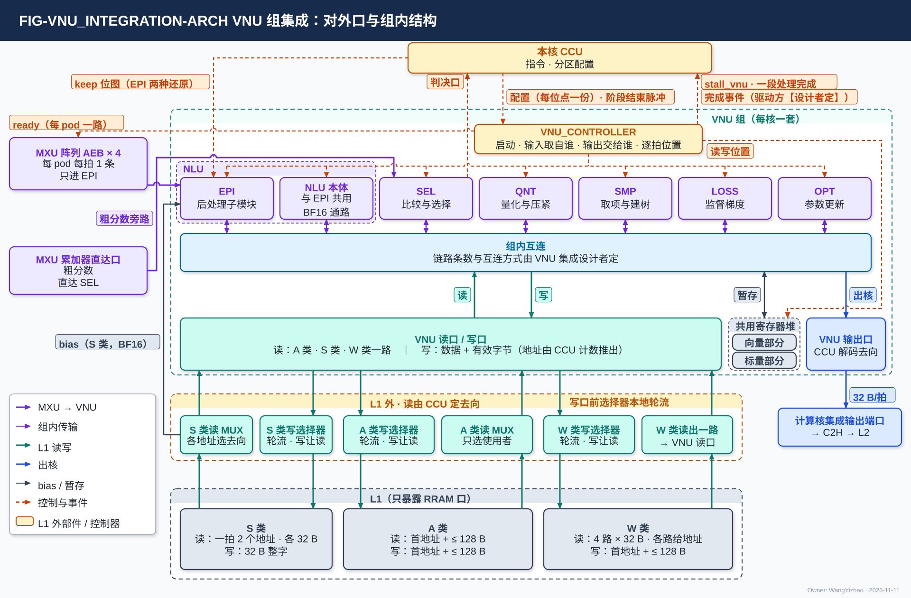
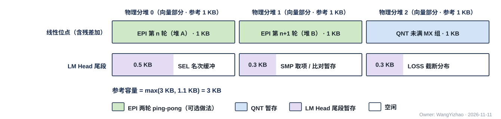

# VNU 组集成（VNU_INTEGRATION）需求

> Owner: WangYizhao｜2026-11-11

## 1 概述

**本篇只写 VNU 组怎样拼起来**：组的对外口、共用寄存器堆的容量与用途、组内各单元之间交什么、组级格式与精度。**组内谁先谁后、单元怎样串接、共用寄存器堆逐拍读写哪里、单元之间怎样握手，由 VNU 自己的控制器 VNU_CONTROLLER 按 CCU 给的配置执行，见 VNU_CONTROLLER 篇。** 各单元的运算写在各单元篇，后处理子模块 EPI 的动作与 AEB 接收规则写在 EPI 篇。VNU 组在计算核内，每核一套、全芯片 4 套、物理相同；组的配置只来自本核 CCU。

### 1.1 六个单元加三项组级共用资源

| 单元 | 一句话 | 单元篇 |
|---|---|---|
| NLU（含后处理子模块 EPI） | 两次矩阵乘之间的非矩阵、非选择运算：逐元素、归约与归一化、二维旋转、在线 softmax、流式累加；EPI 做矩阵乘结果出阵列后的收尾处理 | VNU_NLU、VNU_EPI |
| SEL | 比较与选择：阈值、相对阈值、流式 TOPK、阈值后限个数 | VNU_SEL |
| QNT | 量化、按判决位压紧、记录组装与解码 | VNU_QNT |
| SMP | 在 TOPK 项的概率上取项、沿树路径比对接受、截断建树、生成随机数 | VNU_SMP |
| LOSS | 监督梯度、截断分布统计（可选） | VNU_LOSS |
| OPT | 一步参数更新，算法由设计者定 | VNU_OPT |

组级共用资源有三项：**共用寄存器堆**（§3.3）、**L1 读口与写口**（§2.4、§2.6）、**输出口**（§2.7）。**SMP 只在负责 LM Head 的核上使用，这个核由指令指定、可以是任一核**（V18-SMP-09）。

组内另有 **VNU_CONTROLLER**（每核一个）：按 CCU 给的配置负责单元的串接与先后、共用寄存器堆的逐拍位置、组内握手与停发；它不是发令方，不产生 L1 的地址（VNU_CONTROLLER 篇 §1、§5.1）。

### 1.2 配置与参数只来自本核 CCU

**VNU 只收本核 CCU 给 VNU_CONTROLLER 的配置与阶段结束脉冲**（VNU_CONTROLLER 篇 §2.2、§2.3）：配置由 CCU 解码指令得到，含处理链、各单元的运算与参数、输入从哪来、输出去哪、数据的大小、共用寄存器堆的分区；各单元的启动、输入取自谁、输出交给谁由 VNU_CONTROLLER 发（同篇 §2.5）。**L1 的读写地址只在 CCU 一侧，不交 VNU。** **单元用到的参数分两类来路**（V18-NLU-07、V18-SEL-17）：

| 类 | 例子 | 来路 |
|---|---|---|
| 标量 | $\epsilon_{\text{norm}}$、温度、SEL 的门限与相对系数、个数（$k$、前缀截断的 $n$ 或累积概率）、节点数 | 指令字段，由本核 CCU 解码后放进位点配置，经 VNU_CONTROLLER 交给单元 |
| 配置表 | 逐通道向量（如 $\gamma$）、RoPE cos / sin 表、近似系数与查找表、QNT 的通道置换表与量化参数 | 离线产生、存 DDR / HSRAM，由 MAE 的搬运指令搬到本核 L1 的 A 类（经 HUB_IDN，或经 L2 → H2C），单元经 VNU 读口读入；L1 地址在位点指令里 |

**某件事由指令给出时本篇写明"由指令给"；指令字段需要就加，各单元需要哪些字段由各单元设计者整理，本篇不写指令字段表。**

### 1.3 时钟

VNU 组与所在计算核同一时钟域，组内没有跨时钟域。

## 2 接口需求

### 2.1 架构图与接口汇总

图中模块框内的结构是参考实现（见第 7 章），本章以框外的各口为准。

图中绿色虚线框是 VNU 组：

- **左**：MXU 阵列的 AEB × 4，只进 EPI；MXU 累加器的粗分数直达口，旁路直达 SEL，不经 EPI。**MXU 组的边界在 AEB**（V18-MXU-06）。
- **下**：分两层。上层是 **L1 外、计算核内的部件**——由 CCU 定去向的 S 类读 MUX、A 类读 MUX、W 类读出到 VNU 读口的一路，以及 A / S / W 三类写口前各一个选择器（自己在 H2C 接收桥、NWB、VNU 写口之间轮流，不由 CCU 逐拍选，V18-L1-32）；它们的输入、输出与每拍规则在架构篇 §3.7，内部实现属计算核集成（`CORE_INTEGRATION_STAGING.md`）。下层是**只暴露 RRAM 口的 L1**（W / S / A 三类，口宽见架构篇 PORT-01…06；L1 内部的组织属 L1 篇）。VNU 读口从 A 类读 MUX、S 类读 MUX 与 W 类读出一路三路取数（§2.4）；VNU 写口经写口前的选择器按 `seg` 进 A 类、S 类或 W 类写口（§2.6）；bias 由 S 类读 MUX 直接送 EPI（§2.5）。图中 L1 三类各画一框、只写口（S 类读口一拍 2 个地址，CONC-6），共用寄存器堆画成向量、标量两部分（§3.3）。
- **上**：本核 CCU，给 VNU_CONTROLLER 每位点一份配置与阶段结束脉冲，给 EPI 两种还原用的 keep 位图（§2.9）；**L1 的读写地址留在 CCU 一侧，不交 VNU**。回 CCU 的线：VNU_CONTROLLER 报 stall_vnu 与一段处理完成，完成事件的驱动方【设计者定】，SEL 交判决口。图中 VNU_CONTROLLER 在六个单元上方，向各单元一根汇总控制线（启动 · 输入取自谁 · 输出交给谁），向共用寄存器堆给读写位置，向 AEB × 4 给 ready（每 pod 一路）；VNU 读口 / 写口框写"写：数据 + 有效字节（地址由 CCU 计数推出）"；写口前的选择器标"轮流 · 写让读"。
- **右**：VNU 输出口接计算核的集成输出端口，再经 C2H 写 L2。
- **框内**：VNU_CONTROLLER、六个单元（EPI 与 NLU 本体套在虚线 NLU 框内）、组内互连、共用寄存器堆、读口 / 写口、输出口。组内各单元之间交什么见 §3.6。
- **未画**：MXU 的 pod 激活入口。$\tilde p$ 经 VNU 写口写 L1 A 类、再由 MXU 经 A 类读口读入，VNU 与 pod 之间没有直送口（§2.8）。

| 口 | 对端 | 方向 | 每拍位宽 | 握手 | 架构篇出处 |
|---|---|---|---|---|---|
| AEB 入口 | MXU 阵列的 AEB × 4 | 入 | 一条 AEB 条目 = 16 个 BF16 = 32 B；参考每 pod 每拍 1 条、4 pod 合计 128 B（§2.2） | valid / ready；ready 由 VNU_CONTROLLER 给，每 pod 一路 | PORT-07 |
| 粗分数旁路口 | MXU 累加器 → SEL | 入 | 每 pod 每算完一个（查询行, 16 个 key）出 16 个粗分数 | 无；SEL 不反压、判完即丢 | §2.3 |
| VNU 读口 · A 类入口 | L1 外的 A 类读 MUX | 入 | 一次 = 首字节地址 + 长度（≤ 128 B），交回从首字节起对齐好的数据 | 无握手（核内 RRAM 口，读固定拍数）；VNU 来不及收时拉 stall_vnu | PORT-03 |
| VNU 读口 · S 类入口 | L1 外的 S 类读 MUX | 入 | 每个地址每拍 1 个整字（32 B）；S 类读口一拍可接收 2 个地址，可以是同一个堆里的两个数据，两个都可送 VNU（CONC-6） | 同上 | PORT-02 |
| VNU 读口 · W 类入口 | W 类读出到 VNU 读口的一路 | 入 | 每拍至多 4 个整字（128 B），4 路各自给地址 | 同上 | PORT-01 |
| bias 入口（EPI） | L1 外的 S 类读 MUX | 入 | 一个整字 = 一个 16 通道列块的 16 个 BF16 | 无握手（读固定拍数） | PORT-02 |
| VNU 写口 | L1 外写口前的选择器 → A / S / W 类写口（按 `seg`） | 出 | VNU 交数据（从第 0 字节起放）与有效字节数（≤ 128 B）；首字节地址与 `seg` 由 CCU 计数推出（§2.6.1）；S 类一次 1 个整字 | 选择器轮到时写入，L1 不回信号；没轮到时 VNU 保持、来不及时让在写的单元停住（wr_stall） | PORT-04 / 05 / 06 |
| VNU 输出口 | 计算核的集成输出端口 | 出 | 32 B | C2H 不 ready 时 stall_tx 门控 CCU | PORT-09 |
| CCU 配置口 | 本核 CCU → VNU_CONTROLLER | 入 | 每位点一份配置（§2.9） | — | — |
| 阶段结束脉冲 | 本核 CCU → VNU_CONTROLLER | 入 | 一批送完时一个脉冲（§2.9） | — | — |
| keep 位图 | 本核 CCU → EPI | 入 | §2.9 | — | — |
| stall_vnu、一段处理完成 | VNU_CONTROLLER → 本核 CCU | 出 | §2.9 | — | — |
| 判决口、完成事件 | VNU → 本核 CCU（判决口由 SEL 给；完成事件由哪个部件驱动见 §2.9） | 出 | §2.9 | — | — |

口宽与条数以架构篇 §2.7 的 PORT-nn 为准，本表只为阅读方便列出。

**不在 VNU 口上的东西**：

- **命令网端点**：VNU 不在命令网上，配置只来自本核 CCU。**VNU 组不发 DDR 请求、不发令**；组内的先后由 VNU_CONTROLLER 按配置执行。
- **标量专用寄存器**：跨核合并的部分值（attention 部分状态、平方和、amax 等）是数据，与其他输出一样写 L1 或经输出口写 L2，由 MAE_CRU 在 L2 合并；合并值经 H2C 落 L1 后由单元读入（V18-TP-55）。
- **到 MAE_CRU 的直连**：没有。

### 2.2 AEB 入口：MXU 阵列推送，只进 EPI

**4 个 pod 算完一轮统一输出，次序固定、条目不带标签，只进 EPI**（V18-EPI-03）。一条 AEB 条目 = 一个（token 或查询行, 列块）的 16 个输出通道，每通道 1 个 BF16；**一轮至多 4 pod × $n$ 条（$n$ = 每 pod 源数，由配置给出；没开的 pod、没用的驻留位不输出，MXU 集成篇 §2.6）**，$n = 8$ 时 32 条；全码轮的条目只有 8 个有效结果（MXU_ARR 篇 §3.6）。条目的身份与接收规则在 EPI 篇 §2.2；条目在 EPI 里放在哪由 EPI 设计者定（V18-EPI-06），暂存在共用寄存器堆时位置由 VNU_CONTROLLER 算（VNU_CONTROLLER 篇 §3.5）。

**条目不带标签；条目属于哪个 token 或查询行只由 CCU 持有，VNU 收到的条目相对于 token 或查询行的自然次序可能是乱序的；各单元是否需要先后信息由 VNU 设计者评估，确实需要的与 CCU 设计者对接**（V18-VNU-13，VNU_CONTROLLER 篇 §2.4）。4 个 pod 各一路，同一拍可各到一条；同一拍到达的几条谁先谁后见 MXU 集成篇 §2.6 与 VNU_CONTROLLER 篇 §2.4。

- **valid / ready 握手**：EPI 来不及收时由 VNU_CONTROLLER 拉低对应 pod 的 ready（VNU_CONTROLLER 篇 §2.8），AEB 满后反压 MXU 累加器；只降速、不丢（§3.9）。
- 接口不按峰值定宽（用户 11-08）；每 pod 每拍 1 条是参考值，见架构篇 PORT-07 与 EPI 篇 §2.2.3。

### 2.3 粗分数旁路口：MXU 累加器直达 SEL

**attention 粗算的粗分数由 MXU 累加器直达 SEL，不经 EPI、不进 AEB、不进共用寄存器堆**（用户 11-08："无需经过EPI透传，直接旁路"）。**无握手：SEL 不反压、判完即丢。** 每 pod 每算完一个（查询行, 16 个 key）出 16 个粗分数；粗分数的有效位进 VNU_CONTROLLER（VNU_CONTROLLER 篇 §2.4）。

### 2.4 VNU 读口：一个读口，三路入口都在 L1 外

**VNU 对 L1 只有一个读口；它在 A 类读 MUX 上算一个使用者，A 类一次读 = 首字节地址 + 长度（≤ 128 B），首地址与长度由本核 CCU 定**（V18-VNU-04；用户 11-08："我希望对于VNU本身最多暴露一个读出口和一个写入口"；"读口和写口都是128B……直接配置一个上限即可"）。**进 VNU 读口的三路都在 L1 外、由 CCU 调控；L1 只暴露 RRAM 读口，不感知去向**（V18-L1-21；用户 11-09："对于W类到VNU的读口，我认为这种外部MUX是CC集成篇需要说明的内容，也是CCU需要调控的内容，但是L1 SRAM无需感知这件事"）。三路入口与 bias 入口（§2.5）各是一个对外口。**经读口送来的数据只带有效位、不带 token 标记，与 AEB 条目按 CCU 给的次序一一对应**（V18-VNU-13，VNU_CONTROLLER 篇 §5.2）；一批送完时 CCU 给阶段结束脉冲（§2.9）。

#### 2.4.1 A 类入口

| 项 | 规定 |
|---|---|
| 来源 | L1 外的 A 类读 MUX 的 VNU 去向（架构篇 PORT-03、§3.7） |
| 一次读 | 首字节地址 + 长度（≤ 128 B）；**L1 交回从首字节起按地址次序排好的数据；首地址可以是任意字节，字节移位在 SRAM 内部，VNU 入口不做字节移位**（V18-TP-74） |
| 每拍 | **整拍只送一个使用者；轮到 VNU 的拍，这一次读出全部给 VNU**；A 类读 MUX 只选使用者、不排字序（V18-L1-21） |
| 占几拍 | 从存储字边界起一拍，否则允许多拍（架构篇 §3.4 CONC-3）；CCU 据此排后续访问 |
| 谁用 | 全部单元：码、元数据项、F 列表、行状态、暂存、配置表、OPT 的状态与梯度 |

#### 2.4.2 S 类入口

| 项 | 规定 |
|---|---|
| 来源 | L1 外的 S 类读 MUX 的 VNU 去向（架构篇 PORT-02） |
| 每拍 | **S 类读口一拍可接收 2 个地址、每个地址一个整字（32 B），可以是同一个堆里的两个数据（架构篇 §3.4 CONC-6）**；每个地址的读出送哪个去向由 CCU 给；同拍需要的多于 2 路时由 CCU 错开 |
| 谁用 | NLU（K 与嵌入行的 E8M0）、EPI 还原残差与特征行的 E8M0、OPT 副本的 E8M0 |

**V 的尺度不进 VNU**：$O = PV$ 里 V 的每 key 尺度作为权重一侧的尺度进 pod 权重旁带、由 pod 处理，NLU 交给阵列的是 $\tilde p$（V18-MXU-15）。

#### 2.4.3 W 类入口

| 项 | 规定 |
|---|---|
| 来源 | W 类读出到 VNU 读口的一路：**W 类只有一个读口，即 4 路 × 32 B 的 W 类权重读口（架构篇 PORT-01）；送 VNU 读口的这一路是它在 L1 外的一个去向**（V18-L1-26） |
| 每拍 | 至多 4 个整字（128 B），**一拍接收 4 个地址、各路各自给地址（CONC-4）**，地址由 CCU 给；读连续的副本码时 CCU 给出连续字的地址即可 |
| 谁用 | OPT 读前向副本的码 |

#### 2.4.4 三路同拍与读入口来不及时

- **L1 不限制 W 类、A 类与 S 类同拍读出；VNU 入口一拍怎样收几路的数据，由 VNU 设计者定**（V18-VNU-09；用户 11-10："我认为SRAM不要受限，这个由VNU的设计者来判断"）。
- **VNU 读入口来不及收时由 VNU_CONTROLLER 向 CCU 拉 stall_vnu，CCU 停发读**（VNU_CONTROLLER 篇 §2.7）；只降速、不丢。各单元的状态怎样合成这一根【设计者定】，约束：拉起之后在途的读出全部收下。
- 读出在 VNU 内由 VNU_CONTROLLER 按配置分给各单元（VNU_CONTROLLER 篇 §2.5）。

### 2.5 bias 入口：S 类读 MUX 直接送 EPI

**bias 存在 L1 的 S 类（一个存储字 = 一个 16 通道列块的 16 个 BF16），由 CCU 发读，经 L1 外的 S 类读 MUX 直接进 EPI，不经 VNU 读口；精度只有 BF16、不量化**（V18-EPI-02 / 05、V18-L1-21）。EPI 读 bias 是 S 类读口的使用者之一，与 pod 权重一侧的尺度、pod 激活一侧的尺度、VNU 读尺度、发送 FIFO 入口共用 S 类读口一拍 2 个地址（架构篇 §3.4 CONC-6）；同拍需要的多于 2 路时由 CCU 错开。bias 何时读、在 EPI 里怎样用由 EPI 设计者定（EPI 篇 §2.3）。

### 2.6 VNU 写口：一个写口，按 `seg` 写 A / S / W 三类

**VNU 对 L1 只有一个写口，在写口前的选择器上算一个来源；每一次写按段选 `seg` 进 L1 的 A 类、S 类或 W 类写口；每类写口前的选择器在 L1 外，自己按固定规则在三个来源（H2C 接收桥、NWB、VNU 写口）之间轮流、一拍写一个来源，没轮到的在自己的 FIFO 里等，不由 CCU 逐拍选；写与读碰到同一个堆时写让读，由选择器本地判断；不同来源不合并进同一次写**（V18-L1-14 / 20 / 24 / 32、V18-VNU-09、架构篇 §3.4 CONC-2；用户 11-09："L1 SRAM本身现在只有3个来源，而不是以前的4个，此外，我不认为它应该并发，应该分出先后写入顺序……不能把两者的数据来源合并写入，而是要错拍"；用户 11-11："我认为CCU不应该控制这件事，这个控制不能让LANDING自己做吗？"）。轮流的固定规则属计算核集成（`CORE_INTEGRATION_STAGING.md`）。

#### 2.6.1 一次写的形式与写哪一类

| 项 | 规定 |
|---|---|
| 一次写的形式 | **首字节地址 + `seg` + 有效字节（≤ 128 B）+ 从第 0 字节起放的数据**：首字节地址是 24 bit 段内字节地址；有效字节用长度（len）还是从第 0 字节起连续的字节写使能（be）表达、字段位宽【设计者定】，约束是能表达任意字节起点与 1–128 B 的长度。**VNU 只交数据与每次的有效字节数；首字节地址与 `seg` 由 CCU 按位点配置与自己的计数推出，VNU 不报地址、不报长度**（V18-VNU-12，VNU_CONTROLLER 篇 §2.7、§3.9）。**地址与 `seg` 在哪里与 VNU 的数据拼成一次写【设计者定】**：要定的是地址随 VNU 的写一起进 VNU 写口的 FIFO，还是在选择器处与数据汇合；约束是一次写的地址、`seg`、有效字节与数据一一对应，不丢、不错位 |
| A 类 | 码、元数据项、F 列表、行状态、暂存、列表、停放值与部分和、OPT 的新副本码与状态等，一次 ≤ 128 B |
| S 类 | QNT 写的激活 E8M0、OPT 写的新副本 E8M0；**一次 1 个整字、整字写、不带 be**，生产方末字补 0（V18-L1-20、V18-DORG-04） |
| W 类 | **本核产生、本核消费的 K / V 码可经 VNU 写口直接写 W 类、不必绕 L2**；权重梯度计算中进权重侧的操作数（$\mathrm dY$、$X$ 由 QNT 把 MXFP6 码无损改写成的 8 bit 两个平面）；**经 VNU 写口写进 W 类的数据都由 QNT 直接排成 W 类字形态**（两种字形态的定义见数据组织篇 §2.12），地址由 CCU 推出，一次 ≤ 128 B（QNT 篇 §3.5、§3.8，V18-VNU-09、V18-MXU-14） |
| 起点 | **首地址可以是任意字节，L1 支持紧密存储、字节移位在 SRAM 内部，VNU 一侧不需要移位**（V18-TP-74）；数据组织默认让每部分从存储字边界开始（数据组织篇 §2.3），不对齐的写允许多拍（CONC-3） |

需要行字区字形态、本核自用的 K / V，**由 QNT 攒 key 转置后写 W 类，或按 key 写进 L2、再经 NI 读口 → MAE_DSU 转置 → IDN 送回，两条路硬件都支持，由编译链按位点选**（V18-MAE-45，架构篇 §3.8）。给别的核用的 K / V 经发送 FIFO 入口或 VNU 输出口出核。

#### 2.6.2 选择器没轮到时：请求原样保持、不丢

**VNU 写口的请求在选择器轮到 VNU 写口之前原样保持、不丢；保持不住时由 VNU_CONTROLLER 让当拍在写的单元停写（wr_stall），单元保持待写的数据**（V18-L1-24 / 32，VNU_CONTROLLER 篇 §3.8）。wr_stall 只到 VNU 各单元、不到 CCU。**编译链不做写带宽保证**（V18-L1-21）：选择器连续轮到别的来源时，VNU 写口只降速。保持用的缓冲与将满阈值是参考实现（§7.3）。

#### 2.6.3 VNU 写的完成：由选择器告知 CCU 或由 VNU 报完成

**VNU 写口的一批写何时全部写进 L1，由写口前的选择器告知 CCU，或由 VNU_CONTROLLER 在最后一拍写进之后报给 CCU【设计者定】**（V18-L1-32 (3)，VNU_CONTROLLER 篇 §2.7）：要定的是用哪一种；约束是 CCU 在得知写完之后才把这批数据当作可读。**L1 不提供写完成信号，SRAM 内部不设计数**（协议篇 D1；用户 11-10："SRAM内部不需要计数逻辑"）。核外经接收桥落地的数据由 MAE 的写完通知判定（V18-TP-70）。

各单元的写在 VNU 内合并进这一个写口；哪个单元的输出何时交写口由 VNU_CONTROLLER 按配置定，按到达次序交出（VNU_CONTROLLER 篇 §3.9）。

### 2.7 VNU 输出口：留一个接口，来源与去向由 CCU 解码

**VNU 留出一个输出口接计算核的集成输出端口；数据来自哪个单元由 CCU 解码指令后作为配置给、VNU_CONTROLLER 执行，写到 L2 哪里由 CCU 定**（用户 11-08："直接说需要留出这一个接口，来自哪，写到哪由CCU通过指令解码得到"）。

- 集成输出端口的核内来源只有两种：发送 FIFO 入口、VNU 输出口；CCU 在切换段边界选一路，上 C2H（架构篇 §2.3.1）。
- 输出口每拍 32 B；**C2H 不 ready 时 stall_tx 门控 CCU**，CCU 停发全部 en、停算，等 C2H ready 再继续。
- **同一链路上切换段不交错**（协议篇 §3.10 的规则，由 CCU 保证）。
- 每个输出每条指令只能选写 L1 或经输出口写 L2，不两边都写。

### 2.8 $\tilde p$ 不设直送通路：经 L1 A 类进 MXU

**$\tilde p$ 经 VNU 写口写 L1 A 类、再由 MXU 经 A 类读口读入；直送通路不作要求**（MXU 集成篇 §2.3，VNU_NLU 篇 §2.10）。

### 2.9 命令侧的线

| 线 | 方向 | 内容 |
|---|---|---|
| CCU 配置口 | CCU → VNU_CONTROLLER | 每位点（或一段连续执行的指令）一份：处理链（用到哪些单元、怎样串接、各做哪一种运算、各项参数）、输入从哪来、输出去哪、数据的大小、共用寄存器堆的分区、某项工作数据放共用寄存器堆还是放 L1（指令里的 1 bit）；在位点数据到达之前给到，位点进行中不变（VNU_CONTROLLER 篇 §2.2）。**不含 L1 的读写地址、共用寄存器堆的逐拍位置、AEB 条目属于哪个 token** |
| 阶段结束脉冲 | CCU → VNU_CONTROLLER | CCU 经 VNU 读口送完一批数据时给一个；MXU 的一轮 AEB 条目是否另由 MXU 给"一轮交完"的脉冲【设计者定】（VNU_CONTROLLER 篇 §2.3） |
| keep 位图 | CCU → EPI | **EPI 还原紧凑残差与还原紧凑格式的特征行时，保留位图都由 CCU 读元数据项后交给 EPI**（V18-VNU-10）；通路与位宽【设计者定】，约束：每条条目能拿到本条目 16 个通道的 keep 位 |
| stall_vnu | VNU_CONTROLLER → CCU | 读入口来不及收（§2.4.4） |
| 一段处理完成 | VNU_CONTROLLER → CCU | 这个位点（或这一段指令）在 VNU 里的处理全部完成、输出全部交出（VNU_CONTROLLER 篇 §2.7）；输出交出不等于已写进 L1（§2.6.3） |
| 判决口 | SEL → CCU | 数据线：每条比较指令每元素 F / C / Z 三类之一（保留位 + 是否 F）、按行计数、最大类号 |
| 完成事件 | VNU → CCU | OPT 的读完与组完成、SMP 的完成摘要、EPI 的动作完成；**由哪个部件驱动（单元直连 CCU，还是经 VNU_CONTROLLER 汇总）【设计者定】**，约束：OPT 的"读完"是该副本段的最后读者完成事件（VNU_OPT 篇 §2.5），不能并进位点末尾的"一段处理完成" |

**变长产出（紧凑 token 记录、列表）只交数据与有效字节数，写回地址由 CCU 自己计数推出**（V18-VNU-12，VNU_CONTROLLER 篇 §3.9）；给 MAE 用的列表的项数仍由生产核 CCU 写成定长计数项（V18-DORG-05 (5)）。

## 3 功能描述

### 3.1 功能一览

| 功能 | 输入 | 输出 | 触发 / 生效条件 | 节 |
|---|---|---|---|---|
| 调度 | CCU 给的配置 | 各单元并发或串行执行 | 由 VNU_CONTROLLER 按配置执行（VNU_CONTROLLER 篇 §3.2–§3.4） | §3.2 |
| 共用寄存器堆 | CCU 给的分区配置 | 各单元在自己的分区里读写，逐拍位置由 VNU_CONTROLLER 算 | 分区在位点边界切换 | §3.3 |
| L1 读 | CCU 给的首字节地址与长度 | 从首字节起对齐好的数据 | 轮到 VNU 的拍；紧凑 token 记录由 CCU 先定地址 | §3.4 |
| L1 写 | 单元的数据与有效字节（地址与 `seg` 由 CCU 计数推出） | 写进 A / S / W 类 | 写口前的选择器轮到的那拍 | §3.5 |
| 组内传输 | 各单元的产出 | 下游单元的输入 | 按配置，由 VNU_CONTROLLER 推进 | §3.6 |
| 按口看的数据路径 | 位点 | 各口与单元的先后 | 按位点 | §3.7 |
| 格式与精度 | 各单元的输入输出 | BF16 / MXFP6 向量、FP32 标量 | 恒定 | §3.8 |
| 握手与停发 | 收端来不及 | 发端停发（执行方 VNU_CONTROLLER） | 任何时刻 | §3.9 |
| 复位 | CIF 的复位 | 清工作状态 | 复位 | §3.10 |

### 3.2 调度：由 VNU_CONTROLLER 按配置执行

**本节的单元并发、同一单元一时一个任务、资源冲突的先后、单元串接，都由 VNU_CONTROLLER 按 CCU 给的配置执行，需求写在 VNU_CONTROLLER 篇 §3.2–§3.4、§3.7；本篇只保留四个子节标题作为别篇引用的落点。**

#### 3.2.1 计算资源不冲突时，各单元可同时工作

见 VNU_CONTROLLER 篇 §3.4。

#### 3.2.2 同一单元一时一个任务

见 VNU_CONTROLLER 篇 §3.3；单元内不设多源合并逻辑（V18-TP-84 (6)）。

#### 3.2.3 资源冲突的先后由配置给

冲突的三类资源（同一份计算资源、同一个对外口、共用寄存器堆的同一个分区）与先后见 VNU_CONTROLLER 篇 §3.4：先后由配置给、VNU_CONTROLLER 执行；**VNU 读口与输出口每拍轮到谁仍由 CCU 定，VNU 写口何时写进由写口前的选择器轮流**（§2.6）。

#### 3.2.4 单元之间的串行依赖由 Fusion 指令编排执行

单元串成处理链、链上先后由配置给（来自 Fusion 指令），VNU_CONTROLLER 推进，见 VNU_CONTROLLER 篇 §3.2（V18-TP-84 (6)）。

### 3.3 共用寄存器堆：全组一份，分区由 CCU 配置，位置由 VNU_CONTROLLER 算

**VNU 全组只设一份共用寄存器堆，容量按各位点同时需要的最大量配置，不按各用途相加**（用户 11-08："我希望只用一份寄存器，可以根据最大需求去配置"）。**实际容量、装哪些暂存，由 VNU 设计者评估确定**（用户 11-08："你可以写一个参考，但是要在文档中提到实际需求要让VNU的设计者来定"）；参考用途与容量见 §7.1。

**寄存器堆按地址分区；各用途的分区（向量、标量两部分里各占多少）由 CCU 在位点边界作为配置给出；分区之内逐拍读写哪里由 VNU_CONTROLLER 算，别的模块不给逐拍位置**（V18-VNU-10 / 12，VNU_CONTROLLER 篇 §2.6、§3.6）：

- **单元的工作数据放寄存器堆还是 L1 由指令里的 1 bit 选，作为配置项交 VNU_CONTROLLER**（V18-TP-83 (5)，VNU_CONTROLLER 篇 §2.2）：**放 L1 时经 VNU 读口 / 写口、地址由 CCU 给；放寄存器堆时位置由 VNU_CONTROLLER 按分区算；单元不区分两种情况**（例：QNT 未满 MX 组、SEL 名次缓冲、SEL 相对阈值的暂存、SMP 的工作数据，V18-SEL-19、V18-SMP-09）。
- **分存向量与存标量两部分，物理分开，各有自己的地址范围**（V18-VNU-10；用户 11-11："寄存器堆是需要区分的，有的要存大量的向量数据，有的是存这种标量数据，二者可以物理区分，然后利用地址分区"）。向量部分装未满 MX 组、名次项等（EPI 若选用"条目先进寄存器堆"的做法也装 AEB 条目，EPI 篇 §7.2）；标量部分装跨组共享的标量、统计量等（例：OPT 确有跨组共享的量时存这里或 L1 A 类，V18-OPT-02）。
- **需要同时一写一读的用途（ping-pong），写与读落在寄存器堆里物理上分开的两部分**（下称寄存器堆的"分堆"，是寄存器堆自己的物理分块，与 L1 / L2 由 `seg` 选的堆无关）：**写哪个分堆、读哪个分堆由 VNU_CONTROLLER 交替选（VNU_CONTROLLER 篇 §3.6），寄存器堆本身没有读写角色状态**；寄存器堆的 ping-pong 用途规定一个分堆写、另一个读（V18-VNU-05）。

**正确性**（同一分区同一时刻只有一个写者、分区只在位点边界切换、ping-pong 只在用途自己的分区里分两个分堆）见 VNU_CONTROLLER 篇 §3.6；**切换前在途数据用完由 CCU 在位点边界保证**；整个寄存器堆不要求做两份。

### 3.4 L1 读：VNU 在 A 类读 MUX 上算一个使用者

- **A 类读出每拍只给一个使用者**（V18-L1-21；用户 11-09："在一次L1 SRAM使用中，它只能被一个使用者读取，不需要存在两个消费者同时花费读取请求，然后L1 SRAM主动拼接两个需求，这样对L1 SRAM的控制难度要求太大了"）：使用者是 MXU（4 个 pod 算一个使用者）、VNU 读口、CCU、发送 FIFO 入口之一（架构篇 §3.7）；L1 不合并两个使用者的读。
- **字序由 L1 按地址排好**：CCU 给一次读的首字节地址与长度，L1 交回按地址次序排好的数据；A 类读 MUX 只选使用者。
- **默认读到的是从数据块（或片的一部分）第 0 字起的整字流**（V18-TP-64 / 74、V18-DORG-04，数据组织篇 §2.3、§2.5）。**首地址也可以是任意字节**：SRAM 内部把该字节移到输出的第 0 字节后交出，不从字边界起的读允许多拍（CONC-3）；**VNU 入口不需要做字节移位**。
- **读紧凑 token 记录时，码字地址由 CCU 按该片元数据项算出，VNU 不算地址**（V18-TP-66 / 68、V18-L1-20，数据组织篇 §3.2、§3.4）。一片 = 元数据项（A 类）+ E8M0 项（S 类）+ F 列表（A 类）+ 码块（A 类）。**码块**是紧凑 token 记录四部分之一，只装保留通道的 6 bit 码；码块片长（按 32 B 取整）记在元数据项里。CCU 读这一片的元数据项后，给 VNU 读口发三样读：元数据项里含所需 keep 位的字（A 类）、码字（A 类）、所需 MX 组的 E8M0（S 类）。单元按"第 $i$ 个码对应 keep 位图里第 $i$ 个 1"放回通道，每 $G$ 个通道换一个尺度（$G$ 由指令给）。
- **EPI 的两种还原（紧凑残差、紧凑格式的特征行）由 CCU 读元数据项并把 keep 位图直接交给 EPI**（V18-VNU-10，用户 11-11："EPI我认为统一CCU交是对的"）：EPI 只经读口收码字（A 类）与 E8M0（S 类），不另读元数据字（EPI 篇 §3.3、§3.6）。
- **读出交给哪个单元由 VNU_CONTROLLER 按配置分发**（VNU_CONTROLLER 篇 §2.5）。
- **编译链不做读带宽保证，需求超出时 VNU 自己等**（V18-L1-21；用户 11-09："编译链不应该保证带宽"）：CCU 按各使用者的需求排拍，VNU 的读没排到时等下一个 VNU 拍；VNU 读入口来不及收时经 stall_vnu 让 CCU 停发。只降速、不丢。

### 3.5 L1 写：按 `seg` 写三类，写口前的选择器轮流

- 一次写的形式与写哪一类见 §2.6.1。
- **写口前的选择器在 L1 外，自己在 H2C 接收桥、NWB、VNU 写口之间按固定规则轮流，不由 CCU 逐拍选**（V18-L1-32，`CORE_INTEGRATION_STAGING.md`）；L1 只暴露 RRAM 写口，没有优先级表、不回任何"选中"信号。
- **同一类的读口与写口同一拍不落同一个堆**（架构篇 §3.4 CONC-1 / 2）：**碰到同一个堆时写让读**，这一拍不写、下一拍再写，由选择器本地判断，CCU 不参与（V18-L1-32 (2)）；L1 不回 busy。
- **写回的地址与 `seg` 由 CCU 计数推出，VNU 只交数据与有效字节数**（§2.6.1）。
- **紧凑 token 记录默认四部分各自从存储字边界开始、片尾补到 32 B**（数据组织篇 §2.3）：QNT 写 A 类三部分（元数据项、F 列表、码块）时末字只标出有效字节，E8M0 末字补 0；怎样攒、何时写归 QNT（QNT 篇）。L1 也支持不补齐的紧密存储，某类数据怎样排归数据组织篇。
- 选择器没轮到时 VNU 写口保持请求（§2.6.2）；写完怎样让 CCU 知道见 §2.6.3。

### 3.6 组内各单元之间交什么

**组内各单元之间理论上有哪些传输需求写在本节；互连方式（是否点对点、几条、要不要交叉开关）由 VNU 集成设计者确定**（用户 11-08："这是VNU的集成设计者需要考虑的任务，咱们只需要说明，理论上VNU内的各个模块，可能存在怎样的需求即可"）。参考位宽见 §7.4。

#### 3.6.1 传输需求表

| 发端 → 收端 | 交什么 | 速率条件 | 出处 |
|---|---|---|---|
| EPI → NLU 本体 | 精确分数、区块打分粗分数、$(P \times V)_{\text{tile}}$、q / k 投影结果、夹心归一化的 $Y$ | 不使 EPI 违反拍数条件（EPI 篇 §4.1） | EPI 篇 §2.5 |
| NLU 本体 → EPI | 夹心归一化后的缩放值 | 同上 | EPI 篇 §3.5 |
| EPI → QNT | $x'$、归约完成的投影结果、梯度、已还原的特征行 | 同上 | EPI 篇 §2.5、QNT 篇 §2.8 |
| EPI → SEL 与 LOSS | LM Head 的 logit 流（同一条流两个收端）；**LOSS 收不收这条流由指令逐位点指定**（V18-LOSS-08），收时 LOSS 不让这条流停发 | — | EPI 篇 §3.2、LOSS 篇 §2.2、§4.2 |
| EPI → SMP | TOPK 列补算后的精确 logit；**补算开启时，归一化、采样与比对所用的 TOPK 项的 logit 须是这些精确值，一个节点的全部项都换成精确值之后才进入归一化与采样；对应哪一项由 CCU 给，词号与成员不变；由 EPI、SMP 还是别的单元写入【设计者定】；TOPK 项放 L1 时位置由 CCU 给，放共用寄存器堆时由 VNU_CONTROLLER 按分区算**（V18-SMP-10；TOPK 项只存一份，V18-SMP-09） | — | EPI 篇、SMP 篇 §3.6 |
| NLU → SEL | 评分与统计量、Q 逐维幅值 | — | NLU 篇 §2.2、SEL 篇 §2.1 |
| SEL → NLU | 录取位图 | 每 key 1 bit | NLU 篇 §2.2 |
| NLU ↔ QNT | 待量化向量、K 存储码、解码后的 K | — | NLU 篇 §2.2、QNT 篇 §2.2 |
| NLU → SMP | TOPK 项内归一化后的概率、残差分布 | 每个位置 $K_{\text{top}}$ 项 | SMP 篇 §2.1 |
| SMP → NLU | 一个节点的 $K_{\text{top}}$ 项 logit（待归一化）；残差更新请求 | 每个节点一次；每次被拒一次 | SMP 篇 §3.3、§3.6.1、§3.6.2 |
| NLU → LOSS | lse（FP32，V18-LOSS-07）；启用熵与最大概率时另交截断分布 | 每个采样位置一个；截断分布 $K_{\text{top}}$ 项 | NLU 篇 §2.2、LOSS 篇 §2.4 |
| QNT → SEL | 待做保留判断的幅值 | — | QNT 篇 §2.2 |
| SEL → QNT | keep 判决位（每元素 1 bit）与 F 序号列表（片内序号，每项 2 B；紧凑输出时由 SEL 按通道片补齐，V18-DORG-11），一对阈值一遍判出 | — | SEL 篇 §2.1 |
| SEL → SMP、LOSS | 流式 TOPK 名次项：**每项固定 8 B（序号 3 B + 评分 2 B，其余补 0）、紧密存储；每个节点只存一份；放 L1 时位置由 CCU 给，放共用寄存器堆时由 VNU_CONTROLLER 按分区算；SEL 写、补算开启时其中的 logit 换成精确值、SMP 与 LOSS 读同一份**（V18-SEL-19、V18-SMP-09） | 选择域结束时可读 | SEL 篇 §2.1、SMP 篇 |
| SMP → SEL | 建树后各节点的路径概率 $\hat w$，由 SEL 两条比较指令判出、CCU 合成 2 bit 档号 | 每棵树一次 | SMP 篇 §3.4 |
| SMP → LOSS；LOSS → SMP | 所选 token 与所选项 logit $z_{\text{sel}}$（V18-LOSS-07）；可选统计结果 | 每个取项位置一次 | SMP 篇、LOSS 篇 |
| LOSS → QNT | 链首梯度 $\mathrm{d}z$（BF16，QNT 量化后写 L1） | — | LOSS 篇 §2.6 |
| QNT ↔ OPT | 临时格式统一（只在设计者选用时存在） | — | QNT 篇 §3.6 |

各传输的参考速率见 §7.4。

#### 3.6.2 组内链路只限位宽，格式由两端解码

**组内链路上的格式与精度由两端的控制逻辑按配置解码，链路本身不区分格式**（用户 11-04，V18-VNU-02）。**来不及收的一端经握手让发端停发，发端保持数据、不丢**；执行方是 VNU_CONTROLLER（VNU_CONTROLLER 篇 §3.8）。

#### 3.6.3 功能复用与寄存器复用：NLU 的运算元件对 LOSS / OPT 分时开放

**NLU 的运算元件（exp、ln、开方、除法等）对 LOSS、OPT 分时开放，共用寄存器堆对全组各单元开放；功能复用与寄存器复用是底层需求**（V18-VNU-10；用户 11-11："这是必要的，对于VNU的功能复用和寄存器复用，以及其他类似设计，这是底层需求"）。借用时 NLU 只执行；**谁先用由配置给、VNU_CONTROLLER 安排，一个元件同一时刻只给一个单元**（VNU_CONTROLLER 篇 §3.7）；借用时段内 attention 不运行。SMP 不借用元件：TOPK 项内的归一化由 NLU 自己完成，再把概率交 SMP（V18-SMP-01）。借用接口的做法见 §7.4。

#### 3.6.4 同一条流交两个收端

LM Head 的 logit 流按指令同时交 SEL 与 LOSS 时，**两个收端都收到才算交出**；任一收端来不及时，发端停发。

### 3.7 按口看整组的数据路径

下表只写数据经过哪些口、按什么顺序；哪个位点走哪条路径、何时走，归数据流篇。凡"读口 → 单元"处默认读到的是从记录第 0 字起、按地址排好的数据，A 类读出整拍只给一个使用者；凡"写口 → L1"处都是一次按 `seg` 进 A / S / W 类写口（A、W 类一次 ≤ 128 B，S 类一个整字），写口前的选择器在 L1 外、自己轮流（§3.4、§3.5）。

| 路径 | 经过的口与单元 |
|---|---|
| 线性位点、核内残差加 | AEB → EPI → 残差是紧凑格式时 CCU 读元数据项、把 keep 位图交 EPI → EPI 经读口读残差码（A 类读 MUX）与 E8M0（S 类读 MUX）、按 keep 位图还原、相加 → QNT（四部分按片补齐：元数据项、F 列表与码进 A 类，E8M0 进 S 类）→ 写口 → L1 |
| 线性位点、门控 FFN | AEB → EPI → NLU 本体（激活与门控乘、评分）→ SEL（判决）→ QNT（按判决位压紧）→ 写口 → L1 |
| attention 粗算与录取 | MXU 累加器粗分数旁路 → SEL → 录取位图 → NLU 本体 |
| attention 精算 | AEB → EPI → NLU 本体（在线 softmax，行状态经读口 / 写口读改写）→ $\tilde p$（稠密 BF16）→ 写口 → L1 A 类 → A 类读 MUX → MXU 的 pod 入口（直送通路不作要求，§2.8） |
| attention P×V | AEB → EPI → NLU 本体（$O \leftarrow \alpha O + (P \times V)_{\text{tile}}$，行状态经读口 / 写口读改写）；V 的尺度经 S 类读 MUX 进 pod 权重旁带、由 pod 处理，不进 VNU（V18-MXU-15） |
| K 读时旋转 | 读口（K 码经 A 类读 MUX、E8M0 经 S 类读 MUX）→ NLU 本体 ↔ QNT（解码、旋转、重量化，分码与 E8M0 两块）→ 本核消费时可经写口直接写本核 W 类（码已是 W 类字形态）、E8M0 写 S 类，不必绕 L2；需要行字区字形态时由 QNT 转置后写，或经 L2 → MAE_DSU 转置后送回，两条路硬件都支持、编译链按位点选（§2.6.1）；给别的核时：写口（码 A 类、E8M0 S 类）后经发送 FIFO 入口出核，或经输出口 → L2 → 消费核（码落 W 类、E8M0 落 S 类；L2 里存 L1 字形态经 H2C 多播，或存按 key 的形态经 NI 读口 → MAE_DSU 转置 / 直通后经 IDN 多播，同样由编译链按位点选，QNT 篇 §3.5） |
| 核间按 $k$ 切分的部分和 | AEB → EPI 透传 → 输出口 → 集成输出端口 → C2H → L2（MAE_CRU 归约，bias 并入归约指令、每个结果允许 2 拍，V18-CRU-09 / 10）；合并结果经 L2 → H2C 落 L1 → 读口 → EPI / NLU 本体 |
| 跨核标量 | NLU 本体（部分和）→ 输出口 → L2；合并值经 H2C 落 L1 → 读口 → NLU 本体 |
| LM Head 尾段 | AEB → EPI → SEL（+ LOSS，收不收由指令逐位点指定）→ SEL 把名次项写进 TOPK 项的位置（放 L1 时由 CCU 给，放共用寄存器堆时由 VNU_CONTROLLER 算，§3.6.1）；SEL 写 TOPK 重算词号列表 → MAE 按列读 $W_{\text{head}}$ 的按列连续全码副本（每列 2,560 B 落 W 类、按列字区的列位落，V18-DORG-08；列副本的尺度每列补到 32 B 的倍数、落 S 类）→ 阵列 8 bit 权重一遍算完 → AEB → EPI → 同一份 TOPK 项里该节点的全部 logit 换成精确值（由谁写入【设计者定】，V18-SMP-10）→ NLU 归一化（含前缀截断）→ SMP 取项 / 比对 → 写口或输出口；采样位置上 NLU 交 LOSS lse、SMP 交 LOSS 所选项 logit |
| 训练更新 | 读口（副本码经 W 类一路、E8M0 经 S 类读 MUX，状态与梯度经 A 类读 MUX）→ OPT → 写口（新副本码与状态写 A 类、E8M0 写 S 类）→ L1（经发送 FIFO 入口出核） |

### 3.8 输入输出格式与精度的组级规范

#### 3.8.1 向量只有 BF16 与 MXFP6 两类

**VNU 的输入向量规范为 BF16 与 MXFP6 两类，标量为 FP32 语义**（用户 11-04，V18-VNU-01）；激活 MXFP6 的 MX 组长 $G$ 为位点属性（32 的倍数，上限【设计者定】且不大于通道片长；32 是精度基准、验收工况与效果最好的配置，V18-MXU-10），Q / K / V 的组长同样由指令给（V18-ATT-04），权重的 MX 组固定 32；组长由指令交给 QNT、EPI、NLU 与 CCU，pod 不感知。以下是需要临时处理的格式，设计者可选择在 QNT 统一成上述两类后再交其他单元：

- OPT 自己的格式（MXINT8 权重副本、优化器状态）；
- 可选格式：MXFP6 装不下时的 FP8 / BF16 / FP16 梯度、元素位宽取 8 的位点所用的 FP8 E4M3；
- 经 HUB_IDN 交 LOSS 的 teacher 概率；
- 与 M55 共用的条件概率 2 B 与随机数向量（SMP 篇 §3.11）。

#### 3.8.2 精度要求只一条

**VNU 各单元的计算方案集成到算法后，任务精度下降 < 0.1%**；中间精度不规定，由设计者定。OPT 单独放宽为：在线训练后 Draft 的接受长度相对 AdamW（FP32 理想更新）下降 < 5%（OPT 篇）。

### 3.9 握手与停发的组级规则

本节只列对外可见的停发信号与作用；谁在什么条件下拉、内部怎样做见 VNU_CONTROLLER 篇 §3.8。

| 停发 | 谁给 → 给谁 | 作用 |
|---|---|---|
| 组内握手 | 组内各传输的收端 → 发端（VNU_CONTROLLER 执行） | 收端来不及时发端停发、保持数据 |
| stall_vnu | VNU_CONTROLLER → CCU | 读入口来不及收时拉起，CCU 停发读；拉起之后在途的读出全部收下 |
| wr_stall | VNU_CONTROLLER → 当拍在写的单元 | 选择器没轮到 VNU 写口、请求保持不住时拉起，单元保持待写的数据；不到 CCU |
| AEB ready | VNU_CONTROLLER → AEB（每 pod 一路） | EPI 来不及收时拉低，AEB 满后反压 MXU 累加器（EPI 篇 §4.3） |

此外，集成输出端口来不及上 C2H 时拉 stall_tx 门控 CCU（协议篇 §3.16），是核内唯一的全局门控。

**上述停发都只降速，不丢数据。** 例外承诺：LOSS 收 logit 流时不让它停发（LOSS 篇 §4.2）。

### 3.10 复位

- **复位输入来自 CIF（架构篇 PORT-41），硬复位与软复位不区分**（CIF 篇 §2.4）。
- 复位清各单元的工作状态与共用寄存器堆，VNU_CONTROLLER 的状态机回到空闲（VNU_CONTROLLER 篇 §3.11）；VNU 没有需要跨次保留的状态。
- VNU 不是发令方，CIF 的停止请求（架构篇 PORT-42）不送 VNU：本核 CCU 停住后 VNU 没有新的配置与数据，把已收到的处理到能处理的地方后停在原地（CIF 篇 §2.6、VNU_CONTROLLER 篇 §3.10）。

## 4 性能指标

### 4.1 各口的速率要求

| 口 | 要求 | 说明 |
|---|---|---|
| VNU 读口 · A 类入口 | 一次 ≤ 128 B | 从存储字边界起一拍，否则允许多拍（CONC-3） |
| VNU 读口 · S 类入口 | 每个地址每拍 1 个整字；S 类读口一拍可接收 2 个地址 | CONC-6；够不够用【待标定】 |
| VNU 读口 · W 类入口 | 每拍至多 4 个整字（128 B） | CONC-4 |
| bias 入口 | 一次 1 个整字（16 个 BF16） | S 类读口的使用者之一（CONC-6） |
| VNU 写口 | 一次 ≤ 128 B（S 类 1 个整字） | 从存储字边界起一拍，否则允许多拍（CONC-3） |
| VNU 输出口 | 32 B/拍 | PORT-09 |
| AEB 入口 | **EPI 处理一轮的拍数 ≤ MXU 产出下一轮的拍数** | EPI 篇 §4.1；架构篇 §4.3 |

### 4.2 同时使用的口与并发条件

**VNU 用到的并发条件由架构篇 §3.4 定义，本篇只引用、不另定**（V18-TP-81）：

| 同时使用的情形 | 适用的约定 | 结果 |
|---|---|---|
| VNU 同一拍读 128 B、写 128 B | CONC-1 / 2：读由 CCU 排；读与写落同一个堆时写让读，由写口前的选择器本地判断（V18-L1-32） | 落在不同的堆时两边都不降速；落同一个堆时写顺延 |
| A 类、S 类、W 类同拍读出 | 三类各有自己的口；L1 不限制同拍（CONC-4 / 6） | VNU 入口怎样收由 VNU 设计者定 |
| S 类同拍有几个读取需求（pod 权重一侧的尺度、pod 激活一侧的尺度、EPI 的 bias、VNU 读尺度、发送 FIFO 入口） | CONC-6：S 类读口一拍可接收 2 个地址，可以是同一个堆里的两个数据 | 同拍需要的多于 2 路时由 CCU 错开 |
| 不从存储字边界起的读或写 | CONC-3 | 允许多拍，CCU 据此排拍 |
| VNU 写口与接收桥同拍要写同一类 | CONC-2：同一拍只写一个来源，不合并；写口前的选择器按固定规则轮流（V18-L1-32） | VNU 写口没轮到时保持请求、只降速 |

**编译链不做读写带宽保证**（V18-L1-21）：上述情形超出口宽时使用者自己等，只降速。

### 4.3 要求值表

| 项 | 要求 | 说明 |
|---|---|---|
| L1 读口 | 1 个，三路入口：A 类一次 ≤ 128 B，S 类每个地址 1 个整字（S 类读口一拍 2 个地址），W 类每拍至多 4 个整字、4 路各自给地址 | 三路都在 L1 外、CCU 调控；A 类读出每拍只给一个使用者 |
| L1 写口 | 1 个，一次 = 首字节地址 + `seg` + 有效字节（≤ 128 B，len 或 be，形式【设计者定】）+ 数据：VNU 交数据与有效字节，地址与 `seg` 由 CCU 计数推出；S 类一次一个整字、不带 be；写完由选择器告知 CCU 或由 VNU 报完成【设计者定】 | 按 `seg` 进 L1 的 A / S / W 类写口，是各写口前选择器的三个来源之一 |
| 输出口 | 1 个，32 B/拍 | 接计算核的集成输出端口 |
| bias 入口 | bias 在 L1 S 类、BF16、由 CCU 发读，经 L1 外的 S 类读 MUX 进 EPI | V18-EPI-05 |
| 共用寄存器堆 | 一份、按地址分区，分区由 CCU 配置、逐拍位置由 VNU_CONTROLLER 算；向量与标量两部分物理分开；ping-pong 用途写读分落两个分堆 | 容量由 VNU 设计者定，参考见 §7.1 |
| VNU_CONTROLLER | 每核一个 | 见 VNU_CONTROLLER 篇 |
| 精度 | 集成后任务精度下降 < 0.1% | OPT 另有放宽 |

## 5 约束与由使用者保证的事项

### 5.1 硬约束

- **共用寄存器堆只用单端口存储**（用户 11-08："寄存器只允许单端口设计，可以物理分堆去ping-pong，这样好处理地址逻辑"）；需要同时一写一读的用途靠物理分开的两个分堆（§3.3）。
- **VNU 组不发 DDR 请求、不在命令网上、不发令**；配置只来自本核 CCU。
- **别的模块不给共用寄存器堆的读写位置**（VNU_CONTROLLER 篇 §5.1）。
- VNU 组与所在计算核同一时钟域。
- **本篇不含容错设计**（V18-TP-75）。

### 5.2 由使用者保证的事项

| 事项 | 由谁保证 |
|---|---|
| L1 读写地址与 `seg`（写回的地址与 `seg` 由 CCU 按配置与自己的计数推出）；L1 外各读 MUX 的控制（A 类读 MUX 每拍给哪个使用者、S 类读 MUX 每路送谁、W 类一路何时给 VNU）；VNU 读口每次访问的首地址与长度，按 CONC-3 排拍；W 类一路各路的地址；写 W 类时每个字的地址；紧凑 token 记录读出时的元数据读取与码字地址推算；EPI 两种还原时读元数据项、把 keep 位图交 EPI；$\tilde p$ 的有效个数（从录取位图数出）；S 类同拍读需求多于 2 路时错开（CONC-6）；AEB 条目与经读口送来的数据属于哪个 token，两者按同样的次序一一对应；配置在位点数据到达之前给到；stall_vnu 拉高后停发读 | CCU（`CCU_STAGING.md`、`CORE_INTEGRATION_STAGING.md`） |
| 写口前的选择器在 H2C 接收桥、NWB、VNU 写口之间轮流；读与写落同一个堆时写让读 | 计算核集成（`CORE_INTEGRATION_STAGING.md`） |
| 处理链的组成与先后（Fusion 指令）、单元并发、同一单元多来源的先后、资源冲突的先后、元件借用的先后；处理链不成环 | 编译链、指令（经 CCU 的配置）；执行归 VNU_CONTROLLER |
| 共用寄存器堆的分区配置与切换时机；单元工作数据放寄存器堆还是 L1（指令里的 1 bit） | CCU（来自指令） |
| 共用寄存器堆各分区之和不超过容量 | 编译链 |
| 输出口的源单元与去向；同一链路上切换段不交错 | CCU |
| 通道片四部分起点默认对齐到存储字的地址分配；元数据项、E8M0、F 列表、码块四个数据块的基址；尺度与 bias 在 S 类的地址 | 编译链 |
| 需要行字区字形态的本核自用 K / V 走 QNT 转置还是 L2 → MAE_DSU；K / V 给别的核时 L2 里存哪种形态 | 编译链（按位点选，两条路硬件都支持） |
| 经 VNU 写口写进 W 类的数据排成 W 类字形态（本核自用的 K / V 码、权重梯度用的权重侧操作数） | QNT（QNT 篇 §3.5、§3.8） |
| 录取 key 的 V 尺度按录取次序排成整字，送 pod 权重旁带 | MAE_DSU（MAE_DSU 篇 §3.2 典型用法表）；pod（V18-MXU-15） |
| 一个数据块的写入与读出在同一种 A / W 容量配置下（A 类与 W 类之间按位点调配容量，对外口宽不变） | 编译链；L1（V18-L1-23） |
| AEB 统一输出的次序与条目格式 | MXU |
| 核间按 $k$ 切分位点的残差加与 bias 加（bias 并入归约指令，带 bias 的归约每个结果允许 2 拍，V18-CRU-09 / 10） | MAE_CRU |
| 配置表搬进本核 L1 的时机与地址（MAE 搬运指令）；标量参数放进指令字段 | LIC、MAE；编译链 |
| 统计量往返期间的暂存容量 | 编译链 |

## 6 验收

### 6.1 本篇条目的验收项

| 项 | 方法 | 判据 | 出处 |
|---|---|---|---|
| 读口三路入口 | 周期仿真 + 逐位比对 | A 类读出每拍只给一个使用者，VNU 拍与 MXU、CCU、发送 FIFO 入口的拍交替时不丢不乱；默认读入从记录第 0 字起、按地址排好；首地址不在字边界时 VNU 入口收到的已是移好位的数据，结果与对齐读一致，不对齐读占多拍时不丢、不乱序；S 类读入的尺度、W 类一路读入的副本码与 A 类读入对应到同一批数据；紧凑 token 记录还原结果与参考模型逐位相同 | §2.4、§3.4 |
| stall_vnu | 周期仿真 | 读入口来不及收时 CCU 停发，拉起后在途读出不丢 | §2.4.4 |
| 写口 | 周期仿真 + 逐位比对 | 默认从字边界起写；不从字边界起的写结果与对齐写一致；按 `seg` 写 S 类一个整字；按 `seg` 写 W 类的字形态与 QNT 篇规定一致；选择器连续轮到 H2C 接收桥 / NWB 时 VNU 写口只降速、请求原样保持，wr_stall 拉起后不丢字；写与读落同一个堆时写让读、写不丢；CCU 计数推出的写回地址与 VNU 交出的数据、有效字节一一对应 | §2.6 |
| EPI 的 keep 位图 | 逐位比对 | 两种还原时 keep 位图由 CCU 交、还原结果与参考模型逐位相同；EPI 不发元数据项的读 | §2.9、§3.4 |
| 单元并发与串行 | — | 见 VNU_CONTROLLER 篇 VCTL-A-01…03 | §3.2 |
| 共用寄存器堆 | 周期仿真 + 断言 | 按 CCU 给的分区配置、由 VNU_CONTROLLER 算位置读写；向量与标量两部分地址不重叠；单元工作数据放寄存器堆或 L1 时结果相同；一个写者、分区切换无残留、ping-pong 分堆的判据见 VNU_CONTROLLER 篇 VCTL-A-05 | §3.3 |
| 元件复用 | 周期仿真 | LOSS、OPT 借 NLU 元件的结果与独立元件逐位相同；借用时段内 attention 不运行 | §3.6.3 |
| 同一条流两个收端 | 周期仿真 | 两个收端都收到才算交出；LOSS 不收时 SEL 照常收 | §3.6.4 |
| 输出口 | 周期仿真 + 断言 | 切换段不交错；C2H 不 ready 时不丢 | §2.7 |
| 组级端到端 | 逐位比对 | 以相同的 AEB 条目与 L1 读入为输入，各路径的结果与算法参考模型逐位相同；含 MXU 的端到端按任务精度不低于 Reference 判、不要求逐位一致（V18-MXU-17 / 20 / 21） | §3.7 |
| 集成精度 | 算法侧评测 | 任务精度下降 < 0.1%（OPT 另有放宽） | §3.8.2 |
| 复位 | 周期仿真 | 复位来自 CIF；复位后各单元与共用寄存器堆无残留 | §3.10 |

单元内的运算由各单元篇验收；处理链推进、先后与握手由 VNU_CONTROLLER 篇验收；本篇只验组级口与寄存器堆。

### 6.2 与上下游模块的对接检查

| 对接项 | 对端 | 检查内容 |
|---|---|---|
| L1 的 RRAM 口与并发约定 | L1 篇 §2.2、架构篇 §3.4 CONC-1 / 2 / 3 | **仿真断言**：每个堆一拍一次访问；同一类读口与写口落同一个堆时写让读；从字边界起的 ≤ 128 B 访问一拍完成 |
| S 类读口与 bias | L1 篇、EPI 篇 §2.3、架构篇 §3.4 CONC-6 | S 类读口一拍至多 2 个地址；EPI 的 bias、VNU 读尺度与 pod、发送 FIFO 入口的 S 类读同拍多于 2 路时由 CCU 错开 |
| W 类一路 | 架构篇 PORT-01、CONC-4 | OPT 读副本时 4 路各自给地址，同一路的两字不同拍 |
| 写口前的选择器与三个来源 | `CORE_INTEGRATION_STAGING.md`、接收桥篇 | 每拍每类写口只写一个来源，按固定规则轮流；写与读落同一个堆时写让读；VNU 写口没轮到时保持；VNU 写的完成由选择器告知 CCU 还是由 VNU 报，两边取同一种 |
| AEB 入口 | MXU 集成篇 §2.6、EPI 篇 §2.2 | 统一输出次序与条目格式；EPI 来不及收时拉低 ready，AEB 不丢 |
| 输出口与 C2H | 架构篇 §2.3.1、协议篇 §3.16 | stall_tx 门控 CCU；切换段不交错 |
| CCU 的配置、脉冲与 keep 位图 | `CCU_STAGING.md`、VNU_CONTROLLER 篇 | 配置各项（含共用寄存器堆分区、工作数据放处的 1 bit）、阶段结束脉冲与"一段处理完成"的时序；CCU 计数推出的写回地址与 VNU 交出的有效字节一致；两种还原时 keep 位图由 CCU 交 |
| VNU_CONTROLLER | VNU_CONTROLLER 篇 | 对各单元的控制与状态、共用寄存器堆的位置、AEB ready、stall_vnu |
| 复位 | CIF 篇 §2.4、§6.2（CIF-I-04） | 复位输入接到 VNU 各单元与共用寄存器堆 |
| $\tilde p$ 交回 pod | MXU 集成篇 §2.3、VNU_NLU 篇 §2.10 | $\tilde p$ 经 VNU 写口写 L1 A 类、再经 A 类读 MUX 进 pod 激活入口，与录取位图对齐；V 尺度由 pod 处理 |

## 7 参考实现

**本章内容可以换；换了之后别的模块不用改。**

### 7.1 共用寄存器堆的参考用途、容量与分堆

判据：每个位点都用、量小（KB 以下）、读写频繁的，参考放寄存器堆；量随序列长度、行数或节点数增长的，留在 L1。

| 暂存 | 内容 | 参考量 | 参考放处 |
|---|---|---|---|
| EPI 两轮 ping-pong（只在 EPI 选用"条目整轮先进寄存器堆、两份轮换"这种可选做法时，EPI 篇 §7.2；不是需求，V18-EPI-06） | 一轮至多 4 pod × $n$ 驻留位 × 16 通道 × BF16（参考 $n = 8$） | 2 × 1 KB | 寄存器堆（向量部分） |
| QNT 未满 MX 组 | 一个 MX 组 $G$ 个通道（位点属性）= 相邻 $G/16$ 轮；$G = 32$ 时前一轮的 16 通道等下一轮 | $G = 32$ 时 32 token × 16 通道 × 2 B ≈ 1 KB，$G$ 更大时按 $(G - 16)/16$ 倍增大 | 寄存器堆（向量部分） |
| SEL 流式 TOPK 名次缓冲 | 一个选择域当前前 $k$ 名的名次项（每项 8 B） | $k = 64$ 时约 0.5 KB | 寄存器堆或 L1（由指令选） |
| SMP 取项与比对暂存 | 一个位置的 $K_{\text{top}}$ 项 | 约 0.3 KB | 寄存器堆或 L1（由指令选） |
| LOSS 截断分布 | 一个采样位置的 $K_{\text{top}}$ 项 | 约 0.3 KB | 寄存器堆 |
| P×V 的 $\tilde p$ | 每（查询行, tile）一条按录取次序排列的稠密 BF16 向量，每录取 key 2 B | 64 个录取 key 时每行 128 B，随驻留查询行数增长 | L1 A 类（§2.8） |
| 跨组共享的标量、统计量 | 例：OPT 确有跨组共享的量 | 小 | 寄存器堆（标量部分）或 L1 A 类 |
| attention 行状态 | 每个查询行 $m_{\text{run}}$、$l$、$O$（$d_h = 128$ 时 264 B） | 随查询行数增长 | L1 |
| 停放区、部分和 | 归约未完成的部分和 | 随 $K_t$ 分块与 $M$ 增长 | L1 |
| 统计量往返暂存 | 夹心归一化等等待跨核合并值期间的向量 | 随往返时延，容量归编译链 | L1 |
| QNT 卸载区、区块摘要、OPT 的副本 / 状态 / 梯度、SMP 的 TOPK 项表与树状态 | — | 大 | L1 |

分区之内的位置参考算法见 VNU_CONTROLLER 篇 §7.3。

图中寄存器堆按 3 个物理分堆（各参考 1 KB）画出两个位点的划分：

- 线性位点用满三个分堆：EPI 两轮各一个（EPI 选用整轮先进寄存器堆的可选做法时；不选时这两份不需要），QNT 未满组一个；
- LM Head 尾段只用约 1.1 KB：SEL 名次缓冲（名次项每项 8 B，$k = 64$ 时 0.5 KB）、SMP 暂存、LOSS 截断分布各占一个分堆的一部分。

容量取两者的最大值 3 KB【待标定】，不相加。脚本断言了每个分堆不超容量、每个位点一个分堆只有一个使用者。标量部分的容量未计入这 3 KB【设计者定】，约束：装下同一位点同时活着的标量与统计量。

- 写入参考 128 B/拍，即 AEB 4 个 pod 合计；读出宽度【设计者定】，约束是同一拍使用它的各单元需求之和。

### 7.2 VNU 读口 / 写口一次访问的形状（L1 内的落位见 L1 篇第 7 章）

VNU 读口 / 写口一次访问的首字节地址、长度与 `seg` 由 CCU 给（写回时 VNU 只交数据与有效字节，地址由 CCU 计数推出），VNU 不感知这次访问在 L1 内落在哪里；L1 内的参考组织与落位例（每堆几个 bank、字怎样交织、不从字边界起的 128 B 在参考组织里为何占两拍）属于 L1 的设计，见 L1 篇第 7 章，本篇不转述。

例（只看 VNU 一侧）：CCU 给 VNU 发一次读，首地址 192（字 6），长度 128 B，读出字 6–9，A 类读 MUX 把这一拍整拍交 VNU 读口；下一拍 MXU 的 pod 读 64 B，A 类读 MUX 把这一拍整拍交 MXU，**每拍只给一个使用者**（架构篇 §3.7）。VNU 写口要写一片 100 B 的码块、起点字 5（地址由 CCU 计数推出）：同一拍选择器轮到 H2C 接收桥的请求，VNU 写口的这一次写在 VNU 一侧原样保持一拍，下一拍选择器轮到 VNU 写口写入；下一片的码块从字 9 起。这一片的元数据项另作一次写、`seg` 类选 A（何时写归 QNT）；E8M0 项（$P/G$ = 2 B，补 0 成一个字）另作一次写、`seg` 类选 S。不从字边界起的访问允许多拍（架构篇 §3.4 CONC-3）。

### 7.3 VNU 写口的保持：写口 FIFO 与 wr_stall

**参考做法：VNU 写口自己有一个 FIFO**：本拍选择器没轮到 VNU 写口时，这一次写在 FIFO 里等；**FIFO 将满时拉 wr_stall**，经 VNU_CONTROLLER 交给当拍在写的单元，单元保持待写的数据。FIFO 深度【设计者定】：约束是 wr_stall 拉起之后在途的写不溢出，选择器连续轮到 H2C 接收桥 / NWB 时 VNU 只降速、不丢。H2C 接收桥与 NWB 一侧怎样保持请求属接收桥篇。

### 7.4 组内链路、元件借用与读出分发的参考做法

- **组内链路参考每拍 256 bit（32 B）+ 握手**（V18-VNU-02）；是否点对点、几条、要不要交叉开关【设计者定】，约束：满足 §3.6.1 各传输与 EPI 篇 §4.1 的拍数条件。
- 各传输的参考速率：EPI → NLU 本体、NLU 本体 → EPI 每拍至多 16 个元素；QNT 统一请求入口每拍 16 个元素；SEL 的 NLU 口每拍 16 个评分；NLU ↔ QNT 每拍 16 个元素；SEL → QNT 保留判断每拍至多 16 个通道；EPI → SMP 精确 logit 每轮至多 $4n$ 条（$n = 8$ 时 32 条）。
- **元件借用接口**：由 VNU 集成设计者定，约束：LOSS、OPT 借用时 NLU 只执行、结果与独立元件逐位相同。
- **读出分发与写合并**：读出在 VNU 内由 VNU_CONTROLLER 按配置分给各单元、各单元的写合并进一个写口（VNU_CONTROLLER 篇 §2.5、§3.9），做法【设计者定】。
- **keep 位图交 EPI 的通路**：参考每条条目 16 bit，与本条目的码字同一轮交到（CCU 一侧见 `CCU_STAGING.md`；何时交、EPI 怎样保持由 EPI 与 CCU 设计者对接）。

### 7.5 stall_vnu 的阈值

**参考做法**：读入口缓冲占到"深度 − $L$"时拉 stall_vnu；$L$ = CCU 停发 1 拍 + L1 读返回 1 拍（按从存储字边界起的读算；不从字边界起的读多出的拍由 CCU 排拍时计入）。深度与 $L$【设计者定】，约束：拉起之后在途的读出全部收下。

### 7.6 计数与门数参考

- **计数**：各单元的饱和计数（如 AEB ready 拉低的拍数）供 LIC / MAE 读取，计数项见各单元篇第 7 章。
- **门数与存储**：建议值见各单元篇（NLU、EPI、SEL、QNT、SMP、LOSS、OPT 各篇的参考实现），本篇不另算。组级新增的只有共用寄存器堆、读出分发、写合并、输出口选择与 VNU_CONTROLLER（规模参考见 VNU_CONTROLLER 篇 §7.4），由 VNU 集成设计者估算。

### 7.7 参考实现的自检项

| 项 | 判据 |
|---|---|
| 寄存器堆分堆 | 线性位点与 LM Head 尾段两种划分下，每个分堆不超容量、一个位点一个分堆只有一个使用者（FIG-VNU_INTEGRATION-RF-SPLIT 的断言） |
| 写口 FIFO | 选择器连续 $N$ 拍轮到别的来源时 FIFO 不溢出、wr_stall 拉起后在途写不丢 |
| stall_vnu 阈值 | 拉起后在途读出不溢出读入口缓冲 |
| 组内链路 | 各传输在参考位宽下满足 EPI 拍数条件（EPI 篇 §7.3 的位点） |

## 8 为什么

### 8.1 需求的理由

- **VNU 只暴露一个读口、一个写口，各 ≤ 128 B**（用户 11-08："我希望对于VNU本身最多暴露一个读出口和一个写入口"；"读口和写口都是128B……直接配置一个上限即可"）：A 类只有一个逻辑读口、一次访问至多 128 B（架构篇 §3.4 CONC-3），VNU 在 A 类读 MUX 上算一个使用者、在写口前的选择器上算一个来源；多开读入口不增加带宽，反而让 L1 的接线与写来源变多。读写同拍各 128 B 以读与写落在不同的堆为前提（CONC-1 / 2；用户 11-10："对于SRAM我必须要求同拍单端口设计，写口和读口只是逻辑行为，我认为这里对L1也有相同要求"；"同一时段可行，同一Clock不行"）。
- **L1 只暴露 RRAM 写口，写口前的选择器在 L1 外、自己轮流，VNU 写口是三个来源之一；写与读碰到同一个堆时写让读**（V18-L1-14 / 24 / 32；用户 11-09："不能把两者的数据来源合并写入，而是要错拍"；用户 11-11："我认为CCU不应该控制这件事，这个控制不能让LANDING自己做吗？"；"如果说这个数据的读写请求本来就来自CCU，那我认为它的去向由CCU仲裁就很合理"）：**一个读写请求本来就是 CCU 发的，它的去向由 CCU 仲裁才合理；请求不是 CCU 发的，就不由 CCU 仲裁**——H2C 接收桥与 NWB 的落地写，地址与数据都来自 MAE，所以三个来源由选择器本地轮流；读由 CCU 发、口上没有握手、不能等，所以碰到同一个堆时写让读。一拍一个来源、一次 ≤ 128 B，L1 不设优先级表、不回选中信号；VNU 写口没轮到时保持请求、来不及时拉 wr_stall，只降速。
- **L1 只暴露 RRAM 读口，A 类读出每拍只给一个使用者，进 VNU 读口的三路都在 L1 外**（用户 11-08："是否可以通过外部的MUX来决定数据去向？"；V18-L1-21，用户 11-09："在一次L1 SRAM使用中，它只能被一个使用者读取……这样对L1 SRAM的控制难度要求太大了"；"A类读出的形式我认为对于L1SRAM来说，它只需要遵守RRAM协议即可，其他控制信息由CCU给出"）：L1 内只做存储；送给谁是 CCU 控制的 L1 外路由。
- **L1 不限制 W 类、A 类与 S 类同拍读出，VNU 入口怎样收由 VNU 设计者定**（V18-VNU-09；用户 11-10："我认为SRAM不要受限，这个由VNU的设计者来判断"）：三类各有自己的口，同拍读出在 L1 一侧没有冲突；VNU 入口一拍收几路是 VNU 自己的面积与速率取舍。
- **W 类只有一个读口，送 VNU 的一路是它在 L1 外的去向**（V18-L1-26）：W 类权重读口 4 路各给地址，已能读出任意 4 个不同路上的字；OPT 读前向副本只是 CCU 给出地址，不必为 VNU 另开一个 W 类读口。
- **S 类读口一拍可接收 2 个地址、可以是同一个堆里的两个数据；本篇只列出谁会同时读 S 类，同拍多于 2 路时 CCU 错开**（V18-L1-31、V18-TP-83 (2)(4)、V18-TP-84 (1)；用户 11-11："我认为Bias和权重尺度是可以分时的，我认为S类同拍只需要设计到2路"；"我觉得S区也可以接受两个地址，相当于能够支持同一堆中两个数据的同时读"；"我觉得只需要说明S类需要同时被哪些模块有读取数据的需求即可"）：尺度、bias 何时到达、谁保持不作需求，与 bias 同理（V18-EPI-05）。
- **bias 只写能加、存在哪、什么精度**（V18-EPI-05；用户 11-11："我认为bias的先后这种级别的设计是EPI的负责人要考虑的，EPI的需求就是，它要能够累加Bias值，Bias值存在哪，有哪些精度"）。
- **工作数据放共用寄存器堆还是 L1 由指令里的 1 bit 选，作为配置交 VNU_CONTROLLER；放 L1 时地址由 CCU 给，放寄存器堆时位置由 VNU_CONTROLLER 算**（V18-TP-83 (5)、V18-VNU-12；用户 11-11："其他的我都可以接受"；"V1，V2认可"）：单元不区分两种放处。
- **单元之间的串行依赖由 Fusion 指令编排执行**（V18-TP-84 (6)；用户 11-11："D5：我认为这是一个简化逻辑，所以可以保留，VNU只有一个需求是这些模块之间可能会串行依赖，需要Fusion执行"）：QNT / SEL / LOSS / OPT 一次处理一个完整请求的简化保留；单元串由 Fusion 指令段经配置给出，执行方是 VNU_CONTROLLER（用户 11-11："对于例如VNU内部数据的Fusion等，就应该是Controller负责的模块"，VNU_CONTROLLER 篇 §8.1），VNU 不自己判依赖。
- **EPI 不要求条目整轮先进寄存器堆**（V18-EPI-06；用户 11-11："我觉得残差加和Bias加本身属于一次加法计算，这里不需要折叠，而且也就只能吃到1-2拍的优化，意义不大"）：寄存器堆里的 EPI 两份只在 EPI 选用那种做法时才有（§7.1）。
- **精确 logit 替换 TOPK 项里的 logit 不规定由谁写入**（V18-SMP-10；用户 11-11："我觉得这里不应该咱们定，应该直接合并成一个需求交给设计者"）。
- **复位来自 CIF、不区分硬复位与软复位**（CIF 篇 §2.4；用户 11-11："复位与启停你直接采用最标准通用的设计就可以了"）。
- **V 的尺度由 pod 处理，NLU 只交 $\tilde p$**（V18-MXU-15；用户 11-11："对于梯度反传的矩阵转置来说，它的MX组是否由pod直接折叠？那我认为V和K的折叠也不应该放在VNU"）：右操作数的尺度一律由 pod 处理，VNU 不替阵列折尺度，S 类的 V 尺度字直接送 pod 权重旁带。
- **VNU 写口按 `seg` 写 A / S / W 三类**（V18-L1-18 / 20、V18-VNU-09；用户 11-09："我需要所有尺度都落 S 类，包括激活值的 MX"；"那我认为还是取消元数据SRAM区，复用Activation区吧"；用户 11-10："我觉得VNU确实可以输出数据到W口，因为对于K/V，也可能存在原地产生K/V直接消费的情况"）：码、元数据项与 F 列表在 A 类，E8M0 在 S 类，本核产生、本核消费的 K / V 码可由 QNT 排成 W 类字形态直接写 W 类，省一次 L2 往返；S 类整字写、不带 be，生产方末字补 0。
- **需要行字区字形态的 K / V 两条整形路都支持、编译链选**（V18-MAE-45；用户 11-11："当前的DSU输出只能走IDN不能走H2C吗？我认为需要留出兼容性"）：整形放在 QNT 还是 MAE_DSU 随位点的 L1 余量与链路负载变化，硬件两条都留。
- **VNU 写的完成由选择器告知 CCU 或由 VNU 报完成，L1 不设写计数**（V18-L1-32 (3)、协议篇 D1；用户 11-10："SRAM内部不需要计数逻辑"）：VNU 写口的写由 CCU 发起，CCU 要知道它何时写完；选择器自己轮流之后，CCU 不能再从"选中"得知写进的那一拍，所以要有一方告知，由哪一方告知交设计者。
- **VNU 写回只交数据与有效字节数，地址由 CCU 计数推出**（V18-VNU-12；用户 11-11："可以和参考项目一致，VNU写回处理好的数据，CCU内部计数，并且推理本轮写回的地址"）：一条结果属于哪个 token 只有 CCU 知道，写回位置自然由 CCU 推；VNU 不报地址、不报长度，变长产出也一样。
- **VNU 收到的数据可能是乱序的，由 VNU 设计者评估**（V18-VNU-13；用户 11-11："这个信息由CCU持有，VNU来判断是否需要先后信息，在接口的地方需要写清楚，它接收到的信息可能是乱序的，VNU的Designer来评估是否有问题"）：AEB 条目不带标签，MXU 与 VNU 都不需要 token 身份，只有 CCU 写回时用。
- **紧凑 token 记录每片四部分、CCU 算地址、VNU 读数据；EPI 的两种还原都由 CCU 交 keep 位图**（V18-TP-66 / 68、V18-L1-20、V18-DORG-04、V18-VNU-10；用户 11-09："我认为Pod不需要解包器了，解包的任务由CCU承担了"；用户 11-10："这一步可以让CCU给VNU"；用户 11-11："EPI我认为统一CCU交是对的"）：CCU 本来就要读元数据项算出码字地址，顺手把 keep 位交 EPI，元数据项只读一次；两种还原读法统一。
- **数据组织默认 32 B 对齐，SRAM 保留任意字节起点读写，字节移位放在 SRAM 内部，VNU 入口不移位**（V18-TP-64 / 74、V18-DORG-04；用户 11-10："紧密存储的粒度我希望128B紧密，只是128B的支持效果可以不好，咱们默认在数据组织的角度保证32B对齐"；"字节移位逻辑要放在SRAM内部"）：所有使用者一侧都不需要移位器；不从字边界起的访问允许慢。
- **编译链不做读写带宽保证**（V18-L1-21；用户 11-09："编译链不应该保证带宽"）：需求超出时使用者自己等，只降速、不丢。
- **共用寄存器堆一份、按地址分区，分区由 CCU 配置、位置由 VNU_CONTROLLER 算，向量与标量物理分开**（V18-VNU-10 / 12；用户 11-08："我希望只用一份寄存器，可以根据最大需求去配置"；用户 11-11："寄存器堆是需要区分的，有的要存大量的向量数据，有的是存这种标量数据，二者可以物理区分，然后利用地址分区"；"他们接受数据的时候理论上是不需要接收写入地址的，这两个逻辑可以内部计算地址"；"V1，V2认可"）：多个单元都要寄存小量数据，但不会在所有位点同时用满，按最大需求配一份比每个单元各备一份省；分区随位点变、由 CCU 作为配置给，分区之内的位置只需计数、不必别的模块逐拍给；暂存放寄存器堆还是 L1 单元都不感知。
- **寄存器堆只用单端口、ping-pong 靠物理分堆**（用户 11-08："寄存器只允许单端口设计，可以物理分堆去ping-pong，这样好处理地址逻辑"）：单端口面积最小，写读分落两个物理分堆，由 VNU_CONTROLLER 交替选堆、没有读写角色状态。
- **功能复用与寄存器复用是底层需求**（V18-VNU-10；用户 11-11："这是必要的，对于VNU的功能复用和寄存器复用，以及其他类似设计，这是底层需求"）：LOSS、OPT 用到 exp、ln、开方、除法的量小，分时借 NLU 元件比各备一套省。
- **单元可并发、同单元串行、冲突先后由配置给、VNU_CONTROLLER 执行**（用户 11-08；V18-VNU-12）：先后来自编译链与指令，执行放在 VNU 自己的控制器里，CCU 不逐拍管 VNU 内部的资源占用；单元内不设多源仲裁。
- **输出口只留接口**（用户 11-08）：源与去向随位点变化，由指令决定。
- **组内只写交什么、格式由两端解码**（用户 11-04、11-08）：各对之间交什么是固定的，链路怎样连是实现选择；格式随位点变化，链路不必区分。
- **标量走指令字段、向量与表是配置表**（V18-NLU-07、V18-SEL-17）：标量随位点指令到达最简单；表大、随模型变，按外部信息的"配置表"由 MAE 搬进 L1，单元经 VNU 读口读，VNU 不另设装载口。
- **TOPK 项只存一份（放 L1 时位置由 CCU 给，放共用寄存器堆时由 VNU_CONTROLLER 算）；名次项固定 8 B**（V18-SEL-19、V18-SMP-09；用户 11-11："TOPK项 SMP存的意义是什么？他不是拿精确logits去采样吗？"；"这里需要固定，就直接标注成8B紧密存储吧，这样便于对齐"）：SEL 写、精确 logit 替换与 SMP 读都在同一份上，省掉另存与释放通知。
- **LOSS 收不收 logit 流由指令逐位点指定**（V18-LOSS-08；用户 11-11："我认为应该是两种模式都要支持"）：边收边算与先存后读两种都支持。
- **$\tilde p$ 用 BF16、不压缩不出核**（用户 11-09："我认为P的压缩毫无意义，因为它可以被原地执行，它不可能增加EMA"）：阵列按 BF16 两道单遍乘 V，省掉一次量化；交回 pod 只经 L1 A 类，直送通路不作要求（§2.8）。
- 被否方案：每个单元一条 L1 读入口 / 写入口（多出的入口不增加带宽）；按 32 B 一个 VNU 口（attention 的行状态读改写与部分和最后一遍加残差时不够）；粗分数经 EPI 透传（粗分数每核每拍约 21.8 个，会占满 AEB）；L1 写侧按 bank 的多源选择、几个来源合并进同一次写；VNU 入口的字节对齐器（字节移位放在 SRAM 内部，V18-TP-74）；L1 两堆物理上一堆只读、一堆只写（两堆都可读可写，V18-TP-73）；S 类 bank 个数由 L1 设计者按同拍尺度种类数定、同拍尺度不放同一个 bank（由 V18-L1-31 / TP-84 的 S 类读口一拍 2 个地址取代）；NLU 把 V 尺度折进 $P$、按 V 尺度分组各折一份（由 V18-MXU-15 撤）；参数表经 CCU 交来；QNT / SEL 把每片长度交 CCU、由 CCU 另写长度表（由每片定长元数据项取代，V18-TP-66）；CCU 把 keep 位与 E8M0 旁带进 VNU 读口；EPI 还原特征行时自己再读一次元数据字（由 V18-VNU-10 统一为 CCU 交）；A 类读出按道分给几个使用者、L1 合并两个使用者的读（V18-L1-21 撤）；L1 写口的优先级表与"选中"信号（V18-L1-24 撤）；A 类 4 bank / 8 bank 两种配置（V18-L1-23 撤）；元数据类与 CCU 旁的元数据 SRAM（V18-L1-20 撤）；同一阶段读写总需求由编译链保证（V18-L1-21 撤）；SMP 另存一份 TOPK 项并通知 SEL 释放（V18-SMP-09 撤）；CCU 逐拍给共用寄存器堆的读写位置（V18-VNU-12 撤）；AEB 条目带 token 标签（V18-VNU-13）；变长产出把字节长度报 CCU、由 CCU 累加地址（由 CCU 计数推出写回地址取代，V18-VNU-12）；写口前的选择器由 CCU 逐拍选来源（V18-L1-32 撤）。

### 8.2 参考实现的选型理由

- **寄存器堆按 3 个 1 KB 分堆参考**：线性位点 EPI 两轮 ping-pong（EPI 选用整轮先进寄存器堆的可选做法时）加 QNT 未满组正好三份，LM Head 尾段的三种暂存各占一份的一部分；容量取两种位点的最大值，不相加。
- **一次 A 类访问的参考落位按每堆 4 个 bank 字交织**：一个堆每拍的物理上限就是 4 × 32 B = 128 B，所以 VNU 读写口的 128 B 上限与 L1 参考组织一致；连续 4 个字必落 4 个不同 bank，一拍内同一 bank 只一个深度；不从字边界起的 128 B 覆盖 5 个字，同一 bank 要两个深度，分两拍。
- **写口用 FIFO 保持请求**：选择器轮到别的来源的那几拍，VNU 各单元不必立刻停，FIFO 吸收短时冲突；只有连续冲突时才拉 wr_stall。
- **组内链路参考 32 B**：与 L1 存储字同宽，16 个 BF16 一拍，与 AEB 条目同形。
- 被否方案：A 类读 MUX 按字号 $r \bmod 4$ 把各 bank 的字排回字序（L1 按地址交回排好的数据，V18-L1-26）；S 类固定三个 bank 并写默认分配（V18-L1-28 / 29）。
