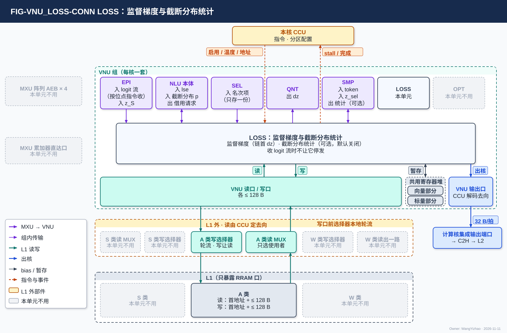
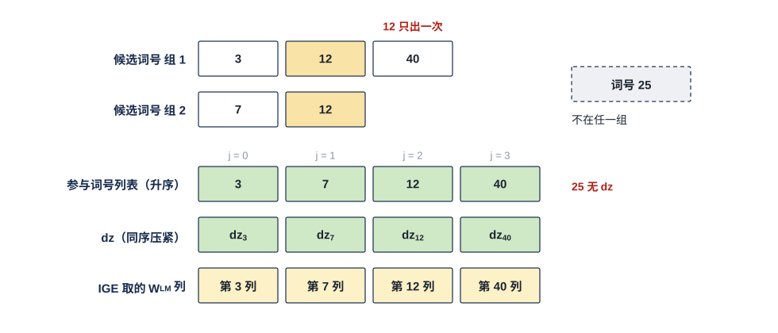
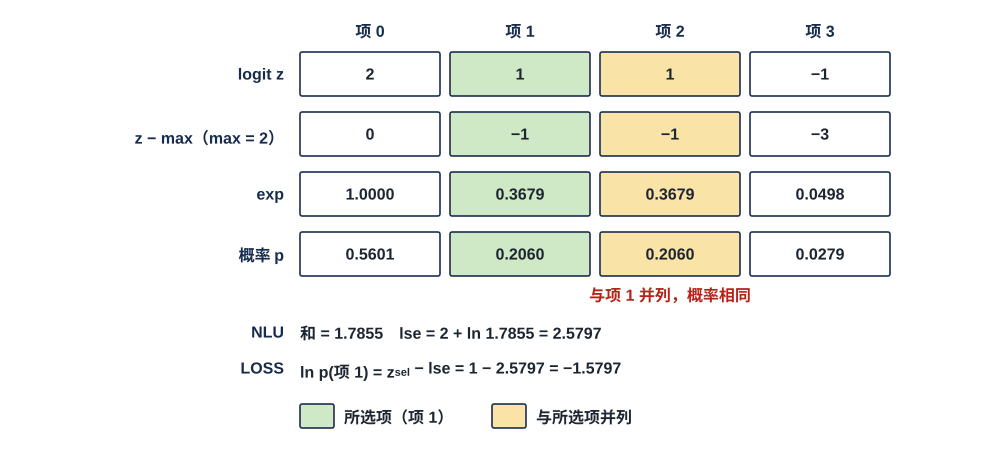

# VNU 损失单元（LOSS）需求

> Owner: WangYizhao｜2026-11-11

## 1 概述

LOSS（Loss Unit，损失单元）做两件事：

- **监督梯度**。LM Head 对一个 token 给出一行 logits：$z = \mathbf h\,W_{\text{head}}$，$\mathbf h$ 为该 token 的 hidden 行向量（$1 \times d_{\text{hidden}}$），$W_{\text{head}}$ 为 $d_{\text{hidden}} \times V_{\text{vocab}}$，词表项是输出列。LOSS 在**参与词号集合** $\mathcal S$ 上形成**链首梯度** $\mathrm dz_{\mathcal S}$。$\mathcal S$ 是这一行里参与梯度计算的若干列下标，$\lvert\mathcal S\rvert \ll V_{\text{vocab}}$；链首梯度是反传链的第一跳，下游 MXU 用它求 $\mathrm d\mathbf h = \mathrm dz_{\mathcal S}\,W_{\mathcal S}^{\mathsf T}$，$W_{\mathcal S}$ 是 $W_{\text{head}}$ 按 $\mathcal S$ 取出的列（$d_{\text{hidden}} \times \lvert\mathcal S\rvert$）。
- **截断分布统计**。**截断分布**是只在一个采样位置的 $K_{\text{top}}$ 个候选项上归一化的分布。LOSS 用 NLU 交来的 lse 与 SMP 交来的所选项 logit 给出所选 token 在这个分布里的对数概率（log-prob），可选给出熵与最大概率。

**LOSS 不做什么**：不做矩阵乘（MXU）、选择与排序（SEL）、采样与监督信息的产生（SMP）、量化（QNT）、跨核合并（MAE_CRU）；不发 DDR 请求，不参与调度。**M55 算好损失、随调用输入给出的 logits 梯度（入口梯度）不经 LOSS**，LOSS 没有与它相关的功能。

**LOSS 是 VNU 组的一个单元，每核一个，全芯片 4 个、物理相同。** 一个计算核由 CCU、MXU 组、L1 组、VNU 组四组拼成；LOSS 是 VNU 组的六个单元之一，其余五个是 NLU（含后处理子模块 EPI）、SEL、QNT、SMP、OPT。**LOSS 与 VNU 组外的模块交换数据，都经 VNU 组的对外接口**：访问 L1 **经 VNU 读口 / 写口**（各 ≤ 128 B，VNU 集成篇 §2.4 / §2.6），向核外上行经 **VNU 输出口**进计算核的集成输出端口，源与去向由 CCU 解码指令（集成篇 §2.7）。

**本篇只规定三条要求（§3.2）、两种做法都要支持（§3.3）与输出合同（§3.4），不规定损失怎样算**（用户 11-02）。以下内容由设计者与算法侧共同确定：监督信息从哪来；损失公式；$\mathcal S$ 怎样选；**学生侧信息**保存什么（学生侧信息是 Draft 一侧在监督样本产生时就要记下、等监督到齐后才用的量，例如该 token 的 $\mathbf h$）。硬件与同步更新的算法参考模型逐位一致；某个口径硬件实现太难时，交回算法侧修改并同步参考模型（用户 11-02）。

**两项功能各自由指令启用**；都不启用时 LOSS 不工作。**LOSS 是一份计算资源，同一时刻只服务一个任务；两项功能都要用 LOSS 时，由 CCU 按指令串行排**；与 VNU 其他单元在计算资源不冲突时可以同时工作（V18-VNU-06，集成篇 §3.2）。本篇不写指令字段。

本篇用到的几个词（其余术语在首次出现处定义）：

| 词 | 含义 |
|---|---|
| 参与词号集合 $\mathcal S$ | 一个监督行里参与梯度计算的若干词号（$W_{\text{head}}$ 的列下标） |
| 参与词数上限 $S_{\max}$ | 一个监督行的 $\lvert\mathcal S\rvert$ 的上限，位点参数，由算法侧给（§3.4） |
| 链首梯度 | $\mathrm dz_{\mathcal S}$，反传链的第一跳 |
| 截断分布 | 一个采样位置的 $K_{\text{top}}$ 个候选项上归一化的分布 |
| 学生侧信息 | Draft 一侧在监督样本产生时记下、监督到齐后才用的量 |

## 2 接口需求

### 2.1 架构图与接口汇总

图中模块框内的结构是参考实现（见第 7 章），本章以框外的各口为准。

图是 VNU 组的统一外框（VNU 集成篇 §2.1），灰框为 LOSS 不用的对端：

- **上方**：本核 CCU（虚线）把启用、温度等作为配置交 VNU_CONTROLLER（L1 地址留在 CCU 一侧，VNU_CONTROLLER 篇 §2.2），LOSS 的 stall 与完成回 CCU（VNU 集成篇 §2.9）。**LOSS 在命令网上没有端口**；CRU 的合并值是数据：MAE_CRU 在 L2 合并后经 H2C 落 L1，LOSS 经 VNU 读口读入，FP32；LOSS 自己不出部分和（V18-TP-55 / 56、V18-CRU-07；MAE_CRU 与 L2 在 L1 之后，图中不画）。
- **左侧**：MXU 阵列的 AEB × 4（只进 EPI）与 MXU 累加器直达口（直通 SEL）都画灰；LOSS 收的 logit 流由 EPI 在组内交来。
- **框内上排**是 VNU 六个单元，NLU 拆成 EPI 与 NLU 本体两格；"本单元"那格是 LOSS。与 LOSS 往来的单元点亮，"入 / 出"以 LOSS 为准：EPI（入：logit 流，以及按 $\mathcal S$ 重算的 $z_{\mathcal S}$）、NLU 本体（入：lse、启用熵与最大概率时的截断分布 $p$，出：借用请求，§2.4）、SEL（名次项经存储交付：SEL 写出、LOSS 读同一份，放 L1 A 类时位置由 CCU 给，放 VNU 共用寄存器堆时由 VNU_CONTROLLER 按分区算，§2.3）、SMP（入：所选 token 与所选项 logit $z_{\text{sel}}$，出：可选统计结果）、QNT（出：$\mathrm dz$）；OPT 画灰。
- **框内中部**是 LOSS 的展开框，只写运算形态：监督梯度（链首 $\mathrm dz$）与截断分布统计（可选，默认关闭），并标出 LOSS 自己的承诺"不让 logit 流停发"（§4.2）。
- **框内下排**是三项组级共用资源（集成篇 §1.1），LOSS 三项都用：VNU 共用寄存器堆（截断分布等小量暂存；**CCU 只给分区配置、逐拍读写位置由 VNU_CONTROLLER 算，分存向量与存标量两部分、物理分开**，V18-VNU-10 / 12，集成篇 §3.3、VNU_CONTROLLER 篇 §3.6）、VNU 读口 / 写口（各 ≤ 128 B）、VNU 输出口 → 框外计算核的集成输出端口 → C2H → L2。
- **框外下方**分两层：上层是 **L1 外的读写选择部件**——S 类读 MUX、A 类读 MUX、W 类读出到 VNU 读口的一路由 CCU 定去向；A / W / S 三类写口前各一个选择器，自己按固定规则在 H2C 接收桥、NWB、VNU 写口三个来源之间轮流，没轮到的在自己的 FIFO 里等，不由 CCU 逐拍选（归计算核集成，V18-L1-21 / 32）；下层是**只暴露 RRAM 口的 L1**——W 类、A 类、S 类（S 类读口一拍可接收 2 个地址，架构篇 §3.4 CONC-6）。**LOSS 只读写 A 类**：A 类读 MUX 把读出送到 VNU 读口，VNU 写口经 A 类写 MUX 进 A 类写口；VNU 写口也可经 W 类写 MUX 写 W 类（V18-VNU-09，LOSS 不用，画灰）；S 类读 MUX、S 类写 MUX、W 类一路以及 S 类与 W 类画灰。

| 口 | 对端 | 方向 | 位宽 | 握手 |
|---|---|---|---|---|
| logit 流 | EPI（组内） | 入 | 组内链路（位宽由 VNU 集成篇定） | 组内握手；**指令指定收时 LOSS 不反压**（§4.2） |
| 按 $\mathcal S$ 重算的 logit $z_{\mathcal S}$ | EPI（组内） | 入 | 组内链路 | 组内握手 |
| 名次项 | SEL 写出的那一份（放 L1 A 类时位置由 CCU 给，放 VNU 共用寄存器堆时由 VNU_CONTROLLER 按分区算），LOSS 读同一份 | 入 | 每项 8 B | 随所经的口（读 L1 时经 VNU 读口） |
| lse、截断分布 | NLU | 入 | 组内链路 | 组内握手 |
| 元件借用 | NLU | 入 / 出 | 组内链路 | 组内握手 |
| 所选 token、所选项 logit $z_{\text{sel}}$ | SMP | 入 | 组内链路 | 组内握手 |
| 统计结果（可选） | SMP | 出 | 组内链路 | 组内握手 |
| 链首梯度 $\mathrm dz_{\mathcal S}$ | QNT | 出 | 组内链路 | 组内握手 |
| 经 VNU 读口读 L1 | L1 外 A 类读 MUX 的 VNU 去向 | 入 | 一次 ≤ 128 B | 核内 RRAM 口，无握手；来不及收时 VNU 向 CCU 拉 stall_vnu |
| 经 VNU 写口写 L1 | L1 外 A 类写 MUX | 出 | 一次 ≤ 128 B | 核内 RRAM 口，无应答；写不进时 VNU 给本单元 wr_stall |
| 经 VNU 输出口上行 | 计算核的集成输出端口 → C2H → L2 | 出 | 32 B/拍 | C2H 不 ready 时 stall_tx 门控 CCU |
| 指令 | 本核 CCU | 入 | — | — |

口宽与条数以架构篇 §2.7 的 PORT-nn 为准（VNU 对 L1 的读口、写口见架构篇 §2.2.5）。

**组内链路只限定位宽**（用户 11-04，V18-VNU-02）：**链路上是什么格式、什么精度，由 LOSS 与对端单元的控制逻辑按指令解码，链路本身不区分格式**，所以下面各节只写"交什么"；LOSS 须能解码的格式列在 §3.9。链路条数、位宽与组内互连方式由 VNU 集成篇定（集成篇 §3.6.2，V18-VNU-08；参考位宽见 §7.3）。

**表中输入是可用输入，是否使用由所选损失算法决定。** 这些都是 VNU 组已有的口，不为 LOSS 新增通路；新算法需要现有通路以外的输入时，再记入 V1.8 修订文档。

### 2.2 logit 流与按 $\mathcal S$ 重算的 logit：EPI 交来，收不收由指令逐位点指定

#### 2.2.1 交什么

| 接口 | 对端 | 方向 | 内容 |
|---|---|---|---|
| logit 流 | NLU 的后处理子模块 EPI（组内链路，V18-EPI-01，EPI 篇 §3.2） | 入 | LM Head 的 logit 流，按词表序到达；与 SEL 收到的是同一条流，指令指定 LOSS 收时，两个收端都收到才算交出（集成篇 §3.6.4） |
| 按 $\mathcal S$ 重算的 logit | EPI（组内链路） | 入 | $z_{\mathcal S} = \mathbf h\,W_{\mathcal S}$，按词号升序到达 |

**LOSS 收不收 logit 流由指令逐位点指定**（V18-LOSS-08）：指定收时 EPI 把 logit 流同时扇出给 SEL 与 LOSS，LOSS 不反压、不丢（§4.2）；指定不收时 EPI 只交 SEL。两种做法的区别见 §3.3。

### 2.3 与 SEL：读 SEL 写出的名次项，只有一份

#### 2.3.1 交什么

| 接口 | 对端 | 方向 | 内容 |
|---|---|---|---|
| 名次项 | SEL 写出的那一份（放 L1 A 类时位置由 CCU 给，放 VNU 共用寄存器堆时由 VNU_CONTROLLER 按分区算） | 入 | 流式 TOPK 的名次项。**每个名次项固定 8 B：序号 3 B + 评分 2 B，其余 3 B 补 0，紧密存储**（V18-SEL-19，SEL 篇 §2.7、§3.5）。SEL 可在同一条评分流上同时跑两组流式 TOPK，结果可按序号升序输出 |

**名次项由 SEL 在选择域结束时写出，LOSS 读同一份，SEL 不另交副本；放 L1 A 类时位置由 CCU 给，放 VNU 共用寄存器堆时由 VNU_CONTROLLER 按分区算**（V18-SEL-19 / SMP-09、V18-VNU-12；放哪一处由指令的 1 bit 选，VNU_CONTROLLER 篇 §2.2）。**LOSS 不向 SEL 发释放通知；SEL 写出后不持有名次项，同一地址何时可被下一组覆盖由 CCU 与编译链按地址安排**（§5.2）。**LOSS 用完名次项不向 CCU 报事件，何时覆盖由编译链按位点先后安排**（与 SMP 同一口径，SEL 篇 §2.7.2）。

### 2.4 与 NLU：lse 与截断分布进，元件分时借用

#### 2.4.1 交什么

| 接口 | 对端 | 方向 | 内容 |
|---|---|---|---|
| lse | NLU | 入 | **NLU 做温度缩放 softmax 时交出的 $\mathrm{lse} = \ln\sum_{v\in\mathcal K} e^{z(v)/T_{\text{temp}}}$（FP32）**，LOSS 据此与 $z_{\text{sel}}$ 算 log-prob（§3.7，V18-LOSS-07）；不传 $K_{\text{top}}$ 项 logit。**温度缩放 softmax 与各种重归一化都由 NLU 完成**（V18-SMP-01，集成篇 §3.6.1） |
| 截断分布 | NLU | 入 | 一个采样位置 $K_{\text{top}}$ 项上归一化后的分布 $p$；只在启用熵与最大概率（§3.7）时交 |
| 元件借用 | NLU | 入 / 出 | 分时使用 exp、ln 等元件 |

**LOSS 需要的 exp、ln 等分时借用 NLU 的元件，NLU 只执行**（V18-VNU-10：NLU 的运算元件对 LOSS / OPT 分时开放是底层需求）。使用时段由 CCU 与指令安排；借用接口的形式由 VNU 集成设计者定（集成篇 §3.6.3）。

### 2.5 与 SMP：所选 token 与所选项 logit 进，统计结果出

#### 2.5.1 交什么

| 接口 | 对端 | 方向 | 内容 |
|---|---|---|---|
| 所选项 logit | SMP | 入 | **所选项的 logit $z_{\text{sel}}$（BF16），SMP 取项后直接交**——SMP 本就持有该位置 $K_{\text{top}}$ 项的 logit，不绕 NLU 查表（V18-LOSS-07） |
| 所选 token | SMP | 入 | 该采样位置所选 token 的词号（V18-SMP-01：取项在 SMP） |
| 统计结果（可选，默认关闭） | SMP | 出 | 指令启用时：log-prob，另可选熵与最大概率；由 SMP 组装进结果记录 |

### 2.6 与 QNT：链首梯度出

| 接口 | 对端 | 方向 | 内容 |
|---|---|---|---|
| 链首梯度 | QNT | 出 | $\mathrm dz_{\mathcal S}$，按 BF16 交出；**由 QNT 量化成流动梯度格式后写本核 L1，LOSS 不设量化器**（用户 11-04，V18-LOSS-03） |

### 2.7 经 VNU 读口 / 写口访问 L1

#### 2.7.1 读与写

| 接口 | 对端 | 方向 | 内容 |
|---|---|---|---|
| L1 读 | 经 VNU 读口（A 类读 MUX 的 VNU 去向，集成篇 §2.4） | 入 | 经 HUB 组的入站分发网 HUB_IDN 落入 L1 的监督记录、读回的学生侧信息、logit 先存后读时读回的 logit 与名次项（§3.3）、跨核合并值（§2.8） |
| L1 写 | 经 VNU 写口（A 类写 MUX，集成篇 §2.6） | 出 | 先写 L1 再上行的数据；logit 先存后读时存入的数据（§3.3） |

- **VNU 对 L1 只有一个读口、一个写口，各 ≤ 128 B；每次访问的首字节地址与有效字节数由 CCU 定**（V18-VNU-04 / TP-73，集成篇 §2.4 / §2.6）；LOSS 与 VNU 其他单元分用这两个口：读口每拍读什么由 CCU 排，各单元轮用的先后由 VNU_CONTROLLER 按配置定（VNU_CONTROLLER 篇 §3.4）。
- **A 类读口一次访问 = 首字节地址 + 有效字节数（≤ 128 B）**，L1 交回从首字节起排好的数据；默认首地址在存储字边界，不在字边界时由 SRAM 内部移位、允许慢（从存储字边界起一拍，否则允许多拍，架构篇 §3.4 CONC-3），**VNU 一侧不需要做字节移位**（V18-TP-74）。读出由 L1 外的 A 类读 MUX **整拍送给一个使用者**——这个 MUX 只选使用者、不排字序——轮到 VNU 时送到 VNU 读口，再由 VNU_CONTROLLER 按配置分给 LOSS（VNU_CONTROLLER 篇 §2.5）。从存储字边界起的读出固定 1 拍到达（核内 RRAM 协议，协议篇 §2.3）。
- **读的 en / 首地址由本核 CCU 给出**；**LOSS 写 L1 时只交数据与每拍的有效字节数（≤ 128 B，从第 0 字节起），不给地址；写的首字节地址与 `seg` 由本核 CCU 内部计数推出（V18-VNU-12，VNU_CONTROLLER 篇 §3.9）**；有效字节的写使能由 SRAM 内部生成（V18-TP-74）。LOSS 的写在 VNU 内合并进 VNU 写口，VNU 写口按 `seg` 接 L1 的写口（LOSS 只写 A 类）；写口前的选择器在 L1 外，自己按固定规则在 H2C 接收桥、NWB、VNU 写口之间轮流，写与读碰到同一个堆时写让读（V18-L1-32）。**核内写 L1 的完成由 CCU 判定；VNU 写口的写何时写完，由写口前的选择器告知 CCU 或由 VNU 报完成【设计者定】（V18-L1-32）**（协议篇 §3.8）。
- 读写哪一堆由堆选选；**同一个堆同一拍只做一次访问（读或写），读由 CCU 排，写碰到同一个堆的读时写让读、由写口前的选择器本地判断**（架构篇 §3.4 CONC-1 / 2，V18-L1-32）；两堆都可读可写，ping-pong 只是编译链排地址的用法（V18-TP-73、V18-L1-21 / 26）。

#### 2.7.2 来不及时的停发：stall_vnu 与 wr_stall

| 信号 | 方向 | 含义 |
|---|---|---|
| stall_vnu（入口 stall） | VNU 读入口 → 本核 CCU | LOSS 来不及收读出时参与合成 VNU 读入口的 stall_vnu，CCU 停发读；**拉起之后在途的读不丢**；各单元的 stall 怎样合成这一根由 VNU 集成篇定（集成篇 §2.4） |
| wr_stall（写握手） | VNU 写口 → 当拍在写的单元 | **写口的请求在写口前的选择器轮到 VNU 写口之前原样保持、不丢；保持不住时拉 wr_stall 让各单元停写**（集成篇 §2.6）；**只到 VNU，不到 CCU**；wr_stall 拉起时 LOSS 保持待写的数据 |

**编译链不做读写带宽保证**（V18-L1-21）：需求超出时 LOSS 经 stall_vnu 与 wr_stall 等，只降速。阈值与写口保持的参考做法见 §7.5。

### 2.8 经 VNU 输出口上行与跨核合并值

| 接口 | 对端 | 方向 | 内容 |
|---|---|---|---|
| 上行 | 经 **VNU 输出口**进计算核的集成输出端口、上 C2H 写 L2，或先写 L1 再经 A 类读 MUX 读出、进集成输出端口的发送 FIFO 入口、经 C2H 发出；源与去向由 CCU 解码指令（集成篇 §2.7，V18-TP-56、V18-VNU-07） | 出 | 参与词号列表、学生侧信息，写入 L2 |
| 跨核合并值 | 经 L2 → H2C 落 L1，LOSS 经 VNU 读口读入（V18-TP-55 / 56、V18-CRU-07） | 入 | MAE_CRU 合并后的值（部分和由 NLU 累加后写 L2）；FP32；落进 L1 后 CCU 才发使用它的指令 |

**要上行的数据两种路径都由本核 CCU 按位点指令发令、逐拍给出 L2 地址，数据块发完后 CCU 向 MAE 发出报告**（V18-TP-35 / 56、V18-VNU-07，协议篇 §3.17）。输出口每拍 32 B，C2H 不 ready 时 stall_tx 门控 CCU（集成篇 §2.7）。

### 2.9 指令

| 接口 | 对端 | 方向 | 内容 |
|---|---|---|---|
| 指令 | 本核 CCU | 入 | 启用哪项功能、本位点收不收 logit 流（§3.3）、温度、个数、$S_{\max}$ 对应的容量窗口基址与长度、计数项地址等 |

## 3 功能描述

### 3.1 功能一览

| 功能 | 按矩阵维度说做什么 | 输入 | 输出 | 触发 / 生效条件 | 节 |
|---|---|---|---|---|---|
| 监督梯度 | 在一行 logits 的参与列 $\mathcal S$ 上形成 $\mathrm dz_{\mathcal S}$ | 选定算法所需的监督信息、学生侧信息与 logit | 升序去重的参与词号列表；同序压紧的 $\mathrm dz_{\mathcal S}$ | 指令启用；输入齐备之后（§3.5） | §3.2–§3.6 |
| 截断分布统计（**可选输出，默认关闭**） | 在一个采样位置的 $K_{\text{top}}$ 项上求所选 token 的 log-prob | NLU 交来的 lse、SMP 交来的所选项 logit、温度；启用熵与最大概率时另收截断分布 $p$ | log-prob；可选熵与最大概率 | 指令逐调用启用（例如 RL rollout） | §3.7 |
| 关闭 | 不工作 | — | — | 两项都不启用 | §3.8 |

典型用途：监督梯度用于 Draft 同步训练的链首梯度；截断分布统计用于 RL rollout 记录的 log-prob。

### 3.2 监督梯度的三条要求

监督梯度的算法不固定（§1），所以本节用三条可验收的要求代替公式：第 1、2 条约束硬件开销，第 3 条约束训练效果；§3.4 的输出合同则约束交给下游（QNT、MAE 搬运引擎、MXU）的数据形状。设计者在这四者之内选算法。LOSS 的监督梯度只需满足三条要求（用户 11-02；条文用户 11-04 定，V18-LOSS-01 / 02）：

1. **计算量低**：满足第 2 条；**收 logit 流的位点不反压 logit 流**（§4.2）；门数的建议值见 §7.6，借用的 NLU 元件计入 NLU。不规定处理时间的拍数预算，处理时间按 §4.1 与相关模块的设计者对接。
2. **不算 logits 的全部维度**：**LOSS 自身不对一行的全部 $V_{\text{vocab}}$ 个 logit 逐项计算或逐项 exp。** 为出 TOPK 而跑的 LM Head 高位平面遍不计入（用户 11-02）。
3. **监督效果好**：同步训练后，Draft 接受长度 AL 相对对照基线的下降 < 0.1%。AL 是 Target 一次验证平均接受的 Draft token 数；对照基线是现行截断分布 teacher 方案按 FP32 理想值计算；量不出 0.1% 时以算法侧噪声带为准【待标定】。

### 3.3 logit 流上边收边算与 logit 先存后读：两种做法都要支持，由指令逐位点指定

**LOSS 必须同时支持两种做法，用哪种由指令逐位点指定**（V18-LOSS-08；用户 11-11："我认为应该是两种模式都要支持"）：

| 做法 | LOSS 做什么 | 收不收 logit 流 |
|---|---|---|
| 边收 logit 流边算 | 在 Draft LM Head 的 logit 流到达时完成所需的统计（例如全词表归一化项） | 收；**不反压、不丢**（§4.2） |
| logit 先存后读 | 把教师的 $K_{\text{top}}$ 项、Draft 的 top-$k$ 项（词号 + logit）与学生侧信息先存进 L1 / L2，监督到齐后再读回计算；缺的 logit 用 $z_{\mathcal S} = \mathbf h\,W_{\mathcal S}$ 重算（$W_{\mathcal S}$ 反传本来就要 gather） | 不收 |

两种做法都在三条要求（§3.2）与输出合同（§3.4）之内；也可以两者组合，由设计者与算法侧按第 3 条（AL 下降 < 0.1%）选定算法，编译链按位点在指令里指定。若某位点只在 $\mathcal S$ 上归一化，监督效果须由算法侧按第 3 条验证。两种做法的代价对比见 §7.1。

### 3.4 输出合同：词号升序去重，dz 与列表同序压紧

- **参与词号列表按词号升序、去重。**
- **$\mathrm dz_{\mathcal S}$ 与列表同序压紧**：第 $j$ 个 $\mathrm dz$ 对应列表第 $j$ 个词号；$\mathcal S$ 外不输出。MAE 搬运引擎按同一列表 gather $W_{\mathcal S}$，MXU 不重排。
- $\mathrm dz$ 经 QNT 量化成**流动梯度格式**（反传梯度在算子之间流动时的格式，默认 MXFP6 单平面（组长 $G$，位点属性），可选 FP8 E4M3 / BF16 / FP16，格式集合在整体集成篇定义）。
- **$\mathcal S$ 为空时不输出，不产生 NaN。**
- **参与词号列表是数据组织篇 §1.2 的变长数据块，形式为序号列表（项数另存）**：每个监督行一张列表，**列表内按词号升序紧凑排（每项 3 B）；按数据组织的默认 32 B 对齐，每张从存储字边界起、行末补到 32 B，下一行的列表从下一个存储字边界起**；第 $r$ 行列表的起点 = 数据块起点 + $\sum_{i<r}\lceil \text{len}_i/32\rceil \times 32$（以监督行为单位只在末尾补齐，V18-DORG-03、V18-TP-74，数据组织篇 §2.3）。例：某行 $\lvert\mathcal S\rvert = 13$，$\text{len} = 13 \times 3 = 39$ B，占 $\lceil 39/32\rceil = 2$ 个存储字，下一行从起点 + 64 B 开始。LOSS 只交数据与每拍有效字节数，首地址由 CCU 计数推出；**CCU 怎样知道一张列表在哪一拍结束、以便下一张从字边界起【待确认】**（建议：一次写不跨两张，每张的最后一次写带一位"本张结束"；或 CCU 从别处得知每行的项数）。
- **每行的项数 $\lvert\mathcal S\rvert$ 由生产核 CCU 写成一个定长计数项（编译链给地址，与列表同在 L2），MAE 读列表前先读它**（V18-DORG-05 (5)）；LOSS 不另报每张列表的字节长度，CCU 自己数（V18-VNU-12）。用这张列表做 gather 时 MAE 先读计数项得每行的项数（MAE_ENG 篇 §3.8.2），不需要定长或槽尾填充。
- **参与词号列表按位点的容量窗口静态分配**（用户 11-06，协议篇 §3.13、数据组织篇 §3.3，V18-TP-40）：**每行参与词数有上限 $S_{\max}$（位点参数，算法侧给），容量窗口 = 每行长度上限（$S_{\max} \times 3$ B 按存储字取整）× 监督行数**（V18-LOSS-08）；基址、窗口长与计数项地址在指令里，CCU 不做运行期分配；列表写进 L2 后由本核 CCU 向 MAE 发出报告（只带目的起始地址）。$S_{\max}$ 在参考算法下的取值见 §7.2。

缩小例只画 1 个监督行。两组候选词号 {3, 12, 40} 与 {7, 12} 合并、去重、按升序排成列表 {3, 7, 12, 40}，$\mathrm dz$ 按同一顺序压紧成 4 项，MAE 搬运引擎按同一列表取 $W_{\text{head}}$ 的第 3、7、12、40 列。重复的词号 12 只出一次；列表外的词号 25 没有 $\mathrm dz$。$\mathrm dz$ 的值怎样算由选定算法决定，图中只用符号表示。

### 3.5 输入齐备才形成

某行的 $\mathrm dz$ 在选定算法所需的全部输入都已就绪之后才形成；**不读写到一半的监督记录与学生侧信息**。

LOSS 这一侧不判断就绪：落进 L1 的监督记录与学生侧信息是否写完，以发令的 MAE 搬运引擎数满写入握手后发给本核 CCU 的写完通知为准（V18-TP-70，协议篇 §3.8）；CCU 收到写完通知后才发读这些监督记录与学生侧信息、发形成 $\mathrm dz$ 的指令（§5.2"监督未就绪时等待"一行）。LOSS 收到指令即可按读回的数据计算，不要求有效位。

### 3.6 跨调用保存学生侧信息

算法需要跨调用保存学生侧信息时：

- 经上行写出，下次经 L1 读回；**消费前完整可读**；
- 字节数不超过数据组织篇给的训练区预算；
- 格式由生产者与消费者共同定义，并供 M55 解读。

### 3.7 截断分布统计：对 K_top 项分布求所选 token 的 log-prob

$$\ln p(y) = \frac{z_{\text{sel}}}{T_{\text{temp}}} - \mathrm{lse},\qquad \mathrm{lse} = \ln\sum_{v\in\mathcal K} e^{z(v)/T_{\text{temp}}}$$

$\mathcal K$ 为该采样位置的 $K_{\text{top}}$ 个候选项，$y$ 为所选 token，$z_{\text{sel}} = z(y)$ 为它的 logit，$T_{\text{temp}}$ 为采样温度。**只在 $\mathcal K$ 上归一化，不用全词表。** 贪心采样按同式给出。

**LOSS 的输入就是 NLU 做温度缩放 softmax 时交出的 lse（FP32）与 SMP 直接交来的所选项 logit $z_{\text{sel}}$（BF16）**（V18-LOSS-07）：NLU 求 softmax 时本来就要算出 lse，SMP 取项时本就持有 TOPK 项 logit，LOSS 只做 $z_{\text{sel}}/T_{\text{temp}} - \mathrm{lse}$ 一次乘加，NLU 不传 $K_{\text{top}}$ 项 logit。

- **前缀截断开启后 lse 的口径【设计者定】**（V18-LOSS-07）：SMP 按个数或按累积概率截断前缀再采样时（V18-SMP-08），lse 取全 $K_{\text{top}}$ 项还是截断后的前缀，由 LOSS / SMP 设计者与算法侧定，约束是 RL 的重要性比需要的是实际采样分布下的 log-prob；定下后 NLU 按同一口径交 lse。

**log-prob 是可选输出项，默认关闭，不是采样的默认顺带输出**（V18-LOSS-05）：

- 由指令逐调用启用（例如 RL rollout 的生成调用），不启用时 LOSS 不做这项计算，SMP 组装的结果记录里也不含 log-prob 字段；
- 留在 LOSS，不移交 M55：lse 由 NLU 的 softmax 顺带给出（exp / ln 在 NLU，§2.4），M55 重算要多花时间，结果记录也要多带每位置约 100 B 的 $K_{\text{top}}$ 项；
- **输入用 logit 与 lse**（V18-LOSS-07），不用 Proposal 输出记录里 2 B 编码的归一化概率：2 B 概率的精度不足以给 RL 的重要性比取对数。

- **可选：熵与最大概率。** 截断分布的熵 $H = -\sum_{v\in\mathcal K} p(v)\ln p(v)$ 与最大概率 $P_{\max}$，用来监视分布是否坍缩，不参与训练计算；这两项要逐项的 $p$，所以启用时 NLU 另交截断分布，$\ln p$ 借 NLU 的 ln 元件（§2.4）。**可选能力，默认关闭**；是否实现由设计者与算法侧按实验需要定（用户 11-04，V18-LOSS-04）。
- 不改变采样分布；不要求同时启用监督梯度。

缩小例 $K_{\text{top}} = 4$、$T_{\text{temp}} = 1$，项 0…3 的 logit 为 2.0、1.0、1.0、−1.0，所选为项 1（logit 1.0，与项 2 并列）。NLU 做 softmax 时先减去最大值 2.0 再求 exp，和为 1.7855，$\ln$ 和加回最大值得 lse = 2.5797；LOSS 收到 NLU 的 lse 与 SMP 的所选项 logit 1.0，得 log-prob $1.0 - 2.5797 = -1.5797$。并列的两项概率相同，各为 0.2060。实际 $K_{\text{top}}$ 参考 20。

### 3.8 关闭

两项功能都不启用时，LOSS 不工作。

### 3.9 格式：组内链路只限定位宽，格式由控制逻辑解码

**LOSS 的控制逻辑按指令解码收到的是什么格式、按什么精度处理，并按指令编码交出的数据。** 以下是 LOSS 的解码能力，不作为口的定义：

| 类别 | 格式 | 来源 |
|---|---|---|
| 向量 | BF16 | logit 流、$z_{\mathcal S}$、名次项评分、所选项 logit $z_{\text{sel}}$、NLU 归一化后的 $p$ |
| 序号 / 词号 | 位宽覆盖词表（15 万词需 18 bit，名次项与参与词号列表里占 3 B） | 名次项、所选 token |
| 临时格式 | 由生产者与 LOSS 共同定义，供 M55 解读；设计者可选择在 QNT 统一成 BF16 / MXFP6（V18-VNU-01）；**不规定每行的字节上限**，超过 32 B 的数据由 CCU 拆成多个 32 B（V18-SMP-09） | 监督记录、学生侧信息 |
| 标量 | FP32 语义：结果与"按 FP32 计算、只在最后舍入一次"的参照一致，实现可用更窄的内部格式 | NLU 交来的 lse（FP32）、CRU 合并值（经 H2C 落 L1 后读入，FP32）、指令给出的温度 |

LOSS 交出的数据：

- $\mathrm dz_{\mathcal S}$：BF16，交 QNT 量化成流动梯度格式（§2.6）。
- log-prob、熵、最大概率：FP32 语义标量。
- 参与词号列表：每项一个词号，3 B。

### 3.10 结果规则与复位

- **同一行的结果只取决于该行的输入**，与 Batch 大小、同批其他行无关。
- **从 L1 读入的跨核合并值与各核部分和到达 L2 的次序无关**：合并次序由 MAE_CRU 固定（§5.2）。
- 与同步更新的算法参考模型逐位一致（§1）。
- $\mathcal S$ 为空时不产生 NaN。
- **复位**：复位输入来自 CIF（架构篇 PORT-41），硬复位与软复位不区分（CIF 篇 §2.4、§3.3）；复位清在线状态与归并状态，不跨调用保留。学生侧信息存在 DDR，不由 LOSS 持有。

## 4 性能指标

### 4.1 各口的速率：匹配上下游模块

**LOSS 每拍能处理的元素数和处理时间，须匹配上下游各口的需求，由 LOSS 设计者与以下模块对接确定**（用户 11-04，V18-LOSS-01）。各对端的现行参考值见 §7.3；它们不是 LOSS 的要求值，对端改值时随之重新对接。

| 相关模块 | 接口 | 要匹配的量 |
|---|---|---|
| NLU 的后处理子模块 EPI | logit 流 | EPI 送 logit 流的速率（收 logit 流的位点，§4.2） |
| QNT | 链首梯度 | QNT 统一请求接口（所有量化请求的唯一入口，QNT 篇 §2.5）的速率 |
| NLU、SMP | lse（NLU）与所选项 logit（SMP）；截断分布 | 每个采样位置一个 lse、一个 $z_{\text{sel}}$；启用熵与最大概率时另收 $K_{\text{top}}$ 项（集成篇 §3.6.1） |
| SMP | 所选 token、统计结果 | SMP 所在 LM Head 尾段的时间需求（由数据流篇给，本篇不定拍数预算，V18-LOSS-01） |
| SEL | 名次项 | 名次项写出的时点（选择域结束）；同一地址被下一组覆盖之前 LOSS 读完，先后由 CCU 与编译链按地址安排 |
| NLU | 元件借用 | 借用时段由 CCU 与指令安排 |
| MAE 搬运引擎 | 参与词号列表 | 列表发完、发出报告到 MAE 的时点决定 $W_{\mathcal S}$ 的 gather 何时开始 |
| L2 / MAE_CRU | 合并值 | 一次往返（NLU 部分和写 L2 → MAE_CRU → 写回 L2 → H2C 落 L1）；往返时延不定要求值，CRU 并行 lane 可配（协议篇 §3.18） |
| L1（经 VNU 读口 / 写口） | 监督记录、学生侧信息、先写 L1 的上行数据、先存后读的数据 | 与 VNU 其他单元分用 VNU 读口 / 写口、读由 CCU 排、单元之间的先后由 VNU_CONTROLLER 按配置定（§4.3） |
| VNU 输出口 | 上行数据 | 32 B/拍；C2H 不 ready 时 stall_tx 门控 CCU（集成篇 §2.7） |

### 4.2 LOSS 自己承诺：收 logit 流时不反压、不丢失

**指令指定 LOSS 收 logit 流的位点，LOSS 不对 logit 流施加反压，也不丢失 logit。** 这是 LOSS 能单方面保证的唯一速率承诺；指令指定不收的位点（logit 先存后读，§3.3）这条不适用。

这条承诺的含义：logit 流由后处理子模块（EPI）同时交 SEL 与 LOSS，两个收端都收到才算交出（集成篇 §3.6.4），**LOSS 不得因自己来不及而让 EPI 停发这条流**，所以 LOSS 对 logit 流的持续处理能力不低于 EPI 送这条流的速率（参考值见 §7.3），**峰值注入下也不拉低对 EPI 的握手、不丢 logit**；怎样承受突发【设计者定】，约束即前一句。验收按 logit 流峰值注入、同时形成链首梯度（§6.1）。其他口（VNU 读口、组内链路）来不及时照常经 stall_vnu 或组内握手停发，只降速（集成篇 §3.9）。

### 4.3 同时使用的口与并发条件

| 同时使用的情形 | 适用的约定 | 结果 |
|---|---|---|
| VNU 读口与写口同拍（例：读监督记录、写列表） | 架构篇 §3.4 CONC-1 / CONC-2 | 读与写落不同的堆时同拍；同一个堆同一拍只做一次访问：读由 CCU 排，写碰到读时写让读（写口前的选择器本地判断，V18-L1-32） |
| A 类读写一次 ≤ 128 B 不从存储字边界起 | 架构篇 §3.4 CONC-3 | 从字边界起一拍，否则允许多拍；CCU 按此排后续访问 |
| LOSS 与 VNU 其他单元同时工作 | VNU 集成篇 §3.2.1 | 计算资源不冲突时可同时；借用 NLU 元件的时段由 VNU_CONTROLLER 按配置安排（VNU_CONTROLLER 篇 §3.7） |

### 4.4 精度要求：集成到算法后任务精度下降 < 0.1%

**LOSS 的计算方案集成到算法后，任务精度下降 < 0.1%；中间计算精度不规定，由设计者定**（用户 11-04，V18-VNU-01）。口径：

- 下降量按绝对百分点计；
- 基线为该模块各运算按 FP32 理想值计算的结果；
- 评测集为算法侧的标准评测集；
- 硬件实现与算法参考模型逐位一致，作为验证手段；参考模型随硬件实现同步。

对监督梯度，"任务精度"取 §3.2 第 3 条的 Draft AL。截断分布统计不设元件精度目标（用户 11-04，V18-LOSS-02）。

### 4.5 要求值表

| 项 | 要求值 | 说明 |
|---|---|---|
| 运算形态 | 监督梯度、截断分布统计（可选输出，默认关闭）、关闭 | 由指令启用 |
| 两种做法 | 边收 logit 流边算、logit 先存后读都要支持 | 收不收 logit 流由指令逐位点指定（§3.3） |
| 计算量 | 不对一行全部 $V_{\text{vocab}}$ 个 logit 逐项计算或 exp | 为出 TOPK 的 LM Head 高位平面遍不计入 |
| 每拍处理能力与处理时间 | 匹配上下游各口（§4.1） | 由 LOSS 设计者对接确定 |
| logit 流 | 收 logit 流的位点不反压、不丢失 | §4.2 |
| 参与词数上限 | 每行 $\lvert\mathcal S\rvert \le S_{\max}$（位点参数，算法侧给） | 容量窗口按它算（§3.4） |
| 监督效果 | Draft AL 相对对照基线下降 < 0.1% | 【待标定】 |
| 精度 | 集成到算法后任务精度下降 < 0.1%（绝对百分点） | 中间精度由设计者定 |
| 名次项 | 每项 8 B（序号 3 B + 评分 2 B，其余补 0），紧密存储 | V18-SEL-19 |
| L1 口 | 经 VNU 读口 / 写口（各 ≤ 128 B，集成篇 §2.4 / §2.6）；写只交数据与有效字节数；读入口来不及时 stall_vnu 到 CCU，写口保持不住时 wr_stall 回 VNU | 并发条件见 §4.3 |
| 上行 | 经 VNU 输出口（32 B/拍，集成篇 §2.7）或先写 L1 再经发送 FIFO 入口发出 | 源与去向由 CCU 解码指令 |
| CRU 的合并值 | 从 L1 读入（经 H2C 落地），FP32；LOSS 在命令网上无端口、无有效位 | 协议篇 §3.17、§3.18 |

## 5 约束与由使用者保证的事项

### 5.1 硬约束与范围

- **LOSS 不对一行的全部 $V_{\text{vocab}}$ 个 logit 逐项计算**（§3.2 第 2 条）。
- **LOSS 不设量化器**，$\mathrm dz$ 交 QNT（§2.6）。
- **LOSS 在命令网上没有端口**；跨核合并值是数据（§2.8）。
- **LOSS 只读写 L1 的 A 类**（§2.7）。
- **本篇不含容错设计**（V18-TP-75）。

### 5.2 由使用者保证的事项

以下事项 LOSS 不检查，由对应模块保证。表里的事项 LOSS 既不实现也不检查，验收时把它们当作输入前提、用仿真断言核对（§6）。

| 事项 | 由谁保证 |
|---|---|
| 监督信息的产生与写出 | SMP，或算法选定的生产者 |
| 监督记录与学生侧信息的 DDR 读写，经 HUB_IDN 落 L1 | MAE |
| 名次项的选出；名次项按 8 B 格式写出 | SEL |
| 名次项的放处（L1 地址由 CCU 给，或共用寄存器堆分区由 CCU 配置）；同一地址在 LOSS 读完之前不被下一组覆盖（LOSS 用完不报事件，覆盖时机由编译链按位点先后安排） | CCU 与编译链（V18-SEL-19 / SMP-09） |
| logit 与 $z_{\mathcal S}$ 的计算；指令指定 LOSS 收时 logit 流同时交 SEL 与 LOSS | MXU（计算）；EPI（扇出，EPI 篇 §3.2）；放行先后与收不收归 CCU 与指令 |
| 按参与词号列表 gather $W_{\text{head}}$ 的列；列表写进 L2、CCU 发出报告（只带地址）后再放行，每行项数由生产核 CCU 写成定长计数项，MAE 读列表前先读它 | MAE；CCU（发出报告，协议篇 §3.13，V18-TP-35、V18-DORG-05 (5)） |
| 读写 L1 的地址（读由 CCU 发；写按 LOSS 交出的有效字节数计数推出）与 A 类读出去向；A 类读 MUX 每拍给哪个使用者（在 L1 外）；读的排拍（写与读碰到同一个堆时由写口前的选择器本地写让读，V18-L1-32；架构篇 §3.4 CONC-1 / 2） | CCU |
| 核内写 L1 的完成判定 | CCU（协议篇 §3.8） |
| 每行参与词数不超过 $S_{\max}$，参与词号列表不超位点容量窗口（§3.4） | 算法侧给 $S_{\max}$；SEL 等选出参与词号的单元按位点配置不超出；编译期检查核对 |
| 参与词号列表按位点容量窗口静态分配，每位点的 $S_{\max}$ 与窗口由算法侧给出；其余 A 类地址段的分配、写入前旧数据已读完 | 算法侧（模型表）；编译链（指令中的基址与窗口长，LIC 操作 15） |
| 交给 LOSS 的是哪一份截断分布与 lse（拒绝采样时为父节点未经残差更新的分布） | NLU 按指令交出（归一化在 NLU，V18-SMP-01、V18-LOSS-07），交哪一份由 CCU 与指令定 |
| 所选 token 与所选项 logit $z_{\text{sel}}$ | SMP 取项后直接交（V18-LOSS-07，SMP 篇 §2.5） |
| 前缀截断（V18-SMP-08）开启后 lse 取全 $K_{\text{top}}$ 项还是截断后的前缀 | LOSS / SMP 设计者与算法侧定（V18-LOSS-07） |
| 跨核合并按固定次序（LOSS 只接收合并值） | MAE_CRU |
| 合并值落 L1 之后才发使用它的指令 | CCU（协议篇 §3.18）；MAE（合并指令收齐发出报告后执行） |
| 链首在哪个核、何时执行；监督未就绪时等待 | LIC、CCU 与数据流篇 |
| 入口梯度的读入与落位 | MAE、LIC |
| $\mathrm dz$ 的量化 | QNT |
| 同一单元的不同任务不在时间上重叠；多个来源要用 LOSS 时的串行先后 | CCU 与指令（集成篇 §3.2.2） |
| 上行数据经 VNU 输出口或经发送 FIFO 入口上 C2H | 本核 CCU（按位点指令发令、选源、逐拍给 L2 地址；发完后向 MAE 发出报告） |
| VNU 读口 / 写口每次访问的首地址与长度（不从字边界起的访问占几拍，CONC-3）、读出分给哪个单元、写口每拍收哪个单元的写；输出口的源与去向 | CCU（集成篇 §5.2） |
| 超过 32 B 的监督记录等数据拆成多个 32 B | CCU（V18-SMP-09） |
| 组内链路条数与互连、元件借用接口 | VNU 集成设计者（集成篇 §3.6） |

## 6 验收

### 6.1 本篇验收项

| 验收项 | 方法 | 用例 | 出处 |
|---|---|---|---|
| 输出合同 | 断言 | 列表升序、去重；$\mathrm dz$ 与列表同序；$\mathcal S$ 外无输出；$\mathcal S$ 为空时无输出、无 NaN；各监督行的列表默认从存储字边界起、行末补到 32 B，写出的有效字节与长度一致，CCU 数出的每张长度正确 | §3.4 |
| 容量窗口 | 断言 | 每行 $\lvert\mathcal S\rvert \le S_{\max}$；列表不超位点容量窗口 | §3.4 |
| 两种做法 | 周期仿真；逐位比对 | 同一位点分别按"收 logit 流"与"不收、先存后读"两种指令跑，各自满足输出合同；不收时 EPI 只交 SEL | §3.3 |
| 计算量 | 审查 | 无全词表逐项计算或 exp | §3.2 |
| 不反压 logit 流 | 周期仿真 | 收 logit 流的位点，logit 流峰值注入，同时形成链首梯度 | §4.2 |
| 输入齐备 | 断言 | 输入未齐时不形成 $\mathrm dz$；不读写到一半的监督记录与学生侧信息 | §3.5 |
| 名次项格式 | 断言 | 按每项 8 B（序号 3 B + 评分 2 B + 3 B 补 0）解码 | §2.3 |
| 截断分布 log-prob | 与算法参考模型逐位比对 | 由 NLU 交来的 lse 与 SMP 交来的所选项 logit 计算；不同 $K_{\text{top}}$ 与温度；并列 logit；贪心采样 | §3.7 |
| 结果规则 | 逐位比对 | Batch 1 / 8 / 32 结果相同；合并值到达次序不同时结果相同 | §3.10 |
| 监督效果 | 算法侧回放对拍 | 同模型、同数据、同调用配置的同步训练 | §3.2 |
| 集成精度 | 算法侧评测 | 目标模型在标准评测集上下降 < 0.1% | §4.4 |

### 6.2 与上下游模块的对接检查项

| 对接项 | 对端 | 检查内容 |
|---|---|---|
| L1 的并发 | L1 篇、架构篇 §3.4 CONC-1 / 2 | L1 的每个堆一拍一次访问（同一个堆的读与写不在同一拍） |
| logit 流扇出 | EPI 篇 §3.2、集成篇 §3.6.4 | 指令指定收时 EPI 同时交 SEL 与 LOSS、两端都收到才算交出；不收时只交 SEL |
| 名次项 | SEL 篇 §2.7、§3.5 | 名次项 8 B、紧密存储，只存一份；LOSS 读同一份（放 L1 A 类时位置由 CCU 给，放 VNU 共用寄存器堆时由 VNU_CONTROLLER 按分区算）；LOSS 不发释放通知，覆盖时机由 CCU 与编译链按地址安排 |
| lse 与 $z_{\text{sel}}$ | NLU 篇 §3.4、SMP 篇 §2.5 | lse 由 NLU 交、$z_{\text{sel}}$ 由 SMP 交；前缀截断口径两端一致 |
| 参与词号列表 | MAE_ENG 篇 §3.8.2、协议篇 §3.13 | 计数项与列表同在 L2；MAE 先读计数项再 gather；CCU 发出报告后才放行 |
| 链首梯度 | QNT 篇 §2.5 | $\mathrm dz$ 以 BF16 交 QNT，量化成流动梯度格式 |

## 7 参考实现

**本章内容可以换；换了之后别的模块不用改。**

### 7.1 两种做法的代价对比

| 做法 | 代价 |
|---|---|
| 边收 logit 流边算 | LOSS 须跟上 logit 流、不反压（§4.2）；只要流过一遍就能出结果，不额外占 L1 / L2、不多一次读回 |
| logit 先存后读 | 要占存储并多一次读回；若只在 $\mathcal S$ 上归一化，监督效果须由算法侧按第 3 条验证 |

两种做法 LOSS 都要支持（§3.3）；内部怎样共用状态与通路由设计者定。

### 7.2 参与词数上限 $S_{\max}$ 在参考算法下的取值

参考算法（现行算法基线）下，参与词号由 SEL 在同一条评分流上同时跑的两组流式 TOPK 选出，**$S_{\max}$ = 两组流式 TOPK 的 $k$（每组最多选出的项数）之和**（$k$ 之和用户 11-05 认可）；容量窗口 = 两组 $k$ 之和对应的每行长度上限（按存储字取整）× 监督行数。换算法时 $S_{\max}$ 由算法侧重给。

### 7.3 参考速率

下表是各对端的现行参考值（由对端篇或数据流给出的参考值与推导值），只作对接背景：

| 相关模块 | 接口 | 现行参考值 |
|---|---|---|
| NLU 的后处理子模块 EPI | logit 流 | 15 万词 × 24 个 token 在约 10.8 ms 内送完，约 0.33 个/拍 |
| 组内链路 | 全部 | 参考每拍 256 bit（32 B）+ 握手位（V18-VNU-02） |
| QNT | 链首梯度 | QNT 统一请求接口每拍 16 个元素；参考 7 个监督行 × 84 项 = 588 个，约 37 拍 |
| SMP | 所选 token、统计结果 | log-prob 每个采样位置 1 次乘加；熵与最大概率启用时每位置 $K_{\text{top}}$ 项 |
| MAE 搬运引擎 | 参与词号列表 | 参考每拍 1 个词号 |
| L1（经 VNU 读口 / 写口） | 各类读写 | VNU 读口 / 写口各 ≤ 128 B/拍，与 VNU 其他单元分用 |

### 7.4 监督记录的现行格式

现行算法下监督记录为 teacher 概率，每项词号 3 B + 概率 3 B；这是参考值，不是字节上限（§3.9）。

### 7.5 L1 访问的参考细节

- **A 类一次访问的参考组织**：A 类读口、写口都是逻辑口，一次访问 = 首字节地址 + 连续 1–4 个存储字（≤ 128 B），可以不从行首（4 个 bank 的同一深度）起、跨相邻两行，一拍内同一个 bank 只访问一个深度；首地址不在字边界时允许多拍（架构篇 §3.4 CONC-3），L1 内部怎样分拍属 L1 篇的参考实现（V18-TP-74、V18-L1-26）。
- **读入口 stall 阈值**：VNU 读入口缓冲占到"深度 − $L$"时向 CCU 拉 stall_vnu，CCU 停发读；$L$ 参考 = CCU 停发 1 拍 + L1 读返回 1 拍【设计者定】，约束是拉起之后在途的读不溢出（集成篇 §2.4）。
- **写口保持**：VNU 写口自设一个 FIFO，写口前的选择器本拍没轮到 VNU 写口时它的项在 FIFO 里等，将满时拉 wr_stall；何时写完由选择器告知 CCU 或由 VNU 报完成【设计者定】（V18-L1-32）。

### 7.6 门数与状态

门数建议值 ≤ 18 k 门（NAND2 等效），另加 < 1 KB 状态；借用的 NLU 元件不计。LOSS 不设计数。

### 7.7 参考实现的自检项

| 自检项 | 方法 | 用例 |
|---|---|---|
| L1 一次访问内的 bank 访问 | 仿真断言 | 一次访问内同一 bank 一拍一个深度 |
| 门数 | 综合 | 待 RTL |

## 8 为什么

### 8.1 需求的理由

- **只规定要求、不规定方案**（用户 11-02）：监督损失的算法还在演进，硬件固定一种算法会限制算法侧。所以本篇只规定计算量、监督效果与输出合同。设计 Spec 保留现行算法基线（两级 lse、截断分布 teacher 等），作为监督效果的对照。
- **不算全部维度**：词表有十几万项，LOSS 若对每个位置逐项处理，会成为训练的主要开销；为出 TOPK 的 LM Head 高位平面遍在前向本来就要跑，不计入。
- **词号与梯度同序**：MAE 搬运引擎按列表直接 gather $W_{\mathcal S}$，$\mathrm dz$ 按同一顺序到达 MXU，MXU 不必再重排。
- **两种做法都要支持、由指令逐位点指定**（V18-LOSS-08；用户 11-11："我认为应该是两种模式都要支持"）：EPI 的扇出取决于 LOSS 收不收 logit 流，若由设计者单方面选一种，EPI 与编译链都要跟着改；两种都支持、按位点在指令里指定，EPI 只按指令扇出。此前用户 11-06 的偏好（"我认为监督梯度具体的流设计，可以交给 Designer，咱们不要预先标定，但是可以写出设计偏好，即如果能流式处理完是最好的"，V18-LOSS-06）说明了边收边算的好处：不额外占 L1 / L2、不多一次读回。
- **容量窗口按 $S_{\max}$ 算、不绑定两组 TOPK 之和**（V18-LOSS-08；用户 11-11 对清单 B22 D1 回复"认可"）：窗口是编译链的规则，若写成"两组 TOPK 之和"就把一种参考算法写进了编译链；改成位点参数 $S_{\max}$，换算法只改参数。
- **元件借用是底层需求**（V18-VNU-10；用户 11-11："这是必要的，对于VNU的功能复用和寄存器复用，以及其他类似设计，这是底层需求"）：exp、ln 在 NLU 已有，LOSS 再备一套只增加面积。
- **用完名次项不报事件，覆盖时机由编译链安排**（V18-TP-83 (5)；用户 11-11 对重整完成报告 §4 第 13 条"认可"）：名次项只存一份，LOSS 在哪个位点读完是编译期就知道的，由编译链按位点先后安排下一组何时覆盖，与 SMP 同一口径；多一个事件只多一条要 CCU 等的信号。
- **名次项固定 8 B**（V18-SEL-19；用户 11-11："这里需要固定，就直接标注成8B紧密存储吧，这样便于对齐"）：编译链用它定缓冲段长，SMP、LOSS 按它收。
- **不规定数据量上限**（V18-SMP-09；用户 11-11："我认为这里没必要规定上限，我觉得这类的问题，都不用规定上限，CCU可以根据SMP的设计把超过32B的数据拆成多个32B位宽的数据"）：监督记录每行多少字节随算法而变，超过 32 B 由 CCU 拆，内部存多少由设计者定。
- **log-prob 按截断分布**：采样只在 $K_{\text{top}}$ 项上进行，rollout 记录的 log-prob 必须与实际采样空间一致，训练端才能算对重要性比。
- **log-prob 留在 LOSS、作可选输出、默认关闭**（用户 11-06："我觉得这一步复用 NLU 的 log 核还是有意义的，毕竟 CPU 处理这个数据也要花很长时间，保留这里的设计，但是我这里不要设计成默认的顺带输出，而是一个可选的输出项，还是把它归在 LOSS 中"；V18-LOSS-05）：移交 M55 要多搬 $K_{\text{top}}$ 项、多花 CPU 时间；只有 RL rollout 需要，所以不做成采样的默认副产物。
- **log-prob 的输入是 lse 与所选项 logit，各由手里本就有它的单元交**（V18-LOSS-07；用户 11-09："（所选项 logit 由 SMP 交）可以"；前缀截断口径，用户 11-09："这是 LOSS 和 SMP 的设计者要决定的任务"）：NLU 做温度 softmax 时本来就算出 lse，所选项 logit 在 SMP 取项时就在手里，LOSS 只做一次乘加，不必再收 $K_{\text{top}}$ 项 logit、不重复做 exp 与 ln，也不需要把所选项序号交回 NLU 查表。
- **截断分布的归一化在 NLU**（用户 11-08："SMP为什么要有归一化功能？归一化不应该是NLU的功能吗？"；V18-SMP-01）：TOPK 项内的温度缩放 softmax 是"沿向量的归约与归一化"，归 NLU；所选 token 由 SMP 给。
- **入口梯度不经 LOSS**：独立训练的损失由 M55 算，NPU 从入口梯度直接反传。
- **dz 交 QNT 量化**（用户 11-04）：VNU 组内向量的量化统一由 QNT 执行，LOSS 不另设量化器。
- **组内链路只限定位宽**（用户 11-04）：格式由两端控制逻辑按指令解码，换算法、换格式不改链路。
- **精度按集成后掉点要求**（用户 11-04）：$\mathrm dz$ 与 log-prob 都要经过量化或只作统计用，元件误差只需明显小于下游影响，所以不规定元件误差界。
- **速率由设计者对接**（用户 11-04）：LOSS 所在的 LM Head 尾段由 SMP、SEL、NLU、MAE 共同决定，拍数预算不由 LOSS 单方面决定，所以本篇列出相关模块，只保留"收 logit 流时不反压"这一项自身承诺。
- **对外接口经 VNU 组封装**（用户 11-04 / 11-08，V18-VNU-04 / 07）：LOSS 访问 L1 经 VNU 的一个读口、一个写口（各 ≤ 128 B），向核外上行经 VNU 输出口（集成篇 §2）；**每个堆同一拍只做一次读或一次写，读口、写口只是逻辑口**（V18-TP-73，架构篇 §3.4 CONC-2），每个单元各开一条入口不增加带宽。
- **按协议篇同步**（用户 11-05，V18-TP-01…16）：读侧按 RRAM 读口（首地址 + 长度）、写侧经 VNU 写口进 L1 的写口；读的 en / addr 与写访问的首地址只在 CCU 推理；CCU 不看下游余量，所以 VNU 读入口给 CCU 一根 stall_vnu；参与词号列表长度运行期才知道，每行项数由生产核 CCU 写成定长计数项、MAE 读列表前先读它（V18-DORG-05 (5)）；空间按位点容量窗口静态分配（用户 11-06："可以在算法侧预先给出一个典型窗口，去保证每个数据都能被存储到该窗口，这样还可以极大程度简化调度逻辑"，V18-TP-40）。
- **编译链不做读写带宽保证**（V18-L1-21；用户 11-09："编译链不应该保证带宽"）：A 类读出每拍只给一个使用者，需求超出时 LOSS 等，只降速；LOSS 唯一的速率承诺仍是收 logit 流时不让它停发（§4.2）。
- **列表起点默认对齐到存储字，字节移位在 SRAM 内部**（V18-DORG-03、V18-TP-74；用户 11-09："这里唯一需要额外标定的是每个Token的起始地址需要和Bank对齐，这样避免同一Bank不同深度的写入"；用户 11-10："字节移位逻辑要放在SRAM内部"）：默认每张列表从字边界起、行末补到 32 B，读写都满速；SRAM 保留从任意字节起读写的能力，不从字边界起时由 SRAM 内部移位，**LOSS、VNU 读口 / 写口一侧不设移位器**。
- **标量走数据协议、输出可直接写 L2、跨核合并经 L2**（用户 11-07："如果是控制网，我认为他们不属于控制网，需要走数据通信协议"；"VNU 和 MXU 的输出可以由 CCU 直接推算要写在 L2 SRAM 的地址，然后走核间协议，不过也要支持输出写回到 L1 SRAM"；"MAE 可以读取 L2 SRAM 的数据，去做整合"；V18-TP-55 / 56、V18-CRU-07）：LOSS 在命令网上不设端口；MAE_CRU 的合并值经 L2 → H2C 落 L1 后读入，合并值落进 L1 之后 CCU 才发使用它的指令，LOSS 不需要有效位、不因合并值未到而 stall。
- **写回只交数据与有效字节数、共用寄存器堆的位置归 VNU_CONTROLLER**（V18-VNU-12；用户 11-11："可以和参考项目一致，VNU写回处理好的数据，CCU内部计数，并且推理本轮写回的地址"）。
- **被否方案**：固定一种监督损失算法；只支持一种做法、由设计者单方面选流式还是预存（由 V18-LOSS-08 撤）；容量窗口写死为两组流式 TOPK 的 $k$ 之和（由 V18-LOSS-08 改为 $S_{\max}$）；监督信息每行规定字节上限（由 V18-SMP-09 撤）；log-prob 移交 M55 重算、由 SMP 在采样时默认顺带输出；LOSS 收 $K_{\text{top}}$ 项 logit 自算 lse；所选项 logit 由 NLU 按 SMP 交回的序号查出再交；参与词号列表的字节数由 CCU 另写一张单独存储的长度表（V18-TP-65，随 V18-TP-66 撤）；结果寄存器 / 合并值寄存器的专用接口与标量经 CCU 中转；运行期 bump 分配；同一阶段写口总需求由编译链保证（由 V18-L1-21 撤）；A 类读口道固定接 bank、由 A 类读 MUX 按字号 $r \bmod 4$ 排回字序（由 V18-TP-73 / V18-L1-26 取代）；LOSS 用完名次项向 SEL 发释放通知、此前 SEL 保持名次项（名次项改为只存一份后 SEL 不持有名次项，通知在 SEL 一侧无可做的动作，随 V18-SEL-19 / SMP-09 撤）；LOSS 用完名次项另向 CCU 报事件（V18-TP-83 (5) 不设）。

### 8.2 参考实现的选型理由

- **$S_{\max}$ 取两组 TOPK 之和**：现行算法用两组流式 TOPK 选参与词号，两组之和就是一行最多的参与词数（$k$ 之和用户 11-05 认可）。
- **门数 ≤ 18 k**：截断分布统计只是一次乘加，监督梯度的 exp、ln 借 NLU，LOSS 自身只剩归并与少量状态，所以门数小。
- **VNU 写口自设 FIFO、读入口按"深度 − $L$"拉 stall**：读出去向在 L1 外由 CCU 选、写口前的选择器自己轮流，VNU 一侧用 FIFO 保持请求、用阈值留出在途余量是最直接的做法，深度归 VNU 集成设计者。
