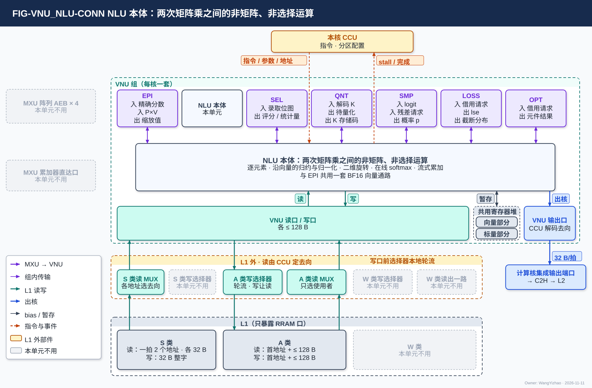
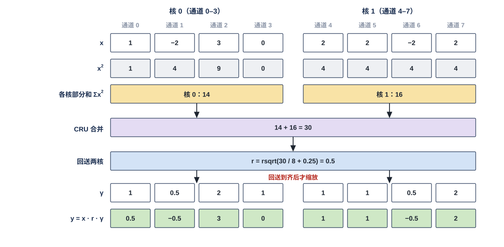
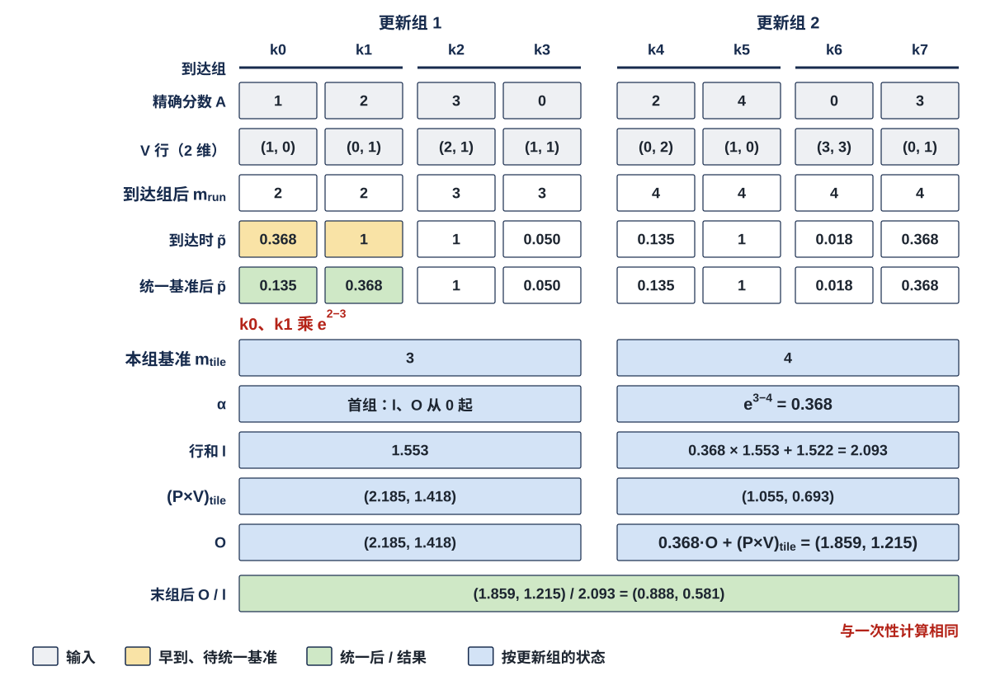
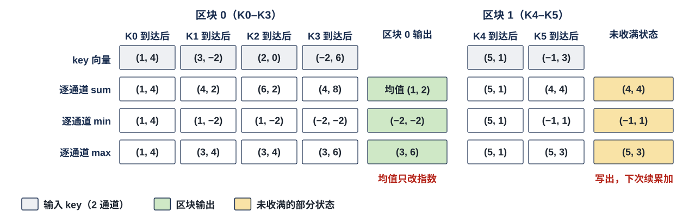

# VNU 非线性单元（NLU）需求

> Owner: WangYizhao｜2026-11-11

## 1 概述

NLU（Nonlinear Unit，非线性单元）做**两次矩阵乘之间所有非矩阵、非选择的运算**：

- 逐元素函数，例如激活与门控乘；
- 沿一条向量的归约与归一化，例如 RMSNorm，以及 LM Head 的 TOPK 项（每个预测位置值最大的 $K_{\text{top}}$ 个（词号, logit））上的温度缩放 softmax 与各种重归一化（§3.5，V18-SMP-01）；
- 按位置的二维旋转，例如 RoPE；
- attention 的在线 softmax 与输出累加；
- 跨向量的流式累加，例如区块摘要。

**比较与判决交 SEL（含 keep：按门限决定下一位点输入的各通道是否保留），量化与按判决位压紧、打包交 QNT；NLU 不做矩阵乘、不搬数据。** 深度卷积（DFlash2 的动态卷积、Gated DeltaNet（GDN）的短卷积）由 CCU 调度成 MXU 的两种工作模式来算，MXU 不为卷积改动，pod 内的调度见 MXU_CONTROLLER 篇 §3.9（V18-MXU-18 / 19）；NLU 只合成动态卷积的系数。**GDN 层的状态更新（每个头一个状态矩阵逐 token 递推）由 MXU、NLU、CCU 的设计者后续设计，本篇暂不规定 NLU 承担哪些步骤**（用户 11-05）。NLU 也不做跨核合并（MAE_CRU）、取项与比对接受、loss 与参数更新（SMP、LOSS、OPT），不发 DDR 请求，不参与调度；SMP 取项与比对所用的概率由 NLU 归一化后交出（§3.5）。

**NLU 还承担 MXU 阵列出口之后的全部 BF16 域动作：这些动作由 NLU 的强制子模块——后处理子模块（EPI）——执行（§3.10，VNU_EPI 篇）**：接收 4 个 pod 的阵列出口缓冲（Array Egress Buffer，AEB）条目，按位点去向直通或扇出给 VNU 各单元，做核内残差位点的残差加、bias 加、残差与特征行的格式还原、部分和的停放写与读改写，以及把要出核的 MXU 输出透传到 VNU 输出口。MXU 组的边界到 AEB 为止（V18-MXU-06）。**EPI 与 NLU 本体共用一套 BF16 向量通路**（V18-EPI-01）；本篇写 NLU 本体，§2 起说"NLU"时指 NLU 本体，提到 EPI 的地方只写它与 NLU 本体之间交什么，EPI 的动作、AEB 的接收规则与对外口见 EPI 篇。

**NLU 是 VNU 组的一个单元，每核一个，全芯片 4 个、物理相同。** 一个计算核由 CCU、MXU 组、L1 组、VNU 组四组拼成；NLU 是 VNU 组的六个单元之一，其余五个是 SEL、QNT、SMP、LOSS、OPT。**NLU 与 VNU 组外的模块交换数据，都经 VNU 组的对外接口**：访问 L1 经 VNU 读口 / 写口（一次访问 = 首字节地址 + 有效字节数，≤ 128 B，VNU 集成篇 §2.4 / §2.6），向核外上行经 VNU 输出口进计算核的集成输出端口（集成篇 §2.7）；EPI 另收 AEB 条目，bias 经 L1 外的 S 类读 MUX 读入（集成篇 §2.5 / §2.2）。

本篇用到的几个词（其余术语在首次出现处定义）：

| 词 | 含义 |
|---|---|
| 位点 | 一层里的一个算子实例，例如 gate/up 投影、一段 attention |
| 查询行 | $Q$ 的一行：一个 token 在一个 q 头上的 $d_h$ 个元素，$d_h$ 为 head_dim（128 / 256 / 512） |
| attention 行状态 | NLU 为每个查询行保存的行最大值 $m_{\text{run}}$、行和 $l$ 与 $d_h$ 维输出累加值 $O$（§3.8） |
| 编译产物 | 每个位点在 NLU 上跑哪些运算步骤、各步参数从哪来、结果交给哪个去向；随指令生效（§3.2） |
| 配置表 | 外部输入信息五类之一（`L3PU_EXTERNAL_INFORMATION.md`）：逐通道向量、RoPE cos / sin 表、近似系数与查找表等，存在本核 L1 的 A 类 |

## 2 接口需求

### 2.1 架构图与接口汇总

图中模块框内的结构是参考实现（见第 7 章），本章以框外的各口为准。

图中虚线框是 VNU 组，框内外画出 VNU 组的全部单元与直接对端，与本单元往来的点亮、其余画灰；对端之后的去向不画，在下文交代。

- **上方**：本核 CCU 下发指令、参数与地址，收各单元的 stall 与完成上报（虚线）。
- **左侧**：MXU 阵列的 AEB × 4 与 MXU 累加器直达口都画灰——AEB 条目只进 EPI（MXU 组到 AEB 为止，V18-MXU-06），粗分数由累加器直通 SEL；NLU 本体收到的精确分数、$(P \times V)_{\text{tile}}$ 都经 EPI 转来。
- **框内上排**是 VNU 六个单元，NLU 拆成 EPI 与 NLU 本体两格，NLU 本体那格标"本单元"。点亮的对端与所交内容以 NLU 本体为准：EPI（入 精确分数 / P×V，出 夹心归一化的缩放值）；SEL（入 录取位图，出 评分 / 统计量）；QNT（入 解码后的 K，出 待量化向量 / 待解码的 K 存储码）；SMP（入 TOPK 项 logit / 残差更新请求，出 归一化后的 $p$）；LOSS（入 借用元件的请求，出 lse / 截断分布）；OPT（入 借用元件的请求，出 元件结果）。这些都是组内传输（§2.2–§2.7）。
- **框内中部**是 NLU 本体的展开框，只写它的五种运算形态（§3）。
- **框内下排**是三项组级共用资源：VNU 共用寄存器堆（**CCU 只给分区配置、逐拍读写位置由 VNU_CONTROLLER 算，分存向量与存标量两部分、物理分开**，V18-VNU-10 / 12，集成篇 §3.3、VNU_CONTROLLER 篇 §3.6）；VNU 读口 / 写口（各 ≤ 128 B，集成篇 §2.4 / §2.6），NLU 经它读写 L1 的 A 类空间、读 S 类（§2.8）；VNU 写口也能经 W 类写 MUX 写 W 类，那一路供 QNT 写已排成 W 类字形态的数据（QNT 篇 §3.5、§3.8，V18-MXU-14），NLU 本体不用；VNU 输出口，接框外计算核的集成输出端口，再经核上行链路（C2H）写 L2（§2.9）。
- **框外下方**分两层：上层是 **L1 外的读写选择部件**——S 类读 MUX、A 类读 MUX、W 类读出到 VNU 读口的一路由 CCU 定去向；A / W / S 三类写口前各一个选择器，自己按固定规则在 H2C 接收桥、NWB、VNU 写口三个来源之间轮流，没轮到的在自己的 FIFO 里等，不由 CCU 逐拍选（归计算核集成，V18-L1-21 / 32）；下层是**只暴露 RRAM 口的 L1**——S 类（读口一拍可接收 2 个地址，架构篇 §3.4 CONC-6）、A 类、W 类。NLU 本体经 A 类读 MUX 读 A 类、经 S 类读 MUX 读 K 的 E8M0 与嵌入行的 E8M0，经 A 类写 MUX 只写 A 类；S 类写 MUX、W 类写 MUX、W 类读出一路与 W 类对 NLU 本体画灰。

图外的路径：HUB 组的入站分发网 HUB_IDN（Inbound Distribution Network）送来的嵌入行先由 L1 的接收桥 NWB 落地 L1，NLU 再经 VNU 读口读入。要出核的数据也可以先写 L1，再经 A 类读 MUX 读出、进集成输出端口的发送 FIFO 入口、经 C2H 发出；每个输出每条指令只选一种（V18-TP-56）。要跨核合并的标量（交 MAE 组的合并单元 MAE_CRU，Cross-Core Reduction Unit）**与其他输出一样是数据**（V18-TP-55）：NLU 把部分值写 L1 或经输出口写 L2，由 MAE_CRU 在 L2 合并；合并值经 L2 → H2C 落 L1 后由 NLU 从 L1 读入。**NLU 在命令网上没有端口。**

| 口 | 对端 | 方向 | 位宽 | 握手 |
|---|---|---|---|---|
| EPI → NLU 本体 | EPI（子模块内） | 入 | 组内链路（位宽由 VNU 集成篇定） | 组内握手 |
| 夹心归一化缩放值 | EPI（子模块内） | 出 | 组内链路 | 组内握手 |
| 评分与统计量 | SEL | 出 | 组内链路 | 组内握手 |
| 录取位图 | SEL | 入 | 每 key 1 bit | 组内握手 |
| 待量化向量 / 待解码的 K 存储码 | QNT | 出 | 组内链路 | 组内握手 |
| 量化结果回送 / 解码后的 K | QNT | 入 | 组内链路 | 组内握手 |
| TOPK 项 logit、残差更新请求 | SMP | 入 | 组内链路 | 组内握手 |
| 归一化后的 $p$、残差分布 | SMP | 出 | 组内链路 | 组内握手 |
| lse、截断分布 | LOSS | 出 | 组内链路 | 组内握手 |
| 元件分时开放 | LOSS、OPT | 入 / 出 | 组内链路 | 组内握手 |
| 经 VNU 读口读 L1 | L1 外 A 类读 MUX、S 类读 MUX 的 VNU 去向 | 入 | A 类一次 ≤ 128 B；S 类一次一个整字（32 B） | 核内 RRAM 口，无握手；来不及收时 VNU 向 CCU 拉 stall_vnu |
| 经 VNU 写口写 L1 | L1 外 A 类写 MUX | 出 | 一次 ≤ 128 B | 核内 RRAM 口，无应答；写不进时 VNU 给本单元 wr_stall |
| 经 VNU 输出口上行 | 计算核的集成输出端口 → C2H → L2 | 出 | 32 B/拍 | C2H 不 ready 时 stall_tx 门控 CCU |
| $\tilde p$ 向量交 MXU | 经 VNU 写口写 L1 A 类，再由 CCU 经 A 类读 MUX 送 pod 激活入口 | 出 | BF16，每元素 2 B | 随 VNU 写口（§2.10） |
| 指令 | 本核 CCU（作为配置经 VNU_CONTROLLER 给） | 入 | — | — |

口宽与条数以架构篇 §2.7 的 PORT-nn 为准（VNU 对 L1 的读口、写口见架构篇 §2.2.5）。

**组内链路的共同规则**（用户 11-04，V18-VNU-02）：**链路上是什么格式、什么精度，由 NLU 与对端单元的控制逻辑按指令解码，链路本身不区分格式**；下面各表"元素格式"一列是两端须能解码的内容，不是链路的定义。链路条数、位宽、是否点对点与组内互连方式由 VNU 集成篇定（集成篇 §3.6；参考位宽见本篇 §7.2）。**对端来不及收时经该链路的握手让 NLU 停发，NLU 保持待发数据、不丢。**

### 2.2 与 EPI 之间：投影结果、精确分数与 P×V 进，夹心归一化缩放值出

#### 2.2.1 交什么

| 接口 | 方向 | 内容 | 元素格式 |
|---|---|---|---|
| EPI → NLU 本体 | 入 | 精确分数（§3.7）、区块打分的粗分数（§3.9）、$(P \times V)_{\text{tile}}$（§3.7）、q / k 的投影结果；夹心归一化位点的投影结果 $Y$（EPI 篇 §2.5） | BF16 |
| 夹心归一化缩放值 | 出 | $\mathrm{RMSNorm}(Y)$，交回 EPI，夹心归一化 $x' = x + \mathrm{RMSNorm}(Y)$ 里残差只加一次（§3.4，EPI 篇 §3.5） | BF16 |

**AEB 条目只进 EPI**：每条 = 一个（token 或查询行, 列块）的 16 个输出通道，各 1 个 BF16；**4 个 pod 算完一轮后按固定次序统一输出，条目不带标签**，属于哪个 token 或查询行、哪个列块由它在一轮中的位置决定，对应关系只由 CCU 持有（EPI 篇 §2.2.2 / §2.2.3）。EPI 把其中交 NLU 本体的部分按上表转来。EPI 交给 QNT、SEL + LOSS、SMP 的向量（$x'$、投影结果、logit 流、精确 logit）是 EPI 的接口，见 EPI 篇 §2.5；bias 经 S 类读 MUX 只进 EPI（EPI 篇 §3.4，集成篇 §2.5）。

### 2.3 与 SEL：评分与统计量出，录取位图进

#### 2.3.1 交什么

| 接口 | 方向 | 内容 | 元素格式 |
|---|---|---|---|
| 评分与统计量 | 出 | FFN 评分 $\lvert\mathrm{SiLU}(\tilde g)\rvert$ 与 $\lvert\tilde s\rvert$（§3.3）；区块能量 $\mathcal E_J$（§3.9）；token 复用比值 $s_{\text{self}}$（§3.7）；判别器（一个旁路小分类网络，矩阵部分在 MXU）的三类分数；相对阈值所用的统计量，例如 Q 一行的 $\mathrm{mean}_d\lvert q_d\rvert$、下一位点保留判断所用的 $\sum\lvert x\gamma\rvert$（§3.4，用户 11-04）；Q 一行的逐维幅值 $\lvert q_d\rvert$，取 RoPE 之后、量化之前的值（用户 11-04） | BF16 |
| 录取位图 | 入 | 每个查询行哪些 key 被录取（§3.7）。NLU 只对录取 key 算 $\tilde p$；$\tilde p$ 向量按录取次序排列，**哪个 $\tilde p$ 对应哪个 key 由这张位图给出**；pod 也按它挑 V 行（MXU 的设计，V18-ATT-02） | 每 key 1 bit |

### 2.4 与 QNT：待量化向量出，量化结果与解码后的 K 进

#### 2.4.1 交什么

| 接口 | 方向 | 内容 | 元素格式 |
|---|---|---|---|
| 待量化向量 | 出 | 需要量化的结果，连同目标格式；K 读时旋转时另交待解码的 K 存储码（§3.6）。**每个位点的运算以"交 QNT 量化"一步结尾，NLU 内不设量化器** | BF16；K 存储码为 MXINT8 的 hi / lo 平面（组长由指令给，V18-ATT-04） |
| 量化结果回送 | 入 | 解码后的 K（§3.6）；归约完成的投影结果、q 与梯度 | MXFP6（激活 MX 组长 $G$，位点属性）或 BF16（§3.12） |

### 2.5 与 SMP：TOPK 项 logit 与残差更新请求进，归一化后的概率出

#### 2.5.1 交什么

| 接口 | 方向 | 内容 | 元素格式 |
|---|---|---|---|
| TOPK 项 | 入 | 一个位置或树节点的 $K_{\text{top}}$ 个 logit，取自该节点唯一的一份 TOPK 项（SEL 写出，位置放 L1 时由 CCU 给、放共用寄存器堆时由 VNU_CONTROLLER 给；TOPK 列重算开启时精确 logit 写进同一份（由谁写入由设计者定，V18-SMP-10），SMP 读同一份，V18-SMP-09，SMP 篇 §3.6.1 / §3.6.2）；**一个节点的 $K_{\text{top}}$ 项全部换成精确值之前不交 NLU** | BF16 |
| 归一化后的 $p$ | 出 | TOPK 项内归一化后的概率 $p$（按词号升序或概率降序，由指令定）；拒绝采样被拒后的残差分布（§3.5） | 由 NLU 与 SMP 的设计者定 |
| 残差更新请求 | 入 | 被拒的子候选、所用 $q_D$、是否剔除已试 token（§3.5，SMP 篇 §3.3） | — |

### 2.6 与 LOSS：lse 与截断分布出

#### 2.6.1 交什么

| 接口 | 方向 | 内容 | 元素格式 |
|---|---|---|---|
| lse | 出 | **做温度缩放 softmax 时得到的 $\mathrm{lse} = \ln\sum_{i} e^{z_i/T_{\text{temp}}}$（$K_{\text{top}}$ 项内）**，LOSS 据此与所选项的 logit $z_{\text{sel}}$ 算 $\log p = z_{\text{sel}}/T_{\text{temp}} - \mathrm{lse}$（V18-LOSS-07；§3.5）；**$z_{\text{sel}}$ 由 SMP 取项后直接交 LOSS，不经 NLU**；不传 $K_{\text{top}}$ 项 logit。前缀截断开启时 lse 取全 $K_{\text{top}}$ 项还是截断后的前缀【设计者定】：由 LOSS / SMP 设计者与算法侧定，定下后 NLU 按同一口径交 | FP32 |
| 截断分布 | 出 | 一个采样位置 TOPK 项上的归一化概率（§3.5），只在 LOSS 启用熵与最大概率时交；所选 token 由 SMP 交 LOSS | 由 NLU 与 LOSS 的设计者定 |

### 2.7 元件分时开放给 LOSS、OPT

**NLU 的运算元件对 LOSS、OPT 分时开放：LOSS、OPT 的运算可分时使用 NLU 的元件（例如 exp、ln、开方与除法），NLU 只执行**（V18-VNU-10，用户 11-11："对于VNU的功能复用和寄存器复用，以及其他类似设计，这是底层需求"）。使用时段由 CCU 与指令安排，**借用时段内 attention 不运行**；借用接口的形式由 VNU 集成设计者定（集成篇 §3.6.3）。SMP 不借用元件：TOPK 项上的归一化由 NLU 自己完成，再把概率交 SMP（§3.5）。NLU 与 OPT 怎样合作或折叠（例如梯度裁剪系数所需的开方与除法），由指令设计考虑，具体指令由两个模块的设计者配合确定；裁剪系数的计算与使用属于 OPT 的功能，见 OPT 篇。

| 接口 | 对端 | 方向 | 内容 |
|---|---|---|---|
| 元件借用 | LOSS、OPT | 入 / 出 | 借用请求进、元件结果出 |

### 2.8 经 VNU 读口 / 写口访问 L1

**NLU 经 VNU 读口 / 写口访问 L1 的 A 类与 S 类空间，只写 A 类**（VNU 集成篇 §2.4 / §2.6）。VNU 对 L1 只有一个读口、一个写口（架构篇 §2.2.5），NLU 与 VNU 其他单元分用：读口每拍读什么由 CCU 排，读出分给谁、各单元轮用写口的先后由 VNU_CONTROLLER 按配置定（VNU_CONTROLLER 篇 §3.4）。

#### 2.8.1 读：A 类一次首字节地址 + ≤ 128 B，S 类一次一个整字

| 读的内容 | 所在类 |
|---|---|
| 配置表（§3.2）；行状态（§3.8）、分数暂存、区块摘要部分和、统计量往返期间暂存的向量（§3.4）；CRU 归约值与标量合并值（MAE_CRU 在 L2 合并后，由一条 L2 → L1 指令经 H2C 写进 L1，协议篇 §3.18）；经 HUB_IDN 落地的嵌入行码与第 0 层标量表；K 在 RoPE 之前量化存储时，读未旋转的 K 存储码（§3.6） | A 类 |
| 嵌入行的 E8M0；K 读时旋转用的 K 的 E8M0 | S 类 |

**NLU 不读 V 的尺度**：V 的每 key 尺度作为权重一侧的尺度进 pod，由 pod 处理（V18-MXU-15，§3.7）。

- **A 类读**：L1 的 A 类读口一次访问给**首字节地址与有效字节数（≤ 128 B）**，L1 交回从首字节起排好的数据（第 0 字节就是首地址那个字节）；**L1 外的 A 类读 MUX 只选使用者，每拍只送一个使用者**，轮到 VNU 的拍整次读出都给 VNU（≤ 128 B），再由 VNU_CONTROLLER 按配置分给 NLU（VNU_CONTROLLER 篇 §2.5）。占几拍按架构篇 §3.4 CONC-3。
- **S 类读**：S 类读口一拍可接收 2 个地址、每个地址读一个整字，可以是同一个堆里的两个数据；同拍需要多于 2 路时由 CCU 错开（架构篇 §3.4 CONC-6），读出经 L1 外的 S 类读 MUX 送 VNU 读口（V18-L1-21 / 31）。
- **数据组织默认按 32 B 对齐**（token 记录、通道片四部分的起点在存储字边界）；首地址不在字边界时，由 SRAM 内部把首字节移到输出的第 0 字节再交出，**NLU / VNU 一侧不需要做字节移位，总是从读出数据的第 0 字节起解析**（V18-TP-74，数据组织篇 §2.3、§3.4）。
- **读的 en / 首地址都由本核 CCU 给出；读出在 VNU 内分给哪个单元由 VNU_CONTROLLER 按配置定**；从存储字边界起的读出固定 1 拍到达（核内 RRAM 协议，协议篇 §2.3）。
- **嵌入表三张、单独存单独访问、三次 gather**（V18-DORG-03，数据组织篇 §2.8）：码表（落 A 类）、E8M0 表（落 S 类）、第 0 层两个标量 $\sum x^2$ 与 $\sum\lvert x\gamma\rvert$ 的标量表（落 A 类，NLU 读，§3.4）；**标量表每项 8 B = 两个 FP32，各项紧挨存、不补齐到 32 B**，8 B 整除 32 B，一项不跨存储字。嵌入行为残差格式（MXFP6，组长 $G$），标量为 FP32 语义；嵌入行由 HUB_IDN → NWB 落地 L1 后再经 VNU 读口读入。

#### 2.8.2 写：一次首字节地址 + `seg` + ≤ 128 B，NLU 只写 A 类

| 写的内容 | 所在类 |
|---|---|
| 行状态、分数暂存、区块摘要部分和、统计量往返期间暂存的向量；$\tilde p$ 向量（§2.10）；要出核的数据选"先写 L1"时写 L1 | A 类 |

- **NLU 写 L1 时只交数据与每拍的有效字节数（≤ 128 B，从第 0 字节起），不给地址；写的首字节地址与 `seg` 由本核 CCU 内部计数推出（V18-VNU-12，VNU_CONTROLLER 篇 §3.9）。** NLU 的写在 VNU 内与其他单元的写合并进 VNU 写口，各单元的写怎样轮用这个口见 VNU_CONTROLLER 篇 §3.4、§3.9。
- VNU 写口进 L1 的一次写 = 首字节地址（24 bit 段内字节地址，默认是 32 的倍数，由 CCU 计数推出）+ `seg` + 有效字节（≤ 128 B，len 或 be，形式【设计者定】，约束：能表达任意字节起点与 1–128 B 的长度）；数据从第 0 字节起给，首地址不是 32 的倍数时由 SRAM 内部移位（V18-TP-74）。
- **A 类写口前的选择器在 L1 外，自己按固定规则在 H2C 接收桥、NWB、VNU 写口三个来源之间轮流，没轮到的在自己的 FIFO 里等；写与读碰到同一个堆时写让读，本地判断**（集成篇 §2.6，V18-L1-32、V18-VNU-09）；写进即可见，**核内写 L1 的完成由 CCU 判定；VNU 写口的写何时写完，由写口前的选择器告知 CCU 或由 VNU 报完成【设计者定】（V18-L1-32）**（协议篇 §3.8）。

#### 2.8.3 来不及时的停发：stall_vnu 与 wr_stall

| 信号 | 方向 | 含义 |
|---|---|---|
| stall_vnu | VNU 读入口 → 本核 CCU | VNU 读入口来不及收时拉起，CCU 停发读；**拉起之后在途的读不丢**；各单元的 stall 怎样合成这一根由 VNU 集成篇定（集成篇 §2.4） |
| wr_stall | VNU 写口 → 当拍在写的单元 | **写口的请求在写口前的选择器轮到 VNU 写口之前原样保持、不丢；保持不住时拉 wr_stall 让各单元停写**（集成篇 §2.6）；**只到 VNU，不到 CCU**，NLU 保持待写的数据 |

**编译链不做读写带宽保证**：A 类读出每拍只给一个使用者，需求超出时 NLU 经 stall_vnu 与 wr_stall 等，只降速（V18-L1-21）。阈值与缓冲的参考做法见 §7.5。

### 2.9 经 VNU 输出口上行与跨核合并值

#### 2.9.1 输出与合并值

| 接口 | 对端 | 方向 | 内容 | 格式 |
|---|---|---|---|---|
| 输出（含要跨核合并的部分值） | 经 **VNU 输出口**进计算核的集成输出端口直接写 L2，或写 L1；源与去向由 CCU 解码指令（集成篇 §2.7，V18-TP-55 / 56、V18-VNU-07） | 出 | attention 部分状态 $(m_{\text{run}}, l)$、归一化平方和部分和（§3.4）、梯度平方和 $\sum g^2$ 部分和（只在 NLU 累加）等 FP32 部分值，与其他输出一样是数据；要跨核合并时写进 L2 本核象限的同一段内地址，由 MAE_CRU 合并。EPI 透传出核的 MXU 输出也走这个口（EPI 篇 §3.9） | 输出口每拍 32 B；C2H 不 ready 时 stall_tx 门控 CCU |
| 合并值 | 经 L2 → H2C 落 L1，NLU 经 VNU 读口读入（V18-TP-55） | 入 | MAE_CRU 在 L2 合并后的标量，由一条 L2 → L1 指令送到本核 L1 | FP32 |

lse 的跨核合并就是 $(m_{\text{run}}, l)$ 状态合并：部分状态作为输出写进 L2，由 MAE_CRU 合并，合并值经 H2C 落 L1 后 NLU 读入再算 lse（§3.7，协议篇 §3.17、§3.18）。**NLU 在命令网上没有端口；合并值落进 L1 之后 CCU 才发使用它的指令，NLU 不要求有效位、不因合并值未到而 stall**（§3.4）。

### 2.10 $\tilde p$ 向量交 MXU：本核内往返，不出核

**每（查询行, 更新组）交 MXU 一条按录取次序排列的稠密 BF16 向量 $\tilde p$（§3.7），供 MXU 做 P×V；不出核、不压缩、不量化，V 的尺度不折进去**（V18-ATT-02、V18-MXU-15）。**路径只有一种：NLU 经 VNU 写口写进 L1 的 A 类，CCU 再从 A 类读出、经 A 类读 MUX 送 pod 的激活入口**（MXU 集成篇 §2.3）；**VNU → pod 激活入口的直送通路不是需求**。约束是 P×V 在该（查询行, 更新组）的 $\tilde p$ 写进 L1 之后才放行（§5.2），且 $\tilde p$ 只在本核内往返、每行每更新组写读一次。

### 2.11 指令与配置表

| 接口 | 对端 | 方向 | 内容 |
|---|---|---|---|
| 指令 | 本核 CCU | 入 | 每个位点跑哪些运算、读哪张配置表、屏蔽位等；**标量参数**（$\epsilon_{\text{norm}}$、温度 $T_{\text{temp}}$、门限、个数，§3.2）；配置表在 L1 里的地址；EPI 的动作与去向（CCU 作为配置交 VNU_CONTROLLER，VNU_CONTROLLER 篇 §2.2；驻留位 → token / 查询行的对应只由 CCU 持有，不交 VNU） |
| 配置表 | 由 MAE 搬运指令搬到本核 L1 的 A 类（经 HUB_IDN，或经 L2 → H2C），NLU 经 VNU 读口读入（V18-NLU-07） | 入 | 逐通道向量（如 $\gamma$、$\beta$）、RoPE cos / sin 表与维对规则、近似系数与查找表（§3.2）；换表即换地址（§3.13）；格式由编译链与 NLU 设计者定 |

各地址段的基址与长度由指令给出（编译链分配），容量建议值见 §7.4。

## 3 功能描述

### 3.1 功能一览

| 功能 | 输入 | 输出 | 触发 / 生效条件 | 节 |
|---|---|---|---|---|
| 由编译产物与指令编程 | 编译产物、指令里的标量、L1 里的配置表 | 各位点的运算 | 位点指令；在位点边界切换 | §3.2 |
| 逐元素运算 | 一条或两条同长向量、标量参数 | 同长向量 | 位点指令 | §3.3 |
| 沿向量的归约与归一化 | 向量；统计量（本核算出、经 CRU 合并后回送或随数据到达） | 统计量；缩放后的向量 | 统计量到齐后才缩放（CCU 判断） | §3.4 |
| TOPK 项上的归一化 | TOPK 项 logit、残差更新请求 | 归一化后的 $p$、残差分布、lse、截断分布 | 一个节点的 $K_{\text{top}}$ 项全部换成精确值之后 | §3.5 |
| 二维旋转与 K 读时旋转 | 向量、位置；未旋转的 K 存储码 | 同长向量；交 QNT 重量化 | 位点指令 | §3.6 |
| 在线 softmax 与 attention 输出累加 | 精确分数、录取位图、$(P \times V)_{\text{tile}}$ | $\tilde p$ 向量（交 MXU）、$O / l$、lse、token 复用比值 | 精确分数按到达组到达；更新组结束时交 $\tilde p$ | §3.7 |
| attention 行状态 | 上一更新组的行状态 | 更新后的行状态 | 每个有录取的（行, 更新组）读改写一次 | §3.8 |
| 跨向量的流式累加 | 一串向量；读回的部分和 | 状态向量；区块结束时的摘要 | 区块收满时输出 | §3.9 |
| 后处理子模块 EPI 的动作 | AEB 条目等 | 见 EPI 篇 | 见 EPI 篇 | §3.10 |
| 元件分时开放 | LOSS、OPT 的借用请求 | 元件结果 | CCU 与指令安排的借用时段 | §2.7 |
| 输入与输出格式 | — | — | — | §3.11、§3.12 |
| 结果规则与复位 | — | — | — | §3.13 |

一个位点之后通常跑一到三步运算，例如归一化 → 旋转 → 交 QNT 量化。各种用途都是下面五种运算形态换了运算步骤与参数，同一形态的不同用途不另设机制。读第 3 章时可把每种形态看成一类数据通路："典型用途"一列只说明这条通路会被哪些位点用到，不是要另做的功能。

| 运算形态 | 按矩阵维度说做什么 | 输入 | 输出 | 典型用途 |
|---|---|---|---|---|
| 逐元素运算 | 对一条或两条同长向量逐元素计算，元素之间不交换数据 | 向量、标量参数 | 同长向量 | FFN 门控与评分、嵌入的 $\sqrt{d_{\text{hidden}}}$ 缩放、GDN 门与每层嵌入（PLE）门控、DFlash2 动态卷积系数合成、判别器隐层激活、K 减均值、反传导数 |
| 沿向量的归约与归一化 | 沿一个 token 的 hidden 维（$d_{\text{hidden}}$ 个元素）、一个头的 head_dim（$d_h$ 个元素）或一个位置的 $K_{\text{top}}$ 个 TOPK 项求统计量，再用统计量缩放这条向量 | 向量；统计量（本核算出、经 CRU 合并后回送或随数据到达） | 统计量；缩放后的向量 | 层入口 RMSNorm、按头归一化、夹心归一化、相对阈值的行均值、梯度范数、判别器归一化、TOPK 项上的 softmax 与重归一化 |
| 二维旋转 | 把向量里成对的两维看作二维坐标，按位置给出的角度旋转 | 向量、位置 | 同长向量 | q / k 位置编码、K 读时旋转（K 在 RoPE 之前量化存储时）、K 段位移复用、反传 |
| 在线 softmax 与 attention 输出累加 | 对分数矩阵 $S = Q K^{\mathsf T}$ 的一行按 key 分组到达做 softmax，同时把 $PV$ 累加进该行的 $O$ | 精确分数、录取位图、$(P \times V)_{\text{tile}}$ | $\tilde p$ 向量（稠密 BF16，交 MXU，不出核）、$O / l$、lse、token 复用比值 | attention |
| 跨向量的流式累加 | 一串向量逐通道累加到一个状态向量 | 一串向量；读回的部分和 | 状态向量；区块结束时的摘要 | 区块摘要、区块能量、dK / dV 跨 chunk 累加 |

### 3.2 由编译产物与指令编程：换算子只改编译产物与指令，不改硬件

**NLU 的运算按位点由编译产物与指令给出：每个位点跑哪些运算步骤、各步参数从哪来、结果交给哪个去向、读哪张配置表，都由指令给出。新模型的新算子只要能由 §3.3–§3.9 的运算形态与必须支持的函数表达，就只改编译产物与指令、不改硬件；编程接口（编译产物的格式与指令字段）由 NLU 设计者与编译链、ISA 对接确定**。本篇不写编译产物格式与指令字段。参考做法（固定运算元件 + 可装载序列）见 §7.1。

编译产物用到的参数都是编译产物的一部分，**按大小分两类来路**（V18-NLU-07）：

| 类 | 内容 | 来路 |
|---|---|---|
| 标量 | $\epsilon_{\text{norm}}$、温度 $T_{\text{temp}}$、门限、个数（如前缀截断的 $n$、累积概率 $p_{\text{cut}}$） | **指令字段**，随位点指令由本核 CCU 交来 |
| **配置表** | 逐通道向量（如 RMSNorm / LayerNorm 的 $\gamma$、$\beta$）、RoPE 的 cos / sin 表与维对规则、近似系数与查找表（若做成可装载） | 离线产生、存 DDR 或 HSRAM，**由 MAE 的搬运指令搬到本核 L1 的 A 类**（经 HUB_IDN，或经 L2 → H2C），NLU 经 VNU 读口读入；L1 里的地址在位点指令里 |

**NLU 的同一份计算资源同一时刻只服务一个任务；几个来源要用 NLU 时，按指令给出的先后串行处理**（V18-VNU-06；CCU 作为配置交 VNU_CONTROLLER 执行，VNU_CONTROLLER 篇 §3.3）。**NLU 与 VNU 其他单元在计算资源不冲突时可同时工作**，由指令给出、VNU_CONTROLLER 推进（VNU_CONTROLLER 篇 §3.4）。EPI 与 NLU 本体共用一套 BF16 向量通路，两者抢同一份资源时的先后也由配置给出。

### 3.3 逐元素运算：每个元素独立计算

- **激活**：SiLU $\mathrm{SiLU}(x) = x\,\sigma(x)$，其中 $\sigma(x) = 1/(1 + e^{-x})$；GELU 的 tanh 近似 $\mathrm{GELU}(x) \approx \tfrac12 x\big(1 + \tanh(\sqrt{2/\pi}\,(x + 0.044715\,x^3))\big)$；sigmoid；tanh。**SiLU、GELU tanh 近似、sigmoid、tanh 必须支持**；GELU 的 erf 形式 $\tfrac12 x\,(1 + \mathrm{erf}(x/\sqrt2))$ 由现有运算组合拼出（用户 11-04）。
- **门控乘**：$\tilde s = \tilde u \odot \mathrm{SiLU}(\tilde g)$。$\tilde g$、$\tilde u$ 是 gate、up 两个投影的输出（一个 token 一行，$d_{\text{ff}}$ 个元素）。FFN 评分 $\lvert\mathrm{SiLU}(\tilde g)\rvert$ 与 $\lvert\tilde s\rvert$ 以 BF16 交 SEL 判决，不另量化；$\tilde s$ 交 QNT 量化。
- **算术**：加、减、乘、乘加、按标量缩放、绝对值、平方、饱和。**溢出按饱和处理。**
- **加减通道均值**：减去或加回一个逐通道均值向量 $\mu$（每个通道一个值），例如 K 在旋转之后减均值。
- **通道置换**：按编译期固定的置换表重排一条向量的通道。
- **尺度折叠与反量化**：乘一个 2 的幂尺度，只加指数；反量化即码 × 尺度，例如 K 读时旋转之前用 K 的 E8M0 反量化（§3.6）。**V 的每 key 尺度不由 NLU 折**（V18-MXU-15，§3.7）。
- **逐元素导数**：$\mathrm{SiLU}'(x) = \sigma(x)\big(1 + x(1 - \sigma(x))\big)$、GELU′，用于反传。
- **动态卷积系数**：DFlash2 的两抽头动态卷积，系数 $k_{\text{dc}} = k_{\text{dc,base}} + \delta_{\text{dc}}$ 由 NLU 逐元素相加得出，交 QNT 量化后写 L1；**卷积本体由 CCU 调度成 MXU 的两种工作模式来算（pod 内调度见 MXU_CONTROLLER 篇 §3.9），NLU 不做卷积**（V18-MXU-18 / 19）。

### 3.4 沿向量的归约与归一化：先求统计量，再缩放

**归约维**是一个 token 的 hidden 维，或一个头的 head_dim（$d_h$ = 128 / 256 / 512）。NLU 沿归约维求 sum、max、均值，以及 MX 组（$G$ 个元素，$G$ 为位点属性：32 的倍数，上限【设计者定】且不大于通道片长；32 是精度基准、验收工况与效果最好的配置，V18-MXU-10）内的最大幅值 amax，并用统计量做归一化：

- **RMSNorm**：$y_i = x_i \cdot \mathrm{rsqrt}\!\Big(\tfrac{1}{d}\textstyle\sum_{j} x_j^2 + \epsilon_{\text{norm}}\Big)\cdot \gamma_i$，$d$ 为归约维长度，$\gamma$ 取自配置表，$\epsilon_{\text{norm}}$ 由指令给出（§3.2）。
- **QK-Norm**：对 q、k（以及带 v 归一化的模型里的 v）按头做 RMSNorm，归约维为 $d_h$。
- **LayerNorm**：$y_i = (x_i - \bar x)\cdot \mathrm{rsqrt}(\sigma_x^2 + \epsilon_{\text{norm}})\cdot \gamma_i + \beta_i$，$\bar x$、$\sigma_x^2$ 为沿归约维的均值与方差。
- **$1+\gamma$ 变体**：RMSNorm 中 $\gamma_i$ 换成 $1 + \gamma_i$。

**统计量有三种来源**：

1. **本核算出**：整条向量都在本核，例如按头的 QK-Norm。
2. **各核部分和经 CRU 合并后回送**：一个 token 的 hidden 维分散在几个核上，例如层入口 RMSNorm。各核对自己持有的那段 hidden 维求部分和（FP32），**作为输出写进 L2 本核象限的同一段内地址（或先写 L1 再发），由 MAE_CRU 在 L2 合并；合并值经 L2 → H2C 落各核 L1，NLU 从 L1 读入**（用户 11-07，V18-TP-55；协议篇 §3.17、§3.18）。层入口用两个标量：平方和 $\sum x^2$，以及供下一位点 keep 判断使用的增益加权绝对值和 $\sum\lvert x\gamma\rvert$，由 NLU 交 SEL 作相对阈值的统计量。
3. **随数据到达**：第 0 层的两个标量预先算好，**存在单独的标量表里**（嵌入表三张单独存、单独访问，V18-DORG-03）；MAE 按词号对标量表另做一次 gather、经 HUB_IDN 落地 L1 的 A 类，NLU 与嵌入行一并读入，只转发、不重算。

**统计量到齐后才缩放。** 到齐由 CCU 判断：合并值落进本核 L1（MAE 数满写入握手后给本核 CCU 发写完通知，V18-TP-70）后 CCU 才发出缩放的指令，**NLU 不要求有效位、不因合并值未到而 stall**。

**统计量跨核往返期间的暂存：容量与位置由编译链安排**（V18-EPI-04；用户 11-08："这里是编译链的任务，但是需要给出这个情况，要让VNU和EPI的设计者能解决这个问题"）。情形如下：

- **什么时候要暂存**：一个 token 的 hidden 维按 $m$ 分在几个核上时，**层入口 RMSNorm 与夹心归一化 $x' = x + \mathrm{RMSNorm}(Y)$ 里对 $Y$ 的 RMSNorm 两种都属这一情形**，各核的平方和部分和要经一次往返——部分和写 L2 → MAE_CRU 合并 → 写回 L2 → H2C 落本核 L1。往返期间本核继续产出的待缩放向量（BF16，每 token 一条本核持有的那段 hidden 通道）都要暂存，合并值到了才能缩放。
- **放在哪**：暂存期间不丢，缩放结果与不暂存时逐位相同；放在 NLU 外时，放 L1 时地址由 CCU 给（读由 CCU 发，写的地址由 CCU 计数推出），放共用寄存器堆时位置由 VNU_CONTROLLER 按分区算，地址段或分区由指令给出（参考放处见 §7.4）。往返时延不定要求值、随 MAE_CRU 的并行配置变化（协议篇 §3.18），所以容量随位点配置由编译链定。
- **暂存不够时**：NLU 只能经握手停上游——层入口 RMSNorm 停的是交来 $x'$ 的 EPI 残差加，夹心归一化停的是交来 $Y$ 的 EPI；EPI 随之对 AEB 拉低 ready（EPI 篇 §3.5）。这只降速。

缩放后的向量交 QNT 量化；**夹心归一化**（o / down 投影之后、残差加之前另做一次 RMSNorm 的模型结构，如 Gemma 类）的缩放值则交回 EPI，**$x' = x + \mathrm{RMSNorm}(Y)$，残差只加一次**（EPI 篇 §3.5）。

缩小例：一条 8 通道的向量，核 0 持通道 0–3，核 1 持通道 4–7；实际 hidden 维为几千（例如 2,560），分在参与计算的各核上。$\epsilon_{\text{norm}}$ 取 0.25 只为好算，实际约 $10^{-6}$。

- 两核各算平方和部分和 14、16，MAE_CRU 合并得 30。
- $r = \mathrm{rsqrt}(30/8 + 0.25) = 0.5$ 回送两核。
- 两核各用 $r$ 与自己通道的 $\gamma$ 缩放，结果与单核对整条向量直接计算相同。

核 0 若不等回送、只用自己的 14 按 4 个通道算，会得到 $\mathrm{rsqrt}(14/4 + 0.25) \approx 0.516$，结果不对。

**归约类的其他运算**：

- **归一化的导数**：RMSNorm′、QK-Norm′ 需要一次沿归约维的归约。以 RMSNorm 为例，$\mathrm dx_j = r\,\gamma_j\,\mathrm dy_j - \tfrac{r^3}{d}\,x_j \sum_i x_i \gamma_i\,\mathrm dy_i$，其中 $r = \mathrm{rsqrt}(\tfrac1d\sum_i x_i^2 + \epsilon_{\text{norm}})$。
- **softmax′ 的行内归约**：$P$ 为 softmax 概率矩阵（行为查询行，列为 key），$\mathrm dP$ 为它的梯度。NLU 先求 $D^{\text{sm}}_i = \sum_j P_{ij}\,\mathrm dP_{ij}$，再逐元素算 $\mathrm dS_{ij} = P_{ij}\,(\mathrm dP_{ij} - D^{\text{sm}}_i)$。
- **梯度平方和部分和**：对本核持有的梯度矩阵累加 $\sum g^2$（FP32），作为输出写进 L2，由 MAE_CRU 合并；合并值经 H2C 落 L1，由 OPT 读用（§2.7）。
- **相对阈值所用的行均值**：SEL 的相对阈值判断需要本域均值时，由 NLU 求好交 SEL。例如对 Q 的一行沿 $d_h$ 维选维时，NLU 求 $\mathrm{mean}_d\lvert q_d\rvert$，SEL 再与逐维幅值 $\lvert q_d\rvert$ 比较。**两者同源：都取 RoPE 之后、量化之前的 BF16 值**（用户 11-04）。

### 3.5 TOPK 项上的归一化：温度缩放 softmax 与重归一化都在 NLU

**TOPK 项上的归一化全部在 NLU**（V18-SMP-01；用户 11-08："SMP为什么要有归一化功能？归一化不应该是NLU的功能吗？"）。LM Head 的输出 $Z = H\,W_{\text{head}}$（$W_{\text{head}}$ 为 $d_{\text{hidden}} \times V$，每个输出列是一个词号）每个预测位置一行 $V$ 个 logit；SEL 从中选出值最大的 $K_{\text{top}}$ 个（词号, logit），称 **TOPK 项**（参考 $K_{\text{top}} = 20$）。归约维是一个位置或树节点的 $K_{\text{top}}$ 个 TOPK 项，**TOPK 项之外的词按 $-\infty$、概率 0 处理**。NLU 在这条 $K_{\text{top}}$ 项向量上做四种运算：

- **温度缩放 softmax**：$p_j = e^{z_j / T_{\text{temp}}} \big/ \sum_{i} e^{z_i / T_{\text{temp}}}$，$i$、$j$ 只取 $K_{\text{top}}$ 项内，$T_{\text{temp}}$ 由指令给出；Draft 分布与 Target 分布用同一温度。
- **前缀截断后的重归一化，两种截断都支持、由指令选**（V18-SMP-08；用户 11-09："我认为应该是都支持"）。TOPK 项按归一化后的 $p$ 降序排列（并列取词号小者），只保留一个前缀，在保留的项上重新归一化：
  - **按个数**：保留前 $n$ 项，$n$ 由指令给出（$n \ge K_{\text{top}}$ 时不截断）；
  - **按累积概率**：保留累积概率首次 $\ge p_{\text{cut}}$ 的最短前缀，$p_{\text{cut}} \in (0, 1]$ 由指令给出（至少保留 1 项）。

  例：5 项 $p$ = 0.40、0.25、0.20、0.10、0.05。按个数 $n = 3$：保留前 3 项，和 0.85，重归一化为 0.471、0.294、0.235。按累积概率 $p_{\text{cut}} = 0.6$：累积 0.40 < 0.6、0.65 ≥ 0.6，保留前 2 项，重归一化为 0.615、0.385。实际 $K_{\text{top}}$ 参考 20。
- **拒绝采样被拒后的残差重归一化**：$\mathrm{norm}\big(\max(0,\ p_T - q_D)\big)$，在父节点 TOPK 项与该深度 TOPK 项的并集上逐项相减、截零、再归一化；$p_T$ 是父节点 TOPK 项上的归一化概率，$q_D$ 是该深度的 Draft 分布（上一轮该深度 TOPK 项的归一化概率，SMP 篇 §3.3）。由 SMP 的残差更新请求触发。
- **$q_D$ 剔除已试 token 后的重归一化**：把已试过的子候选 token 在 $q_D$ 上置 0，再归一化。剔除与不剔除两种都须支持，由指令选。

输入是 SMP 交来的 TOPK 项 logit（一个节点的 $K_{\text{top}}$ 项全部换成精确值之前不交 NLU，§2.5）与残差更新请求；输出是归一化后的 $p$ 与残差分布，**经组内传输交 SMP**（按词号升序或概率降序，由指令定）；采样位置上，温度缩放 softmax 顺带得到的 lse（FP32）交 LOSS 算 log-prob（所选项的 logit 由 SMP 直接交 LOSS），LOSS 启用熵与最大概率时再交截断分布（§2.6，V18-LOSS-07）。SMP 只用这些概率取项、沿树路径比对接受，不做归一化。

### 3.6 二维旋转与 K 读时旋转：按位置旋转成对的两维

把向量中成对的两维 $(a_i, b_i)$（哪两维成对随模型而定，由配置表给出）看作二维坐标，旋转角度 $\theta_i = p\,\omega_i$，$p$ 为位置，$\omega_i$ 为第 $i$ 对维的频率；$\cos\theta_i$、$\sin\theta_i$ 取自配置表里的 RoPE cos / sin 表（§3.2，V18-NLU-07）：

$$a_i' = a_i\cos\theta_i - b_i\sin\theta_i,\qquad b_i' = a_i\sin\theta_i + b_i\cos\theta_i .$$

- **正向旋转**：可只旋转前若干维，其余维不变。
- **按位置差重旋转**：已旋转到位置 $p$ 的向量再转 $\theta_i = \Delta_{\text{pos}}\,\omega_i$，即得位置 $p + \Delta_{\text{pos}}$ 的结果。用于已存的 K 段换到新位置复用。
- **逆旋转**：$\theta_i$ 取负，用于反传（RoPE′）。
- **位置 = 基址 + 偏移**，基址由指令给出，偏移随该 key 记录给出。

#### 3.6.1 K 读时旋转：与本次新算出的 K 走同一条链

**K 读时旋转**（用户 11-04）。K 可以在 RoPE 之前量化存储：QK-Norm 之后、旋转之前，由 QNT 量化成 MXINT8（组长由指令给，V18-ATT-04）的高位、低位两个 4 bit 平面（hi / lo）；**码与 E8M0 各成数据块，分别称码块与 E8M0 块**（每 key 64 B hi、64 B lo，E8M0 另成一块，V18-DORG-05 (1)）。这时从 L1 读出的 K 存储码还没有旋转，NLU 在使用前先做读时旋转：码经 VNU 读口从 A 类读，E8M0 经 L1 外的 S 类读 MUX 读入。**它与本次新算出的 K 走同一条链，只是输入不同**：

1. 解码：由 QNT 把存储码重建成数值（用 K 的 E8M0 反量化）；
2. 加回源均值：若写入时减过；
3. 按 key 的绝对位置旋转；
4. 减目标均值：可配；
5. 交 QNT 量化：通道置换若用，在量化时施加。

两段用法：

| 段 | 输入 | 重建 | 输出 |
|---|---|---|---|
| 粗算段 | 本核负责的那部分 key 的 hi 平面与 E8M0 | 只用 hi 平面 | 量化后由 QNT **分两块写出：码块（每 key 一条 hi 平面，head_dim 128 时 64 B）与 E8M0 块**，送进需要的核（路径见下文），**码落 W 类、E8M0 落 S 类**，供粗分数计算 |
| 精算段 | 录取 key 的 hi 与 lo 平面与 E8M0 | 用全部数字 | 量化成完整的 hi + lo，同样分两块：**码块每个录取 key 一条全码 key 记录**（一个 key 的 hi、lo 两个平面的全部码；head_dim 128 时 hi 2 个存储字、lo 2 个存储字，共 128 B）、E8M0 块，同一路径送进需要的核，供精确分数计算；**全码 key 记录进 L1 时这 4 个存储字各落 W 类全码区里该 key 所在的列位（按列字区的列位落，不按 key 连续落），hi、lo 平面分开**（V18-DORG-08；列字区的字形态定义见数据组织篇 §2.12） |

**旋转后的 K 由 QNT 分码块与 E8M0 块两块写出**（V18-DORG-05 (1)），去向有两种：

- **本核产生、本核消费**：可由 QNT 经 VNU 写口把码直接写进本核 L1 的 W 类、E8M0 写进 S 类，不必绕 L2（V18-VNU-09；每条指令选一种去向，QNT 篇 §3.5）。码要落列字区（精算段，一个 key 一列）时与 QNT 的产出次序一致，直接写；码要落行字区的字形态（粗算段）时，由 QNT 攒 key 转置后直写，或按 key 写进 L2、再由 MAE 经 NI 读口 → MAE_DSU 转置 → IDN 送回：**两条路硬件都支持，由编译链按位点选**（V18-MAE-45 (5)，QNT 篇 §3.5、MAE_DSU 篇）。
- **给别的核用**：两块写本核 L1（码 A 类、E8M0 S 类）后，由本核 CCU 按位点指令发令、经 A 类 / S 类读 MUX 读出进发送 FIFO 入口、经 C2H 写 L2（源在核内，CCU 发令，V18-TP-35），或由 QNT 经 VNU 输出口直接写 L2；再由 MAE 多播进需要的核。

**码到达 L1 的 W 类时已是 W 类的字形态**：H2C、IDN、接收桥与 L1 都不变换形态，片外来的数据由 MAE_DSU 调形态，核内产生的数据由 QNT 排；旋转后的 K 在 L2 里存 L1 字形态还是按 key 的形态、由谁转置，归 QNT 篇与 MAE_DSU 篇。**NLU 不写 K 的存储区。** 读时旋转的输入（未旋转的 K 存储码）由 MAE 按存储字原样搬入本核 L1 的 A 类、不变换形态；多个核需要同一批 K 时，key 可按核切分，各核旋转自己那一部分后互相多播，不重复旋转（用户 11-04，V18-L1-05）。位置来源（随 K 流读入的位置数组，或段基址 + 偏移）【待确认】；旋转后作粗分数的精度【待标定】。速率要求见 §4.3。

### 3.7 在线 softmax 与 attention 输出累加：分数分组到达，按更新组统一基准

attention 按 AW 写法为 $S = Q K^{\mathsf T}$、$P = \mathrm{softmax}(S)$（按行）、$O = P V$，其中 $Q$ 为 $T \times d_h$，$K^{\mathsf T}$ 为 $d_h \times N$，$V$ 为 $N \times d_h$，$T$ 为查询行数，$N$ 为 key 数（各运算用哪种工作模式见架构篇 §3.6）。对一个查询行：

- **录取 key** 是 SEL 为该行选中的 key；
- **精确分数** $A_j$ 是该行对录取 key $j$ 的分数，由 MXU 用 K 的全部数字算出；
- **到达组**是连续 $N_{\text{u}}$ 个录取 key，精确分数按到达组到达；
- **更新组**是连续 $N_{\text{adm}}$ 个录取 key（即 P×V 的一个 tile），$\tilde p$ 向量、$\alpha$、$l$ 与 $O$ 按更新组各更新一次。

$N_{\text{u}}$、$N_{\text{adm}}$ 由指令给出（参考 $N_{\text{u}} = 32$，$N_{\text{adm}} = 128$–512）。

下面四步按粒度分层：第 1 步随到达组走，只动 $m_{\text{run}}$ 与 $\tilde p$；第 2、3 步随更新组走，动 $\tilde p$ 向量、$l$ 与 $O$；第 4 步每行一次。读者可把到达组理解为数据到达的粒度、更新组理解为状态写回的粒度。

**第 1 步：到达组到达时更新行最大值。** 一个到达组里本行的录取 key 集合记 $\mathcal A_u$：

$$m'_{\text{run}} = \max\!\Big(m_{\text{run}},\ \max_{j\in\mathcal A_u} A_j\Big),\qquad \tilde p_j = e^{\,A_j - m'_{\text{run}}}\quad (j \in \mathcal A_u),$$

以 $m'_{\text{run}}$ 作本行新的 $m_{\text{run}}$。录取以外的 key 不进 exp。更新组结束前，早到 key 的中间结果不丢；保存哪些量、放在哪【设计者定】，约束：不得改变 $\tilde p$、$\alpha$ 与 $l$ 的数值；放在 NLU 外时，放 L1 时地址由 CCU 给（读由 CCU 发，写的地址由 CCU 计数推出），放共用寄存器堆时位置由 VNU_CONTROLLER 按分区算（参考放 L1 A 类的分数暂存段，§7.4）。

**第 2 步：更新组结束时统一基准，交出 $\tilde p$ 向量。** 基准 $m_{\text{tile}}$ 取本组最后一个精确分数到达后的 $m_{\text{run}}$：

- 早到的 $\tilde p_j$ 乘 $e^{\,m_{\text{old}} - m_{\text{tile}}}$ 统一到基准，$m_{\text{old}}$ 为算它时所用的 $m_{\text{run}}$；
- $\alpha = e^{\,m_{\text{tile,prev}} - m_{\text{tile}}}$，$m_{\text{tile,prev}}$ 为上一更新组的基准；
- **交给阵列的 $\tilde p$ 先舍入成 BF16，行和用这同一组值累加**：$l \leftarrow \alpha\, l + \sum_{j \in \text{本组}} \mathrm{bf16}(\tilde p_j)$，**累加按 FP32**，不经量化（V18-ATT-02）。这样分子 $(P \times V)$ 与分母 $l$ 用的是同一组 $\tilde p$ 数值；
- **交给阵列的就是 $\mathrm{bf16}(\tilde p_j)$，NLU 不读 V 的尺度、不把它折进 $\tilde p$**（V18-MXU-15）：V 以 MXINT8 存储，尺度按（key, 沿 head_dim 的一个尺度分组）各一个 E8M0，在 L1 的 S 类；**它作为权重一侧的尺度进 pod 权重旁带，由 pod 处理**，与反传 $\mathrm dX = \mathrm dY\,W^{\mathsf T}$ 的逐归约位置尺度同一套做法（架构篇 §3.6，属 MXU 的设计，见 MXU 集成篇 §2.4、MXU_FEED 篇 §3.6）。V 的尺度分组长度 $g_V$ 是位点属性、由指令给出，对 NLU 没有影响；
- **$\tilde p$ 向量是每（查询行, 更新组）一条按录取次序排列的稠密 BF16 向量，不设 keep 位图 / E8M0 等元数据块、不压缩、不量化、不出核**（V18-ATT-02；用户 11-09："我认为P的压缩毫无意义，因为它可以被原地执行，它不可能增加EMA"）。一个更新组 $N_{\text{adm}}$ 个录取 key，$\tilde p$ 向量长 $N_{\text{adm}}$ 个元素、每元素 2 B（$N_{\text{adm}} = 128$ 时 256 B）；**哪个 $\tilde p$ 对应哪个 key 由 SEL 的录取位图给出**，向量里不带 key 号；**$\tilde p$ 向量的有效个数由 CCU 从录取位图数出，NLU 不另交**（V18-DORG-09）；
- **$\tilde p$ 向量交 MXU 的路径**见 §2.10。

**第 3 步：按位置累加输出。** MXU 以 $\tilde p$ 向量作激活、与该组录取 key 的 V 行算出 $(P \times V)_{\text{tile}} = \sum_{j \in \text{本组}} \mathrm{bf16}(\tilde p_j)\,V_j$（$V_j$ 为反量化后的 V 行，V 的尺度由 pod 处理），按**列块**（head_dim 中连续 16 维）交出，经 EPI 到 NLU。**条目不带标签**：一轮里每条条目属于哪个查询行、哪个列块只由 CCU 持有（EPI 篇 §2.2.2，V18-VNU-13）；CCU 按条目的到达次序发该行 $O$ 这 16 维的读（地址由 CCU 给），NLU 把条目与读回的 $O$ 按到达次序配对，做

$$O \leftarrow \alpha\, O + (P \times V)_{\text{tile}}$$

后写回行状态（§3.8）。**结果与条目到达的先后无关。** 本组没有录取 key 的查询行，CCU 不给它的驻留位动作，$O$ 与 $l$ 不变。**$m_{\text{run}}$ 变大时，此前的 $O$ 与 $l$ 只乘 $\alpha$，不重新量化。**

**第 4 步：末组之后输出。**

- $O / l$ 交 QNT 量化，作下一位点（o 投影）的输入；
- 给出 $\mathrm{lse} = m_{\text{run}} + \ln l$；
- 多个核各持一行的一部分 key 时，各核的部分状态 $(m_{\text{run}}, l)$（FP32）作为输出写进 L2，由 MAE_CRU 合并（$m = \max(m_a, m_b)$，$l = l_a e^{m_a - m} + l_b e^{m_b - m}$）；合并值经 H2C 落本核 L1 后，CCU 再发算 lse 的指令。

**对录取 key 的子集另算行和。** 对录取 key 中由指令指定的一个子集，用同一 $m_{\text{run}}$ 与 $\alpha$ 另累加行和 $l_{\text{self}}$，与全部录取 key 的行和 $l_{\text{total}}$ 相除得 token 复用比值 $s_{\text{self}} = l_{\text{self}} / l_{\text{total}}$；跨 q 头的聚合方式（如取均值）由编译产物给出，结果交 SEL 判决。

**参与 softmax 的元素集合**（用户 11-04）：

- **被屏蔽的位置不得计入行最大值、行和与输出，等价于权重为 0。** 屏蔽的来源包括因果截断、树形 token 之间的祖先关系、有效 key 范围、被剪掉的 token；屏蔽位由指令给出。
- **整行全被屏蔽时输出零向量，不产生 NaN。**
- **提高稀疏计算的利用率：被屏蔽的元素不应白占运算拍**（V18-NLU-08）。怎样做到【设计者定】，约束：处理一行的拍数随该行未被屏蔽的元素数减少而减少，结果与按全部元素算、屏蔽位置权重取 0 逐位相同；参考做法见 §7.9。

缩小例：一个查询行的 8 个录取 key，到达组 $N_{\text{u}} = 2$（表头下的深色短线），更新组 $N_{\text{adm}} = 4$；表头下的短线标出到达组，每段一个到达组（{k0, k1}、{k2, k3}、{k4, k5}、{k6, k7}）；V 只取 2 维、按已反量化的值给出（V 的尺度由 pod 处理，与 NLU 无关），$l$ 累加统一基准后的 $\tilde p$（例中不计 BF16 舍入）。实际参考 $N_{\text{u}} = 32$、$N_{\text{adm}} = 128$–512，$d_h = 128$，$O$ 每个列块 16 维。

- **更新组 1**：到达组 {k0, k1} 到达后 $m_{\text{run}} = 2$，k0、k1 按 2 算 $\tilde p$；到达组 {k2, k3} 到达后 $m_{\text{run}}$ 升到 3。组末统一基准 $m_{\text{tile}} = 3$，早到的 k0、k1 乘 $e^{2-3}$，得 0.135、0.368。首组的 $l$ 与 $O$ 从 0 起：$l = 1.553$，$O = (2.185,\ 1.418)$。
- **更新组 2**：第一个到达组就把 $m_{\text{run}}$ 升到 4，第二个到达组不变，所以组内不必统一。$\alpha = e^{3-4} = 0.368$；$l = 0.368 \times 1.553 + 1.522 = 2.093$；$O = 0.368 \times O + (1.055,\ 0.693) = (1.859,\ 1.215)$。
- **末组后** $O / l = (0.888,\ 0.581)$，与对 8 个分数一次性做 softmax、再加权 V 的结果相同（脚本断言，浮点容差内）。

### 3.8 attention 行状态：存在编译链分配的 L1 A 类地址段，由 NLU 独占，每（行, 更新组）读改写一次

NLU 为每个查询行保存 **attention 行状态**：

- 行最大值 $m_{\text{run}}$：本行已到达分数的最大值；
- 行和 $l$：本行 softmax 分母的累加值；
- 输出累加值 $O$：$d_h$ 维。

行状态是在线 softmax（§3.7）在一行的两次更新之间要记住的全部内容。**它放在 L1 的 A 类空间里编译链分配的一段地址、不寄存在 NLU 内部；每个有录取的（行, 更新组）读改写一次，NLU 每次只读改写正在更新的那一行**（编译链与 CCU 依赖这一条安排地址与排拍）。

- **由 NLU 独占读写**，别的单元不读不写。
- **每个堆同一拍只做一次访问：读由 CCU 排；写与读碰到同一个堆时写让读，由写口前的选择器本地判断**（架构篇 §3.4 CONC-1 / 2，V18-TP-73 / L1-32）：L1 的两堆都可读可写，同一个堆同一时段可以又读又写、同一拍不行，所以旧值与新值放同一个堆（不同拍读写）或放两个堆都可以，放法由编译链定。读哪堆、写哪堆由 CCU 给的堆选显式选，L1 没有堆角色状态（协议篇 §3.2、§3.14）。
- 行状态是定长项数据块（数据组织篇 §1.2）。存储格式由设计者定，参考格式见 §7.4。

### 3.9 跨向量的流式累加：逐通道累加，可从读回的部分和继续

一串向量逐通道累加到一个状态向量，**结果与一次性成批计算一致**：

- **区块摘要**：**区块**是连续 $L_{\text{blk}}$ 个 key（参考 128，取 2 的幂），**区块摘要**是区块内 K 的逐通道聚合量。NLU 对每个到达的 key 向量（$d_h$ 维）按 key 升序累加：
  - 逐通道 sum，区块收满后乘 $1/L_{\text{blk}}$ 得均值；$L_{\text{blk}}$ 为 2 的幂，乘法只改指数；
  - 逐通道 min / max。

  两种摘要都必须能做，用哪种由编译产物选择。收满的摘要交 QNT 量化。
- **区块能量**：MXU 用查询行与区块摘要算出区块打分的粗分数 $S_{iJ}$（查询行 $i$ 对区块 $J$），经 EPI 交 NLU。NLU 按（query 行块, q 头, 区块）把同一区块的 $S_{iJ}$ 聚合成区块能量 $\mathcal E_J$，交 SEL 做区块选择。聚合形式由编译产物给出；**聚合按行号升序进行，结果与到达次序无关。**
- **两个部分和相加**：attention 反传按 query 分块（chunk）计算时，本块的 dK / dV 部分和与读回的累加值逐元素相加。
- **从读回的部分和继续累加**：区块未收满时，部分和由 MAE 写出；下次读回后从这个状态继续累加，次序不变，结果与一次性成批计算一致。

缩小例：6 个 key，每个 2 个通道，区块长 $L_{\text{blk}} = 4$；实际参考 128 个 key、$d_h = 128$ 个通道。

- 区块 0 收满 K0–K3 后输出：均值 $= \text{sum} \times 2^{-2} = (1,\ 2)$，min $(-2,\ -2)$，max $(3,\ 6)$，与对 4 个 key 成批计算相同。
- 区块 1 只到了 K4、K5，sum $(4,\ 4)$、min $(-1,\ 1)$、max $(5,\ 3)$ 是未收满的部分状态。写出、下次读回后从这个状态继续累加，结果与对整个区块成批计算相同（脚本以 2 个后续 key 断言）。

### 3.10 后处理子模块 EPI 的动作：只用逐元素加与两部分和相加，正文在 EPI 篇

**EPI 是 NLU 的强制子模块，与 NLU 本体共用一套 BF16 向量通路；它的动作只用 §3.3 的逐元素算术与 §3.9 的两部分和相加这两种形态，不新增运算形态。动作清单（直通与扇出、残差加、bias 加、夹心归一化的加、残差 / 特征行还原、停放写、部分和读改写、透传出核）与 AEB 接收规则见 EPI 篇 §3.1、§2.2**（V18-EPI-01）。EPI 还原紧凑残差与还原特征行时，保留位图都由 CCU 交给 EPI（V18-VNU-10，EPI 篇）。

### 3.11 输入格式：向量只有 BF16 与 MXFP6 两类

| 类别 | 格式 | 来源 |
|---|---|---|
| 向量 | BF16 | MXU 阵列的 AEB 条目（经 EPI）、VNU 内部（含 SMP 交来的 TOPK 项 logit）、L1 里的暂存向量 |
| 向量 | MXFP6：每个元素 6 bit（E2M3 码），每 $G$ 个元素（MX 组长，位点属性，V18-MXU-10；Q / K / V 组长同样由指令给，V18-ATT-04）共享一个 8 bit 指数尺度（E8M0，落 S 类） | 存储（L1 读回、经 HUB_IDN 落地的嵌入行；紧凑 token 记录由 CCU 先经 A 类读 MUX 读元数据项算出码字地址，再给 VNU 读口发元数据项与码字（A 类）、E8M0（S 类读 MUX）的读，集成篇 §2.4；残差与特征行由 EPI 还原，**还原时的保留位图由 CCU 交给 EPI**，V18-VNU-10、EPI 篇）、QNT 回送 |
| 标量 | FP32 语义：结果与"按 FP32 计算、只在最后舍入一次"的参照一致，实现可用更窄的内部格式 | 合并值（MAE_CRU 合并后经 L2 → H2C 落 L1，FP32）、随嵌入行经 HUB_IDN 落地 L1 |

还有几种需要临时处理的格式：

- OPT 自己的格式：MXINT8 权重副本、优化器状态；
- 可选格式：MXFP6 装不下时的 FP8 / BF16 / FP16 梯度；元素位宽取 8 的位点所用的 MXFP8 E4M3；
- 经 HUB_IDN 交 LOSS 的 teacher 概率。

**设计者可选择在 QNT 把这些格式统一成上述两类后再交 NLU**（用户 11-04）。

### 3.12 输出格式

- 交 QNT、SEL 的向量为 BF16；交 SMP、LOSS 的归一化概率格式由两端设计者定（§2.5、§2.6）；EPI 写 L1 的停放值与部分和为 BF16（每项 2 B，EPI 篇 §5.3）。
- 交 MXU 做 P×V 的 $\tilde p$ 向量为稠密 BF16，每元素 2 B，不设元数据块、不压缩、不量化、不折 V 的尺度（§3.7）。
- 要跨核合并的标量为 FP32，按定长项排列，可紧密排、也可单个发（一拍、只标出有效字节，不补 32 B；有效字节用长度还是 be 表达【设计者定】，约束同 §2.8.2；数据组织篇 §1.2，V18-TP-58），与其他输出一样写 L1 或直接写 L2（V18-TP-55 / 56、V18-CRU-07）。
- 反传逐元素运算的输出经 QNT 按位点配置的流动梯度格式（反传梯度在算子之间流动时的格式，默认 MXFP6 单平面，组长 $G$）量化后才离开 VNU。$\mathrm dS$ 取其中哪一种格式、梯度 MXFP6 的组轴（逐 token 沿通道或沿 token）【待确认】。

### 3.13 结果规则与复位

- **在线 softmax 的结果与 key 的到达次序无关。**
- 区块能量与到达次序无关。
- 流式区块摘要与一次性成批计算一致，跨次读回后续累加时次序不变。
- K 读时旋转与本次新 K 的复算链是同一条链，同一输入下逐位相同。
- **位点的编译产物在位点边界切换，切换不打断在途向量。**
- **换配置表 = 指令给出新的 L1 地址；在途的运算一直读旧地址那一份，直到用完。** 新旧两份是 L1 里两个独立的数据块，旧的一份在在途运算用完之前不被覆盖（编译链按最后读者完成安排），所以不出现半更新状态。
- **复位**：复位输入来自 CIF（架构篇 PORT-41），硬复位与软复位不区分（CIF 篇 §2.4、§3.3）；复位清行状态、分数暂存、平方和暂存与各部分和。**NLU 没有需要跨次保留的状态**：区块摘要的未收满部分和由 MAE 写出、下次读回。

## 4 性能指标

### 4.1 各口的速率：匹配上下游模块

**NLU 每拍能处理的元素数，须匹配上游各口的产出速率与下游各口的接收要求，由 NLU 设计者与以下模块对接确定**（用户 11-04）。各对端的现行参考值见 §7.2；它们不是 NLU 的定值，**设计者可按需求加大并行数**（用户 11-05："NLU可以增加它并行处理的数量，当前的值可以是一个Reference值"）。

| 相关模块 | 接口 | 要匹配的量 |
|---|---|---|
| MXU 阵列（AEB，经 EPI） | AEB 条目 | **EPI 篇 §4.1 的拍数条件：EPI 处理一轮的拍数 ≤ MXU 产出下一轮的拍数**；EPI 与 NLU 本体共用向量通路，NLU 本体在同一时段的负载要计入这一条件（§4.4，与 EPI、MXU、CCU 设计者对接；拍数最紧的位点见 EPI 篇 §7.3） |
| EPI | EPI → NLU 本体 | EPI 交来的速率（集成篇 §3.6.1） |
| QNT | 待量化向量、量化结果回送 | QNT 统一请求接口（所有量化请求的唯一入口，QNT 篇 §2.3）的速率 |
| SEL | 评分与统计量 | SEL 的 NLU 口的速率 |
| SMP、LOSS | TOPK 项、归一化后的 $p$、残差分布；lse、截断分布 | 每个位置或树节点 $K_{\text{top}}$ 项；每次被拒一次残差重归一化；每个采样位置一个 lse（集成篇 §3.6.1） |
| L1（经 VNU 读口 / 写口） | 行状态读改写、分数暂存、$\tilde p$ 向量 | 每个有录取的（行, 更新组）读改写一次行状态（§3.8）、写读一次 $\tilde p$；与其他单元分用 VNU 读口 / 写口（读由 CCU 排，单元之间的先后由 VNU_CONTROLLER 按配置定） |
| L2 / MAE_CRU | 标量部分值、合并值 | 层入口归一化每 token 一次往返；往返时延不定要求值，CRU 并行 lane 可配（协议篇 §3.18） |
| MAE（K 存储码流入） | K 读时旋转 | §4.3 |

### 4.2 exp 能力：匹配录取率上限下的精确分数到达速率

**exp 的能力须匹配"精确分数到达速率 × 录取率上限 $\phi_{\max}$"**（用户 11-04）：按录取率达到上限 $\phi_{\max}$（一行里被录取的 key 所占比例的上限）时的精确分数到达速率定容。参考值见 §7.2。

### 4.3 K 读时旋转：不慢于本核 K 存储码的流入

**粗算段的读时旋转不得慢于本核 K 存储码的流入**：每（key, kv 头）的 K 存储码（hi 码 + E8M0）按 DDR 入流速率灌进各核，按参与的核分摊，NLU 旋转的速率不低于本核分到的流入速率。元素数与倍数的参考值见 §7.2；并行度【设计者定】，约束即本条。

### 4.4 不使 EPI 违反拍数条件：O 更新与投影后处理

**$O$ 更新与投影后处理（投影结果进 NLU 后跑的归一化、旋转等）的耗时，不得使 EPI 违反 EPI 篇 §4.1 的拍数条件**。$O$ 更新每（行, 更新组）的参考拍数、投影后处理流水深度的参考值见 §7.3。

### 4.5 超载时经握手停上游，不丢分数

精确分数的到达超过 exp 的能力时，NLU 经握手让上游停发，**不丢分数**。握手只用协议篇 §3.16 的相邻级 stall：对 EPI 是组内握手让 EPI 停发，EPI 来不及时对 AEB 拉低 ready，AEB 满后反压 MXU 累加器（EPI 篇 §4.3）；对 CCU 发读的数据是 VNU 读入口的 stall_vnu。

本节与 EPI 篇 §4.1 拍数条件的分界：

| 工况 | NLU 的要求 |
|---|---|
| 录取率 ≤ $\phi_{\max}$（§4.2 的定容点） | exp 与 $O$ 更新跟得上，**不因 NLU 使 EPI 违反 EPI 篇 §4.1 的拍数条件、进而持续反压 MXU 累加器** |
| 录取率 > $\phi_{\max}$ | 允许经上述握手降速；**只降速、不丢分数** |

### 4.6 同时使用的口与并发条件

| 同时使用的情形 | 适用的约定 | 结果 |
|---|---|---|
| VNU 读口与写口同拍（例：行状态读旧值、写新值） | 架构篇 §3.4 CONC-1 / CONC-2 | 读与写落不同的堆时同拍；同一个堆同一拍只做一次访问：读由 CCU 排，写碰到读时写让读（写口前的选择器本地判断，V18-L1-32） |
| A 类读一次 ≤ 128 B 不从存储字边界起 | 架构篇 §3.4 CONC-3 | 从字边界起一拍，否则允许多拍；CCU 按此排后续访问 |
| S 类读 K / 嵌入行的 E8M0 与别的使用者同拍 | 架构篇 §3.4 CONC-6 | S 类读口一拍可接收 2 个地址（可以是同一个堆里的两个数据）；同拍需要多于 2 路时由 CCU 错开 |
| NLU 与 EPI、VNU 其他单元同时工作 | 本篇 §3.2 | 计算资源不冲突时可同时；冲突时由 CCU 串行排 |

### 4.7 精度要求：集成到算法后任务精度下降 < 0.1%

**NLU 的计算方案集成到算法后，任务精度下降 < 0.1%。中间计算精度不规定，由设计者定**（用户 11-04）。口径：

- 下降量按绝对百分点计；
- 基线为同一算法下 VNU 各运算按 FP32 理想值计算的结果；
- 评测集为算法侧的标准评测集；
- 硬件实现与算法参考模型逐位一致，作为验证手段；参考模型随硬件实现同步。

### 4.8 要求值表

| 项 | 要求值 | 说明 |
|---|---|---|
| 运算形态 | 逐元素、沿向量的归约与归一化、二维旋转、在线 softmax 与 attention 输出累加、跨向量的流式累加 | 由编译产物与指令编程，换算子不改硬件（§3.2）；GDN 状态更新的分工待 MXU、NLU、CCU 设计者后续设计 |
| 后处理子模块 EPI（强制） | 八种动作与 AEB 接收规则见 EPI 篇 §3.1、§2.2、§4.4 | 与 NLU 本体共用一套 BF16 向量通路，由 CCU 指令调配 |
| 每拍处理能力 | 匹配上下游各口（§4.1） | 由 NLU 设计者对接确定；参考值见 §7.2 |
| exp 能力 | 匹配录取率上限下的精确分数到达速率（§4.2） | 参考值见 §7.2 |
| K 读时旋转 | 粗算段不慢于本核 K 存储码流入（§4.3） | 参考值见 §7.2 |
| $O$ 更新与投影后处理 | 不使 EPI 违反 EPI 篇 §4.1 的拍数条件（§4.4） | 参考拍数见 §7.3 |
| head_dim | 128 / 256 / 512 | 归一化、旋转、$O$ 更新都要支持 |
| 精度 | 集成到算法后任务精度下降 < 0.1%（绝对百分点） | 基线为 VNU 各运算按 FP32 理想值；中间精度由设计者定 |
| 元件分时开放 | NLU 的运算元件对 LOSS、OPT 分时开放（§2.7） | 借用时段由 CCU 与指令安排 |
| L1 口 | 经 VNU 读口 / 写口（各 ≤ 128 B，集成篇 §2.4 / §2.6）；NLU 写时只交数据与有效字节数；首地址可为任意字节，移位在 SRAM 内部；同一个堆的读由 CCU 排、写碰到读时写让读（V18-L1-32） | 并发条件见 §4.6 |
| 要跨核合并的标量 | 作为输出写 L1 或直接写 L2；合并值从 L1 读入；FP32；NLU 在命令网上无端口 | 协议篇 §3.17、§3.18 |

## 5 约束与由使用者保证的事项

### 5.1 硬约束与范围

- **NLU 不做矩阵乘、不搬数据、不做比较判决与量化、不发 DDR 请求、不参与调度**（§1）。
- **NLU 的同一份计算资源同一时刻只服务一个任务**；多个来源由 CCU 串行排（§3.2）。
- **NLU 在命令网上没有端口**；标量走数据协议（§2.9）。
- **NLU 只写 L1 的 A 类**；不写 K 的存储区（§3.6）；不读 V 的尺度（§3.7）。
- **本篇不含容错设计**（V18-TP-75）。

### 5.2 由使用者保证的事项

以下事项 NLU 不检查，由对应模块保证。表里的事项 NLU 既不实现也不检查，验收时把它们当作输入前提、用断言核对（§6）；读者若在别处看到 NLU 与这些事项有关，指的只是 NLU 消费其结果。

| 事项 | 由谁保证 |
|---|---|
| 量化、按判决位压紧与打包；Q 粗算查询行记录的组装与写出 | QNT |
| keep 判断（下一位点输入各通道的保留） | SEL |
| 比较与判决；TOPK 项的选出与 TOPK 重算词号列表 | SEL |
| 屏蔽位的内容（§3.7） | 指令 |
| AEB 条目 = 归约完成的 BF16（RNE）、一条 16 个输出通道；4 个 pod 算完一轮后按固定次序统一输出 | MXU 阵列（MXU 累加器导出时舍入成 BF16、AEB） |
| V 的每 key 尺度作为权重一侧的尺度进 pod 并由 pod 处理；录取 key 的 V 尺度由 MAE_DSU 按录取次序排成整字、送 pod 权重旁带 | MXU、CCU、MAE_DSU（V18-MXU-15，MXU 集成篇 §2.4、MXU_FEED 篇 §3.6） |
| 一轮里"驻留位 → token / 查询行"的对应（每条 $(P \times V)_{\text{tile}}$ 属于哪个查询行、哪个列块；只由 CCU 持有，不交 VNU） | CCU（EPI 篇 §2.2.2） |
| AEB 的深度；停放值的装回（A 类读出经 pod 的 128 B 激活入口、带装回标志，不经 EPI，MXU 集成篇 §2.3.4） | MXU、CCU |
| EPI 每个动作的输入源、去向与时隙；EPI 与 NLU 本体争用向量通路时的先后 | CCU 与指令（EPI 篇 §1.2） |
| 核间按 $k$ 切分位点的残差加、bias 加与编码 | MAE_CRU（V18-CRU-08、V18-EPI-02） |
| TOPK 项的 logit 换成精确值，一个节点全部换完后才交 NLU 归一化 | 由谁写入、谁判全部换完由 EPI / SMP / CCU 设计者定（SMP 篇 §3.6.1，V18-SMP-10） |
| P×V 在该（查询行, 更新组）的 $\tilde p$ 向量写进 L1 后才放行；位点的编译产物在位点边界切换；算子融合与放行先后 | CCU 与指令 |
| $\tilde p$ 向量的有效个数（从录取位图数出） | CCU（V18-DORG-09） |
| 同一单元一时一个任务、多个来源串行；资源冲突的先后 | CCU 与指令（集成篇 §3.2） |
| 配置表搬进本核 L1 的时机（MAE 搬运指令，LIC 排）；使用前已写完（MAE 数满写入握手后给本核 CCU 发写完通知，CCU 收到后才发使用它的指令，V18-TP-70）；换表前旧表的在途使用已完成 | LIC、MAE、CCU；编译链 |
| 标量跨核合并的次序 | MAE_CRU |
| 部分值的去向（写 L1 / 写 L2）与地址；合并值落 L1 之后才发使用它的指令 | CCU（协议篇 §3.18）；MAE（合并指令在收齐发出报告后执行） |
| 读写 L1 的地址（基址 + 字节累加、环形回绕）与 dout 去向；读的排拍（写碰到同一个堆的读时由写口前的选择器本地让读，架构篇 §3.4 CONC-1 / 2）；不从字边界起的访问占几拍（CONC-3） | CCU |
| 核内写 L1 的完成判定 | CCU（协议篇 §3.8） |
| 区块摘要未收满部分和的跨次写回与读回，次序不变 | MAE |
| 读时旋转的输入（未旋转的 K 存储码）搬入本核 L1（码块落 A 类、E8M0 块落 S 类，按存储字原样搬运，不变换形态） | MAE |
| 旋转后的 K 量化、分码块与 E8M0 两块写出；本核产生、本核消费时可由 QNT 经 VNU 写口直接写本核 W 类（码）与 S 类（E8M0），不必经 L2（§3.6）；给别的核用时写 L2（经发送 FIFO 入口与 C2H 由本核 CCU 发令，或经 VNU 输出口），再由 MAE 多播进需要的核（码落 W 类、E8M0 落 S 类）；**码到达 L1 W 类时已是 W 类的字形态，形态差由 QNT 或 MAE_DSU 调**；K 存储码的解码 | QNT、本核 CCU、MAE、MAE_DSU（用户 11-04 / 11-06 / 11-10，V18-L1-05、V18-TP-35、V18-DORG-05 (1)、V18-VNU-09） |
| K 读时旋转按核调度，与 K 落地、粗分数计算的先后 | LIC 与 CCU |
| A 类各地址段的分配（含行状态、分数暂存、$\tilde p$ 向量），以及写入前旧数据已读完 | 编译链（指令中的基址与长度，LIC 操作 15） |
| 统计量跨核往返期间暂存向量的容量与位置（§3.4） | 编译链（V18-EPI-04） |
| 借用时段内 attention 不运行 | CCU 与指令 |
| A 类读 MUX 每拍给哪个使用者、S 类读 MUX 每路的读出送谁（都在 L1 外，计算核集成）；VNU 读口每次访问的首地址与长度；写回 L1 的地址（按 VNU 交出的有效字节数计数推出） | CCU（集成篇 §2.4 / §2.6、§5.2） |
| 读出在 VNU 内分给哪个单元、各单元的写怎样轮用 VNU 写口、共用寄存器堆逐拍读写位置 | VNU_CONTROLLER（VNU_CONTROLLER 篇 §2.5、§3.4、§3.6） |
| 写口前的选择器在 H2C 接收桥、NWB、VNU 写口之间轮流；写与读碰到同一个堆时写让读 | 写口前的选择器本地（V18-L1-32） |
| 临时格式统一转换成 BF16 / MXFP6（若设计者选用，§3.11） | QNT |
| 深度卷积本体（DFlash2 动态卷积、GDN 短卷积及其反传）：由 CCU 调度成 MXU 的两种工作模式，MXU 阵列与模式不变，pod 内调度见 MXU_CONTROLLER 篇 §3.9（V18-MXU-18 / 19） | CCU、MXU |
| GDN 层状态更新在各模块之间的分工 | MXU、NLU、CCU 的设计者后续设计（用户 11-05） |

## 6 验收

### 6.1 本篇验收项

| 验收项 | 方法 | 用例 | 出处 |
|---|---|---|---|
| 逐元素运算 | 与算法参考模型逐位比对 | 各激活、门控乘、导数；饱和与大幅值输入 | §3.3 |
| 归约与归一化 | 逐位比对 | hidden 与 head_dim 两种归约维；head_dim 128 / 256 / 512；三种统计量来源；多核部分和合并后与单核整体计算相同；全零输入给出有限值；夹心归一化残差只加一次 | §3.4 |
| TOPK 项归一化 | 逐位比对 | 温度缩放 softmax 只在 $K_{\text{top}}$ 项内，同时给出的 lse 交 LOSS；按个数、按累积概率两种前缀截断后的重归一化（含不截断、只留 1 项的边界）；残差重归一化 $\mathrm{norm}(\max(0, p_T - q_D))$；$q_D$ 剔除与不剔除已试 token 两种 | §3.5 |
| 二维旋转 | 逐位比对 | 正向、部分维、按位置差重旋转、逆旋转 | §3.6 |
| K 读时旋转 | 与"解码 → 同一条链 → 重量化"的参照逐位比对；周期仿真 | 粗算段与精算段；单核与多核；旋转后两种去向（QNT 经 VNU 写口直写本核 W 类 / 经 L2 多播）；旋转不慢于本核 K 码流入 | §3.6.1、§4.3 |
| 在线 softmax | 逐位比对 | 多种 $N_{\text{u}}$、$N_{\text{adm}}$；条目与查询行的对应只由 CCU 持有、NLU 按到达次序配对，结果与到达先后无关；本组无录取的行 $O$ 不变；$\tilde p$ 向量按录取次序排列、与录取位图一一对应；**交给阵列的是未折 V 尺度的 $\mathrm{bf16}(\tilde p)$，NLU 不读 V 的尺度**；CCU 从录取位图数出的有效个数与 NLU 交出的 $\tilde p$ 向量长度一致；$l$ 累加交给阵列的同一组 BF16 $\tilde p$ 值（FP32 累加）；多核部分状态合并后与单核结果相同 | §3.7 |
| 行状态 | 断言 | 只由 NLU 读写；每个有录取的（行, 更新组）读改写一次；读旧值与写新值不在同一拍落同一个堆 | §3.8 |
| 参与 softmax 的元素 | 逐位比对；周期仿真 | 因果、树形祖先、有效范围、被剪掉的 token；整行全屏蔽输出零向量、无 NaN；同一行屏蔽比例不同（例：未屏蔽元素 100% / 50% / 10%）时处理拍数随未屏蔽元素数减少而减少，结果与按全部元素算、屏蔽位置权重取 0 逐位相同 | §3.7 |
| 流式累加 | 逐位比对 | 均值与 min / max；未收满部分和写出、读回后续累加；区块能量乱序到达 | §3.9 |
| 结果规则 | 断言 | 编译产物在位点边界切换、在途向量用旧编译产物完成；在途运算只读旧地址的配置表 | §3.13 |
| 集成精度 | 算法侧评测 | 目标模型在标准评测集上下降 < 0.1% | §4.7 |
| 与 EPI 共用通路下的拍数条件 | 周期仿真 | 按 EPI 篇 §7.3 的位点整轮注入 AEB 条目，在线 softmax、$O$ 更新、归一化缩放与 EPI 的动作同时进行；满足 EPI 篇 §4.1 条件的位点 MXU 累加器不持续反压 | §4.1、§4.4 |
| exp 超载 | 周期仿真 | 录取率扫描，超过上限时经 stall 停上游、不丢分数 | §4.5 |
| VNU 读口 / 写口与 stall | 周期仿真；断言 | 写只交数据与有效字节数；默认读入从存储字边界起；首地址不在字边界时 SRAM 已移位、VNU 侧不移位，结果与对齐读一致；不对齐的读按 CONC-3 占多拍时不丢、不乱序；stall_vnu 拉起后在途读不丢；选择器先轮到 H2C 接收桥 / NWB 时 VNU 写口拉 wr_stall 后不丢写；S 类读 MUX 读入的 E8M0 与 A 类读入的码对应正确 | §2.8 |
| 标量走数据协议 | 断言 | 部分值作为输出写 L1 或 L2、合并值从 L1 读入；不经命令网；多核合并后与单核结果相同 | §2.9、§3.4、§3.7 |
| 元件分时开放 | 周期仿真 | LOSS、OPT 在 VNU_CONTROLLER 按配置安排的时段借用元件，结果与独立计算一致；借用时段内 attention 不运行 | §2.7 |
| 复位 | 检查状态 | 运算进行中复位 | §3.13 |

### 6.2 与上下游模块的对接检查项

| 对接项 | 对端 | 检查内容 |
|---|---|---|
| L1 的并发 | L1 篇、架构篇 §3.4 CONC-1 / 2 | 行状态读改写的读与写不在同一拍落同一个堆；每个堆一拍一次访问 |
| EPI 拍数条件 | EPI 篇 §4.1 / §7.3 | NLU 本体同时段负载计入后，EPI 一轮拍数 ≤ MXU 下一轮拍数 |
| P×V | MXU 集成篇 §2.3、§2.4、§6.1，架构篇 §3.6 | $\tilde p$ 向量只经 L1 A 类进 pod 激活入口、未折 V 尺度；V 的尺度经 S 类读 MUX 进 pod；$(P \times V)_{\text{tile}}$ 的精度按 MXU 的口径（任务精度不低于 Reference，不要求逐位一致） |
| TOPK 项 | SMP 篇 §3.6.1 / §3.6.2、SEL 篇 §3.5 | 节点 TOPK 项只有一份，放 L1 时按 CCU 给的地址、放共用寄存器堆时按 VNU_CONTROLLER 按分区算的位置读写；全部换成精确值后才交 NLU |
| lse 与 $z_{\text{sel}}$ | LOSS 篇 §3.7 | lse 由 NLU 交、$z_{\text{sel}}$ 由 SMP 交；前缀截断口径两端一致 |
| 合并值 | MAE_CRU 篇、协议篇 §3.18 | 部分值写进 L2 本核象限的同一段内地址；合并值落 L1 后 CCU 才发指令 |
| K 读时旋转 | QNT 篇 §3.5、MAE_DSU 篇 | 码块与 E8M0 块的去向与字形态一致 |

## 7 参考实现

**本章内容可以换；换了之后别的模块不用改。**

### 7.1 固定运算元件 + 可装载序列

NLU 由一组固定的运算元件和可装载的序列组成。**序列**是一段运算步骤：一条向量依次经过哪些元件、各步参数从哪来、结果交给哪个去向。同一组元件按不同序列组合出第 3 章的五种运算形态；新模型的新算子只要能由现有元件表达，就只换序列、不改硬件。序列与它用到的参数都是编译产物；每个位点跑哪条序列、读哪张配置表，由指令给出。元件的种类、个数与近似方法由设计者定。一份元件一次跑一条序列，先后由指令给出、VNU_CONTROLLER 按配置排定。

### 7.2 参考速率

**现行每拍 16 个元素是参考值，设计者可按需求加大并行数**（用户 11-05）。下表是各对端的现行参考值，只作对接背景：

| 相关模块 | 接口 | 现行参考值 |
|---|---|---|
| MXU 阵列（AEB，经 EPI） | AEB 条目 | 4 个 pod 算完一轮统一输出，参考每 pod 每拍 1 条（32 B，合计 128 B/拍），一轮 32 条、8 拍读完 |
| EPI | EPI → NLU 本体 | 每拍至多 16 个元素（集成篇 §3.6.1） |
| 组内链路 | 全部 | 参考每拍 256 bit（32 B）+ 握手（V18-VNU-02） |
| QNT | 待量化向量、量化结果回送 | QNT 统一请求接口每拍 16 个元素 |
| SEL | 评分与统计量 | SEL 的 NLU 口每拍 16 个评分 |
| SMP、LOSS | TOPK 项、lse | 每个位置或树节点 $K_{\text{top}}$ 项（参考 20） |
| L1（经 VNU 读口 / 写口） | 行状态、分数暂存、$\tilde p$ 向量 | 读口 / 写口各 ≤ 128 B/拍，与其他单元分时 |
| exp | 精确分数 | 粗算每核每拍扫过约 21.8 个 key，$\phi_{\max} = 0.5$ 时精确分数约 11 个/拍，即 exp 约 11 次/拍；SiLU 等逐元素场合每拍 16 个。参考值来自旧供数结构下的粗算节奏【待标定】 |
| MAE（K 存储码流入） | K 读时旋转 | 每（key, kv 头）68 B（hi 码 64 B + E8M0 4 B，组长 32 时），DDR 参考 19.2 B/拍时全芯片约 0.28（key, kv 头）/拍、约 36 元素/拍，按参与的核分摊；单核时约 36 元素/拍，约为向量路径的 2.2 倍【待标定】 |

### 7.3 O 更新与投影后处理流水的参考拍数

- **$O$ 更新**：每个有录取的（行, 更新组）读改写一次 $O$，按每拍 16 个元素耗时 $d_h / 16$ 拍（head_dim 128 时 8 拍）。耗时与 $N_{\text{adm}}$ 无关；$N_{\text{adm}}$ 越大，一行的更新次数越少。
- **投影后处理流水深度**：一条向量的首个元素从进入 NLU 到交给 QNT 的拍数，参考 ≤ 40 拍【待标定】。整条向量的耗时另按每拍 16 个元素计，例如 2,560 个元素约 160 拍。

这两项只为满足 §4.4（不使 EPI 违反拍数条件）而给的参考。

### 7.4 行状态的参考存储格式与 L1 建议容量

| 项 | 参考值 |
|---|---|
| 行状态 | 每行 $2 d_h + 8$ B（$O$ 为 BF16，$m_{\text{run}}$ 与 $l$ 为 FP32）；head_dim 128 / 256 / 512 时 264 / 520 / 1,032 B |
| 分数暂存 | $N_{\text{adm}} = 512$ 时约 19 KB |
| 区块摘要部分和 | 每 kv 头 $d_h \times 4$ B（均值）或 $2 d_h \times 4$ B（min / max） |
| $\tilde p$ 向量 | 每（查询行, 更新组）$2 N_{\text{adm}}$ B |

A 类地址段由编译链分配；统计量往返暂存的容量由编译链安排（§3.4）。**参考放处**：统计量往返期间的待缩放向量放 L1 的 A 类，经 VNU 写口写入、缩放指令到达后经读口读回，不进 VNU 共用寄存器堆；早到 key 的中间结果放 L1 A 类的分数暂存段（§3.7）。

### 7.5 L1 访问的参考细节

- **不从存储字边界起的访问**：从存储字边界起一拍，否则允许多拍（架构篇 §3.4 CONC-3）；CCU 据此排后续访问，L1 内部怎样分拍属 L1 篇的参考实现。
- **读入口 stall 阈值**：VNU 读入口缓冲占到"深度 − $L$"时向 CCU 拉 stall_vnu；$L$ 参考 = CCU 停发 1 拍 + L1 读返回 1 拍；入口缓冲深度与 $L$【设计者定】，约束是 stall 拉起之后在途的读不溢出入口缓冲（集成篇 §2.4）。
- **写口保持**：VNU 写口自己设一个 FIFO，写口前的选择器本拍没轮到 VNU 写口时它的项在 FIFO 里等，FIFO 将满时拉 wr_stall，再交给当拍在写的单元；何时写完由选择器告知 CCU 或由 VNU 报完成【设计者定】（V18-L1-32）。深度【设计者定】，属 VNU 集成篇。

### 7.6 饱和计数

溢出饱和的次数计数，供 LIC / MAE 读取；计数项与读出方式【设计者定】。

### 7.7 门数与存储参考

参考 ≤ 150 k 门（NAND2 等效），另加 3–5 KB 存储；不含 L1 中的行状态与记录。行状态更新与归一化缩放部分的门数增量【待标定】。

### 7.8 参考实现的自检项

| 自检项 | 方法 | 用例 |
|---|---|---|
| 参考速率 | 周期测量 | head_dim 128 / 256 / 512 时 $O$ 更新拍数与投影后处理流水深度 |
| VNU 读入口与写口 | 周期仿真 | stall_vnu 拉起后入口缓冲不溢出；VNU 写口 FIFO 将满时 wr_stall 及时拉起 |
| 门数 | 综合 | 待 RTL |
| 屏蔽元素的处理（§7.9） | 周期测量 | 同一行未屏蔽比例 100% / 50% / 10% 时各元件的占用拍数 |

### 7.9 被屏蔽元素的参考处理：跳过并均衡各运算元件的利用率

逐元素把被屏蔽位置置 $-\infty$ 后照算是最差的做法：被屏蔽的元素照样占 exp、乘加等元件的运算拍。参考做法是在送入运算元件前按屏蔽位跳过被屏蔽元素，把未被屏蔽的元素紧排后分给各运算元件，**均衡各运算元件的利用率**（用户 11-04）；跳过与紧排的粒度、元件间怎样分配由设计者定，只要满足 §3.7 的需求（被屏蔽位置不计入行最大值、行和与输出，处理拍数随未屏蔽元素数减少）。

## 8 为什么

### 8.1 需求的理由

- **两次乘加之间的运算落 NLU**：MXU 只做矩阵乘加，两次乘加之间的非矩阵、非选择运算都落到 NLU；比较与判决在 SEL，量化与打包在 QNT，各单元只做一类事。
- **对外接口经 VNU 组封装**（用户 11-04；用户 11-08："我希望对于VNU本身最多暴露一个读出口和一个写入口"）：NLU 是 VNU 组内的单元，访问 L1 经 VNU 读口 / 写口、向核外上行经 VNU 输出口，三者由全组共用、CCU 分时；**每个堆一拍只做一次访问（读或写）**（架构篇 §3.4 CONC-2），一次至多 128 B，读口与写口同拍须落不同的堆，多开口不增加带宽（集成篇 §2.4、§8）。
- **换算子只改编译产物与指令，不改硬件**（用户 11-11 对 B17 D1"认可"）：新模型的新算子只要能由现有运算形态表达就不改硬件；编程接口与编译链、ISA 对接，换模型只换编译产物、配置表与指令里的标量。怎样做到（元件 + 序列）是参考实现。
- **标量走指令、向量与表是配置表、经 MAE 落 L1**（V18-NLU-07；用户 11-09："除了查找表以外的数据可以来自指令，而查找表本身很大，它需要被存在DDR，然后可以走IDN或者其他逻辑到VNU内部"）：几个标量放进指令字段即可；$\gamma$、cos / sin 表与查找表随模型与层变化、量大，按五类外部信息里的"配置表"存 DDR / HSRAM，由 MAE 搬进 L1 后经 VNU 读口读，NLU 不另设装载口；换表只换地址，不需要版本号。
- **元件对 LOSS、OPT 分时开放是底层需求**（V18-VNU-10；用户 11-11："这是必要的，对于VNU的功能复用和寄存器复用，以及其他类似设计，这是底层需求"）：exp、ln、开方、除法在 NLU 已有，LOSS、OPT 再各备一套只增加面积；分时使用由 CCU 与指令安排。
- **默认 32 B 对齐，字节起点的移位在 SRAM 内部，VNU 不设移位器**（V18-TP-74；用户 11-10："紧密存储的粒度我希望128B紧密，只是128B的支持效果可以不好，咱们默认在数据组织的角度保证32B对齐"；"字节移位逻辑要放在SRAM内部"）：数据组织默认让 token 记录与通道片起点落在存储字边界，此时读到的就是从记录第 0 字起的整字流；首地址不在字边界时由 SRAM 把首字节移到输出第 0 字节，VNU 总是从第 0 字节起解析，使用者一侧都不需要移位器。
- **行状态放 L1、每（行, 更新组）读改写一次，只受同拍单端口规则约束**（V18-TP-73；用户 11-10："同一时段可行，同一Clock不行"；"我从来没有规定过物理的分区读写"）：行状态随查询行数增长，寄存在 NLU 内放不下；编译链与 CCU 要按"每（行, 更新组）一次"安排地址与排拍，所以这是需求。硬件只要求同一个堆同一拍一次访问，读旧值与写新值不同拍即可；从一堆读、向另一堆写（ping-pong）只是编译链排地址的用法。
- **精度按集成后掉点要求，中间精度交设计者**（用户 11-04）：NLU 的输出几乎都要再量化成 MXFP6 这类块格式，元件误差只需明显小于下游量化步。所以本篇不规定元件误差界与内部格式，只规定集成后的任务精度，由设计者在精度与门数之间取舍。
- **输入格式两类**（用户 11-04）：NLU 只面对 BF16 与 MXFP6 两类向量，元件不必为每种格式各备一套；其余格式可在 QNT 先统一。
- **在线 softmax 的到达组与更新组**：精确分数按到达组到达，$m_{\text{run}}$ 随之更新，不等整行分数到齐；一个更新组的 $\tilde p$ 要以同一个基准折成，才能作为一组交 MXU 做 P×V，所以组末统一基准。$N_{\text{u}}$、$N_{\text{adm}}$ 由指令给出，硬件只固定粒度；更新组越大，$O$ 的读改写越少。$N_{\text{adm}}$ 的参考值来自 11-01 的真实位图回放（旧供数结构下仿真【待标定】）。
- **$\tilde p$ 用稠密 BF16、不量化不压缩，$l$ 累加同一组 BF16 值**（V18-ATT-02；用户 11-09："不如直接FP16或者BF16，还省了一次量化"；"我认为P的压缩毫无意义，因为它可以被原地执行，它不可能增加EMA"）：阵列按 BF16 两道单遍乘 V 的 hi / lo，每（行, key, 维）4 次数字乘，与两平面 MXFP6 的做法拍数相同，却省掉一次量化、QNT 回送与查询行记录组装；$\tilde p$ 只在本核内写读一次，不产生片外访存，压缩没有收益；$l$ 用交给阵列的那组 BF16 舍入值累加，分子分母一致（用户 11-09 对此回答"可以"）。
- **V 的尺度由 pod 处理，NLU 只交 $\tilde p$**（V18-MXU-15；用户 11-11："对于梯度反传的矩阵转置来说，它的MX组是否由pod直接折叠？那我认为V和K的折叠也不应该放在VNU"；"O=PV在VNU折叠MX的意义到底是什么？咱们已经规定P是FP16或者BF16了……这里也可以折叠呀，没有什么区别"）：$O = PV$ 里 V 是右操作数，它的每 key 尺度沿归约维（key）逐位置不同，与反传 $\mathrm dX = \mathrm dY\,W^{\mathsf T}$ 的情形相同，pod 已为后者备有逐归约位置的尺度处理；交给 pod 处理后 NLU 不必读 V 的尺度，也不必在 $d_h > g_V$ 时按尺度分组各折一份 $P$、把 P×V 拆成子位点，V 的尺度分组长度由指令给、硬件对任意分组长度都支持（V18-ATT-02 的要求）由 pod 一侧满足。
- **$O$ 与行状态归 NLU**（用户 11-03）：$\alpha O$ 要乘任意实数 $\alpha$，MXU 的累加器与 CRU 都没有这一乘法；$m_{\text{run}}$、$l$ 与 $O$ 同在 NLU 读写，$\alpha$、$l$ 与 $O$ 更新的先后只在单元内部排序。这与 TPU（矩阵单元只出累加结果，逐元素与归一化在向量单元）和昇腾（Cube 单元只做矩阵乘，向量后处理在 Vector 单元）的分工一致。
- **地址只在 CCU 推理，NLU 只给数据与长度**（用户 11-05，V18-TP-01…16）：每次读写的地址与去向都由 CCU 发出；CCU 不看下游余量，所以 VNU 读入口给 CCU 一根 stall_vnu；HUB_IDN 与 H2C 只落 L1，所以嵌入行先落地再读入。
- **统计量跨核合并后再缩放**：一个 token 的 hidden 维分散在各核，RMSNorm 要整行的平方和；只用本核部分和会算错缩放系数（FIG-VNU_NLU-NORM-SPLIT 的 0.516 对 0.5）。
- **K 读时旋转归 NLU**（用户 11-04 晚）：K 在 RoPE 之前量化存储时，读出后要先旋转。把旋转放到各核 NLU，工作量随核并行、每核只旋自己要用的头；MAE 只按存储字搬运，不设专门的旋转通路。速率只写"不慢于本核 K 码流入"的比例关系，元素数随 DDR 带宽与核数变化，所以归参考。
- **旋转后的 K 分码与 E8M0 两块写出**（V18-DORG-05 (1)、V18-L1-28；用户 11-09："我需要所有尺度都落 S 类"）：码落 W 类、E8M0 落 S 类；接收桥与 L1 都不变换形态，码到 L1 时已是 W 类的字形态，形态差由 QNT 或 MAE_DSU 调；尺度经 S 类读 MUX 进 pod 与 VNU，不与码抢 A 类读口。**本核产生、本核消费的 K 可由 QNT 经 VNU 写口直接写 W 类**，省一次 L2 往返（V18-VNU-09；用户 11-10："对于K/V，也可能存在原地产生K/V直接消费的情况"）。
- **E8M0 经 S 类读 MUX 进 VNU 读口，编译链不做带宽保证**（V18-L1-21；用户 11-09："只要允许S类的数据接向需要它的模块不就可以了，例如MXU，VNU"；"编译链不应该保证带宽"）：S 类读出的去向在 L1 外由 CCU 选；A 类读出每拍只给一个使用者，需求超出时 NLU 等，只降速。
- **$\tilde p$ 的有效个数由 CCU 数**（V18-DORG-09；用户 11-10："CCU数"）：录取位图本来就经 CCU，CCU 从位图数出个数即可，NLU 不另交一个数。
- **Q 粗算查询行记录由 QNT 写**（用户 11-04）：QNT 组装 Q 全维查询行记录时已有 SEL 给的选维位与全部码，顺带写出只保留选中维的粗算查询行记录，不必由 NLU 再从 L1 读回重打包。
- **TOPK 项上的归一化归 NLU**（V18-SMP-01；用户 11-08："归一化不应该是NLU的功能吗？"；"我认可你对于任务归属的判断"）：温度缩放 softmax 与各种重归一化都是"沿向量的归约与归一化"形态，与 RMSNorm 同一组元件；SMP 只留取项、比对接受、建树与随机数，不借 NLU 的元件。softmax 本来就要算 lse，所以 log-prob 所需的 lse 由 NLU 交 LOSS，所选项的 logit 由本就持有 TOPK 项 logit 的 SMP 直接交（V18-LOSS-07；用户 11-09："（所选项 logit 由 SMP 交）可以"）；两种前缀截断都支持（V18-SMP-08，用户 11-09："我认为应该是都支持"）。
- **屏蔽：需求是不计入结果并提高稀疏计算的利用率，做法给参考**（用户 11-04；V18-NLU-08，用户 11-11："需求可以是提高稀疏计算利用率，然后给出参考做法"）：屏蔽位由指令给出，NLU 保证被屏蔽元素不计入行最大值、行和与输出；逐元素置 $-\infty$ 后照算会让被屏蔽元素白占运算拍，稀疏越高浪费越大，所以利用率写成需求（拍数随未屏蔽元素数减少），均衡各运算元件的利用率等具体做法放 §7.9 作参考。
- **与 OPT 只留合作通路**（用户 11-04）：裁剪系数是 OPT 的功能；它需要的开方与除法可借 NLU 的元件，怎样配合由指令设计与两个模块的设计者确定。
- **每拍处理能力由设计者对接**（用户 11-04）：上游 EPI 与下游 QNT、SEL 的节奏都随相关模块的设计而定，所以本篇列出相关模块，不写死跨模块的数字；与 MXU 的速率关系只有 EPI 篇 §4.1 一条拍数条件。$O$ 更新拍数与投影后处理流水深度只为满足这一条，所以从要求值降为参考（用户 11-11 对 B17 D2"移出"）。
- **GDN 状态更新暂不写实现需求**（用户 11-05："不要现在写入GDN的实现需求了……GDN的状态更新，留出MXU，NLU，CCU的设计者后续设计"）：状态更新跨 MXU、NLU、CCU 三个模块，分工与数据通路由三方设计者后续共同设计。
- **深度卷积由 CCU 调度成 MXU 的两种模式，不进 NLU**（V18-MXU-18 / 19；用户 11-05："MXU利用率再低，它的输出维度也能保持在64并行输出（4个Pod）"；用户 11-11："这是CCU负责的一种需求，它要支持这种调度模式，MXU只暴露两种模式，其中一个模式可以退化成稠密，除非CCU发现DCONV和CONV难以拆解，不然MXU不要改"）：NLU 只合成 DFlash2 的动态系数。
- **$\tilde p$ 只经 L1 A 类进 MXU**：MXU 的激活入口只接 A 类读 MUX（MXU 集成篇 §2.3），$\tilde p$ 每行每更新组只在本核内写读一次，经 L1 不增加片外访存；另开 VNU → pod 的直送通路不是需求（MXU 篇定稿时裁定不作需求）。
- **写回只交数据与有效字节数、条目与查询行的对应只由 CCU 持有**（V18-VNU-12 / 13；用户 11-11："可以和参考项目一致，VNU写回处理好的数据，CCU内部计数，并且推理本轮写回的地址"；"这个信息由CCU持有，VNU来判断是否需要先后信息"）。
- **覆盖目标模型**：Qwen3-4B、MiniCPM5-1B 与现行 Draft 模型的全部非矩阵、非选择算子；新增目标 Qwen3.5-4B（GDN 门的逐元素部分、head_dim 256；状态更新的分工待后续设计）与 Gemma 4 E2B（GELU、q / k / v 归一化、嵌入 $\sqrt{d_{\text{hidden}}}$ 缩放、PLE 门控的逐元素乘）；Llama 类结构作同类覆盖。不能由现有运算形态表达的新算子记为缺口，不承诺任意函数可配。
- **标量走数据协议、输出可直接写 L2**（用户 11-07："如果是控制网，我认为他们不属于控制网，需要走数据通信协议"；"VNU 和 MXU 的输出可以由 CCU 直接推算要写在 L2 SRAM 的地址，然后走核间协议，不过也要支持输出写回到 L1 SRAM"；V18-TP-55 / 56）：跨核合并的部分值与其他输出一样是数据，NLU 在命令网上不设端口；合并值落进 L1 之后 CCU 才发使用它的指令，NLU 不需要有效位、不因合并值未到而 stall。
- **EPI 是 NLU 的强制子模块、共用一套 BF16 通路，正文单独成篇**（用户 11-08："它的功能是应该被合并的（只合并出口级和NLU的对应功能），因为MXU和VNU的指令都是CCU来的，因此它本身是可以被调配的"；"它应该成为NLU模块中一个被强制需求的子模块"；"出口级最好还是单独放一个文档"；V18-NLU-06、V18-EPI-01）：EPI 的 BF16 加法与 NLU 本体的向量加法本是一套，两者的指令都来自 CCU，合成一套通路由 CCU 调配，残差还原也只留一处；EPI 的动作与 AEB 接收规则自成一类，所以单独成篇，本篇只写归属与接口。理由详见 EPI 篇 §8。
- **嵌入表三张单独存、单独访问**（V18-DORG-03；用户 11-09："不希望拼接，而是单独存储，单独访问"）：码落 A 类、E8M0 落 S 类、第 0 层两个标量落 A 类，各按词号 gather 一次；标量不接在码表行尾，NLU 读标量与读码互不牵连。
- **Q / K / V 的组长也由指令给**（V18-ATT-04；用户 11-09："我认为 Attention 也可以解放组"）：NLU 求 amax 只按指令给的组长分组，attention 与线性位点用同一套 MX 组规则。
- **lse 由 NLU 交、$z_{\text{sel}}$ 由 SMP 交**（V18-LOSS-07）：lse 是 NLU 做温度 softmax 的副产品，所选项 logit 在 SMP 取项时就在手里，各交各的，不绕一程。
- **被否方案**：$\tilde p$ 经 VNU 共用寄存器堆直送 pod 激活入口（直送通路不作需求）；深度卷积用 MXU 专设的逐通道 FIR（改为 CCU 调度成两种模式，V18-MXU-18 / 19）；NLU 按 CCU 给的查询行读 $O$、写 L1 时由 CCU 给每次写的地址（由 V18-VNU-12 / 13 取代）；$P$ 量化成两平面 MXFP6 后由 QNT 组装查询行记录；NLU 把 V 的每 key 尺度折进 $P$（$P_j = \tilde p_j \cdot S_{V,j}$）、每 key 多个 V 尺度时 $P$ 按组各折一份并把 P×V 拆成子位点（由 V18-MXU-15 撤）；所选项序号由 SMP 交回 NLU、NLU 查表后再交 LOSS；嵌入标量接在码表行尾；结果寄存器 / 合并值寄存器的专用接口与标量经 CCU 中转；参数表由 CCU 交来、带版本；VNU 入口字节对齐器；L1 两堆物理上一堆只读、一堆只写；SMP 自做归一化；读时旋转后的 K 写成"hi + E8M0 + 最大指数"一条记录、由落地一侧排存储形态（由 V18-DORG-05 (1)、V18-MXU-12 撤）；S 类尺度由 CCU 旁带进 VNU 读口、同一阶段读写总需求由编译链保证（由 V18-L1-21 撤）。

### 8.2 参考实现的选型理由

- **固定元件 + 可装载序列**：新算子只要能由现有元件表达就不改硬件；序列与配置表是编译产物，换模型只换序列、配置表与指令里的标量，正好满足 §3.2。
- **每拍 16 个元素**：与 EPI → NLU 本体、QNT 统一请求接口、SEL 的 NLU 口同一节奏，是现行参考；新负载按需加大并行数，由设计者与上下游对接（用户 11-05）。
- **行状态参考格式**：$O$ 用 BF16 与交给阵列的 $(P \times V)_{\text{tile}}$ 同格式，$m_{\text{run}}$、$l$ 用 FP32 保证累加精度；一行一条定长项，读改写一次取整行。
- **VNU 写口自设 FIFO**：写口前的选择器在 L1 外自己轮流，VNU 写口没轮到的拍要能保持请求；FIFO 是最直接的保持做法，深度归 VNU 集成设计者。
