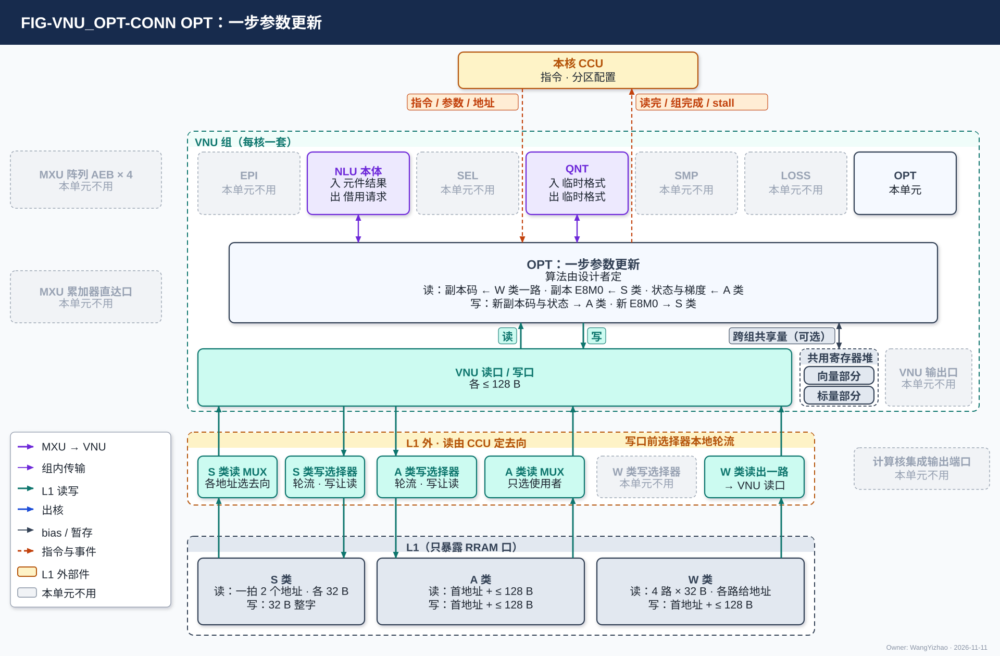

# VNU 优化器单元（OPT）需求

> Owner: WangYizhao｜2026-11-11

## 1 概述

OPT（Optimizer Unit，优化器单元）对一组可训练参数做**一步更新**：输入当前参数 $\boldsymbol\theta$、同形的梯度矩阵 $\mathbf G$ 与优化器状态，输出新参数 $\boldsymbol\theta'$ 与新状态。例如一个线性位点 $Y = XW$（$W$ 为 $K \times M$）旁加 LoRA 支路 $XAB$，$A$ 为 $K \times r_{\text{LoRA}}$、$B$ 为 $r_{\text{LoRA}} \times M$；训练只更新 $A$、$B$，OPT 的一组参数就是 $A$ 或 $B$ 的一段，$\mathbf G$ 是对应的 $\mathrm dA$ 或 $\mathrm dB$。**组**是随同一段权重流到达、一次更新完的一段参数，由指令给出。

**本篇只规定接口、时序协议与集成精度；更新算法由设计者基于算法仿真确定**（用户 11-04："最大程度放权，OPT 可以直接给它接口规范，然后设计者来自行决定权重更新该怎么做；AdamW 无需作为强制需求，可以由设计者基于算法仿真来设计"）。

**OPT 是 VNU 组的六个单元之一**（其余五个是 NLU（含后处理子模块 EPI）、SEL、QNT、SMP、LOSS），每个计算核一个，全芯片 4 个，物理相同；按指令启用，不启用时不工作。一个计算核由 CCU、MXU 组、L1 组、VNU 组四组拼成。**OPT 与 VNU 组外的模块交换数据，都经 VNU 组的对外口**（VNU 集成篇 §2）。**OPT 是一份计算资源，同一时刻只服务一个任务；多个来源要用 OPT 时由 CCU 按指令串行排**；与 VNU 其他单元在计算资源不冲突时可以同时工作（V18-VNU-06，VNU 集成篇 §3.2）。本篇不写指令字段，指令字段由 OPT 设计者按需整理、与 ISA 对接。

**OPT 不做什么**：不做反传，不形成梯度矩阵（训练核的 MXU 与 NLU）；不做跨核归约（MAE_CRU）；不发 DDR 读写请求（MAE 与 NI），不参与调度。

## 2 接口需求

### 2.1 架构图与接口汇总

图中模块框内的结构是参考实现（见第 7 章），本章以框外的各口为准。

图是 VNU 组的统一外框（VNU 集成篇 §2.1），灰框为 OPT 不用的对端：

- **上方**：本核 CCU（虚线）把指令与参数作为配置交 VNU_CONTROLLER（L1 地址留在 CCU 一侧，VNU_CONTROLLER 篇 §2.2），OPT 的读完、组完成事件与 stall 回 CCU（由谁驱动见 VNU 集成篇 §2.9）。**OPT 在命令网上没有端口**；跨核归约结果是数据：由 MAE_CRU 在 L2 合并、经 H2C 落 L1 后 OPT 经 VNU 读口读入，部分和由 NLU 作为输出写 L2（V18-TP-55 / 56、V18-CRU-07；MAE_CRU 与 L2 在 L1 之后，图中不画）。OPT 不向 CCU 上报跨组共享量（V18-OPT-02，本篇 §3.6）。
- **左侧**：MXU 阵列的 AEB × 4（只进 EPI）与 MXU 累加器直达口（直通 SEL）都画灰，OPT 不接 MXU。
- **框内上排**是 VNU 六个单元，NLU 拆成 EPI 与 NLU 本体两格；"本单元"那格是 OPT。与 OPT 往来的两格点亮，"入 / 出"以 OPT 为准：NLU 本体（入：元件结果，出：借用请求，本篇 §2.6）、QNT（入 / 出：临时格式，只在设计者选用 QNT 统一格式时存在，VNU 集成篇 §3.6.1）；其余画灰。
- **框内中部**是 OPT 的展开框，只写运算形态：一步参数更新，算法由设计者定。
- **框内下排**是三项组级共用资源（VNU 集成篇 §1.1）：共用寄存器堆、VNU 读口 / 写口（各 ≤ 128 B）、VNU 输出口。**OPT 用 VNU 读口 / 写口；确有跨组共享的量时也可用共用寄存器堆，位置由 VNU_CONTROLLER 按分区算（本篇 §3.6）**；输出口画灰。
- **框外下方**分两层：上层是 L1 外的读写选择部件（S 类读 MUX、A 类读 MUX、W 类读出到 VNU 读口的一路由 CCU 定去向；A / W / S 三类写口前的选择器自己按固定规则在 H2C 接收桥、NWB、VNU 写口之间轮流，不由 CCU 逐拍选，V18-L1-32；归计算核集成，`CORE_INTEGRATION_STAGING.md`）；下层是只暴露 RRAM 口的 L1（W / S / A 三类；图中 L1 只画三类的读写口，L1 内部组织，见 L1 篇第 7 章）。OPT 用其中五个：W 类读出到 VNU 读口的一路读前向副本的码、S 类读 MUX 读副本的 E8M0、A 类读 MUX 读状态与梯度，A 类写口前的选择器把新副本的码与新状态写 A 类、S 类写口前的选择器把新 E8M0 写 S 类；W 类写口前的选择器画灰（VNU 写口可写 W 类是组级能力，V18-VNU-09，OPT 不用这一路）。

| 口 | 对端 | 方向 | 内容 | 握手 |
|---|---|---|---|---|
| VNU 读口 · W 类一路 | L1 W 类权重读口在 L1 外送 VNU 读口的一路 | 入 | 当前参数副本的码（MXINT8 hi / lo 平面） | 读侧无握手（核内 RRAM 协议）；来不及收时拉 stall |
| VNU 读口 · S 类 | L1 S 类读口经 S 类读 MUX | 入 | 当前参数副本的 E8M0 | 同上 |
| VNU 读口 · A 类 | L1 A 类读口经 A 类读 MUX | 入 | 优化器状态、梯度、可选持久平面、跨核归约结果、跨组共享量（存 A 类时） | 同上 |
| VNU 写口 · A 类 | A 类写口前的写 MUX | 出 | 新参数副本的码、新状态与可选平面、跨组共享量（存 A 类时） | wr_stall 回 OPT |
| VNU 写口 · S 类 | S 类写口前的写 MUX | 出 | 新参数副本的 E8M0，整字 | 同上 |
| 共用寄存器堆 | VNU 共用寄存器堆（存标量的部分；分区由 CCU 配置，位置由 VNU_CONTROLLER 算） | 入 / 出 | 跨组共享量（存寄存器堆时） | 组内 |
| 指令与参数 | 本核 CCU | 入 | 指令、标量与超参、各读写地址 | 命令侧的线（VNU 集成篇 §2.9） |
| 读完信号、组完成事件、入口 stall | 本核 CCU | 出 | 本篇 §2.5 | 同上 |
| NLU 元件借用 | NLU 本体 | 出 / 入 | 借用请求 / 元件结果 | 组内（VNU 集成篇 §3.6.3） |
| 临时格式 | QNT | 入 / 出 | 只在设计者选用 QNT 统一格式时存在 | 组内 |

VNU 读口、写口的口宽以架构篇 PORT-01 / PORT-02 / PORT-03 / PORT-04 / PORT-06 与 VNU 集成篇 §2 为准，本表只为阅读方便列出 OPT 一侧交什么。

### 2.2 VNU 读口：副本码经 W 类一路、副本 E8M0 经 S 类、状态与梯度经 A 类

**OPT 访问 L1 经 VNU 读口 / 写口（各 ≤ 128 B，VNU 集成篇 §2.4 / §2.6）；VNU 对 L1 只有一个读口、一个写口，OPT 与 VNU 其他单元分用**（V18-VNU-04）：读由 CCU 发，各单元怎样轮用两个口见 VNU_CONTROLLER 篇 §3.4。读出到 VNU 读口后由 VNU_CONTROLLER 按配置分给 OPT（VNU_CONTROLLER 篇 §2.5）。

#### 2.2.1 三类数据从哪里读

| 数据 | 在 L1 哪里 | OPT 怎样读 |
|---|---|---|
| 当前参数副本的码（MXINT8 hi / lo 平面） | W 类（前向已读入的那一份） | **经 W 类权重读口在 L1 外送 VNU 读口的一路**（V18-L1-21 / 26）：W 类只有一个读口（一拍 4 路 × 32 B，每路各自给地址，架构篇 §2.2.1、§3.4 CONC-4），送 VNU 读口是它在 L1 外的一个去向；OPT 读副本码时与 MXU 取权重共用这个读口、先后由 CCU 排；读连续的副本码时 CCU 给出连续字的地址 |
| 当前参数副本的 E8M0 | S 类（前向已读入的那一份；放在哪由编译链分配） | **经 L1 外的 S 类读 MUX 进 VNU 读口**；S 类读口一拍可接收 2 个地址（可以是同一个堆里的两个数据），同拍需要多于 2 路时由 CCU 错开（架构篇 §3.4 CONC-6） |
| 优化器状态、梯度、可选持久平面 | A 类（经 HUB_IDN 落地） | **经 A 类读 MUX**，整拍只给一个使用者（架构篇 §3.7） |

#### 2.2.2 读的规则

- **读的首地址与长度（≤ 128 B）、W 类一路各路的地址都由本核 CCU 给出**（V18-VNU-04 / TP-73 / L1-26）；L1 交回按首地址对齐好的数据，不从存储字边界起时由 SRAM 内部移位（V18-TP-74，架构篇 §3.5.4），**OPT 一侧不需要做字节移位**；从存储字边界起一拍，否则允许多拍（架构篇 §3.4 CONC-3）。
- **读侧没有握手**（核内 RRAM 协议）：OPT 的读入口来不及收时参与合成 VNU 读入口的 stall_vnu，CCU 停发读（VNU 集成篇 §2.4）。
- **编译链不做读写带宽保证，需求超出时 OPT 等**（V18-L1-21）。

### 2.3 VNU 写口：新副本码与新状态写 A 类，新 E8M0 写 S 类

**OPT 只写 A 类与 S 类**：新参数副本的码、新状态与可选平面写 A 类；新参数副本的 E8M0 写 S 类（V18-L1-28 / 29）。

| 数据 | 写到哪 | 怎样写 |
|---|---|---|
| 新参数副本的码、新状态与可选平面 | A 类 | 经 VNU 写口、写 MUX 进 A 类写口 |
| 新参数副本的 E8M0 | S 类 | 经 VNU 写口、写 MUX 进 S 类写口；**S 类整字写、不带 be，数据块末字的空余字节补 0**（架构篇 §2.2.4） |

- **OPT 写 L1 时只交数据与每拍的有效字节数（≤ 128 B，从第 0 字节起），不给地址；写的首字节地址与 `seg` 由本核 CCU 内部计数推出（V18-VNU-12，VNU_CONTROLLER 篇 §3.9）**；OPT 的写在 VNU 内合并进 VNU 写口，VNU 写口按 `seg` 接 L1 的 A 类或 S 类写口（VNU 集成篇 §2.6）。
- **A、W、S 三类写口前各有一个选择器，在 L1 外，自己按固定规则在 H2C 接收桥、NWB、VNU 写口三个来源之间轮流，没轮到的在自己的 FIFO 里等，不由 CCU 逐拍选；写与读碰到同一个堆时写让读**（V18-L1-32、V18-VNU-09，架构篇 §3.7）；VNU 写口来不及时拉 **wr_stall** 交当拍在写的单元（只到 VNU，不到 CCU），**OPT 保持待写的数据、不丢**。
- **核内写 L1 的完成由 CCU 判定；VNU 写口的写何时写完，由写口前的选择器告知 CCU 或由 VNU 报完成【设计者定】（V18-L1-32）**（架构篇 §3.9）；OPT 自己不报写完成。

### 2.4 写回出核：写 L1 后由 CCU 经发送 FIFO 入口上 C2H

**新参数与新状态写进 L1 后，由本核 CCU 发读 L1、经 C2H 发出，再由 MAE 发令经 L2 写回 DDR**（用户 11-04 / 11-06，V18-TP-35，协议篇 §3.17）：码与状态从 A 类经 A 类读 MUX、E8M0 从 S 类经 S 类读 MUX 进集成输出端口的发送 FIFO 入口（架构篇 §2.3.1）；本核 CCU 按位点指令发令、发读 L1 并逐拍给出 C2H 上的 L2 地址；数据块写进 L2、数满写入握手后 CCU 向 MAE 发出报告；**写到 DDR 哪里由 MAE 指令给出**。**OPT 不用 VNU 输出口。**

### 2.5 CCU 口：指令、标量与超参入；读完信号、组完成事件与 stall 出

| 方向 | 内容 | 说明 |
|---|---|---|
| 入 | 指令（标明本组更新）、标量与超参（个数与含义由设计者定，例如学习率、与训练步数相关的系数、衰减系数）、各读写地址 | 跨组要用的量存 L1 A 类或共用寄存器堆（本篇 §3.6），CCU、LIC 不持有 |
| 出 | **读完信号**：副本读完 | 作为该副本段的"最后读者完成"事件（协议篇 §3.14，本篇 §3.5） |
| 出 | **组完成事件**：本组全部输出已写回 | 交本核 CCU（本篇 §3.5） |
| 出 | **入口 stall**：OPT 的读入口来不及收 | 参与合成 VNU 读入口的 stall_vnu（VNU 集成篇 §2.4） |

**OPT 在命令网上没有端口**；跨核归约结果与跨组共享量都是数据，经 L1 或共用寄存器堆读写（本篇 §3.3、§3.6）。

### 2.6 NLU 元件借用口：NLU 的运算元件对 OPT 分时开放

**OPT 的算法需要开方、除法、归约等运算时，分时借用 NLU 的运算元件；NLU 的运算元件对 LOSS / OPT 分时开放是 VNU 的底层需求**（V18-VNU-10，用户 11-11："这是必要的，对于VNU的功能复用和寄存器复用，以及其他类似设计，这是底层需求"）。NLU 与 OPT 怎样合作或折叠，由指令设计考虑，具体指令由两个模块的设计者配合确定（用户 11-04，V18-NLU-03）；借用接口的形式由 VNU 集成设计者定（VNU 集成篇 §3.6.3，V18-VNU-08）。

### 2.7 组内链路：只限定位宽

**OPT 与同组单元之间经组内链路交换数据，链路只规定位宽：全组参考每拍 256 bit（32 B），另加握手位**（用户 11-04，V18-VNU-02；架构篇 PORT-08）。链路上是什么格式、什么精度，由两端的控制逻辑按指令解码；链路条数与互连方式由 VNU 集成设计者定（VNU 集成篇 §3.6.2，V18-VNU-08）。与 QNT 的临时格式只在设计者选用 QNT 统一格式时存在（VNU 集成篇 §3.6.1）。

## 3 功能描述

### 3.1 功能一览

| 功能 | 输入 | 输出 | 触发 / 生效条件 | 节 |
|---|---|---|---|---|
| 一步参数更新 | 当前参数副本、梯度、状态、标量 | 新参数副本、新状态 | 本篇 §3.5 的启动条件齐 | §3.2 |
| 输入格式 | — | — | 恒定 | §3.3 |
| 输出格式与副本的重量化 | 更新后的参数 | MXINT8 g32 副本 | 每组 | §3.4 |
| 时序协议 | 指令、就绪 | 读完信号、组完成事件 | 每组 | §3.5 |
| 跨组共享量的存放 | 设计者算法需要的跨组量 | 存 L1 A 类或共用寄存器堆 | 算法需要时 | §3.6 |
| 集成精度 | — | — | 恒定 | §3.7 |
| 复位 | 复位 | 清 OPT 内部状态 | 复位 | §3.8 |

### 3.2 一步参数更新：算法由设计者基于算法仿真确定

**AdamW 不是强制需求。** 以下都由设计者基于算法仿真确定，只要满足本篇 §3.7 的集成精度（用户 11-04，V18-OPT-01）：更新规则；是否做梯度裁剪；优化器状态存什么、用什么格式；新参数写回时怎样舍入；是否另存更高精度的参数平面。

**设计者要交付的**：所选的更新规则、状态内容与格式、写回舍入方式；支撑它满足本篇 §3.7 的算法仿真结果；同步更新的算法参考模型。

**可以调的范围**：逐元素或按组的更新规则；是否使用状态，用几份；是否使用跨核归约结果，例如是否做全局范数裁剪；副本写回的舍入（就近舍入、无偏舍入或其他）；是否另存持久平面，例如更高精度的参数主值或余数。

**不可以改的**：本篇第 2 章的接口与本篇 §3.5 的时序协议；交给前向的参数副本是 MXINT8 合同格式（本篇 §3.4）；不另开 DDR 读流、不新增 MAE 引擎与片上链路（本篇 §5.1）。

现行参考算法见本篇 §7.1。

### 3.3 输入

| 输入 | 从哪来 | 经哪个口 | 格式规定到什么程度 |
|---|---|---|---|
| 当前参数副本 | L1 中前向已读入的一份：码在 W 类、E8M0 在 S 类 | VNU 读口：码经 W 类读出到 VNU 读口的一路，E8M0 经 S 类读 MUX（本篇 §2.2） | **MXINT8 g32 合同格式**：每元素 8 bit 码，拆成高位、低位两个 4 bit 平面；每 32 个元素共享一个 E8M0 尺度 |
| 梯度矩阵 $\mathbf G$ | 训练核累加完成后写 DDR，随同组权重流到达 | 经 HUB_IDN 落入 L1 A 类，经 VNU 读口读 | **格式与每参数字节由 OPT 设计者与训练核、数据组织篇对接后登记**（清单 VNU_OPT D1，用户 11-11"认可"；参考值 BF16，见本篇 §7.2）。与副本同布局、同组、同序 |
| 优化器状态与可选持久平面 | DDR，随同组权重流到达 | 同上 | **内容、格式、每参数字节由 OPT 设计者与训练核、数据组织篇对接后登记**；与副本同组同序。没有状态的算法可以不用 |
| 跨核归约结果 | MAE_CRU 合并后的值，例如全局梯度范数平方 $\lVert g\rVert^2$ | 经 L2 → H2C 落 L1，OPT 经 VNU 读口读入（V18-TP-55 / 56、V18-CRU-07）；落进 L1 后 CCU 才发使用它的指令 | **FP32** |
| 标量与超参 | 指令 | 本核 CCU | 个数与含义由设计者定；跨组要用的量存 L1 A 类或共用寄存器堆（本篇 §3.6），CCU、LIC 不持有 |
| 跨组共享量（若算法需要） | 本核 L1 A 类或 VNU 共用寄存器堆（本篇 §3.6） | VNU 读口（地址由 CCU 给）或共用寄存器堆（位置由 VNU_CONTROLLER 按分区算） | 由设计者定 |

**写死的只有前向直接消费的副本格式与跨核标量的 FP32**；其余"由设计者定"的，设计者可随算法改，但须保持与副本同组、同序到达（本篇 §5.1）。这里的梯度矩阵指参数梯度，例如 $\mathrm dA$、$\mathrm dB$，与参数同形；不是反传时读入的激活，也不是在算子之间流动的梯度，那两类已是 MXFP6。若设计者把梯度改用 MXFP6，只在累加完成后量化一次，跨块累加面仍为 BF16，并在本篇 §3.7 的仿真中验证 AL。

### 3.4 输出与副本的重量化

| 输出 | 去向 | 格式规定到什么程度 |
|---|---|---|
| 新参数副本 | 经 VNU 写口写 L1（**码写 A 类、E8M0 写 S 类**），再由本核 CCU 经 C2H 发出、MAE 经 L2 写回 DDR（本篇 §2.4） | **MXINT8 g32 合同格式，是底线，不放开**（用户 11-04）：码、E8M0 尺度与尺度规则按整体集成篇的量化合同，前向 MXU 直接读它。设计者可另存更高精度的持久平面，但交给前向的一份必须是 MXINT8。舍入方式由设计者定 |
| 新状态与可选持久平面 | 同上（写 A 类） | 设计者自有格式，每参数字节按本篇 §3.3 登记 |
| 读完信号、组完成事件 | 本核 CCU | 本篇 §3.5 |

**副本的重量化由 OPT 执行**：输出必须是合同格式的副本，重量化随更新算法在 OPT 内完成，按与 QNT 相同的量化规则（V18-QNT-04 所列例外之一）。

### 3.5 时序协议：放权后仍固定的六条

这六条只管"什么时候能开始、什么时候算完、什么时候可以覆盖"，与更新算法无关；设计者无论选什么算法都按这六条与 CCU、MAE、LIC 对接。其中第 2、3 条是 OPT 对外发的两个事件（读完信号、组完成事件），第 4、5 条是别的模块保证的前提，第 1、6 条是 OPT 自身的行为。

1. **启动条件**：以下三者齐了才开始一组更新；不齐时等待：
   - 指令标明本组更新；
   - 本组所需的标量已给齐。跨核归约结果（若算法使用）**落进本核 L1 之后，CCU 才发本组的更新指令**，所以这一条在指令到达时已成立，OPT 不检查有效位；
   - 本组的副本、状态与梯度已在 L1 中就绪（写完成：发令的 MAE 搬运引擎数满写入握手后给本核 CCU 发写完通知，CCU 收到后才发本组的更新指令，V18-TP-70，协议篇 §3.8）；一组的状态与梯度分几批搬入时，**CCU 按批判就绪**：每一批是一条搬运指令的一次执行，每次执行各发一次写完通知；一批的写完通知到了就可发这一批的更新指令，不要求整组搬完（V18-DORG-10）。
2. **读完才释放**：OPT 读完副本才发读完信号；**读完信号就是该副本段的"最后读者完成"事件**，编译链安排的下一组数据只在这个事件之后才写进同一段地址（协议篇 §3.14：目的空间是否空闲归编译链与指令，L1 不带段标志）。
3. **全部输出写回完成后才报组完成事件。**
4. **前向不读到半更新的参数**：OPT 只承诺第 3 条；版本怎样轮换、新版写到哪、前向读哪一版，由 MAE、LIC 与 CCU 保证。
5. 副本不在本核 L1 时，由 MAE 在现有通路内送进本核 L1，**OPT 只读本核 L1**。
6. OPT 不区分参数属于哪个模型、哪种训练方式，同一套接口与时序。

### 3.6 跨组共享量：确有时存 L1 A 类或共用寄存器堆

**设计者的算法确有跨组共享的量（例如裁剪系数）时，这些量存在本核 L1 A 类或 VNU 共用寄存器堆，由 OPT 写入、在后续各组读回；放 L1 A 类时位置由 CCU 给，放共用寄存器堆时由 VNU_CONTROLLER 按分区算**（V18-OPT-02，用户 11-11："如果真的涉及跨组共享，A区的SRAM存储或者共享寄存器都可以用来存"）。OPT 不把它们报给 CCU，CCU 与 LIC 不持有、不随指令带回。VNU 共用寄存器堆分存向量与存标量两部分、物理分开，分区由 CCU 配置、逐拍位置由 VNU_CONTROLLER 算（V18-VNU-10 / 12，VNU 集成篇 §3.3），跨组共享的标量放在存标量的部分。

### 3.7 集成精度

**OPT 的更新方案集成到在线训练后，Draft 接受长度 AL 相对 AdamW（按 FP32 理想值更新）的下降 < 5%**（用户 11-04）。

- 这是 OPT 对 VNU 统一口径（集成后掉点 < 0.1%，V18-VNU-01）的放宽。
- 中间计算精度不规定，由设计者定。
- 硬件实现与算法参考模型逐位一致，作为验证手段；参考模型随硬件实现同步。

### 3.8 复位

复位输入来自 CIF（架构篇 PORT-41），硬复位与软复位不区分（CIF 篇 §2.4、§3.3）；**复位清 OPT 内部的在途状态**。跨组共享量若存在，存在 L1 A 类或共用寄存器堆（本篇 §3.6），不由 OPT 清。

## 4 性能指标

### 4.1 速率要求：及时读走落地数据，不让 HUB_IDN 落地停顿

**OPT 每拍能更新的参数数、每参数每步的 DDR 字节，须匹配相关模块的需求，由 OPT 设计者与 MAE、数据组织篇、L1、数据流篇对接确定**；现行参考值见本篇 §7.2。OPT 自己承诺：

- **读走落地数据的持续速率不低于 MAE 灌入该段的速率**（清单 VNU_OPT D3，用户 11-11"认可"）：状态与梯度经 HUB_IDN 落入 L1 的 A 类空间（用户 11-05 确认，VNU 集成篇 §2.4），OPT 须按编译链排定的节奏读走已落地的状态与梯度并及时报读完，**使下一轮落地不因 OPT 而推迟；读取不丢失、不重复**。
- 落地段按 ping-pong 两份轮转（这是编译链排地址的用法，两堆在硬件上都可读可写；MAE 搬运的数据不按环形使用，V18-MAE-17），每拍目的地址由 MAE 搬运引擎逐拍给出；**HUB_IDN 何时可以写入一段，由编译链按预取距离与 OPT 的读完事件安排（LIC 操作 15）**。NWB 的吞吐要求与做法见接收桥篇（NWB 32 B/拍，目的地址连续时满速、不连续只降速，架构篇 §3.4 CONC-3）。
- 写完由发令的 MAE 搬运引擎数满写入握手后通知本核 CCU（V18-TP-70）。

### 4.2 同时使用的口与并发条件

| 同时使用的情形 | 适用的约定 | 结果 |
|---|---|---|
| OPT 经 VNU 读口读、经 VNU 写口写 L1 | 架构篇 §3.4 CONC-1 / CONC-2 | 读与写落不同的堆时同拍进行；同一个堆同一拍只做一次访问：读由 CCU 排，写碰到读时写让读（写口前的选择器本地判断，V18-L1-32） |
| OPT 读副本码与 MXU 取权重共用 W 类权重读口 | 架构篇 §2.2.1、§3.4 CONC-4 | 先后由 CCU 排 |
| OPT 读副本 E8M0 | 架构篇 §3.4 CONC-6 | S 类读口一拍可接收 2 个地址；同拍需要多于 2 路时由 CCU 错开 |
| NWB 落地与 VNU 写口写 L1 | 架构篇 §3.7（每类写口前的选择器本地轮流、写让读，V18-L1-32） | 先后由选择器本地定，不由 CCU 排 |
| OPT 与 VNU 其他单元分用 VNU 读口 / 写口 | 架构篇 §3.7 | 读口每拍读什么由 CCU 排；读出在 VNU 内分给谁、各单元轮用写口的先后由 VNU_CONTROLLER 按配置定（VNU_CONTROLLER 篇 §3.4）；编译链不做读写带宽保证，需求超出时 OPT 等（V18-L1-21） |
| OPT 写回经 C2H 写 L2 | 架构篇 §3.4 CONC-2 / CONC-3 | 与同一个堆上的其他链路依次服务、只降速；调度先错开 |

### 4.3 要求值表

| 项 | 要求值 | 说明 |
|---|---|---|
| 接口 | 本篇第 2 章 | 输入输出固定；状态格式由设计者定 |
| 参数副本 | MXINT8 g32 合同格式 | 底线，不放开 |
| 梯度与状态的格式、每参数字节 | 由 OPT 设计者与训练核、数据组织篇对接后登记 | 参考值见本篇 §7.2 |
| 时序协议 | 本篇 §3.5 | 启动条件、读完才释放、全部写回后报完成 |
| 精度 | 在线训练后 Draft AL 相对 AdamW（FP32）下降 < 5% | 中间精度由设计者定 |
| 读走落地数据 | 持续速率不低于 MAE 灌入该段的速率；不丢、不重 | 本篇 §4.1 |
| 每拍处理能力与 DDR 字节 | 匹配相关模块 | 由 OPT 设计者对接确定 |
| 组内链路 | 参考每拍 256 bit + 握手位 | 互连方式由 VNU 集成设计者定（VNU 集成篇 §3.6.2） |
| L1 访问 | 经 VNU 读口 / 写口（各 ≤ 128 B）：读入口来不及收时 VNU 向 CCU 拉 stall_vnu；写只交数据与有效字节数（写地址由 CCU 计数推出），wr_stall 回 OPT | VNU 集成篇 §2.4 / §2.6 |
| 写回出核 | 写 L1 后由 CCU 经发送 FIFO 入口上 C2H | 不用 VNU 输出口 |
| 跨核归约结果 | 从 L1 读入（MAE_CRU 合并后经 H2C 落地）；部分和由 NLU 累加；FP32；OPT 在命令网上无端口、无有效位 | 协议篇 §3.17、§3.18 |
| 跨组共享量 | 存 L1 A 类（位置由 CCU 给）或共用寄存器堆（位置由 VNU_CONTROLLER 按分区算） | 本篇 §3.6 |

## 5 约束与由使用者保证的事项

### 5.1 硬约束

- **不另开 DDR 读流，不新增 MAE 引擎与片上链路**（用户 09-28 / 09-29 复用哲学）：当前参数读 L1 中前向已读入的一份（码在 W 类、E8M0 在 S 类），不从 DDR 重读；状态与梯度随同组权重流同序进入；写回走现有的上行通路。DDR 只多出状态、梯度与可选平面的字节。
- **交给前向的参数副本是 MXINT8 g32 合同格式**（本篇 §3.4）。
- **OPT 只读本核 L1**（本篇 §3.5 第 5 条）。
- **本篇不含容错设计**（V18-TP-75）。

### 5.2 由使用者保证的事项

以下事项 OPT 不检查，由对应方保证；验收时把它们当作输入前提、用仿真断言核对（本篇 §6.1）。

| 事项 | 由谁保证 |
|---|---|
| 梯度矩阵的形成与跨块累加 | 训练核（MXU、NLU） |
| 跨核归约的部分和与合并 | NLU（默认）、MAE_CRU |
| 跨核归约结果落 L1 之后才发使用它的指令；部分和由 NLU 作为输出写 L2 | CCU（协议篇 §3.18）；MAE（合并指令收齐发出报告后执行） |
| 标量与超参的产生与下发 | LIC、CIF |
| 跨组共享量（若有）的存放地址：L1 A 类或 VNU 共用寄存器堆的哪一段；段在各组之间不被覆盖 | CCU 与编译链（V18-OPT-02） |
| 更新哪一组、在哪个核、何时更新 | LIC 与数据流篇 |
| 读写 L1 的地址（基址 + 字节累加）与读出去向 | CCU |
| 副本段在读完信号之前不被覆盖；下一组数据的写入等读完信号（最后读者完成） | 编译链（LIC 操作 15 的预取距离与缓冲轮转）、CCU |
| 状态、梯度与可选平面随组权重流同组同序到达 | MAE |
| 副本不在本核 L1 时送进本核 L1 | MAE |
| 写回地址与版本轮换 | MAE、LIC |
| 前向读本组前等组完成事件 | CCU、LIC |
| MXINT8 码与尺度规则 | 整体集成篇的量化合同 |
| 写 L1 的数据经发送 FIFO 入口上 C2H | 本核 CCU（按位点指令发令、发读 L1、逐拍给 C2H 地址；发完后向 MAE 发出报告） |
| 同一单元的不同任务不在时间上重叠；多个来源要用 OPT 时的串行先后 | CCU 与指令（VNU 集成篇 §3.2.2） |
| W 类读出到 VNU 读口的一路、S 类读 MUX、A 类读 MUX 每拍送谁（都在 L1 外）；VNU 读口每次访问的首地址与长度、W 类一路各路的地址；写回 L1 的地址（按 OPT 交出的有效字节数计数推出） | CCU（VNU 集成篇 §5.2；架构篇 §3.4、§3.7） |
| 读出在 VNU 内分给哪个单元、各单元的写怎样轮用 VNU 写口、共用寄存器堆的逐拍位置 | VNU_CONTROLLER（VNU_CONTROLLER 篇 §2.5、§3.4、§3.6） |
| 写口前的选择器在三个来源之间轮流；写与读碰到同一个堆时写让读 | 写口前的选择器本地（V18-L1-32） |
| 组内链路条数与互连、元件借用接口 | VNU 集成设计者（VNU 集成篇 §3.6） |

## 6 验收

### 6.1 本模块验收项

| 验收项 | 方法 | 用例 | 出处 |
|---|---|---|---|
| 启动条件 | 断言（输入前提，§5.2） | 更新指令晚于本组副本、状态与梯度的写完通知；使用跨核归约结果的组，更新指令晚于该结果落进 L1 | §3.5、§5.2 |
| 读完才释放 | 断言 | 读完信号之前该副本段无覆盖写；相邻两组 | §3.5 |
| 组完成事件 | 断言 | 组完成事件晚于全部输出写回 | §3.5 |
| 副本格式 | 逐位检查 | 输出副本的码与尺度符合量化合同；新 E8M0 整字写 S 类、末字空余补 0 | §3.4、§2.3 |
| VNU 读口 / 写口与入口 stall | 周期仿真；断言 | 写只交数据与有效字节数；stall_vnu 拉起后读入口不溢出；wr_stall 拉起后不丢字 | §2.2、§2.3 |
| 跨组共享量 | 逐位比对 | 跨组共享量存 L1 A 类与存共用寄存器堆两种，后续组读回的值与写入相同；CCU 与 LIC 不持有 | §3.6 |
| 更新算法 | 与设计者交付的算法参考模型逐位比对 | 随机组；边界值（全零梯度、大幅值参数） | §3.2 |
| 集成精度 | 算法侧在线训练对拍 | Draft 同步训练与独立训练；对照 AdamW（FP32） | §3.7 |
| 不另开 DDR 流 | 审查 | 无 OPT 专用 DDR 读流、MAE 引擎与片上链路 | §5.1 |
| 读走落地数据 | 周期仿真 | DDR 峰值灌入时 OPT 读走速率不低于灌入速率，HUB_IDN 落地不因 OPT 停顿；不丢、不重 | §4.1 |
| 由使用者保证的前提 | 仿真断言 | 逐项核对本篇 §5.2 表中的前提在 OPT 的输入上成立 | §5.2 |

### 6.2 与上下游模块的对接检查

| 对接项 | 对端 | 检查内容 |
|---|---|---|
| 梯度与状态的格式、每参数字节 | 训练核（MXU、NLU）、数据组织篇 | 双方登记的格式与字节数一致，DDR 预算按登记值计 |
| 副本读与 W 类权重读口 | L1 篇、CCU（`CCU_STAGING.md`） | OPT 读副本码与 MXU 取权重共用读口，CCU 排开；各路地址由 CCU 给 |
| 读写同拍不落同一个堆 | CCU、L1 篇、架构篇 §3.4 CONC-2 | 读由 CCU 排；写碰到同一个堆的读时由写口前的选择器本地让读（V18-L1-32） |
| NLU 元件借用 | VNU_NLU 篇、VNU 集成篇 §3.6.3 | 借用请求与元件结果的接口两端一致，分时不冲突 |
| 落地与读完 | MAE_ENG 篇、HUB_IDN 篇、接收桥篇、LIC（`LIC_STAGING.md`） | 读完事件与编译链的预取距离配合，下一轮落地不因 OPT 推迟 |
| 写回出核 | 计算核集成（`CORE_INTEGRATION_STAGING.md`）、MAE_ENG 篇 | CCU 经发送 FIFO 入口上 C2H，发出报告后 MAE 写回 DDR |

## 7 参考实现

**本章内容可以换；换了之后别的模块不用改。**

### 7.1 现行参考算法：AdamW 加全局范数裁剪与四种写回形态

设计 Spec V1.7_3 的 VNU_OPT 篇有一套现行参考：AdamW 加全局范数裁剪，以及四种写回形态，即就近舍入写回、无偏写回、副本加 16 bit 余数、FP32 主值。有限仿真（SIM-OPT-MXINT8-MASTER-ONLINE-QUALITY-20261012）中四种形态的 AL 相对参照依次为 −1.36%、+0.04%、−0.54%、+0.27%。**这些只作设计者的起点，不是本篇的条款。**

### 7.2 参考格式、每参数字节与速率

下表是按现行 AdamW 估算的参考值，供 OPT 设计者与各模块对接时作起点：

| 相关模块 | 接口 | 现行参考值 |
|---|---|---|
| 训练核、数据组织篇 | 梯度与状态格式 | 梯度 BF16（是否优化到 MXFP6 g32 由设计者决定，用户 11-04）；状态两份 FP32 |
| MAE（经 HUB_IDN 灌入） | 状态与梯度 | DDR 峰值 19.2 B/拍；现行每参数灌入 10 B（两份 FP32 状态 8 B + BF16 梯度 2 B），约 1.9 个参数/拍 |
| 数据组织篇 | 训练数据的 DDR 预算 | 现行每参数每步 21.03 B（就近舍入 / 无偏写回）、25.03 B（加 16 bit 余数）、29.03 B（FP32 主值） |
| L1（经 VNU 读口 / 写口） | 副本读、状态与梯度读、写回 | VNU 读口 / 写口各 ≤ 128 B/拍，与 VNU 其他单元分用；副本码经 W 类权重读口（4 路 × 32 B = 128 B/拍）读出；现行副本读平均约 0.36 B/拍 |
| C2H、L2 | 写回 | 经本核 C2H（L2WP，32 B/拍）写进本核对应象限里目的地址所在的堆；与同一个堆上的其他链路依次服务，调度先错开；占用归数据流篇 |
| 数据流篇 | 组更新的时间余量 | 一组更新能否在下一次前向读本组之前完成 |

### 7.3 门数、计数与读入口 stall

- **门数参考**：≤ 90 k 门（NAND2 等效），按现行 AdamW 估算的参考值，不是要求值。
- **迟到计数（性能计数，建议）**：两部分相加：① 本组启动条件不满足而推迟的拍数；② 下一次前向读本组时等本组组完成事件的拍数。计入 CCU 的位点计数快照，供观察组更新的时间余量是否够用。由于第 2、3 个启动条件由 CCU 在发更新指令前判定（本篇 §3.5），这两部分都在 CCU 侧可见，OPT 本身只需给出组完成事件的时点。
- **读入口 stall 的门限**：读入口缓冲占到"深度 − $L$"时参与拉 stall_vnu，$L$ = CCU 停发 1 拍 + L1 读返回 1 拍【设计者定】：约束是 stall 拉起后读入口不溢出（VNU 集成篇 §2.4、§3.9）。
- **读的拍数**：从存储字边界起的读一拍出数，否则允许多拍（架构篇 §3.4 CONC-3）；OPT 的数据默认字对齐。

### 7.4 参考实现的自检项

| 自检项 | 方法 | 用例 |
|---|---|---|
| 参考算法（§7.1） | 与参考模型逐位比对 | AdamW 加裁剪，四种写回形态 |
| 迟到计数（§7.3） | 断言 | 启动条件缺失时计入迟到计数 |
| 读入口 stall（§7.3） | 周期仿真 | 到"深度 − $L$"时拉起，不溢出 |
| 门数（§7.3） | 综合 | 待 RTL |

## 8 为什么

### 8.1 需求的理由

- **最大程度放权，只给接口**（用户 11-04）：优化器是算法侧仍在演进的部分，固定 AdamW 会限制设计者按仿真选更合适的方法。所以本篇只规定别的模块依赖的东西：接口、时序、交给前向的格式和集成精度。
- **接口与时序固定**：
  - 前向 MXU 直接读 MXINT8 副本，这个格式一变就牵动 MXU、L1 与 MAE，所以 MXINT8 是底线（用户 11-04）；
  - 前向不能读到只更新了一半的参数，所以全部写回后才报完成；
  - 已读进片上的数据不从 DDR 重读（用户 09-28 / 09-29），所以 OPT 读前向那份副本，状态与梯度搭同组权重流进入。
- **梯度格式与状态字节由 OPT 设计者与训练核、数据组织篇对接后登记**（清单 VNU_OPT D1，用户 11-11"认可"）：它们决定训练核的写出、DDR 预算与 MAE 搬运量，不能只由 OPT 一方定；BF16 与两份 FP32 状态是参考值。
- **撤跨组共享量经 CCU / LIC 带回的通路**（V18-OPT-02；用户 11-11："我认为不要留这个模式，如果真的涉及跨组共享，A区的SRAM存储或者共享寄存器都可以用来存，不过我认为对VNU的共享寄存器堆可以提一个新需求，我认为寄存器堆是需要区分的，有的要存大量的向量数据，有的是存这种标量数据，二者可以物理区分，然后利用地址分区"）：跨组共享量只在设计者选的算法需要时才存在，存进 L1 A 类或共用寄存器堆就够，CCU、LIC 与指令都不必为它留字段。
- **读走落地数据的持续速率不低于 MAE 灌入速率**（清单 VNU_OPT D3，用户 11-11"认可"）：源稿只写"按编译链排定的节奏读走"，没有给速率；给出下限后编译链才能按 MAE 灌入速率排预取距离。
- **NLU 元件对 OPT 分时开放是底层需求**（V18-VNU-10；用户 11-11："这是必要的，对于VNU的功能复用和寄存器复用，以及其他类似设计，这是底层需求"）：开方、除法等元件 NLU 已有，OPT 借用不另设一套。
- **副本经 W 类一路与 S 类读 MUX 读、新副本码写 A 类、E8M0 写 S 类**（V18-L1-21 / 28 / 29；用户 11-09："对于W类到VNU的读口，我认为这种外部MUX是CC集成篇需要说明的内容，也是CCU需要调控的内容，但是L1 SRAM无需感知这件事"；"全部的尺度都应该放在S区的Bank"）：前向读入的副本码在 W 类、E8M0 在 S 类，W 类读口在 L1 外多一个去向接 VNU 读口、S 类读 MUX 也能送 VNU，OPT 就能直接读这一份；新副本的尺度同样落 S 类，出核时码与 E8M0 各经 A 类读 MUX、S 类读 MUX 进发送 FIFO 入口。
- **精度放宽到 5%**（用户 11-04）：对照仍是 AdamW；给设计者留出在精度、DDR 字节与门数之间取舍的空间。
- **组内链路只限定位宽**（用户 11-04）：状态格式由设计者定，链路不区分格式，换算法不改链路。
- **对外接口经 VNU 组封装**（用户 11-04 / 11-08，V18-VNU-04 / 07）：OPT 访问 L1 经 VNU 的一个读口、一个写口（各 ≤ 128 B，VNU 集成篇 §2.4 / §2.6），写回先写 L1、再由 CCU 经发送 FIFO 入口出核；A 类读写各 128 B 是一次访问的上限，且同一个堆同一拍只做一次读或一次写（V18-TP-73，架构篇 §3.4 CONC-2），每个单元各开一条入口不增加带宽。
- **按协议篇同步**（用户 11-05，V18-TP-01…16）：读写的首地址与长度只在 CCU 推理；CCU 不看下游余量，所以 VNU 读入口给 CCU 一根 stall_vnu；L1 没有段级状态，"不被覆盖"由编译链按最后读者完成事件安排，OPT 的读完信号就是这个事件；写口前的选择器在 L1 外自己轮流（V18-L1-32），OPT 只看 VNU 写口交来的 wr_stall；写 L1 只交数据与有效字节数、共用寄存器堆的位置归 VNU_CONTROLLER（V18-VNU-12；用户 11-11："可以和参考项目一致，VNU写回处理好的数据，CCU内部计数，并且推理本轮写回的地址"）；编译链不做读写带宽保证，需求超出时 OPT 等（V18-L1-21）。
- **标量走数据协议、跨核合并经 L2**（用户 11-07："如果是控制网，我认为他们不属于控制网，需要走数据通信协议"；"MAE 可以读取 L2 SRAM 的数据，去做整合"；V18-TP-55 / 56、V18-CRU-07）：OPT 在命令网上不设端口；跨核归约结果由 MAE_CRU 在 L2 合并、经 H2C 落 L1 后读入，落进 L1 之后 CCU 才发本组更新指令，OPT 不需要有效位、不因合并值未到而 stall。
- **不含容错设计**（V18-TP-75；用户 11-10："我希望当前的架构设计无需包含任何容错设计，最后统一加"）：本篇 §5.2 所列前提由对应模块保证，验收时用仿真断言检查。
- 被否方案（需求层面）：固定 AdamW 为强制需求；OPT 专用 DDR 读流、MAE 引擎或片上链路；L1 段上的保留标记；结果寄存器 / 合并值寄存器的专用接口与标量经 CCU 中转；另由 MAE 把副本再搬一份进 A 类供 OPT 读（多一次片内搬运，W 类一路已能读到前向那份）；新副本的 E8M0 暂存 A 类；跨组共享量由 OPT 报 CCU、转 LIC 持有、随后续指令带回（V18-OPT-02 撤）；梯度"暂定 BF16"作为需求（改为对接后登记）。

### 8.2 参考实现的选型理由

- **现行方案作起点**：设计 Spec 保留 AdamW 与四种写回形态及其仿真结果，设计者可以从这里出发。
- **迟到计数在 CCU 侧可见**：启动条件由 CCU 在发更新指令前判定，OPT 只需给出组完成事件的时点，计数放 CCU 的位点计数快照即可。
