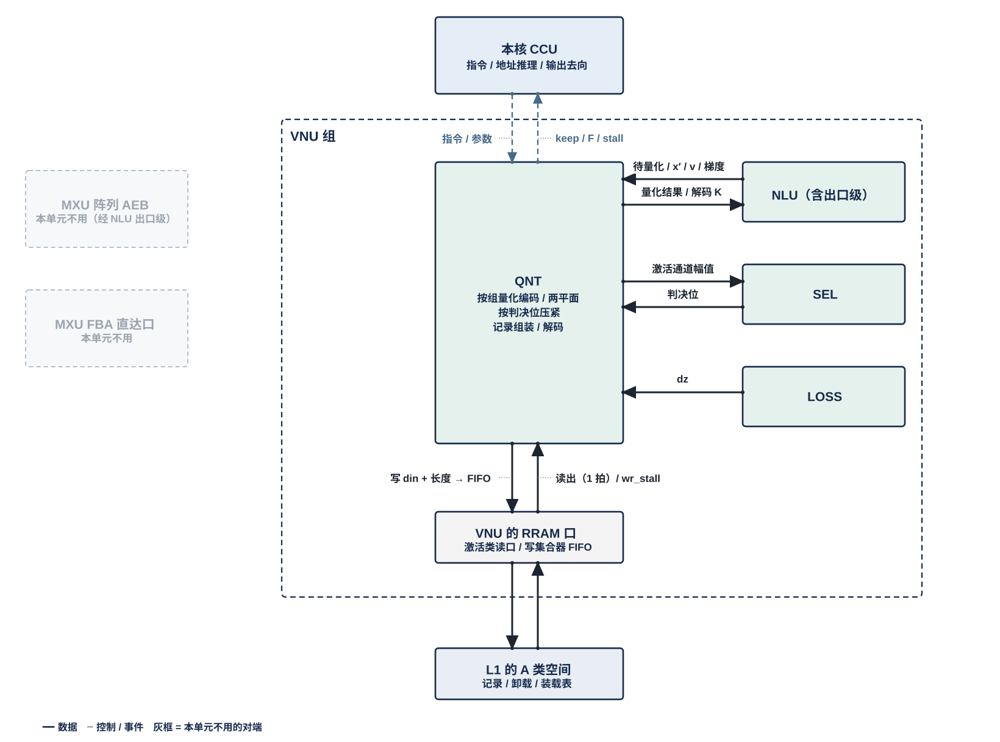
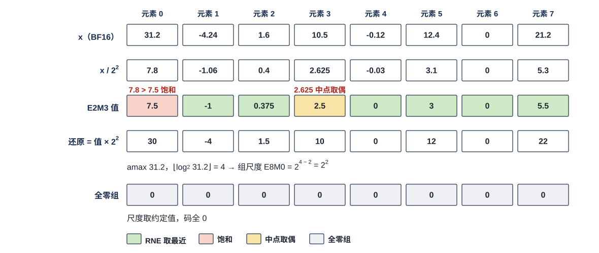
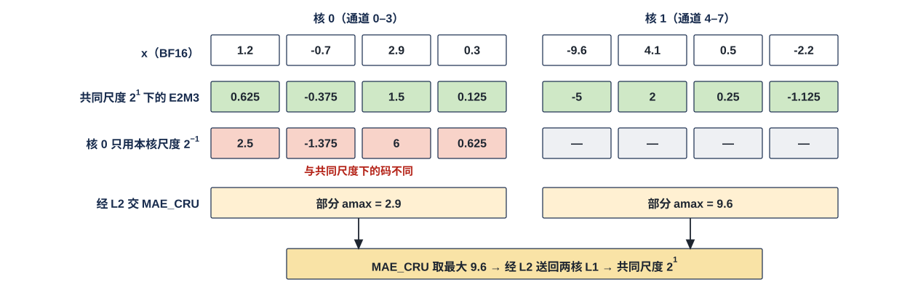
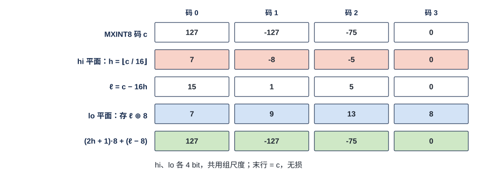
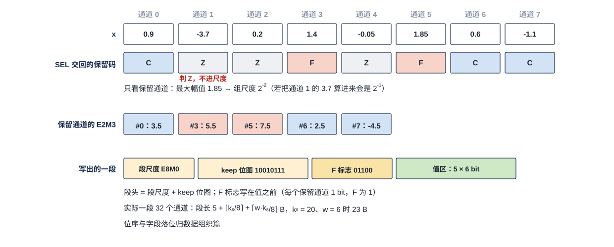
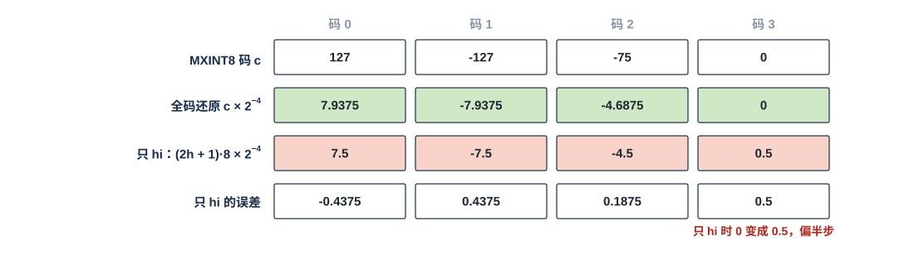

# VNU 量化单元（QNT）需求

> Owner: WangYizhao｜2026-11-11

## 1 概述

### 1.1 QNT 做什么、不做什么

QNT（Quantization Unit，量化单元）把高精度向量变成存储或传输格式，反方向把 K 的存储码还原成计算用的值。它提供五种运算形态（§3.2–§3.6）：
- **按组量化编码**：沿向量的一维每 $g$ 个元素求一个共享尺度，逐元素编码成窄码；
- **两平面表示**：把一个码按位拆成高、低两个平面；
- **按判决位压紧**：按 SEL 给的判决位去掉不读的元素；
- **记录组装**：把码、尺度与附带字段拼成记录，写往指令给的去向；
- **解码与还原**：码乘尺度，还原成计算用的值。

另有两种写出用法由这几种形态组合而成：紧凑 token 记录的四条流写出（§3.7），以及权重梯度用的权重侧形态与转置次序写出（§3.8）。

**VNU 组内向量的量化、编码与记录打包都由 QNT 执行，同一格式只有这一处实现**（用户 11-04）。请求来自 NLU（含其后处理子模块 EPI，V18-EPI-01）与 LOSS。另有两处在 QNT 以外量化，都按 §4.3 的同一套量化规则：MAE_CRU 对跨核合并结果的编码（核间按归约维 $k$ 切分时的归约结果，以及归约结果加残差后的残差格式 / 按 keep 列表压缩的紧凑 token 记录，输出编码由搬运指令给，V18-CRU-08）；OPT 对自有格式（权重副本、优化器状态）的重量化。

**QNT 不做比较与判决，也不做向量算术**：
- Norm、RoPE、加减均值、softmax、$O$ 更新在 NLU；
- 残差加、bias 加、BF16 直通、残差与特征行的还原在 NLU 的后处理子模块 EPI（EPI 是 NLU 的强制子模块，V18-EPI-01，EPI 篇 §3.1）；核间 K 切分位点的残差加与编码在 MAE_CRU（V18-CRU-08）；
- 一切逐元素阈值判断，包括下一位点输入各通道是否保留，在 SEL（用户 11-04）；
- 跨核合并在 MAE_CRU；
- **P×V 的左操作数 $\tilde p$ 不经 QNT**：它是 NLU 出的每（查询行, tile）一条按录取次序排列的稠密 BF16 向量，不设 keep 位图 / E8M0 等元数据块、不压缩、不量化、不出核（V18-ATT-02、V18-MXU-15，NLU 篇 §3.7）；
- QNT 不决定用什么格式、不调度、没有 DDR 口、不发访存指令、不算地址。

### 1.2 在 VNU 组里的位置：每核一个，经 VNU 组的对外口访问 L1 与核外

一个计算核由 CCU、MXU 组、L1 组、VNU 组四组拼成。**QNT 是 VNU 组的六个单元之一**，其余五个是 NLU、SEL、SMP、LOSS、OPT；每个计算核一个 QNT，全芯片 4 个，物理相同。**QNT 与 VNU 组外的模块交换数据，都经 VNU 组的对外口**：访问 L1 经 VNU 读口 / 写口（各 ≤ 128 B，VNU 集成篇 §2.4 / §2.6，架构篇 §2.2.5），向核外上行经 VNU 输出口（VNU 集成篇 §2.7）；QNT 不直接连 L1 或 C2H。

**QNT 只提供运算形态。每个请求出什么格式、组长多少、是否拆平面、是否压紧、结果交到哪里，由指令与模型级配置给出**（§3.10）。本篇不列指令字段表；下文凡写"由指令给出"的，都是 QNT 需要的指令字段，由 QNT 设计者按需整理并与 CCU、ISA 对接。

**QNT 一时只服务一个任务，一次处理一个完整请求；EPI、NLU 本体、LOSS 等几个来源都要交量化请求时，按指令给出的先后串行处理（CCU 作为配置交 VNU_CONTROLLER 执行），QNT 内不设多源合并逻辑**（V18-VNU-06，VNU_CONTROLLER 篇 §3.3）。QNT 与 VNU 其他单元在计算资源不冲突时可同时工作，由指令给出、VNU_CONTROLLER 推进（VNU_CONTROLLER 篇 §3.4）。

本篇用到的几个词（其余在首次出现处定义）：

| 词 | 含义 |
|---|---|
| 位点 | 一层里的一个算子实例，例如第 5 层的 o 投影 $Y = O W_o$ |
| MX 组格式 | 沿向量的某一维每 $g$ 个元素一组，组内共用一个 8 bit 的 2 的幂尺度（E8M0，表示 $2^{e}$），每个元素只存窄码。**激活的组长 $G$ 是位点属性**（32 的倍数，上限【设计者定】且不大于通道片长 $P$；32 是精度基准、验收工况与效果最好的配置），由指令给出（V18-MXU-10）；**Q、K、V 的组长同样由指令给、硬件任意分组**（V18-ATT-04；V 的尺度分组长度记 $g_V$）；**权重的 MX 组固定 32** |
| 通道片 | 一条 token 记录按消费方的归约位置 $k$ 边界切成的段，每片含该 token 在一段连续通道范围上的全部数据；片长 $P$ 由编译链按位点定（$K/4$、$K_t$ 或整条），是 $G$ 的倍数，每 token 片数在位点内固定，随指令给 QNT（V18-DORG-03，数据组织篇 §1.2） |
| 紧凑 token 记录 | 一个 token 按 SEL 判决压紧后的记录：每个通道片分四部分——元数据项、E8M0 项、F 列表、码块（数据组织篇 §2.5） |
| 码块 | 紧凑 token 记录一个通道片四部分之一，只装保留通道的码（元素位宽 $w$ = 6 时每码 6 bit；$w$ = 8 / 16 时装对应宽度的码） |
| 码块片长 | 一个通道片的码在 A 类占的字节数，按 32 B 取整；记在该片元数据项的首字里 |
| 存储字 | 32 B，L1 / L2 读写的基本单位（协议篇 §3.2）；地址是 24 bit 段内字节位置，存储字的序号 = 字节地址 / 32；本篇里"行"只指矩阵的行与 token 行 |
| 码格式 | MXFP6 E2M3 是 6 bit 浮点码（1 符号、2 指数、3 尾数，可表示的最大幅值 7.5）；MXINT8 是 8 bit 整数码；FP8 E4M3 是 8 bit 浮点码 |

## 2 接口需求

### 2.1 架构图与接口汇总

图中模块框内的结构是参考实现（见第 7 章），本章以框外的各口为准。

图中虚线框是 VNU 组，框外画出 VNU 组的全部直接对端；本单元不用的画灰，对端之后的去向不画，在下文交代。
- **上方**：本核 CCU，虚线为指令下发与 stall 上报——下发每个请求的格式、组长、拆平面、压紧、去向与写地址；上报读回入口的 stall。
- **左侧**：MXU 阵列的 AEB × 4 与 MXU 累加器直达口都画灰——AEB 条目只进 EPI，再由 EPI 把 BF16 向量交 QNT（组内传输）；累加器的粗分数直通 SEL。
- **框内上排**是 VNU 六个单元（NLU 拆成 EPI 与 NLU 本体两格），"本单元"一格是 QNT；与 QNT 往来的单元点亮，框内写的"入 / 出"以 QNT 为准：EPI（入 $x'$ / 投影结果 / 梯度）、NLU 本体（入待量化向量与 K 存储码，出解码后的 K）、SEL（入判决位，出待判断幅值）、LOSS（入 $\mathrm dz$）、OPT（临时格式，双向，只在设计者选用时存在）；SMP 画灰。
- **框内中部**是 QNT 的展开框，写它的运算形态（完整的见第 3 章）。
- **框内下排**是三项组级共用资源（VNU 集成篇 §3.3、§2）：VNU 共用寄存器堆、VNU 读口 / 写口（各 ≤ 128 B）、VNU 输出口（接框外计算核的集成输出端口）。
- **框外下方**分两层：上层是 L1 外的读写选择部件——S 类读 MUX、A 类读 MUX、W 类读出到 VNU 读口的一路由 CCU 定去向；A / W / S 三类写口前各一个选择器，自己按固定规则在 H2C 接收桥、NWB、VNU 写口三个来源之间轮流，没轮到的在自己的 FIFO 里等，不由 CCU 逐拍选（归计算核集成，`CORE_INTEGRATION_STAGING.md`；V18-L1-21 / 32）；下层是只暴露 RRAM 口的 L1（W / S / A 三类，图中只画各类的口）。QNT 经 VNU 读口从 A 类读 MUX 读，经 VNU 写口与 A / S / W 三个写 MUX 写 A 类、S 类与 W 类；S 类读 MUX 与 W 类读出到 VNU 读口的一路画灰。

| 口 | 对端 | 方向 | 位宽 | 握手 | 节 |
|---|---|---|---|---|---|
| EPI 请求入口 | NLU 的后处理子模块 EPI（组内传输） | 入 | 组内传输，位宽、条数与互连方式由 VNU 集成设计者定（参考 256 bit = 16 × BF16，架构篇 PORT-08） | 组内握手：QNT 来不及收时让 EPI 停发 | §2.2 |
| NLU 本体接口 | NLU 本体 | 入 / 出 | 同上 | 组内握手 | §2.3 |
| SEL 接口 | SEL | 出幅值，入判决位与 F 序号列表 | 同上 | 组内握手 | §2.4 |
| LOSS 接口 | LOSS | 入 $\mathrm dz$ | 同上 | 组内握手 | §2.5 |
| OPT 接口（可选） | OPT | 入 / 出 | 同上 | 组内握手 | §2.6 |
| 寄存器堆暂存 | VNU 共用寄存器堆 | 入 / 出 | 由 VNU 集成设计者定 | 由 VNU 集成设计者定 | §2.7 |
| L1 读 | VNU 读口（经 L1 外的 A 类读 MUX） | 入 | 一次 ≤ 128 B，与 VNU 其他单元分用（架构篇 PORT-03） | 核内 RRAM，无握手；读回入口将满经 stall_vnu 让 CCU 停发 | §2.8 |
| L1 写 | VNU 写口 → 写 MUX → A / W / S 类写口 | 出 | A / W 类一次 ≤ 128 B，S 类一次一个整字（架构篇 PORT-04 / 05 / 06） | 核内 RRAM，无握手；VNU 写口来不及时向 QNT 拉 wr_stall | §2.9 |
| 卸载 | 经 VNU 写口写、经 VNU 读口读回 L1 A 类 | 出 / 入 | 同 L1 读 / 写 | 同 L1 读 / 写 | §2.10 |
| 上行 | VNU 输出口 → 计算核集成输出端口 → C2H → L2 | 出 | 32 B/拍，与 VNU 其他单元分时（架构篇 PORT-09） | 由 VNU 集成与集成输出端口定；C2H 不 ready 时 stall_tx 门控 CCU | §2.11 |
| 指令 | 本核 CCU | 入 | — | 命令侧的线（VNU 集成篇 §2.9） | §2.12 |
| 读回入口 stall | 本核 CCU（经 VNU 合成 stall_vnu） | 出 | 1 bit | — | §2.8 |

**QNT 在命令网上没有端口**；标量（amax 部分值、共同 amax）与其他输出一样是数据（V18-TP-55 / 56、V18-CRU-07）。

### 2.2 EPI 请求入口：EPI 交来的待量化向量

**EPI 把残差加结果 $x'$、归约完成的投影结果（q、gate、up 等）、v、反传归约完成的梯度、已在 EPI 还原的特征行交 QNT 量化**（用户 11-04；EPI 篇 §2.5）。格式 BF16。

#### 2.2.1 握手与速率条件

- **组内传输的位宽、链路条数与互连方式由 VNU 集成设计者定**（V18-VNU-08，VNU 集成篇 §3.6）。链路上是什么格式、什么精度，由收发两端按指令解码，链路本身不区分格式；本章各表"格式"一列写的是两端须能解码的规范内容，不是链路的定义。
- **QNT 来不及收时经组内握手让 EPI 停发**；EPI 自己再按它的规则对 AEB 拉低 ready（EPI 篇 §4.3）。停发只降速，不是错误。
- **QNT 的接收不得让 EPI 违反它的拍数条件：EPI 处理一轮（含交 QNT）的拍数 ≤ MXU 产出下一轮的拍数**（EPI 篇 §4.1；各位点的拍数余量见 EPI 篇 §7.3），见 §4.1。

### 2.3 NLU 本体接口：待量化向量、K 存储码入，量化结果与解码后的 K 回送

| 方向 | 内容 | 格式 |
|---|---|---|
| 入：待量化向量 | RoPE 之后的 q；k（直接处理时为 RoPE 与减目标均值之后，先 RoPE 再处理时为 QK-Norm 之后，或读时旋转之后）；按 RMS 缩放后的下一位点输入；$O/l$；门控激活 $\tilde s$；嵌入行 $x_0$；区块摘要；反传逐元素输出 | BF16 |
| 入：待解码的 K 存储码 | 读时旋转从 L1 读出的 K 存储码：粗算段为 hi 平面码与 E8M0，精算段为 hi + lo 平面码与 E8M0（NLU 读码与 E8M0 的来路见 NLU 篇 §3.6） | MXINT8 的 hi / lo 平面（组长由指令给，V18-ATT-04） |
| 出：量化结果回送 | 解码后的 K（全码 / 只 hi，§3.6）；量化后的投影结果与流动梯度；（可选）统一格式后的临时格式向量（§3.6） | BF16 或 MXFP6（组长 $G$） |

握手同 §2.2.1：QNT 来不及收时让 NLU 本体停发。Q 一行的逐维幅值由 NLU 直接交 SEL，不经 QNT（用户 11-04）。

### 2.4 SEL 接口：交幅值，收判决位与 F 序号列表

| 方向 | 内容 | 格式 |
|---|---|---|
| 出：待判断幅值 | 下一位点输入一个 token 各通道的幅值 $\lvert x_k\rvert$，供保留判断 | BF16 |
| 入：判决位与 F 序号列表 | Q 一行的选维位（每维 1 bit）；下一位点输入一个通道片的保留位（每通道 1 bit，即 keep 位图）与 F 序号列表（片内序号，升序）——SEL 按 CCU 每片一条的比较指令、用一对阈值一遍判出（V18-SEL-18），QNT 原样写出 | 保留位每元素 1 bit；F 序号每项 2 B |

**判决位一律来自 SEL，QNT 不做比较**（用户 11-04）。QNT 收回判决位之前，对应的那批向量由 QNT 暂存或卸载到 L1（§2.10、§3.4）；SEL 每拍能判的通道数见 §7.5 的参考值。

### 2.5 LOSS 接口：收 dz

**LOSS 交来 $\mathrm dz$（LM Head logit 的梯度），QNT 按流动梯度格式量化**（用户 11-04）。格式 BF16，随 LM Head logit 流；握手同 §2.2.1。

### 2.6 OPT 接口：临时格式（可选）

**只在设计者选择"统一临时格式"时存在**（§3.6）：OPT 自有格式（MXINT8 权重副本、优化器状态）经 QNT 统一成 BF16 或 MXFP6 后再交其他单元，或反向。是否做【设计者定】，见 §3.6。

### 2.7 VNU 共用寄存器堆：未凑满的 MX 组放在 QNT 外时的位置

**一个 MX 组（$G$ 个通道）里已到的通道等后续各轮补齐期间不丢、不覆盖，补齐后的量化结果与整组一起量化逐位相同**（§3.2.4）。**放在哪由设计者定；放在 QNT 外时，放 L1 时位置由 CCU 给，放共用寄存器堆时由 VNU_CONTROLLER 按分区算**，例如 VNU 共用寄存器堆里 CCU 按位点指令配置给 QNT 的分区（位点边界切换；CCU 只给分区配置，逐拍位置由 VNU_CONTROLLER 算，V18-VNU-10 / 12，VNU 集成篇 §3.3、VNU_CONTROLLER 篇 §3.6）。参考放处与参考量见 §7.2。

### 2.8 L1 读：经 VNU 读口读卸载数据、装载表与共同 amax

**QNT 经 VNU 读口读 L1 A 类**（VNU 集成篇 §2.4）：VNU 在 L1 外的 A 类读 MUX 上算一个使用者，**A 类读出每拍只给一个使用者，轮到 VNU 的拍整拍给 VNU**（架构篇 §3.7）；VNU 读出在组内由 VNU_CONTROLLER 按配置分给 QNT（VNU_CONTROLLER 篇 §2.5）。

#### 2.8.1 读什么、怎样读

| 读的内容 | 从哪来 | 说明 |
|---|---|---|
| 卸载数据 | QNT 自己先前卸载到 L1 A 类的请求数据与等待期间的暂存 | §2.10 |
| 装载表（配置表） | 由 MAE 搬运指令搬到本核 L1 的 A 类（经 HUB_IDN，或经 L2 → H2C），与 NLU 的配置表同一来路（V18-NLU-07） | 按（层, kv 头）装载的通道置换表与量化参数（§3.10） |
| 共同 amax | MAE_CRU 取最大后写回 L2，经 L2 → H2C 落本核 L1 A 类（V18-TP-55 / 56、V18-CRU-07） | FP32；落进 L1 之后 CCU 才发出按共同尺度编码的指令，QNT 不要求有效位（§3.2.5） |
| 先以 BF16 写 L1 的待压紧输出 | 用整行统计量判决的位点，输出先以 BF16 写 L1（§3.7） | 判决位就绪后读回压紧与量化 |

- **一次读 = 首字节地址 + 有效字节数（≤ 128 B），由 CCU 给**；L1 交回从首字节起对齐好的数据（从第 0 字节起），从存储字边界起的读固定 1 拍出数（核内 RRAM 协议，协议篇 §2.3）；首地址不在字边界时字节移位在 SRAM 内部，VNU 与 QNT 一侧不需要做字节移位；从字边界起一拍，否则允许多拍（架构篇 §3.4 CONC-3）。
- **读回入口的 stall**：QNT 的读回入口来不及收时，经 VNU 合成为 stall_vnu 交 CCU，CCU 停发读；**stall_vnu 拉起后读回入口不溢出、不丢数**（协议篇 §3.16）。各单元的 stall 怎样合成为一根由 VNU 集成设计者定（VNU 集成篇 §2.4）；读回入口的深度与将满阈值见 §7.4。

### 2.9 L1 写：经 VNU 写口，QNT 交数据、所属的流与有效字节数，地址与 seg 由 CCU 计数推出

**QNT 写 L1 时只交数据、所属的流与每拍的有效字节数；目的地址与段选 `seg` 由本核 CCU 内部计数推出，QNT 不算地址、不解析 L1 的空间布局**（V18-QNT-13、V18-VNU-12；用户 11-05，V18-TP-01…16）。这是 QNT 与 CCU 之间的接口：CCU 据"所属的流"选用该流的目的基址与定位规则（四部分的定位规则见数据组织篇 §3.2），据有效字节数推进地址；CCU 一侧怎样推地址属 CCU 的设计（`CCU_STAGING.md`）。"所属的流"的编码与位宽由 QNT 与 CCU 设计者对接确定。**"所属的流"是 VNU 写回只交数据与有效字节数（V18-VNU-12）之外多交的一项，保留与否【待确认】**：建议保留——四部分交错写出、每片各部分的长度随保留数而变，CCU 只凭有效字节数分不出这一拍属于哪个数据块。

#### 2.9.1 一次写的字段与三类写口

VNU 写口一次写 = 首字节地址 + `seg` + 有效字节（≤ 128 B）+ 从第 0 字节起放的数据（字段形式见架构篇 §2.2.5、VNU 集成篇 §2.6）；**按 `seg` 进 L1 的三类写口之一**：

| 写口 | QNT 写什么 | 一次写 |
|---|---|---|
| A 类写口 | 码块、元数据项、F 列表、稠密残差的码、卸载数据、Q 查询行记录的码 | ≤ 128 B，首地址可以是任意字节；**QNT 的写默认从存储字边界起**（数据组织的默认，数据组织篇 §2.3） |
| W 类写口 | 本核产生、本核消费的 K / V 码；权重梯度用的权重侧操作数（§3.5.2、§3.8）——**写进 W 类的数据由 QNT 排成 W 类字形态**（行字区 / 列字区，定义见数据组织篇 §2.12；V18-VNU-09、V18-MXU-14） | ≤ 128 B，同 A 类 |
| S 类写口 | E8M0（激活、Q、K 的尺度） | **一次一个整字、不带字节有效位；QNT 把每片 E8M0 的末字空余字节补 0 后整字写**（V18-DORG-04） |

- **A / W 类支持紧密存储**：首地址不是 32 的倍数时由 SRAM 内部移位（V18-TP-74，架构篇 §3.5.4），QNT 一侧不需要做字节移位；从字边界起一拍，否则允许多拍（架构篇 §3.4 CONC-3）。
- **每类写口前的选择器在 L1 外，自己按固定规则在 H2C 接收桥、NWB、VNU 写口三个来源之间轮流，没轮到的在自己的 FIFO 里等，不由 CCU 逐拍选**（V18-L1-32，架构篇 §3.7）；**写哪一堆由 CCU 推出的 `seg` 选**；写与读碰到同一个堆时写让读，由选择器本地判断（架构篇 §3.4 CONC-1 / CONC-2）。
- **核内写 L1 的完成由 CCU 判定；CCU 怎样得知 VNU 的写已写进——由写口前的选择器告知或由 VNU 报完成——【设计者定】；L1 本身不提供完成信号**（协议篇 §3.8，V18-VNU-09 / L1-32 (3)）。

#### 2.9.2 wr_stall：VNU 写口来不及时 QNT 保持待写的字

**写口前的选择器这一拍没轮到 VNU 写口、VNU 写口保持不住时，VNU 写口向当拍在写的 QNT 拉 wr_stall；QNT 保持待写的字、不丢**（VNU 集成篇 §2.6、协议篇 §3.16）。wr_stall 只到 VNU 单元，不到 CCU。

### 2.10 卸载接口：来不及处理的数据写到 L1 A 类再读回

**QNT 来不及处理时把数据卸载到 L1 A 类、之后读回处理，这是 QNT 的一个接口，归需求**（V18-QNT-13；用户 11-11："卸载给L1应该不属于参考实现，这是一个接口"）：

- **卸载什么**：QNT 正忙时到达的请求数据，以及等跨核 amax 回送、等 SEL 判决位期间的暂存，可经 VNU 写口写到 L1 的 A 类，之后经 VNU 读口读回处理，不在入口排队等待。
- **卸载段的地址由指令给出**（A 类的一段地址，由编译链分配）；每次写、读回的地址由 CCU 给，QNT 只交数据、所属的流（卸载流）与有效字节数（§2.9）。
- **读回在该段卸载写完之后**（VNU 写口的写何时写完，由写口前的选择器告知 CCU 或由 VNU 报完成【设计者定】，V18-L1-32）；每个堆同一拍只做一次访问（CONC-2）；**同一个堆同一时段可以又读又写**，所以卸载段与正在读的数据可以在同一个堆，同一拍碰上时写让读。卸载写进哪一堆、何时读回由 CCU 与指令排（V18-TP-73）。
- **读回后的处理结果与直接处理逐位相同**（§6.1）。
- **哪些请求在 QNT 忙或等待时卸载、卸载段要多大【设计者定】**：约束是 QNT 的接收不让 EPI 违反拍数条件（§4.1）；卸载段大小由 QNT 设计者按这条约束给出建议值（每次可能卸载的请求数据量 = 向量数 × 每向量字节数），编译链按建议值分配 A 类地址段。选用卸载的位点要在指令与编译链里登记（ISA，CCU：`CCU_STAGING.md`）。

### 2.11 VNU 输出口：记录与 amax 部分值直接写 L2

**要出核的记录与 amax 部分值经 VNU 输出口进计算核的集成输出端口，再经 C2H 写 L2；数据来自哪个单元、写到哪里，由 CCU 解码指令得到**（V18-VNU-07，VNU 集成篇 §2.7）。**每个输出每条指令只选一处**：写 L1（之后可由本核 CCU 发令、经集成输出端口的发送 FIFO 入口与 C2H 发出），或经 VNU 输出口直接写 L2（V18-TP-35 / 56）。

| 内容 | 去向 | 格式 |
|---|---|---|
| K / V 存储 key 记录、本次 attention 用的新 K、读时旋转后的 K（码与 E8M0 两块）、紧凑 token 记录、残差 token 记录、反传流动梯度 | L2，目的地址由本核 CCU 的指令给出（V18-TP-35 / 56）；读时旋转后的 K 进 L2 后由 MAE 指令送进需要它的核的 L1（§3.5.2） | 见 §3.5、§3.7 |
| amax 部分值（一组跨核时本核的 F5 amax） | 写 L1，或经 VNU 输出口直接写 L2，二选一（V18-VNU-07、V18-TP-55 / 56、V18-CRU-07）；写进 L2 本核象限的同一段内地址，由 MAE_CRU 取最大 | FP32 |

上行每拍 32 B，与 VNU 其他单元分时；集成输出端口来不及上 C2H 时拉 stall_tx 门控 CCU（协议篇 §3.16）。变长数据块写进 L2 后的发出报告由 CCU 发，QNT 不报（§3.7）。

### 2.12 本核 CCU：指令入、stall 出；QNT 与 CCU 之间没有其他数据接口

- **指令**：每个请求的格式、组长、是否拆平面、是否压紧、元素位宽 $w$、流动梯度格式、去向，以及卸载段地址、片长 $P$ 与每 token 片数，都由指令给出（§3.10）。**QNT 不感知分档**：按档不参与的 token 由 CCU 不下发（V18-SEL-16）。
- **stall**：读回入口的 stall_vnu（§2.8.1）。
- **写地址**：QNT 写 L1 的地址与 `seg` 由 CCU 给（§2.9）；$H^{\mathsf T}$、$\mathrm dH^{\mathsf T}$ 转置次序的写入地址同样由 CCU 给（§3.8.2）。
- **QNT 与 CCU 之间没有其他数据接口**：每片的码块片长、F 项数与 keep 位图由 QNT 写成元数据项、F 列表原样写出，都落本核 A 类（§3.7）；CCU（含分组单元 CCU_GRP）要用时经 L1 外的 A 类读 MUX 读——CCU 是这个 MUX 的使用者之一（V18-TP-68 / L1-20）。QNT 不另交 CCU、不报完成。

## 3 功能描述

### 3.1 功能一览

| 功能 | 按矩阵维度说做什么 | 输入 | 输出 | 触发 / 生效条件 | 节 |
|---|---|---|---|---|---|
| 按组量化编码 | 沿向量的一维每 $g$ 个元素求一个 2 的幂尺度，逐元素编码 | BF16 向量；可选共同 amax | 码 + 组尺度 | 每个请求按指令给的格式与组长；凑满一个 MX 组才量化 | §3.2 |
| 两平面表示 | 一个码按位拆成 hi / lo | 码 | 两个平面 + 共用组尺度 | K、V 8 bit 存储，权重侧形态 | §3.3 |
| 按判决位压紧 | 去掉判决位未选的元素，其余按原序连续存放 | 向量或码 + SEL 的保留位与 F 序号列表 | 元数据项、E8M0、F 列表与压紧的码四条流 | SEL 的判决位到达之后 | §3.4 |
| 记录组装 | 码、尺度与附带字段拼成记录，写往指令给的去向 | 上面三种的输出 | 各种记录 | 按指令给的去向，每个输出每条指令只选一处 | §3.5 |
| 解码与还原 | 码 × 尺度 | K 存储码 | 计算用的值 | 先 RoPE 再处理的 K 链 | §3.6 |
| 紧凑 token 记录的写出 | 四条流按 `seg` 落 A / S 类 | 压紧后的四条流 | L1 里四个数据块 | 每片每部分从存储字边界起、片尾补齐；元数据项首字含码块片长与 F 项数 | §3.7 |
| 权重梯度用的写出 | MXFP6 码无损改写成 8 bit 两平面写进 W 类；$H$、$\mathrm dH$ 按 CCU 给的地址写成转置次序 | $\mathrm dY$、$X$、$H$、$\mathrm dH$ | W 类权重侧形态；$H^{\mathsf T}$、$\mathrm dH^{\mathsf T}$ | LoRA 位点的权重梯度 | §3.8 |
| 参与量化的元素与特殊值 | 哪些元素决定组尺度、哪些不出码 | — | — | 所有形态 | §3.9 |
| 参数与配置的来源 | 模型级配置、置换表、每个请求的参数 | 指令、装载表 | — | 模型级配置在调用开始锁存；请求参数在位点边界生效 | §3.10 |
| 反传经过量化点 | 梯度直通 | — | — | 训练反传 | §3.11 |
| 结果规则 | 同一量多处产生一致、确定性、写出次序 | — | — | 恒定 | §3.12 |
| 复位与跨调用状态 | 清在途量 | 复位 | — | 复位 | §3.13 |

**输入与输出**：输入为 BF16 向量、FP32 语义的标量（amax）与 K 存储码；输出见本章各节。

五种形态在一个请求里常常串起来用：前四种是写出方向的步骤（编码、拆平面、压紧、组装成记录；压紧与编码的先后随记录而定，见 §3.4），第五种是读入方向的逆过程。所以一个请求可理解为"走这条流水的哪几段"，请求里的格式、拆平面、压紧与去向（§3.10）就是在选段。权重梯度用的写出（§3.8）也是这几种形态的组合：按组量化编码之后把 MXFP6 码无损改写成 8 bit 整数、两平面表示、按行字区排法组装写进 W 类。

### 3.2 按组量化编码：沿一维每组求共享尺度，逐元素编码

#### 3.2.1 成组方式与目标格式

| 张量 | 沿哪一维成组 | 组长 |
|---|---|---|
| 激活（投影结果、下一位点输入、残差、嵌入行、流动梯度） | 一个 token 内沿 hidden 维 | $G$ 个通道（位点属性，V18-MXU-10） |
| Q、K | 一个 token、一个头内沿 head_dim，Q 按 K 的通道置换组序 | 由指令给（V18-ATT-04；本篇数值例按 32 维） |
| V | 一个 key、一个 kv 头内沿 head_dim | $g_V$ 维（位点属性、由指令给，例 128；V18-ATT-02 / ATT-04） |
| BF16 / FP16 激活（元素位宽 $w = 16$ 的位点） | 不成组，整值交出；**同样写成紧凑 token 记录（元数据项、F 列表、码块），只是没有 E8M0**（V18-TP-63 / 66）；进阵列时阵列重构成 16 × 16 去算，属 MXU 的设计（MXU 集成篇 §4.1、MXU_ARR 篇 §3.3） | 不成组（无尺度） |

**目标格式**：MXFP6 E2M3（$w = 6$）、FP8 E4M3（$w = 8$）、E5M2、MXINT8、4 bit（V）、BF16 / FP16 整值（$w = 16$）。**紧凑 token 记录的元素位宽 $w \in \{6, 8, 16\}$ 是位点属性，由位点指令给出；BF16 / FP16 激活是 L3PU 的底层需求，与 MX 格式走同一套紧凑格式**（用户 11-08；V18-TP-63）。所有尺度单独成块、落 L1 的 S 类（V18-L1-18）。

#### 3.2.2 默认选码规则

量化合同；按 §4.3 第 3 层，可在掉点 < 0.1% 的约束下改动：

| 格式 | 组尺度指数 | 元素舍入 | 越界 |
|---|---|---|---|
| MXFP6 E2M3 | $\lfloor\log_2 a_{\max}\rfloor - 2$（E2M3 最大指数为 2） | RNE | 饱和到 ±7.5 |
| FP8 E4M3 | $\lfloor\log_2 a_{\max}\rfloor - 8$ | RNE | 饱和到 ±448 |
| MXINT8 | $\lfloor\log_2 a_{\max}\rfloor - 6$ | RNE | 限幅 ±127 |
| 4 bit（V） | $\lfloor\log_2 a_{\max}\rfloor - 2$ | RNE | 限幅 ±7 |

$a_{\max}$ 是本组参与量化的元素的最大幅值（§3.9）；**激活按 $G$ 个通道一组取 amax**（$G$ 由指令给）。**QNT 只写码与组尺度，不写各组尺度的最大指数**：MXU 累加器按标准 FP32 累加，开算前不需要累加基准（V18-MXU-12）。

缩小例一组 8 个元素，实际一组 $G$ 个（$G$ = 32 时 32 个）。组内最大幅值 31.2，组尺度 $2^{4-2} = 2^2$。各元素除以 4 后按 E2M3 取最近的可表示值：
- 元素 0 的 7.8 超过 E2M3 最大值 7.5，饱和到 7.5；
- 元素 3 的 2.625 恰在可表示值 2.5 与 2.75 正中，按 RNE 取尾数为偶的 2.5；
- 元素 2 的 0.4 落在非规格化区，取 0.375。

全零组给出确定的尺度与零码，不产生 NaN；尺度取值由量化合同约定。

#### 3.2.3 可选的通道置换

**按编译期固定的置换表重排一个 token 的全部通道，再分组**。用于 K 与区块摘要：直接处理在量化入口施加，先 RoPE 再处理在读时旋转后的重量化入口施加。置换表按（层, kv 头）装载（§3.10）。PairFold（RoPE 通道对的缩放）离线折入 Q、K 归一化权重，QNT 不做折叠；是否需要运行时可选【设计者定】：约束是定下后同步算法参考模型与 NLU 的归一化权重装载（§5.3）。

#### 3.2.4 凑组：按 token 凑满一个 MX 组再量化

**一条 AEB 条目只含一个 token 的 16 个输出通道（一个列块），凑不满一组；QNT 按 token 凑满一个 MX 组（$G$ 个通道）再量化**：打包单位是 MX 组（一个 token 的 $G$ 个相邻输出通道 = 相邻 $G/16$ 个列块，即 EPI 的相邻 $G/16$ 轮，EPI 篇 §3.10）。QNT 量化、按 SEL 判决压紧后，把"该 token 该组"的 keep 位（进元数据项）、一个 E8M0、F 序号与压紧的码分别追加到四条流（§3.4、§3.7，数据组织篇 §3.6.8）。

**未凑满的 MX 组在补齐前不丢、不覆盖**：已到的通道等后续各轮补齐后再量化；放在哪由设计者定，放在 QNT 外时，放 L1 时位置由 CCU 给，放共用寄存器堆时由 VNU_CONTROLLER 按分区算（§2.7；参考放处与参考量见 §7.2）。

#### 3.2.5 尺度的两种来源：本核求出与跨核取最大

- **本核求出**：一组的 $G$ 个通道都在本核。
- **跨核取最大**：输出维 $m$ 切分到多核（$Y = XW$ 中 $W$ 的列分给不同核）时，一组 $G$ 个通道可能分在两核上。**各核把本核的部分 amax（FP32）作为输出写进 L2 本核象限的同一段内地址，MAE_CRU 取最大后写回 L2，再由一条 L2 → L1 指令把共同 amax 送到各核 L1**（V18-TP-55、V18-CRU-07）；**共同 amax 落进 L1 之后 CCU 才发按共同尺度编码的指令**，QNT 不要求有效位、不因 amax 未到而 stall，等待期间的数据可卸载到 L1（§2.10）。同一部分值只发一次。CCU 不下发的 token 不进跨核 amax（§3.9）。

一组 8 个通道（实际 32 个），核 0 持通道 0–3、核 1 持通道 4–7。两核的部分 amax 为 2.9 与 9.6，经 L2 交 MAE_CRU 取最大 9.6、再经 L2 送回两核 L1，共同尺度 $2^{1}$，两核按它编码，拼起来就是整组一起量化的结果。若核 0 只用本核尺度 $2^{-1}$，得到的码与共同尺度下的码不同，两半不能拼成一组。

**K 在 RoPE 之前存储、读入后先旋转再处理必须支持**（用户 11-04；由指令配置"直接处理"或"先 RoPE 再处理"，V18-KV-01）：两种处理用同一格式，区别只在量化位置。

### 3.3 两平面表示：一个码按位拆成 hi / lo

**码位拆分**（K 存储与读时重量化、V 8 bit、权重梯度的权重侧形态）：
- MXINT8 码 $c = 16h + \ell$，$h$ 为有符号 4 bit，$\ell \in [0, 15]$；
- hi 平面存 $h$，lo 平面存 $\ell \oplus 8$、读作 $\ell - 8$；两平面共用一个组尺度；
- **还原式** $(2h+1)\cdot 8 + (\ell - 8) = c$；
- 只读 hi 的消费者（粗算）按 $(2h+1)\cdot 8$ 近似 $c$，即取 hi 区间的中点。

四个码 127、−127、−75、0 拆成 hi / lo，最后一行按还原式算回原码，无损。

**两平面表示只用于 K、V 的码位拆分与权重梯度的权重侧形态（§3.8.1）。** P×V 的左操作数 $\tilde p$ 是 NLU 出的稠密 BF16 向量，阵列按 BF16 直接乘 V 的 hi / lo 平面，不经 QNT 量化或拆平面（V18-ATT-02）。

### 3.4 按判决位压紧：去掉不读的元素，其余按原序连续存放

**判决位一律来自 SEL，QNT 不做比较**（用户 11-04）。下一位点输入的保留判断：QNT 把一个 token 各通道的幅值交 SEL，暂存对应的那批向量，**收回 SEL 的保留位与 F 序号列表后再压紧**——SEL 按 CCU 每片一条的比较指令、用一对阈值一遍判出两者，F 序号从本片第 0 个通道起计，就是片内序号（V18-SEL-18）。**等判决期间这批向量放在 QNT 内部还是卸载到 L1（§2.10），以及同时有几批在等【设计者定】**；约束：紧凑 token 记录晚于该 token 的判决位（§3.12）；往返期间到达的数据都要有地方放或经握手停上游；内部暂存计入 QNT 自有存储（§7.2）。

SEL 一遍判出的三类在下一位点 $Y = XW$ 中的含义（token $t$ 的输入通道 $k$）：保留位 = 0 为 **Z**，不读，下一位点跳过 $W$ 的第 $k$ 行；保留位 = 1 且不在 F 序号列表里为 **C**，只读权重 hi 平面；在 F 序号列表里为 **F**，读权重 hi + lo 两个平面。

**先压紧后量化**（下一位点输入的紧凑 token 记录、尾部特征行）：
- 按保留位去掉 Z 通道，**组尺度只取保留通道的最大幅值**，再编码；
- **每个 MX 组写到四条流**（V18-TP-66）：元数据项流追加该组 $G$ 个通道的 keep 位（每通道 1 bit，就是 SEL 交回的保留位）；E8M0 流追加该组的组尺度（1 B，$w = 16$ 时没有）；F 列表流**原样追加 SEL 交来的该组 F 序号**（片内序号，每项 2 B，升序）；码流追加保留通道的码（每码 $w$ bit，按通道序紧密排列，$w$ = 6 / 8 / 16 为位点属性，V18-TP-63）；
- 四条流各写一个独立数据块：元数据项、F 列表与码块落 A 类，E8M0 落 S 类；每片元数据项的首字含该片的码块片长与 F 项数（V18-TP-68）；写出格式见 §3.7；
- 输出维 $m$ 切分到多核时，各核写本核的通道片；
- **所有位点写出时即压紧**（用户 11-04）。

**先量化后压紧**（Q 粗算查询行记录）：
- 码与组尺度逐位不变，只去掉未选的元素；
- SEL 给的选维位按 NLU 的维序，QNT 用 K 的通道置换表把它重排成 Q 查询行记录的维序；
- Q 粗算查询行记录与 Q 全维查询行记录同时写出（§3.5），粗分数 $\tilde S = Q K_{\text{hi}}^{\mathsf T}$ 只在选中维上求和；**Q 粗算查询行记录用紧凑 token 记录的同一套格式：元数据项（keep = 选维位图）+ 码块 + E8M0（S 类），没有 F 列表**（V18-ATT-04）。

一个 MX 组缩画为 8 个通道（实际 $G$ 个），缩小例把这个 MX 组当作一整片。输入是 SEL 一遍判出的两样东西（图中第二、三行）：保留位 10010111 与 F 序号 [3, 5]；保留位为 1 而不在 F 序号里的通道 0、6、7 是 C。通道 1 的幅值 3.7 最大，但被判 Z，不进组尺度：保留通道的最大幅值 1.85，组尺度为 $2^{-2}$；若把 3.7 也算进来会是 $2^{-1}$，保留通道都要多丢一位精度。写到四条流的是：元数据项（A 类）首字里的码块片长 32、F 项数 2 与 keep 位 10010111（4 B 计数 + 1 B 位图）、E8M0 $2^{-2}$（1 B，S 类）、F 列表 [3, 5]（2 项 × 2 B，A 类）、码 5 × 6 bit（30 bit，4 B，A 类）。按数据组织篇的默认排法，四部分各自从存储字边界开始、片尾补到 32 B，各占一个存储字：E8M0 的末字补 0、整字写（S 类写口不带字节有效位），元数据项与码块末字带 be，F 列表的片尾补齐由 SEL 交来时已做好；元数据项首字含两个计数（§3.7）。码块里第 i 个码对应 keep 位图里第 i 个 1；F 列表原样来自 SEL。图中上半按通道类着色（F 红、C 蓝、Z 灰），四部分按落哪类着色（A 类绿、S 类米）。脚本断言了四部分的内容与字节数。

### 3.5 记录组装：码、尺度与附带字段拼成记录，按指令给的去向写出

**记录经 VNU 写口写本核 L1，或经 VNU 输出口直接写 L2，每个输出每条指令只选一处，源与去向由 CCU 解码指令**（V18-VNU-07、V18-TP-56，VNU 集成篇 §2.7）。去向写"L2"的，可直接经 VNU 输出口写 L2，也可先写 L1、再由本核 CCU 按位点指令发令经发送 FIFO 入口与 C2H 写 L2（V18-TP-35）；写"L1"的留在本核。**各记录的字段位置、位序、字节布局与补齐规则以数据组织篇为唯一出处**（数据组织篇 §2.2–§2.8）；本节只写 QNT 组装出哪些部分、交到哪里。**所有尺度都单独成块、落 S 类，记录里不带尺度的最大指数**（V18-L1-18、V18-MXU-12）。

#### 3.5.1 各记录的组成与去向

"每单位字节"一列是 head_dim 128、hidden 2,560、$G = 32$ 时的数值例，格式以所注数据组织篇的节为准；"打包方式"一列是数据组织篇 §1.2 的三种打包方式。

| 记录 | QNT 组装出的部分 | 每单位字节（数值例） | 去向 | 打包方式（数据组织篇） |
|---|---|---|---|---|
| Q 全维查询行记录 | MXFP6 码（A 类）+ 每组一个 E8M0（S 类），稠密、全部维，组长由指令给（V18-ATT-04）；**一个查询行全部 q 头的 E8M0 连续写出，只在行末结束末字**（V18-DORG-08） | 每（行, q 头）码 96 B + 尺度 4 B；Qwen3-4B 32 个 q 头 × 4 B = 128 B，恰 4 个存储字 | L1；不落 DDR | 定长项（§4.2） |
| Q 粗算查询行记录 | 只保留选中维的码 + 各组 E8M0，码与全维查询行记录逐位一致；元数据项（keep = 选维位图）+ 码块 + E8M0，无 F 列表（V18-ATT-04） | 随选中维数 | L1 | 变长（§4.2） |
| 残差 token 记录（稠密残差格式） | **码块（A 类）+ E8M0（S 类）两个独立数据块**：码块每通道 6 bit、按通道序；E8M0 每 $G$ 个通道一个（V18-L1-18）；两块按片补齐（V18-DORG-04） | 每 token（一片一行）码 1,920 B + E8M0 80 B（占 96 B） | L1 或 L2 | 定长项（§4.1） |
| 残差 token 记录（紧凑格式，位点配置为紧凑时） | 与紧凑 token 记录同一格式，按本 token SEL 判决的 keep 压紧；**只能在 SEL 判完后写出**，与写下一位点输入用的紧凑 token 记录同一动作（V18-DORG-02） | 随保留数 | L1 或 L2（K 切分位点写回 L2 残差流） | 变长（§4.1） |
| 紧凑 token 记录 | **一片 = 元数据项（A 类）+ E8M0 项（S 类）+ F 列表（A 类）+ 码块（A 类）四部分**（§3.4、§3.7，V18-TP-66 / 68），无记录头 | 一片 2,560 通道、全保留、$w = 6$：元数据项 352 B（4 B 计数 + keep 位图 320 B）、E8M0 项 80 B（占 96 B）、码 1,920 B；F 列表每项 2 B | L2 | 元数据项、E8M0 项定长；F 列表、码变长（§2） |
| 流动梯度 token 记录（dX / dY / dH / dP / dS / dz） | 与紧凑 token 记录同一格式，按流动梯度格式量化 | 随格式与保留数 | L2 或 L1（由指令给去向） | 变长（用户 11-05） |
| K 存储 key 记录（两种处理同） | **hi 平面码块、lo 平面码块、E8M0 三个数据块**（V18-DORG-10 (1)）；**E8M0 块按 key 组写：一个存储字 = 32 个 key 在同一尺度组上的 E8M0，每 32 个 key 占 $d_h / g$ 个字，最后一组不足 32 个 key 时空余字节补 0**（数据组织篇 §2.13） | 每（key, kv 头）hi 64 B、lo 64 B；E8M0 $d_h / g$ B（组长 32 时 4 B） | L2（再经 MAE 写 DDR）；进 L1 时 E8M0 落 S 类 | 定长项（§4.3） |
| V 存储 key 记录 | 8 bit：hi、lo 两平面；4 bit：单平面；尺度写入每存储 tile 的尺度数组 | 每（key, kv 头）8 bit 128 B + $\lceil d_h / g_V \rceil$ B 尺度；4 bit 64 B + $\lceil d_h / g_V \rceil$ B（$g_V = d_h = 128$ 时 1 B） | L2；进 L1 时尺度落 S 类 | 定长项（§4.3） |
| 本次 attention 用的新 K | 同 K 存储 key 记录 | 同上 | L2 | 定长项 |
| 读时旋转后的 K | **码块与 E8M0 两块**（V18-DORG-10 (1)）：粗算段码块每 key 一条 hi 平面；精算段码块每个录取 key 一条全码 key 记录（hi 2 个存储字接 lo 2 个存储字）；E8M0 块排法同 K 存储 key 记录 | 码：粗算段每（key, kv 头）64 B，精算段 128 B；E8M0 每（key, kv 头）$d_h / g$ B | 见 §3.5.2 | 定长项 |
| 区块摘要 | MXINT8，与 K 同一通道置换；码块与 E8M0 两个数据块 | 每（区块, kv 头）码 128 B、E8M0 4 B | L2；进 L1 时 E8M0 落 S 类 | 数据组织篇定 |

要点：
- **Q 全维查询行记录（稠密）与 Q 粗算查询行记录（按选维位压紧，选维位即元数据项的 keep 位图）都在 SEL 的选维位回来之后写出**（用户 11-04 定两条同时写；V18-ATT-04）。Q 全维查询行记录是定长项，没有元数据项。
- **残差只在 EPI 残差加之后编码一次**（核内位点；核间 K 切分位点由 MAE_CRU 的残差加指令按同一规则加并编码一次，V18-CRU-08）；第 0 层的嵌入行按同一规则编码；不设大值旁路、不设 BF16 旁带（用户 10-23）。**残差流两种存储格式都支持、按位点配置**（V18-DORG-02）：稠密残差格式在残差加后即编码；紧凑格式要等 SEL 对 $\mathrm{RMSNorm}(x'')$ 判完 keep 后才编码（K 切分位点 MAE_CRU 先写稠密 $x''$ 到 L2，核读入后由 QNT 压缩写回）。
- K 的**粗算部分 = hi 平面 + E8M0，补读部分 = lo 平面**（用户 11-04）：粗算只读粗算部分，录取的 key 才补读 lo；两个平面共用一份 E8M0，E8M0 另成一块。

#### 3.5.2 读时旋转后的 K 与本核产生、本核消费的 K / V：W 类字形态由 QNT 排

**读时旋转后的 K 由 QNT 分两块写出——码块与 E8M0 块**（用户 11-04，V18-L1-05、V18-DORG-10 (1)）。**码到达 L1 W 类时必须已是 W 类的字形态；形态差只由 QNT（核内产生的数据）或 MAE_DSU（从 L2 / DDR 来的数据）调，接收桥与 L1 都不变形**。W 类两种字形态（行字区、列字区）的定义见数据组织篇 §2.12：
- **码块按 key 次序每 key 一条**：粗算段为 hi 平面 64 B（head_dim 128 × 4 bit），精算段为全码 key 记录 128 B（hi 2 个存储字接 lo 2 个存储字）。
- **E8M0 块**落消费核 S 类，放在 S 类哪里由编译链分配（S 类读口一拍可接收 2 个地址，架构篇 §3.4 CONC-6）。
- **两块各自的去向每条指令选一处**：直接写本核 W 类（码）与 S 类（E8M0）；写本核 L1（码 A 类、E8M0 S 类）后经发送 FIFO 入口发出；或经 VNU 输出口直接写 L2。
- **本核产生、本核消费的 K / V 可由 VNU 写口直接写本核 W 类，不必绕 L2**（V18-VNU-09、V18-DORG-08）：
  - 落列字区的（精算 $QK^{\mathsf T}$ 的录取 key：一个 key 一列，hi 的 2 个存储字、lo 的 2 个存储字各落各的列位、平面分开）与 QNT 的产出次序一致，QNT 照 CCU 给的地址直接写；
  - 需要行字区字形态的（粗算段 K hi：一个存储字 = 4 个相邻 head_dim 位置 × 16 个 key；V：一个存储字 = 4 个相邻 key × 16 个 head_dim 位置）有两条路：**QNT 攒 key 转置后直接写 W 类；或按 key 写进 L2，再由 MAE 经 NI 读口 → MAE_DSU 转置 → IDN 送回。两条路硬件都支持，由编译链按位点选**（V18-MAE-45 (5)）。**QNT 必须支持把 key 攒成行字区字形态后直写 W 类**（V18-QNT-14）；写入地址与次序由 CCU 给（`CCU_STAGING.md`）；约束：不丢、不覆盖，暂存计入 QNT 自有存储（参考量见 §7.3）。
- **给别的核用的那一份经 L2 多播落消费核 W 类**。L2 里存按 key 的形态（与 DDR 来的 K 同一格式），由 MAE 按与 DDR 来的 K 相同的用法经 NI 读口 → MAE_DSU → IDN 多播（粗算段 hi 转置成行字区的字形态，精算段全码 key 记录直通、按列字区的列位落，MAE_DSU 篇 §3.2 典型用法表）；也可由 QNT 在写 L2 前就排成 L1 字形态、经 H2C 多播。**几条路硬件都支持，由编译链按位点选**（V18-MAE-45 (5)）。**先排成 L1 字形态、写 L2、再经 H2C 多播是上一条同一能力的可选用法，不另加 QNT 需求**；前提是 CCU 能按这种格式给出写回 L2 的地址与次序（V18-QNT-14，`CCU_STAGING.md`）。约束：消费核 L1 里的排列符合数据组织篇 §3.6.6 的衔接表，不丢、不覆盖。

多个核需要同一批 K 时，key 可按核切分：各核只旋转一部分，再互相多播，不必每核重复旋转全部 key；切分由 LIC 安排。

### 3.6 解码与还原：码 × 尺度，还原成计算用的值

**K 存储码的还原**（先 RoPE 再处理的 K 链）。该选项下，K 以未旋转的码存储；用之前要解码、交 NLU 旋转、再交 QNT 重量化。**本次新算出的 K 与从 L1 读出的历史 K 走同一条链，只是输入不同**：

| 还原方式 | 用到的平面 | 算式 | 用途 |
|---|---|---|---|
| 全码 | hi + lo | $c \cdot 2^{e}$ | 精算段（录取 key） |
| 只 hi | hi | $(2h+1)\cdot 8 \cdot 2^{e}$ | 粗算段 |

按本层 K 存储精度码选还原方式（§3.10）。

与 FIG-VNU_QNT-PLANE-BITSPLIT 同一组码，组尺度取 $2^{-4}$。只 hi 时取区间中点，误差不超过半个 hi 步长（$8 \cdot 2^{-4} = 0.5$）；码 0 只 hi 还原为 0.5，正好偏半步。

**残差与特征行的还原不在 QNT**，在 NLU 的后处理子模块 EPI（用户 11-04；V18-EPI-01，EPI 篇 §3.6）。

**可选：统一临时格式**（用户 11-04）。VNU 的规范输入只有 BF16 与 MXFP6 两类，下列临时格式可由设计者选择在 QNT 统一成这两类之一，再交其他单元：
- OPT 自有格式（MXINT8 权重副本、优化器状态 $m$、$v$）；
- MXFP6 装不下时可选的 FP8 / BF16 / FP16 梯度；
- 元素位宽 8 位点的 MXFP8 E4M3；
- 交 LOSS 的 teacher 概率。

是否做、做哪些【设计者定】：要定的是上面四项里哪些在 QNT 统一格式；约束是统一后的结果与各消费方直接处理原格式逐位一致，定下后同步算法参考模型（§5.3）。

### 3.7 紧凑 token 记录的写出：四条流按 seg 落 A / S 类，每片每部分从字边界起、片尾补齐

**本节是 QNT 写紧凑 token 记录时须遵守的规则**；四部分的格式、项宽、片在块内的位置与默认补齐以数据组织篇 §2.3、§2.5 为唯一出处，地址规则以协议篇 §3.3、§3.4、§3.3.1 为准（V18-TP-66 / 68 / 74、V18-L1-20、V18-DORG-04）。**分工：QNT 决定每个存储字里装什么（四条流各自的内容，含每片元数据项里的计数），CCU 决定它写到哪里（地址与 `seg`），编译链决定整块空间够不够（容量窗口）；QNT 不需要知道地址。**

**紧凑 token 记录 = 若干通道片，一片 = 四部分，各在一个独立数据块里**（V18-TP-66 / 68）：

| 部分 | 落在哪 | QNT 写的内容 |
|---|---|---|
| 元数据项 | A 类 | **首字前 4 B = 码块片长 16 bit + F 项数 16 bit**，后接 keep 位图（每通道 1 bit，= SEL 交回的保留位）；字段位序与项宽见数据组织篇 §2.5.1；项尾补齐的字节填 0 |
| E8M0 项 | S 类 | 每 $G$ 个通道一个组尺度；$w = 16$ 时没有 |
| F 列表 | A 类 | 片内 F 序号，升序，每项 2 B（SEL 交来、原样写） |
| 码块 | A 类 | 保留通道的码按通道序紧密排列，每码 $w$ bit |

**码块片长** = 本片码在 A 类占的字节数按 32 B 取整（= keep 位图 popcount × $w$ bit 按 32 B 取整，可由位图算出，QNT 写下来免 CCU / MAE 重算），只用来定下一片码的起点（数据组织篇 §1.2、§3.2）。

**写出格式**（怎样攒字、何时写出由 QNT 设计者定，参考做法见 §7.1）：
- **每片的四部分各从新的存储字开始，片尾补齐到存储字边界**（数据组织篇的默认按片补齐，V18-DORG-04）。
- **元数据项**：**首字含本片的码块片长与 F 项数（实际值，V18-TP-68）**，后接本片的 keep 位图。
- **E8M0 流**：本片的末字把空余字节补 0、整字写出（S 类写口整字写、不带字节有效位）。
- **F 列表流**：**QNT 只原样写出 SEL 交来的内容；F 列表每片末尾补到存储字边界由 SEL 做**（V18-QNT-14、V18-DORG-11 (4)），QNT 不另补；本片没有 F 时不写、片长为 0。
- **码流**：本片的末字带 be 写出，所以每片的码块从存储字边界起，一个存储字只含一片的码。
- **A 类、W 类的一次写 = 首地址 + 至多 128 B 的连续数据**，QNT 的写默认从字边界起（四部分按片补齐保证）；S 类的一次写是一个整字。
- QNT 不算地址、不解析 L1 的空间布局；**码块与 F 列表的起点由 CCU 读元数据项、顺序累加前面各片的码块片长与 F 列表片长得到**（数据组织篇 §3.2）。
- 没有数据块头与记录头：类型、总长、记录数、首 token 序号、token 数编译链已知，不记；不记 token 序号（落位校验留给 debug 架构）。

例：一条 token 记录分 2 片，$P = 64$、$G = 32$、$w = 6$。片 0 保留 40 个通道、其中 3 个 F；片 1 保留 20 个通道、2 个 F。QNT 写出的是：
- 元数据项（A 类，每片一个存储字）：片 0 的字 = 码块片长 32、F 项数 3、keep 位图 8 B；片 1 的字 = 32、2、keep 位图 8 B。
- E8M0 项（S 类）：每片 2 B，补 0 成一个整字。
- F 列表（A 类）：SEL 交来的片 0 的 3 项 6 B、片 1 的 2 项 4 B 各已补到一个存储字，QNT 原样各写一个字。
- 码块（A 类）：片 0 的 240 bit = 30 B 成一个字（be 开字节 0–29），片 1 的 120 bit = 15 B 成一个字（be 开字节 0–14）。

片在各块里的位置由 CCU 按数据组织篇 §3.2 推出：CCU 读片 0 的元数据项首字得（32, 3），推出片 1 的码块起点 = 码块基址 + 32 B、F 列表起点 = F 列表基址 + $\lceil 6/32 \rceil \times 32$ = 基址 + 32 B；元数据项与 E8M0 项按片序号直接定位。

**定长项数据块**（K / V 平面）按定长项存放，有效个数由指令给，末尾未填的项填 0（数据组织篇 §1.2、§2.7）。稠密残差格式 = 码块（A 类）+ E8M0（S 类）两个定长数据块（§3.5.1），E8M0 项同样按片补齐、末字补 0。

**MX 组的产出次序随驻留方式而定，QNT 按产出次序顺序写出**（数据组织篇 §3.6.8）：

| 驻留 | MX 组的产出次序 | QNT 写出 |
|---|---|---|
| token 驻留（先算完一个 token 的全部输出通道） | token 0 的组 0、1、…；再 token 1 | 四条流按 token、片的次序连续写；一组数据块 = 这组 token 的全部片 |
| 权重驻留（$W$ 的一个权重窗口 $W_{\text{win}}$ 列驻 L1，token 逐个流过，过完换下一个权重窗口） | 权重窗口 0 的 token 0…$T-1$；权重窗口 1 的 token 0…$T-1$；… | **每个权重窗口一组四个数据块**，权重窗口里每个 token 的那一段通道（$W_{\text{win}}$ 个通道）作一片，按 token 次序排 |

两种驻留下每条流的产出都是顺序的。**写 K 的 E8M0 块（K 存储 key 记录、读时旋转后的 K，§3.5.1）时，格式按 32 个 key 一组、每个尺度组一个字**：第 $j$ 个字装这 32 个 key 在第 $j$ 个尺度组上的 E8M0，每 32 个 key 占 $d_h / g$ 个字，最后一组不足 32 个 key 时空余字节补 0、整字写（数据组织篇 §2.13，V18-MAE-41）；$d_h = 128$、$g = 32$ 时每 32 个 key 占 4 个字 = 128 B；何时写出由 QNT 定（参考做法见 §7.1）。权重驻留的产出按权重窗口分开，下一位点要按 token 整条读时由 MAE 按各权重窗口的元数据项聚集，或由消费方按权重窗口分段算、停放部分和（数据组织篇 §3.6.8）；QNT 不感知。

**变长块按容量窗口静态分配**（用户 11-06，协议篇 §3.13、V18-TP-40，数据组织篇 §2.5）：紧凑 token 记录、反传流动梯度、Q 粗算查询行记录的 F 列表与码块是变长的，四块基址、`seg` 与容量窗口长在指令里，CCU 不做运行期分配。**QNT 按 SEL 的判决位写出，SEL 的限个数选择模式（每片最多保留 $k$ 个通道，V18-SEL-13）在前，所以每片码块不超过片长上限**（= （每片保留上限 $k$ + 本域强制入选数）× $w$ bit 按 32 B 取整）；上限只用于定容量窗口，不决定片的位置（V18-TP-58）。**数据块不超容量窗口由编译期保证、仿真断言核对**。数据块写进 L2 后由 CCU 经 hub 的发出报告专用信号组向 MAE 发出报告（只带目的起始地址 = 码块的容量窗口基址，V18-DORG-10 (8)），QNT 不报。

**反传在算子之间流动的梯度**（dX / dY / dH / dP / dS / dz）按与前向激活紧凑 token 记录同一种格式写出（每片元数据项 + E8M0 + F 列表 + 码块），元素按位点配置的流动梯度格式量化（用户 11-05，数据组织篇 §1.2）。

**用整行统计量判决的位点**（相对阈值、QDS 行均值）在权重驻留下，判决要等全部权重窗口算完：**这些位点的输出先以 BF16 写 L1，行统计就绪、SEL 给出判决位后，QNT 再从 L1 读回、压紧与量化**（用户 11-05）。哪些位点如此由 CCU 按 SEL 的选择模式逐位点列出（`CCU_STAGING.md`）。**按通道片分段流水（先判一片、MXU 算这一片的同时判下一片）只支持不需要整行统计量的判法，这些位点不分段流水**（V18-DORG-08）。

**散写不由 L1 解析**：token 切分时各核的片散写到各自位置（四块各按自己的定位规则），核间每拍地址由该链路的发令方给出（C2H 为本核 CCU，H2C 每道为 MAE 的搬运引擎，协议篇 §3.3）；片的位置由消费方 CCU 读元数据项得到，L1 不按 token 定位（数据组织篇 §3.2、§3.6.2）。

### 3.8 权重梯度用的写出：MXFP6 码无损改写成 8 bit 两平面写进 W 类，$H$、$\mathrm dH$ 按转置后的次序写出

**用在哪**：LoRA 位点 $Y = XW + (XA)B$（$A$ 为 $K \times r$、$B$ 为 $r \times M$、$r = 32$，按稠密处理）的两次权重梯度 $\mathrm dB = H^{\mathsf T}\mathrm dY$ 与 $\mathrm dA^{\mathsf T} = \mathrm dH^{\mathsf T}X$（各运算的工作模式见架构篇 §3.6，V18-MXU-14）。这两次都按输入稀疏模式（挑归约维，此处读集为全部行）算：**归约维是 token 维 $t$**；左操作数（激活侧）是 $H^{\mathsf T}$ 或 $\mathrm dH^{\mathsf T}$，32 行；右操作数（权重侧）是 $\mathrm dY$（$T \times M$）或 $X$（$T \times K$），在 W 类按行字区排法放。**pod 与阵列的权重侧只收 4 bit 码的 hi / lo 两个平面，不收 MXFP6 码，所以 $\mathrm dY$、$X$ 除激活侧形态外再由 QNT 写一份权重侧形态，pod 与阵列不改。**

#### 3.8.1 $\mathrm dY$、$X$ 的权重侧形态：MXFP6 码无损改写成 8 bit 整数、拆两平面、按行字区排法写进 W 类

- **输入**：一个 token 的 $\mathrm dY$ 或 $X$ 按 §3.2 量化得到的 MXFP6 E2M3 码（每通道 6 bit）与组尺度（每 $G$ 个通道一个 E8M0），稠密、全部通道、不压紧。权重侧形态在写激活侧形态（§3.7）的同一个请求里一起写，还是之后从 L1 读回激活侧的码再改写【设计者定】；约束：两种形态的码来自同一次量化、逐位对应。
- **改写成带符号 8 bit 整数**：E2M3 的每个可表示值 $v$ 乘 16 都是整数——非规格化 $v = f/8$ 时 $16v = 2f$（0–14）；规格化 $v = 2^{e-1}(1 + f/8)$、$e = 1, 2, 3$ 时 $16v = 16 + 2f$、$32 + 4f$、$64 + 8f$，最大 $64 + 8 \times 7 = 120$。所以 **$c = 16v$ 是带符号 8 bit 整数，$\lvert c \rvert \le 120$**，原值 $x = v \cdot 2^{E} = c \cdot 2^{E-4}$（$2^{E}$ 为该组尺度）。**组尺度沿用，不是重新量化**：$E - 4$ 恰是 §3.2.2 的 MXINT8 规则给同一组的尺度指数（$\lfloor\log_2 a_{\max}\rfloor - 6 = (\lfloor\log_2 a_{\max}\rfloor - 2) - 4$）；常数 $-4$ 在哪里折入（QNT 写尺度时减 4，或消费方作固定指数偏移）【设计者定】，约束：结果与 $c \cdot 2^{E-4}$ 逐位相同，定下后与 MXU 对接（MXU_FEED 篇 §3.6）。
- **拆两平面**：$c$ 按 §3.3 拆成 $c = 16h + \ell$，hi 平面存 $h$，lo 平面存 $\ell \oplus 8$；$\lvert c \rvert \le 120$ 时 $h \in [-8, 7]$（例 $c = 120$：$h = 7$、$\ell = 8$；$c = -120$：$h = -8$、$\ell = 8$）。与 K、V 8 bit 存储同一拆法，pod 按全码（hi + lo）乘。
- **无损的理由**：乘 16 是 E2M3 码到整数的一一映射，没有舍入；拆平面按 §3.3 的还原式逐位可逆；尺度只差一个常数指数。所以权重侧算出的 $\mathrm dB$、$\mathrm dA$ 与直接用 MXFP6 值算的结果相同。
- **输出：按行字区排法经 VNU 写口写进 W 类**：行字区的一个存储字 = 4 个相邻归约位置 × 16 个连续输出列的 4 bit 码（32 B，数据组织篇 §3.5）；这里归约位置是 token $t$，输出列是 $\mathrm dY$ 的通道 $m$ 或 $X$ 的通道 $k$。**一个 token 的 16 个连续通道在每个平面上给出一个 8 B 的行字，4 个相邻 token 的行字凑成一个存储字；hi、lo 两平面各自成字、分开存。** 右操作数本来就按 token 行存，每 4 行排成一个行字区的字，不需要转置。**QNT 先攒 4 个 token 再整字写，还是每个 token 的 8 B 行字按 CCU 给的字节地址写（W 类支持紧密存储，V18-TP-74），由 QNT 与 CCU 设计者对接确定**（它决定 CCU 给地址的粒度）；约束：到达 W 类时已是行字区字形态，不丢、不覆盖，暂存计入 QNT 自有存储（参考量见 §7.3）。
- **尺度**：沿归约维 $t$ 逐位置不同（每个 token 自己的 E8M0），**沿用反传已有的逐归约道指数偏移**（V18-MXU-11）；QNT 不另求尺度。尺度怎样按归约位置供给 pod 属 MXU 与 CCU 的设计（MXU_FEED 篇 §3.6、`CCU_STAGING.md`）。

#### 3.8.2 $H$、$\mathrm dH$：量化成 MXFP6，转置后的次序由 CCU 给地址直接写出

- **$H = XA$（$T \times 32$）由 QNT 量化成 MXFP6**（每 token 沿 $r$ 的 32 个值；组长 32 时恰一组一个 E8M0），按激活侧格式写出，作 $Y_{\text{L}} = HB$ 的左操作数；$\mathrm dH = \mathrm dY\,B^{\mathsf T}$ 按流动梯度格式量化写出，作 $\mathrm dX_{\text{L}} = \mathrm dH\,A^{\mathsf T}$ 的左操作数。$H$ 要留到反传（架构篇 §3.6.3 的先后约束）。
- **$H^{\mathsf T}$、$\mathrm dH^{\mathsf T}$（权重梯度的左操作数，32 行、沿 $t$ 归约）的转置不设部件：QNT 写出 $H$、$\mathrm dH$ 时，由 CCU 按地址逻辑给出每个码的写入地址，直接写成转置后的次序，QNT 只照地址写**（V18-MXU-14）。$H^{\mathsf T}$ 的一行 = 一个 $r$ 在 $T$ 个 token 上的码，每个 token 给每一行贡献一个 6 bit 码。
- **正常次序与转置后次序两份怎样写（同一请求一起写，或分两次写）、每次写几个 token 的码（6 bit 码沿 $t$ 紧密排，4 个 token 凑成 3 B）、要攒几个 token，由 QNT 与 CCU 设计者对接确定**（它决定 CCU 给地址的粒度）；约束：只照 CCU 给的地址写，不丢、不覆盖，暂存计入 QNT 自有存储。
- 尺度仍是每 token 一个（沿 $r$ 成组），在 $H^{\mathsf T}$、$\mathrm dH^{\mathsf T}$ 里沿归约维 $t$ 逐位置不同；进 pod 的方式与 §3.8.1 的权重侧尺度相同，属 MXU 与 CCU 的设计。

### 3.9 参与量化的元素与特殊值

本节回答"一组的尺度由哪些元素决定、哪些元素不出码"。它和前面的形态正交：无论哪种形态，凡被排除的元素既不出码，也不影响组尺度。

1. **只量化请求给出的位置。**
2. **判为 Z 的通道不参与组尺度**（§3.4）。
3. **CCU 不下发的 token 不量化、不出 token 记录、不进跨核 amax**：按档不参与的 token 由 CCU 屏蔽或不下发，QNT 不感知分档（V18-SEL-16）。
4. **全零组**给出确定的尺度与零码，不产生 NaN。
5. **超出格式范围的值**按 §3.2.2 的饱和或限幅处理。

### 3.10 参数与配置的来源

- **模型级配置在调用开始时锁存，调用内不变**（用户 11-03）：
  - **K 处理选项**：直接处理或先 RoPE 再处理，由指令配置，两种都必须支持（V18-KV-01）；
  - **逐层 K 存储精度码**：4 bit，0000 表示每个有效元素存 8 bit（尺度等元数据另计），其余 15 码保留。**同一层的量化写入与 QNT 的解码共用这一个码；MAE 不感知它（V18-MAE-01），K 的地址与长度由编译链折进搬运指令的几何字段**；
  - **V 位宽**：4 bit 或 MXINT8，与 K 存储位置无绑定。
- **通道置换表**按（层, kv 头）装载，经 VNU 读口读入（§2.8.1）；先 RoPE 再处理时本次新 K 的复算与读时旋转共用同一张表。
- **每个请求的参数由指令给出**：格式、组长、是否拆平面、是否压紧、元素位宽 $w$、流动梯度格式、去向、片长 $P$ 与每 token 片数、卸载段地址。**新配置在位点边界生效，在途的向量按旧配置做完。**
- **QNT 不存门限**：保留判断的门限与偏置都在 SEL（用户 11-04）；按 token 的档选门限由 CCU 做，SEL 只收选好的一个门限（V18-SEL-16）。QNT 只按 SEL 的判决位行事，不收门限、不感知分档。

### 3.11 训练反传经过量化点：梯度直通

训练反传时，梯度要穿过前向的量化点。以线性位点为例：前向把激活 $X$（$T \times K$）量化成 $\hat X$ 再算 $Y = \hat X W$；反传先得 $\mathrm d\hat X = \mathrm dY\,W^{\mathsf T}$，再由 $\mathrm d\hat X$ 得 $\mathrm dX$。

- **需求：梯度直通**，$\mathrm dX = \mathrm d\hat X$，即反传时把量化看成恒等。这一步不需要 QNT 有任何动作。
- **饱和截断由设计者思考方案**（用户 11-04）：前向被饱和的元素（超出格式最大值），改变 $x_{t,k}$ 不再改变 $\hat x_{t,k}$，可选让其梯度置零。这需要前向为每个元素记下是否饱和（一张 $T \times K$ 的位图），并保存、传递到反传。是否支持、怎样记录与传递【设计者定】：要定的是饱和位图由谁记、存在哪、怎样交给反传；约束是与算法侧对齐后同步参考模型。

### 3.12 结果规则：同一量多处产生一致、确定性、写出次序

**同一个量在多处产生时必须逐位一致**：
- **先 RoPE 再处理时本次新 K 复算与读时旋转是同一条链**：同一存储码、同一 key 位置、同一均值与置换设置下，输出逐位相同。所以本次用的 K 与后续调用、训练前向重算读入后旋转得到的 K 相同。
- 残差的编码（EPI 残差加之后、第 0 层嵌入行）与 EPI 的还原按同一残差格式定义。
- q 经 EPI 交出的格式无论取 MXFP6 还是 BF16，RoPE 之后都得到同一种 Q 格式。
- **MAE_CRU 的 MXFP6 编码器（稠密输出与按 keep 列表压缩的紧凑 token 记录）对同一向量与 QNT 逐位相同**（V18-CRU-08）。

**确定性**：
- 结果与请求到达的先后、所在的核无关。
- 线性位点的结果与同批 token 数无关。
- 卸载到 L1 再读回处理的结果与直接处理逐位相同。

**写出次序**：
- **消费方读一片之前这一片的四部分都已写完**；四部分在片内的写出先后由 QNT 定（参考做法：元数据项首字最后写，§7.1）。本核内写完由 CCU 判定、由 CCU 排先后，跨核搬运与消费按批流水、以 MAE 对该批的写完通知为准（V18-TP-70、V18-DORG-10 (10)；协议篇 §3.8）。CCU 先经 A 类读 MUX 读元数据项与 F 列表算出码的读法，E8M0 经 L1 外的 S 类读 MUX 进 pod（数据组织篇 §3.4）。
- 紧凑 token 记录晚于该 token 的判决位。
- Q 全维查询行记录晚于该行的选维位。

### 3.13 复位与跨调用状态

- **复位**：复位输入来自 CIF（架构篇 PORT-41），硬复位与软复位不区分（CIF 篇 §2.4、§3.3）；复位清在途量化、凑组暂存与等判决位的暂存。
- **QNT 不保留跨调用状态**；模型级配置与置换表在调用开始重新装载。

## 4 性能指标

### 4.1 速率要求：不让 EPI 违反拍数条件，读时旋转跟上 K 码流入

**QNT 每拍能处理的元素数，须匹配上下游各口的需求，由 QNT 设计者与上下游模块对接确定**（用户 11-04）。要求只有下面几条，各口的现行参考值见 §7.5：

| 要求 | 依赖它的 | 说明 |
|---|---|---|
| **QNT 的接收不得让 EPI 违反它的拍数条件：EPI 处理一轮（含交 QNT）的拍数 ≤ MXU 产出下一轮的拍数** | EPI、MXU、CCU | EPI 篇 §4.1；最紧的位点见 EPI 篇 §7.3。卸载接口（§2.10）就是为满足这一条而设：不卸载的请求只能在入口等或经握手停 EPI |
| **读时旋转：QNT 的解码与重量化不慢于本核 K 码的流入**（每个元素经 QNT 两次：解码一次、旋转后重量化一次） | NLU、LIC | 与 NLU 篇读时旋转的速率条件同一比例；元素数参考见 §7.5 |
| **SEL 往返不让上游失速**：等判决期间到达的数据都有地方放（QNT 暂存或卸载到 L1）或经握手停上游 | SEL、EPI | §3.4 |
| **写 L1 只受 wr_stall 控制、读回只受 stall_vnu 控制，只降速、不丢** | VNU 集成、CCU | §2.8.1、§2.9.2 |

**QNT 不丢请求，只经握手让上游停发**（协议篇 §3.16）；停发只降速，不是错误：对 EPI、NLU 本体、LOSS 是组内握手（EPI 再按它的规则对 AEB 拉低 ready，EPI 篇 §4.3）；对由 CCU 发读的读回入口是 stall_vnu；写 L1 只受 VNU 写口交来的 wr_stall 控制，QNT 保持待写的字、不丢。

**若设计上认为读时旋转所需的速率极难支持，可重新考虑由 MAE 加回 RoPE**（用户 11-04），即 K 在入核时就完成旋转，不经 QNT 解码与重量化（§8.1）。

### 4.2 同时使用的口与并发条件

| 同时使用的情形 | 适用的约定 | 结果 |
|---|---|---|
| QNT 经 VNU 读口读、经 VNU 写口写（如卸载读回与写出同时进行） | 架构篇 §3.4 CONC-1 / CONC-2 | 读与写分落两个堆时同拍各 ≤ 128 B；同一个堆同一时段可以又读又写，同一拍只做一次访问：读由 CCU 排，写碰到读时写让读（写口前的选择器本地判断，V18-L1-32） |
| VNU 读口与其他 A 类读使用者（MXU、CCU、发送 FIFO 入口） | 架构篇 §3.7 | **A 类读出每拍只给一个使用者；编译链不做读写带宽保证，需求超出时 QNT 等**（V18-L1-21）：读侧由 CCU 排拍，写侧在 VNU 写口一侧等、经 wr_stall 让 QNT 停写 |
| VNU 写口与 H2C 接收桥、NWB 同写一类 | 架构篇 §3.7 | 写口前的选择器本地轮流、写让读，不由 CCU 逐拍选；不同来源不合并（V18-L1-32） |
| A / W 类不从存储字边界起的写 | 架构篇 §3.4 CONC-3 | 从字边界起一拍，否则允许多拍；QNT 的写默认从字边界起 |
| QNT 与 VNU 其他单元 | VNU 集成篇 §3.2.1 / §3.2.2 | 计算资源不冲突时可同时工作；同一单元一时一个任务，由 CCU 串行排 |

### 4.3 精度要求分三层

QNT 的输出会被别的模块按约定解读：MXU 把码乘上 $2^{e}$，对 hi 取 $(2h+1)\cdot 8$ 直接乘；MAE 按存储字搬 K / V 平面；DDR 中的 KV 下次调用、其他核还会再读。所以要求分三层（用户 11-04）；**MAE_CRU 的 MXFP6 编码器按本节同一规则实现，对同一向量与 QNT 逐位相同**（V18-CRU-08）：

1. **格式定义逐位一致**：码与尺度的含义、hi / lo 的拆法与只 hi 时取中点的还原、各记录的字节布局（数据组织篇）。解码方不在 QNT 里，这一层错一位就是功能错误。
2. **同一个量在多处产生时逐位一致**（§3.12）。
3. **选码规则按集成后掉点 < 0.1% 放开**：QNT 的计算方案集成到算法后，任务精度下降 < 0.1%（按绝对百分点；基线为同一算法下各运算按 FP32 理想值计算；评测集为算法侧标准评测集）。§3.2.2 的规则是默认；设计者要改尺度指数、舍入或饱和规则，须交回算法侧同步参考模型并重测。

中间精度不规定。与参考模型逐位比对只作验证手段，参考模型随硬件实现同步。

### 4.4 要求值表

| 项 | 要求值 | 说明 |
|---|---|---|
| 运算形态 | 按组量化编码、两平面表示、按判决位压紧、记录组装、解码与还原；紧凑 token 记录的写出；权重梯度用的写出 | 格式与去向由指令给出（§3） |
| 目标格式 | MXFP6 E2M3、FP8 E4M3、E5M2、MXINT8、4 bit、BF16 / FP16 整值 | §3.2.1 |
| 组长 | 激活 $G$ 为位点属性：32 的倍数，上限【设计者定】且不大于片长 $P$（32 是精度基准、验收工况与效果最好的配置）；Q / K / V 组长由指令给；权重 32 | V18-MXU-10 / ATT-04 |
| 元素位宽 | 紧凑 token 记录 $w \in \{6, 8, 16\}$，位点属性 | V18-TP-63 |
| 精度 | 集成后掉点 < 0.1%；格式定义与多处产生的量逐位一致 | §4.3、§3.12 |
| 每拍处理能力 | 匹配上下游各口，满足 §4.1 各条 | 由 QNT 设计者与上下游对接确定 |
| L1 写 | 经 VNU 写口，QNT 交数据、所属的流与长度，地址与 `seg` 由 CCU 给；A / W 类一次 ≤ 128 B（QNT 默认从字边界起），S 类一次一个整字、末字补 0 | §2.9 |
| L1 读 | 经 VNU 读口，读回入口来不及收时经 stall_vnu 停 CCU，不溢出 | §2.8 |
| 卸载接口 | 卸载段地址由指令给；卸载段大小由 QNT 设计者按 §4.1 给建议值，编译链分配 | §2.10 |
| 输出口 | 经 VNU 输出口直接写 L2，或写 L1；每个输出每条指令只选一处 | §2.11 |
| 写出 | 紧凑 token 记录每片写成四部分（元数据项、E8M0 项、F 列表、码块），每片每部分从字边界起、片尾补齐，元数据项首字含两个计数；无数据块头、无记录头；不写尺度的最大指数；权重侧形态按行字区排法写进 W 类；$H$、$\mathrm dH$ 按 CCU 给的地址写成转置次序 | §3.7、§3.8 |
| 跨核 amax | 部分值作为输出写 L1 或 L2；共同 amax 从 L1 读入；FP32；QNT 在命令网上无端口、无有效位 | §3.2.5，协议篇 §3.17、§3.18 |
| 门限 | QNT 不存门限 | §3.10 |

## 5 约束与由使用者保证的事项

### 5.1 硬约束

- **同一格式只有 QNT 一处实现**（MAE_CRU、OPT 的编码按同一规则，§1.1、§4.3）。
- **QNT 没有 DDR 口、不发访存指令、在命令网上没有端口**；与 VNU 组外交换数据都经 VNU 组的对外口（§1.2）。
- **QNT 不算地址、不解析 L1 的空间布局**；写 L1 的地址与 `seg` 由 CCU 给（§2.9）。
- **QNT 内不设多源合并逻辑**：一时一个任务，几个来源由 CCU 串行排（§1.2）。
- **本篇不含容错设计**（V18-TP-75）；§5.2 所列前提与"压紧激活数据块不超容量窗口"在验收时用仿真断言核对（§6.1）。

### 5.2 由使用者保证的事项

以下事项 QNT 不检查，由对应模块保证。这张表划出 QNT 的实现与验证边界：表里的事项 QNT 既不实现也不检查，验收时把它们当作输入前提、用仿真断言核对。

| 事项 | 由谁保证 |
|---|---|
| 每个请求的格式、组长、拆平面、压紧与去向；片长 $P$ 与每 token 片数；卸载段地址 | 指令（编译链） |
| 模型级配置的装载 | LIC |
| 向量的算术（Norm、RoPE、softmax、缩放、残差加、bias 加）；残差与特征行还原成 BF16 | NLU（含后处理子模块 EPI，EPI 篇 §3.6） |
| P×V 的 $\tilde p$（稠密 BF16，不量化；V 的尺度由 pod 处理） | NLU、MXU（V18-ATT-02、V18-MXU-15） |
| 核间 K 切分位点的残差加与编码；跨核 amax 的合并；核间归约值的量化 | MAE_CRU（V18-CRU-08） |
| 一切逐元素阈值判断与偏置；F 序号列表及其每片末尾补到存储字边界（V18-QNT-14）；每片不超每片保留上限 $k$（限个数选择模式） | SEL（V18-SEL-13 / 18） |
| 相对阈值所用统计量（行均值、$\sum\lvert x\gamma\rvert$）与 Q 逐维幅值 | NLU 求并交 SEL；跨核合并由 MAE_CRU |
| 按 token 所在的档选出一个门限下发 SEL；按档不参与的 token 不下发；分档在位点边界翻转 | CCU（V18-SEL-16） |
| amax 部分值的去向与地址；共同 amax 落 L1 之后才发按共同尺度编码的指令 | CCU（协议篇 §3.18）；MAE（合并指令收齐发出报告后执行） |
| amax 部分值与共同 amax 经 C2H → L2 → MAE_CRU → L2 → H2C 往返（数据协议，不走命令网） | 协议篇 §3.18、HUB、MAE |
| 放行先后与算子融合；几个来源要用 QNT 时的串行先后；与其他单元的并发编排 | CCU 与指令（VNU 集成篇 §3.2） |
| 写 L1 的地址：四部分的基址与 `seg`、按数据组织篇 §3.2 的定位规则推出每片各部分的地址；写 W 类的地址（K / V 码按列字区的列位或行字区的位置、权重侧操作数按行字区排法、$H^{\mathsf T}$ / $\mathrm dH^{\mathsf T}$ 每个码的写入地址） | CCU（`CCU_STAGING.md`；V18-MXU-14） |
| 各地址段（A 类的元数据项、F 列表、码块与卸载段，S 类的 E8M0）的分配，以及写入前旧数据已读完；E8M0 在 S 类的地址（S 类读口一拍可接收 2 个地址，架构篇 §3.4 CONC-6） | 编译链（指令中的基址与长度，LIC 操作 15） |
| F 列表与码块按位点的容量窗口静态分配（容量窗口 = 每片码块片长上限 × 片数）；每位点的每片保留上限 $k$ 与容量窗口 | 编译链（指令中的基址与容量窗口长）；算法侧（模型表）（数据组织篇 §3.3） |
| 变长数据块写进 L2 后数满写入握手、向 MAE 发出报告；MAE 搬进消费核后发写完通知；跨核搬运与消费按批流水 | 本核 CCU；MAE（协议篇 §3.13、MAE_ENG 篇；V18-TP-35 / 70、V18-DORG-10 (8) (10)） |
| 写 L2 的目的地址（容量窗口内，V18-TP-40） | 编译链（CCU 的发送指令） |
| 核内写 L1 的完成判定；C2H 发出的数据按指令数据量计数 | CCU（协议篇 §3.8、V18-TP-35、V18-VNU-09） |
| K 入站按存储字搬运；未旋转的 K 存储码落 L1 | MAE |
| 读时旋转序列的调度；多核旋转同一批 K 时的切分 | LIC |
| V 4 bit 码按 MXINT4 单平面存放、不展开（MXU 以标准数字模式直接算，V18-NII-02） | 数据组织篇 / MXU |
| VNU 对外口（读口、写口、输出口）的定义；组内互连方式与链路位宽；stall 的合成 | VNU 集成篇 §2、§3.6；VNU 集成设计者 |
| 输出的源与去向（写 L1，或经 VNU 输出口写 L2）；上行产出写 L1 后经 C2H 发出；读时旋转后的 K 从 L2 多播进需要的核 | 本核 CCU（解码指令、发读 L1、逐拍给 C2H 地址）；MAE（H2C / IDN 多播） |
| A 类读 MUX 每拍给哪个使用者（在 L1 外，计算核集成）；VNU 读口每次访问的首地址、长度与时隙；写回 L1 的地址与堆选（按 QNT 交出的流与有效字节数计数推出）；读的排拍 | CCU 与指令（VNU 集成篇 §5.2；架构篇 §3.4 CONC-1 / 2、§3.7） |
| 未满 MX 组放在 QNT 外时，所用的段（例如共用寄存器堆里的基址 + 长度）与位点边界的切换 | CCU 与指令（VNU 集成篇 §3.3；V18-VNU-10） |
| 各记录的字段布局；W 类两种字形态的定义 | 数据组织篇 §1–§3（W 类两种字形态见 §2.12） |
| BF16 / FP16 激活进阵列（重构成 16 × 16）；权重侧尺度按归约位置供给 pod | MXU（MXU 集成篇 §4.1、MXU_FEED 篇 §3.6） |
| 写口前的选择器在三个来源之间轮流；写与读碰到同一个堆时写让读 | 写口前的选择器本地（V18-L1-32） |
| 哪些位点按整行统计量判决、输出先以 BF16 写 L1 再读回压紧 | CCU（按 SEL 的选择模式逐位点列出，`CCU_STAGING.md`） |
| 进 L1 前的整形走哪条路（QNT 直接排成 W 类字形态，或经 L2 → MAE_DSU） | 编译链按位点选（V18-MAE-45 (5)） |

### 5.3 交设计者定、定下后须同步算法参考模型与各解码方的格式项

以下各项由设计者定（用户 11-04）；**属于格式合同的项定下后，须同步算法参考模型与各解码方**：
- q 经 EPI 交出的格式（MXFP6 或 BF16）的取法；
- BF16 / FP16 激活进阵列时的拆段位置（MXU 侧）；
- 流动梯度的组轴与尺度：逐 token 沿通道成组，还是为 $\mathrm dW$ 的跨 token 归约沿 token 成组；
- $\mathrm dP$ / $\mathrm dS$ 用流动梯度格式集合中的哪一种；
- PairFold 是否需要运行时可选；
- 统一临时格式做不做、做哪些（§3.6）；
- 权重侧形态的常数 $-4$ 在哪里折入（§3.8.1）。

## 6 验收

### 6.1 本模块验收项

| 验收项 | 方法 | 用例 | 出处 |
|---|---|---|---|
| 按组量化编码 | 与参照量化器逐位比对 | 各格式 × 组长（激活 $G$ = 32 / 64 / 128 及其他 32 的倍数）；RNE 中点、饱和、全零组；跨核 amax 回送后的共同尺度 | §3.2 |
| 两平面表示 | 逐位比对；还原式断言 | hi / lo 拆分全码域 | §3.3 |
| 按判决位压紧 | 给定判决位，与参照打包器逐位比对 | 全保留、全 Z、最大幅值通道被判 Z；$w = 6$ / 8 / 16；四条流内容与参照一致；Q 粗算查询行记录与全维查询行记录逐位一致 | §3.4 |
| 记录组装 | 与数据组织篇布局逐字节比对 | 各记录 | §3.5 |
| W 类字形态直写 | 与数据组织篇 §3.5 的字形态逐字节比对 | 本核消费的 K / V 直写 W 类（列字区、行字区）；读时旋转后的 K 两块各走三种去向 | §3.5.2 |
| 解码 | 逐位比对 | 全码、只 hi | §3.6 |
| 紧凑 token 记录的写出 | 与数据组织篇布局逐字节比对；断言 | 四部分内容与参照逐字节相同、各按 `seg` 落 A 类 / S 类；每片每部分从字边界起、片尾补齐；元数据项首字的码块片长 / F 项数等于实际值；E8M0 每片末字补 0、整字写；码块每片末字 be 正确；F 列表与 SEL 交来的内容逐字节相同；A / W 类一次写 ≤ 128 B，S 类一次一个整字；Q 的 E8M0 每查询行连续、行末结束末字；$G$ = 32 / 64 时 E8M0 每片 $P/G$ 项；权重驻留下每个权重窗口一组数据块；K 的 E8M0 块每 32 个 key 占 $d_h / g$ 个字、末组补 0；仿真断言每片不超码块片长上限、数据块不超容量窗口 | §3.7 |
| 权重梯度用的写出 | 逐位比对；还原式断言 | MXFP6 E2M3 全码域（含非规格化与 ±7.5）改写成 $c = 16v$ 后 $\lvert c \rvert \le 120$、拆 hi / lo 再还原逐位等于原值；权重侧行字区存储字与参照逐字节相同；用权重侧形态算的 $\mathrm dB$、$\mathrm dA$ 与用 MXFP6 值直接算的相同；$H$、$\mathrm dH$ 按 CCU 地址写出的转置次序与参照转置逐字节相同 | §3.8 |
| 同一量多处产生 | 断言 | 新 K 复算与读时旋转对同一存储码输出相同；残差两处编码相同；MAE_CRU 编码与 QNT 对同一输入逐位相同 | §3.12 |
| 确定性 | 断言 | 乱序注入、换核运行结果相同；同批 token 数变化不影响线性位点结果 | §3.12 |
| 卸载与读回 | 周期仿真；逐位比对 | 卸载到 L1 再读回处理的结果与直接处理相同；stall_vnu 拉起后读回入口不溢出 | §2.10、§2.8.1 |
| 写侧握手 | 周期仿真 | wr_stall 随机拉起，QNT 保持待写的字、不丢写 | §2.9.2 |
| EPI 拍数条件 | 周期仿真 | EPI 交来请求的峰值注入，输入稀疏压紧后的短轮线性位点；读时旋转同时进行；QNT 不使 EPI 一轮拍数超过 MXU 下一轮拍数 | §4.1 |
| 未满 MX 组 | 周期仿真；逐位比对 | $G = 32$ 与 $G \ge 64$：已到的通道等后续各轮补齐后的量化结果与整组一起量化相同（放在 QNT 外时只在给定的位置读写：L1 由 CCU 给，共用寄存器堆由 VNU_CONTROLLER 按分区算）；空驻留位不进组 | §3.2.4、§2.7 |
| 集成精度 | 算法侧标准评测集 | 掉点 < 0.1% | §4.3 |

### 6.2 与上下游模块的对接检查

| 对接项 | 对端 | 检查内容 |
|---|---|---|
| 写地址与所属的流 | CCU（`CCU_STAGING.md`） | QNT 交的"所属的流 + 长度"与 CCU 推出的地址、`seg` 一致；四部分按数据组织篇 §3.2 的定位规则落位；$H^{\mathsf T}$ / $\mathrm dH^{\mathsf T}$ 与权重侧行字的写入粒度按双方对接的结果 |
| 判决位与 F 序号 | VNU_SEL 篇 §2.1、§3.10 | QNT 原样写出 SEL 交来的保留位与 F 序号；每片保留数不超每片保留上限 $k$ |
| EPI 请求与停发 | VNU_EPI 篇 §4.1 / §4.3 | QNT 经组内握手让 EPI 停发后，EPI 一轮拍数仍 ≤ MXU 下一轮拍数 |
| VNU 读口 / 写口 / 输出口 | VNU 集成篇 §2.4 / §2.6 / §2.7 | 读口的数据由 VNU_CONTROLLER 按配置分给 QNT；写口按 `seg` 进 A / W / S 类、S 类整字；wr_stall 只到单元 |
| 寄存器堆分区 | VNU 集成篇 §3.3、VNU_CONTROLLER 篇 §3.6 | 分区由 CCU 配置、位点边界切换；QNT 在寄存器堆里的读写位置由 VNU_CONTROLLER 按分区算 |
| 卸载与读回 | CCU（`CCU_STAGING.md` CCU-S-44） | 卸载段的写与读回碰到同一个堆时写让读（写口前的选择器本地判断，V18-L1-32） |
| 布局 | 数据组织篇 §2.5、§2.8 | 各记录、四部分、K 的 E8M0 块与 W 类字形态逐字节符合 |
| 跨核 amax | MAE_CRU 篇 §3.5、协议篇 §3.18 | 部分值写 L2 本核象限同一段内地址；共同 amax 落 L1 后才收到按共同尺度编码的指令 |
| MXFP6 编码一致 | MAE_CRU 篇 §3.8 | 对同一输入 MAE_CRU 与 QNT 输出逐位相同 |
| 并发 | 架构篇 §3.4 CONC-1 / 2 / 3 | QNT 的读回与写出分落两堆时同拍各 ≤ 128 B；同一个堆同一拍只一次访问 |

## 7 参考实现

**本章内容可以换；换了之后别的模块不用改。** 本章给一套满足第 2–6 章的做法：写出缓冲、暂存、卸载段的用法、参考速率、门数与计数。

### 7.1 流写出缓冲字：每条流一个 32 B，元数据项首字另一个，K 的 E8M0 每尺度组一个

- **参考写法**：四条流各自凑满一个存储字写一个字；一片结束时四条流都把本片的末字写出；元数据项 keep 位随各 MX 组到达追加，首字以外的字凑满即写，首字留到片结束、填进码块片长与 F 项数后再写（$P \le 224$ 时整项只有首字，整项在片结束时写出），所以一片的元数据项首字在本片的码、F 列表与 E8M0 都写出之后才写出；写 K 的 E8M0 块时每满 32 个 key 依次写出 $d_h / g$ 个字（V18-TP-68）。
- **写紧凑 token 记录时 QNT 只需要四个流写出缓冲字（32 B，每条流一个），加一个 32 B 的元数据项首字缓冲**（V18-QNT-11 / TP-66 / TP-68）：两种驻留下每条流的产出都是顺序的（§3.7），所以每条流凑满一字写一字、只留一个未满字即可；首字留到片结束才写，多一个 32 B。
- **写 K 的 E8M0 块时另需 $d_h / g$ 个 32 B 流写出缓冲字，每个尺度组一个**：第 $j$ 个攒这 32 个 key 在第 $j$ 个尺度组上的 E8M0（§3.7）；$d_h = 128$、$g = 32$ 时 4 个。它们与四条流的缓冲字能否共用【设计者定】，约束：同时在写的每条流各有自己的缓冲字。
- 与之配合的 CCU 一侧做法（每个数据块一个写地址累加器，按定位规则累加、环形回绕）属 CCU 的设计（`CCU_STAGING.md`）。

### 7.2 未凑满 MX 组与等判决期间的暂存

- **未凑满的 MX 组参考放在 VNU 共用寄存器堆**：$G = 32$ 时是前一轮的 16 个通道等下一轮，参考量 32 token × 16 通道 × 2 B ≈ 1 KB；$G$ 更大时按 $(G-16)/16$ 倍增大（VNU 集成篇 §7.1）。实际放处与容量由 VNU 设计者评估确定（V18-VNU-05）。
- **等 SEL 判决期间的暂存**：参考放 QNT 内部，量大时卸载到 L1（§2.10）；容量【设计者定】，约束见 §3.4。

### 7.3 直写 W 类字形态时攒 key / token 的暂存

| 用法 | 参考暂存量 |
|---|---|
| QNT 攒 key 转置成行字区字形态直写 W 类（§3.5.2），一个 kv 头 | K hi 16 个 key × 64 B = 1,024 B；8 bit V 两平面 4 个 key × 128 B = 512 B |
| 权重侧形态攒 4 个 token 再整字写（§3.8.1） | 3 个 token × 通道数 × 1 B（两平面合计）；$M$ = 2,560 时 7,680 B |
| $H$、$\mathrm dH$ 转置写出时攒 token（§3.8.2） | 4 个 token 凑成 3 B / 行；攒几个 token 随与 CCU 对接的写入粒度 |

有无与容量【设计者定】，约束：不丢、不覆盖，计入 QNT 自有存储。

### 7.4 卸载段的参考用法与读回入口的将满阈值

- 卸载段只用指令给出的 A 类地址段，容量计入 L1 建议值（§2.10）。
- **读回入口的将满阈值**：读回入口缓冲将满（深度 − $L$）时经 VNU 读口拉 stall_vnu 让 CCU 停发；$L$ = CCU 停发 1 拍 + L1 读返回 1 拍，深度与 $L$【设计者定】，约束是 stall_vnu 拉起后在途的读回不溢出（VNU 集成篇 §2.4、§3.9）。

### 7.5 参考速率与时延

各口的现行参考值（只作对接的起点，不是 QNT 的定值）：

| 相关模块 | 接口 | 现行参考值 |
|---|---|---|
| NLU 的后处理子模块 EPI | EPI 请求 | 每拍至多 16 个元素（与 NLU 本体其余请求合计）；最紧的位点见 EPI 篇 §7.3 |
| NLU 本体 | 待量化向量、回送 | 每拍至多 16 个元素 |
| NLU（读时旋转） | 待解码的 K 存储码、解码后的 K、旋转后的 K | K hi 入流单核约 36、2 核约 18、4 核约 9 元素/拍；每个元素经 QNT 两次，单核约需每拍 72 元素·次；并行度【设计者定】，约束是满足 §4.1 的读时旋转条件 |
| SEL | 待判断幅值、判决位 | 选维每行一次往返；保留判断每拍至多 16 个通道 |
| L2 / MAE_CRU | amax 往返（写 L2 → MAE_CRU 取最大 → 写回 L2 → H2C 落 L1） | 每（token, 跨核组）一次往返；FP32，一个存储字 8 个；往返时延不定要求值，MAE_CRU 并行道数可配（协议篇 §3.18） |
| L1 S 类写口 | E8M0 | 32 B 整字；每片 E8M0 项 $\lceil (P/G)/32 \rceil$ 个字 |
| LOSS | $\mathrm dz$ | 随 LM Head logit 流 |
| VNU 输出口 → 集成输出端口 | 上行 | 每拍 32 B，与其他单元分时 |
| VNU 读口 / 写口 | L1 读写 | 各 ≤ 128 B/拍，与 VNU 其他单元分用；从字边界起的读固定 1 拍 |
| L1 A / W 类写口 | 码、元数据项、F 列表、卸载数据；本核消费的 K / V 码、权重侧操作数 | 一次 ≤ 128 B，默认从字边界起一拍；每片元数据项一项 |
| VNU 共用寄存器堆 | 未满 MX 组暂存 | 参考约 1 KB（§7.2） |

| 时延项 | 参考 |
|---|---|
| 一条 2,560 元素的向量 | 按每拍 16 个约 160 拍 |

### 7.6 门数、计数与复位细节

- **门数参考**：≤ 35 k 门（NAND2 等效，现行估算），不含 L1 内的记录区与卸载段。
- **计数（建议，项目【设计者定】）**：饱和与限幅的次数，供 LIC / MAE 读取。
- **复位细节**：清在途量化、凑组暂存（含寄存器堆段内的未满 MX 组）与等判决位的暂存、各流写出缓冲字。

### 7.7 参考实现的自检项

| 自检项 | 方法 | 用例 |
|---|---|---|
| 流写出缓冲字（§7.1） | 断言 | 每条流同时只有一个未满字；元数据项首字在片结束时写出；K 的 E8M0 每尺度组一个缓冲字 |
| 读回入口将满阈值（§7.4） | 周期仿真 | 阈值处拉 stall_vnu，在途 $L$ 拍的读回全部收下 |
| 门数（§7.6） | 综合 | 待 RTL |

## 8 为什么

### 8.1 需求的理由

- **对外口经 VNU 组封装，VNU 对 L1 只有一个读口、一个写口**（用户 11-04；V18-VNU-04，用户 11-08："我希望对于VNU本身最多暴露一个读出口和一个写入口"）：VNU 在 A 类读 MUX 上算一个使用者、在写 MUX 上算一个来源，每次 ≤ 128 B，与一次 A 类访问的上限相同，多开入口不增加带宽；QNT 与其他单元分用这两个口，读的首地址与长度、写回的地址由 CCU 定（写回地址由 CCU 计数推出，V18-VNU-12）。
- **一个单元一时一个任务，单元之间可并发**（V18-VNU-06，用户 11-08："你这样的情况，不就相当于一个单元被多个任务占用了吗？我认为这种情况由CCU完成串行编排"）：QNT 不必为几个来源同时到达预留合并与仲裁，先后由指令给出、CCU 作为配置交 VNU_CONTROLLER 执行（VNU_CONTROLLER 篇 §3.3）。
- **来不及处理就卸载到 L1，卸载是接口**（用户 11-04；V18-QNT-13，用户 11-11："卸载给L1应该不属于参考实现，这是一个接口"）：请求不必在入口排队，经 VNU 写口写到 L1 再读回；卸载的目的是让 EPI 满足一轮拍数条件（EPI 篇 §4.1）。一旦选用，指令、编译链、CCU 都要配合（卸载段地址由指令给），所以它不是可以随意替换的内部做法。
- **QNT 只交数据、所属的流与有效字节数，地址由 CCU 计数推出**（用户 11-05，V18-TP-01…16；V18-QNT-13 一并认可的 D3）：地址只在 CCU 一处推理，QNT 不需要知道 L1 的布局；"所属的流"让 CCU 选对基址与定位规则。$H^{\mathsf T}$、$\mathrm dH^{\mathsf T}$ 与权重侧行字每次写几个 token 决定 CCU 给地址的粒度，所以由 QNT 与 CCU 设计者对接确定（用户 11-11 认可 D1）。
- **未满 MX 组只要求不丢、结果逐位相同，放处归设计者；放在 QNT 外时放 L1 由 CCU 给位置、放寄存器堆由 VNU_CONTROLLER 按分区算**（V18-TP-84 (3)，清单 A10；V18-EPI-03 / VNU-05 / VNU-10；用户 11-11："我认为需要CCU可见，VNU的共用寄存器堆要有地址分区"）：放在哪不影响别的模块，所以不写死；放在寄存器堆时分区由 CCU 配置，逐拍位置由 VNU_CONTROLLER 算（V18-VNU-12；用户 11-11："V1，V2认可，V3认可"）。参考放处见 §7.2、§8.2。
- **写出只规定格式，怎样攒、何时写归 QNT**（V18-TP-84 (3)，清单 A3；用户 11-11："对于其他的问题，我确实认可这里有过度需求"）：消费方只依赖每片每部分从字边界起、片尾补齐、首字含两个计数，以及读之前四部分已写完（由 CCU 判定或写完通知保证）；首字最后写是参考写法（§7.1）。
- **旋转后的 K 给别的核用时经 L2 多播，码与 E8M0 分两块写**（用户 11-04，V18-L1-05、V18-DORG-10 (1)）：经 C2H 写 L2 再多播，多个核需要同一批 K 时可各转一部分、互相多播；**H2C、IDN、接收桥与 L1 都不变形，片外与 L2 来的数据由 MAE_DSU 转，核内产生的数据由 QNT 排**。
- **进 L1 前的整形几条路硬件都支持，由编译链按位点选**（V18-MAE-45 (5)；用户 11-11："当前的DSU输出只能走IDN不能走H2C吗？我认为需要留出兼容性"）：核内产生的 K / V 可由 QNT 直接转成 W 类字形态，也可经 L2 → MAE_DSU 转；编译链按位点的 L1 占用与 L2 往返代价选。
- **QNT 与 CCU 都支持把 key 攒成行字区字形态直写 W 类；F 列表片尾补齐归 SEL**（V18-QNT-14；用户 11-11："我认为需要支持，但这不止是QNT的需求，还是CCU的需求"；"如果CCU本来就可以做到这种格式地写回，那我建议是可以这么写"；"我认为应该是SEL做"）：核内产生的 K / V 不必绕 L2 转置；F 列表由产出它的 SEL 一处补齐，QNT 与 MAE_CRU 两条路径口径相同。
- **本核产生、本核消费的 K / V 可由 VNU 写口直接写 W 类**（V18-VNU-09，用户 11-10："我觉得VNU确实可以输出数据到W口，因为对于K/V，也可能存在原地产生K/V直接消费的情况"）：可省一次 L2 往返；写进 W 类的数据由 QNT 排成 W 类字形态，所以 L1 仍不变形。
- **权重梯度的权重侧操作数由 QNT 无损改写成 8 bit 两平面，pod 与阵列不改**（V18-MXU-14，用户 11-10："无论是让QNT额外量化一份MXINT8格式的数据供权重梯度计算，还是让Pod支持对MXFP6格式权重的接收，我都可以接收"）：E2M3 的值乘 16 都是不超过 120 的整数，改写不丢信息、组尺度只差常数指数，pod 只认 4 bit 两平面的权重侧不必多一种 MXFP6 接收。$\mathrm dY$、$X$ 本来按 token 行存，每 4 行排成一个行字区的字，不需要转置。
- **$H^{\mathsf T}$、$\mathrm dH^{\mathsf T}$ 的转置体现在 CCU 给的写入地址上，不设转置部件**（V18-MXU-14，用户 11-10："对于H，我希望是MXFP6，对于HT和dHT，我认为应该是CCU在QNT模式下，根据地址逻辑写入"）：$r = 32$，一个 token 只给每一行贡献一个码，按地址散写即可。
- **VNU 留一个输出口，源与去向由 CCU 解码**（V18-VNU-07，用户 11-08："直接说需要留出这一个接口，来自哪，写到哪由CCU通过指令解码得到"）：集成输出端口的核内来源只有发送 FIFO 入口与 VNU 输出口两种；QNT 的输出写 L1 还是经输出口写 L2，每条指令选一处。
- **token 记录按需压缩、每片长度信息随元数据项由 QNT 写出**（V18-TP-58 / 66；用户 11-07："这样就可以保证 Token 长度无需统一，可以按需压缩"）：amax 是几个 FP32，量小，与其他输出一样作为数据走 L1 / L2。
- **每片一个定长元数据项，计数放项首，与 F 列表一起放 A 类**（V18-TP-66 / 68、V18-L1-20；用户 11-09："我认为现在无需长度表，长度表应该和一个 Token 的表，位图信息合并存储"；"我认为对于后三者应该在于数据的最前面，这样可以让CCU最先接触到这些信息"；"那我认为还是取消元数据SRAM区，复用Activation区吧"）：码块片长、F 项数与 keep 位图是同一片的属性，合成一项、定长、按片序号定位；计数在首字，CCU 与 MAE 只读每项的第 0 字就能顺序累加；QNT 本来就知道这几个数，自己写进项里，不必交 CCU 再由 CCU 写一份，代价是首字留到片结束再写；元数据与码同放 A 类、同经 A 类写口写入，不另设元数据存储。
- **E8M0 落 S 类、整字写**（V18-L1-18 / 21、V18-DORG-04；用户 11-09："我需要所有尺度都落 S 类，包括激活值的 MX"；"全部的尺度都应该放在S区的Bank"）：尺度经 L1 外的 S 类读 MUX 送 pod 或 VNU，不占 A 类读口；S 类读口一拍可接收 2 个地址，可以是同一个堆里的两个数据（架构篇 §3.4 CONC-6）；S 类写口整字写、不带字节有效位，所以 QNT 把每片 E8M0 的末字补 0。
- **四部分按片补齐，跟随数据组织的默认对齐**（V18-DORG-04；用户 11-09："第2条，我认可"；用户 11-10："咱们默认在数据组织的角度保证32B对齐"）：SRAM 支持紧密存储、移位在 SRAM 内部（V18-TP-74），数据组织默认 32 B 对齐：同一片在源与目的里的字内字节位置相同，M 切分合并、T 接 K 取第 $q$ 片、权重驻留按权重窗口聚集都只是整字拷贝，默认访问不落到"不从字边界起"的慢访问，使用者一侧不设移位器。代价：每片码块与 F 列表末字的空余平均各 16 B、最多 31 B；元数据项项首 4 B 加补齐（$P = 64$ 时每片 20 B 空余，$P$ = 2,560 时 28 B）；E8M0 项按片补齐（$P = 64$、$G = 32$ 时 2 B 占一个字，$P$ = 2,560 时 80 B 占 96 B）；合计约多 5%，只出现在一条 token 记录拆成多片的位点；F 按每个 F 通道一个 2 B 序号记，比每保留通道 1 bit 的标志在稀疏时更省。
- **不写尺度的最大指数**（V18-MXU-12；用户 11-09："这里暂时就以标准的FP32累加器去设计吧"）：MXU 累加器按标准 FP32 累加，组整数和按组指数转 FP32 后累加，开算前不需要各组 E8M0 的最大指数，QNT 少写一块、CCU 少一路旁带。
- **紧凑 token 记录写成四条流、片起点对齐到存储字**（V18-TP-64 / 65 / 74；用户 11-09："这里唯一需要额外标定的是每个Token的起始地址需要和Bank对齐，这样避免同一Bank不同深度的写入"；"直接单独存该Token的位图或者列表，后续紧密存储各个有值数据，CCU只需要根据位图或者列表去计算每次跳转的地址即可"）：元数据与码分开存，CCU 读 keep 位图做 popcount 就能算出每 128 个归约位置要读哪些码字，发读节拍不靠 pod 反压，pod 不需要解包；每片码块默认从字边界起，一次写一拍完成（不对齐时 SRAM 内部移位，允许多拍，CONC-3）。
- **激活 MX 组长 $G$ 为位点属性，Q / K / V 的组长也由指令给**（V18-MXU-10 / ATT-04；用户 11-09："我希望分组可以解放32为一组，他需要支持32，64，128等组的配置"；"我认为 Attention 也可以解放组"）：QNT 按组长取 amax 只改一组的通道数，E8M0 随 $G$ 变短；32 是精度基准、验收工况与效果最好的配置；权重的 MX 组固定 32。
- **BF16 / FP16 激活与 MX 格式走同一套紧凑格式**（V18-TP-63；用户 11-08："L3PU需要支持FP16和BF16的激活值格式，这也是底层需求"）。
- **变长块按容量窗口静态分配，片长上限由限个数选择模式给**（用户 11-06："我认为 Activation 数据虽然要被压缩，但是可以在算法侧预先给出一个典型窗口，去保证每个数据都能被存储到该窗口，这样还可以极大程度简化调度逻辑。并且这个窗口需要以每个计算为单位去调整"；V18-TP-40、V18-SEL-13；用户 11-07："可以作为保留设计"）：地址全在编译期确定，CCU 没有数据块间的运行期依赖；代价是容量窗口留在上限时空间空着，每片保留上限 $k$ 由算法侧按位点调。
- **amax 是数据，CCU 只排先后**（V18-TP-55 / 56、V18-CRU-07）：QNT 在命令网上不设端口；部分 amax 经 L2 由 MAE_CRU 取最大，共同 amax 落 L1 之后 CCU 才发按共同尺度编码的指令，所以 QNT 不需要有效位、不因 amax 未到而 stall。
- **量化与打包只在 QNT 一处做**（用户 11-03）：同一格式只有一处实现，逐位一致的检查也落在一处；EPI 只做 BF16 域的运算。MAE_CRU 另有一套按同一规则的编码器（用户 11-08："先做这个功能，如果没必要后续再简化"），需求只要求两处逐位相同。
- **判断统一在 SEL，分档在 CCU**（用户 11-04；V18-SEL-16，用户 11-08："VNU无需感知分档，它只接收一个阈值"）：保留判断与 Q 选维、F / C / Z、gate 先筛是同一种逐元素阈值判断，统一在 SEL 做，门限与偏置只存一份；按 token 的档选门限、不参与的 token 不下发都由 CCU 做；QNT 只做量化与打包。
- **Q 粗算查询行记录由 QNT 组装**（用户 11-04）：码与尺度都在 QNT 手里，省去回送 NLU 一程与 NLU 的一次 L1 读写。Q 全维与粗算两条同时写（用户 11-04）。
- **Q 逐维幅值由 NLU 交 SEL**（用户 11-04）：NLU 求行均值时已逐维算过，与均值同源自动成立。
- **残差与特征行在 EPI 还原**（用户 11-04）：QNT 只面对 BF16 输入。
- **所有位点写出时即压紧**（用户 11-04）：写出时 SEL 的判决位已在手，读入时再判没有意义。
- **Q 恒为 MXFP6 单平面**（用户 10-24）：新算法的开发不以改动 Q 或其他组件的操作数格式为前提。
- **残差纯 MXFP6、加完只编码一次、不设大值旁路**（用户 10-23）：实测 ΔKL Qwen3-4B +0.084、MiniCPM5-1B +0.054（10-12）。残差流两种存储格式都支持、按位点配置（V18-DORG-02）。
- **P×V 的 $\tilde p$ 用 BF16、不经 QNT**（V18-ATT-02，用户 11-09："我认为P的压缩毫无意义，因为它可以被原地执行，它不可能增加EMA"）：$\tilde p$ 不出核，压缩省不下访存；BF16 $\tilde p$ × V hi / lo 的乘法次数与量化成两平面时相同，拍数不变，还省一次量化。
- **凑满一个 MX 组（$G$ 个通道）再成组**：MXU 一拍只交出 16 个。
- **跨核按共同尺度编码**：一组的尺度必须由整组决定，否则两核的码拼不成一组（FIG-VNU_QNT-AMAX-SPLIT）。
- **组尺度只看保留通道**：被判 Z 的大值通道不读，不该拉大尺度、损失保留通道的精度（FIG-VNU_QNT-KEEP-PACK）。
- **F 列表单独成块、先于码可读**：它决定下一位点每行读一个权重平面还是两个，CCU 先读它转成 F 掩码再发码的读。
- **两种 K 处理同格式，读时旋转复用新 K 复算的链**（用户 11-04 晚，D25）：存储码不含位置相位，前缀复用与压实不改写已存 K；速率极难支持时可回退为 MAE 加回 RoPE（用户 11-04，§4.1）。
- **K 量化前减通道均值；E4M3 饱和取 ±448**（OCP MX v1.0）。
- **流动梯度默认 MXFP6 单平面**：依据 E30 证据。
- **KV 低位宽是后续可能拓展的方向**（用户 11-04）：沿 token 成组、2 + 2 bit 等格式当前不考虑支持方法。
- **标量走数据协议、输出可直接写 L2、跨核合并经 L2**（用户 11-07："如果是控制网，我认为他们不属于控制网，需要走数据通信协议"；"VNU 和 MXU 的输出可以由 CCU 直接推算要写在 L2 SRAM 的地址，然后走核间协议，不过也要支持输出写回到 L1 SRAM"；"MAE 可以读取 L2 SRAM 的数据，去做整合"；V18-TP-55 / 56、V18-CRU-07）：标量与其他输出一样经 VNU 写口写 L1 或经 VNU 输出口写 L2，跨核合并由 MAE_CRU 在 L2 做。
- **装载表是配置表、经 MAE 落 L1**（V18-NLU-07）：置换表与量化参数随层与 kv 头变化，与 NLU 的配置表同一来路，QNT 不另设装载口。
- **核内写 L1 的完成由 CCU 判定**（协议篇 §3.8；V18-VNU-09，用户 11-10："SRAM内部不需要计数逻辑"）：CCU 据写口前的选择器的告知或 VNU 报的完成来判定，取哪一种【设计者定】（V18-L1-32）；QNT 自己不报完成。
- **本篇不含容错设计**（V18-TP-75）：计数类功能归参考实现（用户 11-11："不需要进入需求文档"）。
- 被否方案（需求层面）：o 位点"写出不压紧、读入时再判"；Q 的 E8M0 按（查询行, q 头）各补到 32 B（多 8 倍）；把 $P$ 量化成 MXFP6 两平面（残差再量化）；运行期 bump 分配与"不限个数的位点按全保留长度留槽"；token 记录从上一条结束的下一个字节起紧接写、跨记录凑字；token 记录内按 32 通道段交错存段头、F 标志与码（V18-TP-58 / 63 的段格式）；每片码块片长与 F 项数交 CCU、由 CCU 另写一张单独存储的长度表（V18-TP-65，由每片定长元数据项取代）；元数据项与 F 列表放 CCU 旁单独的元数据 SRAM（由 V18-L1-20 撤）；F 列表以 token 为单位只在末尾补齐（由 V18-DORG-04 按片补齐取代）；每条记录写各 MX 组 E8M0 的最大指数（tokmax / qmax / kmax）供 MXU 定累加基准（V18-MXU-12；用户 11-09："这个设计本来就不需要tokmax"）；读时旋转后的 K 按"hi + E8M0 + 最大指数"一条记录写出、由落地一侧排存储形态；激活 MX 组长固定 32；记录头带 token 序号；结果寄存器 / 合并值寄存器的专用接口；卸载只作可选的参考实现（V18-QNT-13 改为接口）。

### 8.2 参考实现的选型理由

- **每条流只留一个流写出缓冲字**（V18-TP-58 / QNT-11 / TP-66）：token 驻留与权重驻留下每条流的产出都是顺序的，不必为每个在写 token 各留一个未满字（权重驻留下约 $T \times 32$ B）。
- **元数据项首字另留一个 32 B 缓冲**（V18-TP-68）：两个计数到片结束才知道，换来 CCU 只读第 0 字即可累加。
- **K 的 E8M0 每尺度组一个缓冲字**（V18-MAE-41）：DDR 与片上同一排法（一个存储字 = 32 个 key 在同一尺度组上的 E8M0），QNT 按 key 产出、按尺度组写出，每组一个缓冲字即可顺序写。
- **未满 MX 组放寄存器堆而不是 L1**（V18-EPI-03 / VNU-05）：只等一轮、量小而频繁，放 L1 会多占 A 类读写拍。
- **攒 key 转置的参考暂存量按一个 kv 头算**：K hi 一个行字区字跨 16 个 key、V 一个字跨 4 个 key，攒满即写，量在 KB 级。
- 被否方案（实现层面）：权重驻留下每个在写 token 一个未满字。
