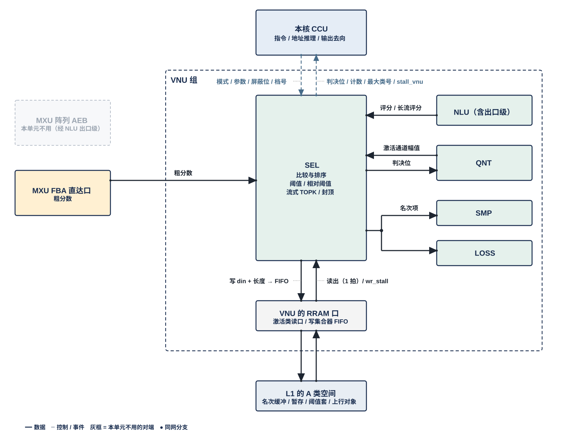
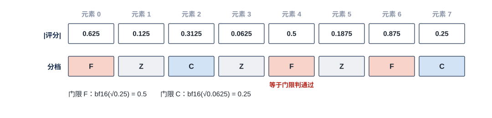
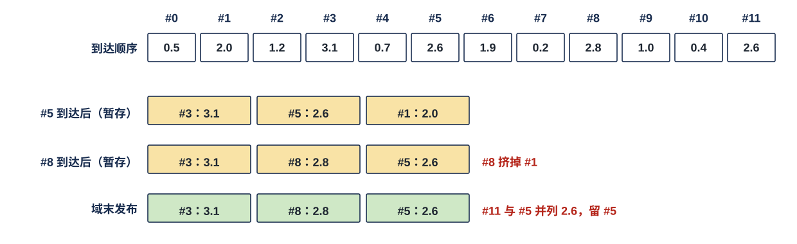
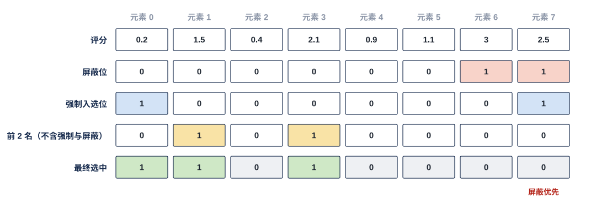
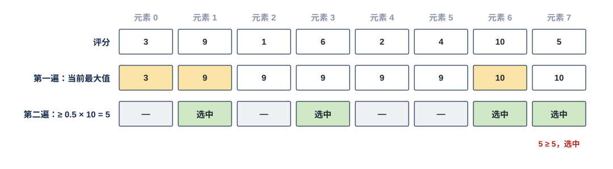

# VNU 选择单元（SEL）需求

> Owner: WangYizhao｜2026-11-11

## 1 概述

SEL（Selection Unit，选择单元）从一组评分里挑出成员：每个元素与门限比较，或在一组元素里取前若干名。**SEL 只做比较与排序。** 门限上的运算只有两种：乘相对系数 $\alpha$（本篇 §3.4），以及只收紧的偏置（本篇 §3.9.3）。SEL 不改评分值、不量化、不取数；需要求和的统计量（如均值）由 NLU 算好交来。

**SEL 是 VNU 组的六个单元之一**（其余五个是 NLU（含后处理子模块 EPI）、QNT、SMP、LOSS、OPT），每个计算核一个，全芯片 4 个，物理相同。一个计算核由 CCU、MXU 组、L1 组、VNU 组四组拼成。**SEL 与 VNU 组外的模块交换数据，都经 VNU 组的对外口**：访问 L1 经 VNU 读口 / 写口（各 ≤ 128 B，VNU 集成篇 §2.4 / §2.6），向核外上行经 VNU 输出口（VNU 集成篇 §2.7）；唯一的例外是 MXU 累加器的粗分数，经粗分数旁路直达 SEL（VNU 集成篇 §2.2）。

**SEL 只提供选择模式（本篇 §3）**：一次选择用哪种模式、门限值、取前几名、结果交给哪个接口，都由指令给出。指令分两层：CCU 收的位点指令字段可带 4 档门限；**CCU 发给 SEL 的每条比较指令只带一个门限，一个门限 = 一对阈值 $(\tau_{\text{hi}}, \tau_{\text{lo}})$，一遍出 F / C / Z 三类**（V18-SEL-16 / 17 / 18）。本篇不写指令字段，指令字段由 SEL 设计者按需整理、与 ISA 对接。

本篇用到的几个词（其余术语在首次出现处定义）：

| 词 | 含义 |
|---|---|
| 选择域 | 一次选择面对的元素集合和它的结束点，结果只在相应时点发布（本篇 §3.2） |
| 名次项 | 流式 TOPK 选出的一项：序号 + 评分，**固定 8 B**（本篇 §3.5.2） |
| TOPK 项 | LM Head 每个预测位置（或树节点）一行 logit 里值最大的 $K_{\text{top}}$ 个名次项；SMP 在它们上取项（VNU_SMP 篇） |
| 读集 | 一份数据里至少一个源要读的行或列的集合；源 = 要从同一份数据里挑数的一个使用者，例如一个 token 或一个查询行（本篇 §3.12） |
| 通道片 | 一个 token 记录在一段通道范围内连续的 32 通道段（数据组织篇 §1.2）；CCU 按通道片发比较指令 |

## 2 接口需求

### 2.1 架构图与接口汇总

图中模块框内的结构是参考实现（见第 7 章），本章以框外的各口为准。

图中虚线框是 VNU 组，框外画出 VNU 组的全部直接对端；本单元不用的画灰，对端之后的去向不画，在下文交代。

- **上方**：本核 CCU，虚线为指令下发与事件上报——下发模式 / 参数 / 屏蔽位 / 门限；上报判决位、按行计数、最大类号、树节点 $\hat w$ 的逐次比较结果与读入口的 stall。**一条比较指令只带一个门限（一对阈值）；需要按档用门限时，CCU 已按 token 的档选好一个门限下发，SEL 不感知分档**（V18-SEL-16 / 18，本篇 §3.9）。
- **左侧**：**MXU 累加器直达口点亮：累加器粗分数经旁路直达 SEL，不经 EPI、不进 AEB、不进寄存器堆**（VNU 集成篇 §2.2）；这是核内唯一的直达口，其他 VNU 单元篇里这个对端画灰。MXU 阵列 AEB × 4 画灰——AEB 条目只进 EPI，长流评分（LM Head 的 logit 流）由 EPI 交 SEL（组内传输）。
- **框内上排**是 VNU 六个单元（NLU 拆成 EPI 与 NLU 本体两格），"本单元"一格是 SEL；与 SEL 往来的单元点亮，框内写的"入 / 出"以 SEL 为准：NLU 本体（入评分 / 统计量，出录取位图）、EPI（入 logit 流）、QNT（入待判断幅值，出判决位）、SMP（入树节点路径概率 $\hat w$；名次项经存储交付，本篇 §2.7）、LOSS（名次项经存储交付）；OPT 画灰。
- **框内中部**是 SEL 的展开框，写它的选择模式与产出（本篇 §3）。
- **框内下排**是三项组级共用资源（VNU 集成篇 §3.3、§2）：共用寄存器堆、VNU 读口 / 写口（各 ≤ 128 B）、VNU 输出口（接框外计算核的集成输出端口）。
- **框外下方**分两层：上层是 L1 外的读写选择部件（S 类读 MUX、A 类读 MUX、W 类读出到 VNU 读口的一路由 CCU 定去向；A / W / S 三类写口前的选择器自己按固定规则在 H2C 接收桥、NWB、VNU 写口之间轮流，不由 CCU 逐拍选，V18-L1-32；归计算核集成，`CORE_INTEGRATION_STAGING.md`）；下层是只暴露 RRAM 口的 L1（W / S / A 三类；图中 L1 只画三类的读写口，L1 内部组织，见 L1 篇第 7 章）。**SEL 只读写 A 类**：经 A 类读 MUX 读、经 A 类写口前的写 MUX 写；S 类、W 类的部件 SEL 不用、画灰。

| 口 | 对端 | 方向 | 每次 / 每拍内容 | 握手 |
|---|---|---|---|---|
| 粗分数口 | MXU 累加器（每 pod 一路，旁路直达） | 入 | 每 pod 每算完一个（查询行, 16 个 key）交 16 个粗分数 | **无握手；SEL 不反压、不丢** |
| NLU 口 | NLU 本体 | 入 | 评分每拍 16 个（BF16）；相对阈值用的统计量；Q 的逐维幅值 | 组内握手（VNU 集成篇 §3.6） |
| 录取位图 | NLU 本体 | 出 | 每（查询行, 录取窗口）一张，每 key 1 bit | 组内握手 |
| 长流评分口 | EPI | 入 | 按存储序到达的长评分流（BF16，例如 LM Head 的 logit） | 组内握手 |
| QNT 口 | QNT | 入 | 待做保留判断的幅值（BF16） | 组内握手 |
| 判决位交 QNT | QNT | 出 | 保留位每元素 1 bit；F 序号每项 2 B | 组内握手 |
| 树节点 $\hat w$ | SMP | 入 | 每个节点的路径概率 $\hat w$，格式由 SMP 设计者定 | 组内握手 |
| 名次项写出 | 写到指定的位置（L1 A 类经 VNU 写口，地址由 CCU 给；或 VNU 共用寄存器堆，位置由 VNU_CONTROLLER 按分区算）；SMP、LOSS 读同一份 | 出 | 每项 8 B，按项首尾相接 | 随所经的口 |
| 指令与门限 | 本核 CCU | 入 | 模式、参数、屏蔽位与强制入选位、一对阈值（L1 的读写地址留在 CCU，不交 SEL） | 命令侧的线（VNU 集成篇 §2.9） |
| 判决口 | 本核 CCU | 出 | 逐元素判决、按行计数、最大类号、$\hat w$ 每条比较指令的三类结果 | 同上 |
| 读入口 stall | 本核 CCU（经 VNU 合成 stall_vnu） | 出 | 1 bit | — |
| VNU 读口（SEL 一侧） | L1 A 类（经 L1 外的 A 类读 MUX）、VNU 共用寄存器堆 | 入 | 一次 ≤ 128 B；读 L1 的首地址与长度由 CCU 给，读共用寄存器堆的位置由 VNU_CONTROLLER 按分区算 | 读侧无握手（核内 RRAM 协议），来不及收时拉 stall |
| VNU 写口（SEL 一侧） | L1 A 类写口（经 L1 外的写 MUX）、VNU 共用寄存器堆 | 出 | SEL 只交数据与每拍有效字节数；写 L1 的地址由 CCU 计数推出，写共用寄存器堆的位置由 VNU_CONTROLLER 按分区算；一次 ≤ 128 B | wr_stall 回 SEL |
| VNU 输出口（SEL 一侧） | 计算核的集成输出端口 → C2H → L2 | 出 | 要出核的位图、序号列表、TOPK 重算词号列表 | 随 VNU 输出口（VNU 集成篇 §2.7） |

VNU 读口、写口与输出口的口宽与条数以架构篇 PORT-03 / PORT-04 / PORT-09 与 VNU 集成篇 §2 为准，本表只为阅读方便列出 SEL 一侧交什么。**每个结果交给哪个接口由指令选。**

**组内传输的位宽、链路条数与互连方式由 VNU 集成设计者定**（V18-VNU-08，VNU 集成篇 §3.6；架构篇 PORT-08）。链路上是什么格式、什么精度，由 SEL 与对端单元的控制逻辑按指令解码，链路本身不区分格式；下文各节"元素格式"是两端须能解码的内容，不是链路的定义。**对端来不及收时经组内握手让 SEL 停发，SEL 保持待发数据、不丢。**

### 2.2 粗分数口：MXU 累加器经旁路直达 SEL，不反压、不丢

#### 2.2.1 内容与特殊需求

- **内容**：粗分数，即 $\tilde S = Q\,K_{\text{hi}}^{\mathsf T}$ 的元素——一个查询行对一个 key 的近似分数，只用 K 的高位平面算出。MXU 每核 4 个同构 pod（计算分组），每个 pod 每算完一个（查询行, 16 个 key）交出 16 个粗分数；**4 个 pod 做同一个 pass、一轮之内各自推进（V18-MXU-07、V18-CCU-01，MXU 集成篇 §3.4），同拍各交 16 个是常态，峰值 64 个/拍/核**。元素格式：BF16 级判决格式。
- **累加器粗分数直达 SEL 的旁路，不经 EPI、不进 AEB、不进寄存器堆**（VNU 集成篇 §2.2，架构篇 §2.2.6）。
- **这个口没有握手：SEL 不反压，也不丢失粗分数；SEL 不需要保存粗分数**（精算不以粗分数为初值）。所以 SEL 的处理能力须满足本篇 §4.1 的两条。
- SEL 一时只服务一个任务（本篇 §3.1 末），各任务的先后由编译链排（本篇 §5.2）；SEL 不按"粗算 / 精算"等阶段区分自己的行为。

### 2.3 NLU 本体口：评分、统计量与 Q 逐维幅值入，录取位图出

#### 2.3.1 入：评分、统计量、Q 的逐维幅值

| 内容 | 元素格式 |
|---|---|
| 评分，每拍 16 个 | BF16 |
| 相对阈值所用的统计量（如按行均值、$\sum\lvert x\gamma\rvert$） | BF16 |
| Q 的逐维幅值：一个查询行的 head_dim 个 $\lvert q_d\rvert$ | BF16；**取 RoPE 之后、量化之前的值，与求均值用的数值同源**（用户 11-04） |

#### 2.3.2 出：录取位图

attention 每（查询行, 录取窗口）一张录取位图，每 key 1 bit。**它同时给出 $\tilde p$ 的 key 对应**：$\tilde p$ 是每（查询行, tile）一条按录取次序稠密排列的 BF16 向量（未折 V 尺度，数据组织篇 §2.10），第 $j$ 个元素对应位图里第 $j$ 个置 1 的 key（V18-ATT-02）；**$\tilde p$ 的有效个数由 CCU 从录取位图数出，NLU 不另交**（V18-DORG-09）；pod 的逐源压紧器按该源的录取位图在读集次序里挑 V 的行（本篇 §3.12）。

### 2.4 长流评分口：EPI 交来的 logit 流

一条按存储序到达的长评分流，例如 LM Head 的 logit：$Z = H\,W_{\text{head}}$，$W_{\text{head}}$ 为 $d \times V$，每个 token 一行 $V$ 个 logit（$V$ 约 15 万）；元素格式 BF16。**EPI 把同一条流同时交 SEL 与 LOSS，两者都收到才算交出**（VNU 集成篇 §3.6.4）；LOSS 是否收这条流由指令逐位点指定（V18-LOSS-08，VNU_LOSS 篇）。**SEL 来不及处理时经组内握手让 EPI 停发，不丢**（本篇 §4.1）。

### 2.5 QNT 口：幅值入，判决位与 F 序号出

#### 2.5.1 入：待做保留判断的幅值

下一位点输入激活一个 token 各通道的 $\lvert x_k\rvert$，BF16。

#### 2.5.2 出：判决位与 F 序号

阈值判断的逐元素判决位（例如 Q 一行 head_dim 个维的选维位、下一位点输入激活一个通道片各通道的保留位）与同一遍比较判为 F 的通道序号。**F 序号从本次比较流第 0 个元素起计；CCU 每片发一条比较指令时就是片内序号**（V18-SEL-18）。保留位每通道 1 bit；F 序号每项 2 B。**QNT 按它们压紧，并原样写成该片元数据项里的 keep 位图与 F 列表**（都在 A 类，本篇 §3.10.2；V18-TP-68 / L1-20）。**紧凑输出时 SEL 按通道片补齐 F 列表：每片 F 列表末尾补到存储字边界由 SEL 做，QNT 只写 SEL 交来的内容**（V18-DORG-11 (4)、V18-QNT-14 (3)；排法见数据组织篇 §2.5）。**按列表压缩输出（经 C2H 写 L2、由 MAE_CRU 填元数据项）的位点，每片 F 项数由 SEL 按片写成一个定长计数项、写进本核 L1 A 类（地址由 CCU 给）**；CCU 随 F 列表经 C2H 送 L2，MAE_ENG 先读计数项、再整字搬 F 列表（V18-TP-83 (5)；MAE_ENG 篇、`CCU_STAGING.md` CCU-S-22）。

### 2.6 树节点 $\hat w$ 口：SMP 交来的路径概率

建树后每个节点的路径概率 $\hat w$（根到该节点各边条件概率之积）由 SMP 交来，格式由 SMP 设计者定；CCU 发两条比较指令、各带一对阈值，SEL 每条对全部节点判出三类交 CCU，两条合成 2 bit 档号（本篇 §3.3.3，V18-SMP-03 / SEL-18）。

### 2.7 名次项写出：写到指定的位置，只存一份

**流式 TOPK 的名次项在选择域结束时写到指定的位置；消费方（SMP、LOSS）读同一份，SEL 不另交副本**（V18-SEL-19 / SMP-09）。本篇的**指定的位置**：工作数据放 L1 A 类时是 CCU 给的地址（读由 CCU 发，写的地址由 CCU 按 SEL 交出的有效字节数计数推出）；放 VNU 共用寄存器堆时是 VNU_CONTROLLER 按分区算的位置（V18-VNU-12，VNU_CONTROLLER 篇 §3.6）。放哪一处由指令的 1 bit 选（VNU_CONTROLLER 篇 §2.2）。

#### 2.7.1 写出的格式与位置

- **每个名次项固定 8 B：序号 3 B + 评分 2 B（BF16）+ 3 B 补 0**（V18-SEL-19，用户 11-11："这里需要固定，就直接标注成8B紧密存储吧，这样便于对齐"）。序号是元素在本选择域里的序号（key 号、词号或区块号），3 B 覆盖 15 万词表。
- **一组名次项按项首尾相接（紧密存储），一个存储字（32 B）恰装 4 项**；一组从指定位置的起点写，起点默认在存储字边界（数据组织篇 §2.3）。
- **放 L1 A 类（经 VNU 写口）还是 VNU 共用寄存器堆由指令选，SEL 不感知是哪一处**：放 L1 时地址由 CCU 给，放共用寄存器堆时位置由 VNU_CONTROLLER 按分区算（V18-SEL-19、V18-VNU-12）。
- **LM Head 的 TOPK 项就是这一份**：每个预测位置（或树节点）的 $K_{\text{top}}$ 个名次项写在指定的位置；**TOPK 列补算后的精确 logit 写进同一份的评分字段（由谁写入由设计者定，V18-SMP-10），SMP 读同一份**（V18-SMP-09，VNU_SMP 篇 §3.6.1）。

#### 2.7.2 写出之后

- **名次项写出后 SEL 不再持有**；同一地址何时可被下一组覆盖，由 CCU 与编译链按地址安排（本篇 §5.2）。**名次项的复用由 CCU 按地址安排；SEL 不收任何消费方的释放通知**（V18-SMP-09）：SEL 写出后不持有名次项，释放通知在 SEL 一侧没有可做的动作。**LOSS 用完名次项也不向 CCU 报事件，何时覆盖由编译链按位点先后安排**（与 SMP 同一口径，V18-TP-83 (5)）。

### 2.8 CCU 口：指令与门限入，判决与计数出

#### 2.8.1 入：指令与门限

选择模式、参数（相对系数 $\alpha$、$k$、偏置 $b$）、每个元素的屏蔽位与强制入选位（本篇 §3.8）；L1 的读写地址留在 CCU、不交 SEL；**CCU 发给 SEL 的每条比较指令只带一个门限（一对阈值 $(\tau_{\text{hi}}, \tau_{\text{lo}})$）**（本篇 §3.9.1，V18-SEL-18）；**CCU 按通道片发比较指令**（一片一条）；需要按档用门限时，这一个门限是 **CCU 已从位点指令的 4 档里按 token 的档选好的**（本篇 §3.9.2，V18-SEL-16）；按档不参与的 token 由 CCU 屏蔽或不下发。

#### 2.8.2 出：判决、计数与 stall

- **判决口**：逐元素判决（一条比较指令每元素出 F / C / Z 三类之一，即保留位与是否 F，本篇 §3.3）、按行计数、最大类号；树节点 $\hat w$ 每条比较指令的三类结果（本篇 §3.3.3）。
- **读入口 stall**：SEL 读入口来不及收时的 stall，由 VNU 合成为 stall_vnu 交 CCU，各单元怎样合成【设计者定】（要定的是合成逻辑，约束：任一单元来不及收时 CCU 停发读，VNU 集成篇 §2.4）。
- 变长产出不另报字节长度：SEL 只交数据与每拍有效字节数，CCU 自己数（本篇 §2.9.1）。

### 2.9 VNU 读口 / 写口：在指定的位置读写 SEL 的工作数据与产出

**SEL 读写的一切——名次缓冲、相对阈值的暂存、名次项、选写 L1 的位图与列表——都在指定的位置读写：放 L1 A 类时读由 CCU 发、写的地址由 CCU 计数推出；放 VNU 共用寄存器堆时位置由 VNU_CONTROLLER 按分区算。工作数据放哪一处由指令的 1 bit 选，SEL 不感知**（V18-SEL-19、V18-VNU-12，VNU_CONTROLLER 篇 §2.2、§3.6）。VNU 共用寄存器堆只由 CCU 给分区配置、逐拍读写位置由 VNU_CONTROLLER 算（V18-VNU-10 / 12，VNU 集成篇 §3.3）。访问 L1 经 VNU 读口 / 写口（各 ≤ 128 B，VNU 集成篇 §2.4 / §2.6），与 VNU 其他单元分用：每次读的首地址与长度由 CCU 定；读出在 VNU 内分给哪个单元、各单元的写怎样轮用写口，由 VNU_CONTROLLER 按配置定（VNU_CONTROLLER 篇 §2.5、§3.4）。

#### 2.9.1 写：SEL 只交数据与有效字节数，地址由 CCU 计数推出

- **SEL 只交数据与每拍的有效字节数，不算地址**（V18-VNU-12）；VNU 写口一次写 = 首地址（24 bit 段内字节地址，默认在存储字边界）+ 段选 `seg` + 有效字节数 ≤ 128 B 的数据（从第 0 字节起放），首地址与 `seg` 由 CCU 内部计数推出（协议篇 §3.3.1，VNU_CONTROLLER 篇 §3.9）。SEL 的写都按 `seg` 进 A 类写口；各单元的写在 VNU 内合并进这一条写口（VNU 集成篇 §2.6）。
- **支持紧密存储，移位在 SRAM 内部**：首地址可以是任意字节，由 L1 内部移位（架构篇 §3.5.4），SEL 与 VNU 写口都不需要做字节移位；SEL 的产出按数据组织的默认对齐使用（本篇 §3.13）。
- **A 类写口前的选择器在 L1 外，自己按固定规则在 H2C 接收桥、NWB、VNU 写口三个来源之间轮流，没轮到的在自己的 FIFO 里等，不由 CCU 逐拍选；写与读碰到同一个堆时写让读**（V18-L1-32，架构篇 §3.7）；本拍没轮到 VNU 写口时，VNU 写口的项在 VNU 一侧等，来不及时 VNU 写口拉 **wr_stall** 交当拍在写的 SEL（不到 CCU，VNU 集成篇 §2.6），**SEL 保持待写的数据、不丢**。
- **核内写 L1 的完成由 CCU 判定；VNU 写口的写何时写完，由写口前的选择器告知 CCU 或由 VNU 报完成【设计者定】（V18-L1-32）**；SEL 自己不报写完成（架构篇 §3.9）。
- 变长的产出同样只交数据与每拍有效字节数，每份的长度由 CCU 自己数；**每份默认从存储字边界起（本篇 §3.13），CCU 怎样知道一份在哪一拍结束【待确认】**（建议：一次写不跨两份，每份的最后一次写带一位"本份结束"；或由指令给出每份的项数）；**给 MAE 用的列表（升序序号列表、TOPK 重算词号列表）的项数由生产核 CCU 写成一个定长计数项**（编译链给地址，与列表同在 L2），MAE 读列表前先读它；SEL 不写计数（V18-DORG-05 (5)）。

#### 2.9.2 读：CCU 给首地址与长度，按地址对齐好交回

- 一次读 = CCU 给的首地址（24 bit 段内字节地址，默认是 32 的倍数）+ 有效字节数（≤ 128 B）；**L1 把首字节移到输出第 0 字节、按地址对齐好交回**（V18-TP-73 / 74），经 L1 外的 A 类读 MUX、VNU 读口到达 SEL。**A 类读 MUX 每拍整拍只送一个使用者**（架构篇 §3.7）；从存储字边界起一拍，否则允许多拍（架构篇 §3.4 CONC-3）。
- SEL 从第 0 字节起解析，不需要做字节移位；读一个选择域的产出就是从它的起始字起整字读到末字。
- **读侧没有握手**（核内 RRAM 协议）：SEL 读入口来不及收时经 VNU 读口拉 stall_vnu，CCU 停发读（本篇 §2.8.2）。

#### 2.9.3 读写哪一堆

读哪一堆、写哪一堆由 CCU 给的堆选决定（架构篇 §3.3）。**每个堆同一拍只做一次访问：读由 CCU 排；写与读碰到同一个堆时写让读，由写口前的选择器本地判断**（架构篇 §3.4 CONC-1 / 2，V18-L1-32）；两堆都可读可写，同一时段可以又读又写，同一拍不行。ping-pong（读一堆、写另一堆）是编译链排地址的用法：相对阈值第一遍暂存与第二遍读回之间按这种用法切换堆时，条件是写完成 ∧ 最后读者完成，由 CCU 在下一阶段的地址里体现（协议篇 §3.14）。

### 2.10 VNU 输出口：产出直接写 L2

**要出核的产出（不需跨核合并的位图、升序序号列表、TOPK 重算词号列表）经 VNU 输出口进计算核的集成输出端口，再经 C2H 写 L2；数据来自哪个单元、写到哪里，由 CCU 解码指令得到**（V18-VNU-07，VNU 集成篇 §2.7）。**每个输出每条指令只选一处**：写 L1（之后可由本核 CCU 经 A 类读 MUX 读进发送 FIFO 入口、经 C2H 发出，数据块发完后 CCU 向 MAE 发出报告，V18-TP-35），或经 VNU 输出口直接写 L2（V18-TP-56）。目的地址由本核 CCU 的指令给出。**要做读集合并的位图写进 L2 本核象限的同一段内地址**，由 MAE_CRU 读四个象限取并、写回 L2，要用时经 H2C 道回核（V18-CRU-07，本篇 §3.12）。变长数据块写进 L2、数满写入握手后由本核 CCU 向 MAE 发出报告（只带目的起始地址），SEL 不报。

## 3 功能描述

### 3.1 功能一览

| 功能 | 输入 | 输出 | 触发 / 生效条件 | 节 |
|---|---|---|---|---|
| 选择域与五种模式 | 评分流、指令 | 见各模式 | 模式与参数在位点边界随指令生效 | §3.2 |
| 阈值模式 | 评分 + 一对阈值 | 每元素 F / C / Z（保留位 + F 序号） | 元素到达即出 | §3.3 |
| 相对阈值模式 | 评分 + $\alpha$ + 本域统计量 | 每元素 1 bit | 统计量就绪后 | §3.4 |
| 流式 TOPK | 评分流 + $k$ | 名次项、位图或升序序号列表；LM Head 时另出 TOPK 重算词号列表 | 选择域结束 | §3.5 |
| 阈值后限个数模式 | 评分 + 门限 + $k$ | 名次项或位图 | 选择域结束 | §3.6 |
| 关闭 | — | 无 | 指令配置为稠密 | §3.7 |
| 屏蔽与强制入选 | 逐元素屏蔽位、强制入选位 | 作用于各模式的结果 | 所有模式 | §3.8 |
| 门限 | 指令里的一对阈值、偏置 | 比较用的门限 | 随比较指令到达 | §3.9 |
| 输出形式 | 选择结果 | 判决位、位图、计数、列表、名次项、最大类号 | 见各模式 | §3.10 |
| 结果规则 | — | — | 恒定 | §3.11 |
| 读集：按源出选择位图 | 各源的评分 | 每个源一张选择位图；核内取并（若由 SEL 做） | 读集在 MAE 按读集搬运之前就绪 | §3.12 |
| 变长数据块与限个数选择模式 | 选择结果 | 按容量窗口存放的变长数据块 | 存储或传输的位点 | §3.13 |
| 复位 | 复位 | 清 SEL 内部状态 | 复位 | §3.14 |

**SEL 一时只服务一个任务；几个来源（例如 NLU 本体的评分、QNT 的幅值、EPI 的 logit 流）都要用 SEL 时，按指令给出的先后串行处理（CCU 作为配置交 VNU_CONTROLLER 执行），SEL 内不设多源合并逻辑**（V18-VNU-06，VNU_CONTROLLER 篇 §3.3）。一个任务里可以同时在选多个选择域（本篇 §3.5）；**SEL 与 VNU 其他单元在计算资源不冲突时可同时工作**，由指令给出、VNU_CONTROLLER 推进（VNU_CONTROLLER 篇 §3.4）。各任务的先后由编译链排（本篇 §5.2）。

### 3.2 选择域与五种模式

**选择域**是一次选择面对的元素集合和它的结束点，结果只在相应时点发布。例如：

- 一个查询行在连续 $N_{\text{ct}}$ 个 key 上的粗分数，$N_{\text{ct}}$ 默认 64，称为一个录取窗口；
- 一个 token 的整行 logit；
- 一个（查询行块, q 头）的全部区块能量。区块是连续 128 个 key，区块能量由 NLU 按摘要分数聚合得到。

| 模式 | 比较什么 | 输出 | 何时发布 | 典型用途 |
|---|---|---|---|---|
| 阈值 | 每个元素与一个门限（一对阈值 $(\tau_{\text{hi}}, \tau_{\text{lo}})$，一条指令一个门限）比较 | 每元素 F / C / Z 三类之一（保留位 + F 序号）；四档以上由 CCU 发几条指令合成 | 元素到达即出 | FFN gate 先筛、FFN 输出通道分档、attention 固定阈值录取、区块绝对阈值、token 复用判决、树节点 $\hat w$ 分档 |
| 相对阈值 | 每个元素与 $\alpha$ × 本域统计量 | 每元素 1 bit | 统计量就绪后 | 区块相对阈值、Q 一行各维的选维 |
| 流式 TOPK | 本域内取前 $k$ 名 | 名次项、位图或升序序号列表 | 选择域结束 | attention 每行每窗口录取、区块名次选择、LM Head 词表（名次项 + TOPK 重算词号列表）、判别器取最大类（$k = 1$） |
| 阈值后限个数 | 过门限的元素里取前 $k$ 名 | 名次项或位图 | 选择域结束 | attention 限个数录取 |
| 关闭 | — | — | — | 稠密计算 |

五种模式的区别只在"拿什么比"和"何时能下结论"：阈值模式每个元素独立判，所以到达即出；相对阈值要先有本域统计量；流式 TOPK 与阈值后限个数要看完整个域才知道名次。"发布时点"一列决定各模式对下游放行先后的影响，放行本身由 CCU 与指令安排（本篇 §5.2）。

### 3.3 阈值模式：一个门限 = 一对阈值，一条指令一遍出 F / C / Z

**一个门限 = 一对阈值 $(\tau_{\text{hi}}, \tau_{\text{lo}})$，$\tau_{\text{hi}} \ge \tau_{\text{lo}}$；一条比较指令只带一个门限，一遍对每个元素判出三类**（V18-SEL-18）。

#### 3.3.1 三类与两样产出

- **三类**：$x \ge \tau_{\text{hi}}$ 为 F，$\tau_{\text{lo}} \le x < \tau_{\text{hi}}$ 为 C，$x < \tau_{\text{lo}}$ 为 Z；这对阈值来自这条指令的字段（本篇 §3.9.1）。用于 FFN 输出通道分档时 F 读权重高位与低位两个平面、C 只读高位平面、Z 不参与后续计算。
- **一遍同时产出两样**：保留位（每元素 1 bit，F 或 C 为 1）与 F 序号列表（判为 F 的元素序号，升序，每项 2 B）。这两样就是紧凑 token 记录元数据项里的 keep 位图与 F 列表（本篇 §3.10.2，V18-TP-66），不合成 2 bit 码。
- **只要二分时**（gate 先筛、attention 固定阈值录取、区块绝对阈值、保留判断等），指令给一对相等的阈值 $\tau_{\text{hi}} = \tau_{\text{lo}} = \tau$，没有 C 类，保留位就是"$x \ge \tau$"，下游只用保留位。
- **序号是本次比较流里从 0 起的相对位置，SEL 不需要知道片长**：**CCU 按通道片发比较指令，一片一条**，所以交出的 F 序号天然是片内序号（V18-SEL-18）。
- **多于三类时由 CCU 发几条比较指令**、每条一对阈值，再把各条的结果合成档号；**结果须与按这些阈值逐级比较逐位相同**（例：树节点 $\hat w$ 四档用两条指令，本篇 §3.3.3）。
- 可选**按幅值比较** $\lvert x\rvert$。
- 阈值取"恒通过""恒不通过"两个哨兵值时，判决与算法参考模型一致。

#### 3.3.2 评分按 BF16 比较，平方尺度阈值由编译链换算

**评分按 BF16 进比较器，不另量化。** 有的阈值在算法侧定义在平方尺度上，例如 FFN 分档的 $\tau_F$、$\tau_C$ 定义在 $\tilde s^2$ 上。这类阈值由编译链换算成 BF16 平方根门限后写进指令字段（$\tau_{\text{hi}} = \mathrm{bf16}(\sqrt{\tau_F})$、$\tau_{\text{lo}} = \mathrm{bf16}(\sqrt{\tau_C})$），SEL 只比较 $\lvert\tilde s\rvert$ 与这对门限，**不做开方**。

缩小例只画 8 个元素，实际 NLU 口每拍交 16 个。平方尺度阈值 $\tau_F = 0.25$、$\tau_C = 0.0625$ 换算成一对门限 $(\tau_{\text{hi}}, \tau_{\text{lo}}) = (0.5, 0.25)$，一条比较指令一遍判出各元素的类，同时给出保留位与 F 序号：

| 元素 | 0 | 1 | 2 | 3 | 4 | 5 | 6 | 7 |
|---|---|---|---|---|---|---|---|---|
| 评分 | 0.625 | 0.125 | 0.3125 | 0.0625 | 0.5 | 0.1875 | 0.875 | 0.25 |
| 类 | F | Z | C | Z | F | Z | F | C |
| 保留位 | 1 | 0 | 1 | 0 | 1 | 0 | 1 | 1 |

F 序号列表 = [0, 4, 6]（3 项 × 2 B）。元素 4 的 0.5 等于 $\tau_{\text{hi}}$，判 F；元素 7 的 0.25 等于 $\tau_{\text{lo}}$，判 C。

#### 3.3.3 典型用途：树节点 $\hat w$ 分档用两条比较指令

（V18-SMP-03 / SEL-16 / SEL-18）SMP 建树后交出每个节点的路径概率 $\hat w$，按 2 bit 档号分 4 档（档 0、1、2 参与，档 3 = 剪掉），要 3 个阈值 $\tau_1 > \tau_2 > \tau_3$，**用两条比较指令**：

- **第 1 条带 $(\tau_1, \tau_2)$、第 2 条带 $(\tau_3, \tau_3)$**（阈值值在指令字段），SEL 每条对这棵树的全部节点判出三类、交 CCU；
- CCU 合成 2 bit 档号写进节点档表：第 1 条判 F 为档 0、判 C 为档 1；第 1 条判 Z 的节点，第 2 条通过为档 2、不过为档 3；结果与按 3 个阈值逐级比较逐位相同；
- 一棵树的节点数由指令给（参考 24；上限来自 SMP 的树记录格式，VNU_SMP 篇 §3.3.2），每条指令每个节点比较一次，每棵树两条；两条都须在 CCU 发出依赖分档的指令之前交完。

档号怎样用于后续计算由 CCU 决定，SEL 与 VNU 其他单元在后续计算里不感知分档（本篇 §3.9）。

### 3.4 相对阈值模式：门限随本选择域的统计量变化

**门限 = $\alpha$ × 本选择域的统计量**，$\alpha$ 由指令给出。统计量有两种：

- **最大值，由 SEL 自己求**：本域每个评分与 $\alpha \times \max$（$\max$ 取本域全部评分的最大值）比较。例如区块相对阈值 $\mathcal E_J \ge \alpha_{\text{blk}} \cdot \max_{J'} \mathcal E_{J'}$。**求最大值期间评分不丢，判决结果与按到达的评分逐位相同**；评分放在哪由设计者定，**放在 SEL 外时在指定的位置读写**（L1 A 类时地址由 CCU 给，VNU 共用寄存器堆时位置由 VNU_CONTROLLER 按分区算；SEL 不感知，本篇 §2.9；V18-SEL-19）。参考做法（两遍、暂存格式与次序）见本篇 §7.2。
- **均值，由 NLU 求好随评分交来**（用户 11-04）。SEL 只算 $\alpha$ × 均值再比较。例如对 Q 的一行沿 head_dim 维判断 $\lvert q_d\rvert \ge \alpha \cdot \mathrm{mean}_d \lvert q_d\rvert$，输出 head_dim bit 的选维位，粗分数只在选中维上求和。

数值例（8 个元素，$\alpha = 0.5$）：评分最大值为 10，门限 $0.5 \times 10 = 5$，元素 1、3、6、7 选中，其中元素 7 的 5 等于门限、判选中（逐步过程见本篇 §7.2 的 FIG-VNU_SEL-RELATIVE）。

**阈值判断沿哪一维、对哪条向量做，由指令给出**（用户 11-04）：FFN 输出通道的分档（F / C / Z）、gate 先筛、下一位点输入激活的保留判断（keep）、Q 一行各维的选维，都是同一种逐元素阈值判断；区别只在被判断的向量、门限个数与门限来源（固定值或相对于本域统计量）。所以本篇不为它们各设机制。**保留判断也由 SEL 执行，QNT 只按 SEL 给的判决位压紧与打包。**

**用整行统计量判决的位点**（相对阈值、QDS 行均值）在权重驻留下，行统计量要等全部列块算完才有，判决前的值须先存 BF16、再判决与压紧，不能逐 MX 组流式打包。规则见数据组织篇 §3.6.8；哪些位点如此，由 CCU 按 SEL 的选择模式逐位点列出（`CCU_STAGING.md`，用户 11-05）。

**按通道片分段流水只支持不需要整行统计量的判法**（V18-DORG-08）：分段流水 = CCU 按通道片发比较指令，SEL 先判一片、MXU 算这一片的同时 SEL 判下一片；判一片只用本片评分与指令给的门限的判法可以这样做——阈值模式，以及选择域就是这一片的流式 TOPK 与阈值后限个数（每片保留上限 $k$ 按通道片给，本篇 §3.13）。**需要整行统计量的位点（相对阈值的最大值或均值、QDS 行均值）不支持分段流水**：统计量要等整行到齐，这些位点按上段先存 BF16、整行判完再压紧。

$\alpha$ × 统计量的舍入与算法参考模型一致。

### 3.5 流式 TOPK 模式：选择域结束时发布前 $k$ 名，与整域排序逐位相同

#### 3.5.1 规则

- **整个选择域结束才发布，中途不发布。** 发布内容是前 $k$ 个名次项，或对应的位图。逐个插入的做法见本篇 §7.8。
- **无近似**：结果与对整个域排序后取前 $k$ 名逐位相同。并列取序号小者。
- **选择域长度不限**：一个窗口的几十个元素、一个 token 的整行 logit、超长上下文的全部区块，都用这一个模式。同时在选的域可以有多个，例如一个窗口里多个查询行各一个域，一条 logit 流上多个 token 各一个域。
- **$k$ 由指令配置，不设硬上限**，只受名次缓冲段（L1 A 类的一段地址，或 VNU 共用寄存器堆里分给它的分区）的长度约束：

  $$n_{\text{dom}} \times k \times 8\ \text{B} \le L_{\text{rank}},$$

  其中 $n_{\text{dom}}$ 为同时在选的域数，8 B 为每个名次项的字节数（本篇 §3.5.2），$L_{\text{rank}}$ 为名次缓冲段的长度（指令给出）。这条由编译链保证（本篇 §5.2）。参考值：attention 录取 $k \le N_{\text{ct}}/4$（$N_{\text{ct}} = 64$ 时 $\le 16$），LM Head 20，判别器取最大类 $k = 1$。
- **一条评分流上可同时跑两组流式 TOPK**，$k$ 各自配置（可为 0），各组结果都可按序号升序输出。

#### 3.5.2 名次项：固定 8 B、紧密存储，写到指定的位置

**名次项 = 序号 3 B + 评分 2 B（BF16）+ 3 B 补 0，固定 8 B；一组按项首尾相接**（V18-SEL-19）。选择域结束时，SEL 把这一域的名次项写到指定的位置（本篇 §2.7）；消费方读同一份，**每份只存一份**。写出后 SEL 不再持有，覆盖时机由 CCU 与编译链按地址安排。

#### 3.5.3 LM Head 的 TOPK 重算词号列表由 SEL 产出

（V18-SMP-02，用户 11-08："这个列表应该由SEL产出，SMP不管"）LM Head 词表的选择域结束时，SEL 除写出名次项（即 TOPK 项，供 SMP、LOSS）外，**按词号升序写出 TOPK 重算词号列表**——要用 hi + lo 全码重算 logit 的词号，每项 3 B，变长、以选择域为单位只在末尾补齐（登记篇 REG-21；项数由生产核 CCU 写成定长计数项，本篇 §2.9.1）。TOPK 重算词号列表与名次项出自同一次流式 TOPK，**词号集合相同**，只是按词号升序而不是按名次排列。MAE 按它从 $W_{\text{head}}$ 另存的按列连续全码副本取列落 L1 W 类、尺度落 S 类，阵列一遍算出精确 logit，再写进同一份 TOPK 项（由谁写入由设计者定，V18-SMP-10）（VNU_SMP 篇 §3.6；登记篇 REG-21；数据组织篇 §3.5）；**补算本身是矩阵计算，SEL 不参与**。

12 个评分按 #0…#11 的顺序到达，$k = 3$。#5 到达后暂存的前 3 名是 #3、#5、#1；#8（2.8）到达后挤掉 #1；#11 与 #5 同为 2.6，按并列规则留序号小的 #5。域末发布 #3、#8、#5。如果在 #5 到达后就发布，下游会用到最终不在前 3 名的 #1。

### 3.6 阈值后限个数模式

先按门限判决，**过门限的元素里再按流式 TOPK 取前 $k$ 名**，在选择域结束时发布。过门限的不足 $k$ 个时，只发布过门限的，不补。

### 3.7 关闭：稠密计算不经 SEL

**指令把一次计算配置成稠密时，SEL 关闭**：不先算粗分数，也不产生任何选择结果，全部元素都参与后续计算。

### 3.8 哪些元素参与选择：屏蔽与强制入选

本节的规则对所有选择模式都成立：先确定哪些元素有资格参与，再按本篇 §3.2–§3.6 的模式在有资格的元素里选。屏蔽与强制入选都是逐元素的位，SEL 只按位施加，不解读它们的算子含义。

#### 3.8.1 屏蔽位与强制入选位由指令给出

每个元素可以带一个屏蔽位和一个强制入选位，**都由指令给出**（用户 11-04）；以区间、位图还是其他形式给出，随指令定。典型来源：

- 屏蔽：attention 的因果截断、树形 token 之间的祖先关系、有效 key 范围。
- 强制入选：序列开头的若干 key、对角区块等。

#### 3.8.2 强制入选的元素不占名额

在流式 TOPK 和阈值后限个数模式里，强制入选的元素不参与名次竞争，也不占 $k$ 个名额。

#### 3.8.3 屏蔽优先

**被屏蔽的元素一律不选中，即使同时带强制入选位。** 选择按以下先后进行：

1. 去掉被屏蔽和强制入选的元素，在其余元素里按模式选；
2. 把结果与强制入选位按位 OR；
3. 被屏蔽的元素置 0。

**按档不参与的 token（档 3）由 CCU 屏蔽或不下发，SEL 不感知分档**（V18-SEL-16）：不下发的 token 不进 SEL、不产出任何结果；以屏蔽位给出的 token 按屏蔽优先，一律不选中。

8 个元素，取前 2 名：

- 元素 6、7 被屏蔽，元素 0、7 强制入选。
- 前 2 名只在其余元素 1–5 里取，得元素 3（2.1）与元素 1（1.5）。
- 与强制位 OR 后加入元素 0。
- 元素 7 既强制入选又被屏蔽，按屏蔽优先不选中。元素 6 的评分 3.0 最高，但被屏蔽，同样不选中。

### 3.9 门限：随指令到达，按档由 CCU 选好，偏置只收紧

**门限分两层给出：CCU 收的位点指令字段可带 4 档门限（每档一对阈值）；CCU 发给 SEL 的每条比较指令只带一个门限（一对阈值 $(\tau_{\text{hi}}, \tau_{\text{lo}})$）**，按档用门限时这个门限由 CCU 从 4 档里选好（本篇 §3.9.2）；偏置只在收到的门限上统一收紧（本篇 §3.9.3）（V18-SEL-16 / 17 / 18）。SEL 不感知分档。

#### 3.9.1 门限随指令到达，SEL 只持当前指令的参数

一层运行要用的门限与参数——attention 录取的固定阈值或 $k$、各阈值判断的门限与相对系数 $\alpha$（FFN 分档的一对门限 $(\tau_F, \tau_C)$、gate 先筛的 $\tau_g$、保留判断的门限、选维的系数）等——每（层, 位点）一组，**填进该位点的比较指令字段，随指令由本核 CCU 交给 SEL**（V18-SEL-17、V18-NLU-07）。**位点**是一层里的一个算子实例，例如 gate/up 投影。字段的位宽与编码归 ISA。

- **SEL 只持有当前这条指令带来的门限与参数**，下一条指令到达前一直有效；不从 L1 读阈值表、不设门限表存储。
- **阈值表的消费方是 LIC**：模型表里按（层, 位点）给出的阈值表由 LIC 读、填进比较指令字段（登记篇 REG-09，外部信息篇 §3.3）；SEL 只看到指令里的门限。
- 保留判断（keep）的门限也随 SEL 的指令到达，只交 SEL 一处，QNT 不收门限（用户 11-04）。

#### 3.9.2 按档用门限：CCU 按 token 的档选好一个门限下发

**同一次选择里，不同 token 可以用不同门限；指令字段可带 4 个档的门限（每档一对阈值），由 CCU 按 token 所在的档选出一个门限交给 SEL，SEL 每次比较只收这一个门限**（V18-SEL-16 / 18）。档 3（不参与）由 CCU 以屏蔽或不下发实现（本篇 §3.8.3）。

- SEL 对每个评分只按"该评分所属 token 当前的门限"比较，不持有档号、不按档查表。
- **CCU 按通道片发比较指令时，门限就在这条比较指令里**（V18-SEL-18）：一片属于一个 token，一条指令一个门限，天然就是该 token 的门限，不需要另外的载体。
- **一条比较指令覆盖多个 token 时怎样换门限【设计者定】**（例如一条评分流连续含几个 token 的评分）：要定的是拆成每 token 一条比较指令，还是在指令里按 token 边界附带下一个门限。约束：
  1. SEL 比较每个评分时，用的是该评分所属 token 的门限；
  2. 分档只在位点边界翻转，一个位点内一个 token 的门限不变（本篇 §3.11.5）；
  3. 4 个档的门限值放位点指令字段（V18-SEL-17），与不分档的门限同一来路（本篇 §3.9.1）；偏置在 SEL 里对收到的这一个门限施加（本篇 §3.9.3）。
- 分档的来源之一是 SEL 的比较：树节点 $\hat w$ 经两条比较指令、由 CCU 合成档号写进节点档表（本篇 §3.3.3）；此后按档选门限只在 CCU。

示例（数值只作说明，gate 先筛是二分，每档一对相等的阈值；$\tau_g$ 按档在指令里给 0.05 / 0.10 / 0.20，同一个评分 0.12）：

| token | CCU 按档选出、交给 SEL 的 $\tau_g$ | 评分 0.12 的判决 |
|---|---|---|
| t0 | 0.05 | 选中 |
| t1 | 0.10 | 选中 |
| t2 | 0.20 | 不选 |
| t3 | 不下发（档 3） | 不参与 |

#### 3.9.3 偏置只能收紧门限

门限可以加偏置 $b$：$\tau' = \tau \cdot 2^{b}$，**只允许 $b \ge 0$，只收紧；$b \ge 0$ 由编译链保证**（V18-SEL-19，本篇 §5.2）。偏置是否开启、$b$ 取多大由指令给出，默认关。

偏置与平方根换算的舍入先后【设计者定】：要定的是先乘 $2^b$ 还是先换算平方根门限；约束是所有门限（含保留判断的门限）用同一口径，选定后同步算法参考模型。

### 3.10 输出形式

#### 3.10.1 各种输出

| 形式 | 内容 | 位宽 |
|---|---|---|
| 判决位 | 一条比较指令每元素 F / C / Z 三类之一，同一遍给出保留位与 F 序号（本篇 §3.3） | 保留位每元素 1 bit；F 序号每项 2 B |
| 位图 | 一个选择域一张，每元素 1 bit | attention 录取窗口的位图按 128 bit 参数化（$N_{\text{ct}} \le 128$）；区块位图 512 bit 定宽；与 MAE_CRU、HUB 一致 |
| 按行计数 | 选中个数 ≥ 1 的行：行号与本域选中个数 | — |
| 升序序号列表 | 选中元素的序号按升序排列 | 序号每项 3 B（行号载荷统一 3 B，任意词表都放得下的冗余设计，V18-MAE-06）；列表内无个数字段（V18-SEL-15）；项数由生产核 CCU 写成定长计数项（本篇 §2.9.1，V18-DORG-05 (5)） |
| TOPK 重算词号列表 | LM Head 词表选择域结束时，按词号升序写出的要重算的词号（本篇 §3.5.3，V18-SMP-02） | 每项 3 B；变长、选择域末尾补齐（REG-21）；项数同上 |
| 名次项 | 序号 + 评分 | **固定 8 B**：序号 3 B + 评分 2 B + 3 B 补 0；紧密存储（本篇 §3.5.2，V18-SEL-19） |
| 树节点 $\hat w$ 比较结果 | 对 SMP 交来的 $\hat w$ 两条比较指令、每条每节点三类之一，交 CCU 合成 2 bit 档号（本篇 §3.3.3） | 每条每节点保留位 + 是否 F 各 1 bit |
| 最大类号 | 取最大类的结果（$k = 1$ 的流式 TOPK） | — |
| 判决位（交 QNT） | 保留位：一条向量每元素 1 bit；F：片内判为 F 的通道序号 | 保留位 Q 一行 head_dim 128 时 16 B；F 序号每项 2 B |

#### 3.10.2 keep 位图与 F 列表就是 SEL 一遍比较的两种产出

**紧凑 token 记录元数据项里的 keep 位图与 F 列表就是 SEL 一遍比较的两种产出，都写进 A 类**（V18-TP-66 / 68、V18-L1-20、V18-SEL-18）：保留位（每通道 1 bit）原样成为该片元数据项的 keep 位图，判为 F 的通道按片内序号升序（每项 2 B）原样成为该片的 F 列表；**F 列表每片末尾补到存储字边界由 SEL 做，QNT 只写 SEL 交来的内容**（V18-DORG-11 (4)、V18-QNT-14 (3)，数据组织篇 §2.5），SEL 把它们交 QNT，由 QNT 与码一起写出——元数据项与 F 列表经 VNU 写口按 `seg` 落本核 A 类（VNU_QNT 篇 §3.7）。所以 CCU 经 A 类读 MUX 读 keep 位图做 popcount、读 F 列表转成 F 掩码，读到的就是 SEL 判出来的结果，中间不换编码。

**交 MAE 搬运引擎用作列表的产出（位图、升序序号列表、TOPK 重算词号列表）载荷只有位图或行号两种，列表没有头、不带模板号**；哪条指令用哪张列表由指令引用列表地址表达（V18-MAE-06，外部信息篇 §3.5）。

### 3.11 结果规则

#### 3.11.1 选择域结束才发布

**选择域结束前的暂存结果不交下游。** 有效元素不足 $k$ 个时，不补无效项。

#### 3.11.2 并列取序号小者

评分相等时，取元素序号（key 号、词号或区块号）小者。

#### 3.11.3 结果只依赖评分与配置

**结果只依赖评分、所属（层, 位点, token）与收到的门限，与评分到达的先后、所在的核无关。**

#### 3.11.4 与算法参考模型逐位一致

全部选择结果必须与算法参考模型在 NPU 格式下逐位一致（用户 11-02）。某种比较口径硬件实现太难时，交回算法侧修改口径并同步参考模型，**硬件不自行换比较方式**。

#### 3.11.5 生效时机

- 选择模式与参数在位点边界随指令生效。
- 分档只在位点边界由 CCU 翻转；一个位点内 CCU 交给 SEL 的同一 token 的门限不变，不会出现新旧门限混用。

### 3.12 读集：SEL 只按源出选择位图

**稀疏取数只有一条路，SEL 在其中只负责给每个源出一张选择位图**（V18-DORG-08，数据组织篇 §3.5）：

1. **SEL 给每个源出一张选择位图**（每个被挑的元素 1 bit）；
2. 用这份数据的所有源的位图按位取并，得读集；
3. MAE 只按读集从 DDR / L2 搬，按读集次序落 L1；
4. L1 读出、送 4 个 pod；
5. pod 的逐源压紧器按该源的位图在读集次序里取。

**只按被挑的是归约维（线性位点 hi / lo、粗算、P×V）还是输出维（gate/up 的列、精算 $QK^{\mathsf T}$、LM Head 列补算、dX）区分**，两种模式见架构篇 §3.6；hi 与 lo 同一套，hi 是读集为全部行的情形。

- **核内取并**（本核几个源的位图取并）**由 SEL 做还是由 CCU 做【设计者定】**（VNU 与 CCU 设计者协商）：要定的是取并放在哪个模块；约束是读集在 MAE 发起按读集搬运之前就绪。由 SEL 做时，它是对已交出的几张位图的按位 OR，与本篇 §3.8.3 选择内部的"与强制入选位 OR"是两回事。
- **跨核取并**（读集合并：把几个核各自的读集合成一份并集，只读一次再多播；数据块分录取读集、区块读集、lo 读集，用户 11-05 定名）：各核的位图写进 L2 本核象限的同一段内地址，由 MAE_CRU 从 L2 读四个象限取并、写回 L2，要用时经 H2C 道回核写 L1（V18-CRU-07，协议篇 §3.18）。

### 3.13 变长数据块与限个数选择模式：存储或传输的位点一律限个数

**选择结果决定的变长数据块**——SEL 自己写出的位图、序号列表、TOPK 重算词号列表、名次项，以及 QNT 按 SEL 判决位压紧写出的紧凑 token 记录——属数据组织篇 §1.2 的变长。**这些数据块按算法侧给的位点容量窗口由编译链静态分配，基址与窗口长在指令里，CCU 不做运行期分配**（用户 11-06，协议篇 §3.13、V18-TP-40）。紧凑 token 记录的码块窗口 = 每片码块片长上限（每片保留上限 $k$ 下的保留数 × $w$ bit，按 32 B 取整）× 片数，F 列表同样按每片保留上限下的每片 F 列表长（按 32 B 取整）× 片数给窗口（数据组织篇 §2.5，V18-TP-66、V18-DORG-04 / 05 (6)）。码块 = 紧凑 token 记录四部分之一，只装保留通道的 6 bit 码（数据组织篇 §1.2）。

**凡产出要存进 L1 / L2 或经链路传输的压紧激活的位点，选择模式必须限个数**（V18-SEL-13）：流式 TOPK，或阈值后限个数（阈值 + 最多 $k$ 个）。纯阈值、相对阈值（不限个数）只用于不落盘、不传输的判决。每片保留上限 $k$ 由算法侧按精度与容量定、按位点配置，算法评测按限个数后的结果测精度。

| 选择模式 | 每个选择域的选中个数上限 | 能否用于存储或传输的压紧激活 |
|---|---|---|
| 流式 TOPK | $k$ | 能 |
| 阈值后限个数 | $k$ | 能 |
| 阈值、相对阈值（不限个数） | 选择域长度 | 不能，只用于不落盘、不传输的判决 |
| 关闭 | 不产生选择结果 | — |

强制入选的元素不占 $k$ 个名额（本篇 §3.8.2），所以**上限 = $k$ + 本域强制入选个数**（用户 11-05 认可）。**每片保留上限 $k$ 按通道片给**（与 CCU 按片发比较指令一致，V18-DORG-05 (6)）。**SEL 保证按所选模式选出的个数不超过上限**；数据块不超容量窗口由编译期检查与仿真断言核对。

**变长数据块里各份的排法按数据组织的默认**：以选择域为单位，每份从存储字边界起、内部按项紧凑、末字带有效字节，下一份从下一个存储字边界起（V18-DORG-03，数据组织篇 §2.3）；第 $t$ 份起点 = 数据块起点 + $\sum_{i<t}\lceil \text{len}_i/32 \rceil \times 32$，由 CCU 累加地址（V18-TP-64 / 74）。SRAM 支持紧密存储（架构篇 §3.5.4），SEL 的产出按默认对齐使用；上限只用于容量窗口（按存储字取整后计入窗口）。**定长位图**（录取窗口位图、区块位图）按定长项排：第 $i$ 张的位置 = 数据块起点 + $i$ × 位图字节数（数据组织篇 §2.7）。

### 3.14 复位

**复位输入来自 CIF（架构篇 PORT-41），硬复位与软复位不区分（CIF 篇 §2.4、§3.3）；复位时清 SEL 内部的状态：当前指令带来的门限与参数、在选选择域的状态。** 分档不由 SEL 持有。SEL 没有需要跨次保留的状态。SEL 写到指定位置的数据（名次项、暂存、产出）不由 SEL 清。

## 4 性能指标

### 4.1 各口的速率要求与超额时的行为

**SEL 每拍能处理的元素数须匹配上游各口的产出速率与下游各口的接收要求，由 SEL 设计者与对端模块对接确定**（用户 11-04；各对端的现行参考值见本篇 §7.3）。SEL 能单方面承诺、与对接结果无关的是下面几条，**各口在超额时的行为不同**：

| 口 | 要求 | 超额时 |
|---|---|---|
| 粗分数口 | **不施加反压，也不丢失粗分数**。须同时满足：① 持续处理能力不低于四个 pod 合计的粗分数持续产出；② 在四个 pod 同拍各交 16 个（共 64 个/拍/核）的峰值下不丢 | 这个口没有 stall 线，超额不允许发生；靠并行比较还是靠入口暂存吸收峰值【设计者定】（约束：①、② 两条；验收按 64 个/拍持续注入，本篇 §6.1） |
| 长流评分口（推送链上） | 不丢 | 来不及处理时经组内握手让 EPI 停发（EPI 来不及时再对 AEB 拉低 ready，AEB 满后才反压 MXU，VNU_EPI 篇 §4.3）。只降速 |
| NLU 口 | 每拍 16 个评分 | 经组内握手停发，只降速 |
| 由 CCU 发读的入口（L1 读回） | 不丢 | 只经 VNU 读口的 stall_vnu 让 CCU 停发（本篇 §2.9.2）。只降速 |
| 流式 TOPK 插入 | 不低于评分到达速率 | — |
| 相对阈值的第二次比较 | 不慢于评分的产出节奏 | — |

**SEL 自身的时延（粗分数到选中位、评分到判决位）满足上下游的 ping-pong 需求，拍数由 SEL 与上下游两端的设计者自己定**（V18-SEL-19，用户 11-11："这里应该写满足上下游的ping-pong需求，拍数他们自己定"）；参考拍数见本篇 §7.4。

### 4.2 同时使用的口与并发条件

| 同时使用的情形 | 适用的约定 | 结果 |
|---|---|---|
| SEL 经 VNU 读口读、经 VNU 写口写 L1 A 类 | 架构篇 §3.4 CONC-1 / CONC-2 | 读与写落不同的堆时同拍进行；同一个堆同一拍只做一次访问：读由 CCU 排，写碰到读时写让读（写口前的选择器本地判断，V18-L1-32） |
| SEL 与 VNU 其他单元分用 VNU 读口 / 写口 | 架构篇 §3.7（A 类读 MUX 每拍只送一个使用者） | 读口每拍读什么由 CCU 排；读出在 VNU 内分给谁、各单元轮用写口的先后由 VNU_CONTROLLER 按配置定（VNU_CONTROLLER 篇 §3.4）；**编译链不做读写带宽保证，需求超出口宽时 SEL 等**（V18-L1-21） |
| 不从存储字边界起的访问 | 架构篇 §3.4 CONC-3 | 从字边界起一拍，否则允许多拍、不出错；SEL 的数据默认字对齐 |
| SEL 与 VNU 其他单元的计算 | VNU 集成篇 §3.2.1 | 计算资源不冲突时可同时工作 |

### 4.3 要求值表

| 项 | 要求值 | 说明 |
|---|---|---|
| 选择模式 | 阈值（一条指令一个门限 = 一对阈值，一遍出 F / C / Z）、相对阈值（最大值 / 均值）、流式 TOPK、阈值后限个数、关闭 | 模式、门限与参数由指令给出 |
| 每拍处理能力 | 匹配上下游各口（本篇 §4.1） | 由 SEL 设计者对接确定 |
| 粗分数口 | 不反压、不丢；峰值 64 个/拍/核 | 本篇 §2.2、§4.1 |
| NLU 口 | 每拍 16 个评分 | — |
| 时延 | 满足上下游的 ping-pong 需求，拍数由两端设计者定 | 参考拍数见本篇 §7.4 |
| $k$ | 指令配置，无硬上限 | 受名次缓冲段长约束（本篇 §3.5.1） |
| 名次项 | 固定 8 B（序号 3 B + 评分 2 B + 3 B 补 0），紧密存储，只存一份、写到指定的位置 | 本篇 §2.7、§3.5.2 |
| 门限 | 位点指令字段可带 4 档门限；CCU 发给 SEL 的每条比较指令一个门限（一对阈值）；每个评分按所属 token 收到的一个门限比较；F 序号从本次比较流第 0 个元素起计；SEL 不感知分档 | 按档选门限、按通道片发比较指令在 CCU；树节点 $\hat w$ 两条比较指令、CCU 合成 2 bit 档号，节点数由指令给 |
| TOPK 重算词号列表 | LM Head 选择域结束时按词号升序写出，变长、选择域末尾补齐 | REG-21 |
| 位图位宽 | 录取窗口按 128 bit 参数化；区块位图 512 bit | 与 MAE_CRU、HUB 一致 |
| 相对阈值（最大值）的选择域 | 不设长度要求值；评分放在 SEL 外时只受暂存段（L1 地址段或寄存器堆分区）的长度约束 | 参考规模见本篇 §7.2 |
| L1 访问 | 经 VNU 读口 / 写口（各 ≤ 128 B），一次访问 = 首地址 + 长度 ≤ 128 B；同一个堆的读由 CCU 排、写碰到读时写让读（V18-L1-32）；读入口来不及收时经 VNU 读口拉 stall_vnu；wr_stall 经 VNU 写口回 SEL | 架构篇 §3.4、VNU 集成篇 §2.4 / §2.6 |
| 变长数据块 | 按容量窗口静态分配；存储或传输的位点一律限个数（每片保留上限 $k$ 按通道片给），选出个数 ≤ $k$ + 强制入选数 | 本篇 §3.13 |

## 5 约束与由使用者保证的事项

### 5.1 硬约束

- **SEL 只做比较与排序**：不改评分值、不量化、不取数、不做开方与求和（本篇 §1）。
- **SEL 不设门限表存储**，只持当前指令的门限与参数（本篇 §3.9.1）。
- **SEL 一时只服务一个任务**，不设多源合并逻辑（本篇 §3.1）。
- **本篇不含容错设计**（V18-TP-75）。

### 5.2 由使用者保证的事项

以下事项 SEL 不检查，由对应方保证；验收时把它们当作输入前提、用仿真断言核对（本篇 §6.1）。

| 事项 | 由谁保证 |
|---|---|
| 评分与统计量怎样算；NLU 求均值用的数值与它交来的逐维幅值同源 | MXU、NLU、QNT |
| 各（层, 位点）各档门限的值折进位点指令字段（字段归 ISA），以及按最松一档离线核过 H2C 口宽 | 编译链（V18-SEL-17） |
| **偏置 $b \ge 0$** | 编译链（V18-SEL-19） |
| 树节点 $\hat w$ 分档：发两条比较指令、各带一对阈值，把两条的结果合成档号写进节点档表；按 token 所在的档从指令给的 4 档门限中选出一个下发 SEL；按档不参与的 token 屏蔽或不下发；分档在位点边界翻转 | CCU（V18-SEL-16 / 18，`CCU_STAGING.md`） |
| 按通道片发比较指令（一片一条），使 SEL 交出的 F 序号就是片内序号；片长只在 CCU 与指令里 | CCU（V18-SEL-18） |
| **SEL 各任务的先后**：几个来源要用 SEL 时串行排；粗分数口没有握手，排先后时须使粗分数到达时 SEL 正在服务这条粗分数流；与其他单元的并发编排 | 编译链排、CCU 按指令执行（V18-SEL-19，VNU 集成篇 §3.2） |
| 每个元素的屏蔽位与强制入选位 | 指令 |
| 稠密计算时被屏蔽的位置不进 softmax | NLU（VNU_NLU 篇）；屏蔽位由指令给出；NLU 一侧被屏蔽元素不白占运算拍（V18-NLU-08） |
| 判决结果与下游计算的放行先后；判决结果转发给其他核（作变长数据块经 C2H → L2 → H2C，协议篇 §3.13） | CCU 与指令 |
| **SEL 的工作数据与产出的地址**：名次缓冲段、相对阈值暂存段、名次项（TOPK 项）的位置、选写 L1 的位图与列表；放在 VNU 共用寄存器堆还是 L1 A 类；**名次项写出后何时可被下一组覆盖** | CCU 与编译链（V18-SEL-19 / SMP-09；寄存器堆的段划分见 VNU 集成篇 §3.3） |
| 名次缓冲段长：$n_{\text{dom}} \times k \times 8\ \text{B} \le L_{\text{rank}}$；相对阈值暂存段装得下本域全部评分 | 编译链 |
| TOPK 重算词号列表的消费：MAE 按列表取 $W_{\text{head}}$ 的按列全码副本落 W 类、尺度落 S 类，阵列一遍算出精确 logit，CCU 给每个精确值对应的项 | MAE、MXU、CCU（V18-MXU-09、V18-DORG-05 (2) / 08；登记篇 REG-21） |
| 核内读集：本核几个源的选择位图按位取并 | SEL 或 CCU，谁做【设计者定】（本篇 §3.12） |
| 跨核读集合并（录取读集 / 区块读集 / lo 读集） | MAE_CRU：各核位图写 L2，MAE_CRU 从 L2 读四个象限取并、写回 L2，要用时经 H2C 道回核；CRU 的合并参数随 MAE 搬运指令（协议篇 §3.17、§3.18，MAE_CRU 篇 §2.1，V18-MAE-12） |
| 按读集搬运：只搬读集里的行或列，按读集次序落 L1；被挑的是输出维的数据按列字区的列位落 | MAE（数据组织篇 §3.5，V18-DORG-08） |
| 逐源取数：pod 的逐源压紧器按该源的位图在读集次序里取 | MXU（V18-DORG-08） |
| VNU 对外口（读口、写口、输出口、粗分数旁路口）的定义；组内互连方式 | VNU 集成篇 §2；VNU 集成设计者（VNU 集成篇 §3.6） |
| 读 L1 的地址（基址 + 字节累加）与写回地址（按 SEL 交出的有效字节数计数推出）；A 类读 MUX 每拍给哪个使用者（在 L1 外）；VNU 读口每次读的首地址与长度；读的排拍（写碰到同一个堆的读时由写口前的选择器本地让读，写口前的选择器自己轮流、不由 CCU 选，V18-L1-32）；读出在 VNU 内分给 SEL、各单元轮用写口由 VNU_CONTROLLER 按配置定（VNU_CONTROLLER 篇 §3.4） | CCU（VNU 集成篇 §5.2，架构篇 §3.4 CONC-1 / 2、§3.7） |
| 输出的源与去向（写 L1，或经 VNU 输出口写 L2）；上行产出写 L1 后经 C2H 发出；变长数据块写进 L2、数满写入握手后向 MAE 发出报告（只带目的起始地址） | 本核 CCU：解码指令、发读 L1、逐拍给 C2H 地址、数 L2 回来的写入握手、发出报告（协议篇 §3.13） |
| 变长数据块按位点容量窗口静态分配，每位点的每片保留上限 $k$ 与容量窗口由算法侧给出；写入前旧数据已读完 | 算法侧（模型表）；编译链（指令中的基址与窗口长，LIC 操作 15） |

## 6 验收

### 6.1 本模块验收项

| 验收项 | 方法 | 用例 | 出处 |
|---|---|---|---|
| 阈值模式 | 与算法参考模型逐位比对 | 一对阈值一遍出 F / C / Z，保留位与 F 序号列表同时正确（FFN F / C / Z）；一对相等阈值的二分；按通道片发指令时 F 序号为片内序号；哨兵门限、评分恰等于 $\tau_{\text{hi}}$ 或 $\tau_{\text{lo}}$ | §3.3 |
| 相对阈值 | 逐位比对 | 最大值与均值两种统计量；8 / 256 / 512 项选择域；暂存放寄存器堆与放 L1 两种地址，结果相同 | §3.4 |
| 流式 TOPK | 与整体排序结果逐位比对；断言中途无发布 | 不同 $k$、并列评分、同一条流两组 TOPK | §3.5 |
| 名次项格式与写出 | 逐字节比对 | 每项 8 B（序号 3 B + 评分 2 B + 3 B 为 0），按项首尾相接、每存储字 4 项；写到指定的位置（L1 时地址由 CCU 计数推出、寄存器堆时位置由 VNU_CONTROLLER 按分区算，两种都测），SEL 写出后不再持有 | §2.7、§3.5.2 |
| 阈值后限个数 | 逐位比对 | 过门限者少于 $k$、多于 $k$ | §3.6 |
| 屏蔽与强制入选 | 逐位比对 | 强制不占名额；强制且屏蔽的元素不选中；CCU 不下发的 token 无输出 | §3.8 |
| 按 token 的门限比较 | 逐位比对 | 同一位点里各 token 收到不同门限的序列（CCU 按 4 档选出）；SEL 不持有分档 | §3.9.2 |
| 树节点 $\hat w$ 分档 | 与算法参考模型逐位比对 | 两条比较指令、各带一对阈值，合成档号与按 3 个阈值逐级比较相同；节点数 1 / 24 / 128；$\hat w$ 恰等于门限；4 档齐全 | §3.3.3 |
| 偏置 | 逐位比对 | $b = 0 \ldots 4$ 扫描下选中集合单调变小 | §3.9.3 |
| TOPK 重算词号列表 | 与整体排序后的胜出词号逐项比对；断言 | 按词号升序、域末才写出、只交数据与有效字节数且 CCU 数出的每份长度正确；与同一次 TOPK 的名次项词号集合相同 | §3.5.3 |
| 结果规则 | 断言 | 域末前无发布；不足 $k$ 不补；乱序注入、换核运行结果逐位相同 | §3.11 |
| 粗分数口不反压、不丢 | 周期仿真 | 四个 pod 同拍各交 16 个粗分数的峰值持续注入；SEL 在服务粗分数流时不丢 | §2.2、§4.1 |
| VNU 读口 / 写口与 stall | 周期仿真；断言 | 写只交数据与有效字节数；stall_vnu 拉起后读入口不溢出；变长产出每份默认从存储字边界起、末字有效字节正确、CCU 数出的每份长度正确；SEL 侧不做字节移位 | §2.9 |
| wr_stall | 周期仿真 | L1 外的写 MUX 连续选 H2C 接收桥 / NWB、VNU 写口拉 wr_stall 后 SEL 不丢写 | §2.9.1 |
| 按源出位图 | 逐位比对 | 每个源一张选择位图；核内取并由 SEL 实现时，读集 = 本核各源位图按位 OR，且在 MAE 按读集搬运之前交出 | §3.12 |
| 限个数上限 | 仿真断言 | 存储或传输的位点每片选中个数 ≤ $k$ + 强制入选数，token 驻留与权重驻留两种顺序；强制入选与 $k$ 同时存在；数据块不超容量窗口 | §3.13 |
| F 列表按片补齐 | 逐字节比对 | 紧凑输出时每片 F 列表按片补齐，与数据组织篇 §2.5 的排法一致；按列表压缩输出的位点每片 F 项数计数项等于该片 F 项数、写在 CCU 给的地址 | §2.5.2、§3.10.2 |
| 关闭 | 审查 | 稠密配置下 SEL 无活动 | §3.7 |
| 复位 | 检查状态 | 复位后门限、参数与在选状态清除 | §3.14 |
| 输入前提 | 仿真断言 | 本篇 §5.2 所列由使用者保证的事项逐项断言核对，SEL 自身不检查 | §5.2 |

### 6.2 与上下游模块的对接检查

| 对接项 | 对端 | 检查内容 |
|---|---|---|
| 粗分数旁路 | MXU 集成篇 §2.7、VNU 集成篇 §2.2 | 每 pod 一路、每次 16 个；无握手；SEL 不反压 |
| 名次项 / TOPK 项 | VNU_SMP 篇 §2.1、§3.6；VNU_LOSS 篇 | SMP、LOSS 在同一处读 8 B 名次项（L1 时地址由 CCU 给，寄存器堆时位置由 VNU_CONTROLLER 按分区算）；精确 logit 写进同一份的评分字段；SEL 不收释放通知，名次项的复用由 CCU 按地址安排 |
| 判决位与 F 列表 | VNU_QNT 篇 §3.7；数据组织篇 §2.5 | QNT 原样写成 keep 位图与 F 列表；F 列表按片补齐；MAE_ENG 读 F 项数后按片交 MAE_CRU（MAE_ENG 篇） |
| 时延与 ping-pong | NLU、QNT、EPI、CCU | 判决位交出的拍数满足上下游 ping-pong 的需求，两端设计者对齐拍数 |
| 读写地址与堆 | CCU（`CCU_STAGING.md`）、VNU_CONTROLLER 篇 §3.6、L1 篇、架构篇 §3.4 CONC-2 | 断言：每个堆一拍一次访问；写与读碰到同一个堆时写让读、不丢（V18-L1-32）；寄存器堆的读写位置由 VNU_CONTROLLER 按分区算 |
| 输出口 | VNU 集成篇 §2.7、计算核集成（`CORE_INTEGRATION_STAGING.md`） | 经 VNU 输出口写 L2 时地址由 CCU 给；读集合并位图写本核象限同一段内地址 |
| 列表项数 | CCU、MAE_ENG 篇 | 给 MAE 用的列表的项数由生产核 CCU 写成定长计数项，MAE 读列表前先读它 |

## 7 参考实现

**本章内容可以换；换了之后别的模块不用改。**

### 7.1 名次缓冲与工作数据的参考放处

**流式 TOPK 的名次缓冲参考放在 VNU 共用寄存器堆**（每个选择域当前前 $k$ 名，按 8 B 名次项格式，$k = 64$ 时约 0.5 KB；VNU 集成篇 §7.1）；实际放处与容量由 VNU 设计者评估确定（V18-VNU-05）。同时在选的域多、$k$ 大、寄存器堆分给 SEL 的段放不下时，指令把名次缓冲段放到 L1 的 A 类地址段，SEL 按 CCU 给的地址读写（本篇 §2.9）。相对阈值的暂存同样可放寄存器堆或 L1 A 类。

域末写出的名次项（本篇 §2.7）可以就是名次缓冲里的那一段（名次缓冲段即 TOPK 项的位置），也可以由 SEL 从内部缓冲写到另一处；哪种由 SEL 与 CCU 设计者对接确定，对 SMP、LOSS 只表现为"在指定的位置读 8 B 名次项"。

### 7.2 相对阈值最大值的两遍暂存

参考做法是两遍：第一遍扫完本域，逐个更新当前最大值，评分暂存进暂存段（指定的位置）；第二遍读回暂存，逐个与 $\alpha \times \max$ 比较。**两遍暂存的格式与次序【设计者定】**（用户 11-01）：要定的是第一遍的评分以什么格式、按什么次序暂存，第二遍怎样读回。约束：

1. 暂存在指定的位置（寄存器堆分区或 L1 A 类地址段）；放 L1 时经 VNU 读口 / 写口读写，默认按存储字 32 B 对齐（从字边界起一拍完成，架构篇 §3.4 CONC-3）；
2. 参考规模：32K 上下文、128 key 区块时一个域有 256 个区块能量；源稿按一个选择域至多 512 项估暂存量；
3. 第二遍读回的评分须与第一遍到达的值逐位相同（本篇 §3.11.4）；
4. 第二遍不慢于评分的产出节奏，256 项选择域参考 ≤ 12 拍。

8 个元素，$\alpha = 0.5$。第一遍逐个更新当前最大值（黄格为最大值在此更新），扫完得 10；第二遍与 $0.5 \times 10 = 5$ 比较，元素 1、3、6、7 选中，其中元素 7 的 5 等于门限、判选中。

### 7.3 各对接模块的现行参考值

下表是 SEL 设计者与各模块对接时的起点，不是 SEL 的定值：

| 相关模块 | 接口 | 现行参考值 |
|---|---|---|
| MXU（累加器） | 粗分数口（旁路，不经 EPI） | 4 个 pod 的累加器都直连 SEL，每个 pod 一次交 16 个；峰值 64 个/拍/核。四 pod 平均约 21.8 个/拍/核（理想粗算节奏），真实掩码回放约 17.2 个/拍/核（旧供数结构下仿真【待标定】） |
| NLU 的后处理子模块 EPI | 长流评分口 | 15 万词 × 24 个 token 约 3.6 M 次比较，须在 EPI 送完这条流的约 10.8 ms 内完成 |
| NLU 本体 | NLU 口、录取位图 | 每拍 16 个评分；录取位图每 key 1 bit |
| QNT | QNT 口、判决位交 QNT | 跟随 QNT 量化的节奏；保留判断每拍至多 16 个通道 |
| VNU 输出口 → 集成输出端口 | 上行 | 每拍 32 B，与其他单元分时；上行负载归 HUB 流量预算 |
| VNU 读口 / 写口 | L1 读写 | 各 ≤ 128 B/拍，与 VNU 其他单元分用 |
| VNU 共用寄存器堆 | 名次缓冲 | $k = 64$ 时约 0.5 KB（本篇 §7.1） |
| SMP、LOSS | 名次项；$\hat w$ | 名次项选择域结束时一次；$\hat w$ 每棵树一次 |
| 本核 CCU | 判决口、门限 | 每条比较指令一个门限，按通道片发；$\hat w$ 每棵树两条比较指令；分档在位点边界翻转 |

### 7.4 参考时延

| 项 | 参考值 |
|---|---|
| 粗分数到达到选中位交出（阈值模式） | ≤ 2 拍【待标定】 |
| 评分到达到判决位交出 | ≤ 4 拍【待标定】 |
| 相对阈值第二遍（256 项选择域） | ≤ 12 拍 |

### 7.5 VNU 读口 / 写口的参考用法

- **读入口 stall 的门限**：SEL 的读入口缓冲占到"深度 − $L$"时经 VNU 读口拉 stall_vnu，CCU 停发读；$L$ = CCU 停发 1 拍 + L1 读返回 1 拍；$L$ 与读入口缓冲深度【设计者定】：约束是 stall 拉起后读入口不溢出（VNU 集成篇 §2.4、§3.9）。
- **读的拍数**：从存储字边界起的读一拍出数，否则允许多拍（架构篇 §3.4 CONC-3）；SEL 的数据默认字对齐、不出现慢读。
- **写口的等待**：VNU 写口本拍没被写口前的选择器轮到时，它的项在 VNU 写口自己的缓冲里等，缓冲将满时拉 wr_stall（VNU 集成篇 §2.6）。

### 7.6 门数与 L1 缓冲建议值

- **门数参考**：≤ 28 k 门（NAND2 等效），另加当前指令门限与参数的寄存器；不含 L1 内的缓冲；不设门限表存储（本篇 §3.9.1）。
- **L1 缓冲建议值**：3–10 KB（名次缓冲放 L1 时与相对阈值暂存），A 类地址段由编译链分配。

### 7.7 参考实现的自检项

| 自检项 | 方法 | 用例 |
|---|---|---|
| 两遍暂存（§7.2） | 逐位比对 | 第二遍读回与第一遍到达逐位相同；256 项选择域第二遍拍数 |
| 读入口 stall 门限（§7.5） | 周期仿真 | 读入口到"深度 − $L$"时拉 stall_vnu，不溢出 |
| 参考时延（§7.4） | 周期测量 | 各模式 |
| 门数（§7.6） | 综合 | 待 RTL |
| 逐个插入（§7.8） | 逐位比对 | 每到一个评分插入后暂存的前 $k$ 名与对已到评分排序取前 $k$ 名相同 |

### 7.8 流式 TOPK 的参考做法：边到达边插入

每到一个评分，与本域暂存的第 $k$ 名比较，胜出就插入（挤掉原第 $k$ 名）；并列按序号小者优先；选择域结束时发布暂存的前 $k$ 名（FIG-VNU_SEL-TOPK 即按这种做法画）。暂存放在名次缓冲（§7.1）。只要结果与整域排序取前 $k$ 名逐位相同（§3.5.1），做法可以换。

## 8 为什么

### 8.1 需求的理由

- **对外口经 VNU 组封装，VNU 对 L1 只有一个读口、一个写口**（用户 11-04；V18-VNU-04，用户 11-08："我希望对于VNU本身最多暴露一个读出口和一个写入口"）：SEL 与其他单元分用读口、写口与输出口，对外口由 VNU 集成篇统一定义，各单元篇只写本单元经口交什么。
- **一个单元一时一个任务，单元之间可并发**（V18-VNU-06，用户 11-08："这种情况由CCU完成串行编排"）：SEL 不为几个来源同时到达预留合并逻辑，先后由指令给出、CCU 作为配置交 VNU_CONTROLLER 执行（VNU_CONTROLLER 篇 §3.3）。
- **不按阶段区分，先后由编译链排**（V18-SEL-19；用户 11-11："不需要分阶段，阶段是编译链区分"）：粗分数口没有握手，SEL 在服务粗分数流时不能接别的任务；这是任务先后的事，由编译链在排任务时保证，SEL 不认识"粗算期间"这样的阶段。
- **名次项固定 8 B、紧密存储**（V18-SEL-19；用户 11-11："这里需要固定，就直接标注成8B紧密存储吧，这样便于对齐"）：编译链要用它定 $k$ 与名次缓冲段长，SMP、LOSS 按它读；8 B 让一个存储字恰装 4 项，任意 $k$ 的一组都能直接按项定位。
- **TOPK 项只存一份，放 L1 时位置由 CCU 给，放共用寄存器堆时由 VNU_CONTROLLER 按分区算**（V18-SMP-09；用户 11-11 对"TOPK 项 SMP 存的意义是什么？他不是拿精确logits去采样吗？"的追问，"VNU的D2问题，我认可你的判断"）：SEL 写、精确 logit 回填、SMP 读的是同一份，不需要复制，也不需要"复制完通知释放"；覆盖时机由 CCU 按地址安排。
- **暂存放哪 SEL 不感知**（V18-SEL-19；用户 11-11："这个方案是可选的，可以放在VNU共享寄存器中，也可以放L1 SRAM中，而且SEL理论上不感知这件事，它只负责接收从CCU传来的地址去写或者读数据"）：两处的位置分别由 CCU（L1）与 VNU_CONTROLLER（共用寄存器堆）给（V18-VNU-10 / 12），SEL 对两处都只是在给定的位置读写。
- **共用寄存器堆的位置归 VNU_CONTROLLER、写 L1 只交数据与有效字节数**（V18-VNU-12；用户 11-11："V1，V2认可，V3认可，可以和参考项目一致，VNU写回处理好的数据，CCU内部计数，并且推理本轮写回的地址"）：SEL 不感知放处这一点不变，只是共用寄存器堆一侧的位置不再由 CCU 逐拍给。
- **时延写成"满足上下游的 ping-pong 需求"**（V18-SEL-19；用户 11-11："认可，这里应该写满足上下游的ping-pong需求，拍数他们自己定"）：CCU 不按 SEL 的固定拍数放行下游，拍数只影响两端缓冲的 ping-pong 是否够用，由两端设计者对齐。
- **偏置非负由编译链保证**（V18-SEL-19；用户 11-11："编译链保证"）：偏置随指令到达，编译期就能检查；SEL 不为负值另设钳位与计数（也符合当前架构不含容错设计，V18-TP-75）。
- **阈值模式一次一个门限，一个门限 = 一对阈值，一遍出 F / C / Z**（V18-SEL-17 / 18；用户 11-09："SEL的阈值模式里，它一次只处理一个阈值，通过CCU的指令篡改来实现不同阈值的判断"；"我说的一个门限中，门限本来就应该同时包括对 hi 和 lo 的阈值"；"指令字段，是ISA设计的任务"）：FFN 评分每拍 16 个持续到达、要按 token 尽快交 QNT，一遍出保留位与 F 列表就不必把同一批评分暂存到第二次比较；更多档由 CCU 换门限重发比较；门限是几个标量，随位点指令到达，不必在 SEL 里另存一张表。
- **CCU 按通道片发比较指令，SEL 只出相对序号**（V18-SEL-18；用户 11-09："SEL 只需要知道从 1 开始的相对位置就可以了，不需要知道总长"）：片长只在编译链与 CCU 里，一片一条指令时相对序号就是片内序号，QNT 原样写进 F 列表，不需要任何单元做序号换算。
- **F 列表按片补齐由 SEL 做**（V18-DORG-11 (4)；用户 11-11："认可"）：F 项数在 SEL 判出时就已知，按片补齐后 MAE_ENG 读计数、按片交 MAE_CRU 填写。
- **按选择模式提供能力，配置由指令完成**（用户 11-04）：attention 录取、区块选择、FFN 判决、LM Head 选词、判别器，都是同几种比较与排序换了参数。模式少且与用途无关，换模型、换算子只换参数与门限，不改硬件。算子融合与放行先后归 CCU 与指令设计。
- **全录取就是关闭**（用户 11-04）：稠密计算不需要先算粗分数再选。
- **屏蔽位与强制入选位由指令给出**（用户 11-04）：因果、树形祖先关系、有效范围都是算子语义，SEL 只按位施加。
- **均值由 NLU 求**（用户 11-04）：NLU 已有求均值的运算（归一化统计），SEL 不做算术。
- **流式 TOPK 作为一个模式**（用户 11-04）：每个域只需存 $k$ 项，域长不限，结果无近似。所以区块名次选择也用它，不再需要直方图近似。
- **选择域结束才发布**：名次要看完整个域才确定，中途发布会让下游用到最终被挤掉的元素（FIG-VNU_SEL-TOPK 的 #1）。
- **粗分数直达、SEL 不需要保存粗分数**（用户 11-08："无需经过EPI透传，直接旁路"）：粗分数每核每拍约 21.8 个，经 AEB 与 EPI 排队会占满 AEB，所以 MXU 累加器经旁路直接送 SEL；精确分数由 MXU 用全部数字重算，不以粗分数为初值，所以 SEL 不保存粗分数。
- **比较口径与参考模型逐位一致**（用户 11-02）：FFN 分档阈值定义在平方尺度上，按 $\lvert\tilde s\rvert \ge \mathrm{bf16}(\sqrt{\tau})$ 比较是算法侧当前配置采用的口径。有限精度下它与"先平方再比较"在舍入边界可能不同；用户判断影响很可能极小，这个判断尚未实测。
- **分档：SEL 判 $\hat w$ 得档号，按档选门限在 CCU，偏置只收紧**（用户 10-14 定 2 bit 档号与四档；V18-SMP-03 / SEL-16，用户 11-08："获取档位这一步，我认为还是交给SEL做吧，相当于SMP输出的数据先给SEL做判别"；"分档的处理我当前认为可以是指令给出4个档位的阈值，然后CCU来判断，VNU无需感知分档，它只接收一个阈值"）：档按 token 被接受的路径概率给出，让算力集中到更可能被接受的 token 上；判档是阈值判断，所以在 SEL，结果交 CCU 后 VNU 不再感知分档，SEL 不必为每个门限存 4 档、不必持有档号表。门限值在编译时已按最松一档核过 H2C 口宽；偏置只收紧，核过的约束一直成立。
- **结果只依赖评分与配置**：多个核对同一组评分各自判决时必须得到相同结果，训练时也要能重现前向的选择。
- **区块位图 512 bit 定宽**：区块大小为 $64 \cdot 2^{e}$ 个 key（$e = 0 \ldots 3$），32K 上下文按最细的 64 key 计有 512 个区块。
- **相对阈值选择域的长度不设要求值**（V18-TP-83 (5)；用户 11-11 对重整完成报告 §4 第 14 条"认可"，通则"我觉得这类的问题，都不用规定上限"，V18-SMP-09）：评分放在 SEL 外时，域长只受暂存段长约束；512 项只留作参考规模（§7.2）与验收用例。
- **LOSS 用完名次项不报事件**（V18-TP-83 (5)；用户 11-11 对报告第 13 条"认可"）：名次项只存一份，覆盖时机由编译链按位点先后安排，与 SMP 同一口径。
- **每片 F 项数由 SEL 写成计数项**（V18-TP-83 (5)；用户 11-11 对报告第 6 条"认可"）：F 项数在 SEL 判出时就已知，SEL 按片写进本核 L1，CCU 随 F 列表送 L2，MAE_ENG 先读计数项再整字搬 F 列表。
- **过度要求移出需求**（V18-TP-84 (3)；用户 11-11："对于其他的问题，我确实认可这里有过度需求"）：流式 TOPK 的逐个插入、相对阈值的暂存放处、"比较结果不等 L1 读回"、粗分数"判完即丢"、树节点数上限都不是 SEL 对别的模块的承诺，只留结果规则（与整域排序逐位相同、判决逐位一致）；做法在第 7 章。
- **每拍处理能力由设计者对接**（用户 11-04）：下游各口的接收节奏随相关模块的设计而定，所以本篇列出要求的下限与相关模块，参考值放第 7 章；粗分数的峰值按 4 个 pod 同拍各交 16 个定（V18-MXU-07，MXU 集成篇 §3.4）。
- **地址只在 CCU 一处推理**（用户 11-05，V18-TP-01…16）：读侧给首地址与长度、写侧经 VNU 写口进 L1 的写口，读的首地址与长度、写的首地址只在 CCU 推理，SEL 只给数据与有效字节数（V18-VNU-12）；CCU 不看下游余量，所以 VNU 读入口给 CCU 一根 stall_vnu；L1 只暴露 RRAM 口，写口前的选择器在 L1 外自己轮流（V18-L1-32），SEL 只看 VNU 写口交来的 wr_stall；变长数据块的上限只能来自选择模式，所以由 SEL 按模式保证；32 B 单位称存储字，免与矩阵的行混淆。
- **编译链不做读写带宽保证**（V18-L1-21；用户 11-09："编译链不应该保证带宽"）：A 类读出每拍只给一个使用者，需求超出时 SEL 经 stall_vnu 与 wr_stall 等，只降速；不写"同一阶段总需求 ≤ 口宽"的约束。
- **同拍单端口：每个堆一拍只做一次访问，读口、写口只是逻辑口**（V18-TP-73；用户 11-10："对于SRAM我必须要求同拍单端口设计，写口和读口只是逻辑行为"；"同一时段可行，同一Clock不行"）：L1 的每拍读都由 CCU 经 L1 外的读 MUX 发起，写碰到同一个堆的读时由写口前的选择器本地让读（架构篇 §3.4 CONC-1 / 2，V18-L1-32），所以 SEL 的暂存与名次缓冲放 L1 时 SEL 自己不必避让；两堆都可读可写，ping-pong 只是编译链排地址的用法。
- **变长产出起点默认对齐到存储字，字节移位在 SRAM 内部**（V18-TP-64 / TP-74；用户 11-09："这里唯一需要额外标定的是每个Token的起始地址需要和Bank对齐，这样避免同一Bank不同深度的写入"；用户 11-10："紧密存储的粒度我希望128B紧密，只是128B的支持效果可以不好，咱们默认在数据组织的角度保证32B对齐"；"字节移位逻辑要放在SRAM内部"）：数据组织默认按 32 B 对齐，一次 128 B 访问从字边界起、一拍完成；SRAM 仍支持紧密存储，移位在 SRAM 内部，SEL、VNU 写口与读口一侧都不需要做字节移位。
- **稀疏取数统一成读集一条路，SEL 只按源出位图**（V18-DORG-08；用户 11-10："我希望将这类方案能统一，最多分出维度的区别"；"我认为对hi也要用一套方案，相当于不要做区分了"；"如果需要整行统计量，直接说明这个情况不支持即可"）：所有稀疏取数只按被挑的是归约维还是输出维分两种，取并与搬运都按读集，SEL 的职责就只剩"给每个源出一张位图"；按通道片分段流水只给判一片不需要整行的判法，需要整行统计量的位点直接不支持分段流水，不另设机制。
- **存储或传输的压紧激活一律限个数、按位点容量窗口静态分配**（用户 11-06："我认为 Activation 数据虽然要被压缩，但是可以在算法侧预先给出一个典型窗口，去保证每个数据都能被存储到该窗口，这样还可以极大程度简化调度逻辑。并且这个窗口需要以每个计算为单位去调整"；V18-SEL-13、V18-TP-40）：有个数上限才有确定的容量窗口，地址可全部在编译期定下，CCU 没有数据块间的运行期依赖；代价是窗口留在上限时空间空着，所以 $k$ 是算法侧按精度与容量一起定、按位点调的旋钮。上限在前，所以不超窗口只留仿真断言；当前架构不含容错设计（V18-TP-75；用户 11-10："我希望当前的架构设计无需包含任何容错设计，最后统一加"）。
- **读集合并按功能命名**（用户 11-05："OR，我认为它不应该叫这个命名，它会严重影响名称"；"读集合并是更合理的叫法"，V18-TP-24）：名字说的是功能——把几核各自要读的集合合成一份并集、只读一次再多播，而不是实现它的逻辑运算；SEL 内部"与强制位 OR"一类按位运算不改名。
- **不在本篇的数字**：位图上行负载是 HUB 流量预算，不由 SEL 决定。一次通过在线录取（One-Pass Online Admission，OPOA）的在线阈值是扩展项，不实现。
- **标量走数据协议、输出可直接写 L2、跨核合并经 L2**（用户 11-07："如果是控制网，我认为他们不属于控制网，需要走数据通信协议"；"VNU 和 MXU 的输出可以由 CCU 直接推算要写在 L2 SRAM 的地址，然后走核间协议，不过也要支持输出写回到 L1 SRAM"；"MAE 可以读取 L2 SRAM 的数据，去做整合"；V18-TP-55 / 56、V18-CRU-07；V18-VNU-07，用户 11-08："直接说需要留出这一个接口，来自哪，写到哪由CCU通过指令解码得到"）：SEL 的产出经 VNU 写口写 L1 或经 VNU 输出口写 L2，每条指令选一处；要做读集合并的位图写 L2，由 MAE_CRU 在 L2 合并。
- **TOPK 重算词号列表由 SEL 产出**（V18-SMP-02，用户 11-08："补算是矩阵计算，本来就不应该和SMP有关系"）：它就是流式 TOPK 本来就能升序输出的序号列表，所以归 SEL；补算按列表读按列连续的全码副本、一遍算完（V18-MXU-09）。
- 被否方案（需求层面）：CCU 逐拍给 SEL 共用寄存器堆的读写地址、SEL 每份产出向 CCU 报字节长度（由 V18-VNU-12 取代）；写口前的写 MUX 由 CCU 逐拍选来源（由 V18-L1-32 取代）；SEL 按 CCU 给的档号自己选门限；阈值模式一次只比一个阈值、F / C / Z 分两次比较（V18-SEL-17 的原写法）；SEL 知道片长、自己把 token 内序号换成片内序号；SEL 存一张按层装载的门限表；运行期 bump 分配与"不限个数位点按全保留长度留槽"；结果寄存器 / 合并值寄存器的专用接口；变长产出默认从上一份结束的下一个字节起紧接写（SRAM 仍支持紧密存储，被否的只是作为默认）；L1 写口按优先级表错拍、同一阶段写口总需求由编译链保证；两堆物理读写分工（一堆只读、一堆只写）；每 pod 设并集压紧器、各类稀疏取数各走各的路；数据块超出容量窗口作运行时错误上报（当前架构不含容错设计，V18-TP-75）；"粗算期间 SEL 只服务粗分数旁路、由 CCU 约束"（按阶段的限制，V18-SEL-19 撤）；名次项参考 5 B（V18-SEL-19 改为固定 8 B）；SMP 另存一份 TOPK 项、复制完通知 SEL 释放（V18-SMP-09 撤）；偏置负值钳 0 并计数（V18-SEL-19 撤，改由编译链保证）；两个时延作为要求值（V18-SEL-19 移出）。

### 8.2 参考实现的选型理由

- **名次缓冲参考放共用寄存器堆**（V18-VNU-05，用户 11-08："我希望只用一份寄存器，可以根据最大需求去配置"）：名次缓冲每个位点都用、量小、读写频繁，适合放寄存器堆；放不下时放 L1，SEL 都在指定的位置读写（L1 时 CCU 给地址，寄存器堆时 VNU_CONTROLLER 按分区算位置），换放处不改 SEL。
- **相对阈值最大值用两遍**（用户 11-01）：最大值要看完整个域才知道，两遍法只需暂存一遍评分；暂存格式与次序留给设计者。
- **读入口 stall 门限 = 深度 − $L$**：CCU 停发读到最后一拍读出到达有 $L$ 拍在途，门限留出这 $L$ 项使 stall 拉起后不溢出。
- 被否方案（实现层面）：区块名次选择用直方图近似（流式 TOPK 已能精确做）。
